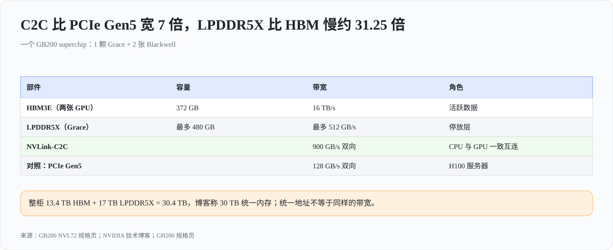
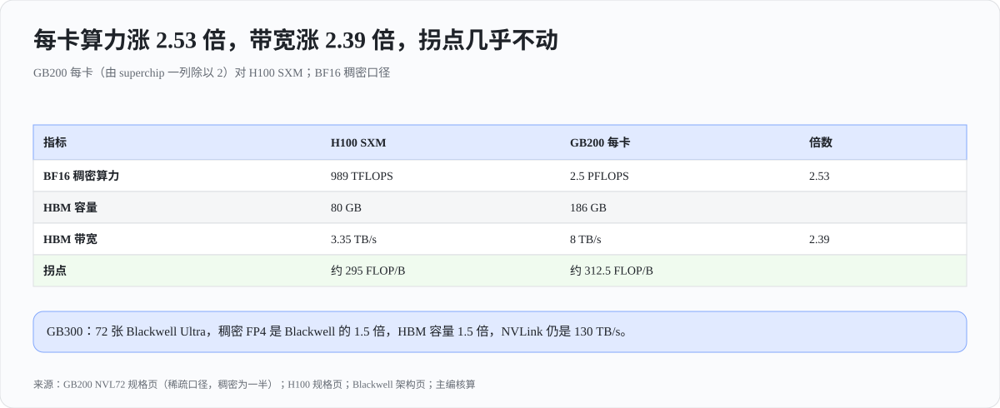
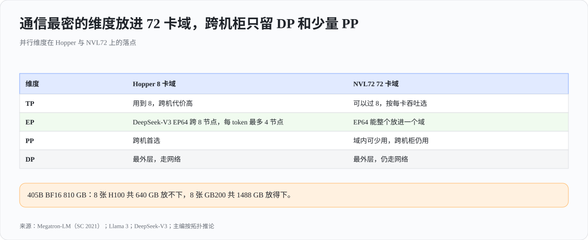
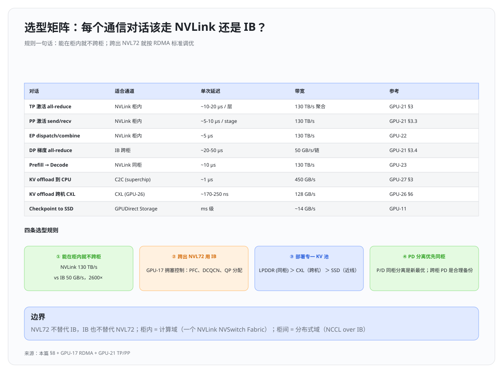
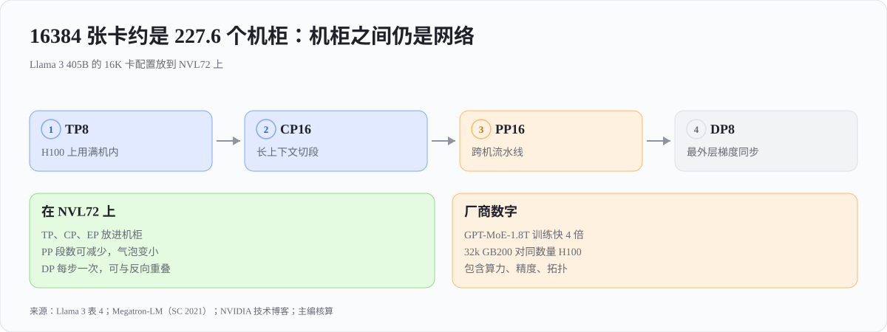
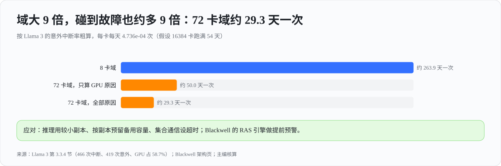

# GPU-27｜硬件｜NVL72 与 Grace-Blackwell Superchip：打穿 TP=8

> 🎯 **这篇文档解决什么问题**：Hopper 上 NVLink 域只有一台 8 卡服务器大，TP 因此被卡在 8，跨机只能用流水线。GB200 NVL72 把 72 张 GPU 连成一个 NVLink 域。本篇拆开机柜和 superchip 的结构，用 405B 的例子算 TP 通信在新域里的代价，说明并行策略、推理和训练要怎样重排，以及域变大以后故障影响怎样变化。

> 💡 **扩展 GPU-13、GPU-21**：GPU-13（[GPU-13｜单机｜NVLink 与 NVSwitch](./13-nvlink.md)）讲单机 8 卡的 NVLink 与 NVSwitch，GPU-21（[GPU-21｜LLM｜训练并行：TP、PP、DP、ZeRO 与 FP8](./21-train-parallel.md)）讲 TP=8 这条上限；本篇讲 NVL72 把 NVLink 域扩到 72 卡以后，并行方案和通信账怎么变。

**使用方式**：第 1 章讲 TP=8 的墙从哪来。第 2、3 章拆机柜和 superchip。第 4、5 章算通信、算力和带宽。第 6 到 8 章讲并行策略、推理和训练。第 9 章讲故障域，第 10 章给清单和自测。

**代码**：本篇没有配套代码，文中算例由主编按公开规格核算，第 10 章给出可以自己写的练习。

<b>🧭 主线位置</b>：GPU-00（[GPU-00｜索引｜从 0 开始 GPU 优化：路线、章节与练习](./README.md)）建立了时间账 T = T_compute + W_mem + W_host + W_comm + W_idle。GPU-21（[GPU-21｜LLM｜训练并行：TP、PP、DP、ZeRO 与 FP8](./21-train-parallel.md)）讲并行策略怎样在显存和通信之间取舍，GPU-26（[GPU-26｜系统｜CXL：一致性互连与 KV offload 工程化](./26-cxl.md)）讲 KV 放不下时怎样借主机内存。本篇说明 NVLink 域从 8 卡扩到 72 卡以后，哪些 W_comm 从网络挪到了 NVLink，C2C 怎样缩短 W_host，以及域变大带来的 W_idle。GPU-28（[GPU-28｜LLM｜推理成本经济学：$ per token 与集群单卡经济](./28-cost.md)）接着算成本。

## 导读 · 先给结论

- <b>TP=8 的墙来自 NVLink 域的大小。</b>Hopper 域是 8 卡，每卡每方向 450 GB/s，网卡只有 50 GB/s（第 1 章）。[[1]](https://www.nvidia.com/en-us/data-center/nvlink/)[[2]](https://arxiv.org/pdf/2104.04473)
- <b>NVL72 是 36 个 superchip、72 张 GPU。</b>9 个交换托盘各 144 端口，连上每卡 18 条链路，每卡 1.8 TB/s 双向（第 2 章）。[[3]](https://www.nvidia.com/en-us/data-center/gb200-nvl72/)[[4]](https://developer.nvidia.com/blog/nvidia-gb200-nvl72-delivers-trillion-parameter-llm-training-and-real-time-inference/)
- <b>C2C 把 CPU 内存接进来。</b>900 GB/s 双向、内存一致，约为 PCIe Gen5 的 7 倍；LPDDR5X 仍比 HBM 慢约 31.25 倍（第 3 章）。[[4]](https://developer.nvidia.com/blog/nvidia-gb200-nvl72-delivers-trillion-parameter-llm-training-and-real-time-inference/)[[3]](https://www.nvidia.com/en-us/data-center/gb200-nvl72/)
- <b>TP 不是越大越好。</b>405B 解码时 NVL72 里 TP16 通信约为读权重的六分之一，TP72 两者接近（第 4 章）。[[5]](https://arxiv.org/pdf/2407.21783)[[2]](https://arxiv.org/pdf/2104.04473)
- <b>每卡算力和带宽同步上涨。</b>BF16 稠密 2.53 倍、HBM 带宽 2.39 倍，解码仍受带宽限制（第 5 章）。[[3]](https://www.nvidia.com/en-us/data-center/gb200-nvl72/)[[6]](https://www.nvidia.com/en-us/data-center/h100/)
- <b>MoE 收益最大。</b>EP64 能整个放进一个域；厂商的 30 倍和 50 倍混合了精度和部署方式（第 6、7 章）。[[7]](https://arxiv.org/pdf/2412.19437)[[8]](https://www.nvidia.com/en-us/data-center/gb300-nvl72/)
- <b>故障影响按域放大。</b>按 Llama 3 的中断率，72 卡域约 29.3 天一次意外中断（第 9 章）。[[5]](https://arxiv.org/pdf/2407.21783)[[9]](https://www.nvidia.com/en-us/data-center/technologies/blackwell-architecture/)

<b>📎 与系列其他文档的分工</b>：GPU-13（[GPU-13｜单机｜NVLink 与 NVSwitch](./13-nvlink.md)）讲 NVLink 和 NVSwitch 的基础。GPU-17（[GPU-17｜集群｜RDMA 网络：InfiniBand、RoCE 与拥塞控制](./17-rdma.md)）讲机柜之间的 RDMA 网络。GPU-21（[GPU-21｜LLM｜训练并行：TP、PP、DP、ZeRO 与 FP8](./21-train-parallel.md)）讲并行策略的显存和通信账。GPU-22（[GPU-22｜LLM｜MoE 与专家并行：all-to-all 与负载均衡](./22-moe-ep.md)）讲 MoE 和专家并行。本篇只讲 NVLink 域从 8 卡变成 72 卡带来的变化。

## 第 1 章 · TP=8 的墙在哪里：NVLink 域只有一台机器大

张量并行（TP）把每一层的权重切到几张卡上，每算完一层就要做一次 all-reduce。Megatron-LM 提出这种层内模型并行时[[10]](https://arxiv.org/abs/1909.08053)，就默认它跑在高带宽的机内互连上。到了 Hopper 这一代，一台 HGX 服务器里 8 张 GPU 由 NVLink 连成一个域，出了这台机器就只剩网卡。TP 的度数因此被卡在 8，这就是本篇标题里要打穿的那堵墙。本章先说明这堵墙从哪来，再看大模型团队是怎样绕开它的。

### 墙的来源：机内和机外差一个数量级

NVIDIA 的 NVLink 规格表写得很清楚：第四代 NVLink 对应 Hopper，每张 GPU 900 GB/s，最多 18 条链路，NVLink 域是 8 张卡[[1]](https://www.nvidia.com/en-us/data-center/nvlink/)，8 卡合计 7.2 TB/s[[1]](https://www.nvidia.com/en-us/data-center/nvlink/)。H100 规格页给的数也是 NVLink 900GB/s，而 PCIe Gen5 只有 128GB/s[[6]](https://www.nvidia.com/en-us/data-center/h100/)。出了机器，每张 GPU 通常配一张 400Gb/s 的网卡[[11]](https://www.nvidia.com/content/dam/en-zz/Solutions/networking/ethernet-adapters/connectx-7-datasheet-Final.pdf)，折合 50 GB/s。按每个方向算，NVLink 是 450 GB/s，网卡是 50 GB/s，相差 9 倍。DeepSeek-V3 的 H800 集群差距小一些，NVLink 160 GB/s，约为 IB 50 GB/s 的 3.2 倍[[7]](https://arxiv.org/pdf/2412.19437)，但方向一样。

TP 的通信发生在每一层、每个微批里[[2]](https://arxiv.org/pdf/2104.04473)，频率最高，最受不了慢链路。Megatron-LM 的后续论文因此给出了经验规则：用 g 卡服务器时，TP 一般用到 g 为止，再大的模型用流水线并行跨服务器扩展[[2]](https://arxiv.org/pdf/2104.04473)。原因是 TP 的 all-reduce 要走服务器间的链路，比服务器内的 NVLink 慢[[2]](https://arxiv.org/pdf/2104.04473)。

### 大模型团队怎样绕开它

Llama 3 的训练服务器每台 8 张 GPU，由 NVLink 相连[[5]](https://arxiv.org/pdf/2407.21783)。论文的表 4 列出三种 405B 训练配置，TP 都是 8[[5]](https://arxiv.org/pdf/2407.21783)。推理时问题更明显：用 BF16 存参数，405B 装不进一台 8 卡 H100 的显存[[5]](https://arxiv.org/pdf/2407.21783)。405B 的 BF16 权重是 810 GB，8 张 H100 一共 640 GB。Meta 的做法是跨两台机器用 16 张卡推理[[5]](https://arxiv.org/pdf/2407.21783)，机内用 TP，机间因为带宽低、延迟高，改用流水线并行[[5]](https://arxiv.org/pdf/2407.21783)。

DeepSeek-V3 走得更远，干脆不用 TP 训练[[7]](https://arxiv.org/pdf/2412.19437)。它的每个节点 8 张卡，节点内是 NVLink 和 NVSwitch[[7]](https://arxiv.org/pdf/2412.19437)，节点之间是 IB。这些选择背后是同一个约束：高带宽的域只有一台机器大。

放进时间账：TP 跨机以后，每层的 all-reduce 从 NVLink 挪到网卡，W_comm 按带宽比放大。团队宁可用流水线并行，接受气泡带来的 W_idle，也不让 TP 走网卡。

按五步闭环看 TP 的上限：

- **定天花板**：查出 NVLink 域的大小和每卡带宽，和网卡带宽比较。
- **测实际**：在 TP=8 和跨机 TP=16 下分别量每层 all-reduce 的时间。
- **定位等待**：看 all-reduce 是不是落在关键路径上。
- **消除或隐藏**：TP 留在域内，跨机用流水线或专家并行。
- **复测**：跨机部分的通信不再出现在每层的关键路径上。

一个常见的误区是为了装下模型，把 TP 直接开到 16 跨两台机器。现象是显存够了，但每一步都慢得多，GPU 大部分时间在等网卡。原因是 TP 每层都要 all-reduce，跨机后走的是带宽只有 NVLink 九分之一的链路。改法是机内 TP 加机间流水线，或者先把权重量化到能装进一台机器。

> 🔑 **本章要点**：Hopper 的 NVLink 域是 8 卡，每卡 900 GB/s，机外每卡只有 50 GB/s 的网卡带宽，每方向差 9 倍。TP 每层都要 all-reduce，所以只用到机内的 8 卡。Llama 3 训练 TP 都是 8，405B 的 810 GB 权重装不进 640 GB，推理只好跨机用流水线。这一章是五步闭环的“定天花板”：TP 的上限由 NVLink 域的大小决定。

## 第 2 章 · NVL72 怎样拼成一个 72 卡的 NVLink 域

GB200 NVL72 把 36 颗 Grace CPU 和 72 张 Blackwell GPU 装进一个液冷机柜[[3]](https://www.nvidia.com/en-us/data-center/gb200-nvl72/)，72 张 GPU 组成一个 NVLink 域，NVIDIA 的说法是它像一块巨大的 GPU[[3]](https://www.nvidia.com/en-us/data-center/gb200-nvl72/)。第 1 章那堵墙的位置，从一台机器挪到了一整个机柜。本章按计算托盘、交换托盘、线缆三部分拆开，并用端口数核对这些规格是否自洽。

### 计算托盘和交换托盘

NVIDIA 的技术博客说明，一个 NVL72 机柜里有 18 个计算节点，每个节点是两套 GB200，合计 72 张 GPU[[4]](https://developer.nvidia.com/blog/nvidia-gb200-nvl72-delivers-trillion-parameter-llm-training-and-real-time-inference/)。每个计算托盘有两颗 Grace CPU 和四张 Blackwell GPU[[4]](https://developer.nvidia.com/blog/nvidia-gb200-nvl72-delivers-trillion-parameter-llm-training-and-real-time-inference/)，给出 80 petaflops 的 AI 算力和 1.7 TB 的快速内存[[4]](https://developer.nvidia.com/blog/nvidia-gb200-nvl72-delivers-trillion-parameter-llm-training-and-real-time-inference/)。18 个托盘乘 4 张 GPU 正好 72，乘 2 颗 Grace 正好 36。1.7 TB 也能对上：每张 GPU 186 GB HBM，每颗 Grace 最多 480 GB LPDDR5X[[3]](https://www.nvidia.com/en-us/data-center/gb200-nvl72/)，4 × 186 + 2 × 480 = 1704 GB。

把 72 张 GPU 连起来的是 NVLink Switch System：9 个 NVLink 交换托盘，加上连接 GPU 和交换机的线缆盒[[4]](https://developer.nvidia.com/blog/nvidia-gb200-nvl72-delivers-trillion-parameter-llm-training-and-real-time-inference/)。线缆盒用的是铜缆[[4]](https://developer.nvidia.com/blog/nvidia-gb200-nvl72-delivers-trillion-parameter-llm-training-and-real-time-inference/)。同一套设计还有 NVL36 的配置，一个机柜 36 张 GPU、9 个双 GB200 节点[[4]](https://developer.nvidia.com/blog/nvidia-gb200-nvl72-delivers-trillion-parameter-llm-training-and-real-time-inference/)。

### 端口数对得上

博客给了端口的细节：每个交换托盘提供 144 个 100 GB 的 NVLink 端口，9 个交换托盘把 72 张 GPU 每张的 18 个 NVLink 端口全部连上[[4]](https://developer.nvidia.com/blog/nvidia-gb200-nvl72-delivers-trillion-parameter-llm-training-and-real-time-inference/)。核对一下：9 × 144 = 1296，72 × 18 = 1296，正好相等。每张 GPU 18 个端口乘 100 GB/s 是 1800 GB/s，和规格表里第五代 NVLink 每卡 1,800 GB/s、最多 18 条链路一致[[1]](https://www.nvidia.com/en-us/data-center/nvlink/)。这是双向合计[[4]](https://developer.nvidia.com/blog/nvidia-gb200-nvl72-delivers-trillion-parameter-llm-training-and-real-time-inference/)，每个方向 900 GB/s。72 张卡合计 72 × 1.8 = 129.6 TB/s，规格表写作 130 TB/s[[3]](https://www.nvidia.com/en-us/data-center/gb200-nvl72/)[[1]](https://www.nvidia.com/en-us/data-center/nvlink/)。

NVLink 规格表还显示，第五代 NVLink 的域可以是 8 卡或 72 卡[[1]](https://www.nvidia.com/en-us/data-center/nvlink/)；博客提到第五代 NVLink 最多能在一个域里连 576 张 GPU[[4]](https://developer.nvidia.com/blog/nvidia-gb200-nvl72-delivers-trillion-parameter-llm-training-and-real-time-inference/)。本篇只讨论已经作为产品发布的 72 卡机柜。

按五步闭环看机柜拓扑：

- **定天花板**：用端口数核对每卡带宽和聚合带宽。
- **测实际**：在机柜内跑 all-reduce 和 all-to-all，量每卡实际带宽。
- **定位等待**：带宽不到预期时，查链路和交换托盘的状态。
- **消除或隐藏**：把通信最密的并行维度放进这个域。
- **复测**：机柜内任意两卡之间的带宽一致。

一个常见的误区是拿 130 TB/s 的聚合带宽和一张网卡的 50 GB/s 比，得出“快两千多倍”的结论。现象是按这个倍数估算通信时间，实测差得很远。原因是 130 TB/s 是 72 张卡加在一起的数，每张卡每个方向只有 900 GB/s。改法是总用每卡、每方向的带宽比较：900 比 50，是 18 倍。

> 🔑 **本章要点**：NVL72 有 18 个计算托盘，每个托盘 2 颗 Grace 和 4 张 Blackwell，合计 36 颗 CPU 和 72 张 GPU。9 个交换托盘各 144 个端口，正好连上每卡 18 条链路，每卡 1.8 TB/s 双向，合计约 130 TB/s。比较带宽要用每卡每方向的 900 GB/s。这一章是五步闭环的“定天花板”：先把机柜的带宽上限算对。

## 第 3 章 · Grace-Blackwell Superchip：NVLink-C2C 把 CPU 内存接进来

NVL72 的基本单元是 GB200 Grace Blackwell Superchip。规格表写的是一颗 Grace CPU 配两张 Blackwell GPU[[3]](https://www.nvidia.com/en-us/data-center/gb200-nvl72/)，整柜 36 个 superchip。它和普通服务器的区别在 CPU 和 GPU 之间的连接：用的是 NVLink-C2C，不是 PCIe。本章讲这条连接带来了什么，以及 CPU 内存在 NVL72 里该怎样用。

### C2C：一致的统一内存

NVIDIA 的博客说明，superchip 用 NVLink-C2C 接口连接两张 Blackwell GPU 和 Grace CPU，双向带宽 900 GB/s[[4]](https://developer.nvidia.com/blog/nvidia-gb200-nvl72-delivers-trillion-parameter-llm-training-and-real-time-inference/)，应用可以一致地访问一个统一的内存空间[[4]](https://developer.nvidia.com/blog/nvidia-gb200-nvl72-delivers-trillion-parameter-llm-training-and-real-time-inference/)。上一代 GH200 用的是同样的思路，规格页称 900GB/s 的一致接口比 PCIe Gen5 快 7 倍[[12]](https://www.nvidia.com/en-us/data-center/grace-hopper-superchip/)，900 ÷ 128 约为 7.03。GPU-26（[GPU-26｜系统｜CXL：一致性互连与 KV offload 工程化](./26-cxl.md)）里，H100 服务器上 GPU 访问主机内存只能走 PCIe Gen5；在 superchip 里，这条路宽了约 7 倍，而且是一致的。

### CPU 内存有多大、多快

规格表的 superchip 一列：HBM 372 GB、16 TB/s，NVLink 3.6 TB/s，CPU 是 72 个 Arm Neoverse V2 核，LPDDR5X 最多 480 GB、带宽最多 512 GB/s[[3]](https://www.nvidia.com/en-us/data-center/gb200-nvl72/)。整柜是 13.4 TB HBM、576 TB/s[[3]](https://www.nvidia.com/en-us/data-center/gb200-nvl72/)，17 TB LPDDR5X、14 TB/s[[3]](https://www.nvidia.com/en-us/data-center/gb200-nvl72/)。博客说整柜有 30 TB 的统一内存[[4]](https://developer.nvidia.com/blog/nvidia-gb200-nvl72-delivers-trillion-parameter-llm-training-and-real-time-inference/)，13.4 + 17 = 30.4，对得上。

这两种内存的带宽差很多：一个 superchip 的 HBM 是 16 TB/s，LPDDR5X 最多 512 GB/s，相差约 31.25 倍。所以 CPU 内存在 NVL72 里的角色和 GPU-26 讲的主机内存一样，是停放层，不是 HBM 的延伸。不同的是回载更快：C2C 比 PCIe Gen5 宽约 7 倍，GPU-26 第 8 章算的 KV 回载时间可以按这个比例缩短。这是主编按带宽比例做的推断，实际要看 C2C 在两张 GPU 之间怎样分配，以及拷贝能用到多少带宽。

放进时间账：C2C 缩短的是 W_host，也就是 GPU 和 CPU 之间搬数据的等待。它不改变解码每一步要读的 HBM 字节数，W_mem 不受影响。

按五步闭环看 superchip：

- **定天花板**：记下 HBM、LPDDR5X、C2C 三个带宽，算出 KV 回载的下限。
- **测实际**：量 GPU 从 LPDDR5X 回载一块 KV 的时间。
- **定位等待**：两张 GPU 同时回载时，看 C2C 是否成为瓶颈。
- **消除或隐藏**：停放层放在 LPDDR5X，按层预取。
- **复测**：回载时间比 PCIe 平台按比例下降。

一个常见的误区是看到“统一内存”，就让 GPU 直接在 LPDDR5X 上跑解码。现象是程序不用改就能跑，吞吐却掉到原来的零头。原因是 LPDDR5X 的带宽只有 HBM 的约三十分之一，统一地址空间不等于同样的带宽。改法是热数据和每步都要读的 KV 留在 HBM，LPDDR5X 只放停放的数据。

> 🔑 **本章要点**：GB200 superchip 是一颗 Grace 配两张 Blackwell，用 NVLink-C2C 以 900 GB/s 双向相连，内存一致、地址统一，约为 PCIe Gen5 的 7 倍。每颗 Grace 最多 480 GB LPDDR5X、512 GB/s，比 HBM 慢约 31.25 倍，适合做停放层。这一章是五步闭环的“消除或隐藏”：用 C2C 缩短 GPU 和 CPU 之间的 W_host。

## 第 4 章 · 带宽账：TP 的 all-reduce 在 72 卡域里花多少时间

第 2 章算出 NVL72 里每卡每方向 900 GB/s。这一章把这个数放进一个具体的计算：Llama 3 405B 解码时，TP 的 all-reduce 要花多少时间，和读权重的时间相比占多大比例。比较四种情况：H100 机内 TP8、H100 跨机 TP16、NVL72 里的 TP16 和 TP72。

### 算法和假设

Llama 3 论文的表 3 给出 405B 的结构：126 层，模型维度 16,384[[5]](https://arxiv.org/pdf/2407.21783)。TP 每一层做两次 all-reduce，每个微批都要做[[2]](https://arxiv.org/pdf/2104.04473)。解码批大小取 64，每次 all-reduce 的数据是 64 × 16384 × 2 = 2097152 字节。环形 all-reduce 每张卡要发 2(n − 1) ÷ n 倍的数据量，n 是 TP 度数。每步的通信时间等于 126 层乘 2 次，再乘每次的发送量除以每卡每方向带宽。这里只算带宽项，不算每次通信的启动延迟，实际时间会更长。

每卡每方向带宽按前几章的数取：H100 的 NVLink 450 GB/s，跨机按每卡 50 GB/s 的网卡[[11]](https://www.nvidia.com/content/dam/en-zz/Solutions/networking/ethernet-adapters/connectx-7-datasheet-Final.pdf)，NVL72 的 NVLink 900 GB/s[[4]](https://developer.nvidia.com/blog/nvidia-gb200-nvl72-delivers-trillion-parameter-llm-training-and-real-time-inference/)。读权重的时间按 BF16 的 810 GB 除以 TP 卡数，再除以每卡 HBM 带宽：H100 是 3.35TB/s，GB200 每卡按 superchip 一列的一半算，8 TB/s。

### 结果

| 配置 | 每步通信（带宽项） | 每步读权重 | 通信 ÷ 读权重 |
|---|---|---|---|
| H100 TP8，NVLink | 2.06 ms | BF16 装不下 | 不适用 |
| H100 TP16，跨机 50 GB/s | 19.82 ms | 15.11 ms | 通信更长 |
| NVL72 TP16 | 1.10 ms | 6.33 ms | 约六分之一 |
| NVL72 TP72 | 1.16 ms | 1.41 ms | 接近 |

H100 上跨机做 TP16，光带宽项就要 19.82 ms，比读权重的 15.11 ms 还长，这解释了 Llama 3 为什么机间改用流水线[[5]](https://arxiv.org/pdf/2407.21783)。在 NVL72 里做 TP16，通信只有 1.10 ms，是读权重时间的约六分之一。TP 开到 72，读权重降到 1.41 ms，通信却几乎不降，两者已经接近，再算上每次通信的启动延迟，通信会成为主要部分。Megatron-LM 的后续论文也指出，过高的模型并行度会产生很小的矩阵乘，降低 GPU 利用率[[2]](https://arxiv.org/pdf/2104.04473)。

放进时间账：NVL72 让 TP 跨过 8 时 W_comm 不再暴涨，但 TP 越大，每卡分到的 T_compute 和 W_mem 越少，W_comm 的占比反而上升。TP 的最佳度数要按模型大小和批大小重新找，不是越大越好。

按五步闭环看 TP 通信：

- **定天花板**：按层数、模型维度、批大小和带宽算出每步通信的带宽项。
- **测实际**：用 NCCL 测试量不同 TP 度数下 all-reduce 的实际时间。
- **定位等待**：比较通信和读权重的时间，找出通信开始占主导的 TP 度数。
- **消除或隐藏**：TP 停在通信占比还小的度数，其余用数据并行或专家并行扩展。
- **复测**：每步时间随 TP 增大而下降，直到拐点。

一个常见的误区是有了 72 卡域就把 TP 开满。现象是每步时间只比 TP16 少了一点，吞吐按卡数算反而下降。原因是读权重的时间按卡数缩短，通信的带宽项几乎不变，还多了启动延迟和更小的矩阵乘。改法是在 8 到 72 之间扫 TP 度数，选每卡吞吐最高的那个。

> 🔑 **本章要点**：405B 批大小 64 解码时，H100 跨机 TP16 的通信带宽项 19.82 ms，超过读权重的 15.11 ms；NVL72 里 TP16 只要 1.10 ms，是读权重的约六分之一；TP72 时通信 1.16 ms，和读权重 1.41 ms 接近。这一章是五步闭环的“定位等待”：找出通信开始占主导的 TP 度数。

## 第 5 章 · 每张 Blackwell 比 H100 多多少：算力、显存和稀疏口径

NVL72 的通信变宽了，每张 GPU 自己也变强了。估算任何工作负载在 NVL72 上的时间，都要先拿到每卡的算力和 HBM 带宽，而且要用同一种口径。本章从 GB200 的规格表推出每卡的数，再和 H100 比较，最后看 GB300 改了什么。

### 从规格表推出每卡的数

Blackwell 架构的 GPU 有 2080 亿个晶体管，用定制的 TSMC 4NP 工艺制造[[9]](https://www.nvidia.com/en-us/data-center/technologies/blackwell-architecture/)，由两颗达到光罩极限的裸片组成，片间互连 10 TB/s，对软件呈现为一张 GPU[[9]](https://www.nvidia.com/en-us/data-center/technologies/blackwell-architecture/)。GB200 规格表只列整柜和 superchip 两列，每卡的数要自己推。superchip 一列的 HBM 是 372 GB、16 TB/s[[3]](https://www.nvidia.com/en-us/data-center/gb200-nvl72/)，除以两张 GPU，每卡 186 GB、8 TB/s。BF16 一行是整柜 360 PFLOPS、superchip 10 PFLOPS[[3]](https://www.nvidia.com/en-us/data-center/gb200-nvl72/)，脚注说明这是稀疏口径，稠密是一半[[3]](https://www.nvidia.com/en-us/data-center/gb200-nvl72/)，所以整柜稠密 180 PFLOPS，每卡 2.5 PFLOPS。

和 H100 SXM 比：H100 的 BF16 稀疏是 1,979 teraFLOPS[[6]](https://www.nvidia.com/en-us/data-center/h100/)，稠密约 989；HBM 80GB、3.35TB/s[[6]](https://www.nvidia.com/en-us/data-center/h100/)。每卡 BF16 稠密算力是 H100 的 2.53 倍，HBM 带宽是 2.39 倍。两者涨得差不多，拐点只从约 295 FLOP/B 移到约 312.5 FLOP/B。所以 GPU-23（[GPU-23｜LLM｜推理系统：KV cache、PagedAttention 与 PD 分离](./23-inference.md)）的结论在 Blackwell 上仍然成立：解码还是受 HBM 带宽限制。

### 低精度和 GB300

Blackwell 的第二代 Transformer Engine 用细粒度的微张量缩放，支持 4 位浮点（FP4）[[9]](https://www.nvidia.com/en-us/data-center/technologies/blackwell-architecture/)。规格表里 FP8 是整柜 720 PFLOPS、superchip 20 PFLOPS[[3]](https://www.nvidia.com/en-us/data-center/gb200-nvl72/)，同样是稀疏口径。用低精度时，读同样多的参数字节更少，算力翻倍，第 7 章的厂商推理数字大多是在 FP4 下测的。

GB300 NVL72 换成了 72 张 Blackwell Ultra 和 36 颗 Grace，NVLink 仍是 130 TB/s[[8]](https://www.nvidia.com/en-us/data-center/gb300-nvl72/)，GPU 内存合计 20 TB[[8]](https://www.nvidia.com/en-us/data-center/gb300-nvl72/)。产品页称它的稠密 FP4 算力是 Blackwell 的 1.5 倍，注意力性能是 2 倍[[8]](https://www.nvidia.com/en-us/data-center/gb300-nvl72/)，HBM3E 容量是前代的 1.5 倍[[8]](https://www.nvidia.com/en-us/data-center/gb300-nvl72/)。拓扑和带宽没变，变的是每卡的算力和容量。

按五步闭环看每卡的数：

- **定天花板**：从规格表推出每卡的稠密算力和 HBM 带宽，算拐点。
- **测实际**：在单卡上跑矩阵乘和带宽测试，看能达到规格的多少。
- **定位等待**：按算术强度判断工作负载受算力还是带宽限制。
- **消除或隐藏**：受带宽限制时用低精度减少字节数。
- **复测**：迁移前后按同一口径比较每卡吞吐。

一个常见的误区是用稀疏口径的算力和别的平台的稠密口径比。现象是估出来的加速比是实测的两倍。原因是 GB200 规格表的算力默认是稀疏口径，脚注才写明稠密是一半。改法是所有比较都先换成稠密口径，并注明精度。

> 🔑 **本章要点**：GB200 每卡 186 GB HBM、8 TB/s，BF16 稠密 2.5 PFLOPS，分别是 H100 的 2.39 倍和 2.53 倍，拐点约 312.5 FLOP/B，解码仍受带宽限制。规格表算力是稀疏口径，稠密减半。GB300 拓扑不变，FP4 和 HBM 容量各增 1.5 倍。这一章是五步闭环的“定天花板”：用同一口径算出每卡上限。

## 第 6 章 · 并行策略重排：TP、EP、PP 在 72 卡域里怎么摆

第 1 章说过，TP 只用到机内是因为 NVLink 域只有一台机器大。Megatron-LM 后续论文的规则是“g 卡服务器时 TP 用到 g”[[2]](https://arxiv.org/pdf/2104.04473)，在 NVL72 上 g 变成了 72。但规则变了，不等于每种并行都该往大里开。本章分别看显存、专家并行和流水线三个方面，NVL72 改变了什么、没改变什么。

### 显存：405B 已经不是理由

H100 上 TP 想跨过 8，最常见的理由是模型装不下：405B 的 BF16 权重 810 GB，8 张 H100 只有 640 GB[[5]](https://arxiv.org/pdf/2407.21783)。到了 GB200，每卡 186 GB，8 张卡就有 1488 GB，405B 的 BF16 权重在 8 卡里就放得下。所以在 Blackwell 上，把 TP 开过 8 的理由不再是显存，而是第 4 章算的时间：更大的 TP 让每卡读的权重更少，只要通信还藏得住，每步就更快。

### 专家并行：跨节点的限制被放宽

MoE 模型的专家并行（EP）用 all-to-all 把 token 发给持有对应专家的卡，通信量比 TP 更大、更不规则。DeepSeek-V3 有 256 个路由专家[[7]](https://arxiv.org/pdf/2412.19437)，训练时用 16 路流水线并行和跨 8 个节点的 64 路专家并行[[7]](https://arxiv.org/pdf/2412.19437)。因为 NVLink 是 IB 的约 3.2 倍，它限制每个 token 最多发到 4 个节点，以减少 IB 流量[[7]](https://arxiv.org/pdf/2412.19437)。这条路由约束是为节点之间的带宽差设计的。

在 NVL72 上，64 路的专家并行可以整个放进一个 72 卡的 NVLink 域，all-to-all 不再经过网卡，按节点限制路由的必要性也随之下降。这是按拓扑做的推论，DeepSeek-V3 的报告是在 H800 集群上写的，没有讨论 NVL72。

### 流水线并行：还要不要

Llama 3 用流水线并行跨节点，是因为节点间带宽低、延迟高[[5]](https://arxiv.org/pdf/2407.21783)。在一个 72 卡域内，流水线并行带来的气泡可以省掉一部分，改用更大的 TP 或 EP。但模型和集群规模再往上，域之间仍然是网络，流水线并行在跨机柜时还是合适的工具。Megatron-LM 后续论文测到，张量并行和流水线并行组合得不好，吞吐可以低到一半[[2]](https://arxiv.org/pdf/2104.04473)，换了拓扑以后要重新搜索组合。

按五步闭环看并行策略：

- **定天花板**：按每卡显存算出最小的模型并行度，按第 4 章的方法算出通信上限。
- **测实际**：在几种 TP、EP、PP 组合下量每步时间。
- **定位等待**：看时间花在 TP 的 all-reduce、EP 的 all-to-all 还是流水线气泡上。
- **消除或隐藏**：通信最密的维度放进 72 卡域，跨机柜的只留数据并行和流水线。
- **复测**：新组合的每卡吞吐高于直接照搬 H100 的配置。

一个常见的误区是把 H100 上调好的并行配置原样搬到 NVL72。现象是作业能跑，吞吐也比 H100 高，但离规格的提升差得远。原因是原配置是按 8 卡 NVLink 域设计的，TP 停在 8，EP 和路由约束也按跨节点设计，没有用上 72 卡域。改法是按新拓扑重新搜索 TP、EP、PP 的组合。

> 🔑 **本章要点**：GB200 上 8 卡就有 1488 GB，405B 的 BF16 权重已能放下，TP 开过 8 的理由变成了时间。DeepSeek-V3 在 H800 上用跨 8 节点的 EP64，并限制每个 token 最多发到 4 个节点；在 NVL72 上 EP64 可以整个放进一个域。跨机柜仍用数据并行和流水线。这一章是五步闭环的“消除或隐藏”：把通信最密的并行维度放进 NVLink 域。

## 第 7 章 · 推理：把大 EP 和 PD 分离装进一个域

推理对 NVLink 域大小的需求，最集中地体现在大型 MoE 模型上。解码时每一步都有专家并行的 all-to-all，批大、专家多，通信又碎又频繁。本章以 DeepSeek-V3 公开的部署方案为例，看它在 H800 集群上怎样摆，再看 NVIDIA 给 NVL72 报的推理加速数字该怎样读。

### DeepSeek-V3 的部署单元

DeepSeek-V3 把预填充和解码分开部署。预填充的最小部署单元是 4 个节点、32 张 GPU[[7]](https://arxiv.org/pdf/2412.19437)，注意力用 TP4，较小的 TP 限制了 TP 通信的开销[[7]](https://arxiv.org/pdf/2412.19437)，MoE 部分用 EP32。解码的最小部署单元是 40 个节点、320 张 GPU[[7]](https://arxiv.org/pdf/2412.19437)，注意力用 TP4 加 DP80，MoE 部分用 EP320[[7]](https://arxiv.org/pdf/2412.19437)，dispatch 和 combine 的 all-to-all 通过 IB 点对点传输[[7]](https://arxiv.org/pdf/2412.19437)。

把这两个单元放到 NVL72 上：32 张卡的预填充单元能整个放进一个 72 卡域；320 张卡的解码单元需要约 4.44 个机柜，EP320 的 all-to-all 仍然有一部分要跨机柜。也就是说，NVL72 能把预填充和较小规模的解码完全装进 NVLink，最大规模的 EP 仍然要靠网络。这是按卡数做的推算，实际部署要看专家的放置和负载均衡。

### 厂商推理数字怎样读

GB200 NVL72 产品页称，它的实时万亿参数大模型推理快 30 倍[[3]](https://www.nvidia.com/en-us/data-center/gb200-nvl72/)。NVIDIA 博客说明了条件：1.8T 参数的 GPT-MoE，对比上一代 H100，使用 FP4 精度和第五代 NVLink[[4]](https://developer.nvidia.com/blog/nvidia-gb200-nvl72-delivers-trillion-parameter-llm-training-and-real-time-inference/)。GB300 NVL72 产品页报了 50 倍的 AI 工厂产出提升[[8]](https://www.nvidia.com/en-us/data-center/gb300-nvl72/)，条件是 DeepSeek-R1、输入 32K、输出 8K，GB300 用 FP4 加 Dynamo 的分离式部署，H100 用 FP8 加 in-flight batching，并注明是预测性能[[8]](https://www.nvidia.com/en-us/data-center/gb300-nvl72/)。

这两个数字把精度（FP4 对 FP8）、每卡算力和显存、NVLink 域大小、部署方式（分离式对普通批处理）叠在了一起，没法单独归给 NVLink。拿它们估算自己的集群规模，会把别的因素的收益也算进来。

放进时间账：大 EP 的 all-to-all 是解码 W_comm 的主要来源。把 EP 组放进 NVLink 域，W_comm 按带宽比缩小；预填充和解码分离以后，各自的批和并行度可以分开调，这部分属于 GPU-23 讲过的调度。

按五步闭环看 MoE 推理：

- **定天花板**：按专家数、每卡显存和 EP 度数，算出部署单元的卡数。
- **测实际**：量解码一步里 all-to-all 占的时间。
- **定位等待**：区分 all-to-all 是在域内还是跨机柜。
- **消除或隐藏**：让 EP 组尽量落在一个 72 卡域里，跨域的部分做通信和计算重叠。
- **复测**：每卡的输出 token 速率和 TPOT 都改善。

一个常见的误区是按厂商的 30 倍或 50 倍直接折算要买多少机柜。现象是采购按这个倍数缩减，上线后同样的 SLO 下吞吐只到预期的一部分。原因是这些数字是特定模型、特定精度、特定部署方式下的对比，H100 一侧的配置也不是最优。改法是用自己的模型和精度，在两种平台上按同样的 SLO 实测。

> 🔑 **本章要点**：DeepSeek-V3 预填充单元 32 卡、解码单元 320 卡，all-to-all 走 IB。在 NVL72 上预填充单元能放进一个域，解码单元约需 4.44 个机柜。厂商的 30 倍和 50 倍混合了精度、算力、拓扑和部署方式，不能单独归给 NVLink。这一章是五步闭环的“消除或隐藏”：把 EP 的 all-to-all 收进 NVLink 域。

## 第 8 章 · 训练：域内重排，域间还是网络

训练的并行维度比推理多：TP、CP、PP、DP 和 MoE 的 EP。NVL72 能把其中通信最密的几个放进 NVLink 域，但一个大训练作业有成千上万张卡，绝大部分卡之间仍然隔着网络。本章看 NVL72 在训练里改变的范围有多大。

### 一个 16K 卡作业要多少机柜

Llama 3 405B 在最多 16K 张 H100 上训练[[5]](https://arxiv.org/pdf/2407.21783)。论文的表 4 里，16,384 卡的配置是 TP8、CP16、PP16、DP8[[5]](https://arxiv.org/pdf/2407.21783)，TP 用满了机内的 8 卡。同样 16384 张卡如果换成 NVL72，约是 227.6 个机柜。在每个机柜内部，TP、CP 甚至一部分 PP 都可以走 NVLink；但 DP 以及跨机柜的 PP 仍然要走网络。GPU-17（[GPU-17｜集群｜RDMA 网络：InfiniBand、RoCE 与拥塞控制](./17-rdma.md)）讲的网络拥塞控制，GPU-20（[GPU-20｜集群｜可靠性与可观测：故障、静默错误与 checkpoint](./20-reliability.md)）讲的故障处理，在 NVL72 集群上一样要做。

NVIDIA 博客报告，GPT-MoE-1.8T 在 32k 个 GB200 上训练，比同样数量的 H100 快 4 倍[[4]](https://developer.nvidia.com/blog/nvidia-gb200-nvl72-delivers-trillion-parameter-llm-training-and-real-time-inference/)。和推理的数字一样，这个比较包含了每卡算力、精度和拓扑的变化。第 5 章算过，每卡的 BF16 稠密算力是 H100 的 2.53 倍，剩下的提升来自低精度和通信，具体比例博客没有拆开。

### 怎样重排

Megatron-LM 后续论文的经验是：TP 放在高带宽域内，流水线跨服务器，数据并行在最外层[[2]](https://arxiv.org/pdf/2104.04473)。用这套方法，他们在 3072 张 A100 上训练万亿参数模型，达到 502 petaFLOP/s，每卡 52% 的峰值[[2]](https://arxiv.org/pdf/2104.04473)。在 NVL72 上，这条规则的“服务器”换成了机柜：TP、CP、EP 放进机柜内，PP 和 DP 跨机柜。和第 4 章一样，TP 不是越大越好，要按每卡吞吐重新选。

放进时间账：NVL72 把一部分 W_comm 从网络挪到 NVLink，同时也让流水线并行的段数可以减少，W_idle 里的气泡跟着变小。DP 的梯度同步每一步只做一次[[2]](https://arxiv.org/pdf/2104.04473)，可以和反向计算重叠，留在网络上影响较小。

按五步闭环看训练：

- **定天花板**：按模型和卡数算出每个并行维度的通信量，标出哪些能放进机柜。
- **测实际**：用 profiler 拆出每一步里各类通信和气泡的时间。
- **定位等待**：找出仍然跨机柜、又在关键路径上的通信。
- **消除或隐藏**：调整并行维度的嵌套顺序，让跨机柜的只剩 DP 和少量 PP。
- **复测**：MFU 高于照搬 H100 配置时的值。

一个常见的误区是以为换了 NVL72，网络就不重要了。现象是机柜内通信很快，但作业规模一上去，步时间被 DP 的 all-reduce 和跨机柜流水线拖住。原因是 16384 张卡分在两百多个机柜里，机柜之间仍然是网络。改法是照常设计和调优机柜之间的网络，并把跨机柜通信限制在每步一次的梯度同步和流水线的段间传输上。

> 🔑 **本章要点**：Llama 3 的 16384 卡配置 TP8、CP16、PP16、DP8；换成 NVL72 约 227.6 个机柜，TP、CP、EP 能放进机柜，PP 和 DP 仍走网络。厂商的 4 倍训练加速包含算力、精度和拓扑的变化。这一章是五步闭环的“定位等待”：分清哪些通信还在网络上。

## 第 9 章 · 故障域：72 张卡绑在一起以后

NVLink 域变大，带宽收益是一面，故障影响范围是另一面。一个 TP72 的模型副本，任何一张卡、一条链路出问题，整个副本都要停下来。本章用 Llama 3 公开的中断数据估算域大小对故障频率的影响，再看 Blackwell 在可靠性上做了什么。

### 用 Llama 3 的数据估算

Llama 3 论文报告，预训练的 54 天里共有 466 次作业中断[[5]](https://arxiv.org/pdf/2407.21783)，其中 419 次是意外中断[[5]](https://arxiv.org/pdf/2407.21783)，GPU 问题是最大的一类，占意外中断的 58.7%[[5]](https://arxiv.org/pdf/2407.21783)。训练最多用了 16K 张 H100[[5]](https://arxiv.org/pdf/2407.21783)。在同步训练里，一张 GPU 出故障可能要重启整个作业[[5]](https://arxiv.org/pdf/2407.21783)。论文还提到，NVLink 或远端 GPU 出故障时，常表现为 CUDA kernel 里的 load 和 store 停住不动[[5]](https://arxiv.org/pdf/2407.21783)，这让定位变得困难。

假设这 54 天里一直是 16384 张卡在跑，平均每卡每天发生约 4.736e-04 次意外中断（实际卡数可能少一些，这个估计偏低）。按这个比率，一个 8 卡的域平均约 263.9 天遇到一次，一个 72 卡的域平均约 29.3 天遇到一次；只算 GPU 引起的中断，72 卡域约 50.0 天一次。这些是用 H100 集群的全部原因中断率做的粗算，NVL72 的硬件和故障模式不同，只能说明量级：域大了 9 倍，同一个域碰到故障的频率也大约多 9 倍。

### 硬件和运维上的应对

Blackwell 增加了一个专门的可靠性、可用性和可服务性（RAS）引擎[[9]](https://www.nvidia.com/en-us/data-center/technologies/blackwell-architecture/)，目的是提前识别可能发生的故障，减少停机[[9]](https://www.nvidia.com/en-us/data-center/technologies/blackwell-architecture/)。这类能力把“坏了再修”往“快坏时换下”挪了一步，但没有改变一个基本事实：一个模型副本占满 72 卡时，它的可用性取决于这 72 张卡和它们之间的链路同时正常。

运维上可以从三处着手，这几条是主编按上面的数据给的建议。第一处是副本大小：推理时模型副本不必占满整个域，用较小的 TP 在一个域里放几个副本，坏一张卡只影响一个副本。第二处是冗余容量：按每个域的故障频率预留整副本级的备用容量，而不是按单卡预留。第三处是检测：NVLink 故障常表现为通信卡住而不是报错，要给集合通信设置超时，并采集链路的错误计数。

放进时间账：故障带来的停机和重启都记进 W_idle。域越大，一次故障停掉的卡越多，W_idle 在总时间里的占比越高。

按五步闭环看故障域：

- **定天花板**：用历史中断率乘域内卡数，估出每个域的故障间隔。
- **测实际**：线上记录每个机柜的中断次数和恢复时间。
- **定位等待**：区分是 GPU、链路还是交换托盘引起的中断。
- **消除或隐藏**：缩小副本、预留整副本的备用容量、设置通信超时。
- **复测**：因故障损失的卡时占比下降。

一个常见的误区是把一个 NVL72 机柜当成一台大服务器，按单机的故障率规划可用性。现象是上线后机柜级的中断比预期频繁得多，备用容量不够。原因是一个机柜有 72 张 GPU 和成千条链路，任何一处出问题都会影响整个域。改法是按卡数和链路数估算机柜的故障频率，备用容量按副本而不是按机器预留。

> 🔑 **本章要点**：按 Llama 3 的中断率粗算，8 卡域约 263.9 天一次意外中断，72 卡域约 29.3 天一次，域大 9 倍、故障也约多 9 倍。Blackwell 加了 RAS 引擎做提前预警。推理可以用较小的副本、按副本预留备用容量。这一章是五步闭环的“复测”：用故障间隔检验域的大小是否合适。

## 第 10 章 · 上线前核对清单与自测

前九章沿着 NVLink 域变大这件事展开：第 1 章说明 TP=8 的墙来自 NVLink 域只有一台机器大，第 2、3 章拆开 NVL72 的机柜和 superchip，第 4、5 章算通信和每卡的算力、带宽，第 6 到 8 章讲并行策略、推理和训练怎样重排，第 9 章讲故障域。本章把这些压成一张核对清单，再给出练习和自测题。

### 📌 核对清单

| 检查项 | 怎样查 | 通过的标志 |
|---|---|---|
| 每卡每方向带宽 | NVLink、C2C、PCIe、网卡都换成每卡每方向（第 1、2 章） | 不拿聚合带宽和单卡比 |
| 拓扑自洽 | 用端口数核对每卡带宽和聚合带宽（第 2 章） | 9 × 144 = 72 × 18 |
| CPU 内存的角色 | 比较 HBM、LPDDR5X、C2C 带宽（第 3 章） | LPDDR5X 只做停放层 |
| TP 通信占比 | 按层数、模型维度、批大小算 all-reduce 带宽项（第 4 章） | 通信明显小于读权重 |
| TP 度数 | 在 8 到 72 之间扫描每卡吞吐（第 4、6 章） | 选每卡吞吐最高的度数 |
| 口径统一 | 算力换成稠密口径并注明精度（第 5 章） | 和 H100 的比较同口径 |
| 拐点 | 每卡稠密算力除以 HBM 带宽（第 5 章） | 知道解码仍受带宽限制 |
| EP 放置 | EP 组尽量落在一个 72 卡域（第 6、7 章） | all-to-all 不经过网卡 |
| 厂商数字 | 拆开精度、算力、拓扑、部署方式（第 7、8 章） | 用自己的模型和 SLO 实测 |
| 跨机柜通信 | 列出仍走网络的并行维度（第 8 章） | 只剩 DP 和少量 PP |
| 故障间隔 | 历史中断率乘域内卡数（第 9 章） | 备用容量按副本预留 |
| 通信超时 | 集合通信设超时，采集链路错误计数（第 9 章） | 卡住能被及时发现 |

### 练习

本篇没有配套代码。下面几个练习可以用几十行 Python 完成：

- **TP 扫描**：按第 4 章的公式，对 405B 在批大小 8、64、256 下，画出 TP 从 8 到 72 的通信时间和读权重时间。
- **加上启动延迟**：给每次 all-reduce 加一个固定的启动延迟，看 TP72 的通信时间变成多少，找出新的最佳 TP。
- **EP 的通信量**：按 DeepSeek-V3 每个 token 激活 8 个路由专家，估算解码一步里 all-to-all 的字节数，比较放在域内和跨机柜的时间。
- **机柜数量**：给定一个训练作业的 TP、CP、PP、DP，算出需要多少个 NVL72，以及每一维通信走 NVLink 还是网络。
- **故障间隔**：用第 9 章的中断率，算 TP8、TP16、TP72 三种副本大小下每个副本的平均故障间隔。

### 自测题

1. 为什么 Hopper 上 TP 一般只用到 8？跨机做 TP 的代价是什么？
2. NVL72 的 9 个交换托盘怎样把 72 张 GPU 的 18 条链路全部连上？
3. NVLink-C2C 和 PCIe Gen5 相比宽多少？LPDDR5X 为什么不能当 HBM 用？
4. 405B 批大小 64 解码时，NVL72 里 TP16 和 TP72 的通信与读权重各是多少？
5. GB200 每卡的 BF16 稠密算力和 HBM 带宽各是 H100 的几倍？拐点变了多少？
6. 按 Llama 3 的中断率，72 卡的域大约多少天遇到一次意外中断？

**下一步**：NVL72 让每张卡更强、域更大，但机柜本身更贵、功耗更高。GPU-28（[GPU-28｜LLM｜推理成本经济学：$ per token 与集群单卡经济](./28-cost.md)）把这些放进成本账：每百万 token 的成本怎样从卡时价格、吞吐和利用率算出来。

## 参考文献

按正文首次引用顺序编号，资料截至 2026 年 11 月中。

[1] NVIDIA NVLink 与 NVLink Switch 产品页（各代规格表） [www.nvidia.com/en-us/data-center/nvlink/](https://www.nvidia.com/en-us/data-center/nvlink/)

[2] Narayanan et al. Efficient Large-Scale Language Model Training on GPU Clusters Using Megatron-LM. SC 2021, arXiv 2104.04473 [arxiv.org/pdf/2104.04473](https://arxiv.org/pdf/2104.04473)

[3] NVIDIA GB200 NVL72 产品页（含规格表） [www.nvidia.com/en-us/data-center/gb200-nvl72/](https://www.nvidia.com/en-us/data-center/gb200-nvl72/)

[4] NVIDIA 技术博客. NVIDIA GB200 NVL72 Delivers Trillion-Parameter LLM Training and Real-Time Inference (2024) [developer.nvidia.com/blog/nvidia-gb200-nvl72-delivers-trillion-parameter-llm-training-and-real-time-inference/](https://developer.nvidia.com/blog/nvidia-gb200-nvl72-delivers-trillion-parameter-llm-training-and-real-time-inference/)

[5] Llama Team, AI @ Meta. The Llama 3 Herd of Models. arXiv 2407.21783 [arxiv.org/pdf/2407.21783](https://arxiv.org/pdf/2407.21783)

[6] NVIDIA H100 Tensor Core GPU 产品页 [www.nvidia.com/en-us/data-center/h100/](https://www.nvidia.com/en-us/data-center/h100/)

[7] DeepSeek-AI. DeepSeek-V3 Technical Report. arXiv 2412.19437 [arxiv.org/pdf/2412.19437](https://arxiv.org/pdf/2412.19437)

[8] NVIDIA GB300 NVL72 产品页（含规格表） [www.nvidia.com/en-us/data-center/gb300-nvl72/](https://www.nvidia.com/en-us/data-center/gb300-nvl72/)

[9] NVIDIA Blackwell 架构页 [www.nvidia.com/en-us/data-center/technologies/blackwell-architecture/](https://www.nvidia.com/en-us/data-center/technologies/blackwell-architecture/)

[10] Shoeybi et al. Megatron-LM: Training Multi-Billion Parameter Language Models Using Model Parallelism. arXiv 1909.08053 [arxiv.org/abs/1909.08053](https://arxiv.org/abs/1909.08053)

[11] NVIDIA. ConnectX-7 Datasheet [www.nvidia.com/content/dam/en-zz/Solutions/networking/ethernet-adapters/connectx-7-datasheet-Final.pdf](https://www.nvidia.com/content/dam/en-zz/Solutions/networking/ethernet-adapters/connectx-7-datasheet-Final.pdf)

[12] NVIDIA GH200 Grace Hopper Superchip 产品页 [www.nvidia.com/en-us/data-center/grace-hopper-superchip/](https://www.nvidia.com/en-us/data-center/grace-hopper-superchip/)

---

上一章：[GPU-26｜系统｜CXL：一致性互连与 KV offload 工程化](./26-cxl.md) · [目录](./README.md) · 下一章：[GPU-28｜LLM｜推理成本经济学：$ per token 与集群单卡经济](./28-cost.md)
