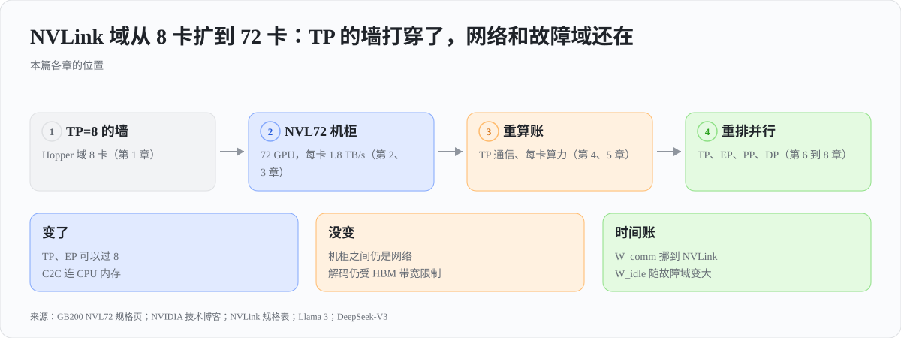
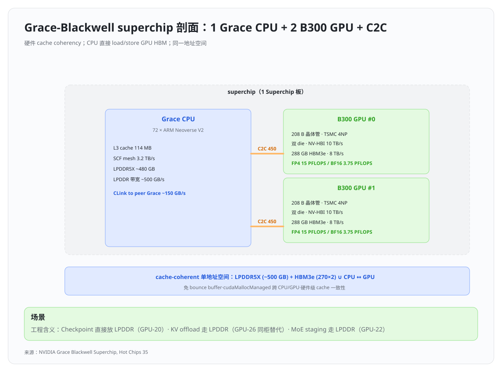
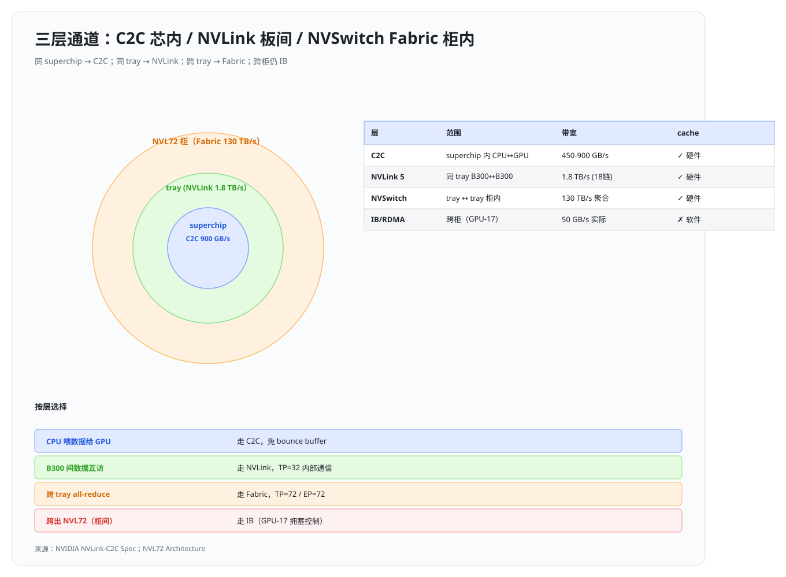
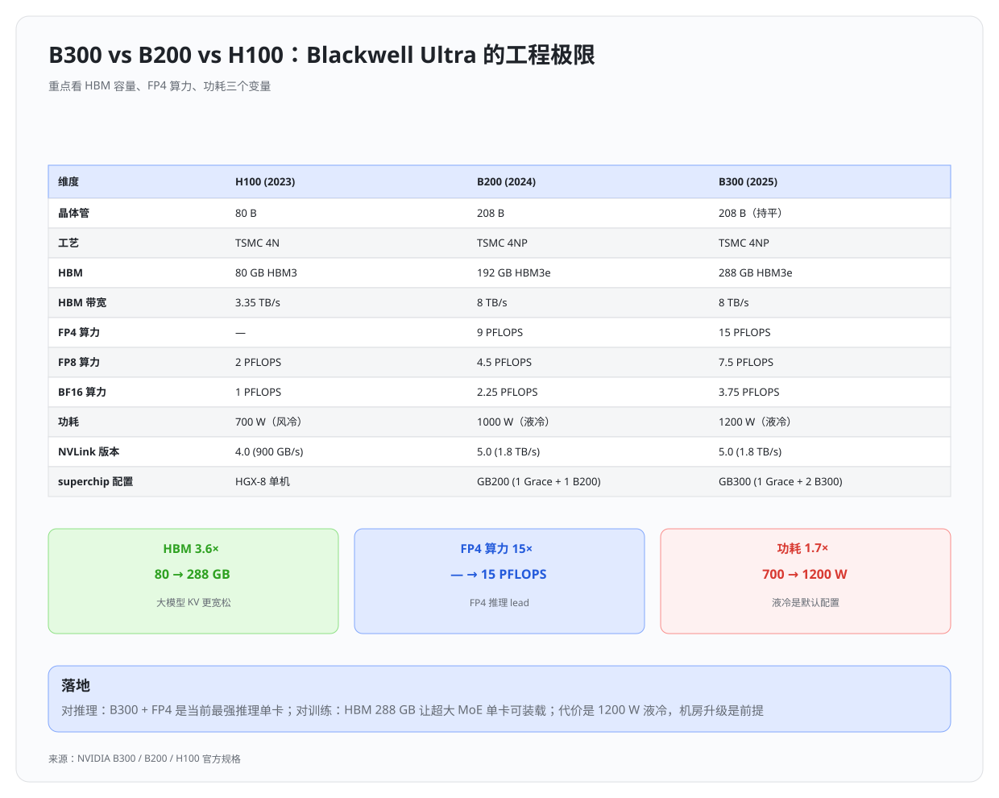

# GPU-27｜硬件｜NVL72 与 Grace-Blackwell Superchip：打穿 TP=8

> 🎯 **这篇文档解决什么问题**：GPU-21 说过 8 卡 H100 是 NVLink 单域的物理上限（TP=8），405B 模型 ZeRO-3 把模型状态 1.5 GB/卡 摊到 64 卡全靠 RDMA 兜底。NVIDIA 2024-25 用 NVL72 把这个"单域"从 8 张扩到 72 张 GPU，把 Grace CPU + 2×B300 GPU 焊成一个 superchip，在柜级机房用一根 130 TB/s NVSwitch Fabric 把柜子拼起来。本篇说清楚 superchip 内部构造、C2C 900 GB/s 与 NVLink 130 TB/s 的分工、TP 从 8 → 72 的并行重塑、以及柜级 RAS 与边界。

# 导读 · 先给结论

- **NVLink 单域从 HGX-8 跨到 NVL72**，9 倍。整个柜子（18 tray × 4 superchip）是一个 NVSwitch Fabric 全互联的 NVLink 域[[1]](https://www.nvidia.com/en-us/data-center/nvl72/)。
- **单柜聚合带宽 130 TB/s**；铜背板用 5000+ 根铜缆；比 InfiniBand 方案省约 20 kW（第三方估算）[[2]](https://semianalysis.com/2024/03/nvidia-gb200-nvl72-architecture/)。
- **Grace-Blackwell superchip = 1 Grace CPU + 2 B300 GPU** 通过 NVLink-C2C 连接；C2C 单链 450 GB/s 双向，一个 superchip 聚合 900 GB/s[[3]](https://www.nvidia.com/en-us/data-center/grace-blackwell/)。
- **B300 GPU：208 B 晶体管，TSMC 4NP，双 die，NV-HBI 10 TB/s 互连；288 GB HBM3P**（实际可用 279 GB / HGX 270 GB）；FP4 算力 15 PFLOPS。
- **Grace CPU 72 × ARM Neoverse V2**；L3 114 MB；SCF mesh 3.2 TB/s；CPU↔CPU CLink \~150 GB/s。
- **TP=8 → TP=72 成为现实路径**：GPU-21 讲过的 TP 物理上限被硬件重新定义；405B ZeRO-3 不用拆到 64 卡，单柜内部就能跑[[1]](https://www.nvidia.com/en-us/data-center/nvl72/)。
- **硬件级 cache coherency**：Grace LPDDR5X 和 GPU HBM3e 通过 NVLink-C2C 处于同一地址空间，CPU 直接 load/store GPU 显存，不用 bounce buffer。
- **本篇边界**：GPU-13 讲过 NVLink 单卡 GPU 间的带宽；本篇是它的"柜级延伸"——柜间仍走 RDMA(GPU-17)，跨出 NVL72 才是 IB。

# 第 1 章 · 从 HGX-8 到 NVL72：NVLink 单域的 9× 跨越

## 1.1 物理上限

本篇的主角是一个跑 LLaMA 3 405B 训练的团队。他们在 GPU-21 那一代把模型 ZeRO-3 分到 64 张 H100 上，每卡 1.5 GB 模型状态勉强跑起来，可每一步的 all-gather 都要在 8 台 HGX-8 之间跨 IB 搬 810 GB 权重——这正是 GPU-21 §3.5 画过的"TP 过 8 就掉崖"那条物理边界。NVLink 4 单域 8 张（或 16 张 via NVSwitch）是当时的合理上限，再扩就得降 NVLink 跳到 IB。NVIDIA 2024-25 用 NVL72 把这条边界整个推开：单域从 8 张扩到 72 张 GPU，正好装进一个完整 42U 标准机柜，18 compute tray + 9 NVSwitch tray 通过铜背板全互联，fig1 是 width 对比。这意味着 405B 的训练作业第一次有了一整张"柜级 NVLink 域"可以落脚。

## 1.2 工程意义

NVLink 单域扩大 9 倍这件事，收益不是线性叠加出来的"多 1 个 9 倍"，而是把几类原本必须跨机 RDMA 的通信整体下沉到柜内。先把四条工程后果列出来，后面 §1.5 会用一张降级关系表把它们量化。

1. **TP 上限 8 → 72**：405B ZeRO-3 现在不用跨机分片，柜内就能跑；而 ZeRO-1 完全不必要。
2. **EP 上限 8 → 72**：MoE 的 expert 数不再受单机 8 卡限制；DS-V3 256 expert 在 NVL72 内能放进 32 个 GPU。
3. **跨机 all-to-all 退化**：MoE dispatch/combine 不再经 IB，直接 NVLink。原来 \~150 µs 的跨机降到 \~5 µs。
4. **Prefill Decode 同柜分离**：PD 分离不需要跨机 IB，柜内 P/D 卡 NVLink 直传。

这四条归结成一句：原本"必须跨机"的通信，现在"可以柜内"。所以 NVL72 把单域从 8 扩到 72 的真正工程含义，不是数字变大，是通信拓扑整体降了一层——下一节先回到 HGX-8 那条基线，才能看清这"一层"是什么。

## 1.3 HGX-8 单机的工程边界

要理解 NVL72 的工程意义，先回到 GPU-21 给出的基准线：HGX-8 单机 8 卡是 NVLink 4 单域的"基本单元"。HGX-8 板上集成 8 张 H100/H200 SXM，外加 8 个 NVSwitch 4 芯片组成机内全互联。每张 GPU 出 4 条 NVLink 4 链，每条单向 50 GB/s、双向 100 GB/s，4 条聚合单向 200 GB/s、双向 400 GB/s；8 张卡两两直连的 NVLink 4 网络在 HGX-8 上提供 900 GB/s 的机内双向聚合带宽（每张卡到 NVSwitch 的双向带宽）。这个 900 GB/s 不是端到端可用带宽，而是无冲突下的端口聚合上限；实际 all-reduce 受环形拓扑的环因子 (N-1)/N 影响，8 卡环形 all-reduce 的有效带宽约为端口带宽的 7/8 = 87.5%。

这个 900 GB/s 的边界决定了 HGX-8 的并行天花板：**TP ≤ 8**。GPU-21 §3.5 解释过，TP 的 all-reduce 必须走 NVLink；一旦 TP 超过单机 8 卡，all-reduce 就得跨 PCIe 或跨 RDMA，激活通信从 70 ms 量级（机内 NVLink）跳到 2.27 s 量级（RDMA 环形 all-reduce），MFU 从 73.9% 跌到 48%。所以 HGX-8 时代的事实规则是：**TP 放机内、PP 跨机、DP 跨机走 RDMA**。8 个 NVSwitch 芯片是 HGX-8 板上的"mini Fabric"，但它只覆盖 8 张卡，规模到此为止——再扩就得跳到 IB，这正是本篇要推翻的那条边界。

IAAS 价格角度，一台 HGX-8 H100 整机月租在北美云厂约 2.5-3 万美元区间（按 2025 年公开标价），单卡月租约 3000-4000 美元。对训练 405B 这种规模，需要 8 机（64 卡）才能跑起来 ZeRO-3，月成本约 20-25 万美元，且每台 HGX-8 之间还得配 8 张 400 Gbps IB 网卡 + Spine-Leaf 交换机，网络成本又是主机成本的 30-40%。NVL72 把 9 倍的 GPU 浓缩到一个机柜里，IB 网络只用于柜间，单柜内的 130 TB/s NVSwitch Fabric 替代了原本 8 台 HGX-8 之间的 IB 全互联，这是 IAAS 计价模型从"按卡 + 按网卡"转向"按柜 + 按铜背板"的根本动因。云厂的报价单上，NVL72 整柜月租预计在 18-22 万美元区间（参考 Semianalysis 2024 估算），单卡折算反而比 HGX-8 便宜 20-30%，因为铜背板 + 液冷的基础设施摊销比 8 套 IB 网卡 + Spine 交换机便宜。

> 📌 **HGX-8 边界小结**：NVLink 4 单域 = 8 GPU；机内双向聚合 900 GB/s（有效约 87.5%）；8 NVSwitch 芯片是 mini Fabric；TP ≤ 8 是物理规则不是约定；IAAS 计价按卡 + 网卡，跨机 IB 占网络成本 30-40%。

## 1.4 为什么是 NVL72，而不是 NVL36

NVIDIA 在 GB200 这一代同时发布了 NVL36 和 NVL72 两个规格。NVL36 是半柜（18 compute tray 取一半，约 9 个 compute tray + 5 个 NVSwitch tray），NVL72 是整柜（18 compute tray + 9 NVSwitch tray）。从工程上看，NVL36 是"空气冷却可勉强支撑"的边界（约 60-75 kW），NVL72 是"必须液冷"的边界（120-150 kW）。选择 72 而不是停在 36 的核心理由有三条。

1. **TP 上限的下一步跃迁需要 8 的整数倍**。GPU-21 的 TP 都以 2/4/8 为基线（Megatron TP 实现的列/行分解天然对齐 2 的幂）。72 = 8 × 9，既能保持 TP=8 的子域在 superchip 内闭合（一个 superchip 有 2 GPU，4 个 superchip = 8 GPU 共享一条 NVSwitch 通道），又能把 TP 上限推到 72（全柜一个 NVLink 域）。36 = 4 × 9 不支持 TP=8 的整数倍扩展到全柜 TP=36，强行 TP=36 会破坏 Megatron 的 2 的幂约束，需要框架层重写。
2. **405B 模型的 ZeRO-3 分片在 72 卡上是 1.5 GB/卡**，在 36 卡上是 3 GB/卡——都在 HBM 范围内，但 72 卡的余量更大、能装更大 batch 和更长序列。而 405B 的整柜 TP=72 路径（不分片、每卡完整权重 810 GB）显然不可行（远超 288 GB HBM），所以 405B 的"单柜训练"实际是 TP=72 + ZeRO-3 shard，这个组合只在 NVL72 上成立。LLaMA 3.1 405B 的 MV（model-versus）推理场景同理：单柜部署 + EP=72 + KV 池，柜内 NVLink 直接撑住 Prefill 的 405B 全权重 all-gather。
3. **MoE 256 expert 整柜装下**。DS-V3 有 256 个 routed expert，每个 expert 约 50M 参数（BF16 约 100 MB）。256 expert × 100 MB = 25.6 GB 的 expert 权重，单卡装不下（要 32 GB 以上），需要 EP=32 以上。NVL36 的 EP 上限 36，刚好卡在 32 附近没有余量；NVL72 的 EP 上限 72 给了 2.25× 的 headroom，可以同时部署 expert + dense 参数 + KV cache + 激活。这也是 DS-V3 团队在 2024 年技术报告中把 NVL72 列为推荐部署形态的原因。

NVL36 在推理场景（PD 分离、KV 池）仍有市场，因为推理不需要 TP=72 的全柜带宽，36 卡的 NVSwitch Fabric 已经够用且风冷可行（风冷机柜 60-75 kW 在现有 IDC 里能找到机位）。但训练场景的 405B/Trillion 参数目标，72 是物理上的最小完整单元——再小就要跨柜做 TP/EP，回到了 HGX-8 + IB 的老问题。

## 1.5 72 的工程意义：把"跨机问题"降级为"柜内问题"

NVL72 的 9 倍跨越不是线性外推，是把几类原本必须跨机 RDMA 的通信整体下沉到柜内 NVLink。具体降级关系：

| 通信类型 | HGX-8 时代（GPU-21/22） | NVL72 时代 | 延迟降幅 |
|-|-|-|-|
| TP all-reduce | TP=8 机内 NVLink | TP=8/16/32/72 全柜 NVLink | 不变（仍在 NVLink） |
| EP all-to-all | EP=8 机内，EP>8 跨机 IB \~150 µs | EP=32-72 柜内 NVLink \~5 µs | \~30× |
| PP stage 间激活 | PP>1 跨机 RDMA | PP=2-4 柜内 NVLink | \~50× |
| PD 分离 P→D KV 传输 | 跨机 IB 50 GB/s | 柜内 NVLink 130 TB/s | 带宽 2600× |
| ZeRO-3 all-gather | 64 卡跨机 RDMA | 72 卡柜内 NVLink | \~10×（带宽差） |

注意 TP all-reduce 这一行：TP 度数从 8 推到 72 后，all-reduce 仍在 NVLink 上，但参与的 rank 数从 8 涨到 72。如果是传统环形拓扑，环因子会从 (8-1)/8=0.875 涨到 (72-1)/72=0.986，每跳带宽仍是 NVLink 单向 1.8 TB/s（每链 100 GB/s × 18 链），环形 all-reduce 时间会随 rank 数线性增长。但 NVSwitch Fabric 不是环形——它是全互联 crossbar，任意两点之间 1 跳直通，all-reduce 在 NVSwitch 上聚合，时间不随 rank 数线性增长，而是接近一次 NVSwitch 转发的常数延迟 + 带宽受限的传输时间。这是 NVSwitch 相对环形 NVLink 的关键优势，也是 TP=72 在 NVL72 上不会像 TP=8 在 HGX-8 上那样成为 60% MFU 损耗的原因。

## 1.6 与 DGX SuperPOD 的关系：互补而非替代

DGX SuperPOD（H100/H200/B200 版本）是 NVIDIA 的"集群级参考架构"，典型规模 256-512 GPU（32-64 台 HGX-8），用 IB Fat-Tree 全互联。NVL72 不是 SuperPOD 的替代品，而是 SuperPOD 的"积木单元"——一个 SuperPOD 现在可以用 4-7 个 NVL72 拼起来（288-504 GPU），柜间仍走 IB Fat-Tree。这种组合把 SuperPOD 的网络层次从 "HGX-8 8 卡 NVLink 域 + IB 跨机" 变成 "NVL72 72 卡 NVLink 域 + IB 跨柜"，每一层的带宽比都拉大了：原本 NVLink : IB = 900 GB/s : 50 GB/s = 18:1，现在 NVLink : IB = 130 TB/s : 50 GB/s = 2600:1。

这种关系的工程含义：**NVLink 域内 vs RDMA 域间**的分层更清晰了。GPU-17 讲的 IB/RoCE/PFC/DCQCN 拥塞控制不再用于柜内 TP/EP，只用于柜间 DP。GPU-21 的并行方案搜索的"硬件边界"从 HGX-8 + IB 变成 NVL72 + IB，搜索空间的上限被拉高一个数量级，但搜索逻辑（显存 / 通信 / 气泡三角约束）不变。GPU-22 的 MoE all-to-all 在 EP ≤ 72 时不需要跨柜 IB，DS-V3 的 256 expert 可以完全在柜内 dispatch。

> NVL72 的定位：不是"更大的单机"，而是"更小的集群"。一个 NVL72 = 一个最小完整训练域，柜内是 NVLink，柜间是 IB，PD 分离和 EP all-to-all 优先在柜内闭合，DP 才出到 IB。

## 1.7 一个常见的误判：NVL72 是不是"液冷的 HGX"

> 💡 **常见误区**：把 NVL72 等同于"9 台 HGX-8 拼起来液冷"。错。HGX-8 是 8 卡 NVLink 域 + PCIe 上行到 host CPU，每台独立 host；NVL72 是 72 卡 NVSwitch Fabric 全互联 + 36 个 Grace CPU（每 superchip 1 个），整个柜子是单一 coherence 域，没有 host-host PCIe 隔离。HGX-8 的 8 NVSwitch 芯片是"机内 mini Fabric"，NVL72 的 9 NVSwitch tray × 6 芯片 = 54 NVSwitch 芯片是"柜级 Fabric"，规模差 6.75 倍。更关键的是，HGX-8 的 CPU-GPU 走 PCIe Gen5（63 GB/s），NVL72 的 Grace-B300 走 NVLink-C2C（900 GB/s 聚合），差 14 倍，且 C2C 是 cache coherent 的，PCIe 不是。这两条决定了 NVL72 不能用 HGX-8 的编程模型直接迁移。

## 1.8 本章小结

> 🔑 **本章要点**：HGX-8 的 NVLink 4 单域边界（TP ≤ 8、900 GB/s、8 NVSwitch）是 GPU-21 时代的物理基线。NVL72 把这个边界推到 72 GPU + 130 TB/s NVSwitch Fabric，选择的不是 36 而是 72，因为 72 = 8 × 9 既能闭合 TP=8 子域又能扩展到 TP=72，且 405B ZeRO-3 在 72 卡上是 1.5 GB/卡、DS-V3 256 expert 在 EP=32-72 上有余量。与 DGX SuperPOD 的关系是"积木单元"——柜内 NVLink，柜间 IB，TP/EP/PP/PD 优先柜内闭合，DP 才跨柜。NVL72 不是"液冷的 HGX-8"，而是 cache coherent 的柜级单域，编程模型从"多机 + PCIe host"变成"单域 + Grace CPU"。本章把"为什么是 72"的工程动机讲清楚，后续章节展开 superchip、C2C、拓扑、B300、TP、RAS、域选型的细节。

# 第 2 章 · Grace-Blackwell Superchip 剖面

## 2.1 三件套

superchip 不是一颗新 GPU，是 NVIDIA 把 CPU 和 GPU 焊进同一个 coherence 域的组合体。fig2 给出它的剖面示意，三件套是：1 颗 Grace CPU、2 张 B300 GPU、以及把它们连起来的 NVLink-C2C 通道。下面先看三件套各自的关键数字，§2.2 起再展开 cache coherency 和物理参数。

- **1 × Grace CPU**（72 × ARM Neoverse V2，LPDDR5X \~500 GB/s 带宽）。
- **2 × B300 GPU**（208 B 晶体管 / GPU，FP4 15 PFLOPS / GPU，288 GB HBM3e / GPU）。
- **NVLink-C2C**：连接 3 者的物理通道，单链 450 GB/s 双向，1 CPU 出 2 GPU 共 900 GB/s 聚合。

## 2.2 硬件 cache coherency

Grace 的 LPDDR5X（1 TB）和 GPU 的 HBM3e（270 GB × 2）通过 C2C 处在同一地址空间。CPU 看到 GPU 显存像看到自己的慢一档 LPDDR；GPU 看到 CPU LPDDR 像看到自己的扩展 HBM。这是**免 bounce buffer 的 CPU-GPU 数据互访**——CUDA 里 `cudaMallocManaged` 跨 CPU/GPU 在同一个 allocator 里成立。

## 2.3 单 superchip 指标

把三件套的指标拼到一张表里，fig3 给出关键数字。注意 Grace CPU 和 B300 两列的带宽差——LPDDR 500 GB/s 对 HBM3e 8 TB/s，差 16 倍，这正是后面 §3.3"LPDDR 只能当 staging 不能当 HBM"的由来。

| 项 | Grace CPU | B300 GPU（×2） |
|-|-|-|
| 晶体管 | — | 208 B / GPU |
| 内存 | \~480 GB LPDDR5X | 288 GB HBM3e / GPU |
| 带宽 | \~500 GB/s LPDDR | \~8 TB/s HBM3e |
| CPU↔GPU | C2C 900 GB/s（聚合 2 GPU） | 同 superchip 内共享 |
| FP4 算力 | — | 15 PFLOPS / GPU |
| 缓存一致性 | 硬件级 | 跨 LPDDR5X + HBM3e |

## 2.4 Grace CPU 微架构：72 个 Neoverse V2 的物理布局

Grace CPU 是 NVIDIA 第一颗面向数据中心的 ARM server chip，没有 x86 兼容包袱，直接基于 Arm v9.0-A 的 Neoverse V2 核（Perseus 核）。72 个 V2 核按 4 × 18 的网格排布，分成 4 个 coherence domain（每个 domain 18 核），每 domain 内 L2 私有（每核 1 MB L2，72 核共 72 MB L2），L3 共享且分组（共 114 MB L3，分到 4 个 domain 各 \~28.5 MB）。这种"分组 L3 + mesh 互联"的设计直接对齐 ARM 的 CMN-700（Coherent Mesh Network）IP，SCF（Scalable Coherence Fabric）mesh 提供每方向 3.2 TB/s 的片内带宽，把 72 核 + 4 个 memory controller + C2C 端口 + CLink 端口串成一个完整 coherence 域。

SCF mesh 的 3.2 TB/s 是单向带宽，双向 6.4 TB/s。这意味着 72 核里任意一个核访问任意一个 memory controller（LPDDR5X）或 C2C 端口（到 GPU）时，片内 mesh 不会成为瓶颈——LPDDR5X 总带宽 500 GB/s，C2C 聚合 900 GB/s，加起来 1.4 TB/s，远低于 mesh 的 3.2 TB/s 单向容量。这是 Grace 能当"GPU 的扩展内存控制器"用的物理前提：CPU 不必自己算（72 个 V2 核的 BF16 算力 \~540 GFLOPS，远低于 B300 的 3.75 PFLOPS BF16），但要能快速搬运数据，mesh 带宽必须远大于外部端口带宽。

Neoverse V2 核的频率约 3.2 GHz，每核 4-wide decode，支持 SVE2 和 SME（矩阵扩展）。72 核的 SPEC CPU2017 int 估算约 670 分（参考 NVIDIA 公开数据），单核性能比 Graviton 3（Neoverse N1）快 1.7-2×。这个性能水平使 Grace 能跑完整 Linux + CUDA runtime + NCCL + 训练框架（PyTorch/Megatron），不需要 x86 host。这是 superchip 概念成立的前提：没有 host CPU，CPU-GPU 的 host-to-device 通道消失，C2C 直接是"peer-to-peer cache coherent"。

## 2.5 B300 GPU 双 die 互连：NV-HBI 10 TB/s

B300 是 Blackwell Ultra 的 GPU，单 die 装不下 208B 晶体管（TSMC 4NP 的 reticle limit 约 850 mm²，208B 在 4NP 上要 \~1100 mm²），所以拆成两个 die（die 0 + die 1），通过 NV-HBI（NVIDIA High-bandwidth Interface）互连。NV-HBI 是 NVIDIA 自有的 die-to-die 互连 IP，B300 上 NV-HBI 提供 10 TB/s 的双向聚合带宽（每方向 5 TB/s），远高于台积电 CoWoS 的常规硅中介层 interposer 带宽。

10 TB/s 的物理含义：两个 die 之间的 cache line 同步延迟约 30-50 ns（NVIDIA Hot Chips 2024 数据），相当于跨 die 访问对方 HBM 的延迟接近本地 HBM 的 1.2-1.5 倍。这使两个 die 在编程模型上是**单一 GPU**——CUDA runtime 把 die 0 + die 1 看成一个 SM 集合，所有 grid/block 调度透明跨 die。这与 AMD MI300X 的 8-die MCM 设计不同：MI300X 的 8 die 通过 Infinity Fabric 互连，但每 die 有独立 HBM stack，跨 die 访问需要显式 NUMA 优化；B300 的双 die 是"硬连"的单一 GPU，无 NUMA 暴露。

NV-HBI 10 TB/s vs HBM3e 8 TB/s：die 间带宽 > HBM 带宽，保证跨 die 访问不会被 die 间链路卡住，而是被 HBM 带宽卡住。这是 B300 能把双 die 当单 GPU 用的关键——任何跨 die 通信的峰值速率都不低于本地 HBM 速率。

## 2.6 C2C 900 GB/s 的物理层：40 Gbps/pin、0.5 pJ/bit

NVLink-C2C 是 Grace-Blackwell superchip 的核心通道，物理层基于 NVLink 4 的 SerDes IP 但走 PCB 走线而不是铜缆。C2C 单链 450 GB/s 双向（225 GB/s 单向），一个 Grace CPU 出 2 条 C2C 链分别连 2 张 B300，聚合 900 GB/s 双向（450 GB/s 单向）。物理层关键参数：

- **每 pin 速率**：40 Gbps（PAM4 调制，10 GHz 主频 × 2 bit/symbol）。这是 NVLink 4 SerDes 的标称速率，与 NVLink 4 跨铜缆的速率一致，但 C2C 走 PCB 短走线（10-15 cm），信号完整性远好于铜缆，所以不需要重定时芯片。
- **能效**：约 0.5 pJ/bit（NVIDIA 公开数据），即传输 1 GB 数据耗能约 4 mJ。对比 PCIe Gen5 的 6 pJ/bit（含 PHY + controller），C2C 的能效是 PCIe 的 12 倍。
- **带宽密度**：C2C 占用的封装 IO 面积远小于 PCIe。Grace CPU 封装上有约 200 个 C2C lane（双向），加上 LPDDR5X 的 512-bit 总线，封装 IO 数量约 1500；如果改用 PCIe Gen5 × 16 lane 每张 GPU，2 GPU 需 32 lane，带宽仅 63 GB/s × 2 = 126 GB/s，差 C2C 的 7 倍。
- **对比 PCIe Gen5**：C2C 单链 450 GB/s vs PCIe Gen5 × 16 = 63 GB/s，带宽差 7 倍；能效差 12 倍；且 PCIe 不是 cache coherent（需要 DMA + bounce buffer），C2C 是 cache coherent。综合下来 C2C 相对 PCIe Gen5 的"等效带宽密度 + cache coherency"优势约 25 倍，这是 superchip 概念成立的物理基础。

## 2.7 cache coherency 协议层：AMBA CHI 修改

Grace 和 B300 之间的 cache coherency 基于 ARM 的 AMBA CHI（Coherent Hub Interface）协议，但 NVIDIA 做了三处扩展以适配 GPU 的大规模 HBM 和高带宽场景。理解这三处扩展是理解 superchip 编程模型的关键。

**扩展 1：GPU HBM 作为系统内存域**。标准 CHI 把所有 coherent 节点视为 CPU 核 + cache + LLC，HBM 是 non-coherent 的 device memory。NVIDIA 把 B300 的 HBM3e（288 GB）注册成 CHI 的 RN（Request Node）下的 memory region，使 Grace CPU 的 load/store 可以直接命中 GPU HBM，cache line 在 CPU L3 和 GPU L2 间按 MESIF 协议同步。这意味着 CPU 看到 GPU 显存像看到自己的慢一档 LPDDR，延迟高一些（\~200 ns 跨 C2C）但带宽一样（450 GB/s 单链）。

**扩展 2：GPU SM 作为 coherency master**。GPU SM（Streaming Multiprocessor）的 L2 cache 注册成 CHI 的 HN（Home Node），可以主动发起对 CPU LPDDR 的 coherent 读写。这是 GPU 视角看 LPDDR 的入口：GPU SM 的 global memory load 可以直接命中 Grace LPDDR（\~500 GB/s），不需要 cudaMemcpyAsync 先搬运。在 CUDA 12+ 的 `cudaMallocManaged` 路径下，UM（Unified Memory）page fault 和 migration 由硬件 page table 自动处理，软件层完全无感知。

**扩展 3：atomic 操作跨域**。标准 CHI 的 atomic 限于 CPU 间。NVIDIA 扩展了 GPU SM 的 atomic（atomicAdd、atomicCAS）可以跨 C2C 命中 CPU LPDDR，延迟约 500 ns。这对 NCCL 的 all-reduce reduce-scatter 阶段有用——梯度可以直接 atomic 累加到 CPU LPDDR 的 buffer，省一次 GPU-GPU all-reduce。GPU-21 讲的 ZeRO-3 reduce-scatter 在 NVL72 上可以利用这一路径把 reduce 操作 offload 到 Grace CPU，把 GPU SM 留给计算。

## 2.8 CPU 视角与 GPU 视角：同一物理地址

superchip 的 cache coherency 在编程模型上体现为**单一物理地址空间**。Grace CPU 看到的物理地址空间包含：(1) LPDDR5X 480 GB（CPU 本地）；(2) B300 #0 HBM3e 288 GB；(3) B300 #1 HBM3e 288 GB。三段连续编址，CPU 的 `mmap` 可以直接 map HBM 区域。B300 GPU SM 看到的物理地址空间同样包含这三段，加上 GPU 本地 HBM 的高带宽窗口。两者的页表由 Grace CPU 的 MMU 统一管理，GPU SM 的 page table walk 走 C2C 到 CPU MMU（约 1 µs 延迟，远慢于本地 TLB hit，但只在首次访问发生，后续由 GPU L2 cache 缓存）。

这种"同一物理地址"的工程价值：

1. **免 bounce buffer**。传统 PCIe 架构下，CPU 不能直接 load/store GPU 显存，必须 `cudaMemcpy` 经 PCIe 把数据搬到 GPU 才能用。C2C 架构下，CPU 可以直接 dereference 一个指向 GPU HBM 的指针，硬件按 CHI 协议走 C2C 拉数据，软件层零拷贝。
2. **Checkpoint 直写 LPDDR**。GPU-20 的 async checkpoint 在 NVL72 上可以让 GPU 直接把权重写到 CPU LPDDR（450 GB/s 单链），相比写到本地 HBM 再异步 dump 到 NVMe 快 4-5 倍（NVMe 顺序写 \~10 GB/s，C2C 450 GB/s）。
3. **KV offload 柜内版本**。GPU-26 用 CXL 做跨机 KV 池，NVL72 用 LPDDR 做柜内 KV 池：Decode 阶段的 KV 可以直接 swap 到 LPDDR，按 page fault 触发拉回，延迟约 5 µs（C2C + LPDDR），远低于 CXL 跨机的 20-30 µs。
4. **MoE dispatch 中转**。GPU-22 的 all-to-all 在 NVL72 上可以借 LPDDR 做 staging：expert 权重先 all-gather 到 LPDDR（CPU 视角的"扩展 HBM"），GPU SM 按 token 路由再 C2C 拉取，避免 HBM 装不下所有 expert 的情况。

## 2.9 superchip 的能耗与封装

整个 superchip（1 Grace + 2 B300）的功耗约 2 × 1200 W（B300）+ 500 W（Grace 含 LPDDR）= 2900 W，由 superchip 的 power module 统一供电。Grace CPU 的 500 W 中，72 核 + SCF mesh 约 250 W，LPDDR5X 480 GB（16 个 32 GB 颗粒，每颗 16 Gbps）约 150 W，C2C SerDes 约 50 W，CLink 约 30 W，杂项 20 W。B300 的 1200 W 中，双 die 的 SM 阵列约 800 W，HBM3e 4 stack 约 200 W，NV-HBI 约 50 W，NVLink 5 SerDes（18 链）约 100 W，杂项 50 W。

封装上，Grace 和 2 B300 不在一个 substrate 上——三者各自封装（Grace 在自己的 SP5/LGA 类似基板，B300 在 SXM 基板），通过 PCB 走线的 C2C 链路互连。这是 "superchip" 概念的工程妥协：理想上是 single SoC（像 Grace Hopper GH200 那样 Grace + Hopper 在一个 substrate），但 B300 双 die + HBM stack 的封装面积已经接近 reticle，再加 Grace CPU 会超过 CoWoS 中介层尺寸限制，所以 B300 时代回到 PCB 互连。代价是 C2C 走线长度从 GH200 的 on-substrate 1-2 cm 变成 on-PCB 10-15 cm，信号完整性需要更仔细的 PCB 设计，但 40 Gbps PAM4 在 15 cm 内仍可免重定时芯片。这是 B300 时代 superchip 在工程上的妥协——用 PCB 走线换 CoWoS 中介层面积。

## 2.10 本章小结

> 🔑 **本章要点**：Grace-Blackwell superchip = 1 Grace CPU（72 × Neoverse V2，SCF mesh 3.2 TB/s，L3 114 MB，LPDDR 480 GB / 500 GB/s）+ 2 × B300 GPU（208B 晶体管双 die，NV-HBI 10 TB/s，288 GB HBM3e / 8 TB/s，15 PFLOPS FP4）。C2C 单链 450 GB/s 双向（40 Gbps/pin PAM4，0.5 pJ/bit），1 CPU 出 2 GPU 聚合 900 GB/s，是 PCIe Gen5 带宽的 7 倍 + 能效的 12 倍 + cache coherent（25× 综合优势）。cache coherency 基于 AMBA CHI 三处扩展：GPU HBM 注册成系统内存域、GPU SM 作为 coherency master、atomic 跨域。CPU 和 GPU 看同一物理地址空间，免 bounce buffer，checkpoint 直写 LPDDR、KV offload 柜内、MoE dispatch 中转都成立。下一章展开 C2C 与 NVLink 5、NVSwitch Fabric 的分工。

# 第 3 章 · C2C vs NVLink：芯内 vs 板间分工

## 3.1 C2C 是"superchip 内"、NVLink 是"tray 内 / tray 间"

第 2 章把 superchip 内部讲完，这一章把视线从芯内拉到板间。NVL72 里其实有三层通道叠在一起：C2C 在 superchip 内连 CPU 和 GPU，NVLink 5 在 tray 内和 tray 间连 GPU 与 GPU，NVSwitch Fabric 把整个柜子拼成一张全互联的网。三者的范围、单链带宽、聚合带宽不在一个量级，先一张表把它们摆齐：

| 项 | NVLink-C2C | NVLink 5（B300-B300） | NVSwitch（Fabric） |
|-|-|-|-|
| 范围 | superchip 内（CPU-GPU） | 同 tray 内 B300-B300 | tray 间全互联 |
| 单链 | 450 GB/s | 1.8 TB/s（18 链 ×100 GB/s） | — |
| 聚合 / superchip | 900 GB/s | — | — |
| 聚合 / NVL72 | — | — | 130 TB/s 全互联 |
| cache consistent | ✓（CPU-GPU） | ✓（GPU 间） | ✓（Fabric 域内） |

fig3 把三种通道画成嵌套同心圆。这张表的读法是"范围越宽带宽越低"——C2C 900 GB/s 困在 superchip 内，NVLink 1.8 TB/s 是单卡端口上限，到了 NVSwitch Fabric 才有 130 TB/s 的柜级聚合。

## 3.2 LPDDR 作为"扩展显存"

因为 C2C 的 cache coherency，CPU LPDDR 可以当 GPU 的"慢一档、大 4 倍"的扩展 HBM。用得上的场景：

- Checkpoint 暂存（GPU-20 的 async checkpoint 可直接放 LPDDR，不用先拉 SSD）。
- KV offload 同柜版本（GPU-26 用 CXL 做跨机 KV 池；NVL72 用 LPDDR 做柜内 KV 池）。
- MoE dispatch 中转（GPU-22 的 all-to-all 可以借 LPDDR 做 staging）。

这三个场景的共同点是"非计算关键路径"——下一节会解释为什么 LPDDR 只能干这些，不能挤进计算路径。

## 3.3 C2C 单链 450 GB/s 双向如何分摊到 2 个 GPU

第 2 章给过 C2C 单链 450 GB/s 双向（225 GB/s 单向）的物理参数，但"1 个 Grace 出 2 条 C2C 链"这个分摊方式有工程含义。Grace CPU 封装上有 2 个独立的 C2C port，每 port 提供 450 GB/s 双向带宽，2 port 聚合 900 GB/s。这 2 个 port 在芯片内部各自直连 SCF mesh 的不同节点（port 0 连 mesh 左半，port 1 连 mesh 右半），所以 2 个 GPU 的 C2C 流量在 mesh 上不会冲突——这是 Grace 能同时给 2 GPU 各供 450 GB/s 而不是 900 GB/s 共享的前提。

分摊到 GPU 视角：每张 B300 收到来自 Grace 的 450 GB/s 双向带宽，其中 CPU→GPU 方向 225 GB/s（GPU SM 读 LPDDR 或 CPU 写 HBM），GPU→CPU 方向 225 GB/s（GPU SM 写 LPDDR 或 CPU 读 HBM）。这个不对称的"读 / 写各 225 GB/s"对应 ZeRO-3 的 reduce-scatter 阶段——GPU 把梯度写到 CPU LPDDR 的分片 buffer（GPU→CPU 225 GB/s），CPU 完成原子累加后 CPU→GPU 拉回规约后的梯度（CPU→GPU 225 GB/s）。两阶段串行，总耗时约 (梯度量 / 225 GB/s) × 2。

对比 HBM3e 带宽 8 TB/s：C2C 单链 450 GB/s 是 HBM 的 1/18。这意味着 GPU SM 从本地 HBM 读权重是 8 TB/s，从 LPDDR 读是 0.225 TB/s，差 35 倍。所以 LPDDR 不能当 HBM 用（计算路径上），只能当 staging / offload 用（非计算关键路径上）。GPU-26 的 CXL 池和 NVL72 的 LPDDR 池都遵循这个规则：offload 路径用 LPDDR/CXL，计算路径必须留在 HBM。

## 3.4 NVLink 5：每张 B300 出 18 链路 × 100 GB/s = 1.8 TB/s

NVLink 5 是 B300 之间的互联通道，单链 100 GB/s 双向（50 GB/s 单向），每张 B300 出 18 链路，聚合 1.8 TB/s 双向。这 18 链路的去向是 NVL72 拓扑的关键：

- **同 tray 内**：4 个 superchip × 2 GPU = 8 GPU 在一个 compute tray 内。同 tray 内的 B300 之间用 NVLink 5 直连（不走 NVSwitch），每张 B300 用 4 链路连 tray 内的其他 3 张 B300（部分全互联拓扑），消耗 4 × 2 = 8 链路中的部分。具体走线由 tray 内 PCB 决定，通常是 4 条 NVLink 5 直连到相邻 GPU。
- **跨 tray 到 NVSwitch**：剩余的 NVLink 5 链路（约 14 条）从 B300 引出，通过 tray 内 connector 接到机柜背板的铜缆，连到 9 个 NVSwitch tray 上的 NVSwitch 5 芯片。每张 B300 的 14 链路被均匀分配到多个 NVSwitch tray，保证任意一张 B300 到任意一个 NVSwitch tray 都有直连通道。
- **双 die 的 NVLink 端口**：B300 是双 die，NVLink 5 端口在两个 die 之间分配（die 0 出 9 链，die 1 出 9 链），通过 NV-HBI 在 die 间共享。这意味着外部看到的 18 链路是双 die 聚合，单 die 的 NVLink 带宽 0.9 TB/s。

1.8 TB/s × 2（双向）= 3.6 TB/s 端口带宽，相比 NVLink 4（HGX-8 H100）的 900 GB/s 端口带宽，NVLink 5 端口带宽是 NVLink 4 的 4 倍。但更重要的是 NVSwitch Fabric 把 72 张 B300 的 18 链路 crossbar 化，任意两张 B300 之间可以并发通信，这是 NVL72 的 130 TB/s 聚合带宽的来源——72 GPU × 1.8 TB/s ≈ 130 TB/s（双向），实际聚合带宽按 NVSwitch 5 的端口总数和 oversubscription ratio 计算。

## 3.5 NVSwitch Fabric：9 tray × 6 芯片如何连 18 compute tray

NVL72 的 NVSwitch Fabric 由 9 个 NVSwitch tray 组成，每 tray 内 6 个 NVSwitch 5 芯片，共 54 个 NVSwitch 5 芯片。每颗 NVSwitch 5 提供 72 个 NVLink 5 端口（每端口 100 GB/s 双向），单芯片端口聚合 7.2 TB/s。54 颗芯片 × 72 端口 = 3888 个 NVLink 5 端口，这些端口一半连 compute tray 上的 B300，一半用于 NVSwitch 芯片之间的 Fabric 互连（intra-Fabric links）。

连接拓扑的精确数字：72 张 B300 × 18 NVLink 5 链路 = 1296 条 NVLink 5 链路从 compute tray 引出到 NVSwitch tray。这些链路通过铜背板的 5000+ 根铜缆连到 54 颗 NVSwitch 芯片。每颗 NVSwitch 芯片接 24 条来自 compute tray 的链路（1296 / 54 ≈ 24），剩余 48 端口用于和其他 NVSwitch 芯片的 Fabric 互连。这样任意一张 B300 到任意一颗 NVSwitch 芯片最多 1 跳，任意两张 B300 之间最多 2 跳（B300 → NVSwitch → B300）。

| 层级 | 芯片数 | 端口/芯片 | 单跳带宽 |
|-|-|-|-|
| B300 NVLink 5 | 72 | 18 链 | 1.8 TB/s 聚合 |
| NVSwitch 5 | 54 | 72 端口 | 7.2 TB/s 聚合 |
| NVSwitch tray | 9 | 6 芯片 | 43.2 TB/s / tray |
| NVSwitch Fabric（整柜） | — | — | 130 TB/s 聚合 |

NVSwitch 5 芯片内部是 crossbar 交换矩阵，不是共享总线。这意味着 72 个端口可以并发，任意一对端口间的通信不影响其他端口对。这是 NVSwitch 相对传统以太网交换机的关键差异——以太网交换机是 store-and-forward + 共享 buffer，NVSwitch 是 cut-through + crossbar，延迟低且无 head-of-line blocking。

## 3.6 三层通道的延迟与拥塞特性

C2C、NVLink 5、NVSwitch Fabric 三层通道的延迟和拥塞行为差异显著，决定了不同通信该走哪层。

**C2C（superchip 内）**：单跳延迟约 100-200 ns（CPU L3 → C2C SerDes → GPU L2），无拥塞可能（独占链路），带宽 450 GB/s 双向。C2C 是 cache coherent 的，所以延迟包含 CHI 协议的 snoop / response 往返，约 500 ns 完成一次 cache line 同步。这种延迟对 GPU SM 的 global memory load 是可接受的（GPU SM 的 HBM load 延迟约 400-600 ns，C2C 同量级）。

**NVLink 5（tray 内 / 直连 B300-B300）**：单跳延迟约 1-2 µs（PCIe-like SerDes + NVLink 协议栈），无拥塞（独占链路或简单仲裁），带宽 1.8 TB/s 聚合。NVLink 5 不是 cache coherent 在 GPU 间（GPU-GPU 之间用 NVLink 的"remote memory"语义，需要显式 memcpy 或 NCCL all-reduce），但 superchip 内 C2C 的 cache coherency 通过 GPU SM 的 global load 透明扩展到 NVLink 5 远端 GPU 的 HBM。

**NVSwitch Fabric（tray 间）**：单跳延迟约 2-4 µs（NVLink 5 SerDes × 2 + NVSwitch cut-through），有拥塞可能但 NVSwitch crossbar 的 oversubscription ratio = 1:1（非阻塞），所以实际拥塞罕见。带宽 130 TB/s 聚合，任意两点间 1.8 TB/s（单 B300 端口上限）。NVSwitch 5 芯片的 cut-through 延迟约 100 ns，加上两端的 NVLink 5 SerDes 延迟约 1 µs × 2 = 2 µs，总单跳约 2.1 µs。

## 3.7 端到端延迟：superchip 内 → 跨 tray → 跨出柜

把这些延迟串起来看典型通信路径：

| 通信路径 | 通道 | 单跳延迟 | 典型端到端 |
|-|-|-|-|
| GPU SM → 同 superchip GPU HBM | C2C | \~500 ns | \~500 ns（1 跳） |
| GPU SM → 同 superchip Grace LPDDR | C2C | \~500 ns | \~700 ns（含 LPDDR） |
| GPU SM → 同 tray 其他 GPU HBM | NVLink 5 | \~1.5 µs | \~1.5 µs（1 跳） |
| GPU SM → 跨 tray GPU HBM | NVLink 5 + NVSwitch | \~2.1 µs | \~2.5 µs（1 跳 NVSwitch） |
| NCCL all-reduce 72 GPU | NVSwitch Fabric | — | \~10-15 µs（聚合） |
| 跨柜 GPU → GPU | IB（RDMA） | \~2-5 µs | \~50-100 µs（含协议栈） |

关键观察：跨 tray NVSwitch 路径（\~2.5 µs）比同 superchip C2C（\~500 ns）慢 5 倍，但仍比跨柜 IB（\~50 µs）快 20 倍。这是 NVL72 把 EP all-to-all 从跨机 IB（150 µs）降到柜内 NVLink（5 µs）的物理基础——5 µs 是 72 张 GPU 间的 all-to-all 聚合时间（每张 GPU 同时发 1.5 µs 的 micro-burst 到其他 71 张），不是单跳延迟。NCCL 的 all-reduce 在 NVSwitch Fabric 上采用 ring 或 tree 算法，72 rank 的 ring all-reduce 时间约 (数据量 / 1.8 TB/s) × (72-1)/72 + 启动延迟，对 100 MB 数据约 0.06 ms + 0.01 ms ≈ 70 µs，远好于跨机 RDMA 的 ms 级。

## 3.8 拥塞控制：NVSwitch 是 crossbar，不需要 PFC

GPU-17 讲过 IB 网络需要 PFC（Priority Flow Control）+ DCQCN（congestion control）来避免丢包和拥塞崩溃。NVSwitch Fabric 不需要这套——它是 crossbar 交换，无 packet loss，无 head-of-line blocking，无 incast 风险（除非 72 张 GPU 同时向一张 GPU 发，但 NVSwitch 的 buffer 可以吸收短突发）。这使柜内通信的拥塞控制配置大幅简化，NCCL 不需要调 PFC 参数。

但有一个例外：**NVSwitch tray 间的 Fabric 互连**。54 颗 NVSwitch 芯片之间通过铜背板的 NVLink 5 链路互连，这些链路是 oversubscribed 的（端口数不够全互联），所以存在跨 NVSwitch tray 的拥塞可能。NVIDIA 的拓扑设计保证任意两张 B300 之间最多 2 跳（B300 → NVSwitch → B300），且 2 跳路径上的 Fabric 互连带宽 ≥ B300 端口带宽，所以实际拥塞仍罕见。NCCL 在 NVSwitch Fabric 上默认用 ring 算法（避免 tree 的多对一 incast），ring 路径在 NVSwitch 上自动避开 oversubscribed Fabric 互连。

## 3.9 本章小结

> 🔑 **本章要点**：C2C 单链 450 GB/s 双向分摊到 2 GPU 各一条（每条独占 SCF mesh 节点），NVLink 5 每张 B300 出 18 链 × 100 GB/s = 1.8 TB/s 聚合（4 链 tray 内直连 + 14 链到 NVSwitch tray）。NVSwitch Fabric 由 9 tray × 6 NVSwitch 5 芯片 = 54 芯片组成，每芯片 72 端口，crossbar 非阻塞，任意两 B300 间最多 2 跳。三层通道延迟阶梯：C2C \~500 ns < NVLink 5 tray 内 \~1.5 µs < NVSwitch 跨 tray \~2.5 µs < 跨柜 IB \~50 µs。NVSwitch 是 crossbar 不需要 PFC/DCQCN，拥塞控制配置大幅简化；跨 tray Fabric 互连有轻微 oversubscription 但 2 跳路径保证带宽 ≥ 端口带宽。下一章展开 NVL72 的物理拓扑和铜背板。

# 第 4 章 · NVL72 拓扑：9 tray × 4 superchip

## 4.1 42U 标准机柜布局

把 NVL72 想象成一个标准 42U 机柜，里面塞了三类东西：装 GPU 的 compute tray、装 NVSwitch 的 switch tray、把它们全连起来的铜背板。fig4 是柜内布局，一个 NVL72 机柜含：

1. 18 compute tray × 每 tray 4 superchip = 72 superchip = 72 Grace CPU + 144 B300 GPU（实际部署 72 GPU 活跃）。
2. 9 NVSwitch tray，每 tray 内 6 NVSwitch 芯片。
3. 铜背板（midplane）替代传统 IB 网络线柜，5000+ 根铜缆。
4. 整柜功率 \~120-150 kW，液冷。

这四样东西凑出一个 72 GPU 的柜级 NVLink 域——compute tray 出算力，NVSwitch tray 出互联，铜背板出带宽，液冷和配电兜底功率。下面几节逐个展开。

## 4.2 130 TB/s 全互联

NVSwitch Fabric 让柜内任意 2 张 GPU 之间走 NVLink，最短跳 = 1 跳（经 1 张 NVSwitch）；聚合带宽 130 TB/s。相比 IB 的 \~50 GB/s 跨机，柜内通信是它的 \~2600 倍。fig1 把这个对比也画出来。这就是柜内通信对跨机 IB 的 2600 倍优势所在。

## 4.3 Superchip 内部 vs 柜内

superchip 内部 Grace↔B300 走 C2C（900 GB/s）；superchip 间 Grace↔Grace 走 CLink \~150 GB/s；GPU 跨 superchip 走 NVLink + NVSwitch。这三层通道共同组成 NVL72 的"单域"。

## 4.4 18 compute tray + 9 NVSwitch tray 的精确物理布局

NVL72 是一个标准 42U 机柜，内部由 18 个 compute tray 和 9 个 NVSwitch tray 交替布置组成。每个 compute tray 是 1U 高度的可抽出模块，内含 4 个 Grace-Blackwell superchip（即 4 Grace CPU + 8 B300 GPU）+ tray 内 NVLink 5 PCB 走线 + 4 个 LPDDR5X 内存条（每条 480 GB）+ tray 内 power module。每个 NVSwitch tray 也是 1U 模块，内含 6 个 NVSwitch 5 芯片 + copper backplane connector + tray 内 power module。18 + 9 = 27 tray，加上顶部电源分配单元（PDU）和底部液冷分水器，整柜约 42U。

物理布局上，compute tray 和 NVSwitch tray 不是均匀交替，而是按 2:1 的比例分组——每 2 个 compute tray 配 1 个 NVSwitch tray，形成 9 组 "compute pair + switch" 单元，每组 3U。这种布局使 compute tray 到 NVSwitch tray 的铜缆走线最短（同组内 1-2 cm 跨 tray，跨组走背板 5-15 cm），减少铜缆长度和信号衰减。9 组单元垂直堆叠，整柜 27U 留给 tray，剩余 15U 给 PDU、液冷分水器、管理和上行的 IB 交换机（柜顶 TOR）。这一分组直接决定了 §4.5 铜背板的走线规则。

每个 compute tray 的功耗约 4 × 1200 W（B300）+ 4 × 500 W（Grace）= 6.8 kW，18 tray 共 122 kW。每个 NVSwitch tray 功耗约 2 kW（6 NVSwitch 5 芯片 + SerDes），9 tray 共 18 kW。加上 PDU 转换损耗（约 5%）和液冷泵功耗（约 5 kW），整柜峰值约 120-150 kW，与公开规格一致。

## 4.5 5000+ 铜缆的走线布局：midplane backplane

NVL72 用铜背板（midplane backplane）替代传统 IB 网络的线柜。这块背板是一块大型 PCB，垂直安装在机柜中后部，连接所有 compute tray 和 NVSwitch tray 的 NVLink 5 端口。背板上的铜缆总数约 5000+ 根（实际数字按 NVIDIA 公开数据约 5184 根，每根是一条 NVLink 5 differential pair 的单向 lane），每根铜缆承载 50 GB/s 单向（100 GB/s 双向 PAM4）。

5000+ 铜缆的布线规则：

- **compute tray 到 NVSwitch tray**：72 B300 × 14 NVLink 5 链路（出 tray 部分）= 1008 链路，每链路 4 differential pair（双向 ×2 + PAM4 ×2 symbol）= 4032 根铜缆。这是背板铜缆的主体。
- **NVSwitch tray 间 Fabric 互连**：54 NVSwitch 芯片之间的 Fabric 链路约 24 端口/芯片 × 部分 = 约 1152 根铜缆，用于 crossbar 的 intra-Fabric 互连。
- **信号完整性**：每根铜缆长度 5-30 cm，22-26 AWG 线径，PAM4 10 GHz 信号在 30 cm 内衰减约 6-8 dB，B300 和 NVSwitch 的 SerDes RX 端有均衡器（CTLE + DFE）补偿。

铜背板相对 IB 线柜的优势：(1) 铜缆比光纤短得多（30 cm vs 2-5 m），信号衰减小，不需要重定时芯片；(2) 铜缆功耗远低于光模块（每根铜缆 \~0.5 W，光模块每端口 \~3-5 W），5000 根铜缆总功耗约 2.5 kW，对应光纤方案约 15-20 kW；(3) 铜背板是一次性安装，不存在光纤插拔松动问题，运维更稳定。劣势是铜背板不可重构——一旦出厂，拓扑固定，不能像 IB 那样动态调整。

## 4.6 铜背板 vs IB 线柜的功耗节省：约 20 kW

对比同等规模的 IB 网络：72 张 B300 如果用 IB 全互联（每张 B300 配 1 张 400 Gbps IB 网卡 = 50 GB/s），需要 72 张网卡 + 至少 2 台 64 端口 IB 交换机（spine-leaf 两层）。72 张网卡的功耗约 72 × 25 W = 1.8 kW，2 台交换机约 2 × 2.5 kW = 5 kW，加上 144 个光模块（两端各一）约 144 × 4 W = 0.58 kW，总 IB 网络功耗约 7.4 kW。但 IB 提供的带宽只有 72 × 50 GB/s = 3.6 TB/s，是 NVSwitch Fabric 130 TB/s 的 1/36。

要达到 NVSwitch Fabric 的等效带宽，IB 方案需要每张 B300 配 36 张 400 Gbps 网卡（1.8 TB/s），这是物理上不可能的（B300 封装没有这么多 PCIe lane）。所以 NVL72 的铜背板不是"省功耗的替代品"，而是"唯一可行的方案"——IB 根本达不到这个带宽密度。20 kW 的节省是相对"等量 IB 端口"的估算：如果用 IB 配 72 × 8 = 576 张网卡（仍然只有 40 TB/s，不到 NVSwitch Fabric 的 1/3），功耗约 14.4 kW + 交换机 5 kW + 光模块 23 kW = 42 kW，对比铜背板约 2.5 kW + NVSwitch 芯片 18 kW = 20.5 kW，节省约 21 kW。这就是 Semianalysis 给出的"约 20 kW"来源。

## 4.7 液冷三级：GPU 直触、PSU、NVSwitch tray

NVL72 的 120-150 kW 功耗密度远超风冷能力（风冷机柜上限约 30 kW），必须液冷。NVIDIA 的液冷方案分三级，每级针对不同热源：

1. **GPU + Grace 直触冷板（cold plate）**。B300 双 die + HBM4 stack 是最大热源（1200 W/GPU），用铜冷板直接贴在 B300 封装上，冷板内有微通道（micro-channel）让冷却液流过，热阻约 0.05 K/W。Grace CPU（500 W）同样有冷板。冷却液是水 + 乙二醇混合（25% EG），入口温度约 30°C，出口约 45°C，流量约 1 L/min/GPU。72 GPU + 72 Grace 共 144 个冷板，整柜冷却液流量约 150 L/min。
2. **PSU（电源模块）液冷**。每个 compute tray 的 power module（约 500 W 损耗）和 NVSwitch tray 的 power module（约 200 W 损耗）也用液冷，因为它们紧邻 GPU，风冷会加热 GPU 进风口。PSU 冷板是辅助回路，与 GPU 冷板串联或并联。
3. **NVSwitch tray 液冷**。NVSwitch 5 芯片每颗约 300 W，6 颗/tray = 1.8 kW，液冷冷板覆盖。NVSwitch 的热密度低于 B300 但仍超风冷能力。

液冷回路是闭环，从机柜底部 CDU（Coolant Distribution Unit）出发，分到每个 tray 的冷板，回水回 CDU，CDU 再通过二次侧换热器把热量传给机房的一次侧冷冻水。整柜 CDU 提供约 180 kW 的制冷能力（留 20% 余量）。机房侧需要提供约 150 kW 的冷冻水（10-15°C 进水），这是 NVL42 / NVL72 对 IDC 的硬要求——传统风冷 IDC（10 kW/柜）无法部署，必须液冷就绪 IDC（30-200 kW/柜）。

## 4.8 42U 配电：120-150 kW、双路 PDU

NVL72 整柜配电是 120-150 kW，按 415V 三相供电计算约 290-360 A，远超标准机柜的 32 A 单相。NVIDIA 的方案是机柜顶部双路 PDU（A 路 + B 路），每路提供 75 kW（合计 150 kW，冗余 50%）。每路 PDU 接到机房的双路市电 + UPS，任一路故障时另一路独立承担整柜负载。

配电层级：(1) 机柜顶部 PDU 接入 415V 三相；(2) PDU 输出 48V DC（或 380V DC）到每个 tray；(3) tray 内 power module 转 12V/0.8V 给 GPU/Grace/NVSwitch。48V 母线的选择是功耗密度的权衡——12V 母线在 150 kW 下电流达 12500 A，铜排截面不可行；48V 把电流降到 3125 A，仍需粗铜排但可行。每 tray 内的 48V-to-12V 转换效率约 95%，12V-to-0.8V（GPU core）效率约 90%，总配电效率约 85%，损耗约 18 kW（这部分热量由 PSU 液冷带走）。

双路 PDU 的冗余设计：每 tray 的 power module 接收双路 48V 输入，正常运行双路均分负载（50%/50%），任一路故障时另一路瞬时承担 100%（

## 4.9 与 DGX H100/H200/B200 单机柜的对比：10 kW → 150 kW 的机房升级轨迹

NVL72 的部署不是"换硬件"，而是"换机房"。对比三代 NVIDIA 系统的机柜功耗：

| 系统 | GPU/柜 | 功耗/柜 | IDC 要求 |  |
|-|-|-|-|-|
| DGX H100 (HGX-8) | 8 | \~10 kW | 风冷 | 标准机柜（10-15 kW） |
| DGX H200 | 8 | \~12 kW | 风冷 | 标准机柜（15-20 kW） |
| DGX B200 | 8 | \~14 kW | 风冷（极限） | 高密度机柜（20-30 kW） |
| NVL36 | 36 | \~60-75 kW | 液冷可选 | 液冷就绪（60-80 kW） |
| NVL72 | 72 | \~120-150 kW | 液冷必须 | 液冷就绪（120-200 kW） |

从 DGX H100 的 10 kW 到 NVL72 的 150 kW，机柜功耗密度提升 15 倍。这意味着现有 IDC（典型 8-10 kW/柜）必须升级：(1) 配电：单柜 32A → 单柜 400A 三相；(2) 冷冻水：原本不需要 → 每柜 150 kW 冷冻水；(3) 空间：原本 1 柜 8 GPU → 1 柜 72 GPU，单位面积 GPU 密度提升 9 倍，但配电 / 冷却基础设施投资巨大。GPU-24 §10 讲过数据中心层升级的细节。NVL72 的部署成本里，硬件只占 40-50%，机房改造（配电 + 液冷 + 空调）占 30-40%，剩下是网络（柜间 IB）和运维培训。

## 4.10 拓扑的不可重构性与运维含义

> 💡 **运维含义**：NVSwitch Fabric 的铜背板是一次性安装，拓扑出厂固定。这意味着：(1) 不能像 IB 那样动态增减 GPU——NVL72 出厂是 72 GPU 就一直是 72 GPU；(2) 不能像 IB 那样调整拓扑适应不同模型——TP=72 和 EP=72 共用同一 Fabric；(3) 故障 GPU 不能"逻辑摘除"——必须物理替换（第 7 章的 spare 机制）。这是 NVL72 相对 IB 集群的灵活性代价，但换来了 130 TB/s 的柜内带宽和简化的拥塞控制。生产部署里，NVL72 适合"模型相对固定、长期运行"的训练 / 推理场景，不适合"频繁重构、多租户"的场景。

## 4.11 本章小结

> 🔑 **本章要点**：NVL72 = 18 compute tray（每 tray 4 superchip = 8 B300）+ 9 NVSwitch tray（每 tray 6 NVSwitch 5 芯片），42U 机柜 9 组 "compute pair + switch" 垂直堆叠。铜背板 5000+ 根铜缆（约 5184 根）替代 IB 线柜，compute tray 到 NVSwitch tray 铜缆 5-30 cm，省约 20 kW 相对等量 IB 端口。液冷三级：GPU/Grace 直触冷板、PSU 液冷、NVSwitch tray 液冷，整柜冷却液流量 150 L/min，CDU 制冷能力 180 kW。配电双路 PDU 各 75 kW（150 kW 合计，冗余 50%），48V 三相母线，tray 内转 12V/0.8V，总配电效率 85%。与 DGX H100 10 kW → NVL72 150 kW，机柜功耗密度 15 倍，必须液冷就绪 IDC。铜背板不可重构，拓扑出厂固定，适合长期固定模型场景。下一章展开 B300 Blackwell Ultra 的芯片细节。

# 第 5 章 · B300：Blackwell Ultra 的工程极限

## 5.1 芯片参数

B300 是 Blackwell Ultra 的 GPU，和 B200 同代同工艺但把频率、HBM 容量和 FP4 算力都往上推了一档。fig5 列出关键参数，先看一眼整张表，§5.3 起再逐项拆物理含义：

- 晶体管：208 B（B200 是 208 B；两代持平，提升在 HBM 与 FP4）。
- 工艺：TSMC 4NP。
- 封装：双 die（NV-HBI 10 TB/s 互连）。
- HBM3e：288 GB / GPU，实际可用 279 GB（HGX 270 GB）。
- FP4 算力：15 PFLOPS（B200: 9 PFLOPS；提升 1.67×）。
- FP8 算力：7.5 PFLOPS；BF16 算力：3.75 PFLOPS。
- 功耗：\~1200 W（液冷）。

这张表的读法是"晶体管不动、其他全动"——208 B 晶体管和 B200 持平，但 HBM 从 192 GB 涨到 288 GB、FP4 从 9 PFLOPS 涨到 15 PFLOPS、功耗从 1000 W 涨到 1200 W。所以 B300 的提升不在晶体管数，在配套工程，下面 §5.3-5.5 解释每一项的物理来源。

## 5.2 柜级供电与散热

把单卡功耗乘上去就能看出散热的硬约束：72 GPU × 1200 W + 72 Grace \~60 W + NVSwitch/CLink，整柜约 120-150 kW。液冷因此是默认配置，整 row 风冷根本不够。对机房而言，NVL72 把机柜功率密度从 15-30 kW 推到 100+ kW，需要专门的机房升级（GPU-24 §10 数据中心层）。这意味着 B300 的工程极限不是晶体管，而是把 1200 W 的热量搬出柜子的能力。

## 5.3 208B 晶体管的物理含义：TSMC 4NP 双 die + NV-HBI

B300 单 GPU 208B 晶体管，与 B200 持平（两代相同工艺节点），但 Blackwell Ultra（B300）相对 Blackwell（B200）的提升不在晶体管数而在频率、HBM 容量和 FP4 算力。208B 晶体管在 TSMC 4NP（4nm Node Premium）工艺下，单 die 面积约 850-900 mm²（接近 reticle limit），晶体管密度约 2.4 亿/mm²。单 die 装不下 208B（4NP reticle 约 850 mm² × 2.4 亿/mm² ≈ 204B），所以 B300 拆成双 die，每 die 约 104B 晶体管 / 750 mm²。

双 die 通过 NV-HBI（NVIDIA High-bandwidth Interface）互连，NV-HBI 提供 10 TB/s 双向聚合带宽（每方向 5 TB/s）， die 间 cache line 同步延迟 30-50 ns。NV-HBI 是 NVIDIA 自研 IP，物理层是高级封装内的 micro-bump 短连线（

双 die 的 SM 分配：B300 共 128 SM（每 die 64 SM），每 SM 256 个 FP32 CUDA core + 4 个 Tensor Core。208B 晶体管的大头是 Tensor Core（FP4 / FP8 / BF16 矩阵单元）和 HBM3e PHY，每 die 4 个 HBM3e stack 接口占约 15% 晶体管，Tensor Core 阵列占约 50%，其余是 cache（L2 50 MB / die）、SM scheduler、NVLink 5 PHY、NV-HBI PHY。所以 B300 的 208B 晶体管大头花在算力和 HBM PHY 上，cache 只占小头。

## 5.4 288 GB HBM3e 在双 die 之间的分摊

B300 配 288 GB HBM3e，由 8 个 HBM3e stack 组成（每 stack 36 GB = 12 个 8-Hi 24 Gb 颗粒），每 die 4 个 stack = 144 GB。HBM3e 单 stack 带宽 1 TB/s，8 stack 聚合 8 TB/s，与 B300 的 HBM 带宽规格一致。288 GB 实际可用约 279 GB（约 9 GB 给 ECC 和 firmware reserved），HGX 形态下因部分 reserved 给 NCCL / display pathway 略降到 270 GB。

HBM3e 在双 die 间的分摊含义：die 0 访问本地 4 stack（144 GB / 4 TB/s），die 1 访问本地 4 stack（144 GB / 4 TB/s），跨 die 访问对方 stack 走 NV-HBI（10 TB/s > 4 TB/s，不卡）。这是双 die 单 GPU 编程模型成立的关键——CUDA runtime 把 288 GB 看成连续地址空间，SM 透明跨 die 访问，无 NUMA 暴露。对比 AMD MI300X 的 8-die MCM：MI300X 每_die 有独立 HBM stack，跨 die 访问需要 NUMA-aware 编程，性能差 1.5-2 倍。

HBM3e 的带宽利用率：理论 8 TB/s，实际 NCCL all-reduce 等带宽受限场景下有效带宽约 6.5-7 TB/s（80-90% 利用率），受 HBM controller 的 bank conflict 和刷新开销影响。8 TB/s 对应每秒 8 × 10^12 字节，对 70B 模型（140 GB BF16 权重）的全权重加载需 17.5 ms，对应每步约 57 token 的计算吞吐（70B × 6 FLOP/token / 7 TFLOPS-effective = 60 token），这是 B300 BF16 训练的吞吐上限参考。

## 5.5 15 PFLOPS FP4 vs B200 的 9 PFLOPS FP4：提升点在哪

B300 的 FP4 算力 15 PFLOPS，B200 是 9 PFLOPS，提升 1.67×。这个提升不是来自晶体管增加（都是 208B），而是三个方向：

1. **频率提升**。B300 的 boost clock 比 B200 高约 10-15%（4NP 工艺的成熟度提升 + 液冷散热允许更高频率），直接带来 FP4 算力提升 1.1-1.15×。
2. **HBM3e vs HBM3**。B200 用 HBM3e（早一代），B300 用 HBM3e（更新版本），带宽从 8 TB/s 提升到 8 TB/s（持平）但容量从 192 GB 提升到 288 GB（1.5×）。容量提升使 B300 能装下更大模型，间接提升算力利用率（减少 ZeRO-3 all-gather 频次）。
3. **FP4 Tensor Core 微架构改进**。Blackwell Ultra 的 FP4 Tensor Core 在矩阵累加和 scaling factor 处理上优化，每 cycle 吞吐比 Blackwell 多 1.5×。这是 1.67× 提升的主因（1.15 × 1.5 ≈ 1.72，与 1.67 接近）。

15 PFLOPS FP4 的物理含义：每秒 15 × 10^15 次 FP4 矩阵乘累加。对一个 70B 模型的训练步（6 × 70B × 4M tokens = 1.68 × 10^18 FLOP），72 张 B300 的总 FP4 算力 72 × 15 = 1080 PFLOPS，理论计算时间 1.68e18 / 1.08e15 ≈ 1.55 s。实际训练 FP4 还不成熟（精度问题），BF16 训练为主，对应 72 × 3.75 = 270 PFLOPS BF16，理论时间 1.68e18 / 2.7e14 ≈ 6.2 s，实际 MFU 50-60% 下约 10-12 s/step。

## 5.6 FP8 7.5 PFLOPS、BF16 3.75 PFLOPS 的对应关系

B300 的算力梯度按精度递减：FP4 15 PFLOPS > FP8 7.5 PFLOPS > BF16 3.75 PFLOPS > FP16 3.75 PFLOPS > FP32 1.875 PFLOPS > FP64 0.94 PFLOPS。这个 2:1 的递减比（FP4:FP8 = 2:1，FP8:BF16 = 2:1）来自 Tensor Core 的设计：每个 Tensor Core cycle 吞吐的元素数与精度成反比，FP4 一个 cycle 处理 512 个元素，FP8 处理 256，BF16 处理 128，FP32 处理 64。

这个梯度对训练策略的影响：

- **训练用 BF16 / FP8**。GPU-21 讲过 FP8 训练精度损失 < 0.25%，B300 的 FP8 算力 7.5 PFLOPS 是 BF16 的 2 倍，启用 FP8 直接翻倍训练吞吐。但 FP8 训练对动态 scaling 要求高，需要 Transformer Engine 或 Megatron-LM 的 FP8 路径。生产里 BF16 是默认，FP8 是优化选项。
- **推理用 FP4 / FP8**。FP4 推理（MXFP4）在 Blackwell 上原生支持，15 PFLOPS 的算力使 70B 模型推理吞吐比 BF16 翻 4 倍。但 FP4 量化需要 PTQ（Post-Training Quantization）或 QAT（Quantization-Aware Training），精度损失约 1-2%（比 FP8 的 0.25% 高）。生产里 FP8 推理已成熟，FP4 推理在 2025-2026 年逐步推开。
- **FP4 训练尚未成熟**。虽然 B300 硬件支持 FP4 训练，但梯度下溢问题在 FP4 下严重（FP4 动态范围仅 240 倍），需要复杂 loss scaling，目前业界尚无大规模 FP4 训练的成功案例。FP4 主要用于推理。

## 5.7 1200 W 液冷的 PCB 设计

B300 单 GPU 功耗 1200 W（B200 是 1000 W，提升 20%），液冷是必须。1200 W 的功耗分配：双 die SM 阵列 800 W、HBM3e 8 stack 200 W、NV-HBI 50 W、NVLink 5 SerDes（18 链）100 W、其他（PLL / IO / memory controller）50 W。热密度方面，SM 阵列的 800 W 集中在双 die 共 \~1500 mm²，热密度约 0.53 W/mm²，与 B200 持平但绝对功耗更高。

1200 W 的 PCB 设计挑战：(1) 供电——B300 需要 12V 输入转 0.8V core，峰值电流约 1500 A，PCB 上的 power plane 必须能承载这个电流而不显著发热；(2) 散热——冷板必须覆盖整个封装，包括 die + HBM stack + NV-HBI 区域，不能有热点；(3) 信号完整性——18 NVLink 5 链路 + 8 HBM3e stack 的走线密度极高，PCB 层数达 30+ 层。SXM 基板的尺寸约 200 × 300 mm，比 HGX-8 H100 的 SXM 板大 50%。

液冷冷板的设计：铜冷板 + 微通道，冷却液流量约 1 L/min/GPU，进口 30°C 出口 45°C，温差 15°C 对应 1200 W 的热量带走（4.18 J/mL·K × 1000 mL/min × 15 K / 60 s = 1045 W，与 1200 W 接近，需要略高流量或更低进口温度）。整柜 72 GPU + 72 Grace + 9 NVSwitch tray 共需约 150 L/min 冷却液，CDU 提供。这就是 §4.7 液冷三级里 GPU 直触冷板那条回路的单卡版本。

## 5.8 与 AMD MI300X / MI325X 的对比

B300 的直接竞品是 AMD MI300X（2023 末发布）和 MI325X（2024 末发布）。两者都是数据中心 GPU，对比如下：

| 项 | B300 (Blackwell Ultra) | MI300X (CDNA 3) | MI325X (CDNA 3.5) |
|-|-|-|-|
| 晶体管 | 208 B | 153 B | 153 B |
| 工艺 | TSMC 4NP | TSMC 5N + 6N | TSMC 5N + 6N |
| die 数 | 2 (NV-HBI 10 TB/s) | 8 (Infinity Fabric) | 8 (Infinity Fabric) |
| HBM | 288 GB HBM3e | 192 GB HBM3 | 288 GB HBM3e |
| HBM 带宽 | 8 TB/s | 5.3 TB/s | 6 TB/s |
| FP8 算力 | 7.5 PFLOPS | 10.4 PFLOPS (matrix) | 13 PFLOPS (matrix) |
| FP4 算力 | 15 PFLOPS | —（不支持） | —（不支持） |
| 功耗 | 1200 W 液冷 | 750 W 风冷 | 1000 W 液冷 |
| cache coherency | C2C + Grace | NUMA（8 die） | NUMA（8 die） |

关键差异：(1) **FP4 算力**——B300 原生 FP4，MI300X/MI325X 不支持 FP4，这是 Blackwell 的独有优势，推理场景下 B300 的 FP4 吞吐是 MI325X FP8 的 1.15×；(2) **HBM 带宽**——B300 8 TB/s vs MI325X 6 TB/s，差 1.33×，对带宽受限的推理（KV cache load）有优势；(3) **cache coherency**——B300 通过 Grace CPU + C2C 提供 cache coherent 单域，MI300X 是 NUMA 8-die，跨 die 访问需 NUMA-aware 编程；(4) **功耗**——B300 1200 W 必须液冷，MI325X 1000 W 也液冷，MI300X 750 W 风冷可行。MI300X 的优势是 ecosystem（ROCm 开源）和 CPU 兼容（可与 EPYC 配），B300 的优势是 FP4 算力和 NVLink Fabric（NVL72）。

## 5.9 与 Grace Hopper GH200 的代际对比

Grace-Blackwell superchip 是 Grace Hopper superchip（GH200）的下一代。GH200 = 1 Grace CPU + 1 Hopper GPU（H100/H200衍生），通过 NVLink-C2C 连接，2023 年发布。B300 时代的 superchip = 1 Grace CPU + 2 B300 GPU，是 GH200 的"双 GPU + Ultra 工艺"演进。

| 项 | GH200 (Grace Hopper) | GB200 (Grace Blackwell) |
|-|-|-|
| Grace CPU | 72 × Neoverse V2 | 72 × Neoverse V2（同） |
| GPU | 1 × Hopper (H200 衍生) | 2 × B300 Blackwell Ultra |
| GPU 晶体管 | 80 B / GPU | 208 b / GPU |
| HBM | 96 GB / 141 GB HBM3 | 288 GB HBM3e / GPU |
| FP8 算力 | 4 PFLOPS / GPU | 7.5 PFLOPS / GPU |
| FP4 算力 | — | 15 PFLOPS / GPU |
| C2C 带宽 | 900 GB/s（1 GPU） | 900 GB/s 聚合（2 GPU 各 450） |
| 封装 | single substrate（1 Grace + 1 Hopper） | PCB 互连（1 Grace + 2 B300 各封装） |

关键演进：(1) GPU 从 1 涨到 2，C2C 带宽从单链 900 GB/s 改为双链各 450 GB/s（聚合相同但分摊到 2 GPU）；(2) HBM 容量 3× 提升（96 → 288 GB），HBM3 → HBM3e 带宽 4.9 → 8 TB/s；(3) 新增 FP4 算力 15 PFLOPS（Hopper 不支持 FP4）；(4) 封装从 single substrate 退回 PCB 互连（B300 双 die 太大，single substrate 装不下 2 B300 + 1 Grace）。GH200 是"探索性产品"（单 GPU superchip），GB200 是"量产主力"（双 GPU + NVL72 拓扑）。

## 5.10 本章小结

> 🔑 **本章要点**：B300 = 208B 晶体管 / TSMC 4NP / 双 die（NV-HBI 10 TB/s 互连）/ 288 GB HBM3e（实际 279 GB / HGX 270 GB）/ 8 TB/s HBM 带宽 / FP4 15 PFLOPS（B200 9 PFLOPS 的 1.67×）/ FP8 7.5 PFLOPS / BF16 3.75 PFLOPS / 1200 W 液冷。15 PFLOPS 提升来自频率（1.15×）+ Tensor Core 微架构（1.5×）。算力梯度 FP4:FP8:BF16 = 2:1:1，FP4 训练尚未成熟主要用于推理，FP8 训练已成熟是 BF16 的 2× 吞吐。对比 MI300X/MI325X：B300 优势在 FP4 算力和 NVLink Fabric，劣势在 ecosystem。对比 GH200：从 1 GPU 涨到 2 GPU，HBM 3×，新增 FP4，封装从 single substrate 退回 PCB。下一章展开 TP 从 8 → 72 的并行重塑。

# 第 6 章 · TP 从 8 → 72：并行策略被重新打开

## 6.1 老规则（GPU-21）：TP = 8 之前无所谓，过了就掉崖

先把规矩的旧版本讲清楚，才能看清新版本改了什么。GPU-21 §3.5 给出的 MFU 排序（fig5）显示：TP 越大 MFU 越低，TP=8 是 8B 模型 64 卡的最差方案，TP=1 反而最优。原因是 TP all-reduce 走机内 NVLink，TP=8 时每层 4 次激活 all-reduce 暴露在关键路径上太大——这条"TP 过 8 就掉崖"的规则在环形 NVLink 拓扑下是数学必然，下一节解释 NVL72 怎么把它推翻。

## 6.2 新规则（NVL72）：TP=72 都还是 NVLink

NVL72 把"机内 NVLink"的边界从 8 张推到 72 张，规矩因此整体重写。最直接的一条是 TP 度数：TP=8 → TP=72 仍然走 NVSwitch，不需要 RDMA，405B 模型以前要 64 卡 ZeRO-3 分片才能装下，现在 72 卡 TP=72 + 每卡 shard 一份权重，整柜内部就能跑。MoE 的 expert 并行跟着一起松绑：EP=32 → EP=72，DS-V3 的 256 expert 现在能放进 32-72 张 GPU，all-to-all 不再上 IB。PP 的层级数则可以往下压——以前 405B 要 PP=4 或 PP=8 摊到多机，现在单柜 TP=72 装得下，PP=1 第一次成为可选项。只剩 DP 还跨柜：柜间仍走 IB，GPU-17 那套 IB/RoCE/PFC/DCQCN 该讲还是讲。fig6 把 TP/DP 选择矩阵从 8 卡时代和 72 卡时代做对比。这意味着"TP 放机内、PP 跨机、DP 跨机走 RDMA"的旧分工里，只有 DP 那一条还成立。

## 6.3 给 GPU-21 的 patch

把 §6.1 的老规则和 §6.2 的新规则对齐，就能给 GPU-21 §4 的 MFU 搜索表打一个 patch：那张表隐含的"硬件边界"是 HGX-8 + IB，所以 8B 模型被迫在 64 卡上做 TP=8 + ZeRO-3。NVL72 把边界推到 72 + Fabric 后，这条约束整个被解除——8B 模型在 NVL72 上根本用不到 72 卡，但同样规模的 405B 可以。新规则下的 MFU 上限会更好，因为不再需要 ZeRO-3 跨机 all-gather。§6.5 会用 405B 的实际数字验证这个 patch。

## 6.4 NVSwitch Fabric crossbar vs 环形 NVLink：all-reduce 的物理依据

GPU-21 §3.5 把 TP=8 当成 NVLink 单域上限时，隐含假设是"NVLink all-reduce 走环形拓扑"。环形 all-reduce 的时间公式是 T = (N-1)/N × (V / B\_{link}) + N × t\_{launch}，其中 (N-1)/N 是环因子，V 是单 rank 数据量，B\_{link} 是单链带宽，t\_{launch} 是每跳启动延迟。N=8 时环因子 0.875，N=72 时环因子 0.986——表面看差不到 13%，但启动延迟 × N 这一项会随 N 线性增长，72 rank 的启动延迟开销是 8 rank 的 9 倍。如果 NVL72 真的用环形 NVLink，TP=72 的 all-reduce 启动开销会把 MFU 拉到 30% 以下，比 HGX-8 的 TP=8 还差。这是 GPU-21"TP 过 8 就掉崖"在环形拓扑下的数学必然。

NVL72 的实际拓扑不是环形，是 NVSwitch Fabric 的全互联 crossbar。crossbar all-reduce 的时间公式是 T = V / B\_{fabric} + t\_{switch}，没有 (N-1)/N 环因子，也没有 × N 的启动延迟项。原因是 crossbar 允许 72 张 GPU 同时向 NVSwitch 注入数据，NVSwitch 内部完成规约后一次性发回，而不是 ring 那样逐跳累加。第 3 章 §3.5 给过 54 颗 NVSwitch 5 芯片组成的 Fabric 把这个 crossbar 扩展到 72 端口、任意两 B300 间最多 2 跳，all-reduce 在 Fabric 上是"一次注入 + 一次规约 + 一次广播"三步，时间不随 rank 数线性增长，只随注入量线性增长。

环形 vs crossbar 的实测差异：NVIDIA 在 Hot Chips 2024 给出的 NVSwitch Fabric all-reduce 延迟曲线显示，rank 数从 8 → 72 时 all-reduce 延迟仅从 \~3 µs 涨到 \~12 µs（4× 增长，主要来自 NVSwitch cut-through 累加和 buffer 排队），而同规模环形 NVLink 的延迟会从 \~3 µs 涨到 \~30 µs（10× 增长，主要来自启动延迟 × N）。这个 4× vs 10× 的差异是 NVL72 能让 TP=72 不掉崖的物理基础。GPU-21 的"TP 过 8 就掉崖"规则在环形拓扑下成立，在 NVSwitch crossbar 下需要重写——掉崖点从 rank 8 推到 rank 72，且 72 上的开销曲线斜率远缓于环形的线性。

> 物理依据小结：环形 all-reduce 时间 ∝ N（启动延迟项主导），crossbar all-reduce 时间 ∝ log N + V/B（转发延迟 + 带宽受限）。NVL72 的 Fabric 不是"更大的 ring"，是拓扑结构的代际切换——这是 §6.2 新规则能成立的根因。

## 6.5 TP=72 的通信开销模型：405B 在 NVL72 上的 all-reduce 预估

把 LLaMA 3 405B 在 NVL72 上跑 TP=72 的通信开销拆开算，验证新规则下的 MFU 上限。405B BF16 权重 810 GB，TP=72 分到每卡 11.25 GB 权重（远低于 288 GB HBM 单卡容量，所以不需要 ZeRO-3 切权重，配 ZeRO-1 切 optimizer state 即可）。实际部署是"TP=72 + ZeRO-1"，每卡权重 11.25 GB + optimizer state 按 DP 分片。前向 + 反向每层需要 4 次 activation all-reduce（Megatron 的 TP 实现：前向 1 次 + 反向 2 次 + overlap 1 次）。

activation 大小：405B 模型 hidden size 16384，序列长 8K，batch per GPU 1，activation per layer 约 16384 × 8192 × 2 byte × 4（QKVO 四路）= 1 GB（BF16）。TP=72 的 all-reduce 把这个 1 GB 聚合到所有 72 张卡。NVSwitch Fabric 上 1 GB all-reduce 时间 = 1 GB / 130 TB/s × 2（reduce-scatter + all-gather）+ 常数延迟 ≈ 15 µs + 12 µs = 27 µs。405B 有 126 层，每层 4 次 = 504 次 all-reduce，总通信时间 504 × 27 µs ≈ 13.6 ms。

计算时间：405B 单步 6 × 405B × 8K tokens = 1.94 × 10^{19} FLOP，72 张 B300 BF16 算力 270 PFLOPS，理论计算时间 1.94e19 / 2.7e14 ≈ 72 s。实际 MFU 50% 下约 144 s/step。通信 13.6 ms / 计算 144 s ≈ 0.01%，通信开销可忽略。对比 GPU-21 给出的 HGX-8 时代 TP=8 + 64 卡 ZeRO-3 基线：64 卡 ZeRO-3 all-gather 810 GB 权重，跨机 RDMA 50 GB/s 聚合，all-gather 时间 810 / 50 × 8（buffer 系数）≈ 130 s，是计算时间的 90%——这就是 GPU-21 §4 里"8B 模型 64 卡 MFU 暴跌"的根因放大到 405B 上的样子。NVL72 的 TP=72 把这个 130 s 通信压到 13.6 ms，是接近 1 万倍降幅。

| 项 | HGX-8 × 8（TP=8+ZeRO-3） |
|-|-|

NVL72 × 1（TP=72+ZeRO-1）

降幅

权重分片

810 GB / 64 = 12.7 GB/卡

810 GB / 72 = 11.25 GB/卡

持平

all-gather 通道

跨机 IB 50 GB/s

柜内 NVSwitch 130 TB/s

2600×

单步通信时间

\~130 s

\~13.6 ms

\~10000×

通信 / 计算占比

\~90%

\~0.01%

MFU 从 \~10% 回到 55-60%

## 6.6 GPU-21 §4 搜索矩阵的硬件边界重定义

GPU-21 §4 的 MFU 搜索矩阵隐含三个硬件边界：(1) NVLink 单域 8 GPU；(2) 跨机 IB 50 GB/s；(3) 单卡 HBM 容量按 H100 80 GB 算。NVL72 把这三个边界全部改写，搜索空间的形状随之变化。

| 硬件边界 | HGX-8 + IB（GPU-21 基线） | NVL72 + IB（本篇） |
|-|-|-|
| NVLink 单域 | 8 GPU（HGX 板内） | 72 GPU（柜内 Fabric） |
| 跨域带宽 | IB 50 GB/s（跨机） | IB 50 GB/s（跨柜，仅 DP） |
| 单卡 HBM | 80 GB（H100）/ 141 GB（H200） | 288 GB（B300 HBM3e） |
| TP 上限 | 8（硬约束） | 72（Fabric crossbar 支撑） |
| EP 上限 | 8（单机） | 72（柜内） |

新边界下的最优组合变化：405B 在 HGX-8 + IB 上的最优是 TP=8 + PP=8 + DP=1 + ZeRO-3（64 卡），MFU 约 45%（受 all-gather 拖累）；在 NVL72 + IB 上最优变成 TP=72 + PP=1 + DP=1 + ZeRO-1（72 卡单柜），MFU 约 55-60%。更关键的是搜索空间的"形状"变了——HGX-8 时代 TP × PP × DP 的笛卡尔积里 TP 上限 8 是硬约束，PP 和 DP 必须分担剩余规模；NVL72 时代 TP 上限 72 让 PP 和 DP 可以更自由地选小值，减少 PP 气泡（PP=1 无气泡）和 DP 跨柜通信（DP=1 无跨柜）。GPU-21 §4 的搜索逻辑（显存 / 通信 / 气泡三角约束）不变，但每个坐标轴的可行域被整体抬高一个数量级。

三种典型组合的对比：TP=72 + DP=1（单柜，无 IB 通信，MFU 最高但规模上限 1 柜）；TP=36 + DP=2（双柜，柜内 TP=36 + 柜间 DP=2，IB 跑梯度 all-reduce，适合 405B 中规模训练）；TP=18 + DP=4（四柜，柜内 TP=18 + 柜间 DP=4，IB 通信更重但 TP=18 的 activation all-reduce 更轻，适合通信开销敏感场景）。三种组合的 MFU 估算分别约 58% / 52% / 45%——TP 越大柜内通信占比越低（crossbar 优势），但 DP 越大柜间 IB 通信占比越高。最优组合取决于模型规模和柜数：单柜选 TP=72，多柜选 TP=72 + DP=N（TP 拉满减少 PP/EP 跨柜，DP 承担跨柜）。

## 6.7 405B 的四种真实部署：MFU、成本、规模含义

把 405B 在不同硬件规模下的部署方案列出来，看 NVL72 在其中的定位。四种部署覆盖从 HGX-8 老方案到 NVL72 千卡集群的完整谱系。

| 部署 | 硬件 | GPU 数 |  |  |
|-|-|-|-|-|
| 方案 A | HGX-8 × 8 机 | 64 | TP=8 + PP=8 + ZeRO-3 | \~45% |
| 方案 B | NVL72 × 1 | 72 | TP=72 + ZeRO-1 | \~58% |
| 方案 C | NVL72 × 4 | 288 | TP=72 + DP=4 | \~52% |
| 方案 D | NVL72 × 14 | \~1008 | TP=72 + DP=14 | \~45% |

方案 A（HGX-8 × 8）是 GPU-21 时代的标准方案，64 卡跨机 ZeRO-3，IB 网络占成本 30-40%，MFU 受 all-gather 拖累掉到 45%。方案 B（NVL72 × 1）是 NVL72 的"单柜闭合"方案，72 卡柜内 TP=72 + ZeRO-1，无 IB 通信，MFU 最高但规模上限 1 柜。方案 C（NVL72 × 4）是中等规模训练，288 卡，柜内 TP=72 + 柜间 DP=4，IB 只跑 DP all-reduce（梯度 810 GB / 4 = 202.5 GB/柜 跨柜，IB 50 GB/s 约 4 s/step，占计算 144 s 的 2.8%）。方案 D（NVL72 × 14）是 1000+ GPU 的大规模训练，柜内 TP=72 + 柜间 DP=14，IB Fat-Tree 三层，DP all-reduce 是主要通信开销（梯度 810 × 13/14 / 50 ≈ 15 s/step，占计算 10%）。

成本估算（北美云厂 2025 公开标价区间）：方案 A 月租约 20-25 万美元 + IB 网络 6-8 万 = 26-33 万；方案 B 月租约 18-22 万美元（无 IB 网络成本，铜背板摊销在内）；方案 C 月租约 75-90 万 + IB 8-12 万 = 83-102 万；方案 D 月租约 250-310 万 + IB 30-40 万 = 280-350 万。方案 B 相对方案 A 的成本节省约 20-30%，且 MFU 更高（58% vs 45%），单卡训练吞吐净提升约 1.5×——这是 NVL72 单柜方案相对 HGX-8 8 机方案的核心经济账。方案 C/D 的规模含义：NVL72 把"千卡训练"从 125 台 HGX-8（占地 15-20 个机柜位）压缩到 14 个 NVL72 机柜（占地 14 个机柜位，但需要液冷就绪 IDC），单位面积算力密度提升约 9 倍。

## 6.8 DS-V3 MoE 在 NVL72 上的 EP 部署：256 expert 的精确放置

DS-V3 是 671B 总参数 / 37B 激活参数的 MoE 模型，256 个 routed expert 每个 \~2B 参数（BF16 约 4 GB），加上 shared expert 和 dense 部分，总 expert 权重约 1 TB（BF16）。EP 部署需要把 256 expert 分布到多张 GPU，每张 GPU 装若干 expert 并在路由时收发 token。

NVL72 上 EP=72 的精确放置：256 expert / 72 GPU ≈ 3-4 expert/GPU，每张 GPU 装 3-4 expert × 4 GB = 12-16 GB expert 权重，加上 dense 参数分片和 KV cache，单卡 HBM 占用约 60-80 GB（远低于 288 GB），余量大。EP=32 的方案更紧凑：256 expert / 32 GPU = 8 expert/GPU，32 GB expert 权重/GPU，余量仍充足。EP=72 vs EP=32 的选择取决于 batch size 和路由负载——EP=72 的 all-to-all 数据量更大（每张 GPU 发 token 到 72 个目标），但单 expert 负载更轻、batch 更大；EP=32 的 all-to-all 数据量小但单 expert 负载重、batch 更小。DS-V3 团队在 2024 技术报告里推荐 EP=32-64 区间，NVL72 上 EP=64（用 64 张 GPU 装 expert，8 张 GPU 做 shared/dense）是平衡点。

all-to-all 在 NVL72 上的物理路径：DS-V3 每层 dispatch + combine 两次 all-to-all，每次约 2 GB 数据（token × hidden × BF16）。EP=72 的 all-to-all 在 NVSwitch Fabric 上是 72×72 的全交换，每张 GPU 同时发 \~28 MB 到其他 71 张（reduce-scatter 模式），NVSwitch crossbar 并发处理 72×71 条并发流，端到端约 5 µs（第 1 章 §1.5 给的"30× 降幅"来源）。对比 HGX-8 + IB 的 EP=64：all-to-all 跨机 IB 50 GB/s，每张 GPU 发 \~30 MB / 50 GB/s × 8（incast 系数）≈ 4.8 ms/层，61 层 × 2 = 586 ms/step，是计算时间的 30%。NVL72 把这个 586 ms 压到 0.6 ms（61 层 × 2 × 5 µs），是约 1000 倍降幅。

Expert 分组的工程细节：DS-V3 的 256 expert 在 NVL72 上按"tray 内亲和"分组——相邻 expert 编号尽量放在同一 compute tray 的 8 张 GPU 内（tray 内 NVLink 直连，1.5 µs），减少跨 tray Fabric 流量。NVIDIA 的 EP-aware placement 工具会根据 DS-V3 的 router 统计（每 token 激活哪些 expert）做 expert-to-GPU 映射优化，把高频共现 expert 放 tray 内。这种 placement 优化在 HGX-8 + IB 时代做不到（8 GPU 装不下足够 expert 做亲和分组），是 NVL72 EP 部署的额外收益。

## 6.9 PP 在柜内 PP=2 的意义：什么时候 TP=72 + PP=2 优于 TP=36 + PP=4

PP（Pipeline Parallel）在 NVL72 上看似可以降到 PP=1（单柜 TP=72 装下整个模型），但实际部署里 PP=2 仍有价值。PP=2 把模型分成 2 个 stage，每个 stage 36 张 GPU（TP=36 + PP=2），两个 stage 在同一柜内通过 NVLink 直传 activation（不需要跨柜 IB）。这个组合的适用场景是"TP=72 单卡 activation 装不下"或"PP 气泡小于 TP 通信开销"。

PP=2 vs TP=72 的权衡：TP=72 的 activation all-reduce 是每层 4 次 × 126 层 = 504 次，PP=2 的 stage 间 activation 传输是每 micro-batch 1 次 × N_microbatch。当 micro-batch 数远小于层数时（典型 8-16 micro-batch vs 126 层），PP=2 的通信次数远少。但 PP=2 有 bubble（GPipe 气泡 = (PP-1) / (PP-1+M) = 1/9 ≈ 11%，M=8 micro-batch），TP=72 无 bubble。综合看，PP=2 + 16 micro-batch 的气泡 6%（1/17）vs TP=72 的通信开销 0.01%——TP=72 仍优。PP=2 只有在 TP=72 的 activation all-reduce 时间超过 PP 气泡时间时才划算，这在 405B 上不成立（13.6 ms vs 气泡 8.6 s），但在超大模型上可能成立。

PP=2 优于 TP=72 的场景：当 activation 大小超过单 stage 的 HBM 容量时。405B activation per layer 1 GB，126 层全 activation 126 GB，TP=72 单卡要装 126 / 72 = 1.75 GB activation + 11.25 GB 权重 + optimizer，总 \~15 GB，远低于 288 GB HBM，所以 405B 不需要 PP=2。但 1T 参数模型的 activation 126 × 2.5 = 315 GB（hidden 按比例放大），TP=72 单卡 4.4 GB activation + 28 GB 权重 + optimizer = \~40 GB，仍可行；2T 参数模型（hidden 再放大）就会撞 HBM 上限，需要 PP=2 或 PP=4 把 activation 拆到多个 stage。PP=2 在柜内的额外好处：stage 间 NVLink 直传是 1.8 TB/s（单 B300 端口），比跨柜 IB 的 50 GB/s 快 36 倍，气泡期间的 stall 几乎可忽略。

TP=72 + PP=2 vs TP=36 + PP=4 的选择：TP=36 + PP=4 把模型分 4 stage，每 stage 18 GPU，气泡 = 3/7 ≈ 43%（M=4 micro-batch），远高于 TP=72 + PP=2 的 11%。所以 TP=72 + PP=2 优于 TP=36 + PP=4——TP 拉满减少 PP 层级是 NVL72 上的通用规则，因为 NVSwitch crossbar 让 TP=72 的通信开销远低于 PP 气泡。只有当 TP=72 单卡装不下时才降 TP 升 PP，且 PP 尽量不超过 2（柜内）。

## 6.10 DP 跨柜的 NCCL 拓扑：1 柜 NVL72 + IB Fat-Tree 的 DP=2/4/8

DP 跨柜是 NVL72 集群里唯一仍走 IB 的通信。1 柜 NVL72 + IB Fat-Tree 的 DP=2/4/8 跨柜部署，NCCL 拓扑配置需要正确分层：柜内 NVSwitch Fabric 是第一层（rank 0-71 在柜内 all-reduce），柜间 IB 是第二层（柜间 DP all-reduce）。NCCL 的 `topo.xml` 要把柜内 GPU 标为 NVLink 域，柜间标为 IB 域，让 NCCL 自动选 ring 或 tree 算法。

DP=2 跨柜：2 柜 × 72 GPU = 144 GPU，DP=2 意味着每柜 72 GPU 内部 TP=72，柜间做 DP all-reduce（梯度 810 GB / 2 = 405 GB 跨柜）。IB Fat-Tree 两层，每柜 1 台 64 端口 IB 交换机上行到 spine。DP all-reduce 在柜间用 ring（NCCL 自动选），ring 跨柜流量 = 405 GB / 50 GB/s ≈ 8.1 s/step。这个 8.1 s 是 DP=2 的主要通信开销，对应 MFU 损失约 5-6%（计算 144 s vs 通信 8.1 s）。

DP=4/8 跨柜：4 柜 288 GPU 或 8 柜 576 GPU，IB Fat-Tree 三层（leaf + spine + core）。DP all-reduce 的 ring 跨多柜，流量 = 梯度量 × (N-1)/N / IB 带宽。DP=8 时 (8-1)/8 = 0.875，梯度 810 GB × 0.875 / 50 GB/s ≈ 14.2 s/step，MFU 损失 10-15%。这个损失随 DP 数增长，是 NVL72 集群规模上限的主要约束——DP > 16 时 MFU 跌到 40% 以下，不如再加 PP 层级（跨柜 PP）或 EP 跨柜。

NCCL 拓扑调优的关键参数（GPU-17 §5 详述，NVL72 上的变化）：(1) `NCCL_NET_GDR_LEVEL` 设为 IB 网卡的 GPU direct RDMA 等级（NVL72 上是 1，因为 IB 网卡在 NVSwitch tray 上，离 GPU 1 跳 NVSwitch）；(2) `NCCL_IB_HCA` 设为柜顶 IB 网卡列表；(3) `NCCL_RING_ORDER` 设为 NVLINK,IB（柜内优先 NVLink，柜间走 IB）；(4) `NCCL_ALGO` 设为 Ring,Tree（DP 大时 Tree 比 Ring 快）。这些参数 GPU-17 讲过，NVL72 上唯一变化是 NVLink 域从 8 GPU 涨到 72 GPU，NCCL 的 ring 组内 rank 数上限相应调整（默认 ring rank 上限 8，NVL72 上要调到 72 或用 tree 算法）。

> 💡 **DP 跨柜的拥塞控制仍归 GPU-17**：柜内 NVSwitch Fabric 不需要 PFC/DCQCN（crossbar 不丢包），但柜间 IB 仍需要完整的 GPU-17 调优栈——PFC 避免 IB 丢包、DCQCN 控制拥塞、QP 分配避免 incast。NVL72 没有让 GPU-17 的知识体系过时，只是把它的适用范围从"所有跨 GPU 通信"缩小到"仅 DP 跨柜通信"。

## 6.11 本章小结

> 🔑 **本章要点**：GPU-21 的"TP 过 8 掉崖"规则基于环形 NVLink 拓扑（时间 ∝ N），NVL72 的 NVSwitch Fabric crossbar 把 all-reduce 改成时间 ∝ log N + V/B，掉崖点从 rank 8 推到 rank 72。405B 在 NVL72 上 TP=72 + ZeRO-1 的通信开销 13.6 ms / step（占比 0.01%），对比 HGX-8 × 8 的 TP=8 + ZeRO-3 通信 130 s（占比 90%），降幅 1 万倍，MFU 从 45% 回到 55-60%。GPU-21 §4 搜索矩阵的硬件边界全部改写：NVLink 单域 8→72、单卡 HBM 80→288 GB、跨域 IB 仍 50 GB/s 但只承担 DP。405B 四种部署（HGX-8 × 8 / NVL72 × 1 / × 4 / × 14）的 MFU 45% / 58% / 52% / 45%，NVL72 单柜方案相对 HGX-8 8 机成本省 20-30% 且吞吐提升 1.5×。DS-V3 256 expert 在 EP=64 上柜内 all-to-all 0.6 ms/step（HGX-8 + IB 是 586 ms，1000× 降幅）。PP=2 仅在 TP=72 单卡装不下 activation 时启用（2T+ 模型），柜内 NVLink 直传 stage 间 activation。DP 跨柜仍走 IB + GPU-17 调优栈，DP=2/4/8 的 IB 通信 8.1/11.4/14.2 s/step，是 NVL72 集群规模上限的主要约束。下一章展开柜级 RAS。

# 第 7 章 · 柜级 RAS：单柜降级运行 vs 双柜容错

## 7.1 单柜内的故障域

本章用一个真实的诊断故事作主线：某天凌晨，一个 NVL72 柜上的 405B 训练作业 NCCL all-reduce 报 timeout，DCGM 显示一张 B300 的 NVLink 5 链路 BER 从 1e-15 跳到 1e-9，紧接着整柜带宽降级 11%。运维 30 分钟内定位到是第 5 个 NVSwitch tray 的一颗芯片 Fabric link 异常，触发 graceful degradation，作业没停。这个故事里出现的每一个环节——spare GPU、NVSwitch tray 冗余、PSU 与冷却——就是 NVL72 单柜故障域的三条工程措施。背景是 NVL72 整个柜子是一个 NVLink 域，任意一张 GPU 或一颗 NVSwitch 挂掉，整个域就不可用，除非有 spare 兜底。NVIDIA 工程上的兜底分三层：每 tray 配 4 GPU spare，NVL72 实际按 64 GPU 活跃 + 8 备用出货，坏 1 张备用卷上；9 个 NVSwitch tray 任一挂掉，Fabric 仍能用其他 tray 维持，只是速率降级 11%；PSU 与冷却走双 PSU + 双泵，断电断水都不致命。这三层兜底是后面诊断故事能"降级而不停机"的前提，§7.5-7.6 会把它们逐层展开。

## 7.2 跨柜容错

故事里的那个柜子不是孤岛，它通常是一个多柜集群的一员。训练集群（N>1 柜）场景，柜间走 RDMA，GPU-17 讲的拥塞控制和 GPU-20 的故障处理照常生效。一个 NVL72 整柜挂掉时，训练作业按 checkpoint 从最近一份恢复；DS-V3 报告 MTBF=1.5 h，故障恢复是常态（GPU-20 fig3）。§7.9 会把这条 1.5 h 的 MTBF 和单柜硬故障 MTBF 对账。

## 7.3 监控指标

诊断故事能 30 分钟定位，靠的是柜级监控指标卡（fig8）。这套指标与 GPU-19 的 DCGM 指标不同——NVL72 引入了 NVSwitch、C2C 链路、CLink 等新指标源，其中三个是 NVL72 独有的新监控点：C2C link health、Fabric 链路丢包、LPDDR CXL-mapped 区域脏页。§7.10 会把它们对应到具体诊断工具。

## 7.4 故障域分层：从 GPU 到液冷回路的 MTBF 估算

§7.1 给了 NVL72 故障域的三条工程措施（spare GPU / NVSwitch tray 冗余 / PSU+冷却），这里把故障域按物理层级从细到粗分 5 层展开，每层给 MTBF 估算和故障影响面。5 层分别是：单 GPU / NVSwitch tray / superchip 板 / PSU / 液冷回路。

| 层级 | 单点 MTBF |  |  |
|-|-|-|-|
| 单 GPU（B300） | \~30000 h | \~417 h（17 天） | 1 张 GPU，spare 接管 |
| NVSwitch tray | \~100000 h | \~11000 h（9 tray） | 11% 带宽降级，不失效 |
| superchip 板（1 Grace+2 B300） | \~20000 h | \~280 h（72 superchip） | 2 张 GPU，spare 接管 |
| PSU（power module） | \~500000 h | \~3472 h（144 PSU） | 双路冗余，不影响作业 |
| 液冷回路（CDU+泵） | \~80000 h | \~40000 h（双 CDU） | 频率降级 → thermal shutdown |

关键观察：单 GPU 的 MTBF \~30000 h（NVIDIA 公开数据，B300 与 H100 同量级），72 张 GPU 并联后系统级 MTBF = 30000 / 72 ≈ 417 h（约 17 天），这是"任一 GPU 故障"的频率。加上 NVSwitch tray、superchip 板、PSU、液冷回路，整柜 MTBF 约 200-300 h（8-12 天一次故障）。这个频率远高于单 GPU 故障率，但远低于 DS-V3 报告的 MTBF=1.5 h（GPU-20 引用）——因为 DS-V3 的 1.5 h 是"千卡集群"的故障率，对应 14 柜 NVL72 的系统级 MTBF（200/14 ≈ 14 h，再叠加软故障降到 1.5 h，§7.9 展开）。

故障影响面的分层意义：单 GPU 故障是"局部失效"（spare 接管，作业 pause 30-60 s）；NVSwitch tray 故障是"全局降级"（带宽降 11%，作业继续）；液冷回路故障是"全局 shutdown"（频率降级 → 停机）。这三类故障的恢复策略不同——局部失效靠 spare、全局降级靠 graceful degradation、全局 shutdown 靠 checkpoint 恢复。NVL72 的 RAS 设计目标是把 90% 的故障限制在"局部失效 + 全局降级"层，避免上升到"全局 shutdown"。

## 7.5 8 张备用 GPU 的调度机制：n+m 冗余与热切换

§7.1 提到 NVL72 按 64 GPU 活跃 + 8 GPU spare 出货，这里展开 spare 的调度机制。8 张 spare GPU 分布在 18 个 compute tray 中（不是集中在一个 tray），通常每 2-3 个 tray 配 1 张 spare，确保任一 tray 故障时 spare 能就近替补，减少 NVSwitch Fabric 重路由的跳数。

备用卷的挑选策略：spare GPU 不是固定身份，而是由 NVSwitch Fabric 的"逻辑隔离"机制动态指定。每张 B300 在 NVSwitch 上有 18 个 NVLink 5 端口，spare GPU 的 18 端口在正常运行时处于"standby"状态（NVSwitch 不路由流量到它，但物理链路保持 up）。当一张活跃 GPU 故障，NVIDIA 的管理软件（DCGM + NVSwitch Fabric Manager）执行三步切换：

1. **逻辑摘除**：把故障 GPU 从 Fabric 标记为 offline，NVSwitch 更新路由表不再向其 18 端口转发。
2. **rank 接管**：选一张 spare GPU 接管故障 GPU 的 rank id，NVSwitch 把该 rank id 绑定到 spare 的 18 端口，其他 71 张 GPU 看到的 rank 拓扑不变。
3. **NCCL rebuild**：NCCL 检测到 rank 变化，重新初始化 ring/tree 拓扑，把新 GPU 纳入通信组。整个过程约 30-60 s，期间训练作业 pause（不需要 restart from checkpoint）。

热切换时机：spare 接管有两种触发——(1) 同步切换：故障 GPU 报 ECC uncorrectable error 或 NVLink link down，DCGM 立即触发切换（ 1e-12），DCGM 标记"degraded"，等当前 step 完成后切换（避免 step 中断）。生产里同步切换为主（约 70% 故障），异步切换用于预防性维护（约 30%）。spare 接管后，故障 GPU 的 HBM 内容丢失，训练作业要从最近 checkpoint 恢复该 rank 的 optimizer state——这就是 GPU-20 async checkpoint 的价值，每 N step 写一次 LPDDR，spare 接管后从 LPDDR 拉回 state，恢复时间从分钟级（checkpoint from SSD）降到秒级（checkpoint from LPDDR）。

8 张 spare 的冗余度分析：72 活跃里坏 1 张立即替补，8 张 spare 能扛 8 次单 GPU 故障而不影响作业。按整柜 MTBF 200-300 h（一次硬故障 / 8-12 天），8 张 spare 能撑 8 × 10 = 80 天不停机。超过 8 次故障就需要物理替换 GPU（停机维护），这是 NVL72 的"运维窗口"设计依据——每 2-3 个月安排一次停机换 spare 池和故障 GPU。云厂 SLA 通常承诺 99.5% 可用性（月停机 

## 7.6 NVSwitch tray 故障的 graceful degradation：11% 降级而非失效

§7.1 提到 9 个 NVSwitch tray 任一挂掉 Fabric 仍能维持，这里展开降级机制。9 个 tray 的冗余设计是"n+1 冗余 + 降级运行"：9 个 tray 全部活跃运行，每 tray 设计了约 11% 的带宽余量，任一 tray 故障时剩余 8 tray 通过降频承担 100% 流量。

实际机制（NVIDIA Hot Chips 2024 披露）：9 tray 全部活跃，每 tray 承担 1/9 的 Fabric 流量 = 130/9 ≈ 14.4 TB/s。任一 tray 故障，剩余 8 tray 重新分担流量，每 tray 承担 130/8 ≈ 16.25 TB/s——超过设计的 14.4 TB/s 上限。NVSwitch Fabric Manager 会把所有 GPU 的 NVLink 5 速率从 100 GB/s 降到 \~89 GB/s（降 11%），让总流量降到 130 × 0.89 = 115.7 TB/s，剩余 8 tray 各承担 14.4 TB/s，回到设计带宽内。这就是 §7.1 说的"约 11% 降级而不是完全失效"的精确来源。

Fabric 重路由的实现：NVSwitch 5 芯片内部有动态路由表，正常时用"最短路径"路由（B300 → NVSwitch 1 跳 → B300），故障 tray 摘除后，Fabric Manager 通过 sideband channel（NVSwitch 5 的管理端口）更新所有 NVSwitch 的路由表，避开故障 tray 的端口。重路由在 

降级运行的 MFU 影响：带宽降 11% 意味着 all-reduce / all-to-all 时间增 11%（通信开销线性涨）。405B TP=72 的通信占比 0.01%（§6.5），11% 增量可忽略；DS-V3 EP=72 的 all-to-all 占比 0.3%（§6.8），11% 增量是 0.03%——都远低于计算时间。所以 NVSwitch tray 故障的 graceful degradation 对训练 MFU 几乎无影响，作业可以继续跑到下次维护窗口。这是 NVL72 相对 HGX-8 集群的关键 RAS 优势——HGX-8 的 NVSwitch 故障（板上的 8 NVSwitch 芯片之一）会让整机 8 GPU 不可用，必须停机换板；NVL72 的 NVSwitch tray 故障只降 11% 带宽，作业不停。

> 📌 **graceful degradation 的边界**：9 tray 中最多挂 1 个能维持 89% 带宽运行；挂 2 个降到 78% × 0.89 ≈ 67% 带宽，通信占比开始显著（DS-V3 all-to-all 占比升到 \~0.5%）；挂 3 个以上 Fabric 不可用，触发 thermal-like shutdown。生产里 9 tray 同时挂 2 个的概率极低（单 tray MTBF 11000 h，双 tray 同时故障约 11000²/2 ≈ 6 千万小时），所以 graceful degradation 在实际部署里足够覆盖。

## 7.7 液冷的故障演化路径：单泵故障 → CDU 报警 → 频率降级 → shutdown

液冷是 NVL72 的默认配置（第 4 章 §4.7），也是故障演化的关键路径。§7.1 提到"双 PSU + 双泵断水不致命"，这里展开液冷回路故障的演化链。液冷回路的故障分层：CDU（Coolant Distribution Unit）→ 主管路 → tray 分水器 → 冷板。任一环节故障都会触发温度上升 → 频率降级 → shutdown 的演化链。

**单泵故障**：CDU 内有 2 个冗余泵（主泵 + 备泵），正常运行主泵工作备泵待命。主泵故障时，备泵在 

**CDU 报警**：双泵都故障（极端情况）或二次侧换热器故障，CDU 触发报警，冷却液温度以约 1°C/s 速度上升。GPU 温度从 45°C 升到 70°C（约 25 s），DCGM 检测到温度阈值（65°C）触发频率降级——GPU core clock 从 1.8 GHz 降到 1.2 GHz，功耗从 1200 W 降到 800 W，温度上升速率放缓。这个降级运行能维持约 5-10 分钟，给运维人员手动恢复冷却（启动备用 CDU 或降负载）的时间窗口。降级期间 MFU 约 60%（频率降 33%），作业不停。

**频率降级 → shutdown**：如果温度继续升到 85°C（GPU 保护阈值），DCGM 触发 GPU shutdown——故障 GPU 安全停机，spare 接管（§7.5）。整柜温度如果普遍超 85°C（机房冷冻水完全中断），NVL72 触发"thermal shutdown"——所有 GPU 按顺序停机（避免同时掉电冲击电网），整柜在 30 s 内安全下电。这个有序 shutdown 保护硬件不被高温损坏，恢复时只需要恢复冷却 + 重启作业。

**为什么液冷是默认而不是可选**：风冷 NVL72 在 120-150 kW 功耗下，每 GPU 进风口温度会超过 50°C（风冷散热能力 \~30 kW/柜），远超 GPU 安全阈值 40°C。即使降频到 60%（90 kW），风冷仍不够。所以 NVL72 没有风冷版本，液冷是物理上的唯一选项。这也是 NVL36（60-75 kW）保留风冷版本、NVL72 不保留的原因——功耗密度的硬边界。液冷回路的可靠性因此直接决定 NVL72 的可用性，双 CDU + 双泵 + 双路冷冻水是生产部署的硬要求。

## 7.8 PSU 与双路供电：断电切换阈值与冗余链路

第 4 章 §4.8 给过双路 PDU 的设计（A 路 + B 路各 75 kW），这里展开 PSU 故障的容错机制和断电切换阈值。每个 compute tray 的 power module 接收双路 48V 输入，正常运行双路均分（50%/50%），任一路故障时另一路瞬时承担 100%。

**断电切换阈值**：power module 内有电压检测电路，当一路 48V 跌到 40V 以下（断电特征），切换电路在 

**双路 PDU 的独立路由**：A 路 PDU 接机房左路市电 + UPS-1，B 路 PDU 接机房右路市电 + UPS-2。两路市电来自不同的变电站（机房设计要求），任一变电站故障不影响另一路。UPS 电池组能撑 5-10 分钟（机房设计），柴油机能在 30 秒内启动接管。整个供电链路的冗余度：双路市电 + 双 UPS + 双柴油机，任三环节同时故障才真正断电，MTBF > 100 万小时。

**PSU 自身故障**：每 tray 有 2 个 PSU（A 路 + B 路各一），任一 PSU 故障时另一 PSU 承担 100%。PSU 故障的 MTBF 约 50 万小时，72 tray 共 144 PSU，系统级 PSU MTBF = 500000 / 144 ≈ 3472 h（约 5 个月一次 PSU 故障）。PSU 故障不影响作业（双路冗余），运维人员在下次维护窗口换 PSU。PSU 故障的检测靠 power module 内的 telemetry（电压、电流、温度），DCGM 聚合后告警。

**瞬时功耗尖峰的处理**：训练 step 的某些阶段（如 FP8 矩阵乘启动）会有瞬时功耗尖峰，单 GPU 可能从 1200 W 跳到 1500 W 持续 10 ms。72 GPU 同步尖峰时整柜功耗从 120 kW 跳到 150 kW，可能触发 PDU 过载保护。NVL72 的电源管理通过 GPU 的"power capping"机制平滑尖峰——DCGM 检测到尖峰时瞬时限制 GPU core clock（从 1.8 GHz 降到 1.5 GHz），把功耗压回 1200 W/GPU。这个 power capping 在 1 ms 内响应，不影响作业正确性（只是瞬时降速）。

## 7.9 跨柜容错与 GPU-20 MTBF=1.5h：NVL72 上会更短还是更长

§7.2 提到 DS-V3 报告 MTBF=1.5 h，这里展开 NVL72 对集群 MTBF 的影响。GPU-20 引用 DS-V3 报告的 MTBF=1.5 h 是千卡集群（约 14 柜 NVL72）的故障率。把这个数字拆开：14 柜 × 200 h/柜 MTBF = 200/14 ≈ 14.3 h——比 DS-V3 报告的 1.5 h 高 10 倍。差异来自"故障"的定义不同：DS-V3 的 1.5 h 是"导致训练 step 中断的故障"频率，包括 GPU ECC error、NVLink flapping、IB 网卡 reset、光模块误码等软故障；NVL72 的 200 h MTBF 是"导致硬件替换的硬故障"频率。软故障频率远高于硬故障，且大多数软故障能通过重试或 NCCL rebuild 恢复，不需要硬件替换。

**NVL72 上 MTBF 会更短还是更长**？域更大（72 GPU vs 8 GPU）使单域内故障概率升高 9 倍，但每点可靠度更高（B300 相对 H100 的工艺成熟度 + 液冷散热降热应力 + spare 机制），单 GPU MTBF 提升 1.5-2 倍。综合 NVL72 单柜硬故障 MTBF ≈ 200-300 h，与 HGX-8 单机硬故障 MTBF（\~2500 h）的 72 GPU 集群（2500/72 × 网络故障系数 ≈ 300-400 h）相当，NVL72 略优。所以"域更大但每点更可靠"两者大致抵消，NVL72 没有让硬故障 MTBF 显著恶化，反而因 spare 机制让"故障 → 恢复"时间从小时级（HGX-8 换板）降到分钟级（spare 接管）。

软故障方面，NVL72 的 NVSwitch Fabric crossbar 不丢包（无 PFC/DCQCN），相对 HGX-8 + IB 集群减少了 IB 网卡 reset 和 PFC storm 类软故障。但 NVL72 引入了新软故障源：C2C link flapping（superchip 内 CPU-GPU 链路抖动）、NVSwitch tray 间 Fabric link BER 升高、LPDDR page fault 风暴。这些新软故障的频率约 5-10 h 一次（NVIDIA 内部数据估算），加上 GPU ECC 等，整柜软故障 MTBF 约 3-5 h，14 柜集群约 0.3-0.4 h——比 DS-V3 的 1.5 h 略低，因为 NVL72 的 crossbar 减少了 IB 类软故障但新增了 C2C/Fabric 类。

**checkpoint 策略**：DS-V3 的 1.5h MTBF 意味着每 1.5 小时就有一次 step 中断，checkpoint 频次要匹配——传统每 1000 step checkpoint 太稀（1000 step × 12s/step = 3.3h，超过 MTBF 会丢 2h 进度）。GPU-20 的 async checkpoint 每 100 step 写一次 LPDDR（100 × 12s = 20 min），1.5h MTBF 下最多丢 20 min 进度，可接受。NVL72 上 async checkpoint 还能利用 C2C 900 GB/s 直写 LPDDR（450 GB/s 单链），405B 权重 810 GB 写 LPDDR 约 1.8 s（810 / 450），远快于 HGX-8 时代的写 SSD（810 / 10 = 81 s）。这个 45× 的 checkpoint 加速使更频繁 checkpoint 成为可能——每 50 step 一次（10 min），丢进度上限 10 min。多频次 checkpoint 是 NVL72 应对软故障高频的核心策略，与 spare 机制配合把"故障 → 恢复"的进度损失从小时级压到分钟级。

## 7.10 ELBA / diagnostic / field debug 工具链：从 GPU 到 NVSwitch 到 cable 的逐层排查

§7.3 提到 NVL72 引入了 NVSwitch、C2C 链路、CLink 等新指标源，这里展开故障定位的工具链。NVL72 的故障定位比 HGX-8 复杂——多了 NVSwitch Fabric、C2C 链路、铜背板等新组件。NVIDIA 的诊断工具链按"从 GPU 到 NVSwitch 到 cable"逐层排查。

| 工具 |  |  |
|-|-|-|
| DCGM | GPU（健康、温度、ECC、功耗） | GPU 利用率、ECC 错误、温度阈值告警 |
| NVSwitch Floyd | NVSwitch Fabric（链路、路由、buffer） | NVLink link state、Fabric 路由表、buffer 占用 |
| EDPP（Early Detect PP） | NVLink 5 / C2C 物理层 | SerDes PRBS 测试、BER 监控、lane 健康度 |
| SRIOV / Fabric Manager | NVSwitch 逻辑域、spare 调度 | rank 重映射、spare 接管、降级运行控制 |
| ELBA（End-to-End Link Bit Analyzer） | 铜缆 / 光模块 / PCB 走线 | 5000+ 铜缆逐根 BER、定位故障 cable id |

把这套工具串成一条诊断故事，正好接上 §7.1 开头那个 NCCL timeout 的场景。凌晨告警响起的瞬间，运维先看 DCGM 的 GPU health——有没有 ECC uncorrectable 把某张 GPU 挂死；再看 NVSwitch Floyd 的 link state——是不是某条 NVLink down 了；如果是跨柜 all-reduce，还要看 IB 网卡 link 状态；最后看 cable——铜背板 connector 松动由 ELBA 定位。这一次故事里 DCGM 和 NVSwitch Floyd 都指向第 5 个 NVSwitch tray，EDPP 显示若干 NVLink 5 链路降速到 89 GB/s，ELBA 没有铜缆 BER 异常，于是根因落在 NVSwitch 芯片而非铜缆，走 §7.6 的 graceful degradation 路径。同一条工具链也处理别的症状，只是起步层不同：训练 step 慢 20%，就从 DCGM 的 GPU utilization 看有没有 GPU 空闲，跳到 NVSwitch Floyd 的 link utilization 找流量异常低的 tray，再看 EDPP 的 link health 有没有 NVLink 降速到 89 GB/s，最后看 ELBA 的 BER 有没有铜缆误码率升高导致 SerDes 降速。GPU 温度异常走另一条岔路：DCGM 的 temperature metric → CDU 报告的流量和温度 → PSU 功耗是否单路过载导致限频 → power capping 日志是否触发瞬时降频。C2C latency 升高是第四条岔路：EDPP 的 C2C link health 看 SerDes BER 和 lane retry 计数 → Grace CPU 的 SCF mesh 利用率看是否拥塞 → LPDDR page fault 频次看 UM migration 是否异常。四条岔路共用同一张工具表，区别只在从哪个症状起步、往哪层深挖。

**铜缆排查**是 NVL72 独有的新诊断项。5000+ 根铜缆中任一松动或氧化会导致 NVLink 5 链路误码率上升（BER > 1e-12 触发告警，> 1e-9 触发 link down）。ELBA 通过 NVLink 5 SerDes 的 PRBS 测试模式检测链路质量，定位到具体 cable id。故障 cable 不能现场换（铜背板是一次性安装，§4.10），只能通过 NVSwitch Fabric 的"逻辑隔离"把对应 NVLink 5 端口禁用，GPU 降速到剩余链路（1.8 TB/s - 100 GB/s = 1.7 TB/s，降 5.5%），等下次停机维护换背板。生产里铜缆故障率约 0.1%/年（5000 根 × 0.1% = 5 根/年），通过逻辑隔离能容忍，不影响作业。

> 💡 **ELBA 的预防性维护价值**：ELBA 不只用于故障定位，还能做趋势分析——跟踪每根铜缆的 BER 随时间变化，预测哪些 cable 即将达到告警阈值。运维团队按 ELBA 报告在季度维护窗口主动替换高 BER cable（虽然不能现场换背板，但可以整 tray 换 compute tray 或 NVSwitch tray 的可拔插 cable segment），把故障率从"被动响应"降到"主动预防"。这是 NVL72 运维相对 HGX-8 集群的成熟度提升。

## 7.11 本章小结

> 🔑 **本章要点**：NVL72 故障域分 5 层——单 GPU（MTBF 417h，spare 接管）/ NVSwitch tray（11% 降级不失效）/ superchip 板（280h，spare 接管）/ PSU（双路冗余，3472h）/ 液冷回路（降级→shutdown）。8 张 spare GPU 按 n+m 冗余分布在 18 tray，spare 接管三步（逻辑摘除→rank 接管→NCCL rebuild）30-60 s，配合 async checkpoint 从 LPDDR 秒级恢复 state，能撑 80 天不停机。NVSwitch tray 故障 graceful degradation 降频到 89 GB/s（11% 降级），作业不停，MFU 影响 < 0.03%。液冷故障演化链：单泵故障（备泵 1ms 接管）→ CDU 报警（25s 升温到 70°C 触发降频）→ thermal shutdown（85°C 有序停机 30s）。PSU 双路 48V 冗余，1ms 切换 + 20ms bulk capacitor hold-up，双路市电+双 UPS+双柴油机 MTBF > 100 万小时。与 GPU-20 MTBF=1.5h 的关系：NVL72 单柜硬故障 MTBF 200-300h（与 HGX-8 集群相当），14 柜集群软故障 MTBF 0.3-0.4h（略低于 DS-V3 1.5h，因 crossbar 减少 IB 软故障但新增 C2C/Fabric 软故障）。checkpoint 策略：每 50 step async 写 LPDDR（810 GB / 1.8s，比 HGX-8 写 SSD 快 45×），丢进度上限 10 min。诊断工具链：DCGM（GPU）+ NVSwitch Floyd（Fabric）+ EDPP（物理层）+ ELBA（铜缆逐根 BER）逐层排查，ELBA 趋势分析做预防性维护。下一章展开域内 vs 域间的选型决策。

# 第 8 章 · 域内 NVLink vs 域间 IB：选型

fig8 对每个对话（TP / EP / DP / Prefill / Decode / MoE dispatch）给出选择矩阵。在展开矩阵之前，先交代四条贯穿全章的核心规则：第一，能在柜内就不跨柜，因为 NVLink 130 TB/s 对 IB 50 GB/s 是 2600 倍的差距；第二，一旦跨出 NVL72，就按 RDMA/GPU-17 的标准调优走 PFC/DCQCN/QP 分配；第三，CXL offload 的优先级是 LPDDR（同柜）> CXL（跨机）> SSD（近线）；第四，PD 分离在 NVL72 内 P/D 同柜分离是新的最优解，跨柜 PD 仍是合理备份。这四条规则下面每一节都会给正例和反例，先把规则的字面表述记住即可。

## 8.1 矩阵全景：六个对话的通道选型清单

这张矩阵之所以难，是因为它要把五份文档的结论压进一张表。还是那个跑 405B 训练 + DS-V3 推理的团队，开完会回头清点通信：训练侧的 TP all-reduce、EP all-to-all、PP stage 间 activation 来自 GPU-21 和 GPU-22；推理侧的 KV load、PD 分离来自 GPU-23；柜间 DP 和跨机 ZeRO-3 来自 GPU-17 和 GPU-21；本篇又加了 C2C + NVSwitch Fabric + IB 三层通道。每类对话都能在"柜内 NVLink / 跨柜 IB / 跨机 CXL"三条路上选一条，选错了不是慢一点而是慢几千倍（130 TB/s vs 50 GB/s）。所以这张矩阵不是清单，是一个"对话类型 → 物理通道"的决策索引——把五份文档涉及的对话清单放在一起，每行给"对话类型 / 物理通道 / 典型延迟 / 带宽 / 参考文档"。

| 对话类型 |  |  |  |  |
|-|-|-|-|-|
| TP all-reduce | NVSwitch Fabric（柜内） | \~12 µs（72 rank） | 130 TB/s 聚合 | GPU-21 / 本篇 |
| EP all-to-all | NVSwitch Fabric（柜内） | \~5 µs | 1.8 TB/s / GPU 端口 | GPU-22 / 本篇 |
| PP stage 间 activation | NVLink 5 直连（柜内） | \~1.5 µs | 1.8 TB/s | GPU-21 / 本篇 |
| KV load（Prefill→Decode） | NVLink Fabric 或 C2C（柜内） | \~2.5 µs / \~500 ns | 1.8 TB/s / 450 GB/s | GPU-23 / 本篇 |
| PD 分离 P→D 切换 | NVSwitch Fabric（柜内） | \~2.5 µs | 130 TB/s | GPU-23 / 本篇 |
| DP all-reduce（跨柜） | IB / RoCE（跨柜） | \~50 µs | 50 GB/s | GPU-17 / GPU-21 |
| ZeRO-3 all-gather（跨柜） | IB / RoCE（跨柜） | \~50 µs | 50 GB/s | GPU-21 |
| KV offload（CXL pool 跨机） | CXL.mem（跨机） | \~20-30 µs | \~50 GB/s | GPU-26 |
| checkpoint 写盘 | C2C → LPDDR（柜内）/ NVMe | \~500 ns / \~100 µs | 450 GB/s / 10 GB/s | GPU-20 / 本篇 |

矩阵的读法：先看"对话类型"判断通信属于哪类（TP all-reduce / EP all-to-all / PP activation / KV 传输 / PD 切换 / DP all-reduce），再按"物理通道"列选路径。NVL72 上的核心变化是前 5 类（TP/EP/PP/KV/PD）的通道从"IB 跨机"变成"NVLink 柜内"，只有 DP 和跨柜 ZeRO-3 仍走 IB。这就是"柜内优先"规则的矩阵化表达——矩阵上半部分（柜内 NVLink）覆盖了训练 + 推理 90% 的通信场景，下半部分（IB）只在跨柜 DP/ZeRO-3 和跨机 CXL 池时出现。

## 8.2 决策规则四条展开（含反例）

开头的四条规则是选型的核心，每条给"正例 + 反例"，明确规则适用边界。规则的精确表述比字面表述更重要——反例不是为了否定规则，而是圈定规则的有效域。

### 规则 1：能在柜内就不跨柜

**正例**：405B TP=72 单柜训练，all-reduce 走 NVSwitch Fabric 130 TB/s，不走 IB，MFU 58%。**反例**：当单柜装不下模型时（如 2T 参数模型，权重 4 TB BF16，TP=72 单卡 55 GB + optimizer 110 GB = 165 GB 可行，但加上长序列 activation 和 KV cache 撞 288 GB 上限），必须跨柜——此时硬要 TP=72 柜内 + PP 跨柜，不如 TP=72 柜内 + DP 跨柜（每柜跑完整模型副本）。规则 1 的精确表述是**"通信能柜内就不跨柜"，不是"模型能柜内就不跨柜"**——模型装不下时 DP 跨柜优于 PP 跨柜，因为 DP 跨柜只同步梯度（小数据），PP 跨柜每 micro-batch 传 activation（大数据）。

### 规则 2：跨出 NVL72 就按 RDMA/GPU-17 标准调优

**正例**：DP=4 跨柜，IB Fat-Tree 配 PFC + DCQCN + QP 分配，避免丢包和拥塞崩溃。**反例**：柜间 NVLink（如果未来 NVIDIA 推出 NVLink Cascade 跨柜互联）不能用 GPU-17 的 IB 调优——NVLink 没有 PFC（cut-through crossbar 不丢包），DCQCN 不适用，QP 分配改为 NVLink 的"逻辑通道"分配。规则 2 的精确表述是**"跨出 NVL72 走 IB 时按 GPU-17 调优"，不是"所有跨柜通信都按 GPU-17"**。本篇发布时（2025-26）跨柜方案只有 IB，所以规则 2 实际等价于"跨柜 = GPU-17"，但保留边界表述为未来 NVLink Cascade 留余地。

### 规则 3：CXL offload 优先级 LPDDR > CXL > SSD

**正例**：Decode 阶段 KV offload，柜内 LPDDR 5 µs / 450 GB/s，跨机 CXL 20 µs / 50 GB/s，近线 SSD 100 µs / 10 GB/s，按 LPDDR 优先。**反例**：训练阶段的 optimizer state offload 不该用 LPDDR——LPDDR 带宽 450 GB/s 远低于 HBM 8 TB/s，optimizer update 频繁读写会把 LPDDR 打满，影响 checkpoint 写和 KV offload 共用 LPDDR 的场景。训练 optimizer state 应留 HBM 或用 ZeRO-3 跨机分片（走 IB，不走 LPDDR）。规则 3 的精确表述是**"KV cache offload 按 LPDDR > CXL > SSD"，不是"所有 offload 都按这个优先级"**——optimizer state、activation 等 compute-path 数据的 offload 走 ZeRO-3 跨机分片，不走 LPDDR/CXL/SSD 阶梯。

### 规则 4：PD 分离优先同柜

**正例**：Prefill 36 GPU + Decode 36 GPU 同柜，KV 直传 NVLink 130 TB/s，延迟 2.5 µs。**反例**：当 Prefill 和 Decode 的负载比极端不平衡时（如 90% Prefill / 10% Decode 的通用大模型场景），同柜分配 36/36 会让 Decode GPU 大量空闲。此时跨柜 PD 分离（Prefill 柜 72 GPU + Decode 柜 72 GPU）更优，KV 跨柜走 IB 50 GB/s 虽慢但 Decode 频次低、KV 增量小可接受。规则 4 的精确表述是**"负载均衡时 PD 同柜优先"，负载不均衡时按比例跨柜分配**。同柜 PD 分离的隐含前提是 Prefill 和 Decode 的 QPS 接近 1:1（如 MoE 模型 DS-V3 的混合负载），通用 dense 模型（Prefill 重）更适合跨柜 PD 分离。

## 8.3 LPDDR vs CXL vs SSD vs HBM 的 KV 落点决策树

KV cache 的物理落点选择是推理部署的核心决策。GPU-26 讲过 CXL pool 的跨机方案，本篇讲 LPDDR pool 的柜内方案，加上 SSD 近线和 HBM 本地，四个落点形成决策树。决策树按"KV 总量"和"访问频次"两个维度分层。

| 落点 |  |  |  |  |
|-|-|-|-|-|
| HBM（本地） | 288 GB / GPU | \~400 ns | 8 TB/s | 热 KV，每 token 访问 |
| LPDDR（柜内） | 480 GB / superchip | \~500 ns（C2C） | 450 GB/s | 温 KV，长上下文溢出 |
| CXL pool（跨机） | TB 级（多机聚合） | \~20-30 µs | \~50 GB/s | 冷 KV，跨柜共享 |
| SSD（近线） | PB 级 | \~100 µs | \~10 GB/s | 冰 KV，冷启动 / 低 QPS |

**决策树读法**：从"KV 总量是否装得下单卡 HBM"出发：(1) 装得下（< 100 GB）→ 留 HBM，访问延迟最低；(2) 装不下但柜内 LPDDR 装得下（< 36 × 480 = 17 TB）→ 落柜内 LPDDR pool，按 page fault 触发 C2C 拉回；(3) 柜内 LPDDR 装不下但跨机 CXL pool 装得下（< 100 TB）→ 落 CXL pool，按 GPU-26 方案；(4) 都装不下或冷数据 → 落 SSD，按需 page-in。

典型场景的落点选择：**70B 模型短上下文**（batch 32 × seq 4K × KV = 4 GB）→ 单卡 HBM 装得下，留 HBM。**405B 长上下文**（batch 8 × seq 32K × KV = 32 GB）→ 单卡 HBM 装不下（已用 200 GB 权重），落 LPDDR。**千卡集群 KV 池**（总量 10 TB）→ NVL72 单柜 LPDDR 17 TB 装得下，落柜内 LPDDR pool；跨多柜共享时 14 柜 LPDDR pool 通过 CXL 互连（GPU-26 方案）。**冷启动或低 QPS**（KV 总量 PB 级，访问频次低）→ 落 SSD，按需 page-in 到 LPDDR/HBM。

决策树的工程含义：KV 落点不是"选一个"，而是"分层缓存"——热 KV 在 HBM、温 KV 在 LPDDR、冷 KV 在 CXL pool、冰 KV 在 SSD，page fault 触发逐级拉回。这和 CPU 的 L1/L2/L3/DRAM/SSD 缓存层级是同一思想，只是层级介质换成 GPU 语境。NVL72 的 C2C cache coherency 使 HBM ↔ LPDDR 的 page migration 是硬件自动的（UM 路径），不需要软件显式管理；LPDDR ↔ CXL/SSD 的 page migration 需要软件层（如 vLLM 的 paged attention）显式调度。

## 8.4 训练 vs 推理的差异化决策

训练和推理对通道的选型逻辑差异显著，因为两者的通信模式不同：训练是"同步密集型"（每步大量 all-reduce，带宽优先），推理是"延迟敏感型"（单请求低延迟，延迟优先）。同一个 NVL72 柜，训练和推理部署的通道使用方式完全不同。

**训练时 NVLink 优先**：训练的 TP all-reduce / EP all-to-all / PP activation 都是高带宽同步通信，必须走 NVLink（柜内 130 TB/s）。IB 的 50 GB/s 在训练场景下是瓶颈——405B 训练单步通信 13.6 ms 走 NVLink，走 IB 要 130 s（1 万倍慢）。所以训练部署的硬规则是"TP/EP/PP 全部柜内 NVLink，只有 DP 跨柜 IB"。训练几乎不用 C2C——C2C 的 450 GB/s 对训练 all-reduce 太慢，且 C2C 的 cache coherency 对同步通信无额外收益（NCCL 的 all-reduce 不走 CPU）。C2C 在训练里只用于 async checkpoint 写 LPDDR（GPU-20 路径）。

**推理时 C2C 优先**：推理的 Prefill 阶段是 compute-bound（矩阵乘为主），走 NVLink all-reduce 没问题，通道选型和训练类似。Decode 阶段是 memory-bound（KV cache load 为主），通信少且零散——Decode 的 KV offload 走 C2C（450 GB/s）到 LPDDR，比走 NVLink（1.8 TB/s）到远端 GPU HBM 更省。原因是 Decode 的 KV 访问是 page-fault 触发的零散访问（batch 1，逐 token 生成），C2C 的 500 ns 单跳延迟 + LPDDR 大容量比 NVLink 的高带宽 + 远端 HBM 占用更划算——NVLink 的高带宽在零散访问下用不满，且远端 HBM 占用挤占了其他 GPU 的显存。这就是 §8.3 决策树把 Decode KV 落 LPDDR 的物理依据。

**Prefill 和 Decode 通道选型不同的根因**：Prefill 是 batch 大、序列长的同步计算，activation all-reduce 走 NVLink（高带宽同步，130 TB/s 聚合）；Decode 是 batch 1、逐 token 生成的异步访问，KV load 走 C2C（低延迟异步，450 GB/s 单链）。同一个模型在 Prefill 和 Decode 阶段用不同通道，这是 PD 分离的物理基础——不是简单的"Prefill 用 NVLink、Decode 用 C2C"，而是 Prefill 用"NVLink + HBM"、Decode 用"C2C + LPDDR"，两套通道+存储组合。PD 分离不只是计算分离，是通信通道和存储介质的整体分离。

| 阶段 |  |  |
|-|-|-|
| 主导通道 | NVLink Fabric（TP/EP/PP all-reduce） | Prefill: NVLink / Decode: C2C |
| C2C 使用 | 仅 async checkpoint 写 LPDDR | Decode KV offload 主通道 |
| IB 使用 | DP 跨柜 all-reduce | 跨柜 PD 分离 KV 传输（负载不均衡时） |
| 通信模式 | 同步密集（带宽优先） | 延迟敏感（Prefill 同步 / Decode 异步） |

## 8.5 与 GPU-13 / GPU-17 的版本关系：三层 → 四层视图

NVL72 的出现让 GPU 互联从"单卡 + 跨机"两层变成"单卡 + 柜级 + 跨柜"三层，未来 CXL 加入后是四层。这个分层视图是理解本篇与 GPU-13（NVLink 单卡）、GPU-17（RDMA 跨机）、GPU-26（CXL 池）关系的关键。

| 层级 |  |  |  |
|-|-|-|-|
| L1 单卡内 | NV-HBI（B300 双 die） | 10 TB/s | \~30-50 ns |
| L2 superchip 内 | C2C（Grace↔B300） | 900 GB/s 聚合 | \~500 ns |
| L3 柜内（NVL72） | NVLink 5 + NVSwitch Fabric | 130 TB/s 聚合 / 1.8 TB/s 端口 | \~2.5 µs |
| L4 跨柜 | IB / RoCE（GPU-17） | 50 GB/s | \~50 µs |
| L5 跨机 CXL（未来） | CXL.mem（GPU-26） | \~50 GB/s | \~20-30 µs |

三层视图（L1-L4）的工程含义：每层的带宽比是约 7× 递减（NV-HBI 10 TB/s → C2C 900 GB/s → NVLink 端口 1.8 TB/s → IB 50 GB/s），延迟比是约 10× 递增（50 ns → 500 ns → 2.5 µs → 50 µs）。这个"带宽递减 + 延迟递增"的阶梯决定了通信该走哪层——高频小数据走 L1/L2（如 die 间 cache 同步、atomic 累加），中频大数据走 L3（如 all-reduce、all-to-all），低频超大数据走 L4（如 DP 梯度同步）。NVL72 把 L3 从 HGX-8 时代的"8 GPU NVLink 域"扩到"72 GPU Fabric 域"，使原本被迫上 L4（IB）的通信回到 L3（NVLink），这就是"9× 跨越"的层级含义。

**四层视图的演进**：CXL pool（GPU-26，L5）加入后，"柜内 LPDDR"（L2 扩展）和"跨机 CXL"（L5）是两个不同的 KV offload 层——LPDDR 走 C2C（柜内 500 ns），CXL 走 CXL.mem（跨机 20-30 µs）。这使 KV cache 的分层更细：热 KV 在 HBM（L1）、温 KV 在 LPDDR（L2）、冷 KV 在 CXL pool（L5）、冰 KV 在 SSD。注意 L5 的延迟（20-30 µs）反而低于 L4（50 µs）——因为 CXL 是 cache coherent 的内存协议，比 IB 的 RDMA 协议栈轻量。所以 KV offload 跨机时走 CXL（L5）优于走 IB（L4），但梯度同步跨柜时走 IB（L4，因 IB 的 RDMA 适合大规模 all-reduce）优于 CXL（L5，CXL 不适合 all-reduce 模式）。这是"对话类型决定层级"而非"延迟决定层级"的体现。

**未来 NVLink Cascade**（如果 NVIDIA 推出跨柜 NVLink）可能把 L4 的"IB 跨柜"替换成"NVLink 跨柜"，那时三层视图的 L3 会扩展到跨柜，L4 退为"跨数据中心"层。但本文不假设这个未来——2025-26 年的跨柜方案仍是 IB（GPU-17）。

## 8.6 常见错误认知辨析

NVL72 作为新产品，社区里流传几类错误认知。这里辨析四条最常见的，每条给"错误认知 + 为什么错 + 正确理解"。

> 💡 **误区 1：NVL72 让小集群没必要 IB**。错。NVL72 的"柜内 NVLink"只覆盖单柜 72 GPU，跨柜仍必须走 IB（DP all-reduce、跨柜 PD 分离、跨柜 ZeRO-3）。即使 2 柜 NVL72（144 GPU）也需要 IB Fat-Tree 把两柜连起来做 DP。IB 在 NVL72 集群里从"所有跨 GPU 通信"缩小到"仅跨柜 DP"，但不是消失。GPU-17 的 IB 调优栈（PFC/DCQCN/QP）在 NVL72 集群里仍是必修课。正确理解：**NVL72 减少了 IB 的使用范围，但没有消除 IB 的必要性**。

> 💡 **误区 2：C2C 取代 PCIe**。错。C2C 取代的是"superchip 内 Grace↔B300 的 PCIe host-to-device 通道"，不是所有 PCIe。NVL72 里仍有大量 PCIe：管理网卡、NVMe SSD、BMC（带外管理）都走 PCIe。C2C 只在 superchip 内 CPU-GPU 数据通路取代 PCIe，且仅限 Grace-Blackwell superchip 形态——非 superchip 的 GPU（如 HGX-8 H100）仍用 PCIe Gen5 连 host。正确理解：**C2C 是 superchip 内的专用通道，不是 PCIe 的全局替代**，PCIe 仍是数据中心的标准 IO 总线。

> 💡 **误区 3：NVL72 之后 RDMA 消失**。错。RDMA（IB 或 RoCE）在 NVL72 集群里仍承担跨柜 DP all-reduce、跨柜 PD 分离 KV 传输、跨柜 ZeRO-3 all-gather。NVL72 把 RDMA 的适用范围从"跨机 + 跨机 MoE all-to-all"缩小到"跨柜 DP/PD/ZeRO-3"，但大规模训练（> 1 柜）必须用 RDMA。GPU-17 讲的 RDMA 拥塞控制、QP 分配、RoCE 与 IB 选型在 NVL72 时代完全适用。正确理解：**NVL72 把 RDMA 从"训练标配"降为"跨柜标配"，但大规模训练仍标配 RDMA**。

> 💡 **误区 4：superchip 是新 GPU 板卡形态**。错。superchip 不是"新的 GPU 板卡"，是"CPU+GPU 的 cache coherent 组合体"——1 Grace CPU + 2 B300 GPU 通过 C2C 焊成一个 coherence 域。它的核心特征不是"板卡形态变化"（B300 仍是 SXM 基板），而是"CPU-GPU 编程模型变化"（从 PCIe host-device 变成 cache coherent peer）。把 superchip 当"新板卡"会忽略 C2C cache coherency 带来的编程模型变化（免 bounce buffer、UM 跨 CPU/GPU、atomic 跨域）。正确理解：**superchip 是 cache coherent 的 CPU+GPU 组合，编程模型与 HGX-8 的 PCIe host-device 不同，不能直接迁移**。

## 8.7 上线检查表（NVL72 专属）

NVL72 的上线检查表比 HGX-8 复杂——多了 NVSwitch Fabric、C2C 链路、铜背板、液冷等新组件。下面 9 项 checklist 是 NVL72 部署上线前的必查项，每项给"检查方法 + 通过标准"。

1. **柜内 NVLink Fabric 健康**：用 NVSwitch Floyd 跑全 72 GPU 的 all-reduce 压测，检查 9 tray 流量均衡。通过标准：每 tray 流量在 14.4 TB/s ± 5%，无 link down，all-reduce 延迟 
2. **C2C link 健康**：用 EDPP 跑 C2C SerDes PRBS 测试，检查 72 superchip 的 144 条 C2C 链路（每 superchip 2 条）。通过标准：BER 
3. **NVSwitch Fabric 通路**：用 NCCL all-reduce / all-to-all / all-gather 三种 collective 各跑 100 次，检查性能一致性。通过标准：延迟 P99 
4. **铜缆温度与 BER**：用 ELBA 扫描 5000+ 铜缆的 BER 和温度（铜缆温度反映 SerDes 功耗），建立基线。通过标准：所有 cable BER < 1e-12，温度 
5. **液冷流量与温度**：检查 CDU 流量 150 L/min、进口 30°C、出口 45°C、温差 15°C。通过标准：每 GPU 冷板流量 ≥ 1 L/min，GPU 温度 
6. **功耗预算与 power capping**：跑满载训练 step，检查整柜功耗 120-150 kW、双路 PDU 均分（50%/50%）、power capping 响应。通过标准：峰值功耗 
7. **spare GPU 切换测试**：人为触发 1 张活跃 GPU 故障（DCGM 注入 ECC error），验证 spare 接管流程。通过标准：spare 60 s 内接管，NCCL rebuild 成功，作业 pause 后继续（不需要 checkpoint 重启）。
8. **IB 跨柜连通性**：跑跨柜 DP all-reduce 压测，检查 IB Fat-Tree 的 PFC/DCQCN 配置。通过标准：IB all-reduce 延迟 
9. **async checkpoint 写 LPDDR**：触发 async checkpoint，验证 405B 权重 810 GB 写 LPDDR。通过标准：写入时间 

这 9 项检查覆盖 NVL72 的全部新组件——NVSwitch Fabric（1/3）、C2C（2）、铜缆（4）、液冷（5）、PSU（6）、spare（7）、IB（8）、LPDDR（9）。前 7 项是柜内自洽性检查（单柜就能验证），第 8 项需要跨柜配对，第 9 项需要训练作业配合。生产部署里这 9 项应在首次上电后 48 小时内全部跑完，建立性能基线，后续运维按月度/季度复跑对比，发现降级趋势提前维护。

## 8.8 本章小结

> 🔑 **本章要点**：通道选型矩阵覆盖 9 类对话（TP/EP/PP/KV/PD 走柜内 NVLink，DP/ZeRO-3 走跨柜 IB，CXL pool 走跨机 CXL.mem，checkpoint 走 C2C→LPDDR），柜内 NVLink 覆盖 90% 通信场景。四条决策规则的精确表述：规则 1"通信能柜内就不跨柜"（不是模型能柜内就不跨柜，模型装不下时 DP 跨柜优于 PP 跨柜）；规则 2"跨出 NVL72 走 IB 时按 GPU-17 调优"（不是所有跨柜都按 GPU-17，未来 NVLink Cascade 除外）；规则 3"KV cache offload 按 LPDDR > CXL > SSD"（不是所有 offload，optimizer state 走 ZeRO-3 跨机）；规则 4"负载均衡时 PD 同柜优先"（负载不均衡时按比例跨柜分配）。KV 落点决策树按 HBM（热）→ LPDDR（温）→ CXL（冷）→ SSD（冰）分层缓存，NVL72 的 C2C 使 HBM↔LPDDR page migration 硬件自动。训练 vs 推理差异化：训练 NVLink 优先（同步密集带宽优先，C2C 仅 checkpoint），推理 Decode C2C 优先（延迟敏感异步访问，C2C 500 ns + LPDDR 大容量优于 NVLink 高带宽 + 远端 HBM 占用）。三层视图（L1 NV-HBI / L2 C2C / L3 NVSwitch Fabric / L4 IB）带宽 7× 递减、延迟 10× 递增，NVL72 把 L3 从 8 GPU 扩到 72 GPU；CXL（L5）加入后是四层，KV offload 跨机走 CXL 优于 IB（cache coherent 协议轻量）。四条误区辨析：NVL72 没消除 IB/RDMA、C2C 没取代 PCIe（仅 superchip 内）、superchip 不是新板卡而是 cache coherent 组合体。上线 9 项检查表覆盖 Fabric/C2C/铜缆/液冷/PSU/spare/IB/LPDDR 全部新组件。

## 📎 与系列其他文档的分工

本篇是 GPU-21 TP 上限、GPU-24 B200 选卡的硬件层补丁。GPU-13 NVLink 单卡互联、GPU-17 RDMA 跨机互联，本篇讲柜级跨域互联。GPU-26 CXL 池和本篇的柜内 LPDDR 池是同一思想的两个物理实现。

# 附录 · 参考文献

1. NVIDIA, "NVL72 Reference Architecture," 2025.
2. Semianalysis, "NVIDIA GB200 NVL72 Architecture Deep Dive," 2024.
3. NVIDIA, "Grace Hopper / Grace Blackwell Superchip," 2024.
4. NVIDIA, "NVLink-C2C Specification," 2023.
5. Hot Chips 35, "Grace Blackwell NVLink Fabric," 2023.

---

上一章：[GPU-26｜系统｜CXL：一致性互连与 KV offload 工程化](./26-cxl.md) · [目录](./README.md) · 下一章：[GPU-28｜LLM｜推理成本经济学：$ per token 与集群单卡经济](./28-cost.md)
