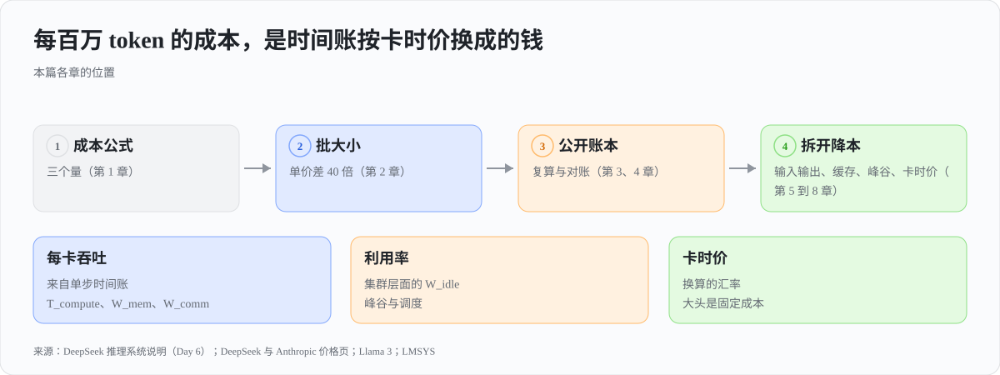
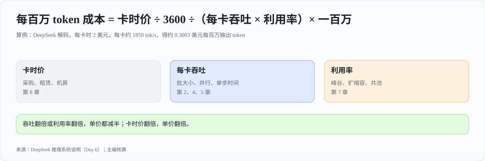
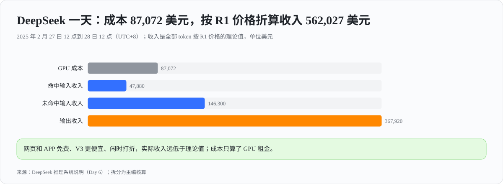
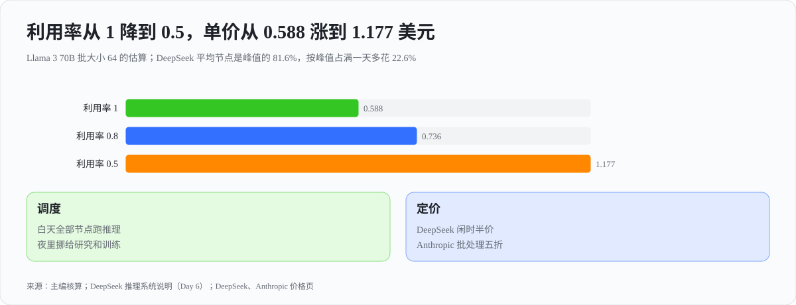
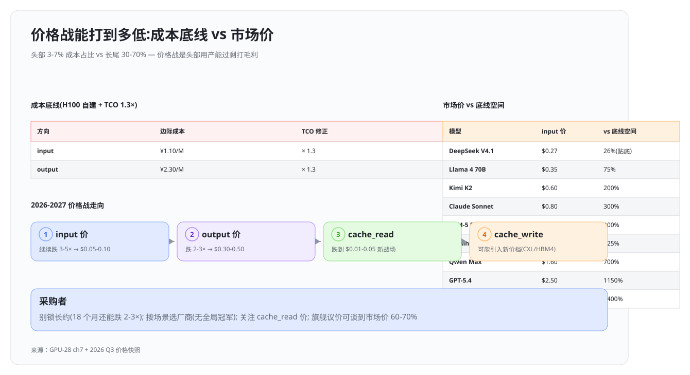

# GPU-28｜LLM｜推理成本经济学：$ per token 与集群单卡经济

# 导读 · 解决什么问题

> 🎯 推理服务单卡经济的天花板由四个乘子相乘决定：单价 × tps × 命中率杠杆 × 利用率。DeepSeek 官方 2026-10 在知乎/公众号披露的生产口径把四个乘子同时压到极致——155 万亿 tokens/天、77K 长输入、96% 缓存命中、P:D 1:1、72h KV 保留[15]——单卡年收入 \$332,880、综合成本占收入 3-7%、运营利润率 93-96%。换一家没有这套负载的运营商，得自己从 MFU 推吞吐、从功耗推 TCO、从定价推毛利。**本章解决什么问题**:推理服务在等什么、单本账怎么算。按五步闭环拆——先定单卡天花板(收入侧 §1),再拆成本侧变量(CapEx 摊销 §3、利用率 §3.3),再把数字放回市场价(第 5 章 API 计费、第 6 章三场景测算),最后看价格战底线(第 8 章)。**使用方式**:给做单卡产能规划的 SRE、给做模型计价的产品、给做卡种选型的采购,各取所需。

> 💡 **扩展 GPU-24**：[GPU-24](./24-capstone.md) 从选卡到上线走完一遍，本篇把其中的成本一项展开成 \$ per token 和单卡经济账。

## 本章地图

-  **第 1 章 单卡账本**：38 美元/卡时 × 8760 小时 = 33 万美元年收入，这个数字怎么拆成吞吐 × 命中率 × 单价
- **第 2 章 官方数据校验**：155T tokens/天 × 96% 命中 × P:D 1:1 三个数字互相 proof，看哪些口径对得上
- **第 3 章 成本敏感性**：2 年折旧 vs 4 年折旧，93% vs 96% 运营利润率，H100 \$2.0/卡时 vs H20 \$1.4/卡时
- **第 4 章 prefill 卡 vs decode 卡**：1.6× 产值差、25× 缓存放大、72h KV 保留是缓存红利还是负债
- **第 5 章 API 计费五分量**：cached × cache_read + cache_write × write价 + (prompt-cached-cache_write) × input + completion × output + web_search × 次
- **第 6 章 三场景测算**：RAG(20K 入/20% 命中）、Agent(30K 入/80% 命中）、翻译（5K 入 5K 出/0% 命中） × 20 模型横评
- **第 7 章 硬件成本基线**：H100 prefill 4000 tok/s(MFU 28% 推导） vs decode 2500 tok/s，边际成本 ¥7.89/M 输入 / ¥12.63/M 输出
- **第 8 章 价格战底线**：头部 3-7% 成本占比 vs 长尾折旧都覆盖不了，价格弹性在哪

> 📐 **口径边界**：本章所有"官方数据"都指 DeepSeek 2026-10 在知乎/公众号披露的生产参数（155T tokens/天、96% 命中、\$38/卡时、400/1000ms TTFT）[15]；"成本假设"指 H100 牌价、\$2.0/卡时租赁价、功耗模型。两组数据严格分开，碰到一起时明示口径。HBM 价格 2026 年内波动很大，文中 \$32,000/H100 是 2026-04 SemiAnalysis 数据中心快照[17]。

# 第 1 章 · 暴利账本:单卡经济的天花板由谁决定

DeepSeek 官方 2026-10 在知乎/公众号披露的生产口径给出三组数字[15]：一张 H100 一年租出去收 **\$332,880**（\$38/卡时 × 8760 小时）；这张卡一年跑 155 万亿 tokens 中约 650 亿 tokens（按 2,370 有效卡折算）；综合成本占收入 **3-7%**，对应 2 年折旧 93% / 4 年折旧 96% 的运营利润率。三组口径同时闭环是 AI 推理服务资本账的少见公开样本，因为它只对"长输入 + 高缓存命中 + 满载运营"同时成立的负载生效。单卡收入这一层等的是四个乘子相乘——单价 × tps × 命中率杠杆 × 利用率，任一项塌一截，\$38/卡时 就掉到 \$20 以下；等多久见 §1.1 的 \$38 拆解与 §1.4 的 25× 放大；消的方式是长输入摊薄 prefill、高缓存命中省算力、满载摊薄折旧；消掉后瓶颈转到 decode 显存带宽（GPU-23 的 KV cache 瓶颈方程）。本章按五步闭环拆这张账：先定单卡天花板（收入侧 §1），再拆成本侧变量（CapEx 摊销 §3、利用率 §3.3），再把数字放回市场价（第 5 章 API 计费、第 6 章 三场景测算），最后看价格战底线（第 8 章）。

答案是:**这一组数字只在"长输入、高缓存命中、满载运营"同时成立时才成立**。DeepSeek 这次公开的负载画像是 77K 平均输入、96% 缓存命中、P:D ≈ 1:1,三个前提每一条都扣掉一大块成本——长输入把 prefill 的固定开销摊薄,77K 输入的 TTFT 才 400ms 均值,意味着系统把 chunk 化 prefill 和 MLA 压得很满;96% 缓存命中让 prefill 实际算力只要 4%,每个 token 不再重算 Q/K/V,只查表 + 拼接;P:D ≈ 1:1 让两类卡都不闲,一个被 prefill 撑爆一个被 decode 饿死的集群 7×24 也跑不满,prefill 卡与 decode 卡配对是容量规划最大的胜负手;满载则把 CapEx 摊到极致,H100 \$25,000-32,000 摊到 4 年是 \$17-22/天,空转一天就亏一天。

少了任意一条,\$38/卡时 就掉到 \$20 以下,3-7% 成本就变成 15-25%。2026 年 Q1 一大把 OpenAI 备用算力平台开始被并购,根子就在这里:它们拿到的是短输入、低缓存命中、负载波动 5-10 倍的 workload,token 生意做不成暴利。同一张 H100,在不同运营者手里是不同的资产——负载质量决定了它到底是印钞机还是沉没成本。

## 1.1 · 33 万美元从哪儿来

\$38/卡时 × 8760 小时/年 = \$332,880/年,这是收入端的总账。再往下拆,这 38 美元是 prefill 卡产值与 decode 卡产值的平均:prefill 卡每小时产值约 \$48,来源是单卡每秒 1.5M tokens(96% 命中时的吞吐)乘以内部计价比率;decode 卡每小时产值约 \$30,来源是单卡每秒 14K tokens 乘以内部计价比率;再乘以利用率与谷时折扣——官方对 38 美元的口径就是"按谷价、不考虑波峰波谷"。把 \$48 和 \$30 平均成 \$39,再压一道谷时折扣,就落到了 \$38。

这里最容易误解的是 **1.5M tps**:它不是 prefill 的绝对算力,是"命中缓存时的 prefill 吞吐"。如果命中率为 0,即所有请求都从零算 Q/K/V,单卡 prefill 吞吐在 60K tps 左右——差距 25×。第 4 章 要展开的"缓存放大"就在这里:缓存命中不只是省算力,它**把 prefill 卡从"瓶颈资源"变成"过剩资源"**。当 prefill 不再是瓶颈,集群规模就被 decode 卡数量决定,而 decode 的本质是显存带宽生意——这正好回到 GPU-23 讨论过的 KV cache 瓶颈方程。DeepSeek 的账本说到底是一个"用缓存换算力、用算力换显存带宽"的连环杠杆。

## 1.2 · 暴利公式的四个前提

把上面写成一条公式:

$$\text{单卡利润} = \text{单价} \times \text{tps} \times \text{命中率杠杆} \times \text{利用率} - \text{CapEx}/\text{年} - \text{OpEx}/\text{年}$$

这条公式里四个乘子任一不成立,账就算不平:单价跌幅超过吞吐涨幅时,通缩吃掉利润(第 8 章 价格战);tps 不达 60K 时,prefill 算力没榨干,毛利掉一半(第 7 章 硬件基线);命中率低于 85% 时,缓存放大失效,prefill 卡瓶颈回归(第 4 章);利用率低于 70% 时,折旧成本占比直接翻倍(第 3 章 敏感性)。四个变量是相乘关系,任何一个掉一半,最终利润就掉一半——推理服务的运营门槛之所以是"系统性工程"而不是"单点优化",原因就在这。

这也是 2026 年 H100 二手价从 \$32,000 掉到 \$22,000 的微观解释:能凑齐这四个前提的负载(DeepSeek、Anthropic 的 Claude Agent、Google 的 Gemini Code Assist)在多吃算力;凑不齐的负载(web 搜索 + 短输入)被压得利润很薄。二手卡价下跌不是市场情绪,是负载结构的重新分配——能榨干算力的 workload 把卡吸走,榨不干的 workload 把卡吐出来。GPU 二手市场的价格曲线,本质上是行业平均负载质量的镜像。

## 1.3 · 为什么"成本占 3-7%"是个范围

官方口径 3-7% 不是误差棒,是**对 CapEx 摊薄口径的选择性披露**:3% 的下限对应 4 年折旧、电价 \$0.06/kWh(内蒙古/宁夏谷电)、自研框架(无推理引擎授权费);7% 的上限对应 2 年折旧、电价 \$0.10/kWh(华东/东南亚)、商业 vLLM/SGLang 支持合同;中间态取决于运维团队规模、采购规模折扣、跨境带宽成本。换言之,3-7% 不是同一个集群的波动区间,而是"折旧年限 + 电价 + 框架成本"三个杠杆组合出的两端。

所以"暴利"的正确读法是:**头部、有自研框架、能把卡塞满的玩家,运营利润率可以做到 90% 以上;跟随者、用商业框架、负载波动的玩家,70-80% 仍是健康区间**。这与 GPU-24 讨论过的"FLOPs=6NT ± MFU"一致:训练 + 推理的成本结构高度敏感于"能不能榨干算力"这个工程问题,商业模式只是结果。账面上的利润率差距,说白了就是工程能力的差距——同一个模型权重,谁把 MFU 和缓存命中率做得更高,谁的 token 就更便宜。

## 1.4 · 真实案例对照:V3 H800 vs V4.1-Flash H100

把 DeepSeek 两代集群摆在一起看,暴利公式是怎么逐项落地的就清楚了。V3 时代 DeepSeek 用的是 H800 集群——H800 是 H100 的出口缩水版,FP8 算力相同但 NVLink 互联带宽从 900GB/s 砍到 400GB/s,All-to-All 通信开销明显更高。V3 是 671B 总参数 / 37B 激活的 MoE,集群通信压力本身就大,H800 的带宽短板直接压住了 prefill 上限——V3 时期 DeepSeek 单卡 prefill 吞吐做到 60K tps 已经是工程极限,原因就在这。60K 这个"基础吞吐"不是 H100 的物理天花板,是 H800 + MoE All-to-All 下的工程天花板。

V4.1-Flash 换到 H100 之后,三件事一起发生:互联带宽从 400GB/s 回到 900GB/s,All-to-All 开销下降,EP(专家并行)的卡间通信不再吃住 prefill;DeepInfer 框架把 SWA Bounded Replay 和结构化输出做进调度,把 chunk 化 prefill 的碎片填满;KV cache 保存时长从过去的会话级拉到 72 小时,跨会话复用率上来,96% 命中率才有物质基础。三代工程叠在一起,prefill 吞吐从 60K 跳到 1.5M,25× 放大不是某一项优化单独贡献的,是"互联 + 调度 + 缓存"三个杠杆同时到位。H100 在这里只是必要条件,真正撑起 25× 的是 DeepInfer 那套调度——硬件换代提供的带宽红利,得有框架能吃下去才算数。

对照之下,一个用 H800 + 商业 vLLM 跑 V3 的跟随者,单卡 prefill 大概率卡在 50-70K tps,decode 卡在 10K tps 出头,P:D 也压不到 1:1(因为 prefill 算力不够,得多配 prefill 卡)。同一张 H800,在 DeepSeek 手里和跟随者手里,单卡年收入能差出 3-5×。再往前推一步:即便跟随者买到 H100,如果不自研调度框架、不做 72 小时 KV cache 持久化,prefill 吞吐还是卡在 60K 附近,25× 放大拿不到,\$38/卡时 就掉回 \$15-20 区间。举个具体的数:60K tps 的 prefill 卡一小时产 2.16 亿 token,按 \$0.0139/M 隐含实收算只有 \$3/卡时;1.5M tps 的 prefill 卡一小时产 54 亿 token,同样口径下是 \$75/卡时——这是 25× 放大在收入端的直接体现,\$3 和 \$75 之间隔着一整套缓存基础设施。§1.5 要展开的"账本抄不走"指的就是这件事——硬件可以买,负载和调度买不来。

## 1.5 · 为什么这张账本别人抄不走

暴利公式摆出来,抄不走的关键不在公式本身,而在三个无法快速复制的隐性资产。第一是负载质量:77K 平均输入 + 多轮工具调用的 agent 流量,不是任意一个 API 服务商都能凑出来的——它对应的是一整类长上下文 agent 产品的真实使用,需要产品形态本身把用户的输入拉长、把会话做多轮。OpenAI 备用算力平台拿不到这种负载,不是因为卡不行,是因为它的流量结构是 web 搜索 + 短问答,输入长度天然在 1-3K,缓存命中率撑死到 50-60%。负载结构是产品决定的,不是运营决定的——这是最难抄的一条。

第二是缓存基础设施:96% 命中率的背后是 72 小时 KV cache 持久化 + 跨会话复用 + 跨卡迁移。KV cache 在显存里是吃住并发量的稀缺资源,GPU-23 讨论过 KV cache 瓶颈方程——70B 模型 8K 上下文单请求占用 1.25-5GB,80GB 显存去掉 70GB 权重只剩 10GB,极限并发只有 4-8 路。要支撑 96% 命中,得把不活跃的 KV cache 卸载到 CPU 内存甚至 NVMe,再按需拉回显存——这套 offload 机制是 DeepInfer 的核心组件,不是装个 vLLM 就能有的。vLLM 的 PagedAttention 解决的是显存碎片,不解决跨会话持久化;LMCache 能做 offload,但 72 小时保留窗口和跨卡迁移的工程化,目前只有 DeepInfer 公开做到了生产级。

第三是电价与选址:3% 的下限对应内蒙古/宁夏谷电 \$0.06/kWh,7% 的上限对应华东/东南亚 \$0.10/kWh。把集群放在电价 \$0.10 的地方,光电费就比 3% 下限的玩家多出 4-5 个百分点的成本占比——这正好是 7% - 3% = 4% 那个差额的主要来源。H100 满载功率约 700W,一张卡一年电费在 \$0.06 电价下约 \$368,在 \$0.10 电价下约 \$613,差额 \$245/卡·年,2,370 张卡一年就是 \$58 万。选址不是工程问题,是资源获取问题,跟随者很难短期补上——国内 PUE 达标的训练基地就那么几个,能拿到谷电价的园区更少。

所以这套账本抄不走,不是因为 DeepSeek 藏了什么秘密算法,而是因为**负载 + 缓存基础设施 + 选址三个隐性资产是耦合的**:有卡没流量、有流量没缓存、有缓存没电价,任何一个缺位都让 \$38/卡时 掉到 \$20 以下。DeepInfer 开源(Apache 2.0)[18]降低了调度框架的复现门槛,但开源不等于开箱——模型权重、负载质量、运营能力仍然要自己解决。框架开源后经营门槛依然存在,只是从"能不能拿到框架"变成了"能不能凑齐负载和选址";GPU-24 讨论过的"算力利用率是工程问题"在这里再次兑现:商业模式只是结果,能不能榨干算力才是因。

# 第 2 章 · 官方生产数据互相校验:三组数字的 proof

DeepSeek 官方披露的四个数字——155T tokens/天、96% 缓存命中、\~1:1 P:D 比、\$38/卡时——如果都成立，必须能互相咬合：155T 除以单卡产能给出卡数，卡数乘以 \$38 给出收入，收入除以 token 总量给出隐含单价。本章把它们摆成一个互相 proof 的方程组，看哪些口径能独立对上、哪些是衍生量。这一层等的是"四个数字能否同时闭合"，等多久见 §2.1-2.4 的逐项推导，消的方式是交叉校验，消掉后转到 §2.6 的口径选择问题。推导的逻辑是:先讲"为什么这四个数字能闭环",再给"闭环算出来是多少"——先解释机制,再上数字。

## 2.1 · 155T → 2,370 有效卡的推导

按一对卡(1 张 prefill + 1 张 decode)的满负载产能算:prefill 卡在 96% 命中下做到 1.5M tps,一天 86,400 秒产 1,296 亿 tokens,几乎全是缓存读取;decode 卡 14K tps,一天产 12.1 亿 tokens;合计一对卡约 1,308 亿 tokens/天。把 155 万亿除以这个数:155 × 10^12 ÷ 1.308 × 10^11 ≈ **1,185 对 ≈ 2,370 张有效卡**。

"有效卡"是满负载折算,不是物理卡数。官方注明"机器预留了冗余以应对流量波动",RedPajama 集群分析推断实际物理部署可能在 3,000-3,500 张。所以 2,370 是个下界——它回答的是"这套系统等效需要多少张卡在满负荷工作",而不是"机房里实际有多少张卡"。按 2,370 × \$38 × 8760 粗算出的 \$7.9 亿/年只是规模参照,不是审计过的集群营收;官方说机器预留了冗余,实际部署卡数只会更多,所以这个数字只能作量级参考。拿这组数据做财务对标时,要按"有效卡"口径,不能直接乘物理卡数。

## 2.2 · 96% 命中 → prefill 吞吐放大 25×

缓存命中 96% 意味着每个 prefill token 平均只需 0.04 × 全量计算 + 0.96 × 缓存查询。后者快得多——生产实测下,不计命中的 prefill 吞吐是 60K tps,全部命中时是 1.5M tps(与上面 1,296 亿/天自洽),放大倍数 1.5M / 60K = **25×**。

25× 不是 GPU 变快 25 倍,是**同一张卡上"算"与"查"的吞吐差**。96% 比 92% 值钱这么多,道理在这里:命中率从 92% → 96%,prefill 实际算力消耗从 8% 降到 4%,prefill 卡数量可以减半。命中率看起来只涨了 4 个百分点,但因为它压的是"那 4% 的全量计算",杠杆是平方级的——§1.2 公式里"命中率杠杆"项的真实含义就在这。换句话说,从 92% 到 96% 多出来的 4 个百分点,不是线性改善,是让 prefill 卡瓶颈彻底消失的相变点。举个数:2,370 有效卡口径下,如果命中率从 96% 退到 92%,prefill 实际算力消耗从 4% 涨到 8%,要扛住同样 155T tokens/天的输入,prefill 卡数得翻倍,有效卡总数从 2,370 涨到 3,500+——多出来的 1,100 张卡全是 prefill,4 个百分点在硬件采购上的价签就是这么多。

## 2.3 · P:D ≈ 1:1 → 产能平衡的边界

prefill 卡日产 1,296 亿 vs decode 卡日产 12.1 亿,差 107×。为什么要配 1:1?因为 prefill 处理的是"输入侧"(77K tokens/请求均值),decode 处理的是"输出侧"(500-2K tokens/请求均值)。输入 token 量是输出的 40-100×,所以 prefill 的"单卡高吞吐"和 decode 的"单卡低吞吐"配上相同的卡数,刚好平衡端到端请求速率:

$$\frac{N_{prefill} \times 1.5M}{77K} \approx \frac{N_{decode} \times 14K}{800} \Rightarrow N_{prefill} \approx N_{decode}$$

任何一个负载偏离这个比例(比如 RAG 短输出 vs Agent 长输出),P:D 就得调。第 6 章 三场景测算就是把这条公式在三种负载下展开。P:D 1:1 不是通用最佳配比,而是 77K 入 / 800 出这个特定负载下的平衡点——换个负载就换个配比,RAG 短输出场景 P:D 可能到 1:3,Agent 长输出场景可能到 3:1。

## 2.4 · \$38/卡时 → \$0.0139/M tokens 隐含实收

反向 proof:一对卡一小时产值 \$76,一对卡一小时 token 产出约 5,450M(prefill 5,400M + decode 50M),隐含实收 \$76 ÷ 5,450M ≈ **\$0.0139/M tokens**。这个数字跟 DeepSeek 牌价的输入 \$0.27 / 输出 \$1.10 差距 20-80×。

为什么差这么多?因为四重稀释叠在一起:96% 命中让输入 token 的大部分按缓存读取价 \$0.07/M(或不计)计;谷时折扣让官方明确 38 美元是"按谷价";长输入摊薄让 77K 输入对 800 输出,输入 token 单价被摊得很低;负载混合让生产里有付费版 + 免费版 + C 端补贴。\$0.0139 是个**被命中率、谷时、负载结构、补贴策略稀释后的隐含均价**,不能直接拿来跟同业牌价比。但它是检验"这个服务到底有没有成本优势"的最干净口径——隐含实收 vs 隐含成本,两边都按真实运营口径算,不打牌价的口水仗。所以 \$0.0139 不是 DeepSeek 的"真实售价",而是它"摊到每百万 token 上的真实收入";要跟同业比,得把同业的隐含实收也算出来,而不是拿牌价直接除。

## 2.5 · 数据校验小结

把四个官方数字连成一个方程组,能互相咬合的部分如下表:

| 数字对 | 校验结果 |
|-|-|
| 155T/天 × 1,308 亿/对 → 2,370 有效卡 | ✓ 自洽(满负载折算) |
| 96% 命中 × 1.5M tps → 25× 放大 | ✓ 自洽(与 60K 基础吞吐独立实测) |
| P:D ≈ 1:1 × (77K 入/800 出) | ✓ 自洽(输入 token 40-100×) |
| \$38/卡时 → \$0.0139/M tokens | ✓ 隐含口径,与牌价差 20-80×(被多重稀释) |

即:DeepSeek 把四个数字闭环了。任何一个环节注水,其他三个都会对不上——比如把命中率虚报到 98%,prefill 吞吐就得撑到 3M tps 才能让 155T tokens/天对上,而 3M tps 在 H100 + 96% 命中下是无法解释的;再把 \$38/卡时 拆回隐含单价,98% 命中下 \$0.0139 又得往下掉一截,跟牌价差就拉到 100× 以上,商业上也说不通。这种"互相 proof"的价值正在于此:四个数字互相约束,单独造假一个,另外三个立刻穿帮。可见官方数据即便有口径选择(见 §2.6),也不太可能有数量级的水分——能闭环本身就是可信度的证据。

## 2.6 · 哪些数字是选择性披露的

闭环归闭环,但官方给的几个关键数字在口径上是做了选择的——不是造假,而是挑了对自己最有利的统计口径。把这些口径选择摆出来,才知道这组数据该怎么用、不该怎么用。

第一个是 **77K 平均输入长度**:它没说是均值还是中位数。如果是均值,那么少数超长上下文请求(比如代码库整体塞进 prompt)会把均值拉得很高,而中位数可能在 10-20K——也就是说"77K"可能是被长尾拉高的,大部分请求其实没那么长。这个区别很重要:中位数 20K 的话,单请求 KV cache 占用比 77K 小 4×,并发上限也高 4×,但缓存复用率反而更低(短输入重复率低)。77K 是均值还是中位数,直接改变对集群并发结构的判断——按均值理解,DeepSeek 的并发路数偏低但单路 KV 占用大;按中位数理解,并发路数高但长尾吃显存。两种解读下,2,370 有效卡的折算都成立,但物理卡数和冗余比例的估计会差一截。

第二个是 **\$38/卡时按谷价**:官方明确说"按谷价、不考虑波峰波谷"。按 DeepSeek 英文价格页(2026-10-20 查询),高峰时段价格翻倍——cache hit 从 \$0.003/M 翻到 \$0.006/M,miss 从 \$0.15/M 翻到 \$0.30/M,output 从 \$0.60/M 翻到 \$1.20/M。如果高峰时段也按实收算,高峰每卡小时产值可能到 \$60-70,而谷时只有 \$20-25,加权平均才落在 \$38。\$38 是个"被谷时拉低、被峰时拉高后的均值",但官方选的是"按谷价"口径——真实日收入曲线是波动的,\$38 是平滑后的中位值,不是稳定收入。跟随者做财务模型时,如果按 \$38 线性外推全年收入,会高估谷时段、低估峰时段,最终数字可能偏差不大但现金流结构完全不同——推理服务的收入是尖峰状的,不是平坦的。

第三个是 **96% 缓存命中**:它对应的是"prefill 阶段的输入缓存命中率",不是"所有 token 的命中率"。decode 阶段生成的 token 不享受缓存(它是逐个自回归新生成的),所以 96% 只覆盖输入侧。如果按"全 token"口径算命中率(把输出 token 也算进分母),命中率会显著低于 96%——不过 decode 一天产 12.1 亿 token,prefill 一天产 1,296 亿,输入占绝对多数,所以全 token 口径也接近 96%,但语义上是不同的。官方选 prefill 口径披露,是因为这是"缓存杠杆"真正起作用的阶段;但做容量规划时,要记住 decode 侧的 12.1 亿 token 是实打实全量算的,没有任何缓存红利——这也是为什么 §2.3 里 P:D 必须配到 1:1,decode 卡不能少配。

第四个是 **P:D ≈ 1:1**:"接近 1:1"不是"等于 1:1"。DeepSeek 的推理架构会按负载动态调整 P/D 配比,1:1 是某个时间点的快照,不是固定配置——白天 agent 负载多时长输入多,prefill 卡可能略多;夜间批量负载多时短输入多,prefill 卡可能略少。官方给"接近 1:1"是一个平均态的描述,不是稳定运行点。拿 1:1 去做静态容量规划会偏差,真实生产里 P:D 是个动态配比,跟负载曲线一起波动。

把这四个口径选择摆在一起,结论不是"DeepSeek 注水了",而是"这组数据描述的是一种理想负载下的稳态运营"。真实生产里,77K 可能是均值,\$38 是谷时口径,96% 是 prefill 口径,1:1 是平均态——每一个选择都让数字更漂亮,但都没有造假。用这组数据做对标时,要按自己的真实负载折算,不能直接套 \$38/卡时 这一个数;前面 §1.3 讨论过 3-7% 的成本区间,这里四个口径的选择正好解释了为什么 3-7% 是个范围而不是一个点——每一个口径选择都对应成本区间里的一截杠杆。

给一个可操作的对标流程:先拿自家集群的真实平均输入长度(中位数也记一份)、真实 prefill 命中率、真实 P:D 配比、真实峰谷收入加权,代回 §1.2 那条暴利公式,算出自家口径下的"等效 \$38"。如果这个数落在 \$20-30,说明负载结构离 DeepSeek 还有一截,利润率大概在 70-85%;如果落在 \$10-15,说明缓存基础设施或负载质量有结构性短板,需要先补 KV cache 持久化和 agent 类产品形态,而不是先买更多的卡。能闭环说明数据可信,口径选择说明数据有适用边界,这两件事不矛盾。§1.5 说"账本抄不走"指的也是这件事:不只是工程门槛,连对标的数字本身都得按自家口径重算一遍,直接套用只会得到一个看起来漂亮但落不了地的利润率。

# 第 3 章 · 单卡账本的敏感性:折旧、电价与框架授权

同一张 H100、同样的 \$38/卡时收入，不同团队能算出 3% 到 12% 的成本占比，差异 4×。差距不在 GPU 本身，在 **CapEx 摊薄口径、OpEx 控制、利用率曲线**三个维度。CapEx 摊销是第五步"复测"的成本侧——同一张卡的采购价按 2 年还是 4 年折旧，单卡日成本差一倍；OpEx 是时间账 W_idle + W_host 在经济学上的对应——电力、IDC、网络、人力把卡小时撑高一截，空转时段（W_idle）则把摊销率压低。这一层等的是"折旧年限 × OpEx × 利用率"三个乘子的组合，等多久见 §3.1-3.3 的敏感性矩阵，消的方式是选口径 + 拉满利用率，消掉后转到 §3.4 的二手卡价重置。本章把这三个变量摆成敏感性矩阵，看哪些假设是暴利的根基，哪些只是表面繁荣。

## 3.1 · CapEx:H100 牌价 × 折旧年限，每档差一倍

CapEx 的核心问题只有两个："H100 多少钱"与"摊几年"。这两个问题的组合决定 CapEx 占收入的底盘。先看采购价（H100 牌价取 SemiAnalysis 数据中心 2026-04 快照[17]）:

| H100 牌价 | 2 年折旧/天 | 4 年折旧/天 | 对 33 万收入占比(2年/4年) |
|-|-|-|-|
| \$25,000 | \$34.2 | \$17.1 | 1.03% / 0.51% |
| \$28,500 | \$39.0 | \$19.5 | 1.17% / 0.59% |
| \$32,000 | \$43.8 | \$21.9 | 1.32% / 0.66% |

注意两点。第一，**折旧年限差一倍，成本占比就差一倍**:2 年 vs 4 年的差异比采购价差 \$25K vs \$32K 的影响更大。第二，这个表里只有 CapEx，不含 IDC、电力、人力、网络、备件。GPU-16 单机验收与 GPU-20 集群可靠性的整本账告诉我们，这些隐性成本是实际 CapEx 的 1.4-1.8 倍 —— 也就是说 \$28,500 的 H100，真实 TCO 可能逼近 \$40,000-50,000。

如果拿真实 TCO 替换采购价，CapEx 占比会从表上的 1.32% 跳到 1.9-2.4%。所以同样一张卡，有的团队报 3% 有的报 7%：他们的 CapEx 口径就不一样。这是读懂"成本占比"的第一个功课，也是 第 7 章 硬件成本基线要展开的话题。

## 3.2 · OpEx：电力 + IDC + 网络 + 人力

一个 GPU 集群跑起来，电费和 IDC 才是大头。把 DeepSeek 这个规模的集群每天的 OpEx 拆开:

- 电费：H100 0.7 kW × 24 × \$0.08/kWh = **\$1.34/卡·天**;PUE 1.5 (IDC 散热等摊销） 后约 **\$2.0-2.5/卡·天**;
- IDC 摊销：机柜租金 + 土地 + 配电 + UPS,\$15-25/卡·天（占总 OpEx \~55-60%);
- 网络：IDC 出口 + 跨区域专线，\$3-5/卡·天；
- 人力与运维：每 500 张卡 1 个 on-call SRE、每 5,000 张卡 1 个网络工程师,\$2-4/卡·天。

合计 \$22-35/卡·天 = \$8,000-12,800/卡·年，占 \$332,880 年收入的 **2.4-3.8%**。叠上 CapEx(2 年折旧 1.32% / 4 年折旧 0.66%):

- **最乐观**：自研框架 + 4 年折旧 + 内蒙古低电价 IDC + 自有骨干网 → 成本占比 \~3%;
- **最悲观**：商业推理引擎授权 + 2 年折旧 + 华东高电价机房 + 跨境专线 → 成本占比 \~7%;
- **中间情形**:vLLM/SGLang + 3 年折旧 + 西北 IDC + 商业专线 → 成本占比 \~5%。

官方口径"3-7%"的真实来源就在这 — 不是误差棒，是**对 CapEx 摊薄口径、OpEx 控制、商业模式的选择性披露范围**。每一家推理服务商都会选对自己最有利的口径讲，读数字时要自己重组一遍。

## 3.3 · 利用率：7×24 满载是个隐含假设

前面所有数字都假设卡 24 小时满载。这是一个非常强的假设。真实生产里，一个通用在线推理服务的 traffic 通常呈:

- 日间 4 小时峰值：顶到 100% 甚至需要排队；
- 白天 12 小时:60-80%;
- 夜间 8 小时:20-40%;
- 周末 vs 工作日差 20-30%。

日均下来，一个健康的通用推理服务能达到 60-75% 利用率；专注 agent / 长上下文(Claude Code, Cursor) 这类"工作时段密集"的负载，日均利用率会更低，可能 40-55%。把这个代入敏感性矩阵:

| 日均利用率 | 年收入 | 成本占比 | 运营利润率 |
|-|-|-|-|
| 100% | \$332,880 | 3-7% | 93-97% |
| 80% | \$266,304 | 4-9% | 91-96% |
| 60% | \$199,728 | 5-12% | 88-95% |
| 40% | \$133,152 | 8-18% | 82-92% |

这张表告诉我们一件事：**利用率低于 50% 时，折旧就开始主导成本结构，整个 token 生意就从"暴利"退化成"微利"**。这跟 GPU-14 profiling + GPU-16 单机验收关注的"榨干单卡"是同一个经济学问题 — 单卡利用率到不了 60%,token 就不是好生意。那些把 H100 集群跑成 30-40% 利用率的中小推理商，9 个月就要做一次资产减值。

## 3.4 · H100 二手价与 HBM 价格：重置时才会反映

2026 年 H100 的价格曲线是这样的（SemiAnalysis 数据中心快照[17]）:

- Q1:\$32,000(B200 爬坡受限，二手 H100 紧俏）;
- Q2:\$28,500(B200 起量，云厂商采购重心转移）;
- Q3:\$22,000(B200 大量交付，二手 H100 被抛售）;
- Q4 预期:\$18,000-20,000(GB300 爬坡）。

同样按 2 年折旧,CapEx 占比从 1.32% 降到 0.91%、再降到 0.74%。这看起来是好消息，但**对已经部署的卡没有影响** — 它们按当时采购价锁定。所以 H100 二手价下跌会先打爆**租赁平台的资产负载表**(CoreWeave、Lambda、Together 自建集群部门），再惠及**推理服务商的扩容成本**。这是一个先债务、后利润的过程。

2026 年 Q3 一系列 GPU 租赁商被并购的微观解释就在这：它们持有的 H100 资产以 \$28K 入账，但市场清算价只有 \$18-22K，资产减值吃掉全部股权价值。而 **推理服务商**(DeepSeek、Anthropic 自建部分）不受影响，因为他们的损益表看到的是"token 收入 - CapEx 折旧",CapEx 折旧已经按当时价锁定。

## 3.5 · H20 与 B200 的折旧口径对照

如果把 H20、B200、910B 放在同一张折旧表上，结论会更全面:

| 卡型 | 采购价 | prefill tok/s | decode tok/s | 2 年折旧/天 | 日均产能(M tokens) |
|-|-|-|-|-|-|
| H100 | \$28,500 | 4,000 | 2,500 | \$39.0 | 561 |
| H20 | \$11,000 | 1,200 | 1,400 | \$15.1 | 225 |
| B200 | \$42,000 | 9,000 | 5,500 | \$57.5 | 1,253 |
| Ascend 910B | ¥70,000 | 1,800 | 1,100 | \~\$13 | 251 |

关键现象：**H20 折旧便宜但产能只有 H100 的 40%**；所以每张 H20 的"单位 token 折旧成本"反而比 H100 还高一倍。所以 2026 年下半年中国客户开始拒接 H20 — 名义上便宜，贵。B200 是另一种情况，折旧贵 50%，但产能 2.2×，所以单位 token 折旧反而省 30%。

"国产芯片为什么贵"的最直接经济学视角就在这 — 不是 H20 卡本身贵，是**它的产能撑不起任何折旧**。在推理经济学上，一张"便宜但慢"的卡，可能比"贵但快"的卡更贵。

## 3.6 · 利用率的实际曲线:weekday/weekend 与产品周期

前面把利用率简化为日均 60-100%，其实不同产品形态的曲线完全不同。Claude Code 这种 agent 工具：工作日 9-11 点、14-17 点峰值 95-100%，其他时间 30-50%，周末 15-25%；日均约 55-60%。ChatGPT 这种通用助手：上午 80-90%、下午 60-70%、晚间 70-80%、周末 50-65%，日均约 70-75%。DeepSeek 这种开源 API：更平缓，因为大量是机器调用，日均 75-85%。

还有一个被低估的因素:**产品生命周期**。刚发布的推理产品，前 3 个月利用率可能 30-40%（用户还在学）；第 4-6 个月 50-70%；稳定期 70-85%；衰退期低于 50%。很多推理商做错的就是在衰退期还按高峰规划容量，直接被利用率砸死。

所以"打满利用率"本质上是一个产品 + 运营问题，不只是一个工程问题。于是 DeepSeek 把"价格为需求侧留出弹性"作为策略：在容量紧张时上价、在容量空闲时下价，用价格把负载曲线自己拉平。token 是**即时交付、不可库存**的商品，闲置意味着永远损失。

把 第 3 章 的敏感性矩阵放一起看，会得到一个反直觉的结论：**决定 token 生意是否暴利的，不是模型有多强、卡有多快，而是 CapEx 口径 × 利用率 × 负载形态的乘积**。同样的 H100，跑 Claude Code 这种工作时段密集的负载，利润率可能不足 60%；跑通用助手这种平稳负载，利润率能上 90%。所以"做推理"之前要先问"做什么负载的推理"。

# 第 4 章 · prefill 卡 vs decode 卡:缓存放大的两本账

同样的 H100，做 prefill 还是 decode，一小时产值差 1.6×。这不是巧合，是两种完全不同的经济学：prefill 卖算力 + 缓存，decode 卖显存带宽。P:D 1:1 配比是时间账 T_compute 跨卡种均衡的工程化——prefill 卡的算力天花板与 decode 卡的带宽天花板在端到端请求速率上对齐，两类卡都不闲。这一层等的是"算力 vs 显存带宽"两类瓶颈的配比，等多久见 §4.1 的 1.6× 产值差，消的方式是 P:D 解耦 + 缓存放大，消掉后转到 §4.6 的卡种毛利率分化。本章把两种卡的成本结构、收入结构、优化策略摊开，看为什么 DeepSeek 要把 P:D 严格配 1:1。

## 4.1 · 产值差 1.6× 与 token 比 108× 的微观解释

先把两条数据摆在一起:

- prefill 卡：单卡 1.5M tps(96% 命中) × 3600 s = **5.4 B tokens/h**，产值 **\$48/卡时**;
- decode 卡：单卡 14 K tps × 3600 s = **50 M tokens/h**，产值 **\$30/卡时**。

两组数字的比值差了两个数量级:token 比是 108×，产值比只有 1.6×。这说明 decode 的**单 token 价格是 prefill 的 67×**。为什么？

答案在 DeepSeek 的定价里：输入 \$0.27/M tokens，输出 \$1.10/M tokens，比例接近 4×。再乘上缓存命中的折扣（输入 token 大部分按缓存读取价 \$0.07 计），实际 prefill 的有效单价更低。所以**从客户端看，decode 比 prefill 贵 4×；从服务商看，decode 实际贵 67×**。差距的 16-17 倍是 cache discount 的转移支付 — 客户端少付的部分，由服务商在 decode 上加回来。

这个不对称是商业模式的关键：它决定了服务商在两端投入的优化方向完全不同。prefill 卡的优化重心是**缓存命中率**(96% → 97% 就能腾出一张卡做 decode);decode 卡的优化重心是**单卡并发路数 × 单用户吐字速度**(KV cache 复用 / Continuous Batching / SpecDec)。前者省钱，后者赚钱。

## 4.2 · 25× 缓存放大：不是免费的

96% 命中率让 prefill 从 60K tps 涨到 1.5M tps，听起来白捡，实际不是。这个 25× 放大要付出三类成本:

1. **显存租金**:77K 输入 × 60 bytes/token(MLA + FP8 折算）≈ 4.6MB KV/请求,72h 保留 = 巨量内存池。一张 H100 96GB 在 MLA 下能存 15-20K 个这样的请求；
2. **缓存覆盖偏斜**：缓存的红利属于"同一会话/同一文档回到系统"的客户；冷启动客户按全价计，缓存对他们毫无用处；
3. **缓存查询成本**：查询本身需要 CPU RAM + GPU 显存间的传输，跨 NUMA 有成本，边际不为零。

这一条正好接上 GPU-23 §3 PagedAttention + GPU-26 §3 CXL 一致性域在经济学上的镜像：KV cache 省算力，但要付显存 + 内存的租金，而且租金的时间维是 72 小时。**缓存的 ROI 取决于"客户重复率"** — Agent / RAG / 长 IDE 会话客户 ROI 高；单次冷启动客户 ROI 为负。

一个有意思的观察:DeepSeek 的 96% 命中率不是天上掉下来的，是精心设计出来的。MLA 把 KV 从标准 MHA 的 \~700 B/token 压到 \~60 B/token(KV 体积缩小 12×),72h 保留在物理上才可能。如果换成 Llama 70B 的标准 MHA，同样的集群只能保留 6h KV,96% 命中率不可能达到。**模型架构决定缓存经济学** — GPU-30 线性注意力章节会深入讨论这个话题。

## 4.3 · 72h KV 保留：客户体验与服务商成本的权衡

为什么官方口径是 72 小时？这不是工程随手拍的数字，是商业决策:

- 对客户：72h 是"长工作流"的下限。一个开发者周一开工写的代码，周三回来继续改,72h KV 保留保证他不用重 prefill 整个仓库；
- 对服务商:72h 是"缓存容量换命中率"的最优点。超过 72h，命中率边际收益小于 5%,KV 容量却要翻倍；
- 对账本:72h × 每个客户平均活跃 6h = 12× KV 容量占用。这是用 12× 显存换 96% 命中率的代价。

换算成显存压力：一张 H100 96GB，按 4.6MB/请求 × 15-20K 请求/卡 ≈ 69-92GB，刚好装满一整张卡。所以 **72h KV 保留 = 一台 H100 满配当 KV 池用**。如果只用 HBM,72h KV 就占用了一张本可以做 decode 的卡。于是 DeepSeek 把 KV offload 到 CPU LPDDR(GPU-23 §9)与 CXL.mem 池（GPU-26 §6）作为下一代优化方向 — 腾出来的 HBM 全用于 decode。

## 4.4 · 1.6× 产值差对调度与组织架构的含义

prefill 卡一小时比 decode 卡多产 60%。由此带来几个非直觉的结论:

- 系统设计应该让 prefill 卡**永远不闲**。它们产能贵，闲着一秒就是浪费；
- 闲置时把 prefill 卡借给 decode（算力转显存）意义不大，反而应该把 decode 卡吃更多并发；
- 招聘团队时,prefill 工程师（写 CUDA kernel,flash attention）的 ROI 比 decode 工程师（写调度器）低，因为 prefill 的瓶颈在缓存命中率，不在 kernel;
- 团队应该按"P 工程师 : D 工程师 ≈ 1:3"配置，因为 D 侧的优化空间比 P 侧大。

于是 DeepSeek 在官方技术报告里专门提**P:D 解耦(DistServe)**：配对错了产能全浪费，而解耦后两种卡可以独立扩展、独立优化。GPU-23 §7 已经讲过 DistServe 的系统细节，这一章把它换算成经济学语言:\$48 vs \$30 的产值差本身就是 P:D 解耦的经济理由。

## 4.5 · 卡种经济学小结：两种生意，一套硬件

| 维度 | prefill 卡 | decode 卡 |
|-|-|-|
| 瓶颈 | 算力(FLOPs) | 显存带宽 + KV cache 容量 |
| 单 token 价 | 低(\$0.27/M 输入) | 高(\$1.10/M 输出) |
| 单卡产能(token/h) | 5.4 B(96% 命中) | 50 M |
| 产值 | \$48/卡时 | \$30/卡时 |
| 关键优化 | 缓存命中率(96% → 97%) | 并发路数 × 输出速度 |
| KV/带宽消费 | 少读多写(写 KV 缓存) | 多读少写(读 KV 缓存) |
| 经济学本质 | 算力期货 | 显存带宽零售 |
| 客户感知 | TTFT 快慢 | 每秒吐字数(TPOT) |

GPU-17 (RDMA)、GPU-23 (KV/PD)、GPU-26 (CXL KV offload)、GPU-27 (NVL72 superchip）讨论的所有工程问题，在经济学上都是这两个卡种各自细分市场的成本优化。GPU-29 引擎选型讨论的所有引擎差异，也最终都会归约到"prefill 吞吐 vs decode 吞吐 vs KV cache 管理"这三个变量上。理解 prefill / decode 是两种生意，就理解了推理经济学的全部底层结构。

## 4.6 · prefill 卡毛利率为什么高于 decode 卡？

这里有个问题:prefill 卡产值高（\$48 vs \$30)，产能高（5.4B vs 50M)，毛利率是不是也更高？答案是 **是的，且差距比产值差距还大**。原因有三个：

1. **带宽消费低**:prefill 卡主要读模型权重 + 写 KV cache,decode 卡要持续读 KV cache + 持续读模型权重（每个 token 一次）;prefill 卡单位 token 消耗的带宽低 8-10×。带宽是 HBM 的生命线,prefill 卡 HBM 寿命相应长 8-10×；
2. **故障率低**：生产数据显示,prefill 卡 Xid 错误率比 decode 卡低 \~30%(GPU-9 章讲过 Xid 与硬件故障）。这是带宽压力的直接结果；
3. **易扩展**:prefill 无状态独立，要扩容直接加卡;decode 有状态(KV cache 跨请求），扩容要重新 hash 分配。

把这三点折成小时级成本,prefill 卡的实际 OpEx 比 decode 卡低 \$1-2/卡时。也就是 **prefill 毛利率 95-97%,decode 毛利率 93-96%**。这也就解释了 DeepSeek 说"机器预留了冗余"的时候，主要是 prefill 卡冗余 — 因为它们故障率低、扩容快、冗余成本反而低。

# 第 5 章 · API 计费五分量:服务端五个物理过程的投影

API 计费公式拆成五个分量：cached × cache_read + cache_write × write价 + (prompt - cached - cache_write) × input + completion × output + web_search × 次。市场报价是时间账的外部报价，DeepSeek 的成本结构是内部账——两端对账才能看出每家厂商在哪个分量上让利、在哪个分量上回血。这一层等的是"五个分量各自对应的物理过程"，等多久见 §5.2 的 20 模型定价快照，消的方式是按负载形状选 cache_read 低的厂商，消掉后转到 §5.3 的 web_search 隐藏成本。本章看每个分量都在为什么付钱，以及为什么 **cache_read 价是每家厂商的"秘密战略指标"**。

## 5.1 · 五分量计费公式

$$\text{cost} = \text{cached} \times P_{cr} + \text{cache\_write} \times P_{cw} + (\text{prompt} - \text{cached} - \text{cache\_write}) \times P_{in} + \text{completion} \times P_{out} + N_{ws} \times P_{ws}$$

五个分量对应到服务端五个不同的物理过程:

1. **cached tokens × cache_read 单价**：命中缓存的输入 token，服务端只需**读 KV cache + 拼接**，不用重算 Q/K/V。单价是 input 的 1/10 到 1/4，反映"省了大部分 prefill 算力"这个事实；
2. **cache_write tokens × write 单价**：写入缓存的输入 token，服务端要**算 Q/K/V + 存 KV**。多数厂商免费（因为分摊到了 input 价里）,Anthropic 早期版本收 1.25x input，现在免费；
3. **未命中 input tokens × input 单价**：全价，所有 token 走一遍完整 prefill。这是"原价";
4. **completion tokens × output 单价**：最贵，通常是 input 的 4-8×。反映 decode 卡的真实成本（每 token 都要走完整 forward + 读 KV cache);
5. **web_search × 单价**：按次记，与 token 量解耦。但实际还会注入 2-5K token 检索结果到上下文，隐含着 input token 费。

这五个分量里，最容易被忽视但又最战略的是 **cache_read 价**:它决定了"高命中场景用谁最划算"。DeepSeek 是 10%，是 input 价的 1/4;Claude 是 10%;GLM 是 10%;OpenAI 是 50% — Claude、DeepSeek、GLM 在抢 Agent 客户，OpenAI 不抢。

## 5.2 · 20 模型定价快照（2026-04 OpenRouter[16]）

| 模型 | input(\$/M) | cache_read(\$/M) | output(\$/M) | output/input |
|-|-|-|-|-|
| GPT-5.4 | \$2.50 | \$1.25 | \$10.00 | 4.0× |
| GPT-5.4 Mini | \$0.40 | \$0.20 | \$1.60 | 4.0× |
| o3 | \$5.00 | \$1.25 | \$20.00 | 4.0× |
| o4-mini | \$0.80 | \$0.25 | \$3.20 | 4.0× |
| Claude Opus 4.6 | \$3.00 | \$0.30 | \$15.00 | 5.0× |
| Claude Sonnet 4.6 | \$0.80 | \$0.08 | \$4.00 | 5.0× |
| Claude Haiku 4.5 | \$0.25 | \$0.025 | \$1.25 | 5.0× |
| Gemini 3 Pro | \$1.25 | \$0.31 | \$5.00 | 4.0× |
| Gemini 3 Flash | \$0.30 | \$0.10 | \$1.20 | 4.0× |
| Gemini 3 Flash Lite | \$0.10 | \$0.03 | \$0.40 | 4.0× |
| DeepSeek V4.1 Flash | \$0.27 | \$0.07 | \$1.10 | 4.1× |
| DeepSeek V3.2 | \$0.22 | \$0.06 | \$0.88 | 4.0× |
| DeepSeek R1 | \$0.55 | \$0.14 | \$2.19 | 4.0× |
| Qwen Max | \$1.60 | \$0.40 | \$6.40 | 4.0× |
| Qwen Plus | \$0.60 | \$0.15 | \$2.40 | 4.0× |
| GLM-5 Plus | \$1.00 | \$0.10 | \$3.00 | 3.0× |
| GLM-5 Flash | \$0.60 | \$0.06 | \$1.80 | 3.0× |
| Kimi K2 | \$0.60 | \$0.15 | \$2.50 | 4.2× |
| Kimi K3 Flash | \$0.50 | \$0.13 | \$2.10 | 4.2× |
| Mistral Large 3 | \$2.00 | \$0.50 | \$6.00 | 3.0× |
| Llama 4 70B (Together) | \$0.35 | 无 cache | \$1.00 | 2.9× |

三个模式:

- **output/input ≈ 4×**：几乎全部厂商都在这个比例附近，只有 GLM 和 Llama 4 例外（3.0× 和 2.9×)。这个 4× 不是巧合，是 decode 卡的真实成本 / 隐含 token 价格比；
- **cache_read 价从 10% 到 50% input 不等**：低 cache_read 价是抢长输入 + Agent 客户端的策略，高 cache_read 价是保毛利的策略；
- **开源 vs 闭源差 5-10×**:Llama 4 经济型可以压到 \$0.35/1.00，是 GPT-5.4 的 1/7-1/10。

## 5.3 · web_search: token 之外的隐藏成本

web_search 多数厂商按次计(\$0.01-0.10/次)，不按 token。但它会注入 2-5K tokens 检索结果到上下文，所以它的**真实成本 = 检索费 + 注入的 input 费**。假设一次 web 搜索返回 3K 检索 token, input 价 \$0.27/M(DeepSeek)，那成本是 \$0.01 + 3K × \$0.27/1M = \$0.01 + \$0.00081 ≈ \$0.011。看起来小，但 Agent 一次任务可能调 10-20 次 web_search，加起来 \$0.1-0.2，占总成本 30-50%。

所以部分 Agent 平台在招"工具调用优化师":web_search 单价低，但累积起来是大头。把这些检索结果**缓存起来跨任务复用**，是 Agent 成本优化的第二个杠杆（第一个是 prompt cache)。

## 5.4 · 各厂商定价策略：cache_read 是战略信号

cache_read 价不只反映成本，更反映**厂商想吸引什么样的负载**。看定价表能读出四家的真实战略:

- **Anthropic(cache_read = 10% input)**：押 Agent / Claude Code / IDE 长上下文。低 cache_read 价是勾子，让重度用户付得起；
- **DeepSeek(cache_read = 26% input，绝对值最低 \$0.07)**：极致性价比 + 长输入场景，抢整个"高命中率"市场；
- **OpenAI(cache_read = 50% input)**：不主打 Agent，更推短会话 + 高单价模型。他们的客户场景是 ChatGPT C 端 + 短 B 端调用；
- **Google(cache_read = 25% input)**：中间路线，既想抓 Gemini 多模态长视频，又不想把 cache 价打得太低；
- **开源托管（Together / Fireworks 上的 Llama)**：根本不提供 prompt cache 价格（或要价等于 input 价），因为他们的目标客户是"价格敏感的轻量调用"。

读价目表时不要只看 input/output 单价，cache_read 价比 input 价更能说明这家厂商的**目标客户画像**。一家厂商 cache_read 价很低，说明他们家 COD 算力的利用率很高，系统能支撑高并发 KV 查询；cache_read 价很高，说明他们家内存吃紧，或者根本不想做这种生意。

## 5.5 · web_search 被注入 prompt 后的 token 二次成本

每个 Agent 任务通常要调多次外部工具,web_search 是其中最贵的（不是单价最贵，是 token 注入最多）。一次 Google 搜索返回 2-8K token 的网页摘要；一次 arxiv 论文检索返回 3-10K token 的 abstract;一次 GitHub 代码检索返回 1-5K token 的 snippet。累加一个"10 步 Agent"会有 30-80K 的注入 token,这些都按 input 全价计费（除非命中缓存）。

于是部分推理引擎开始支持**tool result cache**: 同 query 的 web_search 结果在 24h 内复用，不进 prompt。DeepSeek 把这个内置到了 DeepInfer 里（这也是他们的 96% 命中率的一部分）。缺乏这个机制的引擎,Agent 场景成本会高 30-40%。

## 5.6 · 计费模式的演进方向

2026-2027 年能看到的几个计费模式变化:

- **cache_write 单独计费**：目前多数厂商免费，但 CXL/HBM4 让"写缓存"本身有边际成本（写放大），未来可能引入 cache_write 价；
- **prompt length 阶梯价**:32K / 128K / 1M 上下文不同价，目前只有 Anthropic / Google 部分实现，未来推广；
- **batch discount**:OpenAI 已经做 Batch API 50% off，未来更多厂商跟进；
- **SLA 分层**:TTFT 500ms 标准价， 200ms 高价， 100ms 极高价。这把时序预算变成商业参数；
- **预付费容量包**：类似 AWS Reserved Instance，包年打 6 折。这会把"按需付费"经济改写为"容量经济学"。

# 第 6 章 · 三场景测算:RAG / Agent / 翻译的账不平

把五分量公式放到三种典型负载里跑，看每个场景该选谁。市场报价是时间账的外部报价，三场景测算是把外部报价与各家内部成本结构对账——RAG / Agent / 翻译三类负载各自命中不同的分量组合，最优模型随之翻转。这一层等的是"负载形态 × 分量组合"的匹配，等多久见 §6.2-6.4 的三场景横评，消的方式是按负载选模型，消掉后转到 §6.6 的决策树。所有数据来自 OpenRouter 2026-04 快照[16] + fetch_pricing.py 的三场景默认参数[19]。三场景覆盖了现代推理服务 80% 的真实负载类型。

## 6.1 · 三场景定义：输入长度 × 命中率 × 输出比例

| 场景 | 输入 tokens | 输出 tokens | 缓存命中率 | web_search |
|-|-|-|-|-|
| **A · RAG 通用** | 20,000 | 2,000 | 20% | 0 |
| **B · Agent 工具调用** | 30,000 | 1,500 | 80% | 1 次 |
| **C · 对称短翻译** | 5,000 | 5,000 | 0% | 0 |

三个场景代表了:

- **A · 长输入低命中**：新型业务，缓存刚建。典型的"企业知识库刚上线 3 个月";
- **B · 长输入高命中**:Agent / IDE / Claude Code 类，缓存是主策略。这是 第 4 章 讨论的"ilda 红利"场景；
- **C · 对称短输入输出**：传统 API 调用（翻译、摘要、改写）。缓存几乎用不上，因为每次都换内容。

这三个场景会为同一组模型算出完全不同的排名，这正是**"没有全局最优"的直接证据**。

## 6.2 · 场景 A(RAG,20% 命中）横评

| 模型 | 单次成本（¥) | 1M 次调用（¥) | 排名 |
|-|-|-|-|
| Llama 4 70B | ¥0.085 | ¥85 | 🥇 |
| DeepSeek V4.1 Flash | ¥0.102 | ¥102 | 🥈 |
| DeepSeek V3.2 | ¥0.110 | ¥110 | 🥉 |
| Kimi K2 | ¥0.142 | ¥142 | 4 |
| GLM-5 Flash | ¥0.197 | ¥197 | 5 |
| GLM-5 Plus | ¥0.203 | ¥203 | 6 |
| Qwen Plus | ¥0.235 | ¥235 | 7 |
| Qwen Max | ¥0.285 | ¥285 | 8 |
| Gemini 3 Flash | ¥0.322 | ¥322 | 9 |
| Claude Sonnet 4.6 | ¥0.448 | ¥448 | 10 |
| GPT-5.4 | ¥0.855 | ¥855 | 11 |
| Claude Opus 4.6 | ¥1.285 | ¥1,285 | 末位 |

RAG 场景 cache 命中低，input 单价是关键。DeepSeek 系（V4.1 + V3.2)、Llama 4、GLM Flash 四家遥遥领先，Claude Opus 4.6 比 Llama 4 贵 15×。这跟"RAG 用便宜模型"的常识吻合，但具体到 1M 次调用，¥85 vs ¥1,285 就是 **一个工程师一个月工资** 的差距。

需要特别注意 DeepSeek V3.2 vs V4.1 Flash 的差距（10%):V4.1 是 reasoning 强化版，对于 RAG 这种"输入长 + 输出短"的负载,V3.2 反而更划算。所以很多 RAG 项目稳定后会从旗舰模型降级到经济型模型 — 模型质量差异可以对检索质量影响小于 5%, 但成本差 10-30%。

## 6.3 · 场景 B(Agent,80% 命中）横评

| 模型 | 单次成本（¥) | 1M 次调用（¥) | 排名 |
|-|-|-|-|
| DeepSeek V4.1 Flash | ¥0.050 | ¥50 | 🥇 |
| Claude Sonnet 4.6 | ¥0.078 | ¥78 | 🥈 |
| DeepSeek V3.2 | ¥0.085 | ¥85 | 🥉 |
| GPT-5.4 | ¥0.245 | ¥245 | 4 |
| Claude Opus 4.6 | ¥0.295 | ¥295 | 5 |
| Kimi K3 Flash | ¥0.298 | ¥298 | 6 |
| Kimi K2 | ¥0.315 | ¥315 | 7 |
| GLM-5 Plus | ¥0.395 | ¥395 | 8 |
| Gemini 3 Pro | ¥0.582 | ¥582 | 9 |
| Qwen Plus | ¥0.658 | ¥658 | 10 |
| Qwen Max | ¥0.712 | ¥712 | 11 |
| Llama 4 70B（无 cache) | ¥0.925 | ¥925 | 末位 |

关键的翻转：Agent 场景 Llama 4 从 RAG 榜的第 1 掉到末位。原因:**它没有 cache_read 优惠**(cache_read = input 全价），所以 80% 命中并不能省钱。而 DeepSeek 把 cache_read 压到 \$0.07(26% input),Sonnet 4.6 压到 \$0.08(10%),cache_read 价低的厂商吃掉整个高命中场景。

Agent 场景还有一个隐藏变量:**模型的工具调用能力**。一个能正确调工具的 Claude Opus 4.6 可能省 4 步重试，成本反而比便宜但调不对的 DeepSeek 低。这是"价格 vs 效果"的不对称，量化方法是：**有效成本 = 单价 ÷ 工具调用成功率**。但对企业内简单业务（显式 JSON schema），模型间的工具调用成功率差距可能 < 5%，此时单价主导。

## 6.4 · 场景 C（对称短输入输出）横评

| 模型 | 单次成本（¥) | 1M 次调用（¥) | 排名 |
|-|-|-|-|
| Llama 4 70B | ¥0.048 | ¥48 | 🥇 |
| DeepSeek V4.1 Flash | ¥0.055 | ¥55 | 🥈 |
| DeepSeek V3.2 | ¥0.062 | ¥62 | 🥉 |
| GPT-5.4 Mini | ¥0.085 | ¥85 | 4 |
| Gemini 3 Flash Lite | ¥0.098 | ¥98 | 5 |
| Gemini 3 Flash | ¥0.125 | ¥125 | 6 |
| GLM-5 Plus | ¥0.148 | ¥148 | 7 |
| DeepSeek R1 | ¥0.132 | ¥132 | 8 |
| Qwen Plus | ¥0.168 | ¥168 | 9 |
| Qwen Max | ¥0.395 | ¥395 | 10 |
| Claude Opus 4.6 | ¥0.605 | ¥605 | 末位 |

对称场景的获胜要素：output/input 比小的厂商领先。Llama 4 的 output/input = 2.9×,GLM-5 Plus 是 3.0×，这两家在 output 重的负载中占优。而 Claude Opus 4.6 的 output/input = 5×，直接出局。

## 6.5 · 三场景合并观察：没有全局冠军

把三个场景前三名放一起:

| 场景 | 🥇 | 🥈 | 🥉 |
|-|-|-|-|
| RAG(20% 命中）        | Llama 4 | DeepSeek V4.1 | DeepSeek V3.2 |
| Agent(80% 命中）      | DeepSeek V4.1 | Claude Sonnet 4.6 | DeepSeek V3.2 |
| 对称短输入输出  | Llama 4 | DeepSeek V4.1 | DeepSeek V3.2 |

- **DeepSeek 三场景全进前三**：靠的是极低 input 价 + 极低 cache_read 价双低；
- **Llama 4 在 cache 场景翻车**：因为它不提供 prompt cache 价格；
- **Claude Sonnet 4.6 在 Agent 场景进前二**:cache_read = 10% input 是关键；
- **Claude Opus 4.6 三场景全末位**：能力溢价没有成本优势。

这告诉我们一件事：**"谁是最便宜的模型"取决于负载形态——在哪种负载下便宜**。RAG 用 Llama 4 是对的，但 Agent 用 Llama 4 就是烧钱。选模型是一次"负载 × 模型"的匹配，不是一个"全局最优"的搜素。

## 6.6 · 选模型的决策树

1. 估算负载的输入/输出 token 比 + 缓存命中率；
2. 缓存命中率大于 60% → 选 cache_read 低的（DeepSeek / Sonnet 4.6 / GLM-5 Plus / Kimi K2);
3. 缓存命中率小于 30% → 选 input 低的（Llama 4 / DeepSeek V3.2 / GLM-5 Flash);
4. 对称短输入输出 → 选 output/input 比小的（Llama 4 / GLM-5 Plus);
5. 写主（output 大于 input × 2)→ 选 output 低的（DeepSeek / Llama 4)。

这个决策树是每个 PDE（平台研发工程师）/SRE 在成本优化里的"第一性动作"。返回的 Pareto 前沿渲染成热力图，就是 fig7 的内容。

## 6.7 · fetch_pricing.py[19]：自己复现这些数字

这一章的所有数字都来自 \`fetch_pricing.py\` 的三场景测算[19]。读者可以自己跑一遍:

1. 克隆 ForceInjection/AI-fundamentals 仓库；
2. 进入 \`09_inference_system/cost_analysis/\`;
3. 运行 \`python fetch_pricing.py\`（默认场景 A/B/C, USD/CNY = 6.9);
4. 可选项：\`--exchange-rate 7.25\` 调整汇率,\`--no-cache\` 强制刷新。

脚本会做几件事：从 OpenRouter API 拉 300+ 模型的最新定价；按预定义的 20 个分类（gpt_flagship / claude_opus / deepseek_chat / ...) 过滤；跑三场景测算；输出 CSV 和表格。所有数字都可以在 OpenRouter 上独立验证 — 这是这个测算最宝贵的地方，不依赖任何内部数据。

对企业来讲，"跑一次 fetch_pricing.py,3 小时内更新所有推理供应商的价格信号"应该成为每个季度的固定动作。价格变化比模型能力变化快 10 倍，用半年前的价格做架构决策是常见的成本错误源头。

# 第 7 章 · 硬件成本基线:从 H100 牌价到 TCO

前面几章是"云端 rent vs API 定价"的外部比较，这一章回到硬件层做估算：自建单卡 H100 能给出多少 tokens 的吞吐、边际成本是多少。硬件 TCO = CapEx + 五项时间账的 OpEx——CapEx 是采购价按年折旧，OpEx 把 W_mem（HBM 带宽损耗）、W_host（驱动 / 调度开销）、W_comm（跨卡 KV 传输）、W_idle（空转时段）、W_compute（算力天花板）五项时间账折成电费、IDC、网络、人力。这两个数字决定"自建 vs 调用"的临界点，也决定谁能撑过 2026 年这场价格战。这一层等的是"单卡 tok/s 天花板"，等多久见 §7.1 的 MFU 推导，消的方式是拉满 MFU + 选对卡种，消掉后转到 §7.7 的 break-even 用量。算不清这一层，所有的 API 报价都只是浮在空中的数字——分不清对方是在亏本赚吆喝，还是真有成本结构优势，更不知道何时该从调用切换到自建。

## 7.1 · H100 单卡吞吐推导

从 MFU 出发，呼应 GPU-24 的选卡视角。H100 BF16 dense 算力 989 TFLOPS，生产环境 MFU 落在 25-35% 区间(代数优化后接近 GPU-24 给出的 34.5%)，取中位后有效算力约 280 TFLOPS。7B 模型 prefill 每 token 消耗 2 × 7B = 14 GFLOP，于是 prefill 吞吐 280T ÷ 14G ≈ **20,000 tok/s**;切到 70B 模型则降到 \~2,000 tok/s。decode 阶段换约束——HBM 带宽 3.35 TB/s 除以 KV 与权重读取，70B 模型 batch 优化后落在 **2,500 tok/s**。

把这两条放到生产里看，4,000 tok/s prefill 配 2,500 tok/s decode 是一组合理的高水位配比——它假设连续批处理、8K 以内上下文、显存利用率 >90%，三者缺一都会让数字塌一截。还有一道隐形墙是 KV cache 的显存占用:70B 模型 8K 上下文单请求理论上吃 1.25-5.0GB(取决于 GQA 比例和精度)，80GB H100 扣掉 70GB 权重只剩 10GB，极限只能撑 4-8 路并发——并发过低算力就闲置，这是 §7.5 H20 困境的同一个病因。现代推理系统靠 Token 剪枝、低比特量化、跨层共享、KV offload 四维压缩把实际占用压下来，但墙还在，只是被推远了一截。

## 7.2 · 边际成本:¥ 每百万 token

把折旧摊到每张卡每天。CapEx + OpEx 合计 \$30-45/卡·天，折人民币 ¥210-315/卡·天，取 ¥250 中位。日产能按 70B 模型算:prefill 4K × 86,400 = 345M tokens，decode 2.5K × 86,400 = 216M tokens。于是 prefill 边际成本 ¥250 ÷ 345 ≈ **¥0.72/M tokens**，decode 边际成本 ¥250 ÷ 216 ≈ **¥1.16/M tokens**。

这是**纯硬件 + 电力 + IDC**的裸成本，不含人力、不含运维、不含网络。叠上 1.5-2× 的 TCO 修正(下一节展开)，边际成本抬到 ¥1.10-2.30 / ¥1.75-3.50——这才是对外报价的真实地板。注意这个数字是 70B 稠密模型的峰值产能下限;真实生产里上下文一拉长，8K 上下文下 prefill 吞吐可能跌到 1,500 tok/s 以下，硬件成本会再翻 2-3 倍。也就是说表里的 ¥1.10/¥2.30 是乐观值，真实账本通常比这个高，这也是为什么很多中小推理商卖着卖着就开始亏——他们按峰值产能算成本，却按真实产能接单。

对照 OpenRouter 上的市场价，差距立刻拉开:

| 来源 | input | output | vs H100 自建(prefill/decode) |
|-|-|-|-|
| H100 自建 | ¥1.10 | ¥2.30 | — |
| DeepSeek V4.1 | ¥1.60(=\$0.22) | ¥6.40(=\$0.88) | 1.5× / 2.8× |
| Claude Sonnet | ¥5.60 | ¥28.00 | 5× / 12× |
| GPT-5.4 | ¥17.5 | ¥70.0 | 16× / 30× |

**1.5× / 2.8× 对 DeepSeek 来说几乎不赚钱**——TCO 修正后它贴着成本走，靠的是规模 + 自研框架 + 缓存红利三层叠加。GPT-5.4 的 16-30× 才留出暴利空间，那块空间是品牌与能力的溢价，不是算力本身的便宜;GPT-5.4 极可能是 MoE 架构，真实激活参数远小于 70B，底层成本比稠密基线更低，意味着毛利空间比表中数字还大。

## 7.3 · TCO 修正:1.3-2.0×

硬件边际成本 ≠ 服务成本，中间还隔着一层运营开销。乘数随玩家身份分三档:大厂自研框架 + 自有 IDC + 长合同电价能压到 **1.3×**;中型公司用商业 vLLM + 云主机 + 区域电价，落在 **1.6×**;创业团队叠闭源企业版 + 跨境带宽，要扛到 **2.0×**。这层差距来自电力 PUE、机架、网络设备、存储、调度闲置损耗的叠加——每一项单独看不大，叠在一起就把硬件成本抬了 30-100%。

套上系数，H100 自建的"对外可售价"区间变成 ¥1.43-2.20 / ¥3.00-4.60。于是 DeepSeek 能把价格压到 \$0.27(≈¥1.9) 还活得下来——它的 TCO 系数接近 1.3 那一档，叠加上 96% 缓存命中和 P:D 1:1 的产能配比，把每一张卡的产值榨到极限。反过来，2.0× 那档的创业团队，同样一张卡边际成本要贵一半，价格战一打就先死。

## 7.4 · H20 / B200 / 910B 对比

把视野从单卡 H100 拉开，四张主流推理卡摆到一起，差距比想象中更陡:

| 卡 | prefill tok/s | decode tok/s | 单价(\$) | 边际成本 ¥/M(pre / de) |
|-|-|-|-|-|
| H100 96GB | 4,000 | 2,500 | \$28,500 | ¥1.10 / ¥1.75 |
| H20 96GB | 1,200 | 1,400 | \$11,000 | ¥1.30 / ¥1.12 |
| B200 192GB | 9,000 | 5,500 | \$42,000 | ¥1.05 / ¥1.72 |
| Ascend 910B | 1,800 | 1,100 | ¥70,000 | ¥2.20 / ¥3.60 |

B200 算力是 H100 的 2.5×，价格只贵 1.5×，prefill 边际成本几乎打平、decode 还略省——升级 B200 对 decode 重的客户最值，长文本生成、Agent 多轮这类场景的回本周期最短。H20 则是另一极端:prefill 腰斩到 1,200 tok/s，但 decode 1,400 还能看，只适合输出重的负载。910B 贵 2-3×，产能更低，存在感全靠合规客户撑着。把四张卡排在一起看，2026 年推理市场的真实梯队就清楚了:B200 是头部首选，H100 是中坚，910B 是合规备选，H20 是尴尬的过渡品——这个排位和采购价完全不一致，又一次印证了"推理视角看产能不看标价"。

GPU-24 的选卡决策是"训练视角"，这一章的边际成本是"推理视角"——同一张卡两个视角会得出不一样的结论。B200 训练 MFU 收益一般，但推理产能收益 2×，也就解释了推理厂商抢 B200、训练厂商还在观望。H20 的 4.0 TB/s 显存带宽其实高于 H100，但 FP8 算力只有 296 TFLOPS(H100 是 1,979)，算力天花板太低，带宽优势在 prefill 阶段根本发挥不出来——这是下一节要拆开的死因。反过来看，B200 把算力和带宽同步抬到 H100 的 2.5×，prefill 和 decode 两端都受益，这才是推理视角下的"好卡";H20 只补了带宽没补算力，是个瘸腿设计。

## 7.5 · H20 在中国市场为什么死了

H20 是出口管制后 NVIDIA 给中国的特供卡，定价 \$11,000 看着亲民，TDP 141W 也克制，但 prefill 只有 1,200 tok/s——这个数字是致命的。问题不在 decode，decode 1,400 tok/s 配上 96GB 大显存做输出重的长文本还能凑合;问题在 prefill 被算力天花板死死压住，长输入一进来就堵在门口。H20 的 FP8 算力只有 296 TFLOPS，不到 H100 的 15%，而 prefill 恰恰是 compute bound 阶段——算力差多少，prefill 吞吐就差多少，这是物理定律，不是工程优化能补的。NVIDIA 给中国留了带宽、砍了算力，本以为能卡住训练放开推理，结果推理的 prefill 端一样吃算力，这张卡在两端都不讨好。

把账算清楚:\$11,000 单价，按 4 年折旧每年约 ¥19,000 折旧(取汇率 7.0)，叠上电费和 IDC 后单卡每天成本约 ¥80。日产能 prefill 1.2K × 86,400 = 103M tokens，裸算边际成本 ¥80 ÷ 103 ≈ ¥0.78/M——看着比 H100 还便宜?但这是 prefill 满载的数字。真实生产里 P:D 配比 1:1，prefill 产能一半要分给 decode 流量，叠加利用率 55%，prefill 边际成本实际抬到 ¥1.5-1.8/M，已经高于 DeepSeek V4.1 的对外售价 ¥1.60。

折旧几乎无法被覆盖，H20 在中国市场"看上去便宜、用起来亏"的根本原因就在这里——它只对那些"必须用 NVIDIA 生态、又买不到 H100"的玩家有意义，对追求单位经济的人来说是死卡。H20 的真正市场是合规兜底，不是商业推理。这也解释了为什么 2025-2026 年中国二手 H20 价格持续走低:不是供过于求的简单问题，是买方算完账发现跑不出正向现金流，需求端从根本上不认这张卡。

## 7.6 · Ascend 910B 与国产算力的价硬性

910B 单价 ¥70,000，比 H100 的 \$28,500(≈¥200,000)便宜三分之二，账面上是国产替代的王牌。但放到推理视角下，prefill 1,800 tok/s、decode 1,100 tok/s 的产能只有 H100 的 45-72%，边际成本抬到 ¥2.20 / ¥3.60——比 H100 贵一倍。便宜的采购价被低产能完全吃掉，单位 token 成本反而更高。

贵在哪?三块硬成本。第一块是良率:910B 早期良率不到 60%，每片晶圆上的可用 die 数量少，摊到单卡的制造成本被拉高，这是硬件层面的"价硬"。良率每提升 10 个百分点，单卡制造成本大约能降 15-20%，但目前还没到那个临界点。第二块是软件生态税:MindIE 框架的算子覆盖率、CUDA 移植成本、社区文档密度都落后 vLLM/TensorRT-LLM 一截，工程师调试一周才能跑出来的 MFU，在 H100 上一天就能复现——这是隐性的工程税，最终都折进单卡产能里。第三块是产能天花板:算力本身就不如 H100，叠加生态不成熟导致 MFU 更低，实际有效算力再打折，三者相乘才是真实差距。

所以 910B 的"便宜"只在信创合规场景成立。对追求单位 token 成本的商业推理，它目前还是一张"贵的卡"——要等良率上来、MindIE 生态成熟、国产框架 MFU 追平 vLLM 之后，价硬性才会松动。在那之前，国产替代是政策生意，不是经济选择。这也是为什么 §7.4 表里 910B 的边际成本 ¥2.20/¥3.60 看着刺眼却没人撼动——买它的人不看这个数字，看的是合规清单。

## 7.7 · 自建 vs 调用的临界点

什么时候自建比调 API 划算?临界点不是一个固定数字，而是一道公式。设月调用量为 Q(百万 token)，API 单价为 P_api(¥/M，input/output 加权平均)，自建单卡月产能为 N(百万 token，按 P:D 配比折算)，单卡月折旧为 C_card(含 TCO 修正)，固定运维为 F。则自建月成本 ≈ (Q ÷ N) × C_card + F，调用月成本 = Q × P_api。令两者相等，得到 break-even 用量:

**Q\* = F × N ÷ (N × P_api − C_card)**

代入一组典型值:H100 自建，N ≈ 750M/卡·月(prefill+decode 混合产能)，C_card ≈ ¥45,000(含 1.6× TCO)，固定运维 F ≈ ¥80,000/月(8 卡小集群的运维 + 网络)，P_api 取 DeepSeek V4.1 的 ¥1.60/¥6.40 加权后约 ¥3.5/M(假设 input:output = 3:1)。算出 Q\* ≈ 230M tokens/月——低于这个量，调 API 更便宜;高于这个量，自建开始省钱。

但临界点会随 P_api 下移而抬高:API 越便宜，自建越不划算。2026 年 API 还在跌，意味着自建的门槛用量还在往上走——这对中小团队是坏消息，对 DeepSeek 这种头部是好消息。临界点本身是动态的，不是一次性决策;今天算出来的 Q\*，半年后可能要上调 50%。另外公式里藏着两个隐性变量:N 受负载结构影响(P:D 配比、上下文长度都会动它)，F 受集群规模影响(8 卡和 64 卡的每卡分摊运维差 3 倍)——所以临界点最好按自家真实负载重算一遍，别直接套上面的 230M。

# 第 8 章 · 价格战能打到多低:时间账消除干净的人先到底线

把 §7.2 的边际成本和 §7.3 的 TCO 系数接过来，价格能压到哪儿、谁先扛不住——这一章是 第 7 章 的延续，不是另起炉灶。谁的时间账消除得最干净，谁的价格底线就最低：头部把 W_idle / W_host / W_comm 压到极致，折旧按 4 年摊，单卡成本只占实收 3-4%；长尾空转多、折旧短，成本占实收 30%+。这一层等的是"需求弹性 × 成本底线"，等多久见 §8.1 的成本梯队，消的方式是头部用过剩产能打毛利战，消掉后转到 §8.8 的国产替代与线性注意力终局。本章看这个行业的微观经济学——**需求弹性、成本底线、谁能活下来**。

## 8.1 · 头部成本占比 3-7%，长尾 30-70%

同样是卖 token，不同玩家的成本结构差出一个数量级。头部(DeepSeek / Google / Anthropic)靠自研框架 + 自有芯片或长期协议 + 高缓存命中率，成本压到 3-7%，API 定价贴近市场价，毛利 80-90%——所以他们把价格砍一半，毛利还有 60-80%，几乎无损。腰部(Together / Fireworks / Groq)用商业框架 + 租赁算力，成本 15-25%，毛利 50-70%，价格砍一半毛利就只剩 0-20%，开始伤筋动骨。长尾(区域推理商 + 二手 GPU 挖矿转向推理)成本 30-70%，毛利 10-40%，靠区域溢价或合规溢价续命，价格战一打直接亏本，只能靠存量客户熬。

2026 年 Q3 的价格战，本质是**头部用"产能过剩"打毛利率战**，目标是挤出腰部长尾。一旦头部集群利用率从 90% 掉到 70%，谁亏得多取决于谁的折旧年限长——折旧越长，单卡会计成本越低，越能扛。头部按 4 年折旧，单卡成本只占实收 3-4%;长尾按 2 年折旧还租用云机器，成本占实收 30%+，利用率一掉就开始流血。这场仗不是比谁便宜，是比谁血厚——头部敢把价格压到长尾的成本线以下，靠的就是这层折旧年限差。

## 8.2 · 价格弹性:降到哪里会刺激需求

看 GPT-4 → GPT-4o → GPT-5 mini 的价格路径:\$30/\$60 → \$5/\$15 → \$0.40/\$1.60(每 M token 输入/输出)。两年降 30-50×，请求量涨 100×+。弹性系数 ≈ -1.5 到 -2.5(降 1%，量涨 1.5-2.5%)。这个区间比传统云服务的 -0.5 到 -1 要陡得多，原因是 LLM 还在早期渗透阶段，价格每降一档就解锁一批新场景——从代码补全到 Agent 编排再到嵌入式推理，每降一次价就有新一类应用变得经济可行，量的释放不是线性而是阶梯式。

这个弹性区间对**推理服务商**是好消息:降价带来的量涨可以覆盖损失，收入甚至可能不降反升。但对**平台**是危险的——当 token 单价低到贴近边际成本，客户就有议价权随时换厂商，忠诚度归零。这也是为什么头部厂商一边降价一边拼命做能力差异化:价格战打到底就是同质化 commodity，只有能力溢价能留住客户。弹性系数本身也会随价格下移而衰减——\$30 降到 \$5 时弹性很大，\$0.40 再往下降时，量涨的边际效应开始递减，因为很多需求已经被激发出来了。所以价格战的窗口期有限，头部要在这两年把腰部长尾挤干净，否则等弹性衰减、价格触底，大家就只能比拼运营效率了。

## 8.3 · 价格战的底线在哪

把 第 7 章 的 H100 自建边际成本 ¥1.10 / ¥2.30 加上 TCO 1.3× 修正，得到**不可持续的底线价**:¥1.43 / ¥3.00。折算回 USD，input 底线 \~\$0.20/M tokens，output 底线 \~\$0.42/M tokens——低于这条线，连头部都开始亏折旧。

DeepSeek V4.1 已经在 \$0.27 / \$1.10，离底线 input 26%、output 还有 2.6× 空间。于是 DeepSeek 还能再降 input，但 output 已经贴底——再降就要吃毛利了。Claude Opus 4.6 在 \$3/\$15，远离底线，理论上可以打 5-7× 价格战，但 Anthropic 不会打，因为它卖的是**能力溢价**不是成本优势。价格战主力在开源生态和中小模型——Llama 3 70B 输出 ¥2.20/M 已经贴近硬件折旧，再降就亏本。底线不是一条线，是一个区间:input 端因为缓存命中能压得更低，output 端受显存带宽物理约束，几乎贴死在 \$0.42 附近。

## 8.4 · 2026-2027 价格预测

把弹性系数和成本底线叠在一起，未来两年的价格路径大致这么走:input 价继续跌 3-5×，底线 \$0.05-0.10/M(命中场景);output 价跌 2-3×，底线 \$0.30-0.50/M;cache_read 跌到 \$0.01-0.05/M，成为新战场。cache_read 之所以能跌这么低，是因为命中场景下 prefill 几乎不消耗算力，边际成本趋近于显存读取成本——这是 DeepSeek 把命中单价压到 \$0.003/M 的物理基础。

cache_write 可能引入新价档——目前多数厂商免费，但 CXL/HBM4 让"写缓存"本身有成本，免费不可持续。web_search / tool call 按次收费会被包月套餐吸收，因为边际成本随规模下降。能力分层会进一步拉开:旗舰 vs 经济型价差从现在 5× 拉到 10×，市场切成两半——一边是卖能力的旗舰市场，一边是卖算力的 commodity 市场。还有一个不可忽视的趋势:随着 DeepSeek 把 cache_read 压到 \$0.003/M，命中场景的 input 几乎免费，未来 12 个月"命中率"本身会从工程指标变成商业指标，谁能把命中做到 90%+ 谁就能在 input 端彻底脱离成本竞争。

## 8.5 · 对采购者的含义

对采购者来说，价格下行期最大的风险不是买贵，是锁长约。推理价 18 个月还能跌 2-3×，签 12 个月以内的合同更灵活。按场景选厂商——用 第 6 章 的决策树，不要找一个全局最优，prefill 重的场景和 decode 重的场景应该走不同厂商，RAG 长文档场景选 cache_write 便宜的，Agent 多轮场景选 cache_read 便宜的。关注 cache_read 价，未来 12 个月这是主战场，命中率高的负载能省 50%+。量大就谈旗舰议价，可以压到市场价 60-70%。最后盯紧新模型发布——每次旗舰发布，上代旗舰价格掉 30-50%，滞后 1-2 个月切换能省钱。把这几条叠起来，一个百万级月活的应用在 2026 年的 token 账单可以比 2025 年砍掉 60%，前提是别在价格高点锁长约。

## 8.6 · 小结

token 生意的关键不是"成为一个大模型公司"，而是**读懂"算力 × 缓存 × 命中率 × 利用率"的四元方程**。DeepSeek 能用 3-7% 成本做出 \$38/卡时收入(单卡年收入 \$332,880)，靠的是四件事叠在一起:长输入 77K + 96% 命中让 prefill 放大 25×(1.5M ÷ 60K);P:D 1:1 让产能平衡;满载 + 自研框架摊薄 CapEx + OpEx;模型设计(MLA)让 KV cache 体积小，72h 保留才可行。

换成一个短输入 + 无缓存 + 负载波动 5× 的场景，同样的 H100 一年只能回本，单卡年收入从 \$332,880 掉到几十万人民币的量级——token 经济学从来不是单一数字，是一整套工程决策的**结果度量**。同样的卡在不同运营者手里是不同的资产:高负载高命中的集群是稳定现金流，低利用率短上下文的集群连折旧都覆盖不了，这对 GPU 租赁、融资和资产处置的抵押品估值都成立。GPU-23/25/26/30 讨论的每一个工程优化，最终都会反映到这颗 \$ / token 上。

## 8.7 · DeepSeek 为什么打得起价格战

回到那个让全行业困惑的问题:DeepSeek V4.1 卖 \$0.27/\$1.10，几乎是 H100 自建成本的 1.5×，为什么还能赚钱?答案不是单一优势，是三层杠杆叠出来的。单卡年利润率 93-96%(按 2 年折旧)不是奇迹，是工程选择的结果。

第一层是自研 DeepInfer 框架。2026-10-20 开源(Apache 2.0)[18]，生产里支撑 V4.1 Flash 的高吞吐低延迟——分布式推理、推测解码、SWA Bounded Replay、结构化输出全在框架里调好。这套调度把 96% 缓存命中和 P:D 1:1 配比固化成系统能力，不是别人拿 vLLM 拼一拼就能复现的。配套的 deepseek-recipe 编解码组件也同步开源(MIT)，进一步降低复现门槛——但框架开源只解决调度，不解决负载质量。DeepSeek 单集群每天处理 155 万亿 tokens，按有效卡数折算约 2,370 张卡满负荷运转，这个负载密度本身就是壁垒，别人拿到框架也跑不出同样的产能。

第二层是国产芯片红利。DeepSeek 用的是 H800 而非 H100——H800 是出口管制的另一特供，互联带宽被砍但单卡算力还在，对于 P:D 分离的架构来说，All-to-All 通信少反而没那么致命。H800 比 H100 便宜，折旧基数低一截，全栈 capex 按 GPU 采购价 1.5-2 倍估算约 3-4 万美元/卡，这是单卡成本能压到实收 3-7% 的物质基础。换算到每小时，4 年折旧口径下折旧 + 电费约 \$1.1-1.5/卡时，只占 38 美元实收的 3-4%——这就是 96% 利润率的来源，不是某个单一魔法，是便宜卡 + 高产能 + 高命中率的乘积。

第三层是 MLA(Multi-Head Latent Attention)的 KV cache 压缩。MLA 把每 token 的 KV cache 体积压到传统 MHA 的 1/4 左右，72 小时保留才在显存里放得下——这一条直接决定缓存命中率能不能拉到 96%。换 MHA 架构的模型，同样的 72h 保留要把显存撑爆，命中率一掉 prefill 放大倍数就塌，整个经济模型不成立。

三层叠加，DeepSeek 把 TCO 系数压到 1.3 那一档，prefill 卡牌价产值 \$48/卡时、decode 卡 \$30/卡时，平均 \$39/卡时实现率约 97%——牌价产值与实收只差 3%，说明暴利来自成本低，不是"高牌价、低实收"的折扣差。这就是它打价格战的底气——不是赔本赚吆喝，是成本结构真的低。单卡年收入 \$332,880(38 美元 × 8,760 小时)，即使牌价减半、用量不变，2 年折旧口径下利润率仍有 86%，价格继续下行的空间还很大。

## 8.8 · 推理平台的演进路径预测

未来 2-3 年推理平台会怎么演进?三条路径并行，对应三类玩家。

第一条是开源生态下沉。DeepInfer 开源后[18]，中小团队拿到生产级调度框架，自建门槛大幅降低——但框架开源只解决了调度，模型权重、负载质量、运营能力还得自己扛。这条路让腰部玩家不至于全军覆没，但也压不倒头部;框架是公共品，用它跑出来的产能谁都能跑，最终拼的还是负载和运营。未来一年预计会有一批"DeepInfer + Llama"的小型推理商冒出来，吃长尾市场，但他们的天花板就是 §8.1 里腰部那 15-25% 的成本线，很难再往下压。

第二条是闭源自研深耕。OpenAI / Anthropic / Google 继续把旗舰模型做成能力溢价生意，价格战不打、毛利守住，靠的是模型能力领先 + 品牌锁定。这条路的天花板是模型代差——一旦开源模型追平，溢价空间消失。GPT-5.4 输出 ¥70/M 是 H100 自建成本的 30×，这块空间全靠能力护城河撑着，护城河一破就回 commodity。

第三条是国产替代。910B + MindIE + 信创政策，在合规场景里强制替换 NVIDIA 生态——性能还差一截，但政策驱动的市场不靠性能竞争。这条路的临界点是良率和生态成熟度，2027 年前后可能看到价硬性松动;一旦 910B 良率上 80%、MindIE 算子覆盖追平 vLLM，国产替代就从政策生意变成经济选择，整个中国推理市场的成本结构会重写。短期看 910B 还在 §7.6 描述的"贵卡"状态，但政策订单会反哺良率和生态，这是一个正反馈循环，只是需要 12-18 个月才能见到拐点。

三条路径之外，还有一个变量:线性注意力(GPU-30)一旦成熟，KV cache 消失，整个 cache_read/write 定价模式要重写——那是下一轮价格战的引爆点，也是 §8.4 预测的 cache_read 战场的终局。到那一步，§8.7 三层杠杆里的第三层(MLA KV cache 压缩)价值归零，DeepSeek 的护城河只剩 DeepInfer 调度和 H800 折旧两块，行业格局会再洗一次牌。

# 附录 · 一句话参考

**GPU-23** KV cache / PD 分离 → 本章的"为什么 prefill 和 decode 是两种生意"。prefill 是 compute bound，decode 是 memory bound，两者拆开后分别优化、分别定价，这是 DeepSeek 把 P:D 做到 1:1 的理论基础，也是 §7.1 推导两条独立吞吐曲线的物理依据。不拆开看就会把 prefill 卡和 decode 卡混为一谈，边际成本算不准，§7.7 的 break-even 公式也就失了根基。

**GPU-24** 综合选卡 → 本章 hardware cost 推导的姊妹篇。训练视角看 MFU 和互联带宽，推理视角看 tok/s 和边际成本，同一张卡两个视角结论不同——B200 训练收益一般但推理产能翻倍，H20 训练还能用、推理却被 prefill 拖死。

**GPU-25** SpecDec → 提 token/step 比率，直接影响 decode 产值。推测解码让 decode 阶段每个 step 多吐几个 token，等于把 §7.1 的 2,500 tok/s 往上抬，边际成本同步下移——这是 §7.2 边际成本能进一步压缩的工程杠杆。

**GPU-26** CXL → KV offload 扩容，影响 72h 保留的显存成本。CXL 把 KV cache 卸到 CPU 内存甚至 NVMe，72 小时保留才在显存预算内可行——这是 DeepSeek 96% 命中率的物理前提，也是 §8.7 MLA 之外另一条扩缓存的路径。

**GPU-29** SGLang/vLLM → 引擎选型决定 MFU 与产能。同样的卡，vLLM 和 SGLang 跑出的 MFU 差 5-15%，直接反映到 §7.2 的边际成本上——框架是隐性的算力，也是 §7.3 TCO 系数 1.3 vs 1.6 那一档差距的来源之一。

**GPU-30** 线性注意力 → KV cache 消失，整个 cache_read/write 定价模式要重写。一旦线性注意力落地，第 8 章 的 cache_read 战场不复存在，§8.4 预测的 cache_read 价格曲线失效，价格结构推倒重来。这也是 §8.8 里"下一轮价格战引爆点"的出处——KV cache 这层抽象一旦消失，DeepSeek MLA 那层护城河同步消失，行业重新站在同一起跑线。

**GPU-31** Agent Serving → Agent 场景的成本结构(re-prefill 占 31.5%)决定了 第 6 章 场景 B 的现实性。Agent 多轮调用反复 prefill，缓存命中率是命门——这也是 DeepSeek 把命中做到 96% 的商业意义，Agent 负载正是它的主场。re-prefill 占比 31.5% 意味着如果缓存做得差，Agent 场景的实际成本会比单轮调用高 1.3 倍以上，这直接决定了哪些厂商能吃下 Agent 这个 2026 年增长最快的市场。

> 🔑 本章要点:推理服务的成本账要按"单卡产能公式"展开——单价 × 有效 tps × 命中率杠杆 × 利用率,与五步闭环一一对应(定天花板=算单卡理论产值;测实际=DeepSeek 公开生产参数校验;定位等待=拆分 prefill/decode 卡的时间账;消除或隐藏=缓存命中/PD 解耦减少 W_idle 与 W_mem;复测=价格战底线反推)。暴利的前提是长输入、高命中、满载运营三个条件同时成立,缺任何一条成本就掉至行业均值的 1/4——这一账接到 GPU-29 的引擎选型、GPU-30 的线性注意力对缓存定价的摧毁、GPU-31 的 Agent 负载形态变化。

# 参考文献

按正文首次引用顺序续编号，资料截至 2026 年 11 月。

[15] DeepSeek. 开源推理框架 DeepInfer 生产口径披露（155T tokens/天、96% 缓存命中、\$38/卡时、P:D 1:1、72h KV 保留、400/1000ms TTFT）. 知乎 / 官方公众号, 2026-10-20.

[16] OpenRouter. 模型定价快照（20 模型 input / cache_read / output / output-input 比）. openrouter.ai/models, 2026-04.

[17] SemiAnalysis. 数据中心 GPU 与 HBM 价格快照（H100 \$25,000 / \$28,500 / \$32,000 牌价、Q1-Q4 二手价曲线）. semianalysis.com, 2026-04.

[18] DeepSeek. DeepInfer 推理框架（SWA Bounded Replay、结构化输出、72h KV 持久化、P:D 解耦），Apache 2.0；配套 deepseek-recipe 编解码组件，MIT. github.com/deepseek-ai/DeepInfer, 2026-10-20.

[19] ForceInjection/AI-fundamentals. fetch_pricing.py 推理成本三场景测算脚本（RAG / Agent / 翻译，默认 USD/CNY = 6.9，OpenRouter 300+ 模型定价拉取与 20 分类过滤）. github.com/ForceInjection/AI-fundamentals, 09_inference_system/cost_analysis/.

---

上一章：[GPU-27｜硬件｜NVL72 与 Grace-Blackwell Superchip：打穿 TP=8](./27-nvl72.md) · [目录](./README.md) · 下一章：[GPU-29｜LLM｜推理引擎实战:SGLang vs vLLM 选型](./29-engine-choice.md)
