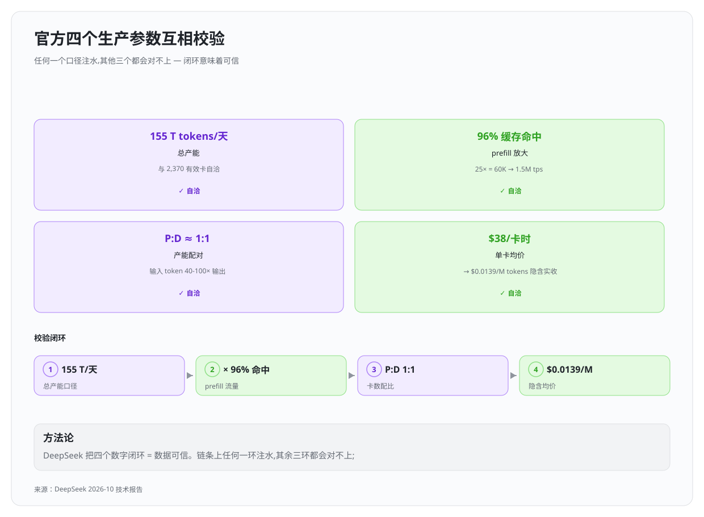
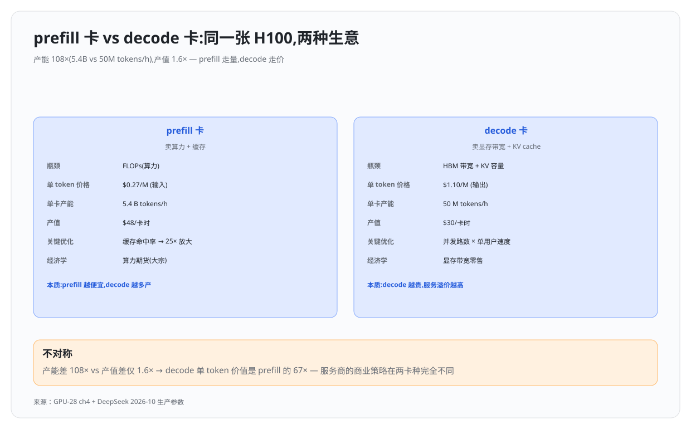
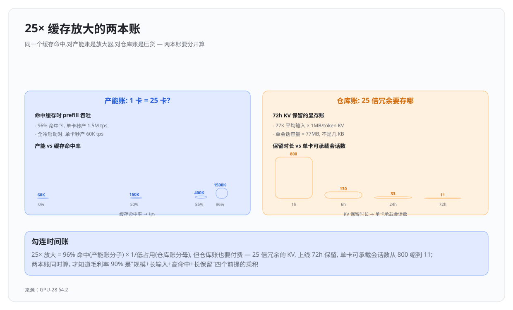
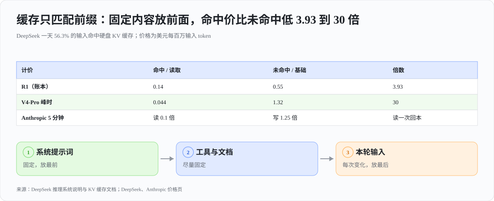
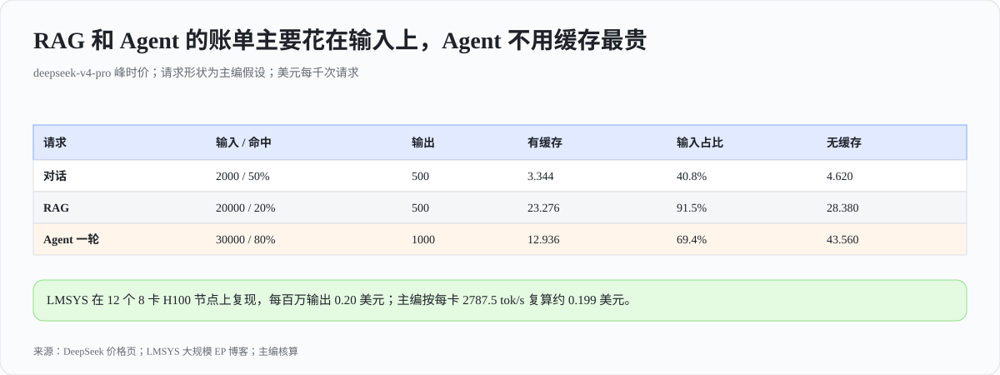

# GPU-28｜LLM｜推理成本经济学：\$ per token 与集群单卡经济

> 🎯 **这篇文档解决什么问题**：每百万 token 多少钱，是推理服务最常被问的数，也最常被算错。本篇把它拆成卡时价、每卡吞吐、利用率三个量，用 Llama 3 70B 的估算看批大小的影响，用 DeepSeek 公开的一天线上账本复算成本、收入和节点秒，再分开看输入和输出、缓存命中、峰谷和卡时价，最后换到调用方，算三种应用的账单。

> 💡 **扩展 GPU-24**：GPU-24（[GPU-24｜LLM｜综合：从选卡到上线](./24-capstone.md)）从选卡到上线走完一遍，本篇把其中的成本一项展开成 \$ per token 和单卡经济账。

**使用方式**：第 1 章给公式，第 2 章算批大小。第 3、4 章复算 DeepSeek 的账本并对账。第 5 到 8 章分别讲输入输出、缓存、利用率和卡时价。第 9 章算应用账单，第 10 章给清单和自测。

**代码**：本篇没有配套代码，文中算例由主编按公开数据核算，第 10 章给出可以自己写的练习。

<b>🧭 主线位置</b>：GPU-00（[GPU-00｜索引｜从 0 开始 GPU 优化：路线、章节与练习](./README.md)）建立了时间账 T = T_compute + W_mem + W_host + W_comm + W_idle。GPU-23（[GPU-23｜LLM｜推理系统：KV cache、PagedAttention 与 PD 分离](./23-inference.md)）讲推理系统怎样压缩这些等待，GPU-24（[GPU-24｜LLM｜综合：从选卡到上线](./24-capstone.md)）第 8 章给出推理按每百万 token 算成本的做法。本篇把时间账完整地换成钱：每卡吞吐来自单步时间账，利用率是集群层面的 W_idle，卡时价是换算的汇率。GPU-27（[GPU-27｜硬件｜NVL72 与 Grace-Blackwell Superchip：打穿 TP=8](./27-nvl72.md)）讲了更大的 NVLink 域，GPU-29（[GPU-29｜LLM｜推理引擎实战：SGLang vs vLLM 选型](./29-engine-choice.md)）接着比较推理引擎。

## 导读 · 先给结论

- <b>成本只由三个量决定。</b>卡时价 ÷ 3600 ÷（每卡吞吐 × 利用率）× 一百万；按 2 美元卡时价，每卡 1850 tok/s 的解码约 0.3003 美元每百万（第 1 章）。[[1]](https://raw.githubusercontent.com/deepseek-ai/open-infra-index/main/202502OpenSourceWeek/day_6_one_more_thing_deepseekV3R1_inference_system_overview.md)
- <b>批大小能让单价差 40 倍。</b>Llama 3 70B 在 8 卡 H100 上，批大小 1 约 23.639 美元，64 约 0.588 美元（第 2 章）。[[2]](https://arxiv.org/pdf/2407.21783)[[3]](https://arxiv.org/pdf/2309.06180)
- <b>DeepSeek 一天成本 87,072 美元。</b>按 R1 价格折算收入 562,027 美元、利润率 545%，原文自己说明实际收入低得多（第 3 章）。[[1]](https://raw.githubusercontent.com/deepseek-ai/open-infra-index/main/202502OpenSourceWeek/day_6_one_more_thing_deepseekV3R1_inference_system_overview.md)
- <b>吞吐和节点数对得上。</b>节点秒折合 226.9 个节点，和报告的 226.75 一致，说明报告的是有效吞吐（第 4 章）。[[1]](https://raw.githubusercontent.com/deepseek-ai/open-infra-index/main/202502OpenSourceWeek/day_6_one_more_thing_deepseekV3R1_inference_system_overview.md)
- <b>输出贵约 5 倍。</b>每百万输入约 0.0603 美元、输出约 0.3003 美元，标价只差 3.98 倍（第 5 章）。[[1]](https://raw.githubusercontent.com/deepseek-ai/open-infra-index/main/202502OpenSourceWeek/day_6_one_more_thing_deepseekV3R1_inference_system_overview.md)
- <b>一半以上的输入命中缓存。</b>56.3% 命中硬盘 KV 缓存；缓存只匹配前缀，命中价低 3.93 到 30 倍（第 6 章）。[[4]](https://api-docs.deepseek.com/guides/kv_cache)[[5]](https://api-docs.deepseek.com/quick_start/pricing)
- <b>峰谷和卡时价决定剩下的账。</b>平均节点是峰值的 81.6%，靠夜里挪去训练；GPU 电费只占卡时价的个位数百分比（第 7、8 章）。[[1]](https://raw.githubusercontent.com/deepseek-ai/open-infra-index/main/202502OpenSourceWeek/day_6_one_more_thing_deepseekV3R1_inference_system_overview.md)[[6]](https://www.nvidia.com/en-us/data-center/h100/)

<b>📎 与系列其他文档的分工</b>：GPU-23（[GPU-23｜LLM｜推理系统：KV cache、PagedAttention 与 PD 分离](./23-inference.md)）讲 KV cache、PagedAttention 和预填充解码分离。GPU-24（[GPU-24｜LLM｜综合：从选卡到上线](./24-capstone.md)）讲从选卡到上线的整体方案，成本只是其中一章。GPU-26（[GPU-26｜系统｜CXL：一致性互连与 KV offload 工程化](./26-cxl.md)）讲 KV 怎样停放在主机内存和 CXL 上。本篇只讲推理的单位经济：每百万 token 的成本怎样算、怎样核对、怎样降。

## 第 1 章 · 成本公式：每百万 token 的价格由三个数决定

谈推理成本，最常见的单位是每百万 token 多少美元。这个数听起来像一个市场价格，拆开以后其实只由三个量决定：一张卡一小时要花多少钱，这张卡每秒能产出多少 token，以及这张卡有多少时间在干活。本章先把公式写出来，再说明它和前面各篇的时间账怎样接上。

### 公式和一个算例

每百万 token 成本 = 卡时价 ÷ 3600 ÷（每卡每秒 token 数 × 利用率）× 一百万。分子是钱，分母是一秒钟里实际产出的 token。DeepSeek 在公开的推理系统说明里给了一个现成的例子：他们假设一张 H800 的租用成本是每小时 2 美元[[1]](https://raw.githubusercontent.com/deepseek-ai/open-infra-index/main/202502OpenSourceWeek/day_6_one_more_thing_deepseekV3R1_inference_system_overview.md)，一个 H800 节点在解码阶段平均每秒输出约 14.8k 个 token[[1]](https://raw.githubusercontent.com/deepseek-ai/open-infra-index/main/202502OpenSourceWeek/day_6_one_more_thing_deepseekV3R1_inference_system_overview.md)。每节点 8 张卡[[1]](https://raw.githubusercontent.com/deepseek-ai/open-infra-index/main/202502OpenSourceWeek/day_6_one_more_thing_deepseekV3R1_inference_system_overview.md)，每卡约 1850 tok/s，代入公式，每百万输出 token 的成本约 0.3003 美元。这里的利用率已经折进了平均吞吐，第 4 章会说明为什么。

同一个公式也能反过来用：给定一个 API 价格，可以算出这张卡至少要跑到多少吞吐才不亏。第 5 章会用这个办法比较 DeepSeek 的标价和成本，第 9 章再用 LMSYS 在 H100 上的复现核对量级：他们换算出的成本是每百万输出 token 0.20 美元[[7]](https://lmsys.org/blog/2025-05-05-large-scale-ep/)。

### 三个旋钮各归谁管

卡时价由采购、租赁合同和机房决定，第 8 章单独讨论。每卡吞吐由每一步的时间决定：GPU-00（[GPU-00｜索引｜从 0 开始 GPU 优化：路线、章节与练习](./README.md)）的时间账 T = T_compute + W_mem + W_host + W_comm + W_idle 里，前四项决定一步多长，一步里能处理多少请求由批大小决定。vLLM 的论文开篇就指出，高吞吐服务要一次批处理足够多的请求[[3]](https://arxiv.org/pdf/2309.06180)，第 2 章会算出批大小能让单价差几十倍。利用率是集群层面的 W_idle：卡开着却没有请求，或者为了应付峰值留着空转，第 7 章讨论。

放进时间账：每百万 token 的成本就是时间账在钱上的投影。T_compute 和 W_mem 决定单卡吞吐的上限，W_comm 和 W_host 吃掉其中一部分，W_idle 再按利用率打折，卡时价把剩下的时间换成美元。

按五步闭环看成本公式：

- **定天花板**：用 HBM 带宽和批大小算出解码吞吐的上限，代入公式得到成本下限。
- **测实际**：线上按小时记录每卡输出 token 数和在用卡数。
- **定位等待**：把实际成本和下限的差拆到吞吐和利用率两边。
- **消除或隐藏**：吞吐不足调批大小和并行策略，利用率不足调扩缩容和峰谷调度。
- **复测**：每百万 token 成本按同一口径重算，和改动前比较。

一个常见的误区是拿别家的 API 标价当作自己的成本参照。现象是自建集群算出来比 API 贵很多，或者便宜得不合常理。原因是标价里含毛利、折扣和免费流量的分摊，自己的账里卡时价、吞吐和利用率的口径又各不相同。改法是先用同一个公式把三个量各自写清楚，再拿标价做对照。

> 🔑 **本章要点**：每百万 token 成本 = 卡时价 ÷ 3600 ÷（每卡吞吐 × 利用率）× 一百万。按 DeepSeek 的 2 美元卡时价和每卡约 1850 tok/s 的解码吞吐，输出成本约 0.3003 美元每百万。卡时价、吞吐、利用率分别对应采购、单步时间账和集群的 W_idle。这一章是五步闭环的“定天花板”：先写出成本由哪几个量决定。

## 第 2 章 · 批大小：同一台机器，单价能差 40 倍

公式里的每卡吞吐不是一个固定值。同一台 8 卡 H100 服务器跑同一个模型，每步同时处理 1 个请求还是 64 个请求，每卡吞吐能差几十倍，成本也就差几十倍。本章用 Llama 3 70B 做一个只算显存读取的估算，看批大小怎样改变单价。

### 解码一步读多少字节

Llama 3 70B 有 80 层、模型维度 8192、64 个注意力头、8 个 KV 头[[2]](https://arxiv.org/pdf/2407.21783)，头维度 128，每个 token 的 KV 是 80 × 8 × 128 × 2 × 2 = 327680 字节，按张量并行 8 卡切开，每卡 40960 字节。按 GPU-23（[GPU-23｜LLM｜推理系统：KV cache、PagedAttention 与 PD 分离](./23-inference.md)）的配套代码输出，模型有 70.6B 参数，BF16 下每卡权重约 17.65 GB。H100 SXM 的显存带宽是 3.35TB/s[[6]](https://www.nvidia.com/en-us/data-center/h100/)。

解码每一步，每张卡要把自己那份权重读一遍，再把批里每个请求的 KV 读一遍。假设上下文都是 4096 个 token、只算显存读取时间，一步的时间约为（权重字节 + 批大小 × 4096 × 40960）÷ 3.35TB/s。这个估算忽略了计算、通信和调度开销，算的是下限。

### 三个批大小的单价

按每卡时 2 美元、利用率 100% 算：

- 批大小 1：一步约 5.32 ms，每卡 23.5 tok/s，每百万输出 token 约 23.639 美元。
- 批大小 8：一步约 5.67 ms，每卡 176.4 tok/s，约 3.150 美元。
- 批大小 64：一步约 8.47 ms，每卡 944.1 tok/s，约 0.588 美元。

批大小从 1 涨到 64，一步只慢了约 1.6 倍，产出却多了 64 倍，单价降了约 40 倍。原因是权重每步只读一次，被批里所有请求分摊。批大小 64 时每卡的 KV 约 10.74 GB，加上权重共 28.39 GB，80 GB 的卡还放得下。vLLM 的论文把这一点说得很直接：高吞吐服务需要一次批处理足够多的请求[[3]](https://arxiv.org/pdf/2309.06180)，KV 显存管理得不好，碎片和重复就会限制批大小[[3]](https://arxiv.org/pdf/2309.06180)。他们的 PagedAttention 在同样延迟下把吞吐提高了 2-4 倍[[3]](https://arxiv.org/pdf/2309.06180)，省下的正是这里的单价。

批大小也不能无限加。批越大，每个请求一步等得越久，首 token 和每 token 延迟都会变长；上下文越长，KV 占的显存越多，能开的批越小。GPU-23（[GPU-23｜LLM｜推理系统：KV cache、PagedAttention 与 PD 分离](./23-inference.md)）第 9 章讲的 SLO 和 goodput 就是这里的约束。利用率也要乘进去：同样批大小 64，利用率 0.8 时单价约 0.736 美元，0.5 时约 1.177 美元。

放进时间账：批大小改变的是 W_mem 的分摊方式。权重读取是每步固定的 W_mem，KV 读取随批大小线性增长；批越大，固定部分被摊得越薄，每个 token 分到的时间越少。

按五步闭环看批大小：

- **定天花板**：按显存容量和 SLO 算出能开的最大批。
- **测实际**：记录线上实际的平均批大小和每步时间。
- **定位等待**：批开不大时，查是显存不够、请求不够还是调度没攒批。
- **消除或隐藏**：用分页 KV、连续批处理、量化 KV 把批开大。
- **复测**：每卡吞吐和每百万 token 成本按同一口径对比。

一个常见的误区是用单请求压测的结果算成本。现象是算出来每百万 token 要几十美元，和市场价差一个数量级。原因是批大小 1 时每步读一遍权重只服务一个 token，单价最高。改法是按线上真实的并发和批大小压测，成本按稳态批大小算。

> 🔑 **本章要点**：Llama 3 70B 在 8 卡 H100 上解码，按只算显存读取的下限，批大小 1、8、64 的单价约 23.639、3.150、0.588 美元每百万输出 token，差约 40 倍。权重每步读一次，被批里的请求分摊。批大小受显存和 SLO 限制，利用率还要再乘进去。这一章是五步闭环的“测实际”：成本要按线上真实的批大小算。

## 第 3 章 · DeepSeek 公开账本：一天成本 87,072 美元，理论毛利 545%

大多数推理服务的成本和收入都不公开。2025 年 2 月，DeepSeek 在开源周的最后一篇说明里公布了一整天的推理账：用了多少节点、处理了多少 token、按什么价格折算收入[[1]](https://raw.githubusercontent.com/deepseek-ai/open-infra-index/main/202502OpenSourceWeek/day_6_one_more_thing_deepseekV3R1_inference_system_overview.md)。这是目前能找到的、口径写得最清楚的一份线上账本。本章先把账本原样摆出来，再逐项复算，并标出它和真实收入之间差在哪里。

### 账本原文

统计窗口是 UTC+8 的 2025 年 2 月 27 日 12 点到 28 日 12 点[[1]](https://raw.githubusercontent.com/deepseek-ai/open-infra-index/main/202502OpenSourceWeek/day_6_one_more_thing_deepseekV3R1_inference_system_overview.md)。所有 V3 和 R1 的推理服务都跑在 H800 上，精度和训练一致[[1]](https://raw.githubusercontent.com/deepseek-ai/open-infra-index/main/202502OpenSourceWeek/day_6_one_more_thing_deepseekV3R1_inference_system_overview.md)。这 24 小时里，V3 和 R1 推理服务的节点占用峰值是 278 个，平均 226.75 个，每节点 8 张 H800[[1]](https://raw.githubusercontent.com/deepseek-ai/open-infra-index/main/202502OpenSourceWeek/day_6_one_more_thing_deepseekV3R1_inference_system_overview.md)，折合平均 1814 张卡、峰值 2224 张卡。假设一张 H800 每小时 2 美元，一天的总成本是 87,072 美元[[1]](https://raw.githubusercontent.com/deepseek-ai/open-infra-index/main/202502OpenSourceWeek/day_6_one_more_thing_deepseekV3R1_inference_system_overview.md)。

流量这边：输入共 608B 个 token，其中 342B 个（56.3%）命中了硬盘上的 KV 缓存[[1]](https://raw.githubusercontent.com/deepseek-ai/open-infra-index/main/202502OpenSourceWeek/day_6_one_more_thing_deepseekV3R1_inference_system_overview.md)；输出共 168B 个 token[[1]](https://raw.githubusercontent.com/deepseek-ai/open-infra-index/main/202502OpenSourceWeek/day_6_one_more_thing_deepseekV3R1_inference_system_overview.md)。这些统计包含网页、APP 和 API 的全部请求[[1]](https://raw.githubusercontent.com/deepseek-ai/open-infra-index/main/202502OpenSourceWeek/day_6_one_more_thing_deepseekV3R1_inference_system_overview.md)。所谓命中，是指后续请求和之前的请求有相同的前缀，重叠的部分直接从缓存取[[4]](https://api-docs.deepseek.com/guides/kv_cache)，第 6 章细讲。如果全部按 R1 的价格计费，一天的收入是 562,027 美元，成本利润率 545%[[1]](https://raw.githubusercontent.com/deepseek-ai/open-infra-index/main/202502OpenSourceWeek/day_6_one_more_thing_deepseekV3R1_inference_system_overview.md)。R1 的价格是命中缓存的输入每百万 0.14 美元[[1]](https://raw.githubusercontent.com/deepseek-ai/open-infra-index/main/202502OpenSourceWeek/day_6_one_more_thing_deepseekV3R1_inference_system_overview.md)，未命中的输入 0.55 美元[[1]](https://raw.githubusercontent.com/deepseek-ai/open-infra-index/main/202502OpenSourceWeek/day_6_one_more_thing_deepseekV3R1_inference_system_overview.md)，输出 2.19 美元[[1]](https://raw.githubusercontent.com/deepseek-ai/open-infra-index/main/202502OpenSourceWeek/day_6_one_more_thing_deepseekV3R1_inference_system_overview.md)。

### 逐项复算

成本：226.75 × 8 × 24 × 2 = 87,072 美元，和原文一致。收入：命中 342B × 0.14、未命中 266B × 0.55、输出 168B × 2.19，三项分别约 47,880、146,300、367,920 美元，合计约 562,100 美元，和原文的 562,027 差几十美元，来自 608B 和 342B 这两个数的取整。按原文收入算，利润率约 545.5%。把输入和输出一起算，每百万 token 的平均成本约 0.1122 美元。

收入里输出占 65.5%，虽然输出 token 只有输入的三分之一不到。输出的单价是未命中输入的 3.98 倍，第 5 章会看这个价差和成本差是否对得上。

### 545% 不是实际利润

原文自己列了实际收入低得多的原因：V3 的定价明显低于 R1[[1]](https://raw.githubusercontent.com/deepseek-ai/open-infra-index/main/202502OpenSourceWeek/day_6_one_more_thing_deepseekV3R1_inference_system_overview.md)；只有一部分服务收费，网页和 APP 仍然免费[[1]](https://raw.githubusercontent.com/deepseek-ai/open-infra-index/main/202502OpenSourceWeek/day_6_one_more_thing_deepseekV3R1_inference_system_overview.md)；闲时会自动打折[[1]](https://raw.githubusercontent.com/deepseek-ai/open-infra-index/main/202502OpenSourceWeek/day_6_one_more_thing_deepseekV3R1_inference_system_overview.md)。另外成本只算了 GPU 租金，没有算研发、训练、存储和带宽。所以 545% 说明的是推理系统本身的单位经济性有多大余量，不能当成公司的利润率。

放进时间账：这份账本把时间账翻成了钱。87,072 美元买的是 1814 张卡一天的时间，这些时间里多少花在 prefill、多少花在 decode、多少闲着，下一章用吞吐把它拆开。

按五步闭环看公开账本：

- **定天花板**：用价格表和 token 数算出理论收入。
- **测实际**：用节点数和卡时价算出实际成本。
- **定位等待**：把收入按命中、未命中、输出三项拆开，看钱来自哪里。
- **消除或隐藏**：标出免费流量、折扣和其他模型定价对收入的影响。
- **复测**：复算的成本和收入与原文对齐到取整误差以内。

一个常见的误区是把 545% 当作大模型推理的普遍毛利。现象是拿它去估算别家服务，结论偏差很大。原因是这个数假设所有 token 都按 R1 价格收费，而原文明说网页和 APP 免费、V3 更便宜、夜间打折。另外，这份账本是 2025 年初的，DeepSeek 现在的价格表已经换成 deepseek-flash 和 deepseek-v4-pro 两个模型[[5]](https://api-docs.deepseek.com/quick_start/pricing)，价格也不同了。改法是只借用账本里的吞吐、节点数和命中率这些工程量，收入按自己的计费口径重算。

> 🔑 **本章要点**：DeepSeek 公布的 24 小时账本：平均 226.75 个节点、峰值 278 个，按每卡时 2 美元一天成本 87,072 美元；输入 608B、命中 56.3%，输出 168B；按 R1 价格折算收入 562,027 美元，利润率 545%，输出贡献收入的 65.5%。原文自己说明实际收入低得多。这一章是五步闭环的“测实际”：先把一份真实线上账本复算对。

## 第 4 章 · 节点秒对账：吞吐和节点数能互相印证

上一章的账本里有两组数：一组是 token 总量和节点数，一组是每节点的平均吞吐。如果这两组数是同一批系统测出来的，用吞吐把 token 总量换成节点秒，应该正好等于节点数乘以一天的秒数。本章做这个核对，并说明它对理解“利用率”有什么用。

### 换成节点秒

DeepSeek 报告，一个 H800 节点在 prefill 阶段平均每秒处理约 73.7k 个输入 token（含命中缓存的部分，这部分只要把重叠前缀的 KV 取回来[[4]](https://api-docs.deepseek.com/guides/kv_cache)），在 decode 阶段平均每秒输出约 14.8k 个 token[[1]](https://raw.githubusercontent.com/deepseek-ai/open-infra-index/main/202502OpenSourceWeek/day_6_one_more_thing_deepseekV3R1_inference_system_overview.md)。608B 个输入 token 除以 73.7k，约 8.250e+06 节点秒；168B 个输出 token 除以 14.8k，约 1.135e+07 节点秒；合计约 1.960e+07 节点秒。一天是 86400 秒，折合平均约 226.9 个节点在工作，和原文的 226.75 几乎一样。

两组数对得上，说明原文的平均吞吐就是用 token 总量除以节点占用时间得到的有效吞吐。这是主编根据对账结果做的推断：节点占用期间的空转、攒批、调度开销都已经折进了这两个吞吐里，它们是线上的实际值，不是压测峰值。所以用它们算出的每卡成本可以直接当作线上成本。

### prefill 和 decode 各占多少节点

按节点秒拆，prefill 占约 42.1%，decode 占约 57.9%。输入 token 是输出的三倍多，prefill 却只用了不到一半的节点时间，因为 prefill 一次处理一整段提示词，算术强度高；decode 每步每个请求只产出一个 token，受显存带宽限制。DeepSeek 的部署也按这两段分开：prefill 的一个部署单元跨 4 个节点，有 32 个冗余路由专家[[1]](https://raw.githubusercontent.com/deepseek-ai/open-infra-index/main/202502OpenSourceWeek/day_6_one_more_thing_deepseekV3R1_inference_system_overview.md)；decode 的一个部署单元跨 18 个节点，同样有 32 个冗余路由专家[[1]](https://raw.githubusercontent.com/deepseek-ai/open-infra-index/main/202502OpenSourceWeek/day_6_one_more_thing_deepseekV3R1_inference_system_overview.md)。跨节点的专家并行通信开销很大，他们用双批重叠把通信藏在计算后面[[1]](https://raw.githubusercontent.com/deepseek-ai/open-infra-index/main/202502OpenSourceWeek/day_6_one_more_thing_deepseekV3R1_inference_system_overview.md)。LMSYS 在 H100 上复现这套系统时，用的也是预填充解码分离加大规模专家并行[[7]](https://lmsys.org/blog/2025-05-05-large-scale-ep/)。GPU-22（[GPU-22｜LLM｜MoE 与专家并行：all-to-all 与负载均衡](./22-moe-ep.md)）讲过这套专家并行的通信账，GPU-23（[GPU-23｜LLM｜推理系统：KV cache、PagedAttention 与 PD 分离](./23-inference.md)）第 7 章讲过预填充和解码分离。

放进时间账：节点秒就是把时间账加总到集群层面。T_compute、W_mem、W_comm 决定每节点吞吐，吞吐决定要多少节点秒；节点占用期间没有用上的时间已经算在吞吐里，节点没被占用的时间才是第 7 章讨论的峰谷 W_idle。

按五步闭环看节点秒：

- **定天花板**：用压测吞吐算出完成一天流量最少要多少节点秒。
- **测实际**：用线上 token 总量和节点占用算出有效吞吐。
- **定位等待**：比较有效吞吐和压测吞吐，差距就是占用期间的空转和开销。
- **消除或隐藏**：按 prefill 和 decode 的节点秒比例分配节点，不让一边闲着。
- **复测**：节点秒合计和节点占用对账一致。

一个常见的误区是拿压测的峰值吞吐算成本。现象是成本算得很低，上线后实际账单高出一截。原因是压测时批总是满的，线上请求有起伏、有长有短，占用期间总有空转。改法是像 DeepSeek 这样，用一天的 token 总量除以实际占用的节点秒，得到有效吞吐再算成本。

> 🔑 **本章要点**：用 73.7k 和 14.8k 的每节点吞吐把 608B 输入、168B 输出换成节点秒，合计约 1.960e+07，折合平均 226.9 个节点，和原文 226.75 对得上，说明原文吞吐是有效吞吐。prefill 占约 42.1% 的节点时间。这一章是五步闭环的“定位等待”：用对账分清占用期间的空转和没占用的空闲。

## 第 5 章 · 输入和输出分开算：输出贵约 5 倍，标价只差约 4 倍

几乎所有 API 都把输入和输出分开定价，而且输出更贵。这个价差有没有成本依据？用上一章的有效吞吐可以把两段的成本分开算出来，再和标价对照。本章做这件事，并解释输出为什么贵。

### 两段各自的单位成本

每节点 8 张卡，prefill 每卡约 9212 tok/s，decode 每卡约 1850 tok/s。按每卡时 2 美元代入第 1 章的公式：每百万输入 token 的成本约 0.0603 美元，每百万输出 token 约 0.3003 美元，输出是输入的 4.98 倍。这里的输入吞吐含命中缓存的 token，命中的部分几乎不用算，所以未命中输入的真实单位成本比 0.0603 美元高；原文没有分开报告两类输入的吞吐，主编无法再拆。

R1 的标价是未命中输入 0.55 美元、输出 2.19 美元，输出是未命中输入的 3.98 倍，比成本差的 4.98 倍小一些。拿标价除以成本，未命中输入约 9.1 倍，输出约 7.3 倍。也就是说，在这份账本的口径下，输出 token 的价格相对成本反而更便宜。这和第 3 章“输出贡献 65.5% 收入”并不矛盾：输出单价高、用量也不小，所以收入占大头。

LMSYS 在 H100 上的复现也是同样的不对称：对 2000 个 token 的输入，每节点每秒处理 52.3k 个输入 token、输出 22.3k 个 token[[7]](https://lmsys.org/blog/2025-05-05-large-scale-ep/)。

### 输出为什么贵

原文报告，每个请求的平均输出速度是 20–22 tok/s，每个输出 token 平均要面对 4,989 个 token 的 KV[[1]](https://raw.githubusercontent.com/deepseek-ai/open-infra-index/main/202502OpenSourceWeek/day_6_one_more_thing_deepseekV3R1_inference_system_overview.md)。解码每一步，每个请求只产出一个 token，却要把这 4,989 个 token 的 KV 和模型权重读一遍，这是 GPU-23（[GPU-23｜LLM｜推理系统：KV cache、PagedAttention 与 PD 分离](./23-inference.md)）第 4 章讲的解码时间账：解码受显存带宽限制。vLLM 的论文也指出，解码要靠一次批处理足够多的请求才能有高吞吐[[3]](https://arxiv.org/pdf/2309.06180)。prefill 则一次处理整段提示词，每读一次权重做几千次乘加，受算力限制，每卡吞吐自然高得多。

这也说明了降低成本的方向。输出贵，是因为 W_mem 每步都要付；第 2 章的大批量、GPU-25（[GPU-25｜LLM｜投机解码：αK 与 MTP / EAGLE 谱系](./25-speculative.md)）的投机解码、GPU-26（[GPU-26｜系统｜CXL：一致性互连与 KV offload 工程化](./26-cxl.md)）讨论的 KV 分层，都是在摊薄或缩短这部分等待。输入贵在 T_compute，靠的是缓存命中（第 6 章）少算一遍。

放进时间账：输入成本主要对应 T_compute，输出成本主要对应 W_mem。两者的单位成本差约 5 倍，反映的是预填充和解码在时间账上的不同形状。

按五步闭环看输入输出：

- **定天花板**：分别按算力和显存带宽算出 prefill 和 decode 的每卡吞吐上限。
- **测实际**：分别记录两段的有效吞吐和节点占用。
- **定位等待**：把每百万 token 成本按输入、输出两项拆开。
- **消除或隐藏**：输出侧摊薄 W_mem，输入侧提高缓存命中。
- **复测**：两项单位成本分别下降，标价与成本的倍数可解释。

一个常见的误区是只用一个“每百万 token 成本”给所有流量定价。现象是长输入、短输出的业务被高估成本，长输出的业务被低估。原因是输入和输出的单位成本差约 5 倍，混在一起算掩盖了业务的形状。改法是输入、输出分开记账，按每类业务的输入输出比例算各自的成本。

> 🔑 **本章要点**：按 DeepSeek 的有效吞吐，每卡 prefill 约 9212 tok/s、decode 约 1850 tok/s，每百万输入约 0.0603 美元、输出约 0.3003 美元，差 4.98 倍；R1 标价差 3.98 倍，标价对成本的倍数输入约 9.1、输出约 7.3。输出贵在每步都要读 KV 和权重。这一章是五步闭环的“定位等待”：把成本分到 T_compute 和 W_mem 两边。

## 第 6 章 · 缓存命中：一半以上的输入不用再算

DeepSeek 的账本里，608B 个输入 token 有 56.3% 命中了硬盘上的 KV 缓存[[1]](https://raw.githubusercontent.com/deepseek-ai/open-infra-index/main/202502OpenSourceWeek/day_6_one_more_thing_deepseekV3R1_inference_system_overview.md)。命中的 token 不用重新做 prefill，只要把存好的 KV 读回来。这是 GPU-26（[GPU-26｜系统｜CXL：一致性互连与 KV offload 工程化](./26-cxl.md)）讲的 KV 分层在成本上的直接体现。本章看缓存怎样定价、怎样命中，以及应用侧要怎样写请求才能吃到这个折扣。

### 缓存怎样工作

DeepSeek 的 API 文档说明，每个用户请求都会触发构建一份硬盘缓存[[4]](https://api-docs.deepseek.com/guides/kv_cache)，硬盘缓存只匹配用户输入的前缀部分[[4]](https://api-docs.deepseek.com/guides/kv_cache)。缓存按“尽力而为”的方式工作，不保证 100% 命中[[4]](https://api-docs.deepseek.com/guides/kv_cache)；不再使用的缓存会自动清理，通常在几小时到几天之内[[4]](https://api-docs.deepseek.com/guides/kv_cache)。这几条决定了命中率主要看应用：同一个用户的多轮对话、共用的长系统提示词、反复引用的文档，前缀都相同，容易命中；每次都变的内容放在前面，就一个也命中不了。

### 命中和未命中差多少钱

R1 的价格是命中 0.14 美元、未命中 0.55 美元[[1]](https://raw.githubusercontent.com/deepseek-ai/open-infra-index/main/202502OpenSourceWeek/day_6_one_more_thing_deepseekV3R1_inference_system_overview.md)，差 3.93 倍。DeepSeek 现在的价格表里，deepseek-v4-pro 的峰时价是命中每百万 0.044 美元[[5]](https://api-docs.deepseek.com/quick_start/pricing)、未命中 1.32 美元[[5]](https://api-docs.deepseek.com/quick_start/pricing)，差 30 倍。其他厂商用的是写入和读取分开计价的方式：Anthropic 的 5 分钟缓存写入按基础输入价的 1.25 倍收费[[8]](https://docs.anthropic.com/en/docs/about-claude/pricing)，1 小时缓存写入按 2 倍[[8]](https://docs.anthropic.com/en/docs/about-claude/pricing)，缓存读取在大多数模型上按 0.1 倍[[8]](https://docs.anthropic.com/en/docs/about-claude/pricing)。按它的说明，5 分钟缓存读一次就回本[[8]](https://docs.anthropic.com/en/docs/about-claude/pricing)：写一次加读一次是 1.35 倍基础价，不用缓存的两次请求是 2 倍。

回到 DeepSeek 的账本，第 3 章算过命中的输入只贡献了约 47,880 美元收入，未命中的输入贡献约 146,300 美元，而命中的 token 比未命中的还多。对服务方来说，命中意味着省下 prefill 的算力；对调用方来说，命中意味着输入账单打了折。两边的利益在这里是一致的。

放进时间账：缓存命中把一部分 T_compute 换成了从缓存层读回 KV 的 W_host 或网络读取。只要读回比重算快，这笔交换就划算；GPU-26 第 8 章算过从主机内存回载一段 KV 和重新 prefill 的时间对比。

按五步闭环看缓存：

- **定天花板**：按业务的前缀结构估算能命中的输入比例。
- **测实际**：API 返回的命中和未命中 token 数，按天汇总命中率。
- **定位等待**：找出命中率低的请求，查前缀是否被时间戳、随机 ID 之类的内容打断。
- **消除或隐藏**：把固定的系统提示词、工具定义、文档放在最前面，变化的内容放在后面。
- **复测**：命中率和输入账单按同一口径对比。

一个常见的误区是在系统提示词的开头写入当前时间或请求 ID。现象是业务明明有大段共用的提示词，命中率却接近零。原因是缓存只匹配前缀[[4]](https://api-docs.deepseek.com/guides/kv_cache)，第一个 token 不同，后面就全部不命中。改法是把每次都变的内容挪到提示词末尾，或者放进用户消息里。

> 🔑 **本章要点**：DeepSeek 一天 56.3% 的输入命中了硬盘 KV 缓存。缓存只匹配前缀、尽力而为、几小时到几天清理。命中价比未命中价低 3.93 倍（R1）到 30 倍（V4-Pro 峰时）；Anthropic 写入 1.25 倍、读取 0.1 倍，读一次就回本。这一章是五步闭环的“消除或隐藏”：用缓存把重复的 prefill 省掉。

## 第 7 章 · 利用率与峰谷：白天满载，夜里把卡挪去训练

第 1 章的公式里，利用率和吞吐同样重要：吞吐翻倍、利用率减半，成本不变。推理流量有明显的峰谷，按峰值配卡，低谷时大量卡就空着。本章用 DeepSeek 的节点数看峰谷有多大，再看他们和其他厂商怎样处理低谷。

### 峰谷有多大

DeepSeek 一天里的节点占用峰值是 278 个，平均 226.75 个[[1]](https://raw.githubusercontent.com/deepseek-ai/open-infra-index/main/202502OpenSourceWeek/day_6_one_more_thing_deepseekV3R1_inference_system_overview.md)，平均是峰值的 81.6%。这个比例已经不低，因为他们没有让低谷的节点空着：原文说，白天高峰时所有节点都用来跑推理，夜间负载低时减少推理节点，把资源分给研究和训练[[1]](https://raw.githubusercontent.com/deepseek-ai/open-infra-index/main/202502OpenSourceWeek/day_6_one_more_thing_deepseekV3R1_inference_system_overview.md)。如果按峰值 278 个节点占满一整天，成本会是 106,752 美元，比实际多 22.6%。这多出来的部分，正是被挪去训练的那些节点时间。

### 用价格引导流量

另一个办法是让低谷的流量变多。DeepSeek 的价格表规定闲时价格是峰时的一半[[5]](https://api-docs.deepseek.com/quick_start/pricing)，账本里也提到闲时会自动打折[[1]](https://raw.githubusercontent.com/deepseek-ai/open-infra-index/main/202502OpenSourceWeek/day_6_one_more_thing_deepseekV3R1_inference_system_overview.md)。Anthropic 的批处理 API 走异步处理，输入和输出都打五折[[8]](https://docs.anthropic.com/en/docs/about-claude/pricing)。这两种折扣的目的相同：把不着急的请求推到负载低的时候，或者交给可以慢慢攒大批的通道。第 2 章算过，批越大单价越低，异步任务正好可以攒满批。

利用率对单价的影响可以直接从第 2 章读出来：同样的批大小 64，利用率从 1 降到 0.8，每百万 token 从 0.588 美元涨到 0.736 美元；降到 0.5，涨到 1.177 美元。卡时价是固定付的，没有请求的那部分时间也要分摊到有请求的 token 上。

放进时间账：峰谷带来的是集群层面的 W_idle。单卡上的 W_idle 发生在一步之内，这里的发生在一天之内，要靠调度和定价来处理，改 kernel 帮不上忙。

按五步闭环看利用率：

- **定天花板**：按一天的流量曲线算出平均和峰值所需的节点数。
- **测实际**：按小时记录在用节点数和空闲节点数。
- **定位等待**：找出低谷时段，以及低谷时还占着的节点。
- **消除或隐藏**：低谷时缩容或把节点挪给训练、批处理；用闲时价和批处理价把流量引到低谷。
- **复测**：平均和峰值节点数之比上升，每百万 token 成本下降。

一个常见的误区是推理集群按峰值固定配置，全天不动。现象是白天排队、夜里大半卡空着，算下来单价比压测时高得多。原因是卡时价按全天付，夜里空转的时间全分摊到了白天的 token 上。改法是像 DeepSeek 那样让推理和训练共用一池卡，按时段调度，或者用闲时折扣把可延迟的流量挪到夜里。

> 🔑 **本章要点**：DeepSeek 平均节点数是峰值的 81.6%，靠的是夜里把推理节点挪去研究和训练；按峰值占满一天会多花 22.6%。闲时半价和批处理五折把可延迟的流量引到低谷。利用率从 1 降到 0.5，单价从 0.588 涨到 1.177 美元。这一章是五步闭环的“消除或隐藏”：用调度和定价消掉集群层面的 W_idle。

## 第 8 章 · 卡时价：2 美元是假设，电费只占其中一小块

前面所有的算例都用了每卡时 2 美元，这个数来自 DeepSeek 的账本，原文明说是假设的 H800 租用成本[[1]](https://raw.githubusercontent.com/deepseek-ai/open-infra-index/main/202502OpenSourceWeek/day_6_one_more_thing_deepseekV3R1_inference_system_overview.md)。卡时价在公式里是线性的：它翻倍，每百万 token 成本也翻倍。本章看这个数里包含什么，以及自建和租用时它分别怎样算。

### 电费有多少

H100 SXM 的最大热设计功耗是 700W[[6]](https://www.nvidia.com/en-us/data-center/h100/)。一张卡满功耗跑一小时是 0.7 kWh。按假设的每 kWh 0.1 美元，电费约 0.07 美元，占 2 美元的 3.5%；按假设的每 kWh 0.2 美元，约 0.14 美元，占 7.0%。这两个电价是主编为了说明量级取的假设值，没有出处。这里只算了 GPU 本身，服务器的 CPU、内存、网卡、交换机和机房制冷都还没算进去，实际的电费占比会更高，但从这个量级看，卡时价的大头不在电费。

按主编的推断，卡时价的大头是硬件折旧和资金成本，其余是机房、网络、运维和租赁方的利润。这些项目都没有公开的统一数据，本篇不给具体比例。对做账的人来说，关键是区分两类成本：电费随负载变化，折旧和机房成本不管卡忙不忙都要付。

### 自建和租用的区别

租用时，卡时价是合同里的价格，按占用时间付钱。第 9 章引用的 LMSYS 复现就跑在云上租用的 12 个 H100 节点上[[7]](https://lmsys.org/blog/2025-05-05-large-scale-ep/)。如果能像 DeepSeek 那样在低谷时把卡退掉或挪作他用，没用的时间就不用付，第 7 章说的利用率损失可以部分转嫁出去。自建时，折旧按日历时间走，卡空着也在贬值，利用率直接决定每 token 的成本。所以自建集群更依赖第 7 章说的推理和训练共池、按时段调度。

放进时间账：卡时价是把时间账换成钱的汇率。前面各章压缩的是时间，这一章说明一秒钟值多少钱，以及哪部分钱会随着 W_idle 一起白白付掉。

按五步闭环看卡时价：

- **定天花板**：列出卡时价的组成：折旧、资金、电费、机房、网络、运维。
- **测实际**：按月汇总实际支出，除以实际卡时，得到真实卡时价。
- **定位等待**：区分随负载变化的部分和固定的部分。
- **消除或隐藏**：固定成本高时优先提高利用率；电费占比高时考虑降频或功耗上限。
- **复测**：真实卡时价和假设值的差异写进成本模型。

一个常见的误区是把电费当成推理成本的主要部分，靠降功耗省钱。现象是功耗降了，吞吐跟着掉，每百万 token 成本反而上升。原因是电费在卡时价里只占个位数百分比，吞吐下降带来的分摊增加远大于省下的电费。改法是先算清卡时价的组成，降功耗要用每百万 token 成本来评估，不能只看电费。

> 🔑 **本章要点**：2 美元卡时价是 DeepSeek 账本里的假设。H100 满功耗 700W，按假设的 0.1 到 0.2 美元每 kWh，GPU 电费只占 3.5% 到 7.0%，卡时价的大头是固定成本。租用可以随低谷退卡，自建则更依赖提高利用率。这一章是五步闭环的“定天花板”：先把一秒钟值多少钱、哪些钱是固定的说清楚。

## 第 9 章 · 三种应用的账单：输入往往是大头

前面几章站在服务方算成本。调用方看到的是另一本账：同样的价格表，不同的应用形状，账单的构成完全不同。本章用 DeepSeek 现在的价格表算三种典型请求，再用一个第三方复现核对服务方成本的量级。

### 三种请求的账单

deepseek-v4-pro 的峰时价是命中输入每百万 0.044 美元、未命中输入 1.32 美元[[5]](https://api-docs.deepseek.com/quick_start/pricing)，输出 3.96 美元[[5]](https://api-docs.deepseek.com/quick_start/pricing)。下面三种请求的输入长度、命中率和输出长度是主编为了说明形状取的假设值：

- 对话：输入 2000 个 token，命中 50%，输出 500 个 token。每千次请求约 3.344 美元，输入占 40.8%；不用缓存约 4.620 美元。
- 检索增强（RAG）：输入 20000 个 token，每次检索的文档不同，命中 20%，输出 500 个 token。每千次约 23.276 美元，输入占 91.5%；不用缓存约 28.380 美元。
- Agent 的一轮：输入 30000 个 token，前面的对话和工具结果大多命中，命中 80%，输出 1000 个 token。每千次约 12.936 美元，输入占 69.4%；不用缓存约 43.560 美元。

三种请求里，只有对话的输出占了一半以上。RAG 和 Agent 的输入很长，账单主要花在输入上。Agent 的输入比 RAG 还长，因为命中率高，每千次反而便宜近一半；不用缓存，它就是三者里最贵的。只有和之前请求重叠的前缀才能命中[[4]](https://api-docs.deepseek.com/guides/kv_cache)，第 6 章说的前缀稳定，对 Agent 类应用影响最大，GPU-31（[GPU-31｜LLM｜Agent Workload Serving：会话原语与约束解码](./31-agent-serving.md)）会接着讲 Agent 负载的服务方式。

### 第三方复现核对成本

LMSYS 用 SGLang 复现了 DeepSeek 的推理系统，跑在 12 个节点上，每节点 8 张 H100[[7]](https://lmsys.org/blog/2025-05-05-large-scale-ep/)。对 2000 个 token 的输入，每节点每秒处理 52.3k 个输入 token、输出 22.3k 个 token[[7]](https://lmsys.org/blog/2025-05-05-large-scale-ep/)。他们换算的成本是每百万输出 token 0.20 美元，约为 DeepSeek 官方 API 价格的五分之一[[7]](https://lmsys.org/blog/2025-05-05-large-scale-ep/)。按每卡时 2 美元、每卡 2787.5 tok/s 代入第 1 章的公式，得到约 0.199 美元，和他们的数一致。和同样资源下的普通张量并行比，这套方案的输出吞吐最多高 5 倍[[7]](https://lmsys.org/blog/2025-05-05-large-scale-ep/)。

这个 0.199 美元比第 5 章算的 DeepSeek 线上 0.3003 美元低。一个原因是口径不同：LMSYS 是固定 2000 个 token 输入的压测，DeepSeek 是一整天真实流量的有效吞吐。另外两边的卡（H100 和 H800）、软件版本和请求长度分布都不一样，主编没法再拆出各自的份额。这也是第 4 章说的，压测吞吐和有效吞吐要分开用。

放进时间账：调用方的账单是服务方时间账的价格映射。输入长的应用付的主要是 prefill 的 T_compute，缓存命中把它换成便宜得多的读回；输出长的应用付的主要是 decode 的 W_mem。

按五步闭环看应用账单：

- **定天花板**：按价格表和请求形状算出每千次请求的理论账单。
- **测实际**：用 API 返回的命中、未命中、输出 token 数汇总真实账单。
- **定位等待**：看账单主要花在未命中输入还是输出上。
- **消除或隐藏**：输入为主的应用先提命中率、裁剪上下文；输出为主的应用控制输出长度。
- **复测**：每千次请求的账单按同一口径对比。

一个常见的误区是按输出单价估算应用成本，因为输出最贵。现象是 RAG 或 Agent 上线后账单比预估高很多。原因是这类应用每次请求都带着检索到的文档或累积的上下文，输入 token 远多于输出，输入单价虽低，总额却占大头。改法是按真实请求的输入长度、命中率和输出长度三个量分别算，再加总。

> 🔑 **本章要点**：按 V4-Pro 峰时价，对话、RAG、Agent 一轮每千次约 3.344、23.276、12.936 美元，输入分别占 40.8%、91.5%、69.4%；Agent 不用缓存要 43.560 美元。LMSYS 复现每百万输出 0.20 美元，主编按公式复算约 0.199 美元。这一章是五步闭环的“复测”：用调用方的账单和第三方复现检验前面的成本模型。

## 第 10 章 · 上线前核对清单与自测

前九章沿着每百万 token 的成本公式展开：第 1 章写出公式，第 2 章看批大小，第 3、4 章复算 DeepSeek 的公开账本并用节点秒对账，第 5 章把输入和输出分开，第 6 章看缓存命中，第 7 章看利用率和峰谷，第 8 章看卡时价，第 9 章换到调用方算应用账单。本章把这些压成一张核对清单，再给出练习和自测题。

### 📌 核对清单

| 检查项 | 怎样查 | 通过的标志 |
|---|---|---|
| 成本公式 | 卡时价、每卡吞吐、利用率三个量分别写清口径（第 1 章） | 能用公式复算出每百万 token 成本 |
| 批大小 | 按线上稳态批大小算单价，不用单请求压测（第 2 章） | 批大小 1 和 64 的单价差可解释 |
| 显存余量 | 权重加批大小乘 KV 不超过显存（第 2 章） | 目标批大小放得下 |
| 账本复算 | 成本、收入按节点数、token 数和价格表复算（第 3 章） | 与报告数对齐到取整误差 |
| 有效吞吐 | token 总量除以实际占用的节点秒（第 4 章） | 节点秒合计和节点占用一致 |
| 输入输出分账 | prefill、decode 的单位成本分开算（第 5 章） | 标价对成本的倍数可解释 |
| 缓存命中 | 按天汇总命中、未命中 token；检查前缀是否稳定（第 6 章） | 固定内容在前，命中率达到预期 |
| 峰谷 | 按小时记录在用和空闲节点；低谷挪给训练或批处理（第 7 章） | 平均与峰值节点之比上升 |
| 卡时价组成 | 区分固定成本和随负载变化的成本（第 8 章） | 真实卡时价替换掉假设值 |
| 应用账单 | 按输入长度、命中率、输出长度算每千次请求（第 9 章） | 知道账单主要花在哪一项 |

### 练习

本篇没有配套代码。下面几个练习可以用几十行 Python 完成：

- **批大小曲线**：按第 2 章的公式，画出 Llama 3 70B 在上下文 4096、16384 下，批大小从 1 到 128 的每百万输出 token 成本，并标出显存放不下的位置。
- **复算账本**：用第 3 章的 token 数和价格表，改用 V3 的价格重算收入，比较利润率的变化。
- **拆分命中**：假设命中缓存的输入几乎不占 prefill 算力，从 73.7k 的有效吞吐反推未命中输入的每卡吞吐和单位成本。
- **峰谷曲线**：给一条日流量曲线，比较按峰值固定配卡和按小时扩缩容两种方式的每百万 token 成本。
- **应用账单**：换成你自己业务的输入长度、命中率和输出长度，算每千次请求的账单和输入占比。

### 自测题

1. 每百万 token 成本由哪三个量决定？各自对应时间账的哪一项？
2. Llama 3 70B 在 8 卡 H100 上，批大小从 1 涨到 64，单价为什么能降约 40 倍？
3. DeepSeek 的账本里，545% 的利润率为什么不等于实际利润？原文列了哪些原因？
4. 用节点秒对账得到 226.9 个节点，说明原文的平均吞吐是什么口径？
5. 按有效吞吐算，输出和输入的单位成本差几倍？R1 的标价差几倍？
6. 缓存只匹配前缀，应用侧写提示词时要注意什么？

**下一步**：本篇的吞吐都来自具体的推理引擎。GPU-29（[GPU-29｜LLM｜推理引擎实战：SGLang vs vLLM 选型](./29-engine-choice.md)）比较 SGLang 和 vLLM，看两个引擎在批处理、缓存和并行上的选择怎样落到吞吐和成本上。

## 参考文献

按正文首次引用顺序编号，资料截至 2026 年 11 月中。

[1] DeepSeek. Day 6: One More Thing, DeepSeek-V3/R1 Inference System Overview（open-infra-index，2025） [raw.githubusercontent.com/deepseek-ai/open-infra-index/main/202502OpenSourceWeek/day_6_one_more_thing_deepseekV3R1_inference_system_overview.md](https://raw.githubusercontent.com/deepseek-ai/open-infra-index/main/202502OpenSourceWeek/day_6_one_more_thing_deepseekV3R1_inference_system_overview.md)

[2] Llama Team, AI @ Meta. The Llama 3 Herd of Models. arXiv 2407.21783 [arxiv.org/pdf/2407.21783](https://arxiv.org/pdf/2407.21783)

[3] Kwon et al. Efficient Memory Management for Large Language Model Serving with PagedAttention. SOSP 2023 [arxiv.org/pdf/2309.06180](https://arxiv.org/pdf/2309.06180)

[4] DeepSeek API 文档. Context Caching [api-docs.deepseek.com/guides/kv_cache](https://api-docs.deepseek.com/guides/kv_cache)

[5] DeepSeek API 文档. Models &amp; Pricing（核实日见文末） [api-docs.deepseek.com/quick_start/pricing](https://api-docs.deepseek.com/quick_start/pricing)

[6] NVIDIA H100 Tensor Core GPU 产品页 [www.nvidia.com/en-us/data-center/h100/](https://www.nvidia.com/en-us/data-center/h100/)

[7] SGLang Team. Deploying DeepSeek with PD Disaggregation and Large-Scale Expert Parallelism on 96 H100 GPUs. LMSYS 博客，2025 [lmsys.org/blog/2025-05-05-large-scale-ep/](https://lmsys.org/blog/2025-05-05-large-scale-ep/)

[8] Anthropic 文档. Pricing（Prompt caching 与 Batch 定价） [docs.anthropic.com/en/docs/about-claude/pricing](https://docs.anthropic.com/en/docs/about-claude/pricing)

---

上一章：[GPU-27｜硬件｜NVL72 与 Grace-Blackwell Superchip：打穿 TP=8](./27-nvl72.md) · [目录](./README.md) · 下一章：[GPU-29｜LLM｜推理引擎实战：SGLang vs vLLM 选型](./29-engine-choice.md)
