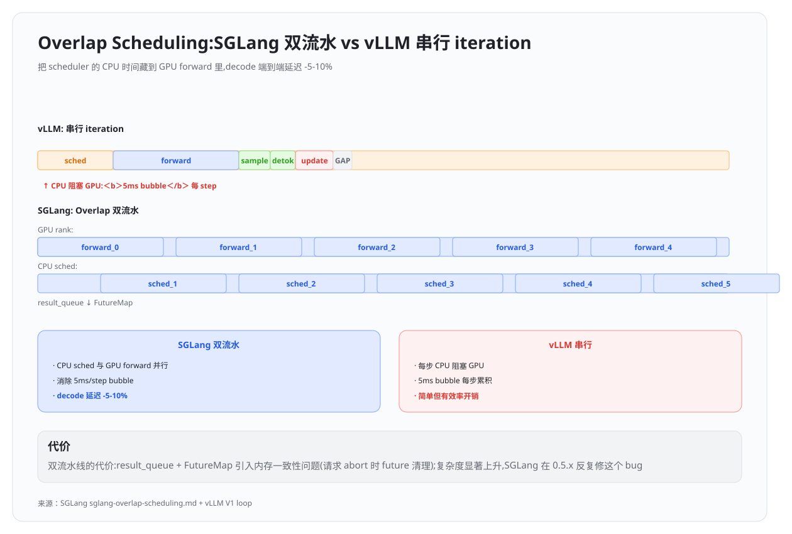
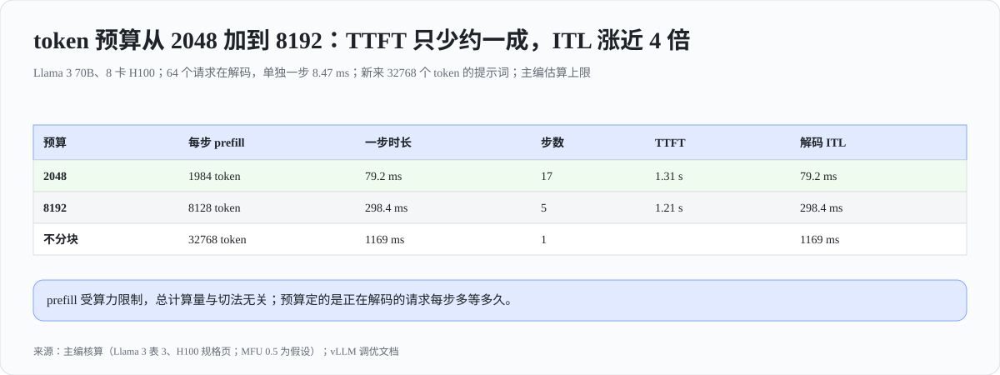
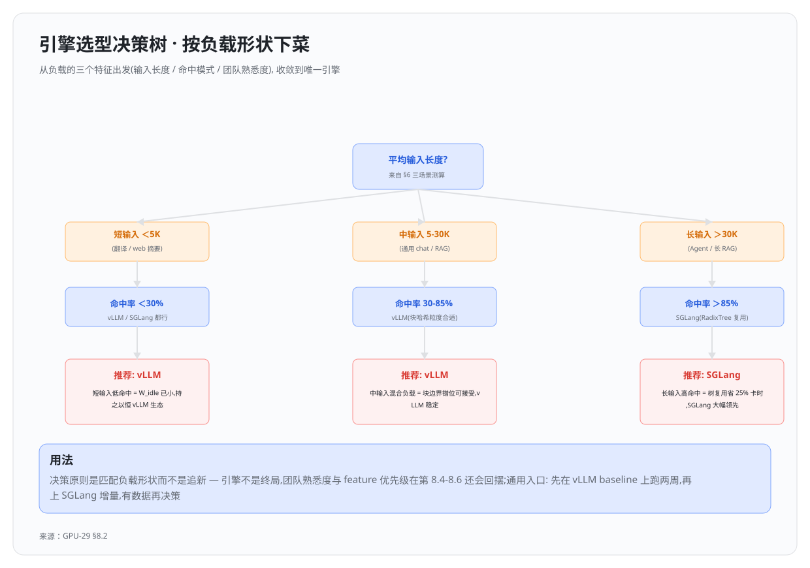

# GPU-29｜LLM｜推理引擎实战：SGLang vs vLLM 选型

> 🎯 **这篇文档解决什么问题**：SGLang 和 vLLM 是目前用得最多的两个开源推理引擎，选型时常被问“哪个更快”。本篇按前缀缓存、调度、CPU 开销、KV 分层与预填充解码分离、多实例路由、结构化输出、投机解码七项逐一比较两者的做法，用公开文档和论文核对每一处说法，用算例估算关键参数的影响，最后给出按负载形状选型和用真实流量验证的方法。

> 💡 **扩展 GPU-23**：GPU-23（[GPU-23｜LLM｜推理系统：KV cache、PagedAttention 与 PD 分离](./23-inference.md)）讲推理系统的通用机制，本篇对照 vLLM 和 SGLang 在调度、KV 管理、约束解码和投机解码上的实现取舍。

**使用方式**：第 1 章讲两个引擎的出发点。第 2 到 4 章讲单机上的前缀缓存、调度和 CPU 开销。第 5、6 章讲跨层和跨机：KV 分层、预填充解码分离、多实例路由。第 7、8 章讲结构化输出和投机解码。第 9 章讲怎样选，第 10 章给清单和自测。

**代码**：本篇没有配套代码，文中算例由主编按公开数据核算，第 10 章给出可以自己写的练习。

<b>🧭 主线位置</b>：GPU-00（[GPU-00｜索引｜从 0 开始 GPU 优化：路线、章节与练习](./README.md)）建立了时间账 T = T_compute + W_mem + W_host + W_comm + W_idle。GPU-23（[GPU-23｜LLM｜推理系统：KV cache、PagedAttention 与 PD 分离](./23-inference.md)）讲推理系统的通用机制，GPU-28（[GPU-28｜LLM｜推理成本经济学：$ per token 与集群单卡经济](./28-cost.md)）把吞吐换成每百万 token 的成本。本篇看两个具体的引擎怎样实现这些机制：前缀缓存省 T_compute，调度和分块预填充决定 ITL，CPU 重叠消掉 W_host，路由决定集群层面的命中率。GPU-30（[GPU-30｜LLM｜线性注意力与 KDA：KV 消失之后的 serving](./30-linear-attention.md)）接着看 KV 不再增长的模型。

## 导读 · 先给结论

- <b>两个引擎出发点不同，今天大量重叠。</b>vLLM 从显存碎片出发，SGLang 从前缀复用和结构化输出出发；博客和论文里的倍数不能直接比较（第 1 章）。[[1]](https://arxiv.org/pdf/2309.06180)[[2]](https://arxiv.org/pdf/2312.07104)[[3]](https://blog.vllm.ai/2025/01/27/v1-alpha-release.html)
- <b>前缀缓存命中的 token 几乎一样多。</b>按块 16 算，1000 个 token 的前缀能复用 99.2%；radix tree 的优势在支持最长前缀优先的调度（第 2 章）。[[4]](https://docs.vllm.ai/en/latest/design/prefix_caching.html)[[5]](https://docs.sglang.io/advanced_features/hyperparameter_tuning.html)
- <b>token 预算按 ITL 定。</b>主编估算 70B 上预算从 2048 加到 8192，TTFT 只少约一成，ITL 从 79.2 ms 变成 298.4 ms（第 3 章）。[[6]](https://docs.vllm.ai/en/latest/configuration/optimization.html)[[7]](https://arxiv.org/pdf/2403.02310)
- <b>CPU 开销要藏到 GPU 后面。</b>SGLang 提前一批调度，吞吐提高 1.1 倍；vLLM V1 拆出 EngineCore，比 V0 最多快 1.7 倍（第 4 章）。[[8]](https://lmsys.org/blog/2024-12-04-sglang-v0-4/)[[3]](https://blog.vllm.ai/2025/01/27/v1-alpha-release.html)
- <b>KV 分层和分离两边都有。</b>SGLang 的 HiCache 长在 radix tree 上，vLLM 用 KV connector 接外部系统（第 5 章）。[[9]](https://docs.sglang.io/advanced_features/hicache_design.html)[[10]](https://docs.vllm.ai/en/latest/features/disagg_prefill/)
- <b>路由决定集群命中率。</b>SGLang 的缓存感知路由在基准里把命中率从 20% 提到 75%（第 6 章）。[[8]](https://lmsys.org/blog/2024-12-04-sglang-v0-4/)
- <b>结构化输出和投机解码两边接近。</b>都能用 xgrammar，投机方法大体重合，要在自己的流量上量开销和接受率（第 7、8 章）。[[11]](https://arxiv.org/pdf/2411.15100)[[12]](https://docs.vllm.ai/en/latest/features/speculative_decoding/)[[13]](https://docs.sglang.io/advanced_features/speculative_decoding.html)

<b>📎 与系列其他文档的分工</b>：GPU-23（[GPU-23｜LLM｜推理系统：KV cache、PagedAttention 与 PD 分离](./23-inference.md)）讲 KV cache、PagedAttention、连续批处理和预填充解码分离的原理。GPU-25（[GPU-25｜LLM｜投机解码：αK 与 MTP / EAGLE 谱系](./25-speculative.md)）讲投机解码的收益公式。GPU-26（[GPU-26｜系统｜CXL：一致性互连与 KV offload 工程化](./26-cxl.md)）讲 KV 分层的硬件和带宽。GPU-31（[GPU-31｜LLM｜Agent Workload Serving：会话原语与约束解码](./31-agent-serving.md)）讲 Agent 负载和约束解码。本篇只比较两个引擎的实现和默认值，给出选型和压测的方法。

## 第 1 章 · 两个引擎的出发点：一个从显存碎片起步，一个从前缀复用起步

选推理引擎时，最常听到的问题是“SGLang 和 vLLM 哪个更快”。这个问题没有脱离负载的答案。两个引擎起步时要解决的问题不同，后来又互相吸收了对方的做法，今天的差别主要在默认配置、数据结构和调度细节上。本章先讲清两者从哪里出发，后面各章再逐项比较。

### vLLM：先解决显存浪费

vLLM 的论文从一个具体的问题出发：KV cache 如果管理得不好，显存会被碎片和重复拷贝大量浪费，批大小因此上不去[[1]](https://arxiv.org/pdf/2309.06180)。他们的解法是 PagedAttention，把 KV 按固定大小的块分配，在同样延迟下把吞吐提高了 2-4 倍[[1]](https://arxiv.org/pdf/2309.06180)。GPU-23（[GPU-23｜LLM｜推理系统：KV cache、PagedAttention 与 PD 分离](./23-inference.md)）第 5 章讲过这套分页机制。2025 年 vLLM 发布 V1，重写了调度器、KV 缓存管理器、worker、采样器和 API 服务器这些核心组件[[3]](https://blog.vllm.ai/2025/01/27/v1-alpha-release.html)，吞吐比 V0 最多高 1.7 倍[[3]](https://blog.vllm.ai/2025/01/27/v1-alpha-release.html)，主要来自压低 CPU 开销。

### SGLang：先解决前缀复用和结构化输出

SGLang 的论文面向的是“结构化的语言模型程序”：多轮对话、Agent、少样本提示、并行分支，这些程序的多次调用之间共享大段前缀，输出常常要符合 JSON 之类的格式。它的运行时有两个核心优化：用 RadixAttention 复用 KV cache，用压缩有限状态机加快结构化输出的解码[[2]](https://arxiv.org/pdf/2312.07104)。论文报告，在多种模型和任务上，吞吐比当时的推理系统最多高 6.4 倍[[2]](https://arxiv.org/pdf/2312.07104)。

这两个数都是各自论文在各自基线和负载上测的，不能拿来直接比较两个引擎今天谁快。今天 vLLM 也默认开了前缀缓存，SGLang 也用分页的 KV 池和分块预填充，两者都支持 xgrammar、投机解码和预填充解码分离。差别留在了几个地方：前缀缓存用树还是哈希块，调度怎样分配 token 预算，CPU 的工作怎样和 GPU 重叠，多实例怎样按缓存路由。第 2 到 8 章逐项看。

放进时间账：推理引擎管的是 GPU-00（[GPU-00｜索引｜从 0 开始 GPU 优化：路线、章节与练习](./README.md)）时间账里的 W_mem、W_host 和 W_idle。分页和前缀复用决定显存能开多大的批、能省多少 prefill；调度和 CPU 重叠决定 GPU 有多少时间在等 CPU。

按五步闭环看引擎选型：

- **定天花板**：用 GPU-23 的解码时间账算出给定批大小的吞吐上限，引擎再好也越不过。
- **测实际**：在两个引擎上用同一份真实流量回放，记录吞吐、TTFT、ITL 和缓存命中率。
- **定位等待**：差距落在显存、调度、CPU 开销还是缓存命中上。
- **消除或隐藏**：按第 2 到 8 章调对应的参数，或换默认更合适的引擎。
- **复测**：同一份流量、同一组 SLO 下再比一次。

一个常见的误区是拿官方博客的倍数选引擎。现象是按“最多 6.4 倍”或“最多 1.7 倍”选了一个，上线后和另一个差不多，甚至更慢。原因是这些倍数是在各自挑选的负载和基线上测的，而且两个引擎一直在互相追平。改法是用自己的流量回放，在自己关心的 SLO 下比较。

> 🔑 **本章要点**：vLLM 从显存碎片出发，PagedAttention 带来 2-4 倍吞吐，V1 重写核心组件、比 V0 最多快 1.7 倍；SGLang 从前缀复用和结构化输出出发，RadixAttention 加压缩状态机，最多 6.4 倍。今天两者功能大量重叠，差别在数据结构、调度和默认值上。这一章是五步闭环的“定天花板”：先知道引擎能改变时间账里的哪几项。

## 第 2 章 · 前缀缓存：radix tree 和哈希块命中的 token 几乎一样多

两个引擎都会把算过的 KV 留下来，给后面前缀相同的请求复用。实现方式不同：SGLang 用一棵 radix tree，vLLM 给每个 KV 块算一个哈希。常见的说法是 radix tree 命中率更高。本章算一下两种结构各能复用多少 token，再看差别真正落在哪里。

### 两种数据结构

SGLang 在一棵 radix tree 里为所有请求维护一个 LRU 的 KV 缓存[[2]](https://arxiv.org/pdf/2312.07104)，按 LRU 逐出，并配合缓存感知的调度来提高命中率[[2]](https://arxiv.org/pdf/2312.07104)。树放在 CPU 上，维护开销可以忽略[[2]](https://arxiv.org/pdf/2312.07104)；没有命中时，额外的显存和时间开销也可以忽略[[2]](https://arxiv.org/pdf/2312.07104)。SGLang 的页大小参数默认是 1[[14]](https://docs.sglang.io/advanced_features/server_arguments.html)，也就是按单个 token 匹配。

vLLM 用哈希：每个 KV 块的哈希由块内的 token 和块之前的前缀 token 决定[[4]](https://docs.vllm.ai/en/latest/design/prefix_caching.html)，实现上是把父块的哈希值和本块的 token 一起再哈希[[4]](https://docs.vllm.ai/en/latest/design/prefix_caching.html)，还可以加上 LoRA ID、多模态输入的哈希和租户隔离用的 salt[[4]](https://docs.vllm.ai/en/latest/design/prefix_caching.html)。它只缓存填满的块[[4]](https://docs.vllm.ai/en/latest/design/prefix_caching.html)，逐出同样按 LRU[[3]](https://blog.vllm.ai/2025/01/27/v1-alpha-release.html)；请求结束时块按逆序放回空闲队列，因为最后一块要哈希的 token 最多，最不容易被别的请求复用[[4]](https://docs.vllm.ai/en/latest/design/prefix_caching.html)。V1 里，即使命中率是 0%，前缀缓存让吞吐下降也不到 1%[[3]](https://blog.vllm.ai/2025/01/27/v1-alpha-release.html)，所以默认打开[[3]](https://blog.vllm.ai/2025/01/27/v1-alpha-release.html)。vLLM 论文里的默认块大小是 16[[1]](https://arxiv.org/pdf/2309.06180)。

### 能复用多少 token

按块缓存的代价是，共享前缀的最后不满一块的部分不能复用。主编按块大小 16 和页大小 1 算了几个前缀长度：前缀 30 个 token 时，按块只能复用 16 个，占 53.3%；100 个 token 时复用 96 个，占 96.0%；1000 个 token 时复用 992 个，占 99.2%；4096 个 token 正好是整块，复用率 100.0%。系统提示词、文档、多轮历史这类需要缓存的前缀通常有上千个 token，两种结构复用的 token 数只差不到一个块。

差别在于树能支持什么样的调度。radix tree 可以按“最长共享前缀优先”的顺序排队[[2]](https://arxiv.org/pdf/2312.07104)，论文证明这等价于对树做深度优先遍历[[2]](https://arxiv.org/pdf/2312.07104)，离线且缓存不小于最长请求时，这个顺序能得到最优命中率。SGLang 现在的默认调度策略是 fcfs，可以改成 lpm[[14]](https://docs.sglang.io/advanced_features/server_arguments.html)；调参文档建议共享前缀多的负载试 lpm[[5]](https://docs.sglang.io/advanced_features/hyperparameter_tuning.html)，代价是它重排请求时调度开销更大[[5]](https://docs.sglang.io/advanced_features/hyperparameter_tuning.html)，排队超过 128 个请求时只检查前 64 个[[5]](https://docs.sglang.io/advanced_features/hyperparameter_tuning.html)。

放进时间账：前缀命中省掉的是 prefill 的 T_compute。两种结构省下的 token 数几乎一样，差别在排队顺序能不能让更多请求在缓存被逐出之前赶上命中。

按五步闭环看前缀缓存：

- **定天花板**：统计流量里共享前缀的长度分布，算出理论命中率。
- **测实际**：读引擎日志或指标里的缓存命中率。
- **定位等待**：命中率低于理论值时，看是前缀太短、缓存被过早逐出，还是排队顺序打散了同前缀请求。
- **消除或隐藏**：稳定前缀、加大 KV 池；共享前缀多时在 SGLang 上试 lpm。
- **复测**：命中率和 TTFT 一起对比。

一个常见的误区是认为 vLLM 的块哈希命中率天生比 radix tree 低很多。现象是为了命中率换引擎，换完命中率几乎没变。原因是对上千 token 的前缀，按块复用只少不到一个块。改法是先看命中率低在哪里：前缀不稳定要改提示词，缓存被逐出要加显存或分层，同前缀请求被打散才轮到调度策略。

> 🔑 **本章要点**：SGLang 用 radix tree、默认按单 token 匹配；vLLM 用父哈希加块内 token 的块哈希、只缓存满块、0% 命中时开销不到 1%。按块 16 算，1000 个 token 的前缀能复用 99.2%，两者差不到一个块。树的优势在支持最长前缀优先的调度。这一章是五步闭环的“定位等待”：命中率低时先分清是前缀、容量还是排队顺序的问题。

## 第 3 章 · 调度：token 预算决定 ITL 和 TTFT 怎样交换

每一步要处理哪些请求、每个请求处理多少 token，是调度器的事。新请求的 prefill 计算量大，正在生成的请求每步只要一个 token，把两者放进同一步，prefill 会拖慢所有正在生成的请求。两个引擎都用分块预填充来处理这个矛盾，参数的名字不同，背后的取舍一样。本章先看两边怎样表达调度决策，再用一个算例看预算大小的影响。

### 两边的调度怎样写

vLLM V1 去掉了 prefill 和 decode 两个阶段的区分，把用户给的提示词 token 和模型生成的 token 一样对待[[3]](https://blog.vllm.ai/2025/01/27/v1-alpha-release.html)。每一步的调度决策就是一个字典，记录每个请求这一步处理多少个 token[[3]](https://blog.vllm.ai/2025/01/27/v1-alpha-release.html)；有了固定的 token 预算，调度器动态决定给每个请求分多少[[3]](https://blog.vllm.ai/2025/01/27/v1-alpha-release.html)。V1 默认尽可能开启分块预填充[[6]](https://docs.vllm.ai/en/latest/configuration/optimization.html)：调度器先把所有等待中的 decode 放进批，再安排 prefill[[6]](https://docs.vllm.ai/en/latest/configuration/optimization.html)，放不进 max_num_batched_tokens 的 prefill 自动切块[[6]](https://docs.vllm.ai/en/latest/configuration/optimization.html)。

SGLang 用 chunked-prefill-size 设定每块最多多少 token，设成 -1 就关掉分块[[14]](https://docs.sglang.io/advanced_features/server_arguments.html)。它还有一个 schedule-conservativeness 参数，值越大调度越保守[[14]](https://docs.sglang.io/advanced_features/server_arguments.html)：从调参文档的解释看，调度器接纳新请求时会按 max_new_tokens 估计它还要占多少 KV：如果很多请求设了很大的 max_new_tokens 却很早遇到结束符停下[[5]](https://docs.sglang.io/advanced_features/hyperparameter_tuning.html)，预留就过多，调参文档建议把这个值调低到 0.3[[5]](https://docs.sglang.io/advanced_features/hyperparameter_tuning.html)；如果反过来频繁出现 KV 池满、请求被撤回，建议调高到 1.3[[5]](https://docs.sglang.io/advanced_features/hyperparameter_tuning.html)。判断依据是日志里的 token usage，文档说大于 0.9 说明显存用得好[[5]](https://docs.sglang.io/advanced_features/hyperparameter_tuning.html)。

### 预算大小的算例

分块预填充来自 Sarathi-Serve：把 prefill 切成大小相近的块，新请求加入批时不暂停已经在生成的 decode[[7]](https://arxiv.org/pdf/2403.02310)。论文里展示过，不这样做时 vLLM 会出现持续数秒的生成停顿[[7]](https://arxiv.org/pdf/2403.02310)。vLLM 的调优文档给了方向：预算小（例如 2048）ITL 更好，因为拖慢 decode 的 prefill 少[[6]](https://docs.vllm.ai/en/latest/configuration/optimization.html)；预算大 TTFT 更好，因为一批能处理更多 prefill token[[6]](https://docs.vllm.ai/en/latest/configuration/optimization.html)。

主编用 Llama 3 70B（80 层、模型维度 8192[[15]](https://arxiv.org/pdf/2407.21783)）在 8 卡 H100 上算了一下量级。假设：已有 64 个请求在 decode，单独 decode 一步约 8.47 ms（GPU-28 的估算）；prefill 按 BF16 稠密 989.5 TFLOPS（规格页 1,979 是稀疏口径[[16]](https://www.nvidia.com/en-us/data-center/h100/)）、50% MFU 算；混合步的时间按 prefill 计算时间加 decode 读显存时间相加，不考虑重叠，算的是上限。一个 32768 个 token 的新提示词：

- 预算 2048：每步 prefill 1984 个 token，约 70.8 ms，一步约 79.2 ms；要 17 步，最后一块不满，TTFT 约 1.31 s；这 17 步里正在生成的请求 ITL 从 8.47 ms 变成 79.2 ms。
- 预算 8192：每步 prefill 8128 个 token，约 290.0 ms，一步约 298.4 ms；要 5 步，TTFT 约 1.21 s；ITL 变成 298.4 ms。
- 不分块：一次 prefill 约 1169 ms，这一步所有正在生成的请求都要等。

这个估算里两种预算的 TTFT 只差约一成，因为 prefill 受算力限制，切多切少总计算量一样，大预算省下的只是少走几步、每步少读几次权重；ITL 却差了将近 4 倍。所以预算按 ITL 的 SLO 定，往往比按 TTFT 定更合适。这是主编在上述假设下的推断，实际要在自己的模型和流量上扫一遍。

放进时间账：分块预填充把一次很长的 T_compute 切开，插进 decode 的步里，正在生成的请求每步多等一个 prefill 块。预算定的是这块有多大。

按五步闭环看调度：

- **定天花板**：按 ITL 的 SLO 反推每步最多能插多少 prefill token。
- **测实际**：记录每步的 prefill token 数、ITL 分布和 TTFT 分布。
- **定位等待**：ITL 的长尾是否和长提示词进来的时刻对齐。
- **消除或隐藏**：调 max_num_batched_tokens 或 chunked-prefill-size；SGLang 上按 token usage 调 schedule-conservativeness。
- **复测**：ITL 的 P99 和 TTFT 一起看。

一个常见的误区是为了吞吐把 token 预算调得很大。现象是平均吞吐略升，长提示词一进来，所有正在生成的请求都卡一下，用户感觉输出一顿一顿的。原因是一步的时长由这一步里的 prefill 块决定，预算越大，卡得越久。改法是按 ITL 的 SLO 定预算上限，吞吐不够再加卡或做预填充解码分离（第 5 章）。

> 🔑 **本章要点**：vLLM V1 用一个 token 预算统一调度 prefill 和 decode，decode 优先，放不下的 prefill 自动切块；SGLang 用 chunked-prefill-size 和 schedule-conservativeness，按 token usage 大于 0.9 判断。主编估算 70B 上一个 32768 token 的提示词，预算 2048 和 8192 的 TTFT 约 1.31 s 和 1.21 s，ITL 却是 79.2 ms 和 298.4 ms。这一章是五步闭环的“消除或隐藏”：用切块把 prefill 藏进 decode 的步里。

## 第 4 章 · CPU 开销：GPU 一步只要 5 ms 时，CPU 不能让它等

推理跑在 GPU 上，但每一步之前，CPU 要组批、分配显存、匹配前缀、准备输入张量，之后还要采样、反分词、把结果流式发给用户。GPU 越快，这些 CPU 工作在一步里占的比例越大。两个引擎在 2024 到 2025 年都把大量精力花在这里。本章看它们各自怎样把 CPU 的时间从 GPU 的关键路径上拿掉。

### 问题有多大

SGLang 的 v0.4 博客说，除了 GPU 上的计算，CPU 还要做组批、显存分配和前缀匹配[[8]](https://lmsys.org/blog/2024-12-04-sglang-v0-4/)，一个没有优化过的推理引擎可能有一半时间花在 CPU 开销上[[8]](https://lmsys.org/blog/2024-12-04-sglang-v0-4/)。vLLM 的 V1 博客也说，随着 GPU 变快，API 服务、调度、准备输入、反分词和流式输出这些 CPU 任务越来越显眼[[3]](https://blog.vllm.ai/2025/01/27/v1-alpha-release.html)；像 Llama-8B 这样的小模型在 H100 上，一步的 GPU 时间可以低到约 5ms[[3]](https://blog.vllm.ai/2025/01/27/v1-alpha-release.html)。

主编用一个简单模型算一下。设 GPU 一步 5 ms，CPU 每步要 c ms。串行时一步是 5 + c，重叠以后一步是两者中较大的那个。c 为 0.5 ms 时，串行 5.5 ms，重叠后 5.0 ms，快 1.10 倍，串行时 GPU 有 9.1% 的时间在等；c 为 1 ms 时快 1.20 倍，GPU 等 16.7%；c 和 GPU 时间一样长时快 2.00 倍，GPU 等 50.0%，对应博客说的“一半时间花在 CPU 上”。

### 两种解法

SGLang 的做法是让调度器提前一批运行，把下一批需要的元数据都准备好[[8]](https://lmsys.org/blog/2024-12-04-sglang-v0-4/)，CPU 调度和 GPU 计算因此重叠起来。他们用 Nsight 验证，连续 5 个解码批之间 GPU 没有任何空闲[[8]](https://lmsys.org/blog/2024-12-04-sglang-v0-4/)，吞吐提高 1.1 倍[[8]](https://lmsys.org/blog/2024-12-04-sglang-v0-4/)，在小模型和大张量并行度上收益最明显[[8]](https://lmsys.org/blog/2024-12-04-sglang-v0-4/)。按上面的模型，1.1 倍对应 CPU 时间约为 GPU 时间的一成，这是主编的反推。这个重叠调度默认开启，有一个参数可以关掉[[14]](https://docs.sglang.io/advanced_features/server_arguments.html)。第 2 章提到 radix tree 放在 CPU 上[[2]](https://arxiv.org/pdf/2312.07104)，前缀匹配也在这段被藏起来的 CPU 时间里。

vLLM V1 把执行循环拆进独立的进程，形成一个只负责调度和模型执行的 EngineCore 循环[[3]](https://blog.vllm.ai/2025/01/27/v1-alpha-release.html)，分词、多模态预处理、反分词和流式输出放在别的进程里和它重叠。输入准备上用持久批，缓存输入张量，每步只更新变化的部分[[3]](https://blog.vllm.ai/2025/01/27/v1-alpha-release.html)。V1 比 V0 最多快 1.7 倍[[3]](https://blog.vllm.ai/2025/01/27/v1-alpha-release.html)，博客把这归功于整条链路上 CPU 开销的削减。

放进时间账：CPU 开销在 GPU 看来就是 W_host 或 W_idle，GPU 空着等下一批的输入。两个引擎的办法都是让 CPU 工作和 GPU 计算并行，把这段等待藏到 GPU 计算的后面。

按五步闭环看 CPU 开销：

- **定天花板**：用 profiler 量出一步的纯 GPU 时间。
- **测实际**：量出端到端的每步时间，两者之差就是没藏住的 CPU 时间。
- **定位等待**：在时间线上找相邻 kernel 之间的空隙，看空隙里 CPU 在做什么。
- **消除或隐藏**：保持重叠调度开启，减少每步的 Python 逻辑，启用 CUDA Graph。
- **复测**：时间线上相邻批之间不再有空隙。

一个常见的误区是只看 GPU 利用率判断引擎有没有瓶颈。现象是 nvidia-smi 显示利用率很高，吞吐却上不去。原因是利用率只说明采样时刻有 kernel 在跑，看不出 kernel 之间的空隙。改法是用 Nsight Systems 看时间线，量出每步 GPU 时间和端到端时间的差。

> 🔑 **本章要点**：GPU 一步只要约 5ms 时，CPU 的组批、前缀匹配、输入准备会显著拖慢吞吐；未优化的引擎可能一半时间花在 CPU 上。SGLang 让调度器提前一批运行，吞吐提高 1.1 倍；vLLM V1 拆出独立 EngineCore 并用持久批，比 V0 最多快 1.7 倍。这一章是五步闭环的“消除或隐藏”：把 CPU 时间藏到 GPU 计算后面。

## 第 5 章 · KV 分层与预填充解码分离：两边都有，成熟度和默认值不同

单机显存放不下更多 KV 时，有两条路：把 KV 往下放到主机内存和存储，或者把 prefill 和 decode 拆到不同的机器上。GPU-26（[GPU-26｜系统｜CXL：一致性互连与 KV offload 工程化](./26-cxl.md)）讲了第一条路的硬件和带宽账，GPU-23（[GPU-23｜LLM｜推理系统：KV cache、PagedAttention 与 PD 分离](./23-inference.md)）第 7 章讲了第二条路的原理。本章只看两个引擎各自怎样实现、配置入口在哪里。

### KV 分层

SGLang 的 HiCache 借鉴 CPU 的三级缓存，把 GPU 显存当 L1、主机内存当 L2、分布式存储当 L3[[9]](https://docs.sglang.io/advanced_features/hicache_design.html)。它的流程主要是三个操作：本地匹配、预取和写回[[9]](https://docs.sglang.io/advanced_features/hicache_design.html)。写回策略可以选，例如 write_back 只在数据从上一级被逐出时才写到下一级[[9]](https://docs.sglang.io/advanced_features/hicache_design.html)。回载时它逐层重叠：计算第 N 层的同时加载第 N+1 层的 KV[[9]](https://docs.sglang.io/advanced_features/hicache_design.html)。因为 radix tree 本来就是一个缓存，HiCache 相当于把这棵树延伸到了主机内存和存储上。

vLLM 通过 KV connector 接口做这件事，其中 OffloadingConnector 可以把 KV 卸到 CPU 内存[[10]](https://docs.vllm.ai/en/latest/features/disagg_prefill/)，也可以接 LMCache、Mooncake 等外部的 KV 存储（GPU-26 第 9 章）。两边的思路相同：显存里放不下的前缀 KV 留在更便宜的层，命中时读回来，比重新 prefill 便宜。

### 预填充解码分离

LMSYS 用 SGLang 在 12 个节点、每节点 8 张 H100 上复现了 DeepSeek 的推理系统[[17]](https://lmsys.org/blog/2025-05-05-large-scale-ep/)，用的是预填充解码分离加大规模专家并行[[17]](https://lmsys.org/blog/2025-05-05-large-scale-ep/)。对 2000 个 token 的输入，每节点每秒处理 52.3k 个输入 token、输出 22.3k 个 token[[17]](https://lmsys.org/blog/2025-05-05-large-scale-ep/)。GPU-28（[GPU-28｜LLM｜推理成本经济学：$ per token 与集群单卡经济](./28-cost.md)）用这组数算过成本。SGLang 还为 DeepSeek 这类 MLA 模型做了数据并行注意力，解码吞吐最多提高 1.9 倍[[8]](https://lmsys.org/blog/2024-12-04-sglang-v0-4/)。vLLM 的预填充解码分离同样走 KV connector，文档列出了多种 connector[[10]](https://docs.vllm.ai/en/latest/features/disagg_prefill/)，在文档目录里标注为实验性功能。

这两项能力两边都有，差别在默认值和配套：SGLang 的 HiCache 直接长在 radix tree 上，和它的前缀缓存、路由器是一套设计；vLLM 的做法是定义一个 connector 接口，让外部系统接进来，组合更灵活，配置也更多。选哪个，取决于团队已经有了哪套 KV 存储，以及愿意维护多少组件。这是主编基于两边文档的判断，没有做过同负载的对比测试。

放进时间账：KV 分层把一部分 prefill 的 T_compute 换成 W_host 或网络读取；预填充解码分离把 prefill 对 decode 的干扰从 ITL 里拿掉，代价是一次 KV 传输的 W_comm。

按五步闭环看 KV 分层与分离：

- **定天花板**：按 GPU-26 的带宽账算出从主机内存回载一段 KV 和重新 prefill 的时间。
- **测实际**：开分层前后，量命中率、回载时间和 TTFT。
- **定位等待**：TTFT 里是回载慢，还是排队慢。
- **消除或隐藏**：用逐层重叠藏住回载；ITL 被 prefill 干扰严重时考虑分离。
- **复测**：TTFT、ITL 和每卡吞吐一起对比。

一个常见的误区是开了 KV 卸载就期待 TTFT 下降。现象是卸载开了，命中率上去了，TTFT 却没变甚至变差。原因是回载走 PCIe，没有和计算重叠时，读回来的时间可能接近重新算的时间。改法是先按带宽账确认回载比重算快，再确认逐层重叠生效。

> 🔑 **本章要点**：SGLang 的 HiCache 把 radix tree 延伸到主机内存和存储，三级、可选写回策略、逐层重叠回载；vLLM 用 KV connector 接口接 CPU 卸载和外部 KV 存储，预填充解码分离同样走 connector。LMSYS 用 SGLang 的分离加大规模 EP 在 H100 上复现了 DeepSeek。这一章是五步闭环的“消除或隐藏”：把放不下的 KV 和互相干扰的两段拆开。

## 第 6 章 · 多实例路由：命中率不只看单机，还看请求落在哪台

一个服务通常有多个引擎实例。每个实例只认识自己的缓存，同一个用户的多轮对话如果被轮询分到不同实例，每次都要重新 prefill 一遍共享的前缀。单机上的前缀缓存做得再好，第 2 章的 lpm 也只能重排一个实例自己的等待队列[[5]](https://docs.sglang.io/advanced_features/hyperparameter_tuning.html)，路由层把同前缀的请求打散，命中率就上不去。本章看 SGLang 的缓存感知路由给出的数据，以及 vLLM 这边要怎样补。

### SGLang 的缓存感知路由

SGLang v0.4 加了一个缓存感知的负载均衡器，吞吐最多提高 1.9 倍，命中率提高到 3.8 倍[[8]](https://lmsys.org/blog/2024-12-04-sglang-v0-4/)。它在路由器上维护一棵近似的 radix tree，对应各个 worker 上真实的树[[8]](https://lmsys.org/blog/2024-12-04-sglang-v0-4/)，按请求的前缀把它送到最可能命中的 worker。博客给出的基准是：v0.3 每秒 82665 个 token、命中率 20%，v0.4 每秒 158596 个 token、命中率 75%[[8]](https://lmsys.org/blog/2024-12-04-sglang-v0-4/)，吞吐是 1.92 倍，命中率是 3.75 倍。这个基准的负载由多组长前缀组成，每组请求量完全均衡[[8]](https://lmsys.org/blog/2024-12-04-sglang-v0-4/)，是对缓存路由最有利的情形。真实流量里前缀组大小不均，路由要在命中率和负载均衡之间取舍。

### vLLM 这边

vLLM 引擎本身只管单实例的前缀缓存[[4]](https://docs.vllm.ai/en/latest/design/prefix_caching.html)，多实例之间按前缀路由要靠外部的路由组件。主编没有核对这些组件的公开基准，本篇不给数字。做法上的原则相同：路由层要知道每个实例缓存了哪些前缀，或者至少按会话、租户把请求粘到同一个实例上。第 2 章说过，哈希块和 radix tree 命中的 token 数几乎一样，所以路由层做对了，两个引擎单机上的命中率差别不大。

路由和负载均衡天然有冲突。把一个热门前缀的请求都送到同一个实例，那个实例会被挤满，其他实例闲着。按前缀粘住请求时，要给每个实例设负载上限，超了就分流到别处，接受一部分不命中。这是主编按上面基准的条件给的建议。

放进时间账：路由决定的是集群层面能省下多少 prefill 的 T_compute。命中率从 20% 到 75%，意味着一半以上的输入从重算变成了读缓存。

按五步闭环看路由：

- **定天花板**：假设所有同前缀请求都落在同一实例，算出集群的理论命中率。
- **测实际**：分别统计每个实例和整个集群的命中率。
- **定位等待**：单机命中率高、集群命中率低，说明路由打散了前缀。
- **消除或隐藏**：用缓存感知路由，或至少按会话粘连；给每个实例设负载上限。
- **复测**：集群命中率、吞吐和各实例负载的方差一起看。

一个常见的误区是在多实例前面放一个普通的轮询负载均衡。现象是单实例压测时命中率很高，上线多实例后命中率掉到原来的零头。原因是轮询把同一会话的请求分散到所有实例，每个实例都只见过一部分前缀。改法是路由层按前缀或会话把请求送到同一实例，再用负载上限防止热点。

> 🔑 **本章要点**：SGLang v0.4 的缓存感知路由在路由器上维护近似 radix tree，基准里吞吐从 82665 到 158596 token/s（1.92 倍），命中率从 20% 到 75%，负载是对它最有利的均衡多前缀组。vLLM 的多实例路由要靠外部组件。路由要在命中率和负载均衡之间取舍。这一章是五步闭环的“定位等待”：分清命中率低在单机还是在路由。

## 第 7 章 · 结构化输出：语法检查的开销已经能藏到 GPU 后面

Agent 调工具、抽取字段、生成配置，都要求模型的输出符合 JSON schema、正则或者更一般的语法。引擎的做法是在每一步采样前，把不合语法的 token 屏蔽掉。这一步在 CPU 上做，做得慢就会拖住 GPU。本章看两个引擎在这件事上用了什么，以及它们现在为什么差得不多。

### 从一次一个 token 到跳跃解码

早期的做法是只对下一个 token 套约束，把不允许的 token 概率屏蔽掉，因此一次只能解码一个 token[[2]](https://arxiv.org/pdf/2312.07104)。SGLang 的论文提出压缩有限状态机[[2]](https://arxiv.org/pdf/2312.07104)：JSON 里很多地方只有一条合法路径，比如固定的字段名和括号，遇到这种地方就一次解码多个 token[[18]](https://lmsys.org/blog/2024-02-05-compressed-fsm/)。他们的博客报告，与当时的方案相比，延迟最多降 2 倍、吞吐最多提高 2.5 倍[[18]](https://lmsys.org/blog/2024-02-05-compressed-fsm/)，带约束的解码甚至比不带约束还快[[18]](https://lmsys.org/blog/2024-02-05-compressed-fsm/)。

### XGrammar：两边的默认后端

XGrammar 把词表分成两类：一类和上下文无关，可以提前检查；一类和上下文有关，要在运行时解释[[11]](https://arxiv.org/pdf/2411.15100)。它还和推理引擎协同设计，让语法计算和 GPU 执行重叠[[11]](https://arxiv.org/pdf/2411.15100)。论文报告，对上下文无关文法，每 token 的延迟比当时最好的方法最多降 100 倍[[11]](https://arxiv.org/pdf/2411.15100)。SGLang v0.4 集成 xgrammar 后，JSON 解码任务比其他开源方案最多快 10 倍[[8]](https://lmsys.org/blog/2024-12-04-sglang-v0-4/)。

今天两个引擎都用它：SGLang 支持三个语法后端，XGrammar 是默认[[19]](https://docs.sglang.io/advanced_features/structured_outputs.html)，不指定后端时就用它[[19]](https://docs.sglang.io/advanced_features/structured_outputs.html)；vLLM 支持用 xgrammar 或 guidance 作为结构化输出的后端[[20]](https://docs.vllm.ai/en/latest/features/structured_outputs.html)。所以在 JSON schema 这类常见约束上，两个引擎的语法开销已经接近。剩下的差别在跳跃解码这类上层优化和各自的默认配置上，要用自己的 schema 实测。

放进时间账：语法屏蔽是每一步采样前的 CPU 工作，属于第 4 章说的 W_host。预先检查把大部分 token 的判断挪到编译期，重叠把剩下的部分藏到 GPU 计算后面；跳跃解码则直接减少解码的步数。

按五步闭环看结构化输出：

- **定天花板**：同一批请求不带约束跑一遍，作为吞吐和延迟的基线。
- **测实际**：带上真实的 schema 再跑，比较每 token 延迟。
- **定位等待**：差距在语法编译、每步屏蔽，还是缓存未命中的 schema 首次编译。
- **消除或隐藏**：用 xgrammar 后端；复用 schema 让编译结果命中缓存；字段多的 schema 尽量固定顺序。
- **复测**：带约束和不带约束的每 token 延迟接近。

一个常见的误区是认为结构化输出必然变慢，于是关掉约束、靠提示词让模型自己输出 JSON。现象是大部分时候能用，偶尔输出不合法，下游解析失败要重试。原因是提示词只能提高概率，不能保证格式；而现在的语法后端开销已经很小。改法是打开约束解码，用自己的 schema 测一下开销，开销小就一直开着。

> 🔑 **本章要点**：SGLang 的压缩状态机在只有一条合法路径时一次解码多个 token，延迟最多降 2 倍、吞吐最多提高 2.5 倍。XGrammar 把词表分成可预检和需运行时检查两类，每 token 延迟最多降 100 倍，现在是 SGLang 的默认后端，也是 vLLM 的后端之一。这一章是五步闭环的“消除或隐藏”：把语法检查的 W_host 挪到编译期或藏到 GPU 后面。

## 第 8 章 · 投机解码：两边支持的方法相近，差别在接受率怎样测

投机解码用一个便宜的草稿先猜几个 token，再让大模型一次验证。GPU-25（[GPU-25｜LLM｜投机解码：αK 与 MTP / EAGLE 谱系](./25-speculative.md)）推导过它的收益公式：收益取决于每轮能接受多少个草稿 token，以及草稿本身花多少时间。本章不重复原理，只看两个引擎各支持哪些方法，以及选型时要注意什么。

### 两边支持的方法

vLLM 的文档把方法分成两类：EAGLE、MTP 和草稿模型这类基于模型的方法延迟降得最多；n-gram 和后缀解码这类简单方法收益较小，但不增加计算量[[12]](https://docs.vllm.ai/en/latest/features/speculative_decoding/)。SGLang 提供 EAGLE-2、EAGLE-3、MTP 等多种选项，也支持传统的小草稿模型和基于 n-gram 的变体[[13]](https://docs.sglang.io/advanced_features/speculative_decoding.html)。两边的方法列表大体重合。自带 MTP 层的模型（GPU-25 讲过）可以直接用 MTP 做草稿，SGLang 的文档就这样建议[[13]](https://docs.sglang.io/advanced_features/speculative_decoding.html)。

### 和调度的关系

投机解码会改变每步的 token 数：一个请求一步要验证好几个 token，第 3 章说的 token 预算要算上这部分。vLLM V1 的调度决策用“每个请求这一步处理多少 token”来表示，博客说这个表示足够通用，可以支持分块预填充、前缀缓存和投机解码[[3]](https://blog.vllm.ai/2025/01/27/v1-alpha-release.html)。另一面是批大小：GPU-25 推过，批越大，解码越接近算力上限，验证多个 token 的额外计算越不划算，投机解码的收益越小。这一条两个引擎都一样。

选型时比方法列表更重要的是接受率。同一个草稿方法，在代码补全、多轮对话、长文写作上的接受率差别很大。vLLM 的文档有按请求统计接受率的指标[[12]](https://docs.vllm.ai/en/latest/features/speculative_decoding/)，SGLang 针对接受率随时间变化的负载提供自适应的投机解码[[13]](https://docs.sglang.io/advanced_features/speculative_decoding.html)。上线前要在自己的流量上量出平均接受长度，再按 GPU-25 的公式算收益。这是主编按 GPU-25 的推导给的建议。

放进时间账：投机解码摊薄的是解码的 W_mem，一次读权重验证多个 token。它多付了草稿的 T_compute 和被拒绝 token 的验证计算，接受率决定净收益。

按五步闭环看投机解码：

- **定天花板**：按 GPU-25 的公式，用草稿成本和预期接受长度算出加速上限。
- **测实际**：在真实流量上量平均接受长度和每 token 延迟。
- **定位等待**：接受率低，还是草稿太慢，还是批太大。
- **消除或隐藏**：换草稿方法、调猜测长度；高负载时减少猜测或关闭。
- **复测**：在不同并发下分别比较开和关的吞吐与延迟。

一个常见的误区是在低并发下测出投机解码明显变快，就在所有负载下打开。现象是高峰期吞吐反而下降。原因是批大时解码接近算力上限，验证被拒绝的 token 是纯浪费。改法是按并发分档：低并发打开，高并发减少猜测长度或关闭。

> 🔑 **本章要点**：vLLM 支持 EAGLE、MTP、草稿模型、n-gram 和后缀解码；SGLang 支持 EAGLE-2、EAGLE-3、MTP、草稿模型和 n-gram 变体，两边大体重合。投机解码改变每步 token 数，要算进 token 预算；批越大收益越小。选型看自己流量上的接受率。这一章是五步闭环的“测实际”：方法列表相近，接受率要自己量。

## 第 9 章 · 怎样选：按负载形状挑默认值，再用自己的流量验证

前八章逐项比下来，两个引擎在功能上大量重叠，差别集中在几处默认值和配套组件上。所以选型要看自己的负载形状更贴近哪一边的默认设计，再用真实流量回放验证，“哪个更快”没有脱离负载的答案。本章把前面的比较压成一张选型表和一套压测方法。

### 按负载形状

共享前缀多的负载，比如 Agent、多轮对话、共用长系统提示词的服务，前缀缓存和路由是关键。SGLang 的 radix tree、lpm 调度、缓存感知路由和 HiCache 是一套从同一个数据结构长出来的设计，调参文档也建议这类负载试 lpm[[5]](https://docs.sglang.io/advanced_features/hyperparameter_tuning.html)。vLLM 默认开着前缀缓存[[3]](https://blog.vllm.ai/2025/01/27/v1-alpha-release.html)，单机命中的 token 数和 radix tree 相差不到一个块（第 2 章），多实例路由要另外配。

请求之间独立、前缀重叠少的负载，两边的前缀结构差别不起作用，比的是调度、CPU 开销和 kernel。两边都做了 CPU 和 GPU 的重叠（第 4 章），分块预填充的预算按 ITL 的 SLO 定（第 3 章）。vLLM 的调优文档建议追求吞吐时把 max_num_batched_tokens 设到 8192 以上[[6]](https://docs.vllm.ai/en/latest/configuration/optimization.html)，显存比例 gpu_memory_utilization 在 CUDA 默认的可扩展 KV 缓存下默认是 1.0[[6]](https://docs.vllm.ai/en/latest/configuration/optimization.html)；SGLang 看 token usage 是否大于 0.9[[5]](https://docs.sglang.io/advanced_features/hyperparameter_tuning.html)。

结构化输出多的负载，两边默认或可选的后端都是 xgrammar（第 7 章），差别不大。超大 MoE 模型的分离部署，SGLang 有 12 个节点共 96 张 H100 的公开复现（第 5 章）；vLLM 走 connector 接口，组合更灵活。团队已有的 KV 存储、运维习惯和模型支持的及时程度，往往比上面这些技术差别更能决定选择。

### 压测方法

主编建议的压测方法是：用一天的真实请求日志回放，保留到达时间、输入长度、输出长度和会话关系；两个引擎用同样的卡、同样的并行方式和同样的精度；比较时固定 SLO，看满足 SLO 的吞吐，也就是 GPU-23（[GPU-23｜LLM｜推理系统：KV cache、PagedAttention 与 PD 分离](./23-inference.md)）第 9 章说的 goodput；同时记录缓存命中率、token usage 和 ITL 的 P99。只看平均吞吐，会掩盖长提示词带来的 ITL 长尾。

放进时间账：选型就是看哪个引擎在自己的负载上把 W_mem、W_host 和 W_idle 压得更低。时间账给出天花板，回放给出实际值，两者之差落在哪一项，决定该调哪个参数或换哪个引擎。

按五步闭环看选型：

- **定天花板**：按模型和卡算出解码与 prefill 的吞吐上限。
- **测实际**：两个引擎在同一份流量回放下测 goodput。
- **定位等待**：差距在命中率、调度、CPU 开销还是结构化输出。
- **消除或隐藏**：按第 2 到 8 章调参，调完再比。
- **复测**：引擎升级后重跑同一份回放，确认结论还成立。

一个常见的误区是选定引擎以后就不再比较。现象是一年后发现另一个引擎在自己的负载上已经明显更好。原因是两个引擎都在快速迭代，互相吸收对方的做法，今天的差别过几个版本可能就反过来。改法是把回放压测做成固定流程，每次大版本升级都跑一遍。

> 🔑 **本章要点**：共享前缀多的负载，SGLang 的 radix tree、lpm、缓存路由和 HiCache 是一套设计；前缀少的负载，两边比的是调度和 CPU 开销；结构化输出两边都用 xgrammar。用真实流量回放、固定 SLO 比 goodput，并在每次大版本升级时重跑。这一章是五步闭环的“复测”：选型结论要随版本复验。

## 第 10 章 · 上线前核对清单与自测

前九章逐项比较了两个引擎：第 1 章讲出发点，第 2 章讲前缀缓存，第 3 章讲调度和 token 预算，第 4 章讲 CPU 开销，第 5 章讲 KV 分层和预填充解码分离，第 6 章讲多实例路由，第 7 章讲结构化输出，第 8 章讲投机解码，第 9 章给出选型和压测方法。本章把这些压成一张核对清单，再给出练习和自测题。

### 📌 核对清单

| 检查项 | 怎样查 | 通过的标志 |
|---|---|---|
| 比较口径 | 同卡、同并行、同精度，用真实流量回放（第 1、9 章） | 不引用博客倍数做结论 |
| 前缀命中 | 统计共享前缀长度分布和实际命中率（第 2 章） | 命中率接近理论值 |
| 调度策略 | 共享前缀多时在 SGLang 上试 lpm（第 2 章） | 命中率上升且调度开销可接受 |
| token 预算 | 按 ITL 的 SLO 定 max_num_batched_tokens 或 chunked-prefill-size（第 3 章） | 长提示词进来时 ITL 的 P99 不超标 |
| KV 占用 | SGLang 看 token usage，调 schedule-conservativeness（第 3 章） | token usage 大于 0.9，撤回不频繁 |
| CPU 开销 | Nsight 时间线上看相邻批之间的空隙（第 4 章） | GPU 没有成段空闲 |
| KV 分层 | 按带宽账确认回载比重算快，逐层重叠生效（第 5 章） | 开分层后 TTFT 下降 |
| 多实例路由 | 分别统计单实例和集群命中率（第 6 章） | 集群命中率接近单实例 |
| 结构化输出 | 用真实 schema 比较带约束和不带约束的每 token 延迟（第 7 章） | 两者接近 |
| 投机解码 | 按并发分档量接受长度和吞吐（第 8 章） | 高并发时不比关闭更慢 |

### 练习

本篇没有配套代码。下面几个练习可以用几十行 Python 完成：

- **块粒度**：给一组前缀长度分布，算块大小 16、32、64 时能复用的 token 比例，和按 token 匹配比较。
- **预算扫描**：按第 3 章的模型，把 token 预算从 1024 扫到 16384，画出 TTFT 和 ITL 两条曲线，标出满足 ITL 的 SLO 的最大预算。
- **CPU 重叠**：按第 4 章的模型，给定 GPU 每步时间和 CPU 每步时间，算串行和重叠时的吞吐比，并反推 1.1 倍对应的 CPU 时间占比。
- **路由模拟**：模拟 4 个实例、若干前缀组，比较轮询、按会话粘连和按前缀路由三种方式的命中率和负载方差。
- **回放压测**：从一份请求日志里抽出到达时间、输入长度、输出长度，写一个按原时间间隔发送请求的回放脚本。

### 自测题

1. SGLang 和 vLLM 起步时各自要解决什么问题？今天两者的差别主要落在哪几处？
2. 按块大小 16 缓存时，1000 个 token 的共享前缀能复用多少？为什么说两种结构的差别主要在调度？
3. vLLM V1 怎样表示一步的调度决策？decode 和 prefill 谁优先？
4. 第 3 章的算例里，token 预算从 2048 加到 8192，TTFT 和 ITL 各怎样变？
5. SGLang 的重叠调度怎样把 CPU 时间藏起来？1.1 倍的提升大约对应多少 CPU 时间？
6. 缓存感知路由的基准里命中率和吞吐各提高了多少？这个基准对路由有利在哪里？

**下一步**：本篇的引擎都围绕 KV cache 设计。GPU-30（[GPU-30｜LLM｜线性注意力与 KDA：KV 消失之后的 serving](./30-linear-attention.md)）看线性注意力和 KDA 这类模型：KV 不再随上下文增长以后，推理服务的显存账和调度会变成什么样。

## 参考文献

按正文首次引用顺序编号，资料截至 2026 年 11 月中。

[1] Kwon et al. Efficient Memory Management for Large Language Model Serving with PagedAttention. arXiv 2309.06180 [arxiv.org/pdf/2309.06180](https://arxiv.org/pdf/2309.06180)

[2] Zheng et al. SGLang: Efficient Execution of Structured Language Model Programs. arXiv 2312.07104 [arxiv.org/pdf/2312.07104](https://arxiv.org/pdf/2312.07104)

[3] vLLM Team. vLLM V1: A Major Upgrade to vLLM's Core Architecture (2025) [blog.vllm.ai/2025/01/27/v1-alpha-release.html](https://blog.vllm.ai/2025/01/27/v1-alpha-release.html)

[4] vLLM 文档. Automatic Prefix Caching（设计文档） [docs.vllm.ai/en/latest/design/prefix_caching.html](https://docs.vllm.ai/en/latest/design/prefix_caching.html)

[5] SGLang 文档. Hyperparameter Tuning [docs.sglang.io/advanced_features/hyperparameter_tuning.html](https://docs.sglang.io/advanced_features/hyperparameter_tuning.html)

[6] vLLM 文档. Optimization and Tuning [docs.vllm.ai/en/latest/configuration/optimization.html](https://docs.vllm.ai/en/latest/configuration/optimization.html)

[7] Agrawal et al. Taming Throughput-Latency Tradeoff in LLM Inference with Sarathi-Serve. arXiv 2403.02310 [arxiv.org/pdf/2403.02310](https://arxiv.org/pdf/2403.02310)

[8] SGLang Team. SGLang v0.4: Zero-Overhead Batch Scheduler, Cache-Aware Load Balancer, Faster Structured Outputs (2024) [lmsys.org/blog/2024-12-04-sglang-v0-4/](https://lmsys.org/blog/2024-12-04-sglang-v0-4/)

[9] SGLang 文档. HiCache System Design and Optimization [docs.sglang.io/advanced_features/hicache_design.html](https://docs.sglang.io/advanced_features/hicache_design.html)

[10] vLLM 文档. Disaggregated Prefilling（KV connector 列表） [docs.vllm.ai/en/latest/features/disagg_prefill/](https://docs.vllm.ai/en/latest/features/disagg_prefill/)

[11] Dong et al. XGrammar: Flexible and Efficient Structured Generation Engine for Large Language Models. arXiv 2411.15100 [arxiv.org/pdf/2411.15100](https://arxiv.org/pdf/2411.15100)

[12] vLLM 文档. Speculative Decoding [docs.vllm.ai/en/latest/features/speculative_decoding/](https://docs.vllm.ai/en/latest/features/speculative_decoding/)

[13] SGLang 文档. Speculative Decoding [docs.sglang.io/advanced_features/speculative_decoding.html](https://docs.sglang.io/advanced_features/speculative_decoding.html)

[14] SGLang 文档. Server Arguments [docs.sglang.io/advanced_features/server_arguments.html](https://docs.sglang.io/advanced_features/server_arguments.html)

[15] Llama Team. The Llama 3 Herd of Models. arXiv 2407.21783 [arxiv.org/pdf/2407.21783](https://arxiv.org/pdf/2407.21783)

[16] NVIDIA. H100 Tensor Core GPU（产品规格页） [www.nvidia.com/en-us/data-center/h100/](https://www.nvidia.com/en-us/data-center/h100/)

[17] LMSYS. Deploying DeepSeek with PD Disaggregation and Large-Scale Expert Parallelism on 96 H100 GPUs (2025) [lmsys.org/blog/2025-05-05-large-scale-ep/](https://lmsys.org/blog/2025-05-05-large-scale-ep/)

[18] LMSYS. Fast JSON Decoding for Local LLMs with Compressed Finite State Machine (2024) [lmsys.org/blog/2024-02-05-compressed-fsm/](https://lmsys.org/blog/2024-02-05-compressed-fsm/)

[19] SGLang 文档. Structured Outputs [docs.sglang.io/advanced_features/structured_outputs.html](https://docs.sglang.io/advanced_features/structured_outputs.html)

[20] vLLM 文档. Structured Outputs [docs.vllm.ai/en/latest/features/structured_outputs.html](https://docs.vllm.ai/en/latest/features/structured_outputs.html)

---

上一章：[GPU-28｜LLM｜推理成本经济学：$ per token 与集群单卡经济](./28-cost.md) · [目录](./README.md) · 下一章：[GPU-30｜LLM｜线性注意力与 KDA：KV 消失之后的 serving](./30-linear-attention.md)
