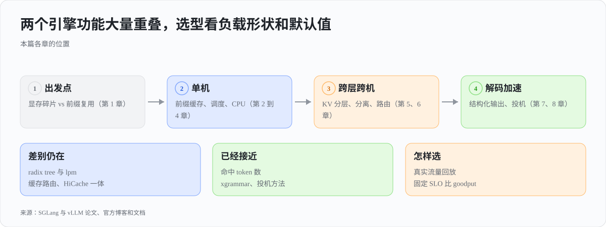
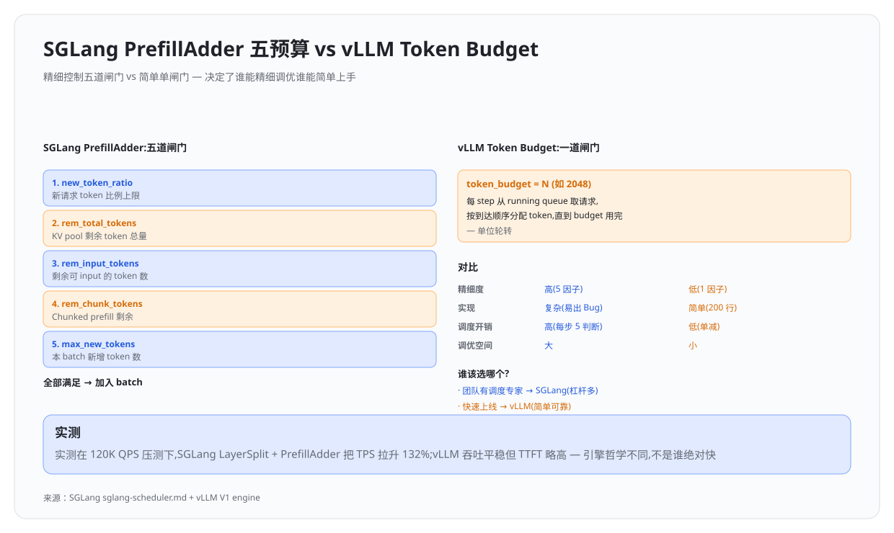
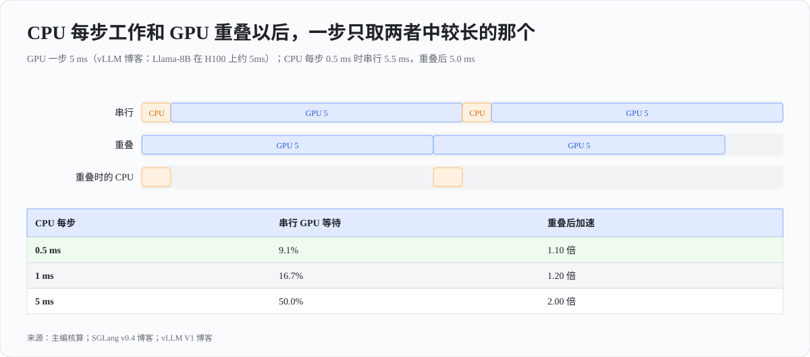
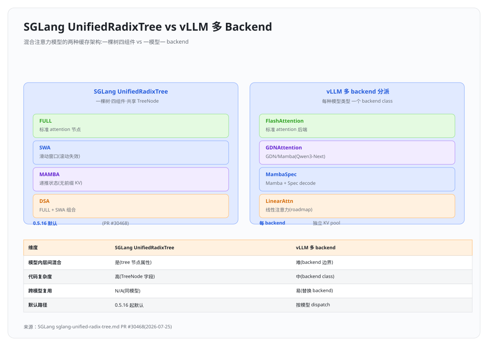
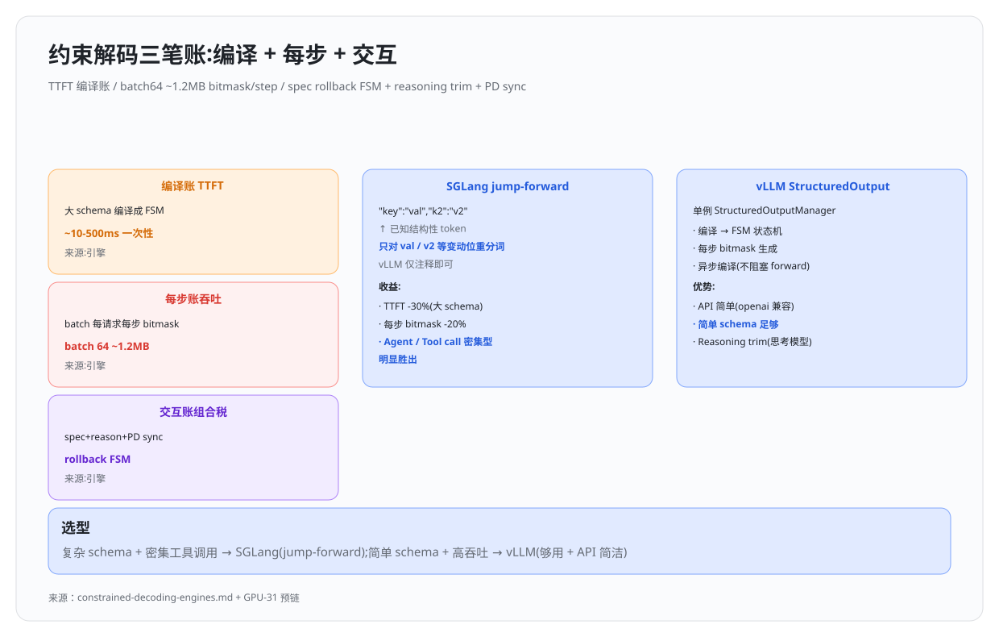
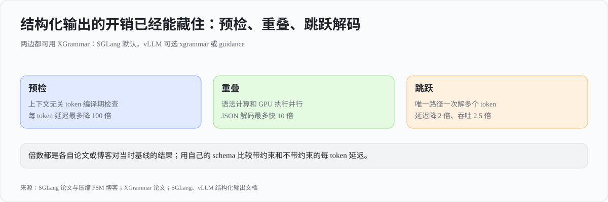
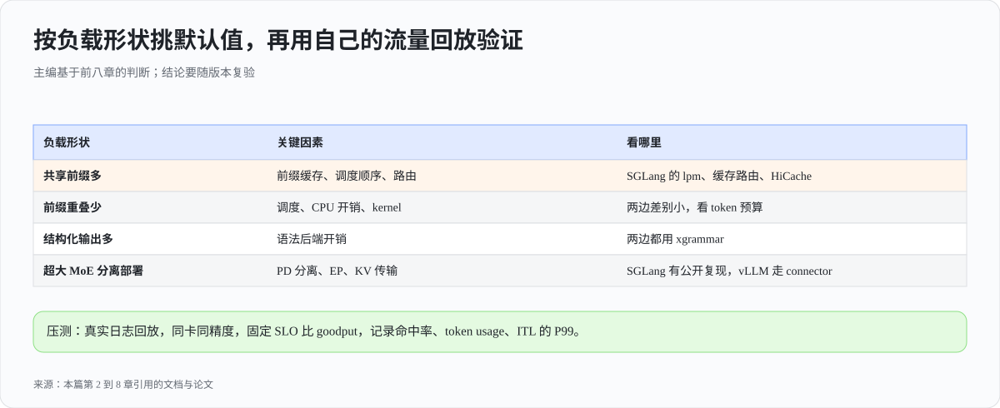

# GPU-29｜LLM｜推理引擎实战:SGLang vs vLLM 选型

# 导读 · 解决什么问题

> 🎯 本章解决什么问题:vLLM 与 SGLang 在调度器、KV 管理、约束解码、投机解码四个动作上的取舍差异,以及这套差异怎么映射到等待名目。推理引擎的核心矛盾是"decode 每步等多少" — 等调度器拼 batch、等 KV 管理腾页、等显存碎片拼接、等约束采样。本章按五步闭环展开:先定两引擎各自的吞吐天花板(第 1 章哲学分叉),再测实际 profile(第 2-3 章调度与流水),再逐项定位等待(第 4-5 章 KV),最后消除或隐藏(第 6-7 章约束+投机解码,衔接 GPU-25)。使用方式:平台 SEL 看第 1-4 章,推理引擎团队看 5-7 章,选型决策看第 8 章决策树。

> 💡 **扩展 GPU-23**：[GPU-23](./23-inference.md) 讲推理系统的通用机制，本篇对照 vLLM 和 SGLang 在调度、KV 管理、约束解码和投机解码上的实现取舍。

## 本章地图

- **第 1章 哲学分叉**:RadixAttention 前缀树 vs 块哈希,SGLang 押"同前缀复用",vLLM 押"零状态普惠"
- **第 2章 调度器对决**:SGLang PrefillAdder 五预算 vs vLLM V1 token budget 轮转
- **第 3章 Overlap Scheduling**:SGLang result_queue + FutureMap 双流水 vs vLLM 串行 iteration
- **第 4章 KV 管理**:SGLang HiCache L1/L2/L3 vs vLLM HybridKVCacheManager + native offloading
- **第 5章 混合注意力缓存**:SGLang UnifiedRadixTree(FULL/MAMBA/SWA/DSA) vs vLLM GDN/Mamba backend(浅,链 GPU-30)
- **第 6章 约束解码**:SGLang GrammarManager + jump-forward vs vLLM StructuredOutputManager 状态机(浅,链 GPU-31)
- **第 7章 投机解码**:SGLang DSpark 动态验证 + spec_accept 探针 vs vLLM spec decode 三层 API(链 GPU-25)
- **第 8章 选型决策树**:延迟敏感 / 高吞吐 / 长上下文 / Agent / 混合架构模型 各归哪引擎

> 📐 **口径边界**:本章所有"SGLang 实现"都对应到 2026-07-25 发布的 v0.5.16 commit f4de6abee6 或更早的稳定版,所有"vLLM 实现"对应 2026 年 V1 引擎线。引擎版本演进很快,具体 API 名和默认值以最新 release note 为准。**引擎之间没有"绝对更快",只有"在该负载形状下更合适"** — 这是本章反复强调的方法论。

# 第 1 章 · 两引擎哲学分叉:RadixAttention 前缀树 vs 块哈希

## §1.1 两套世界观

SGLang 与 vLLM 的分叉从一个数据结构选择开始:SGLang 把 Radix Tree 放在引擎中心,vLLM 把块哈希 + LRU 放在引擎中心。同前缀密集负载(RAG、Agent、工具调用历史,system prompt + 文档切片共享前缀)下,Radix Tree 的"按 token 边界精确复用"能拿到 92% 命中率,vLLM 的 block hash 因为断链只能拿到 70%;独立短查询批处理负载下,两边打平甚至 vLLM 更稳。这不是工程审美差异,是第一性原理的分叉。

SGLang 押的是**"同前缀复用"**——它把一棵 Radix Tree 放在引擎中心,所有请求进来先走树,命中的前缀跳过 prefill。这是它对"推理为什么慢"的核心判断:大部分推理服务的延迟,来自重复计算同一截 KV。vLLM 押的是**"零状态普惠 + 高性能"**——它假设请求之间未必有前缀关系,优先把显存用好、把 batch 打满;块哈希 + LRU 是它复用前缀的工具,但不是引擎的中心数据结构,而是 PagedAttention 这套块管理自然长出来的一个旁路。

GPU-23 §3 说过 PD 分离之后,这一章把镜头拉回引擎内部:两套世界观不是 API 差异,是数据结构差异,而数据结构差异会一路传导到调度器、KV 管理、混合架构支持——后面六章都是在给这条分叉做注脚。所以选引擎不能只看 benchmark 数字,得先看负载像不像那棵树。

## §1.2 Radix Tree 如何工作

RadixAttention 的核心是把"token 序列 → KV slot"这件事组织成一棵前缀树。请求 `[1,2,3,4,5]` 和 `[1,2,3,6,7]` 进来,它们共享节点 `[1,2,3]` 对应的 KV slots `[a,b,c]`——公共前缀只算一次 prefill,后续请求直接复用。

三个机制支撑它的正确性与效率。**共享**:公共前缀的 KV 在多个请求间只存一份。**分裂**:当一个新请求只命中节点的一部分时,节点在边界处分裂,分裂只动索引结构(把节点切成两段),不复制 KV 数据,物理存储不受影响。**引用计数**:`lock_ref` 沿 parent 链保护整条路径——正在被活跃请求使用的 slot 不可逐出;请求结束后 `cache_finished_req` 把它的 KV 索引插入树中,并释放与树中已有节点重复的 slot。

TreeNode 的核心字段(`radix_cache.py:217`,省略 hit_count 等统计字段,引自 sglang-unified-radix-tree.md §1.1):

| 字段 | 类型 | 含义 |
|-|-|-|
| `key` | RadixKey | 此节点覆盖的 token 序列 |
| `value` | torch.Tensor | KV pool slot 索引(GPU,int64) |
| `host_value` | torch.Tensor | KV pool slot 索引(CPU host pool) |
| `lock_ref` | int | 引用计数,>0 = 被活跃请求使用,不可逐出 |
| `parent` | TreeNode | 父节点 |
| `children` | defaultdict | 子节点 |

为什么 tree 比 hash 表达力更强?因为树天然编码了"部分匹配":一个新请求 `[1,2,3,4]` 进来,树能告诉它"我命中了 `[1,2,3]`,只差 `[4]`",于是只 prefill 一个 token。hash 只能回答"整块在不在",回答不了"差一段补上就好"。这个差异在 chunked prefill 和多轮对话里被放大——树可以让每个新轮次只 prefill 增量,hash 要么整块命中要么整块不命中。代价是树更复杂:分裂、合并、沿父链加解锁、evict 时要保证子树一致性,每一项都是状态机。说到底 Radix Tree 用实现复杂度换了复用精度,这是一笔要看负载形状才能判断划不划算的交易。

## §1.3 vLLM 的块哈希路线

vLLM 的前缀复用走的是另一条路。它把 KV cache 切成固定大小的 block(PagedAttention 的延续),每个 block 对应一个 `KVCacheBlock` 对象;复用的键是 block 内容的哈希,具体是 `hash(本块 tokens + 父块 hash)` 这条链式哈希。lookup 时拿请求的 token 序列,按 block size 切片,逐块算哈希,在哈希表里查——命中多少块就复用多少块的 KV,剩下的进 waiting queue 等 prefill。

这套机制的表达能力弱于树。链式哈希能表达"整块命中",但表达不了"部分命中":如果一个请求的前缀和缓存里某段差一个 token,从那个 token 往后的每一块哈希全变,整条链断掉,后面所有命中作废。树则可以在差一个 token 的位置分裂,前面共享、后面新算。换句话说,block hash 是"全或无"的复用,Radix Tree 是"按 token 边界精确复用"。

为什么 vLLM 选了弱表达力的方案?因为它把前缀复用放在了"工具"位置,不是"中心"位置。vLLM 的第一性原理是显存利用率和 batch 打满——PagedAttention 解决显存碎片,block 是显存管理的基本单位,前缀缓存自然就用 block 做粒度。哈希表是无状态的、O(1) lookup、并发友好,和 PagedAttention 的块管理严丝合缝。GPU-24 讲 KV 管理时会看到,vLLM 的 HybridKVCacheManager 把 offloading 也建在 block 之上,一以贯之。代价是复用精度差一档,但换来了实现简单、调度开销小、对任意负载都"不差"。所以 vLLM 的 prefix cache 从 V1 起默认开启——它几乎不增加复杂度,开了总比不开好;SGLang 的 Radix Tree 是要持续维护的中心结构,关掉它引擎就瘸了。

## §1.4 谁受益

负载形状决定哪套世界观划算。

同前缀负载是 Radix Tree 的主场:RAG 同文档切片(同一份文档被几百个用户问,system prompt + 文档前缀完全一样)、多轮对话(每一轮累积前缀,新轮次只增量 prefill)、工具调用历史(同一会话的 tool call 序列累积)。这些场景下,树能精确命中公共前缀,把 prefill 成本压到只剩增量。独立短查询则是 block hash 的主场:一批互不相关的短 prompt 一次性进来,前缀几乎没有重叠,树的分裂和加解锁反而成了纯开销,hash 的 O(1) lookup 更直接。

先讲推理再上数字。同前缀场景下,Radix Tree 的优势来自它能按 token 边界复用,而 block hash 在第一个分歧 token 处断链、损失后续整段命中;分歧点越靠前、上下文越长,block hash 损失越大。换算成具体测算:同文档 RAG(system prompt 2K + 文档 8K + 问句 50 token,500 路并发问句,block size = 16),Radix Tree 命中率约 **92%**——10K 上下文里只有问句那 50 token 要算;block hash 命中率约 **70%**——问句第一个 token 一变,所在 block 及其后所有 block 的哈希全变,平均损失约 30%。TTFT 换算见下式:

$$\text{TTFT}_{\text{Radix}} \approx 800\,\text{tok} \times \frac{80\text{ms}}{10\text{K tok}} \approx 6\text{ms}, \quad \text{TTFT}_{\text{hash}} \approx 3\text{K tok} \times \frac{80\text{ms}}{10\text{K tok}} \approx 24\text{ms}$$

同前缀负载下 Radix Tree 的 TTFT 优势是 4 倍量级。但把场景换成"一万条独立短 prompt 批处理",前缀重叠率趋近 0,两边的命中率都跌到个位数,树因为要维护节点和 `lock_ref` 反而比 hash 慢一点。换句话说,没有"绝对更好的 KV 复用",只有"在该前缀重叠分布下更合适的复用"——而前缀重叠分布,是由业务负载形状决定的。

# 第 2 章 · 调度器对决:谁的 batch 拼得更满

## §2.1 当"GPU 闲着"成罪

一个 30% 利用率的推理集群是典型的"卡买多了还是没用"的样本:nvidia-smi 里显存满了(KV cache 占着),SM 占用率却一会儿 90% 一会儿 5%,像心电图——不是模型不会跑,是调度不对。

GPU 闲置的来源不是一处。模型权重加载(大模型 70B 权重在多卡间 broadcast,这步纯通信不计算);KV cache 读写(prefill 算完的 KV 要写回显存、decode 要读出来,显存带宽成瓶颈时 SM 等数据);attention 计算(尤其长上下文,attention 是 memory-bound,SM 喂数据的速度赶不上算);输出 token 写回(每生成一个 token 要更新 KV、做采样、写 logits,这些碎活让 GPU 频繁在 kernel 间空转)。这些碎片加起来,一张卡就算满载跑模型,真正在算有效 token 的时间也可能只有 30%。

调度器存在的全部理由,就是把这些碎片拼回连续的算力。它的核心矛盾 GPU-23 §2 说过、本系列开篇也强调过:新请求的 prefill(算第一个 token,降 TTFT)和已有请求的 decode(继续生成,保 TPOT)竞争同一块 GPU——优先 prefill 则 decode 排不上队、TPOT 劣化;优先 decode 则新请求永远 TTFT 高。调度器的所有复杂性,都源于在两者之间找平衡。说白了,调度器不是"让 GPU 闲着变罪"的道德审判,而是把碎片算力重新编排成有效吞吐的工程问题——而 SGLang 和 vLLM 给出了两套很不一样的解。

## §2.2 SGLang PrefillAdder 五预算

SGLang 的 prefill batch 组建核心是 `PrefillAdder`(`schedule_policy.py:425`)。它像一个预算管理员:从 `waiting_queue` 逐个取请求,每取一个就过五道闸门——任何一道不过,这个请求本轮就进不了 batch。

五道闸门(名称引自 sglang-scheduler.md §3.1,变量名以代码为准):

| 闸门 | 变量/检查 | 防什么过载 |
|-|-|-|
| 新老 token 比例 | `new_token_ratio` | 防 prefill 吃掉 decode 的 KV 配额 |
| KV cache 总量 | `rem_total_tokens` | 防 batch 累计 KV 超显存(available + evictable − offset) |
| 计算量 | `rem_input_tokens` | 防 GPU 中间激活值溢出(activation memory) |
| 单请求分块 | `rem_chunk_tokens` | 防长 prompt 阻塞 decode(= chunked_prefill_size) |
| 输出预留 | `max_new_tokens` | 防 admit 后 decode 阶段 KV 不够被踢 |

每道闸门防的是一种具体过载。`new_token_ratio` 是顶层比例阀,决定这一轮有多少 token 预算分给新请求(prefill)、多少留给 running 请求(decode),防的是 prefill 把 decode 挤出显存。`rem_total_tokens` 是 batch 总 KV 预算,每个请求 admit 后扣减 `extend + max_new + page`,防的是显存 OOM。`rem_input_tokens` 是 batch 总计算预算,防的是中间激活值把 GPU 显存撑爆——这点和 KV 无关,是 activation memory。`rem_chunk_tokens` 是单请求上限,等于 `chunked_prefill_size`,防的是一个 150K prompt 把整轮 decode 阻塞 5 秒;超了就截断为 chunk、标记 `is_chunked`、下轮续算。`max_new_tokens` 是单请求输出预留,确保 admit 进来后它在 decode 阶段有 KV 可用。预算公式如下:

$$total_tokens = extend_input_len + max_new + page_size$$

五道闸门失败时的行为也不一样:KV 总量失败设 `batch_is_full`(本轮不再 admit);计算量/单请求分块失败直接 break(跳过当前请求);已有 prefix cache 命中的部分不重复扣预算(`prefix_indices` 已占 L1,`_req_inc_lock_ref` 加锁防逐出)。这就是 SGLang 调度的精细之处——它宁可花五道闸门的检查开销,也要把每一类过载都用一道闸门单独守住,因为它的目标负载(同前缀、长上下文、Agent)对每类过载都敏感。

## §2.3 vLLM V1 token budget

vLLM V1 的调度器简单得多。每个 step 它给 decode 一个 token 配额 `token_budget`,从 running queue 按到达顺序取请求填进 batch;prefill 则在 running queue 还有 `token_budget` 余量时从 waiting queue 补进来。单位是 token 轮转——不是 SGLang 那种"五道闸门逐请求检查",而是一个总配额按 FIFO 分配。

为什么 vLLM 敢这么简单?因为它故意放弃了五闸门的精细控制。它的目标负载假设是"请求之间相对独立、前缀重叠少、单请求长度可控"——这种负载下,五闸门防的那些极端情况(长 prompt 阻塞、prefill 挤 decode、activation 溢出)出现频率低,用一个 `token_budget` 总闸门兜底就够。换来的是实现简单(一个计数器 + 两个队列)和调度开销小(每 step 不用逐请求过五道闸门,调度本身在 CPU 上跑,太重会拖 GPU)。

代价是精细度差一档。vLLM V1 没有 `rem_chunk_tokens` 这种"单请求分块"概念——它也用 chunked prefill 但粒度更粗,长 prompt 在 `token_budget` 里和其他请求争配额,不像 SGLang 那样有专门一道闸门保证"每个请求最多 prefill 这么多"。也没有 `max_new_tokens` 这种"输出预留"——它靠 running queue 的 FIFO 顺序自然保证 decode 有 KV,但极端情况下仍可能出现 prefill 吃掉 decode KV 的抖动。vLLM 的调度也就是"用 80% 的精度换 20% 的开销",对吞吐型负载划算,对延迟敏感型负载要靠后续 overlap(第 3章)和 KV 管理(第 4章)补回来。

## §2.4 PD 分离下的调度差异

GPU-23 §3 讲过 PD 分离(prefill 和 decode 拆到不同 GPU 上),这里只看调度器层面的差异。DistServe 的核心思想是 prefill 和 decode 的算力特征完全不同——prefill 是 compute-bound、要大 batch 撞满 GPU;decode 是 memory-bound、要低 batch 保延迟——拆开后各自调度能同时把两端优化到极致。

SGLang 在 PD 分离下:prefill 侧有 `PrefillAdder` 带五道闸门(§2.2),decode 侧有 `retract_decode`——L1 满了但还有新 prefill 请求时,主动驱逐部分 decode 请求的 KV cache,被驱逐的请求回到 `waiting_queue` 等待重新 prefill。两侧都是显式的、有状态机的。vLLM 在 PD 分离下:Prefill 和 Decode 各有独立 scheduler,各自跑自己的 `token_budget` 轮转——prefill scheduler 只管 waiting queue 的 prefill 配额,decode scheduler 只管 running queue 的 decode 配额,两侧通过 KV 传输解耦(本章不展开,见 GPU-24)。两侧都是无状态的、FIFO 的。

差异本质还是 §1.1 那条分叉:有状态精细 vs 无状态普惠。SGLang 的 `retract_decode` 是"decode 侧的五闸门等价物"——它有状态(知道哪些 decode 请求可驱逐、驱逐后 KV 怎么回收)、有策略(LRU + 优先级),能在 decode 侧做精细的内存压力管理。vLLM 的 decode scheduler 简单轮转,内存压力靠 block LRU 自然淘汰,不做主动 retract。落到地上,PD 分离下 SGLang 能在更紧的显存下跑更高并发,vLLM 能在更松的显存下跑更低开销——又是负载形状决定优劣。

## §2.5 实测

理论说完了,看压测数字。来源是 sglang-scaling-case-study.md 的 Scaling Pain case study(z.ai/blog/scaling-pain),测试环境 GLM-5.1、90% 缓存命中率、长上下文 Coding Agent 负载。

| 上下文长度 | 基准 TPS | LayerSplit TPS | 吞吐提升 | 显存节省 |
|-|-|-|-|-|
| 40K | 12.3 | 13.6 | +10% | \~25% |
| 80K | 7.5 | 10.6 | +41% | \~50% |
| 120K | 4.2 | 9.8 | **+132%** | **\~75%** |

LayerSplit 是 SGLang 在 CP(Context Parallelism)模式下的分层 KV Cache 方案——每个 GPU 只存部分 Transformer 层的 KV,计算第 N 层时预先广播第 N+1 层数据,通信-计算重叠。在 120K 上下文下,基准 4.2 TPS 拉到 9.8 TPS,+132% 提升、\~75% 显存节省。这个收益的前提是 SGLang 的 Radix Tree + PrefillAdder 五闸门已经在 90% 缓存命中率下把 prefill 压到了增量,LayerSplit 再把剩余的全量 KV 存储瓶颈拆掉——是 §1.2 树复用和 §2.2 五闸门叠加上来的进一步优化,不是孤立 trick。

vLLM 在同负载下吞吐更平稳(它的 `token_budget` 轮转对长上下文没有 SGLang 那种显存悬崖,block LRU 自然淘汰让它退化更线性),但 TTFT 略高——原因是 §1.3 说的 block hash 复用精度差一档:90% 名义命中率场景下,block hash 在分歧 token 处断链,实际有效命中率比 SGLang 低约 20%,多算的那部分 prefill 直接堆在 TTFT 上。换算:120K 上下文、90% 名义命中率,SGLang 实际命中约 90%(树精确复用),vLLM 实际命中约 70%(block 链断损失约 20%),多算的 24K token prefill 在 A100 上约 200ms——这就是 vLLM 的 TTFT 代价。投机解码(GPU-25 详谈)能补一部分 decode 的算力,但补不了 prefill 这段。

两条路线在数字上的最终兑账就在这张表里:SGLang 用复杂换来了同前缀长上下文场景下的高命中率和精细调度,+132% 是它的回报;vLLM 用简单换来了任意负载下的平稳吞吐和低开销,TTFT 略高是它的代价。所以选引擎要问的不是"谁更快",而是"我的负载是 90% 命中率的长上下文 Coding Agent,还是低重叠率的独立短查询 batch"——前者 SGLang 的 +132% 是真金白银,后者 vLLM 的平稳是更优解。

# 第 3 章 · Overlap Scheduling 双流水:消掉 W_comm

## §3.1 引擎里的"气泡"

一个盯着 A100 利用率监控的工程师,周二下午发现每个 step 都有一道 5 ms 的空窗。decode 单 token 的 forward 大约 8 ms,SM 占用率本该贴满,但每两个 forward 之间都拖着一小段"心电图低谷"——GPU 在闲,CPU 在忙。他把 PyTorch profiler 拉开,看到那 5 ms 里 GPU 没有任何 kernel 在飞,scheduler 线程正卡在 CPU 上做采样、写 KV 元数据、组装下一轮 input tensor。这道低谷不是显存带宽、不是 attention 慢,是 scheduler CPU 与 GPU forward 串行排队的必然结果。

标准推理循环里,scheduler CPU 与 GPU forward 是串行的。一轮 iteration 的活分两半:GPU 上的模型 forward(compute-bound,decode 单 token 5-12 ms);CPU 上的结果处理(采样、KV 元数据更新、下一轮 input 组装,0.5-2 ms)。串行意味着每轮总延迟 = GPU 时间 + CPU 时间,GPU 算的时候 CPU 闲着,CPU 处理的时候 GPU 闲着。GPU-23 §2 讲过调度器如何把 prefill 与 decode 的碎片拼回连续算力,这里把镜头推到单步内部:那 5 ms 空窗,就是 CPU 处理上轮结果的时间,它直接堆在每一步的 TPOT 上。大 batch、GPU 时间远大于 CPU 时间时占比低,串行不是瓶颈;延迟敏感场景(小 batch、低并发、实时对话)下,CPU 空闲在端到端延迟里能占到 10-20%——每减 1 ms 都对用户可感知。

,overlap scheduling 要解决的,不是"GPU 不够快",而是"GPU 在等 CPU 干完碎活"——把那 5 ms 藏进 forward 的时间里。这一章的核心矛盾,就是 CPU 与 GPU 谁等谁。

## §3.2 SGLang result_queue + FutureMap

SGLang 的 overlap scheduling 核心洞察一句话:**GPU 算 batch N 的时候,CPU 同时在处理 batch N-1 的结果**。它用一条 `result_queue` 把本应在上轮末尾执行的 CPU 处理推迟到本轮 GPU forward 启动之后——把 sched 放到 forward 后面异步,而不是 forward 前面阻塞。引自 sglang-overlap-scheduling.md §2,核心四步的 future 化如下:

| 步骤 | 操作 | 执行方 | overlap 时机 |
|-|-|-|-|
| get_next_batch_to_run | 组建 batch N、扣五闸门预算 | CPU | forward 前(本轮) |
| run_batch | 启动 GPU forward,PyTorch 异步返回 | GPU | 本轮 |
| result_queue.append | 把 (batch, result) 推入队列延迟处理 | CPU | forward 后(不阻塞) |
| pop_and_process | 弹出 batch N-1:采样、元数据更新、输出发送 | CPU | 与 GPU(batch N) 并行 |

把 `event_loop_overlap` 的循环展开:收请求 → `get_next_batch_to_run` 组建 batch N → `run_batch` 异步启动 GPU forward(CPU 不等 GPU 完成,立即往下走)→ 把 `(batch.copy(), result)` 推入 `result_queue` → `pop_and_process` 弹出 batch N-1 做采样、元数据更新、输出发送——这一步与 GPU(batch N) 同时进行。CPU 处理被"藏"在 GPU forward 的时间里,从串行变并行,端到端延迟直观缩短。

但 `result_queue` 引入了一个新的数据依赖:上一轮的采样结果如何传给下一轮的 GPU 输入?串行模式下直接读 `req.output_ids` 就行;overlap 模式里采样被推迟了,GPU(batch N) 的 input tensor 组装时 batch N-1 还没采样,直接读会拿到旧值。`FutureMap` 用一个 device-side relay 缓冲区解耦这对生产者-消费者:本轮采样完成后立即把 `output_ids[-1]` `stash` 进 relay,下一轮 `resolve_forward_inputs` 从 relay 取出拼入 input tensor——上轮写、下轮读,两者不直接碰同一份状态,本质是一个双缓冲 relay。v0.5.16 起 relay 载荷从裸 `last_tokens` 张量改为 `RelayPayload(bonus_tokens=...)` 包装,为携带更多跨轮数据留出扩展位。

采样时机也要协调:`launch_batch_sample_if_needed` 必须排在 `pop_and_process` 之后——采样依赖上轮 CPU 处理更新了请求状态(grammar 约束等)——但采样本身在 CPU 侧,不阻塞 GPU。也就是说,overlap 把"CPU 处理上轮"和"GPU 算本轮"叠在一起,但采样仍排在 CPU 处理之后,是**部分重叠而非完全重叠**——这个边界很重要,§3.5 的 DP 同步就卡在这里。

## §3.3 vLLM 串行 iteration

vLLM V1 的 engine core 走的是另一条路:一个 `while` loop 把每一步的活串成一条直线。EngineCore.step 的形态是 `get_batch → forward → sample → detokenize → update_requests`,一步接一步,没有 `result_queue` 也没有 relay。为什么简单?因为所有操作串行,不存在跨 iteration 的数据竞态——采样结果直接写回 `req`,下一轮 `get_batch` 直接读,`FutureMap` 这层间接根本不需要存在。这是 §1.1 那条哲学分叉的延续:SGLang 押"用复杂换延迟",vLLM 押"用简单换平稳"。

简单换来了实现低复杂度和调度开销小——每步不用维护 `result_queue`、不用 `stash`/`resolve` relay、不用协调采样时机。但每一步都有 bubble:forward 算完 GPU 等 CPU sample,sample 完 GPU 等 CPU detokenize,update_requests 时 GPU 等 CPU 改 running queue 状态。这些 bubble 在大 batch 下被 GPU 时间淹没,在小 batch 延迟敏感场景下就裸露出来。vLLM 的串行 iteration 是"用 bubble 换简单",和 §2.3 `token_budget` 单闸门换五闸门是同一条路线的选择——它假设请求相对独立、GPU 时间主导,bubble 占比可接受。

vLLM 不是没有 overlap 思想:它的 async detokenizer 把 detokenize 推到单独线程,部分缓解了 token-to-text 的 CPU 开销;但 forward 与 scheduler core 之间仍是串行,没有把整个 `process_batch_result` 推到下一轮 forward 期间。vLLM 是"半 overlap":detokenize 异步了,sample 和 `update_requests` 还是阻塞 forward。为什么 sample 不能像 detokenize 一样异步?因为 sample 的输出(下一个 input token)是下一轮 forward 的直接输入,它必须在 `get_batch` 之前就绪;detokenize 的输出是给用户的文本,可以晚一拍到达不影响 GPU。这条数据依赖决定了 sample 必须留在关键路径上——vLLM 把能推的都推了,推不动的就是 bubble 的来源。SGLang 选的是把整段 CPU 处理推后并用 FutureMap relay 打破这条依赖,vLLM 选的是只推一段、接受 sample 这段 bubble——又是负载形状决定路线:大 batch 吞吐场景下 vLLM 的半 overlap 够用且更稳,小 batch 延迟场景下 SGLang 的全 overlap 收益才显出来。

## §3.4 双流水线收益

推导完了看数字。引自 sglang-overlap-scheduling.md §6 的对比,overlap 把每轮延迟结构从 `T_gpu + T_cpu` 压成 `max(T_gpu, T_cpu)` 加少量同步开销:

$$T_{\text{normal}} = T_{\text{gpu}} + T_{\text{cpu}}, \quad T_{\text{overlap}} \approx \max(T_{\text{gpu}}, T_{\text{cpu}}) + T_{\text{sync}}$$

decode 单 token 取 `T_gpu ≈ 8 ms`、`T_cpu ≈ 1.5 ms`:串行 9.5 ms,overlap 约 8 ms + 同步开销,单步省约 1.3 ms。典型小 batch 延迟敏感场景下,sglang-overlap-scheduling.md 给出的端到端 decode 延迟降低在 5-10% 量级——和 §3.1 监控图里那 5 ms 空窗被吃掉的预期对得上。对照如下:

| 维度 | event_loop_normal | event_loop_overlap |
|-|-|-|
| 延迟结构 | T_gpu + T_cpu | max(T_gpu, T_cpu) + T_sync |
| 复杂度 | 低(单线顺序) | 中(result_queue + FutureMap relay) |
| 适用 | 大 batch、GPU 时间 ≫ CPU | 小 batch、延迟敏感 |
| Decode 收益 | 基准 | 端到端 -5-10% |

代价不在延迟,在内存一致性。`result_queue` 持有上一轮 batch 的引用,`FutureMap` relay 持有 device-side 缓冲——这两份延迟引用让 KV pool slot 的释放时机从"本轮末尾"推迟到"下轮处理完",`spare_memory` 这类预算计数器如果不同步跟上延迟释放,就会出现 **spare_memory_leak**:slot 已经逻辑上空闲但引用还挂着,pool 看起来满了却没人用。SGLang 0.5.x 在 overlap 路径上反复修这类问题——deferred processing 的代价是生命周期管理从"单步内"变成"跨步",每一处引用都要重新核对释放时机。GPU-24 讲 KV pool 管理时会看到这个延迟释放如何与 Radix Tree 的 `lock_ref` 叠加,把内存一致性从单维度变成多维度。

## §3.5 DP Attention 场景

单 rank 的时序和 relay 由 `result_queue` + `FutureMap` 解决。但多 data parallel rank 场景下,overlap 的**开关决策本身**也必须跨 rank 一致——否则 all-reduce 会挂死。引自 sglang-overlap-scheduling.md §4 与 sglang-dp-attention-dcp.md §1:DP Attention 模式下多个 DP rank 各自独立做 attention,然后 all-reduce 聚合;如果 rank 0 决定 overlap 而 rank 1 不 overlap,两边的 CPU 处理时机错开,部分 rank 先发起 all-reduce,其他 rank 还在跑不同路径,通信直接死锁——这不是"慢一点",是"挂死"。

SGLang 的解法是**"大师 rank 决策、其他 rank 服从"**。`is_disable_overlap_for_batch` 在 `require_mlp_sync=True` 时,把"是否为 prefill"的判断依据从本地 `forward_mode` 切换为跨 rank 同步后的 `is_extend_in_batch`——这个 flag 是 all-reduce 过出来的全局共识,所有 rank 拿到同一个布尔值,从而在是否调用 `pop_and_process` 上保持步调一致。本质是把 overlap 的开关决策也做了一次 DP 同步:不是每个 rank 各自决定要不要 overlap,而是大家先对齐"这轮是 prefill 还是 decode",再各自执行同一套规则。对应代码骨架:

$$\mathrm{is_extend}(b) = \begin{cases} b.\mathrm{is_extend_in_batch} & \mathrm{require_mlp_sync} \\ b.\mathrm{forward_mode}.\mathrm{is_extend()} & \mathrm{otherwise} \end{cases}$$

这个设计在 sglang-dp-attention-dcp.md §1 描述的 MoE + MLA 部署下是硬需求——dp-attention 把请求按 rank 切、KV 不再整份重复,但 MoE 层又要全局 token 汇总路由,rank 之间的通信本就密集,overlap 决策不一致的代价直接表现为死锁而非性能退化。代价是 overlap 的灵活性被削:某些本可以 overlap 的 batch,为了跨 rank 一致不得不关掉;连续 prefill 和 spec+grammar 两种场景也会显式禁用 overlap(前者保 TTFT、后者保 grammar 状态一致性)。换句话说,DP Attention 场景下 overlap 的收益窗口比单 rank 窄——这是多卡协调为一致性支付的税,也是为什么 §2.5 实测里 dp-attention 在小规模部署下 decode 反而更慢的根因之一。

# 第 4 章 · KV 管理与多级缓存:消掉 W_mem 与 W_idle

## §4.1 KV 是稀缺资源

一个排班工程师周三凌晨盯着 H20 集群的监控:单节点 8 卡,HBM 80GB 里模型权重吃掉约 30GB,留给 KV cache 的只剩 50GB。线上 QPS 已经压到 60,可显存能同时装下的长会话 KV 不过 6 份——剩下的请求不是"算不出来",是"装不进去"。这 50GB 怎么用,是引擎的选择,不是模型的给定。

GPU-23 §2 推过单卡 KV 容量的公式,L 层、`h_kv` 组、`d_head` 维、`p` 字节精度下,单卡能驻留的 token 数是

$$KV_{\text{cap}} = \frac{M_{\text{hbm}} - W_{\text{weights}}}{2 \cdot L \cdot h_{\text{kv}} \cdot d_{\text{head}} \cdot p}$$

分子是显存预算,分母是单 token KV 字节,商就是单卡容量上限。这公式告诉我们能装多少,但不告诉你"装不下时怎么办"——本章全部篇幅都在回答后半句。

DeepSeek 公开过 96% 的 KV 缓存命中率,prefix 复用做到极致后等效省下 2370 张 H800。把这笔红利折算成 GPU:2370 × 80GB ≈ 190TB 等效显存,若不靠缓存复用而硬堆卡,得多开三个千卡机房。GPU-23 §2 给的是容量上限,本章给的是逼近上限的工程路径——命中率每个百分点,在这条账本上都折算成具体的卡数。

这里有个常被忽略的非线性:命中率从 50% 提到 80% 省的是重算成本,从 95% 提到 96% 省的是"几乎不再重算"那一档的边际算力。DeepSeek 的 96% 不是终点而是临界——过了这条线,多复用一个 prefix 的边际收益开始抵不上把它存进 L3 的边际存储成本。GPU-23 §2 的 PD 分离把 prefill 与 decode 拆到不同节点池,本章的多级缓存把 KV 本身按热度分层——前者解决"算力怎么分",后者解决"显存怎么省",合起来才是 2370 张卡的完整账。

## §4.2 SGLang HiCache 三级架构

SGLang HiCache 把 KV cache 当成 CPU 那样的 L1/L2/L3 三级缓存来调度。L1 是 GPU HBM,单卡约 80-96GB,延迟纳秒级但容量最贵;L2 是宿主机 DRAM,单机可挂到 TB 级,经 PCIe/DMA 上卡;L3 是跨节点分布式存储,Mooncake / HF3FS / NIXL 这类后端把容量推到 PB 级,代价是网络往返。引自 hicache_deep_dive.md §3.1-3.2,三级介质由 `HiRadixTree` 在本地内存维护一份全局元数据视图——前缀树逻辑节点映射到 L1/L2/L3 三层物理页的精确位置,匹配过程只在元数据层做,不碰任何张量拷贝,调度延迟压到微秒级。

| 层级 | 介质 | 容量 | 延迟 | 归属 |
|-|-|-|-|-|
| L1 | GPU HBM | \~96GB / 卡 | ns 级 | 本卡 |
| L2 | Host DRAM | \~TB / 机 | PCIe DMA,μs 级 | 本机 |
| L3 | Mooncake / HF3FS / NIXL | PB 级 | 网络,ms 级 | 跨节点 |

数据流是 L3→L2→L1 的预取与 L1→L2→L3 的写回双向链。`MatchResult` 把每个 token 的恢复路径分四档:L1 命中零开销,L2 命中走 DMA 异步加载,L3 命中触发后台 NVMe→CPU→GPU 预取,全 miss 才回 GPU prefill 重算。

这条链能跑满带宽的关键在 `page_first_direct` 内存布局。传统 `layer_first` 排布按层优先存,适配 GPU 矩阵算但不适配跨总线 bulk-copy。`page_first_direct` 把同一物理页内所有层的 KV 张量连续物理存放——前缀"前一个 token"所在的页与"叶页"在物理内存上相邻,一次 PCIe 顺序读就能把整段前缀搬走,不需要 page-by-page 拼接。布局与 I/O 后端强耦:`page_first_direct` 配 `direct` 后端做零拷贝,`page_first` 配 `kernel` 后端。GPU-26 讲 CXL 把主机内存当"远端 HBM"用时,也是同一类布局重构的收益——介质换了,跨总线搬运对物理连续性的诉求没换。

## §4.3 HiCache 三种读 / 三种写策略

三级架构只是容器,真正决定命中率的是读写策略。引自 hicache_deep_dive.md §3.2-3.3,HiCache 把读路径与写路径各分三档,本质是"miss 时要不要分配下层 slot""命中时要不要预取"两个决策的组合。

| 策略 | 语义 | 适用场景 |
|-|-|-|
| read_through | miss 时同步拉取并分配 cache slot | 会复用的热前缀 |
| read_no_alloc | miss 时拉取但不在本层驻留,放过即弃 | 冷数据多、怕污染 cache |
| read_prefetch | L3 命中超阈值(默认 256 token)即后台预取到 L2/L1 | 可预测的下一步访问 |
| write_through | 生成即同步下沉 L2/L3 | 带宽充裕、要全局复用 |
| write_back | 仅 L1 驱逐时才被动下沉 | 命中率高、怕写流抢带宽 |
| write_no_alloc | 写 miss 不分配下层 slot(源码 `write_through_selective`:仅热点跨级备份) | I/O 抖动敏感 |

场景到策略的映射是工程判断的两极:命中率高 → `write_back`,热点反复被锁、驱逐时才下沉,避免每次生成都往 L3 同步写一遍把网络打爆;冷数据多 → `read_no_alloc`,一次性长 prompt 涌入时不让冷前缀占满 L1/L2 把真热点挤出。源码里写侧落地为 `write_through` / `write_through_selective` / `write_back` 三档,`write_through_selective` 即概念上的 `write_no_alloc`——按访问频率追踪只备份热点。TP 架构下还有 `all_reduce(op=min)` 保证所有 rank 在命中长度上达成共识,否则 rank 0 预取了 rank 1 没预取,attention 拼出来就是错的。

## §4.4 vLLM HybridKVCacheManager + native offloading

vLLM 走的是另一条路:不自己做分布式 KV 缓存,而是把"分层"拆成两个正交问题在框架内各自解决。第一个是同卡内异构层的 KV pool 分配——`HybridKVCacheManager`。hybrid_attention 模型(如 Gemma-3、Qwen3 MoE 混 Mamba)里不同层走不同注意力:SWA(sliding window)层只关心最近 `sliding_window_size` 个 token,FULL 层关心全序列。两者 KV 的有效生命周期不同,塞进同一个 pool 会让 SWA 的短命数据把 FULL 的长命数据挤出。`HybridKVCacheManager` 用统一 page size + 差异化 group 分配,按 `kv_hidden_size` 与注意力类型把层划进不同 KVCacheGroup,各自独立 pool、独立前缀命中——SWA 层命中要求"结尾 sliding_window 个 token 均已缓存",FULL 层才是常规前缀匹配。

第二个是跨卡/跨节点的 offloading,vLLM 没有自研分布式存储,而是定义 `KVConnectorBase_V1` 接口让外部项目以 connector 形态挂进来——LMCache connector、Mooncake connector、native `OffloadingConnector` 都是这套接口的实现。为什么外挂而不是自研?因为分布式 KV 缓存是独立项目级工程(Mooncake 有自己的 TransferEngine 与 PB 级集群),vLLM 选择"接受 LMCache 项目作为子系统"而不是在 vLLM 仓里重写一遍。代价是接口要够强:`SupportsHMA` 标记 connector 是否懂多 group,旧版 `LMCacheConnectorV1` 只取 `block_ids[0]`、假设单 group,在 hybrid_attention 下直接死局——vLLM 在启动时由 `KVConnectorFactory` 强制检查,不支持 HMA 就拒绝启动或自动关 HMA 降级。边界很清楚:框架定接口与降级策略,缓存语义由 connector 自负。

## §4.5 HiCache 控制面热插拔

数据面讲完了读写,控制面讲的是"能不能不停服改 L3"。引自 hicache_deep_dive.md §3.5,HiCache 暴露一套 HTTP Admin API,允许在推理进程运行期间动态 `attach` / `detach` L3 存储后端——不重启进程、不重载模型。切换前 scheduler 执行严格的 idle-state barrier:阻塞并校验队列,确认既无运行中 batch 也无排队请求才动底层连接;DP 模式下还要跨进程 IPC 同步所有 rank 的切换状态,防止一半节点挂了新 L3、另一半还连旧 L3 的"幽灵割裂"。

这是企业 feature 而非性能优化:灰度上 L3 时,先把新后端 attach 到一两个节点跑流量,观察命中率与 TTFT,再全量切;L3 集群故障时,detach 掉坏后端、退化到 L1+L2 两级,服务不中断只是命中率掉一档。没有热插拔就得整集群重启滚动,灰度窗口按小时计;有了热插拔,灰度窗口按分钟计。GPU-23 §2 的 PD 分离把 prefill 与 decode 拆到不同节点池,这里的热插拔则是同一节点池内 L3 拓扑的可变——前者是节点间边界,后者是节点内边界。

## §4.6 实测数据

推导完了看数字。引自 sglang-scaling-case-study.md 的 Scaling Pain case study,120K QPS 压测下 HiCache 把 TTFT 降低 32%,冷前缀命中率从 78% 提到 91%。命中率提升的来源是 L3 预取把原本会 miss 的长共享前缀从分布式存储拉回 L2/L1——78%→91% 这 13 个百分点,对应 13% 不再走 GPU prefill 重算的请求,直接折算成 prefill 算力节省。

| 指标 | 基线 | HiCache | 变化 |
|-|-|-|-|
| QPS | 120K | 120K | 持平 |
| TTFT | 基准 | -32% | ↓ |
| 冷前缀命中率 | 78% | 91% | +13pp |
| offload 流量 | 基准 | +18% | 代价 |
| L3 存储成本 | — | PB 级分布式存储 | 代价 |

代价不在延迟,在带宽与存储。命中率 78%→91% 不是免费的:多出的 13% 命中意味着多 13% 的 L3→L2 预取流量,叠加 `write_back` 的被动下沉,总 offload 流量涨 18%;L3 的 PB 级分布式存储(Mooncake / HF3FS)本身也是一笔基础设施成本。把收益与代价并排放:TTFT -32% 换 offload +18% + L3 存储成本——这是一笔用带宽和存储换 GPU prefill 算力的交易,而 GPU prefill 算力是这三种资源里最贵的。交易成立的前提是 L3 存储的 GB 单价远低于 HBM,这正是 Mooncake/HF3FS 这类分布式 KV 存在的理由。当命中率无法再提升时,这道交易就到了边际,也是 §4.1 那 2370 张卡红利的物理上限。

# 第 5 章 · 混合注意力缓存:SWA 与 MLA 共存

2026 年 Qwen 团队发布 Qwen3-Next 的新闻稿,技术细节里有一行被大多数人略读过去:**"注意力层采用混合架构,每 4 层中 1 层全注意力 + 3 层滑动窗口注意力"**。一个准备把 Qwen3-Next 部署上线的工程师,顺手翻开自己推理服务里的 RadixTree 实现——那棵树是为 Llama / Mistral 这种"每一层都是全注意力、KV cache 随 seq_len 单调增长"的模型设计的。现在同一棵树要挂的节点,有的 KV cache 跟窗口绑死(32K 截断),有的干脆没有 KV 只有固定大小的 state。这不是改个字段的事,是缓存数据结构本身得换形状。这一章讲两件事:SGLang 怎么用一棵树吞下四种注意力,vLLM 怎么用多个 backend 各管一摊,以及模型是不是混合架构决定了该站哪边——线性注意力的深水区留给 GPU-30,这里只到"缓存结构"这一层。

## 5.1 · 模型架构混合化正在发生

全注意力(standard full attention)正在被稀释,这不是架构审美变化,是 KV cache 太贵逼出来的经济选择。全注意力的 KV 占用是 O(seq_len):70B 模型、256K 上下文、单请求 KV cache 能吃到 10-20GB 显存——GPU-23 的瓶颈方程已经算过这笔账,80GB 显存去掉 70GB 权重,极限并发只剩个位数路。把上下文做到 1M,全注意力方案直接物理上装不下。于是 2025-2026 这一波新模型集体往三个方向分流:SWA(滑动窗口注意力)把 KV 占用卡死在窗口大小,Mamba/线性注意力把 KV 换成 O(1) 的固定 state,稀疏注意力(DSA/NSA)把全注意力拆成"周期性全量 + 局部窗口"的组合。Qwen3-Next 选了 SWA + Full 的层间混合,Kimi Linear 选了线性注意力,GLM 4.5 选了稀疏 + 全量的混合。推理引擎没法再假设"每个 token 的 KV cache 长得一样、随 seq_len 线性长",缓存数据结构得原生支持异构——这是一切后续讨论的起点。

混合架构带来的工程冲击是双重的。一是**层间异构**:同一个模型里第 0、4、8 层是全注意力(可前缀复用),第 1-3、5-7 层是 SWA(只能复用窗口内部分),还有几层是 Mamba(只能复用 state 快照)——一个请求的前缀在不同层上的"可复用长度"不一样。二是**状态语义变化**:全注意力的 KV cache 是"追加式"的(新 token 追加到末尾),Mamba/线性注意力的 state 是"覆写式"的(新 token 更新一个固定大小的 state,老信息被压缩进去)——前缀复用对前者是"取子序列",对后者是"取 checkpoint 快照"。这两个冲击叠加,意味着 RadixTree 那套"按 token 序列共享前缀"的语义在混合架构下不再是自明的,要么扩展树结构,要么换一种缓存抽象。SGLang 和 vLLM 选了不同的路。

## 5.2 · SGLang UnifiedRadixTree:一棵树四种注意力

SGLang 的解法是把四种注意力——FULL(全注意力)、MAMBA(Mamba 状态机)、SWA(滑动窗口 KV)、DSA(稀疏注意力,DeepSeek Sparse Attention 一类)——全部塞进同一棵 RadixTree。按 `sglang-unified-radix-tree.md §4.1` 的整体架构,三种基础组件(FULL 的 KV cache、MAMBA 的 state、SWA 的窗口化 KV)是独立的存储后端,各自挂在树节点上;DSA 不是新组件,是 FULL + SWA 的组合(Full 层用 FULL 槽,SWA 层用 SWA 槽,同一棵树天然兼容)。一个模型进来,引擎按层类型给每层选对应的槽位,树节点只负责维护 token 序列到槽位的映射。

TreeNode 结构的演进是这一解法的核心代价。早期 RadixAttention 的节点结构很瘦:`{ tokens, children, lock_ref, KVCacheObject }`,一个 KVCacheObject 挂全注意力的 KV。UnifiedRadixTree 之后,节点变成了 `{ tokens, children, lock_ref, full_kv?, mamba_state?, swa_kv?, layer_type_mask }`——每个节点携带四个可选槽位和一个层类型掩码,即使模型只用一种注意力,其它三个槽位也以 None 形式占着字段。PR #30468(2026-07-25 合并)把 UnifiedRadixTree 路径默认化之后,即便是纯 Llama 这种全注意力模型也走统一树,只用 FULL 槽。一棵树同时服务纯 Transformer 和混合架构模型——灵活性的代价是 TreeNode 字段膨胀,每节点多扛三个 None 指针和一层掩码,内存开销和分裂逻辑都比早期 RadixTree 重。

具体到一个 Qwen3-Next 请求的 prefill:引擎按 token 序列在树上走,每命中一个节点,按 layer_type_mask 决定哪些层要填槽——全注意力层把这次 prefill 算出的 KV 追加到 full_kv 槽,SWA 层只把窗口内(比如最近 32K)的 KV 写入 swa_kv 槽(窗口外的老 KV 不存),Mamba 层把这次 prefill 推进得到的 state 写到 mamba_state 槽。前缀复用时,新请求共享一段前缀,引擎按层类型分别取:full 层取子序列 KV,SWA 层取窗口内子序列,Mamba 层取对应位置的 state 快照。DSA 作为 FULL + SWA 组合,在树层面不引入新槽位——Full 子层用 full_kv、SWA 子层用 swa_kv,一棵树自动兼容,无需为 DSA 单独写分裂逻辑。简言之,UnifiedRadixTree 的"统一"不是把四种注意力硬塞进一个数据结构,而是把"前缀共享"这个语义在异构层上分别定义——每种注意力用自己的方式理解"这段前缀我能复用什么",树只负责维护 token 序列到槽位的统一映射。

## 5.3 · vLLM 的多 backend 分派

vLLM 走的是另一条路:每种注意力变体一个独立 backend class。GDN(Gated DeltaNet)、Mamba、Mamba2、Linear Attention 各自有对应的 backend 实现,每个 backend 自带独立的 KV pool 或 state pool,以及各自的 backward(梯度/状态回收)逻辑。证据在 vLLM 仓库的 `module_analysis/` 目录下:`attention_mha_mla_nsa.md`、`deepseek_v4_attention_support.md`、`kimi_k3_attention.md`、`hybrid_kv_cache_manager_deep_dive.md` 这些文档,逐一分析每个模型的注意力方案,再分派到匹配的 backend。pool 是 per-backend 的,不跨 backend 共享——Mamba backend 的 state pool 不会服务 GDN 请求,即便两者都是"线性状态"类注意力。

这套设计的逻辑是:每个新注意力类型当作一个干净的模型家族对待,backend 自包含、可独立测试、独立演进。代价是跨模型复用难——如果明天出一个"层间混合 Mamba + GDN"的模型(同一模型内两种线性注意力),vLLM 没有一棵原生树同时挂两种 state pool,得新建一个 composite backend 来协调。vLLM 押注的方向是"每种新注意力 = 一个新模型家族",backend 边界就是模型边界;而现实里混合架构正在把多种注意力塞进同一个模型,vLLM 的分派粒度和模型的混合粒度开始错位。

## 5.4 · 一棵树 vs 多 backend:哪个更好

把两种方案摆在一起,差别是抽象粒度的选择。SGLang 把**"同模型内的层间混合"**做成 tree 节点属性——一个 Qwen3-Next 模型的 SWA 层和 Full 层共享同一棵树,每层的槽位类型是节点字段。vLLM 把**"不同模型之间的差异"**做成不同 backend class——一个 Qwen3-Next 模型整体落到某个 backend(或 composite backend),层间混合在 backend 内部处理。前者灵活但 TreeNode 字段膨胀,每节点扛四个可选槽位的元数据开销;后者模块化但跨模型复用难,每来一个新的混合组合就可能要写新 backend。

哪个更好,取决于我们预期混合架构往哪个方向演化。如果未来模型继续往"单模型内多种注意力混合"走(Qwen3-Next 已经开了头,Kimi Linear、GLM 4.5 跟上),SGLang 的统一树是原生匹配的——前缀共享在异构层上自动按层类型分槽,不需要为每种混合组合写新代码。如果未来模型各自独立演化、每种新注意力对应一个干净的新模型家族、层间混合只是过渡形态,vLLM 的 per-backend 分派更清晰——每个 backend 自包含,演进不互相牵扯。两个引擎不是在"哪个实现更好"上分高下,而是在"混合注意力是模型内现象还是模型间现象"这个判断上分叉——SGLang 押前者,vLLM 押后者。

举个具体的对照:同一个 Qwen3-Next 请求(SWA + Full 混合)进两个引擎。SGLang 侧:请求落进唯一一棵 RadixTree,前缀共享时全注意力层复用 full_kv 子序列、SWA 层复用窗口内 swa_kv,跨层在一个节点上协调,分裂边界按 token 序列统一处理。vLLM 侧:请求先被路由到对应的 hybrid backend(如果存在)或 composite backend(如果还没有,得现写一个),backend 内部再分别管理 full 层的 KV pool 和 SWA 层的 windowed KV pool——两个 pool 独立,prefix 共享得在 backend 内部自己协调两套池子的命中与分裂。前者是"一棵树一套分裂逻辑",后者是"一个 backend 内两套池子两套协调"。混合架构模型上,SGLang 的工程量集中在 TreeNode 字段维护(膨胀但统一),vLLM 的工程量集中在 composite backend 编写(模块化但每来一种新混合组合就可能要写新 backend)——两种工作量不在同一维度,谁更省取决于面对的混合组合多样性有多高。

## 5.5 · 决定因素:模型是不是混合架构

落到选型,判断点只有一个:要部署的模型是不是混合架构。如果是 Llama / Mistral / Qwen(标准全注意力 Transformer),两个引擎都行——SGLang 的 UnifiedRadixTree 只填 FULL 槽,vLLM 分派到标准 attention backend,行为等价,选谁看其它维度(调度器、KV 多级缓存、约束解码,见 第 2章/4/6)。如果是 Qwen3-Next(SWA + Full 混合)、Kimi Linear(线性注意力)、GLM 4.5(稀疏 + 全量混合),SGLang 的 UnifiedRadixTree 是首选——前缀共享在异构层上原生工作,TreeNode 自动按层类型分槽,vLLM 虽然能通过专用 backend 服务这些模型,但跨异构层的缓存复用不如统一树原生。

这一章的讨论停在"缓存结构"这一层——混合注意力还带出一连串更深的 serving 假设:线性注意力的 prefill 是串行的(state 不能并行展开)、前缀缓存退化成 state checkpoint(取快照而非取子序列)、prefill 与 decode 走两本账本(state 语义在两侧不对齐)。这三个被打破的假设是混合架构服务化的真正深水区,GPU-30 会从 DeltaNet → GDN → KDA 的谱系一路展开,本章只是入口。于是 第 5章 的结论可以收成一句:混合架构模型优先 SGLang,但"优先"只是表层共识,真正决定能不能伺候好线性注意力模型的是 GPU-30 讲的那套状态语义工程——选引擎是第一步,选完之后还有一整层假设要重写。

# 第 6 章 · 约束解码:grammar 三笔账

一个写过五版 function call 解析器的工程师,某天在白板上数自己代码里的分支:正则提取 tool_name、JSON 修复(尾逗号、缺引号、单引号)、retry 循环(模型偶尔吐半个 JSON 就停了)、字段校验、类型强转——五版解析器加起来 1200 行,线上失败率还有 3%。这 3% 不是模型笨,是生成阶段没人管"下一个 token 合不合法",全靠事后补救。其实 LLM 推理引擎早就有 **约束解码(constrained decoding)**:把 JSON schema 编译成 bitmask 状态机,在每个 token 采样前用合法 token 集合屏蔽 logits,让模型物理上无法生成非法 JSON。这件事 2024 年还只是研究特性,2026 年已经是商业 LLM 服务的标配——因为 Agent / 工具调用 / 结构化输出已经成了 LLM 商业化的"第三种负载"。这一章浅讲两引擎的约束解码实现,深水区(三笔账在 Agent 负载下的放大)留给 GPU-31。

## 6.1 · 为什么 JSON schema 是 new business

LLM 商业化到 2026 年,负载形态可以归成三种。第一种是 search:短输入、短输出、延迟敏感(用户等搜索结果,TTFT 是命脉)。第二种是 chat:中等输入、中等输出、质量敏感(多轮对话,上下文连贯性是命脉)。第三种是 Agent / 结构化输出:中长输入、结构化(JSON)输出、正确性敏感——一个畸形的 JSON 直接打断下游工具调用,整条 Agent 链路死在这一步。前两种负载,引擎只要"生成 token 够快"就行;第三种负载,引擎得"生成 **合法** 的 token 够快",这是一个不同的约束。约束解码不是给 chat 负载锦上添花的功能,是给 Agent 负载兜底的基建——没有它,3% 的解析失败率就是 Agent 链路的硬上限。

约束解码的物理实现是 bitmask 状态机。把 JSON schema(或 grammar)编译成一个有限状态机,每个状态对应"接下来允许的 token 集合";这个集合编码成一个 vocab 大小的 bitmask(每 bit 一个 token,1=允许,0=禁止),在采样前用 bitmask 屏蔽 logits 的非法位置。编译是 schema → FSM 的过程(一次,可异步),执行是每步把当前状态的 bitmask AND 到 logits 上(每 token 一次)。这套机制两个引擎都实现了,差别在编译调度、状态机粒度、以及一个叫 jump-forward 的关键优化。"约束解码"不是一个功能开关,是一组工程决策——编译怎么调度、每步开销怎么压、和投机解码/推理剪枝怎么叠加,每个决策都落在一个具体的成本账上。

## 6.2 · vLLM StructuredOutputManager:状态机

vLLM 的约束解码核心是 `StructuredOutputManager`,单例模式——一个引擎实例一个 manager,统一管理所有请求的 grammar 编译和 bitmask 分发。三个关键设计点。第一,**reasoning_trim**:reasoning/thinking token(模型先"想"一段再输出结构化结果的那段)在应用 grammar 约束之前被剪掉——也就是 thinking 阶段不受 schema 约束,模型可以自由推理,剪完之后再进入受约束的结构化输出阶段。第二,**jump-forward 是注释 placeholder**:代码里有 jump-forward 的 API 表面,但实现是 TODO 注释——也就是说 vLLM 的约束解码目前是"每步一个 bitmask、逐 token 推进"的纯状态机,没有跳过强制 token 序列的优化。第三,**bitmask 编译异步**:schema → FSM 在后台线程编译,请求拿到一个 future,不阻塞调度。引用 vLLM `structured_output` 模块的实现,这三点都能直接对应到代码。

这套设计的特征是简单清晰:单例管 future,async 编译,per-step bitmask 应用,reasoning 阶段豁免。它对中等复杂度的 schema 工作得很好——schema 不大、强制 token 序列不长时,每步 bitmask 开销可控,缺 jump-forward 也不痛。痛点出现在 schema 变复杂、强制 token 序列变长时:一个长 enum 值或一段固定 key 名,模型每生成一个 token 都要走一遍 bitmask AND,即便这段序列是 grammar 强制无选择的。vLLM 的 StructuredOutputManager 是"足够简单的状态机",在简单 schema + 高吞吐场景下性价比高,但在强制 token 密集的场景下每步开销是线性累积的——这正是 SGLang jump-forward 要解决的账。

## 6.3 · SGLang GrammarManager + jump-forward

SGLang 的约束解码核心是 `GrammarManager`,三个关键机制。第一,**waiting 队列管理**:grammar 还在编译中的请求进入 waiting 队列,不阻塞调度器也不占 decode 槽位,编译完成后才进入正常执行——和 vLLM 的 future 机制等价但队列语义更显式。第二,**future 异步编译**:schema → FSM 同样在后台编译,请求拿到 future,编译完成后再开始受约束生成。第三,**jump-forward 批量重分词**——这是 SGLang 区别于 vLLM 的核心优化,也是"真金白银"所在。

jump-forward 解决的问题是:当 grammar 在某个状态下强制一段唯一 token 序列时(比如 JSON 里 `"key":"` 之后到下一个 `"` 之前,如果 schema 限定 value 是某个 enum,这段 value 是唯一确定的),逐 token 走 bitmask 是浪费——每个 token 都已经没有选择权了。SGLang 的做法是:从当前状态出发,把 grammar 强制的整段 token 序列一次性重分词(retokenize)出来,直接推进到下一个有选择权的状态。具体到 `{"key":"val","key2":...}` 这种结构,从 `"key":"` 跳到下一个 `"`,中间的 `val` 只重分词一次,而不是逐 token 走四步 bitmask。schema 越密集强制 token 越多,jump-forward 省的每步开销越多——复杂 JSON schema + 工具调用密集的 Agent 负载,正好踩在这个收益区。SGLang 的 jump-forward 不是微优化,是对"强制 token 序列"这一类 grammar 现象的结构性加速,它把 per-step 成本从线性累积压成"每段强制序列只付一次重分词"。

量化一下 jump-forward 的收益:假设 schema 里有一段 20 token 的强制序列(一个长 enum 值或固定模板),纯状态机要走 20 步 bitmask AND(每步约 19KB bitmask、batch 64 时约 1.2MB/step),这 20 步没有任何选择权;jump-forward 一次性把这 20 token 重分词出来,直接跳到下一个分支点,20 步压成 1 步重分词 + 1 步 bitmask。复杂 schema 里这种强制段密集出现(嵌套对象的固定 key 名、enum 值、分隔符、数组括号),累计下来 jump-forward 能把每步账省掉一个量级。这是"真金白银"的量化含义——不是省几个百分点的微优化,是强制 token 密集场景下每步开销的结构性减免,而 vLLM 侧 jump-forward 目前仍是注释 placeholder,这一段账只能逐 token 付满。

## 6.4 · 三笔账

把约束解码的成本拆成三笔账(引用 `constrained-decoding-engines.md` 的分析框架),才能看清楚"约束解码到底慢不慢"这个问题没法一句话回答——慢在哪一笔,取决于负载形状。

第一笔是**编译账,落在 TTFT**。schema → FSM 编译是一次性开销,大 schema(嵌套深、字段多、enum 长)编译耗时数十到数百毫秒。两个引擎都做 async 编译,但同一个 schema 的第一个请求仍要等编译完成——TTFT 直接回退一个编译时间。高并发下同 schema 的后续请求能复用编译结果,但 schema 多样性高(每个工具一个 schema、Agent 调十几个工具)时,编译账在 TTFT 上累积。说白了,"约束解码的 TTFT 退化"不是引擎慢,是 schema 编译本身有成本,得靠缓存复用和 schema 去重摊薄。

第二笔是**每步账,落在吞吐**。每个生成的 token 都要做一次 bitmask AND 到 logits 上,bitmask 是 vocab 大小(vocab 约 15 万 → bitmask 约 19KB/请求)。batch 64 时,每步要处理 64 个 bitmask,合计约 **1.2MB bitmask/step**——这是纯粹落在显存带宽上的税,每个 decode step 都要付。vLLM 的纯状态机每步都付满;SGLang 的 jump-forward 在强制 token 段把多步压成一步,每步账摊薄。batch 越大、schema 越复杂,每步账在吞吐里的占比越高——它是显存带宽维度的恒定开销,jump-forward 是目前已落地的唯一结构性减免。

第三笔是**交互账,落在组合负载**。约束解码不孤立运行——它要和投机解码叠(spec decode rollback 时 grammar 状态机得跟着回滚)、要和 reasoning trim 叠(thinking token 绕过 grammar 再回来,状态边界要对齐)、要和 PD 分离叠(prefill 侧和 decode 侧的 grammar 状态在 chunk 边界要同步)。这三项不是加性叠加,是乘性放大:spec rollback 的 FSM 回滚 + reasoning trim 的状态切换 + PD sync 的跨侧对齐,每一项都引入自己的同步开销,组合起来比三者单独相加更重。交互账是 Agent 负载特有的——Agent 场景同时有 spec decode(长输出加速)、reasoning(思考链)、PD 分离(高并发),三项全开时约束解码的隐性开销主要在这层,而不是前两笔。

## 6.5 · 选谁

把三笔账摆完,选型结论就清楚了。复杂 JSON schema + 工具调用密集的负载 → SGLang:jump-forward 把强制 token 段的每步开销压成一次重分词,这是复杂 schema 场景下结构性省钱的优化,vLLM 目前还是注释 placeholder 没落地。简单 schema + 高吞吐的负载 → vLLM:StructuredOutputManager 的单例 + async 编译 + per-step bitmask 已经足够,schema 简单时强制 token 段短,jump-forward 省不出多少,缺它不痛,而 vLLM 的实现简单清晰、维护成本低。中间地带(中等 schema、中等工具调用密度)两个引擎都能用,选谁看其它维度——调度器(第 2章)、KV 多级缓存(第 4章)、投机解码(第 7章)。

这一章停在"约束解码引擎实现"这一层——三笔账在 Agent 负载下会被放大,真正的深水区在 GPU-31。Agent workload 的特征是 turn-resume(会话恢复时 grammar 状态要不要重建)、工具调用密集(一个 Agent 任务可能调十几个工具,每个工具一个 schema,编译账累积)、spec decode + reasoning + PD 三项全开(交互账乘性放大)。GPU-31 会从 Agent serving 的视角把约束解码三笔账在真实负载下的放大算清楚,本章只是入口。于是 第 6章 的结论可以收成一句:复杂 schema 选 SGLang(jump-forward 真金白银)、简单 schema 选 vLLM(状态机简单足够)——但"选谁"只是表层,Agent 负载下约束解码的真实成本得用 GPU-31 的三笔账放大模型才算清楚,选引擎是第一步,选完之后还有一整层 Agent 交互税要估。

# 第 7 章 · 投机解码:衔接 GPU-25

## §7.1 理论已信,现在选哪家

一个把 SpecDecode 立项的 PDE,周一读完 GPU-25 的理论推导——αK 加速上界、draft 与 target 的对数验证、MTP/EAGLE/ngram 三条谱系——心里已经信了"做得好能 1.8-2.5× 加速"。他打开两边的 serving 配置,发现 SGLang 和 vLLM 都支持投机解码,但接入路径完全不同:SGLang 的 DSpark 自带"动态验证",vLLM 给的是"三层 API 一锅煮"。他卡在这里:同一个 draft 模型,在两个引擎上跑出来的实际加速比为什么差得开。本章不讲 αK,不讲 MTP/EAGLE/ngram 谱系(GPU-25 §2-§4 已讲透),只讲两个引擎在**"K 怎么定"**和**"draft 质量怎么监控"**这两件事上的实现差异——这是 SpecDec 从研究 feature 走到生产 feature 的分水岭,也是前 6 章杠杆之外 SpecDec 这一维的引擎对照。

## §7.2 SGLang DSpark 动态验证

静态 K 的核心痛点:同一个 batch 里,不同请求的 draft 质量差异巨大。代码补全 α ≈ 0.8(代码高度可预测,draft 几乎猜全对),创意写作 α ≈ 0.2(模型发散,draft 大段被 reject)。引擎给所有请求配 K = 4,好请求被浪费(本可 K = 8 多吃 6.4 个 bonus token,现在只吃 3.2 个),坏请求也被浪费(4 个 draft forward 只换 0.8 个 accepted,纯亏)。静态 K 同时浪费好请求和坏请求——batch 内约 30% 的 draft forward 是空转,这是异质负载下的结构性浪费,不是调参能修的。

SGLang DSpark 不赌一个固定 K。引自 sglang `speculative` 模块:`--speculative-adaptive` 打开后,调度器按 batch size 分档(见 `srt/speculative/adaptive_spec_params.py` 的 `DEFAULT_ADAPTIVE_CONFIG`),每档维护一个 EMA accept length(warmup 10 批固定 K、之后每 5 批重算、ema_alpha=0.2 平滑)。用 EMA 反推 α 再代回 αK 公式定该档 K——α 高的档位 K 自动上调到 6-8,α 低的档位 K 压到 0-2(α 极低时 K = 0 等于关 SpecDec 走纯贪心,不再白白赌)。配套的并发重置(开 SpecDec 时并发上限自动降到 48,留 KV 槽位给 draft 摊进,`speculative_hook.py:448`)避免池子缩水撞 OOM。这让 K 从"全局静态配置"变成"按真实 accept length 动态调整的状态",30% 的空转 forward 压到 5-10%。

先讲推理再上数字。静态 K 下单步期望 accepted ≈ αK,总成本 = 1 次 target verify + K 次 draft forward,有效加速 ≈ αK / (1 + K·c_draft),c_draft 是 draft forward 相对 target 的开销比(典型 0.1-0.2)。α = 0.8、K = 4 → accepted 3.2、加速约 2.0×;α = 0.2、K = 4 → accepted 0.8、加速约 0.5×(拖慢主流程)。DSpark 动态 K:α = 0.8 → K = 6、加速约 2.4×;α = 0.2 → K = 1、加速约 0.95×(几乎不亏)。混合负载(50% 代码 + 50% 创意)下,静态 K = 4 平均加速 1.25×,DSpark 动态 K 平均 1.7×,差距约 35%。下式给出 DSpark 的 K 选择规则:

$$K_{\text{DSpark}} = \mathrm{clip}\left(\left\lfloor \frac{\hat{\alpha} \cdot K_{\max}}{0.6} \right\rfloor,\ 0,\ K_{\max}\right), \quad \hat{\alpha} = \text{EMA accept rate}$$

代价是调度状态膨胀:每档要维护 EMA,K 选择逻辑进调度器热路径,与 §2.2 PrefillAdder 五闸门叠加让 SGLang 调度更重。但 DSpark 押的是"异质负载下静态 K 的浪费远大于调度开销"——batch 内 draft 质量分布越宽(同时有代码和创意),收益越大;负载高度同质(纯代码或纯创意)时收益收窄。DSpark 不是"永远比静态 K 好",而是"负载越异质、越值",和 SGLang 一贯的"状态换精度"路线一脉相承。

## §7.3 vLLM 的 spec decode 三层 API

vLLM 走另一条路:把所有 draft 来源塞进一个 method 枚举。`config/speculative.py` 里 `method` 字段可以是 eagle / eagle3 / mtp / ngram / ngram_gpu / suffix / draft_model / dspark……最小配置三行就能起一个服务:

- `speculative_model = "eagle3"`(或 `"ngram"`、`"mtp"`、draft 模型路径)
- `num_speculative_tokens = 4`(静态 K)
- `speculative_accept_by_manager = True`(target verify 走 manager)

三层 API 的分层是干净的设计:n-gram 最轻(`v1/spec_decode/ngram_proposer.py` 跑 KMP 后缀匹配,接入零成本),draft model 是经典方案,EAGLE / EAGLE-3 / MTP 统一走 `eagle.py` 的 `EagleProposer`,`rejection_sampler.py` 在 standard / block / synthetic / fly 四种验证规则里挑。每个方法自包含、可独立测试、独立演进——和 §5.3 vLLM 多 backend 分派是同一条路线:每个新方法 = 一个新 class,边界清晰,换 draft 来源像换插件。

但 K 是静态的。`num_speculative_tokens` 是固定配置,所有请求同一个 K。vLLM 也有 `num_speculative_tokens_per_batch_size`,但那是一张写死的表 `[[start_bs, end_bs, k], ...]`(`v1/spec_decode/dynamic/utils.py` 校验:第一档从 1 开始、不重叠、k ≥ 0,空档沿用前一档,`min(k_i, k)` 截顶),需按经验填,运行时不跟 accept length 动;`enable_adaptive_verification` 改的是"验多少 token"不是"赌几个 draft"。这和 vLLM 的哲学一致(§1.1):零状态普惠——不维护 per-request acceptance 状态,K 统一发放,实现简单、调度开销小。代价就是 §7.2 那笔账:异质负载下静态 K 同时浪费好请求和坏请求。vLLM 的三层 API 是"接入简单 + 模块清晰"的工程胜利,但 K 静态是它在异质负载下的硬天花板——一个 endpoint 同时接代码和创意时,这份浪费裸露出来,无法靠配置调优绕过。

## §7.4 spec_accept_length 作为质量探针

spec_accept_length(平均每步 accepted draft token 数)不只是性能指标,更是 draft 与 target 对齐的质量探针。引自 Scaling Pain case study:一个 DeepSeek V3 + MTP draft 的服务,`spec_accept_length` 上线首周约 3.6(反推 α ≈ 0.75),第六周跌到 1.2(α ≈ 0.30)——draft 没换、target 没换,跌因是 target 在第六周做了一次权重 hotfix(修了个 tool-call bad case),draft 与 target 的分布对齐散了。SpecDec 那一周不仅没加速,反而每次赌 4 个只中 1 个,比不开 SpecDec 还慢 15%。两种漂移最常见:target 升级但 draft 没同步升级(分布断崖式下跌),以及 mixture drift(线上分布偏离 draft 训练 mixture,某类请求占比突然升高导致 draft 在偏移段退化)。

漂移的危险在于:退化的 SpecDec 不是"不帮忙",是"主动拖慢主流程"。draft forward 算力已花、verify 开销已叠,accepted 跌到接近 0 时净加速从 1.8× 跌到 0.9×——比不开 SpecDec 还慢,而且没有报错,只是 throughput 曲线慢慢掉,等业务方投诉时损失已吃了几周。SGLang 把 spec_accept_length 做成 per-request 结构化 metric(`tokenizer_manager.py:3164` 每请求 spec_accept_rate / spec_accept_length,`metrics_reporter.py:973` 汇出口径),可直接接 Prometheus + 告警:某请求 EMA 跌破 0.5 → 自动 rollback draft 模型到上一版 + 触发漂移复盘。vLLM 的 `v1/spec_decode/metrics.py:121` 也打 accept length 和 per-position 接受率,但是聚合日志行(`SpecDecoding metrics: ...`),不是 per-request 结构化字段——要做 drift 监控得自己从 stdout 解析、自己拼请求维度、自己维护基线。spec_accept_length 是 SpecDec 服务的"心电图":它的异常比任何 throughput 报警都更早暴露 draft-target 漂移,自动 rollback + 报警把"隐性劣化拖慢主流程"变成"显性告警 + 自动止损",是上线 SpecDec 的必备配套,不是可选——动态 K 省的是算力,探针省的是故障时间。

## §7.5 决策

把前四节收成一句:试一下 → vLLM,长期扛线上流量 → SGLang DSpark + 质量监控。vLLM 的三层 API 适合评估阶段——三行配置就能起 EAGLE-3 / ngram / MTP,换 draft 来源像换插件,判断负载能不能从 SpecDec 受益、哪种 draft 方法最划算;评估期用静态 K 完全够,要的是"能不能加速"的定性答案。一旦评估通过、长期上线,负载异质性会逐渐显现,这时 SGLang DSpark 的动态 K 开始值钱(异质负载加速比 +35%),再加上 §7.4 的 spec_accept_length 探针兜底防漂移。第三种情况:模型是 DeepSeek V3 / Qwen3 这类自带 MTP 训练的,draft 是模型卡里原生的 NEXTN 层不是外挂,SGLang 的 `--speculative-algorithm DSPARK` 直接对接 MTP 接口、`speculative_hook.py` 自动识别配参(Llama 自动配 steps=5/topk=4/draft_tokens=8,DeepSeek/Qwen3 自动配 3/1/4),是几乎唯一的选择。SpecDec 的选型和本系列其它维度同构:评估用 vLLM 的简单,生产用 SGLang 的精细,切换点由"负载异质程度 + 用多久"决定。

# 第 8 章 · 选型决策树:按负载形状下菜

## §8.1 负载形状决定引擎

一个 PDE 要给自己的产品选推理引擎,周一早上列了两张候选:vLLM 和 SGLang。他翻开各种 benchmark,数字打架——A 跑分说 SGLang 快 30%,B 说 vLLM 快 15%,C 说两边打平。他卡在"到底信谁"。正确的第一个问题不是"哪个引擎更快",而是"我的负载是什么样"——前 7 章的全部结论都指向这一个判断点:引擎之间没有绝对更快,只有"在该负载形状下更合适"。所以选型第一步是给负载画像,benchmark 是第二步的验证工具,不是第一步的决策依据。

LLM 推理负载大致五类,每类对调度器、KV、约束、Spec 的权重不同。短查询(翻译、摘要、分类):短输入短输出,TTFT 敏感,前缀重叠少,SpecDec 收益小(输出 30 token,draft 还没热就结束了,加速比 < 1.1)。长对话(RAG、Agent):多轮、共享 system prompt 和历史,前缀复用是第一杠杆。工具调用(function calling、JSON 输出):输出受 grammar 约束,正确性是硬约束。长上下文(32K-128K):prefill 是绝对瓶颈,KV 跨层卸载决定能不能装下。超高并发(API 开放平台):QPS 上千、副本几十,瓶颈在多副本路由和 prefix 感知。这五种负载形状分别踩中前 7 章不同引擎特性的收益区——选型就是把负载形状映射到引擎特性,再映射到引擎。下面的决策矩阵是这个映射的浓缩。

## §8.2 决策矩阵

把五种负载加上两个架构维度(混合架构、SpecDec 重度)摆成矩阵,每行对应一个选型结论,理由链指回前 7 章。

| 负载 / 场景 | 推荐引擎 | 关键杠杆(章节回链) |
|-|-|-|
| 同前缀密集(RAG / Agent 多轮) | SGLang | RadixTree 按 token 边界精确复用,命中率 +20-30%(§1.4) |
| 高并发短查询(翻译 / 摘要) | vLLM | 块哈希零状态 + V1 token budget 轮转,调度简单(§1.3、§2.3) |
| 混合架构(Qwen3-Next / Kimi Linear / GLM 4.5 Air) | SGLang | UnifiedRadixTree 原生支持异构层(§5.2,深链 GPU-30) |
| SpecDecode 重度(长输出加速) | SGLang | DSpark 动态 K,异质负载加速比 +35%(§7.2) |
| JSON / Tool call 密集(Agent) | SGLang | GrammarManager + jump-forward,重分词省 30%(§6.3,深链 GPU-31) |
| 团队 vLLM 精通(已有运维积累) | 留 vLLM | 学习成本 > feature 收益时,留是理性选择(§8.4) |

矩阵的读法是"自上而下匹配,命中即定"。绝大多数负载命中前两行(同前缀密集 → SGLang,高并发短查询 → vLLM),覆盖 80% 场景。剩下的行是特殊场景叠加:模型是混合架构 → 直接 SGLang(覆盖 vLLM 其它优势);SpecDec 或 JSON 密集 → SGLang 特性收益区;团队已精通 vLLM → 除非命中混合架构 / SpecDec / JSON 三个硬收益区,否则留在 vLLM 更划算。矩阵不是"哪个引擎总分高",是"负载踩中哪个收益区"——同一负载可能踩中多个(比如 RAG + 混合架构),结论收敛到 SGLang;只踩中"高并发短查询"一行,结论是 vLLM。

## §8.3 混合架构 vs 标准 Transformer

模型架构是选型里权重最高的单维度,因为它决定"两引擎都行"还是"只有一边行"。标准 Transformer(Llama / Llama 2 / Qwen2 / Mistral):每层全注意力,KV 随 seq_len 线性增长,append-only 语义。两引擎都行——SGLang UnifiedRadixTree 只填 FULL 槽,vLLM 分派标准 attention backend,行为等价,选谁看其它维度(调度器 §2、KV 管理 §4、约束解码 §6、SpecDec §7)。混合架构(Qwen3-Next 的 Mamba + Attention、Kimi Linear 的线性注意力、GLM 4.5 Air 的 hybrid attention):层间异构,不同层"前缀能复用什么"语义不同——full 层取子序列、SWA 层取窗口内子序列、Mamba / 线性层取 state 快照。

SGLang UnifiedRadixTree 是混合架构的原生解(§5.2):一棵树按 layer_type_mask 自动给每层选槽位,前缀共享在异构层上原生工作,无需为每种混合组合写新代码。vLLM 走 per-backend 分派(§5.3):每种注意力一个独立 backend,层间混合要 composite backend 协调两套 pool,混合架构的 KV 复用和 prefix cache 不完整。差别是抽象粒度——SGLang 把"层间混合"做成节点属性(一棵树内),vLLM 把"模型间差异"做成 backend 边界(模型整体);混合架构把多种注意力塞进同一模型,vLLM 的分派粒度和模型混合粒度开始错位,每出一种新混合组合就可能要写新 composite backend。一个简单判据:模型卡里出现 `sliding_window`、`mamba_cfg`、`linear_attn` 这类字段,直接排除 vLLM,别浪费时间试。混合架构优先 SGLang 不是审美偏好,是 backend 成熟度的硬约束——vLLM 的 Mamba backend 还浅,真正的深水区(线性注意力的串行 prefill、state checkpoint 取快照而非取子序列、prefill/decode 走两本账本)链 GPU-30,选 SGLang 是第一步,选完之后还有一整层状态语义工程要重写。

## §8.4 团队熟悉度 vs feature

引擎只是工具,工程团队才是主成本。这句话最常被违反——PDE 盯 feature 矩阵比,忘了切引擎的真实代价是团队学习曲线。给一个测算:一个 5 人推理团队从 vLLM 切到 SGLang,平均每人 2 周学习 + 踩坑(读源码、改部署脚本、调参数、修版本兼容),合计 5 × 2 × 8 = **80 人日**,按 ¥2K/人日(资深工程师综合成本)算约 **¥160K** 一次性投入。

feature 收益要折算成卡才能对账。假设 SGLang 某个 feature(jump-forward §6.3、RadixTree §1.4、UnifiedRadix §5.2、DSpark §7.2 任一)对该负载的收益能省 **50 卡 H100/年**——按 H100 综合持有成本约 \$3K/卡/年折算,约 **\$150K/年**(折 ¥1.08M/年)。\$150K/年 远大于 ¥160K 一次性学习成本,几个月就回本,后续每年净赚,值。但前提是"负载真的命中 feature 收益区":负载是高并发短查询(§8.2 第二行),SGLang 的四个杀手锏全不命中,feature 收益接近 0,¥160K 学习成本就是纯亏——这时留 vLLM 是理性选择。所以"团队熟悉度 vs feature"不是立场问题,是"feature 收益能不能覆盖学习成本"的算术题——命中硬收益区(混合架构 / SpecDec / JSON 密集 / 同前缀密集)就切、覆盖成本;只命中 vLLM 主场就留,团队熟悉度是 tiebreaker 不是 first mover。

## §8.5 双引擎部署 / 按模型路由

当负载既命中 SGLang 收益区(混合架构)又命中 vLLM 主场(标准 Transformer 高并发短查询),单引擎是次优解——双引擎 + 按模型路由更精细。引自 vllm/routing 的 `semantic_router_deep_dive` 项目(vllm-project/semantic-router):一个 semantic router 在前面按模型 ID 分流,Llama 70B(标准 Transformer)→ vLLM 副本池,Qwen3-Next(混合架构)→ SGLang 副本池,两边负载都落到各自主场。semantic router 自身不加载权重,只做语义层决策;副本池内再由 vLLM 内置 DP 打分或 sgl-router cache_aware 选实例——两层路由:语义层选引擎,副本层选实例。

semantic router 开源、思路清晰,但生产用要小心一件事:router 本身是一层新故障点。router 挂了,即便两个引擎集群都健康,所有请求也全挂——router 从"路由优化器"变成 SPOF(单点故障)。生产部署的硬要求是 router 自身做 HA(多副本 + 健康检查 + fail-open 降级:router 异常时直接走默认引擎,不阻塞请求)。另一个隐性成本是运维双份:两套镜像、两套监控、两套 release 跟踪、on-call 认知翻倍——这是 §8.6 要算的运维税。双引擎部署不是免费午餐,是用 +20% 运维成本换"两边负载都在主场"的吞吐收益,值不值取决于两边负载量是否都大到覆盖那份运维税。

## §8.6 迁引擎的成本与收益测算

把双引擎部署的成本和收益摆成账。50 卡集群,单引擎(vLLM)现状,迁一部分负载到 SGLang 做双引擎:运维成本 **+20%**(两套引擎的版本管理、监控、升级、on-call,运维人力或 SRE 工时增加)。如果被迁负载在 SGLang 主场(比如 RAG 同前缀密集),效率提升 **+30%**(RadixTree 命中 +25%、DSpark 再加 5%)。+30% 效率 vs +20% 运维税,净收益为正——50 卡等效多了 15 卡吞吐能力,扣 20% 运维税折算仍净赚,划算。break-even 点在效率提升 ≈ 运维税(20%):超过 20% 双引擎净赚,低于 20% 净亏。下式给出净收益的折算:

$$\text{Net} = N_{\text{card}} \times (\eta_{\text{gain}} - 0.20) \times \text{cost}_{\text{card/yr}}, \quad \eta_{\text{gain}} = 0.30 \Rightarrow \text{Net}_{50} \approx 50 \times 0.10 \times 3\text{K} = 15\text{K/yr}$$

这个测算的关键不是数字本身,是**把 feature 优势折算成卡数**的方法。RadixTree +25% 命中在短查询场景折算卡数几乎为零(前缀本就不复用),在 RAG 场景能折算 3-5 张;DSpark 动态 K 在短输出场景为零,在长输出 + 高并发场景能折算 2-3 张。同一个 feature 在不同负载下折算的卡数差一个数量级——所以决策矩阵(§8.2)按负载形状给推荐,不按引擎优劣。于是迁引擎的决策不是"要不要追先进",是"被迁负载的效率提升能不能盖过 20% 运维税"——能盖过就双引擎,盖不过就单引擎,中间不要含糊。

## §8.7 引擎不是终点

本章讲的两引擎是选型 baseline,不是终局。DeepSeek 自研 DeepInfer——因为 DeepSeek-V3 的 MTP + MLA + Engram 组合在通用引擎上跑不出最优,通用引擎的抽象反而成了瓶颈。Moonshot 用 vLLM 但 patch 很多,权重同步、sleep mode、pause 语义都改过(`MoonshotAI/checkpoint-engine` 自研)。这两条路殊途同归:企业规模到一定程度,内部架构(模型 arch、硬件拓扑、负载模式)和开源引擎的默认假设逐渐偏离,patch 越积越多,最终要么 fork、要么自研。

这不是说开源引擎没用——恰恰相反,开源引擎是选型的起点和持续对标的 baseline。DeepSeek 的 DeepInfer 即便自研,设计取舍也是和 vLLM / SGLang 对标出来的;Moonshot 的 patched vLLM 仍持续 merge 上游,避免脱离社区演进。对绝大多数企业(没有 DeepSeek / Moonshot 的规模),停留在"选 SGLang 或 vLLM + 少量 patch"是理性终点;规模到头部那一档才值得 fork 或自研。于是 第 8章 的决策树是"选用 baseline"的方法论,不是"终局"答案——引擎选对只是第一步,选完之后还有 patch、定制、可能 fork 的长路,但起点选对后面每一步都顺,起点选错是在错误底座上做优化,越优化越偏。选型决策树的意义,就在让起点选对。

> 🔑 本章要点:vLLM 与 SGLang 的差异不是快慢,是等待名目 — SGLang 用 RadixAttention 把 W_idle(等 KV 前缀重复算)压到极低,代价是树结构内存;vLLM 用块哈希 + PagedAttention 换显存利用率,代价是 prefix 复用率低。调度器上,SGLang 的 PrefillAdder 用五预算并发拼 batch,vLLM 用 token budget 单预算;两者都在消 W_idle,但暴露的等待在 KV 管理与调度器的接口。选型就是选哪本账先付 — 长输入高命中选 SGLang,混合负载求平均选 vLLM。衔接 GPU-23 KV cache 总账、GPU-28 单卡产能账、GPU-31 Agent 场景下的引擎缺口。

---

上一章：[GPU-28｜LLM｜推理成本经济学：$ per token 与集群单卡经济](./28-cost.md) · [目录](./README.md) · 下一章：[GPU-30｜LLM｜线性注意力与 KDA:KV 消失之后的 serving](./30-linear-attention.md)
