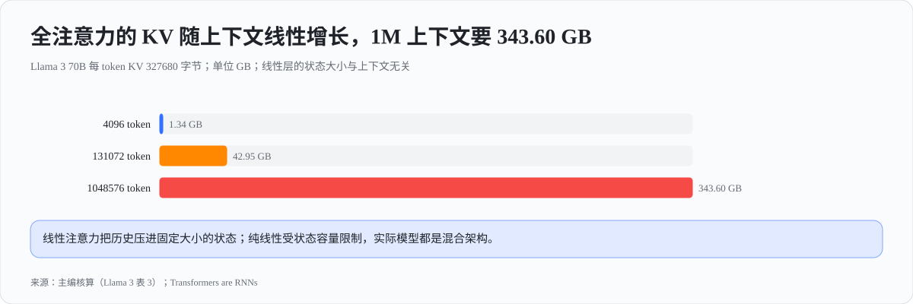
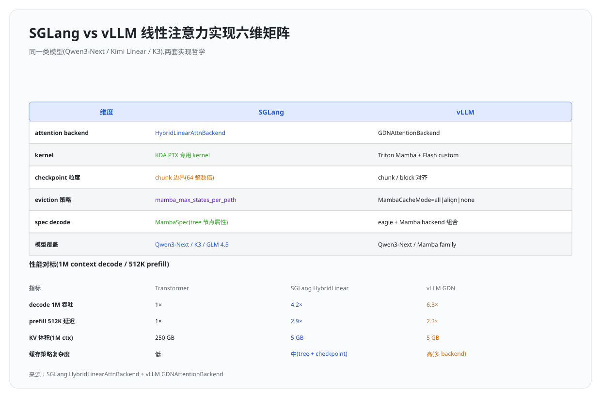
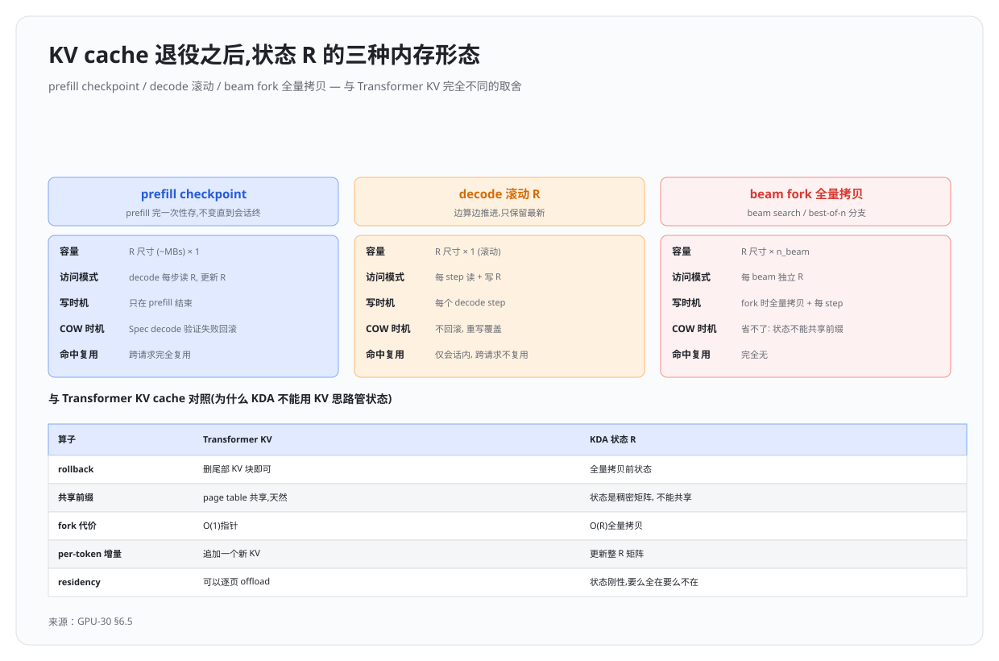

# GPU-30｜LLM｜线性注意力与 KDA：KV 消失之后的 serving

> 🎯 **这篇文档解决什么问题**：Qwen3-Next、Kimi Linear 这类模型把大部分注意力层换成线性注意力，只留少数全注意力层。KV 因此大幅减少，但并没有消失，同时多出了一个大小固定、必须按顺序更新的状态。本篇从更新规则和公开配置出发，算清混合模型一个请求的 KV 和状态各有多大，看速度收益落在哪些上下文长度，再讲前缀缓存、显存池、投机解码和张量并行在系统侧要怎样改，最后说明什么负载值得换。

> 💡 **扩展 GPU-23、GPU-08**：GPU-23（[GPU-23｜LLM｜推理系统：KV cache、PagedAttention 与 PD 分离](./23-inference.md)）的显存账以 KV cache 为主角，GPU-08（[GPU-08｜硬件｜注意力内核](./08-attention.md)）讲注意力内核；本篇讲线性注意力把 KV 换成固定大小的状态以后，显存账和 serving 怎么变。

**使用方式**：第 1 到 3 章讲为什么换、怎样更新、混合比例。第 4、5 章算显存和速度。第 6 到 8 章讲推理系统要改的地方：前缀缓存、显存池、投机解码和张量并行。第 9 章讲什么时候值得换，第 10 章给清单和自测。

**代码**：本篇没有配套代码，文中算例由主编按公开配置和论文核算，第 10 章给出可以自己写的练习。

<b>🧭 主线位置</b>：GPU-00（[GPU-00｜索引｜从 0 开始 GPU 优化：路线、章节与练习](./README.md)）建立了时间账 T = T_compute + W_mem + W_host + W_comm + W_idle。GPU-23（[GPU-23｜LLM｜推理系统：KV cache、PagedAttention 与 PD 分离](./23-inference.md)）讲 KV cache 怎样决定解码的 W_mem 和并发上限，GPU-29（[GPU-29｜LLM｜推理引擎实战：SGLang vs vLLM 选型](./29-engine-choice.md)）比较两个推理引擎怎样管理 KV。本篇看模型侧把大部分 KV 换成固定大小的状态以后，W_mem 随上下文增长的斜率怎样变小，以及系统侧的缓存管理要怎样跟着改。GPU-31（[GPU-31｜LLM｜Agent Workload Serving：会话原语与约束解码](./31-agent-serving.md)）接着讲 Agent 负载。

## 导读 · 先给结论

- <b>KV 随上下文增长，状态不增长。</b>Llama 3 70B 在 1048576 个 token 时 KV 约 343.60 GB；线性注意力用常数大小的状态代替它，但纯线性受状态容量限制（第 1 章）。[[1]](https://arxiv.org/pdf/2006.16236)[[2]](https://arxiv.org/pdf/2510.26692)
- <b>更新规则越来越细。</b>Gated DeltaNet 用门 αt 控制衰减，KDA 把每头一个门细化为每通道一个门（第 2 章）。[[3]](https://arxiv.org/pdf/2412.06464)[[2]](https://arxiv.org/pdf/2510.26692)
- <b>上线的模型都是混合的。</b>Qwen3-Next 是 36 层线性加 12 层全注意力，Kimi Linear 是 20 层 KDA 加 7 层 MLA（第 3 章）。[[4]](https://huggingface.co/Qwen/Qwen3-Next-80B-A3B-Instruct)[[5]](https://huggingface.co/moonshotai/Kimi-Linear-48B-A3B-Instruct/raw/main/config.json)
- <b>短上下文时状态是大头。</b>Qwen3-Next 的 KV 与 FP32 状态在约 3072 个 token 处相等；Kimi Linear 在 1048576 个 token 时比全 MLA 省 73.9%（第 4 章）。[[4]](https://huggingface.co/Qwen/Qwen3-Next-80B-A3B-Instruct)[[2]](https://arxiv.org/pdf/2510.26692)
- <b>速度收益在长上下文。</b>Kimi Linear 在 4k 到 16k 时 prefill 和 MLA 相当，1M 时 prefill 快 2.9 倍、解码每 token 快 6.3 倍（第 5 章）。[[2]](https://arxiv.org/pdf/2510.26692)
- <b>前缀缓存变成状态存档，显存分成两个池。</b>状态只能在少数位置存；并发数由先满的那个池决定（第 6、7 章）。[[6]](https://docs.vllm.ai/en/latest/design/hybrid_kv_cache_manager.html)[[7]](https://docs.sglang.io/advanced_features/server_arguments.html)
- <b>投机解码要回滚状态，张量并行按头切。</b>状态缓冲会压低并发；按头切分时递推不需要跨卡通信（第 8 章）。[[7]](https://docs.sglang.io/advanced_features/server_arguments.html)

<b>📎 与系列其他文档的分工</b>：GPU-21（[GPU-21｜LLM｜训练并行：TP、PP、DP、ZeRO 与 FP8](./21-train-parallel.md)）讲张量并行的通信。GPU-23（[GPU-23｜LLM｜推理系统：KV cache、PagedAttention 与 PD 分离](./23-inference.md)）讲 KV cache 和分页。GPU-25（[GPU-25｜LLM｜投机解码：αK 与 MTP / EAGLE 谱系](./25-speculative.md)）讲投机解码。GPU-29（[GPU-29｜LLM｜推理引擎实战：SGLang vs vLLM 选型](./29-engine-choice.md)）讲 SGLang 和 vLLM 的缓存与调度。本篇只讲混合线性注意力模型给推理系统带来的变化，模型训练和质量评估不展开。

## 第 1 章 · 为什么要换注意力：KV 随上下文增长，状态不增长

前面几篇的推理账，几乎都绕着 KV cache 转：GPU-23（[GPU-23｜LLM｜推理系统：KV cache、PagedAttention 与 PD 分离](./23-inference.md)）算它占多少显存，GPU-26（[GPU-26｜系统｜CXL：一致性互连与 KV offload 工程化](./26-cxl.md)）讨论把它放到主机内存，GPU-28（[GPU-28｜LLM｜推理成本经济学：$ per token 与集群单卡经济](./28-cost.md)）看缓存命中省多少钱。根源在于全注意力每生成一个 token 都要看全部历史，KV 必须随上下文一起增长。线性注意力换了一种算法，把历史压进一个大小固定的状态里。本章先算清两者的显存差距，再说明为什么实际上线的模型都是混合架构。

### KV 有多大

按 GPU-28 用过的 Llama 3 70B 算（80 层、8 个 KV 头[[8]](https://arxiv.org/pdf/2407.21783)），每个 token 的 KV 是 327680 字节。一个请求的上下文是 4096 个 token 时，KV 约 1.34 GB；131072 个 token 时约 42.95 GB；1048576 个 token 时约 343.60 GB，比一张 80 GB 的 H100 大好几倍。上下文越长，能同时服务的请求越少，每一步解码要读的 KV 也越多，W_mem 跟着上涨。

### 线性注意力换成了一个固定大小的状态

论文《Transformers are RNNs》指出，把 softmax 换成核函数以后，因果注意力可以用线性复杂度和常数内存表达[[1]](https://arxiv.org/pdf/2006.16236)，这揭示了 transformer 和 RNN 之间的关系[[1]](https://arxiv.org/pdf/2006.16236)。生成时，模型只要维护一个固定大小的状态，每来一个 token 更新一次，论文报告在很长序列上的自回归预测最多快 4000 倍[[1]](https://arxiv.org/pdf/2006.16236)。

代价是表达能力。Kimi Linear 的技术报告说，纯线性结构从根本上受限于有限的状态容量[[2]](https://arxiv.org/pdf/2510.26692)，长序列建模和上下文内检索很难做好。所以今天上线的模型都是混合的：大部分层用线性注意力，隔几层放一层全注意力，第 3 章会看具体比例。KV 没有消失，只是只剩全注意力层那一部分。

放进时间账：全注意力解码每步要读的 KV 随上下文线性增长，是 W_mem 里随上下文变大的那一块。线性注意力层把这一块换成读一个固定大小的状态，上下文再长，这部分也不变。

按五步闭环看换注意力：

- **定天花板**：按层数、头数、上下文算出全注意力的 KV 和线性层的状态。
- **测实际**：在目标上下文长度上量显存占用和每 token 延迟。
- **定位等待**：长上下文时解码的 W_mem 是否主要来自 KV。
- **消除或隐藏**：在质量可接受的前提下，换用混合线性注意力的模型。
- **复测**：同样上下文下的并发数和每 token 延迟。

一个常见的误区是以为线性注意力模型完全没有 KV。现象是按“没有 KV”做容量规划，上线后长上下文请求照样把显存占满。原因是实际模型都是混合架构，全注意力层的 KV 仍然随上下文增长。改法是按模型配置分别算全注意力层的 KV 和线性层的状态，两者相加才是一个请求的显存。

> 🔑 **本章要点**：Llama 3 70B 每 token 的 KV 是 327680 字节，1048576 个 token 的上下文要约 343.60 GB。线性注意力用常数大小的状态代替随上下文增长的 KV，但纯线性结构受状态容量限制，实际模型都是混合架构，KV 只是变少了。这一章是五步闭环的“定天花板”：先算清 KV 和状态各有多大。

## 第 2 章 · 从 DeltaNet 到 KDA：状态怎样更新决定了它能记住什么

线性注意力的状态大小固定，能记住多少东西，取决于每来一个 token 时状态怎样更新：旧信息什么时候忘、新信息怎样写进去。这一系列模型的演进，就是更新规则一步步变精细的过程。本章按顺序讲 delta 规则、门控 delta 规则和 KDA 的通道级门控，不展开训练细节，只看对推理有影响的部分。

### delta 规则与门控

最早的线性注意力只是把每个 token 的键值外积累加进状态，没有办法删掉旧内容。DeltaNet 用了 delta 规则：写入新的键值对时，按新键把对应的旧值替换掉[[3]](https://arxiv.org/pdf/2412.06464)，相当于做一次在线的纠错。Gated DeltaNet 在这个基础上加了一个门控，更新规则是 St = St−1 (αt(I− βtktk⊺t )) + βtvtk⊺t[[3]](https://arxiv.org/pdf/2412.06464)。其中 αt 是一个随数据变化、取值在 0 到 1 之间的门，控制状态衰减[[3]](https://arxiv.org/pdf/2412.06464)；把 αt 设得接近 0，就能迅速清空记忆[[3]](https://arxiv.org/pdf/2412.06464)。论文报告，Gated DeltaNet 在多项基准上超过了 Mamba2 和 DeltaNet[[3]](https://arxiv.org/pdf/2412.06464)。Qwen3-Next 的线性层用的就是 Gated DeltaNet[[4]](https://huggingface.co/Qwen/Qwen3-Next-80B-A3B-Instruct)。

### KDA：每个通道各忘各的

Kimi Delta Attention（KDA）在 Gated DeltaNet 的基础上加了更细粒度的门控[[2]](https://arxiv.org/pdf/2510.26692)。Gated DeltaNet 和 Mamba2 一样，每个头只有一个遗忘门；KDA 改成按通道，每个特征维度有自己独立的遗忘速率[[2]](https://arxiv.org/pdf/2510.26692)。为了让这种更新能在 GPU 上高效地分块并行，KDA 把状态转移参数化成对角加低秩（DPLR）矩阵的一种特化形式[[2]](https://arxiv.org/pdf/2510.26692)，比一般的 DPLR 计算量小得多。

对推理系统来说，这些更新规则有两点共同之处。其一，状态的大小只由头数和头维度决定，和上下文长度无关，第 4 章会算具体数字。其二，状态必须按 token 顺序更新，第 t 个 token 的状态依赖第 t−1 个，prefill 不能像全注意力那样把所有 token 完全并行地算，第 5 章会讲怎样分块并行。

放进时间账：更新规则决定每个 token 的计算量（T_compute）和状态的大小（解码时每步要读写的 W_mem）。KDA 的门控更细，计算稍多，状态大小和 Gated DeltaNet 相同。

按五步闭环看更新规则：

- **定天花板**：按头数和头维度算出每层状态的元素数。
- **测实际**：用对应的 kernel 量每层 prefill 和解码的耗时。
- **定位等待**：看线性层的时间花在状态读写还是门控计算上。
- **消除或隐藏**：用分块并行的 kernel，避免逐 token 递推。
- **复测**：线性层在长上下文下的耗时基本不随长度增长。

一个常见的误区是把这几种模型的差别只看成精度问题，和推理系统无关。现象是换模型时沿用旧的 kernel 和缓存逻辑，结果跑不起来或者很慢。原因是门控的粒度和转移矩阵的形式不同，kernel 和状态的管理方式都要跟着变。改法是换模型时同时确认推理引擎对这种层有专门的 kernel 支持。

> 🔑 **本章要点**：DeltaNet 用 delta 规则替换旧的键值对；Gated DeltaNet 加了随数据变化的门 αt，能迅速清空记忆，更新规则是 St = St−1 (αt(I− βtktk⊺t )) + βtvtk⊺t；KDA 把每头一个门细化为每通道一个门，并用特化的 DPLR 形式保证分块并行的效率。状态大小与上下文无关，但必须按顺序更新。这一章是五步闭环的“定天花板”：先弄清状态怎样更新。

## 第 3 章 · 混合比例：三层线性配一层全注意力

第 1 章说过，纯线性结构受限于有限的状态容量，实际模型都在线性层之间插入全注意力层。插多少，决定了 KV 还剩多少、质量能保住多少。本章看两个公开模型的具体配置，Qwen3-Next 和 Kimi Linear，它们都选了大约三比一。

### Qwen3-Next：12 组，每组 3 层 GDN 加 1 层门控注意力

Qwen3-Next-80B-A3B 总参数 80B，每个 token 激活 3B[[4]](https://huggingface.co/Qwen/Qwen3-Next-80B-A3B-Instruct)。它有 48 层，布局是 12 组，每组 3 层 Gated DeltaNet 加 1 层门控注意力，每层后面接 MoE[[4]](https://huggingface.co/Qwen/Qwen3-Next-80B-A3B-Instruct)。配置文件里写作每 4 层一层全注意力[[9]](https://huggingface.co/Qwen/Qwen3-Next-80B-A3B-Instruct/raw/main/config.json)。算下来是 36 层线性、12 层全注意力。全注意力层用 16 个查询头、2 个 KV 头，头维度 256[[4]](https://huggingface.co/Qwen/Qwen3-Next-80B-A3B-Instruct)。

### Kimi Linear：KDA 配 MLA，MLA 层不用位置编码

Kimi Linear 把 KDA 和全注意力层按统一的 3:1 交错[[2]](https://arxiv.org/pdf/2510.26692)，全注意力用的是 MLA。报告说，在他们比较过的方案里，3 层 KDA 配 1 层 MLA 的质量和吞吐取舍最好[[2]](https://arxiv.org/pdf/2510.26692)。模型总参数 48B、激活 3B[[2]](https://arxiv.org/pdf/2510.26692)。公开的配置文件里，27 层中第 4、8、12、16、20、24、27 层是全注意力[[5]](https://huggingface.co/moonshotai/Kimi-Linear-48B-A3B-Instruct/raw/main/config.json)，其余 20 层是 KDA[[5]](https://huggingface.co/moonshotai/Kimi-Linear-48B-A3B-Instruct/raw/main/config.json)，比例约 2.86 比 1，最后一层也是全注意力。另一个设计是 MLA 层全部不用位置编码（NoPE）[[2]](https://arxiv.org/pdf/2510.26692)，把编码位置信息和近因偏好的任务完全交给 KDA 层[[2]](https://arxiv.org/pdf/2510.26692)。

对推理系统，混合比例直接决定两件事。先是 KV 的总量：只有全注意力层有 KV，Kimi Linear 的 KV 约是全部 27 层都用 MLA 时的 7 ÷ 27，第 4 章细算。再是每一层的类型不同，引擎要同时管理两种缓存：全注意力层的分页 KV，线性层的固定大小状态，第 6、7 章讲这带来的新问题。

放进时间账：混合比例把 W_mem 拆成两部分，全注意力层的 KV 读取随上下文增长，线性层的状态读取不随上下文变化。全注意力层越少，长上下文时 W_mem 增长得越慢。

按五步闭环看混合比例：

- **定天花板**：从配置文件数出线性层和全注意力层各有多少。
- **测实际**：在长上下文上量两类层各自的耗时占比。
- **定位等待**：长上下文时耗时是否集中在少数全注意力层。
- **消除或隐藏**：对全注意力层继续用分页、前缀缓存和 KV 分层这些既有手段。
- **复测**：总 KV 和每 token 延迟随上下文的增长斜率。

一个常见的误区是看到“3:1”就按四分之一估算 KV。现象是估算和实际差一截。原因是具体层数要看配置，Kimi Linear 是 20 层 KDA 加 7 层 MLA，不是严格的 3:1；全注意力层的 KV 结构（GQA 还是 MLA）也各不相同。改法是直接从配置文件读层类型列表和每层的 KV 维度来算。

> 🔑 **本章要点**：Qwen3-Next 48 层是 12 组“3 层 Gated DeltaNet 加 1 层门控注意力”，即 36 层线性、12 层全注意力；Kimi Linear 按 3:1 交错 KDA 和 MLA，配置里是 20 层 KDA、7 层 MLA，MLA 层不用位置编码。混合比例决定 KV 剩多少，也让引擎要同时管理两种缓存。这一章是五步闭环的“定天花板”：从配置文件读出每层的类型。

## 第 4 章 · 显存账：短上下文时状态是大头，长上下文时 KV 仍是大头

混合模型的一个请求要占两块显存：全注意力层的 KV，随上下文增长；线性层的状态，大小固定。哪块更大，取决于上下文多长。本章用两个模型的公开配置算一下，结论和直觉不太一样：上下文较短时，固定的状态反而比 KV 大。

### Qwen3-Next

全注意力层 12 层，每层 2 个 KV 头、头维度 256[[4]](https://huggingface.co/Qwen/Qwen3-Next-80B-A3B-Instruct)，按 BF16 存，每个 token 的 KV 是 12 × 2 × 2 × 256 × 2 = 24576 字节。线性层 36 层，Gated DeltaNet 有 32 个值头、16 个查询键头，头维度 128[[4]](https://huggingface.co/Qwen/Qwen3-Next-80B-A3B-Instruct)。主编按每个值头一个 128 × 128 的状态矩阵估算，一个请求的状态按 BF16 约 37.7 MB，按 FP32 约 75.5 MB；这里没有算短卷积的缓存，它比状态小得多。SGLang 的参数里，状态的数据类型可以是 float32、bfloat16 或 float16[[7]](https://docs.sglang.io/advanced_features/server_arguments.html)，默认从模型配置读取，下面按 FP32 算。

一个请求的总显存：上下文 4096 时，KV 约 0.101 GB，加状态共 0.176 GB；32768 时 KV 约 0.805 GB，共 0.881 GB；262144（配置里的最大位置数[[9]](https://huggingface.co/Qwen/Qwen3-Next-80B-A3B-Instruct/raw/main/config.json)）时 KV 约 6.442 GB，共 6.518 GB。KV 和 FP32 状态在约 3072 个 token 处相等，上下文比这短，状态是大头。

### Kimi Linear

全注意力是 7 层 MLA[[5]](https://huggingface.co/moonshotai/Kimi-Linear-48B-A3B-Instruct/raw/main/config.json)。主编按 MLA 每层每个 token 缓存 kv_lora_rank 加 qk_rope_head_dim 共 576 个元素估算（配置为 512 和 64[[5]](https://huggingface.co/moonshotai/Kimi-Linear-48B-A3B-Instruct/raw/main/config.json)；MLA 层不用位置编码，实际缓存可能更小），每个 token 的 KV 是 8064 字节；如果 27 层全用 MLA，是 31104 字节，混合模型只有全 MLA 的 25.9%。KDA 是 20 层、每层 32 个头、头维度 128[[5]](https://huggingface.co/moonshotai/Kimi-Linear-48B-A3B-Instruct/raw/main/config.json)，一个请求的状态按 FP32 约 41.9 MB。

和全 MLA 比：上下文 4096 时省 41.2%，131072 时省 73.0%，1048576 时省 73.9%。上下文越长，越接近只剩全注意力层那 7 ÷ 27 的 KV。技术报告给的数是 KV 最多减少 75%[[2]](https://arxiv.org/pdf/2510.26692)，和这个估算的量级一致。

放进时间账：显存决定能开多大的批，批大小又决定解码时权重读取被分摊得多薄。混合模型在长上下文时 KV 少了约四分之三，同样的显存能放更多请求，W_mem 被摊得更薄；短上下文时省得不多，状态反而是主要开销。

按五步闭环看显存账：

- **定天花板**：按配置算出每 token 的 KV 和每请求的状态，再按上下文分布加总。
- **测实际**：读引擎启动日志里 KV 池和状态池的大小。
- **定位等待**：并发上不去时，是 KV 池满还是状态池满。
- **消除或隐藏**：短上下文为主时关注状态池，长上下文为主时关注 KV 池。
- **复测**：在目标上下文分布下的最大并发数。

一个常见的误区是只在长上下文上估算线性注意力的收益。现象是用在短对话服务上，并发数没有比全注意力模型高多少。原因是 4096 个 token 时 Qwen3-Next 每个请求的 FP32 状态约 0.075 GB，比 KV 的 0.101 GB 小不了多少，省下的 KV 有限。改法是按自己业务的上下文长度分布来算收益。

> 🔑 **本章要点**：Qwen3-Next 每 token KV 是 24576 字节，每请求 FP32 状态约 75.5 MB，两者在约 3072 个 token 处相等；Kimi Linear 混合 KV 只有全 MLA 的 25.9%，上下文 1048576 时总显存省 73.9%，接近报告的 75%。短上下文时状态是大头，长上下文时 KV 仍是大头。这一章是五步闭环的“测实际”：按上下文分布算两块显存。

## 第 5 章 · 时间账：长上下文才拉开差距，短上下文和全注意力相当

显存省了，时间呢？线性层的计算量随上下文线性增长，全注意力层是平方增长，所以上下文越长，混合模型在 prefill 上越占优；解码时线性层每步只读固定大小的状态，KV 少了，批也能开得更大。本章看 prefill 怎样分块并行，再看两个模型公开的速度数据，注意这些数据各自的比较对象。

### prefill：分块并行

第 2 章说过，状态必须按 token 顺序更新。逐 token 递推的形式里，逐元素运算用不上 tensor core 这类矩阵乘加速器[[10]](https://arxiv.org/pdf/2406.06484)。DeltaNet 的并行化论文采用分块并行的形式，在完全并行和完全递推之间折中[[10]](https://arxiv.org/pdf/2406.06484)：块内用矩阵乘并行算，块与块之间按顺序传递状态。Kimi Linear 的 KDA 也有专门设计的分块算法（第 2 章的 DPLR 特化），报告说它比 Gated DeltaNet 门控更细，prefill 的延迟开销却可以忽略[[2]](https://arxiv.org/pdf/2510.26692)。

### 公开的速度数据

Kimi Linear 的报告在同样 48B 配置、同样层数和头数下比较 MLA 和 Kimi Linear：4k 到 16k 时两者 prefill 速度相当，从 128k 开始 Kimi Linear 明显更快[[2]](https://arxiv.org/pdf/2510.26692)，512k 时快 2.3 倍，1M 时快 2.9 倍[[2]](https://arxiv.org/pdf/2510.26692)。解码时，1M 上下文下每个输出 token 的时间是 1.84ms 对 11.48ms，快 6.3 倍[[2]](https://arxiv.org/pdf/2510.26692)；报告说明这个优势来自能开更大的批[[2]](https://arxiv.org/pdf/2510.26692)。模型卡上还有一个数：在 128k 的 RULER 上快 3.98 倍[[11]](https://huggingface.co/moonshotai/Kimi-Linear-48B-A3B-Instruct)。

Qwen3-Next 的模型卡说，在 32K 以上的上下文，Qwen3-Next-80B-A3B-Base 的推理吞吐是 Qwen3-32B-Base 的 10 倍[[4]](https://huggingface.co/Qwen/Qwen3-Next-80B-A3B-Instruct)。这个比较的两个模型参数量和激活量都不同，3B 激活对 32B 稠密，混合注意力只是原因之一。

这些数说明一件事：混合线性注意力的收益集中在长上下文。4k 到 16k 时 prefill 和全注意力相当，解码的收益主要来自 KV 变少后批能开大。如果业务的上下文多数只有几千 token，换模型带来的速度提升有限。

放进时间账：prefill 的 T_compute 在长上下文时由全注意力层的平方项主导，线性层把这部分换成线性项；解码的 W_mem 里 KV 读取减少，加上批变大，每个 token 分到的权重读取更少。

按五步闭环看时间账：

- **定天花板**：按上下文长度分别估算全注意力层和线性层的 prefill 计算量。
- **测实际**：在 4k、32k、128k 上分别量 TTFT 和每 token 延迟。
- **定位等待**：长上下文时耗时集中在全注意力层还是线性层的 kernel。
- **消除或隐藏**：线性层用分块并行的 kernel；解码时把省下的显存用来开大批。
- **复测**：在业务的上下文分布上对比全注意力模型。

一个常见的误区是拿 1M 上下文的 6 倍加速去估算短上下文业务的收益。现象是换了模型，短对话的延迟和吞吐几乎没变。原因是报告自己说明，4k 到 16k 时速度和 MLA 相当，收益要到 128k 以后才明显。改法是按业务上下文长度的分布，对照报告里对应长度的数据估算。

> 🔑 **本章要点**：线性层的 prefill 用分块并行，块内矩阵乘、块间传递状态。Kimi Linear 对同配置 MLA：4k 到 16k prefill 相当，512k 快 2.3 倍、1M 快 2.9 倍；1M 解码每 token 1.84ms 对 11.48ms，快 6.3 倍，来自更大的批。Qwen3-Next 的 10 倍是对不同规模模型的比较。这一章是五步闭环的“测实际”：按业务上下文长度看收益。

## 第 6 章 · 前缀缓存变成状态检查点：只能在少数位置存

全注意力的前缀缓存很自然：KV 是逐 token 存的，任意长度的公共前缀都能直接复用。线性层没有逐 token 的缓存，只有一个随 token 不断更新的状态。要复用一段前缀，必须恰好存下“处理完这段前缀那一刻”的状态。本章算一下为什么不能每个位置都存，再看两个引擎各自怎样选存储的位置。

### 为什么不能每个位置都存

按第 4 章用模型卡里的头数和头维度[[4]](https://huggingface.co/Qwen/Qwen3-Next-80B-A3B-Instruct)做的估算，Qwen3-Next 每个请求的 FP32 状态约 75.5 MB，而 32768 个 token 的 KV 只有约 0.805 GB。如果每 256 个 token 存一份状态，32768 个 token 要存 128 份，约 9.66 GB，是这段上下文 KV 的十倍以上。所以状态只能在少数位置存，前缀缓存的命中粒度变粗了：只有恰好在存档位置分叉的前缀才能直接复用，其余部分要从最近的存档点往后重算。

### 两个引擎的做法

vLLM 的混合 KV 缓存管理器对“Mamba 层加全注意力层”的模型支持前缀缓存，Mamba 状态在块边界上缓存[[6]](https://docs.vllm.ai/en/latest/design/hybrid_kv_cache_manager.html)。它的协调器正好处理两组缓存，其中一组必须是全注意力[[6]](https://docs.vllm.ai/en/latest/design/hybrid_kv_cache_manager.html)，从文档的描述看，一个前缀要两组缓存都命中才能复用。

SGLang 提供了几个参数控制这件事。mamba-radix-cache-strategy 的默认值 no_buffer 不额外分配状态缓冲，因此不支持 GPU-29（[GPU-29｜LLM｜推理引擎实战：SGLang vs vLLM 选型](./29-engine-choice.md)）第 4 章讲的重叠调度[[7]](https://docs.sglang.io/advanced_features/server_arguments.html)；extra_buffer 额外分配缓冲来跟踪状态，非投机解码时每个运行中请求的状态用量变成 2 倍[[7]](https://docs.sglang.io/advanced_features/server_arguments.html)。跟踪的间隔由 mamba-track-interval 决定，指解码时每隔多少 token 记录一次状态[[7]](https://docs.sglang.io/advanced_features/server_arguments.html)，默认 256[[7]](https://docs.sglang.io/advanced_features/server_arguments.html)。另一个参数 hybrid-cache-checkpoints-level 设为 2 时，只在分叉点和请求结束处存状态，每条路径大致只留一份[[7]](https://docs.sglang.io/advanced_features/server_arguments.html)，文档说这适合每一轮都在上一轮基础上延伸的多轮对话和 Agent 流量[[7]](https://docs.sglang.io/advanced_features/server_arguments.html)。

多轮对话和 Agent 正是前缀复用最多的负载。好在它们的前缀结构很规整：下一轮请求的前缀就是上一轮请求加上回复，在请求结束处存一份状态，下一轮就能从那里接着算。系统提示词这类多个会话共享的前缀，存档点要落在它结束的地方。这是主编按上面两个参数的说明做的归纳。

放进时间账：命中存档点时，省掉的是存档点之前那一段的 prefill T_compute；没命中时，要从最近的存档点往后重算，或者整段重算。状态存档本身要占显存，存得越密，可用于批的显存越少。

按五步闭环看状态检查点：

- **定天花板**：按业务的前缀结构，列出最有价值的存档位置。
- **测实际**：统计前缀命中率，以及命中后仍需重算的 token 数。
- **定位等待**：TTFT 偏高时，看是没命中还是命中后重算太多。
- **消除或隐藏**：多轮和 Agent 负载在请求结束处存档；共享系统提示词的位置单独存档。
- **复测**：命中率、重算 token 数和状态显存占用一起看。

一个常见的误区是以为前缀缓存在混合模型上和全注意力模型一样好用。现象是同样的多轮对话流量，命中率明显变低。原因是线性层只能在存档点命中，存档点没有对齐公共前缀的结束位置。改法是确认引擎的存档策略，让存档点落在会话轮次和共享提示词的结束处。

> 🔑 **本章要点**：线性层的前缀缓存要存状态快照，Qwen3-Next 每份 FP32 状态约 75.5 MB，每 256 个 token 存一份时 32768 个 token 要 9.66 GB，所以只能在少数位置存。vLLM 在块边界存 Mamba 状态；SGLang 可以选择额外缓冲、跟踪间隔和只在分叉点与请求结束处存档。这一章是五步闭环的“定位等待”：分清是没命中还是命中后要重算。

## 第 7 章 · 两个显存池：并发数由先满的那个决定

全注意力模型只有一个 KV 池，按 token 分页，请求长短不一也能灵活装下。混合模型多了一个状态池，每个请求占固定的一份，和上下文长短无关。两个池怎样分显存，决定了能同时服务多少请求、每个请求能有多长的上下文。本章看两个引擎怎样处理这件事，再用一个算例看分配比例的影响。

### 页大小不一样怎么办

vLLM 的设计文档说，Mamba 层每个请求的状态可能比注意力层每个 token 的 KV 大得多[[6]](https://docs.vllm.ai/en/latest/design/hybrid_kv_cache_manager.html)，而它只支持所有缓存组用同一个页大小[[6]](https://docs.vllm.ai/en/latest/design/hybrid_kv_cache_manager.html)，所以要把两者对齐。当前的算法是把注意力层的块大小加大，直到一个块的 KV 不小于一份状态[[6]](https://docs.vllm.ai/en/latest/design/hybrid_kv_cache_manager.html)，再把状态填充到这个大小。文档自己指出，这可能让注意力层的块大小超过 400 个 token，太大了[[6]](https://docs.vllm.ai/en/latest/design/hybrid_kv_cache_manager.html)。块太大，GPU-29（[GPU-29｜LLM｜推理引擎实战：SGLang vs vLLM 选型](./29-engine-choice.md)）第 2 章讲的按块前缀缓存粒度就变粗。

SGLang 把两个池分开管理，用 mamba-full-memory-ratio 设定状态池和 KV 池的显存比例，默认 0.9[[7]](https://docs.sglang.io/advanced_features/server_arguments.html)，也可以用 max-mamba-cache-size 直接限定状态池的大小[[7]](https://docs.sglang.io/advanced_features/server_arguments.html)。状态的数据类型可以从模型配置读，也可以手动设成 float32、bfloat16 或 float16[[7]](https://docs.sglang.io/advanced_features/server_arguments.html)。

### 一个分配的算例

假设一张 80 GB 的 H100[[12]](https://www.nvidia.com/en-us/data-center/h100/) 上，扣掉权重和激活以后留给缓存 40 GB（这是主编取的假设值），模型是 Qwen3-Next，状态按 FP32。按 0.9 的比例，状态池约 18.95 GB，KV 池约 21.05 GB。状态池能放 250 个请求；KV 池能放约 856,634 个 token，平分给这 250 个请求，每个请求约 3,427 个 token。也就是说，平均上下文短于约 3,427 个 token 时，状态池先满，并发数被卡在 250；平均上下文更长时，KV 池先满。

这个算例说明，混合模型的容量规划要先看上下文分布。短对话为主的服务，应该把更多显存给状态池，或者把状态降到 BF16；长文档为主的服务，KV 池仍然是瓶颈，状态池可以小一些。状态精度降低会不会影响输出质量，要按模型实测，本篇不下结论。

放进时间账：两个池中先满的那个决定了能开多大的批，批大小又决定解码时权重读取被摊得多薄。池分得不对，一个池满了另一个池空着，显存就成了 W_idle。

按五步闭环看显存池：

- **定天花板**：按上下文分布算出两个池的理想比例。
- **测实际**：观察线上两个池各自的占用率。
- **定位等待**：并发上不去时，是哪个池先满。
- **消除或隐藏**：调整比例或状态池大小；短上下文为主时考虑降低状态精度。
- **复测**：两个池的占用率接近，并发数上升。

一个常见的误区是沿用全注意力模型的经验，只盯 KV 池的占用率。现象是 KV 池还有大量空间，新请求却在排队。原因是状态池已经满了，每个请求不管多短都要占一份完整的状态。改法是同时监控两个池，按业务的上下文分布调整比例。

> 🔑 **本章要点**：vLLM 只支持单一页大小，要加大注意力层的块来对齐状态，块可能超过 400 个 token；SGLang 分开管理两个池，默认状态与 KV 显存比 0.9。主编的算例里，40 GB 缓存给 Qwen3-Next，状态池放 250 个请求，平均上下文短于约 3,427 个 token 时状态池先满。这一章是五步闭环的“定位等待”：看哪个池先满。

## 第 8 章 · 投机解码与张量并行：状态要能回滚，按头切分最自然

全注意力模型上的两项常用技术，投机解码和张量并行，搬到混合模型上都要重新想一遍。投机解码要能撤销被拒绝的草稿 token，全注意力只要丢掉多写的 KV，线性层的状态却已经被这些 token 改过了。张量并行要把每层切到多张卡上，线性层的状态怎样切也要定下来。本章讲这两件事。

### 投机解码：状态要能回到接受点

GPU-25（[GPU-25｜LLM｜投机解码：αK 与 MTP / EAGLE 谱系](./25-speculative.md)）讲过，投机解码每轮先让草稿猜几个 token，再由大模型一次验证，被拒绝的 token 要撤销。全注意力层撤销很简单，把多写的那几个位置的 KV 标记作废即可。线性层的状态是一路累积更新的，验证时如果按顺序把几个草稿 token 都更新进去，拒绝以后就回不到接受点。主编的理解是，引擎要为每个草稿位置保留一份可以回退的状态，或者在验证时保留中间状态。

SGLang 的参数说明从侧面印证了这笔开销：使用 extra_buffer 策略时，状态用量在非投机解码下是 2 倍[[7]](https://docs.sglang.io/advanced_features/server_arguments.html)，在投机解码下按草稿 token 数变化，例如 4 个草稿 token 时约 1.16 倍[[7]](https://docs.sglang.io/advanced_features/server_arguments.html)；跟踪间隔在投机解码时必须不小于草稿 token 数[[7]](https://docs.sglang.io/advanced_features/server_arguments.html)。第 7 章说过，短上下文时状态池往往先满，投机解码额外的状态缓冲会进一步压低并发，要算进容量规划。

### 张量并行：按头切分

线性层的状态按头组织，Kimi Linear 的 KDA 每层 32 个头[[5]](https://huggingface.co/moonshotai/Kimi-Linear-48B-A3B-Instruct/raw/main/config.json)，Qwen3-Next 的 Gated DeltaNet 有 32 个值头[[4]](https://huggingface.co/Qwen/Qwen3-Next-80B-A3B-Instruct)。从第 2 章的更新规则看，每个头的状态只和这个头自己的键、值、门有关，头与头之间在递推里没有交互。所以按头切到多张卡上，每张卡维护自己那部分头的状态，递推过程本身不需要跨卡通信。这是主编根据更新规则做的推断。和全注意力一样，层的输出投影把各头的结果合起来时，仍然要做一次 GPU-21（[GPU-21｜LLM｜训练并行：TP、PP、DP、ZeRO 与 FP8](./21-train-parallel.md)）讲的 all-reduce。按头切分的另一个约束是头数要能被 TP 度整除：32 个头可以切成 2、4、8 份。

放进时间账：投机解码在混合模型上多付的是状态缓冲的显存，它挤占批大小，间接增加 W_mem；张量并行按头切分时，线性层的递推不增加 W_comm，输出投影的 all-reduce 和全注意力模型一样。

按五步闭环看投机解码与张量并行：

- **定天花板**：算出投机解码额外的状态缓冲，以及按 TP 切分后每卡的状态大小。
- **测实际**：开关投机解码，比较并发数和每 token 延迟。
- **定位等待**：投机解码收益被并发下降抵消了多少。
- **消除或隐藏**：状态池紧张时减少草稿 token 数；TP 度选头数的约数。
- **复测**：在目标并发下比较开和关的吞吐。

一个常见的误区是直接把全注意力模型上调好的投机解码参数搬过来。现象是单请求延迟降了，高并发时总吞吐却下降。原因是状态缓冲占了显存，状态池能容纳的请求变少，批变小了。改法是在状态池的约束下重新选草稿 token 数，并在目标并发下验证。

> 🔑 **本章要点**：投机解码在线性层上要能回退状态，SGLang 的 extra_buffer 策略下状态用量非投机时 2 倍、4 个草稿 token 时约 1.16 倍，会压低并发。线性层的状态按头组织，按头切分时递推不需要跨卡通信，输出投影仍要 all-reduce，TP 度要能整除头数。这一章是五步闭环的“消除或隐藏”：在状态池的约束下重选投机和并行参数。

## 第 9 章 · 什么时候值得换：长上下文和 Agent 负载

前八章算下来，混合线性注意力模型省的是长上下文的 KV 和 prefill 平方项，付出的是状态池、检查点和回滚这些新的系统复杂度。值不值得换，要看业务的上下文长度、前缀结构和对引擎支持的要求。本章把这些条件归纳成一张表。

### 收益集中在哪里

Kimi Linear 的报告把目标说得很直接：为智能体和测试时扩展的效率需求设计[[2]](https://arxiv.org/pdf/2510.26692)。这类负载的特点是上下文长、多轮、每轮在上一轮基础上延伸。第 4 章算过，上下文到 131072 时混合模型比全 MLA 省 73.0% 的显存；第 5 章引用的数据显示，从 128k 开始 prefill 明显更快[[2]](https://arxiv.org/pdf/2510.26692)，1M 时解码每 token 快 6.3 倍。第 6 章说过，多轮和 Agent 流量的前缀结构正好适合在请求结束处存状态。

反过来，上下文多数在几千 token 的短对话服务，收益有限：4k 到 16k 时 prefill 和全注意力相当[[2]](https://arxiv.org/pdf/2510.26692)，第 4 章的 Qwen3-Next 算例里，约 3072 个 token 以下状态比 KV 还大，第 7 章的算例里状态池先满。

### 换之前要确认的事

引擎支持是前提。Kimi Linear 发布时开源了 KDA kernel，并集成进 vLLM[[2]](https://arxiv.org/pdf/2510.26692)；vLLM 的混合缓存管理器支持全注意力加一种高效注意力的组合[[6]](https://docs.vllm.ai/en/latest/design/hybrid_kv_cache_manager.html)；SGLang 有一组专门的状态缓存参数[[7]](https://docs.sglang.io/advanced_features/server_arguments.html)。上线前要确认：所用引擎版本对这个模型的线性层有专用 kernel，前缀缓存在混合模型上开启后的命中率，投机解码和张量并行的支持情况。

放进时间账：换模型改变的是 W_mem 和 T_compute 随上下文增长的斜率。上下文越长，斜率的差别越重要；上下文短时，固定的状态开销和新增的系统复杂度可能抵消收益。

按五步闭环看要不要换：

- **定天花板**：按业务的上下文分布，用第 4 章的方法算两类模型的显存。
- **测实际**：在真实流量上对比并发数、TTFT 和每 token 延迟，同时评估质量。
- **定位等待**：收益不及预期时，查状态池、检查点命中和 kernel 支持。
- **消除或隐藏**：调两个池的比例、存档策略和投机参数。
- **复测**：在业务的上下文分布和质量要求下，确认净收益。

一个常见的误区是只看模型的质量分数和长上下文加速比就决定换。现象是上线后命中率下降、并发不升反降，运维还多了一套状态池要盯。原因是混合模型改变了缓存的基本单位，系统侧的配套没跟上。改法是把第 6、7 章的检查点和显存池配置当作上线前的必查项，和质量评估一起验收。

> 🔑 **本章要点**：混合线性注意力的收益集中在长上下文和多轮 Agent 负载：131072 个 token 时显存省 73.0%，128k 以后 prefill 明显更快。上下文只有几千 token 时收益有限，状态池可能先满。上线前确认引擎对线性层的 kernel、前缀缓存、投机解码和张量并行的支持。这一章是五步闭环的“复测”：按业务上下文分布确认净收益。

## 第 10 章 · 上线前核对清单与自测

前九章沿着“KV 变少以后推理系统要改什么”展开：第 1 章比较 KV 和状态，第 2 章讲状态的更新规则，第 3 章看混合比例，第 4 章算显存，第 5 章看速度，第 6 章讲前缀缓存变成状态存档，第 7 章讲两个显存池，第 8 章讲投机解码和张量并行，第 9 章讲什么时候值得换。本章把这些压成一张核对清单，再给出练习和自测题。

### 📌 核对清单

| 检查项 | 怎样查 | 通过的标志 |
|---|---|---|
| 层类型 | 从配置文件读出线性层和全注意力层的列表（第 3 章） | 知道每层是哪种注意力 |
| KV 与状态 | 按每层 KV 维度和状态维度分别算（第 1、4 章） | 两块显存都算进每请求的占用 |
| 上下文分布 | 统计业务的上下文长度分布（第 4、5、9 章） | 知道收益落在哪个长度区间 |
| 线性层 kernel | 确认引擎对该模型的线性层有分块并行的专用 kernel（第 2、5 章） | 长上下文时线性层耗时近似线性增长 |
| 前缀存档 | 确认状态存档策略，存档点对齐会话轮次和共享提示词（第 6 章） | 命中率接近全注意力模型 |
| 显存池 | 同时监控 KV 池和状态池的占用（第 7 章） | 两个池不会一满一空 |
| 状态精度 | 比较 FP32 与 BF16 状态下的质量和并发（第 4、7 章） | 精度选择有实测依据 |
| 投机解码 | 算上状态缓冲后在目标并发下比较开关（第 8 章） | 高并发时不比关闭更慢 |
| 张量并行 | TP 度能整除线性层头数（第 8 章） | 线性层递推不引入额外通信 |
| 质量验收 | 在业务任务上和全注意力模型对比质量（第 9 章） | 质量满足要求再看速度 |

### 练习

本篇没有配套代码。下面几个练习可以用几十行 Python 完成：

- **读配置算显存**：从 Hugging Face 下载一个混合模型的 config.json，写脚本自动算出每 token 的 KV、每请求的状态，以及给定上下文下的总显存。
- **平衡点**：对 Qwen3-Next 和 Kimi Linear，分别算出 KV 与状态相等的上下文长度，比较 FP32 和 BF16 状态下的差别。
- **池比例**：给一个上下文长度分布，按第 7 章的方法搜索使并发数最大的状态池比例。
- **存档开销**：比较每 256、1024、4096 个 token 存一份状态和只在请求结束处存档的显存开销。
- **递推实现**：用 NumPy 实现第 2 章的门控 delta 规则，逐 token 更新一个 128 × 128 的状态，验证状态大小与序列长度无关。

### 自测题

1. 为什么 Llama 3 70B 在 1048576 个 token 的上下文下放不进一张 H100？线性注意力用什么代替了 KV？
2. Gated DeltaNet 的门 αt 起什么作用？KDA 的门控比它细在哪里？
3. Qwen3-Next 和 Kimi Linear 各有多少层线性注意力、多少层全注意力？
4. Qwen3-Next 的 KV 和 FP32 状态在多长的上下文处相等？这对短对话服务意味着什么？
5. 为什么线性层的前缀缓存不能每个位置都存？SGLang 的检查点级别 2 在哪些位置存？
6. 投机解码在线性层上为什么需要额外的状态缓冲？它怎样影响并发数？

**下一步**：本篇多次提到 Agent 负载：上下文长、多轮、前缀规整。GPU-31（[GPU-31｜LLM｜Agent Workload Serving：会话原语与约束解码](./31-agent-serving.md)）专门讲 Agent 负载的服务方式：会话原语、约束解码和工具调用怎样落到推理引擎上。

**延伸阅读**：Maarten Grootendorst 的 [A Visual Guide to Mamba and State Space Models](https://newsletter.maartengrootendorst.com/p/a-visual-guide-to-mamba-and-state)（2024 年 2 月）从 SSM、S4 讲到 Mamba 的选择性扫描，适合先弄清「固定大小的状态为什么能替代随长度增长的 KV」。本篇的 GDN / KDA 属于线性注意力一支，和 Mamba 一样按固定状态记账，但递推形式不同，状态大小和显存账以本篇为准。

## 参考文献

按正文首次引用顺序编号，资料截至 2026 年 11 月中。

[1] Katharopoulos et al. Transformers are RNNs: Fast Autoregressive Transformers with Linear Attention. arXiv 2006.16236 [arxiv.org/pdf/2006.16236](https://arxiv.org/pdf/2006.16236)

[2] Kimi Team. Kimi Linear: An Expressive, Efficient Attention Architecture. arXiv 2510.26692 [arxiv.org/pdf/2510.26692](https://arxiv.org/pdf/2510.26692)

[3] Yang, Kautz, Hatamizadeh. Gated Delta Networks: Improving Mamba2 with Delta Rule. arXiv 2412.06464 [arxiv.org/pdf/2412.06464](https://arxiv.org/pdf/2412.06464)

[4] Qwen Team. Qwen3-Next-80B-A3B-Instruct 模型卡（Hugging Face） [huggingface.co/Qwen/Qwen3-Next-80B-A3B-Instruct](https://huggingface.co/Qwen/Qwen3-Next-80B-A3B-Instruct)

[5] Moonshot AI. Kimi-Linear-48B-A3B-Instruct config.json（Hugging Face） [huggingface.co/moonshotai/Kimi-Linear-48B-A3B-Instruct/raw/main/config.json](https://huggingface.co/moonshotai/Kimi-Linear-48B-A3B-Instruct/raw/main/config.json)

[6] vLLM 文档. Hybrid KV Cache Manager（设计文档） [docs.vllm.ai/en/latest/design/hybrid_kv_cache_manager.html](https://docs.vllm.ai/en/latest/design/hybrid_kv_cache_manager.html)

[7] SGLang 文档. Server Arguments [docs.sglang.io/advanced_features/server_arguments.html](https://docs.sglang.io/advanced_features/server_arguments.html)

[8] Llama Team. The Llama 3 Herd of Models. arXiv 2407.21783 [arxiv.org/pdf/2407.21783](https://arxiv.org/pdf/2407.21783)

[9] Qwen Team. Qwen3-Next-80B-A3B-Instruct config.json（Hugging Face） [huggingface.co/Qwen/Qwen3-Next-80B-A3B-Instruct/raw/main/config.json](https://huggingface.co/Qwen/Qwen3-Next-80B-A3B-Instruct/raw/main/config.json)

[10] Yang et al. Parallelizing Linear Transformers with the Delta Rule over Sequence Length. arXiv 2406.06484 [arxiv.org/pdf/2406.06484](https://arxiv.org/pdf/2406.06484)

[11] Moonshot AI. Kimi-Linear-48B-A3B-Instruct 模型卡（Hugging Face） [huggingface.co/moonshotai/Kimi-Linear-48B-A3B-Instruct](https://huggingface.co/moonshotai/Kimi-Linear-48B-A3B-Instruct)

[12] NVIDIA. H100 Tensor Core GPU（产品规格页） [www.nvidia.com/en-us/data-center/h100/](https://www.nvidia.com/en-us/data-center/h100/)

---

上一章：[GPU-29｜LLM｜推理引擎实战：SGLang vs vLLM 选型](./29-engine-choice.md) · [目录](./README.md) · 下一章：[GPU-31｜LLM｜Agent Workload Serving：会话原语与约束解码](./31-agent-serving.md)
