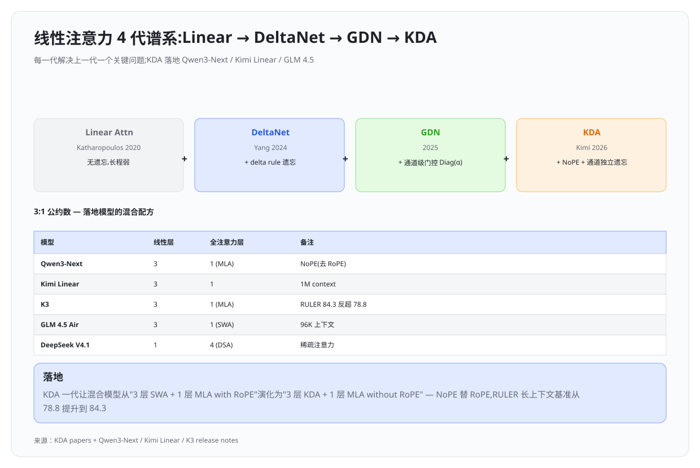
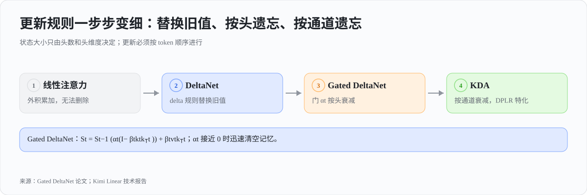
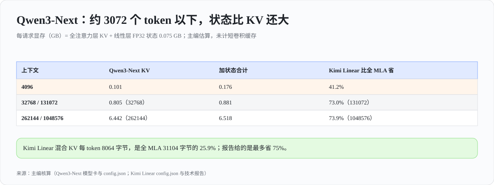
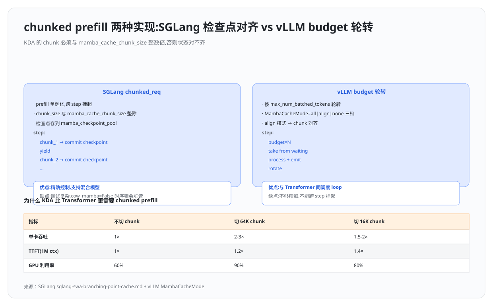
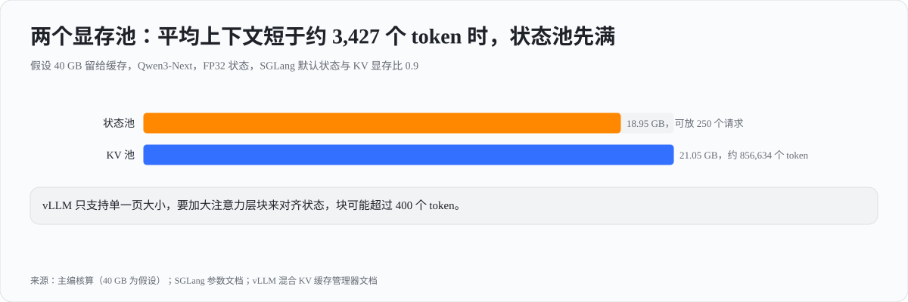
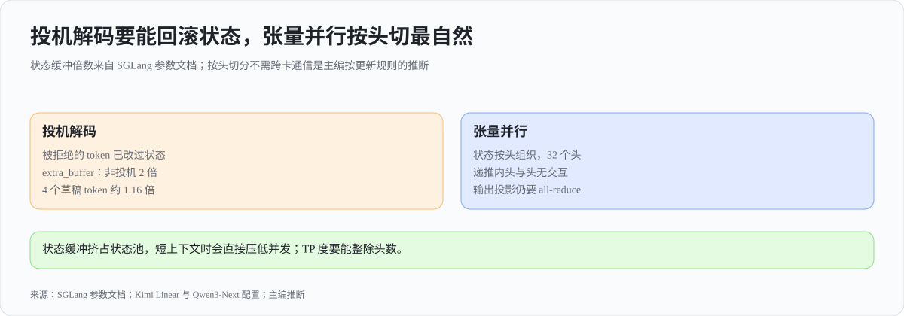
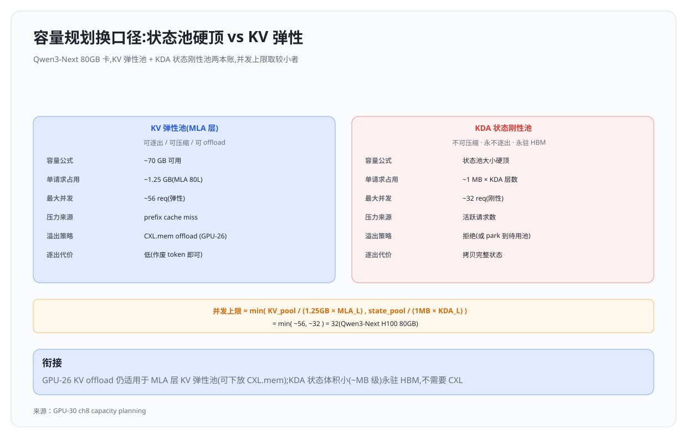

# GPU-30｜LLM｜线性注意力与 KDA:KV 消失之后的 serving

# 导读 · 解决什么问题

> 🎯 本章解决什么问题:KDA(Kimi Delta Attention)等线性注意力把 KV cache 从"显存账主角"推到"退役边缘",模型侧这本账换了名目之后,系统侧的等待也换名目 — 不再等 KV 命中页,而是等状态 checkpoint、等状态刚性强制的串行 prefill。本章按五步闭环展开:先定谱系天花板(第 1-2 章 GDN/DeltaNet/KDA 三行递推),再测双引擎实现差异(第 3-4 章),再定位线性注意力专属的等待(chunkwise 严格串行,第 5 章),再列出状态语义带来的新应对(第 6-7 章 TP 按头切分零通信),最后换口径规划容量(第 8 章)。衔接 GPU-23 的 KV cache 账与 GPU-28 的成本账。使用方式:模型团队看 1-4 章,serving 团队看 5-8 章。

> 💡 **扩展 GPU-23、GPU-08**：[GPU-23](./23-inference.md) 的显存账以 KV cache 为主角，[GPU-08](./08-attention.md) 讲注意力内核；本篇讲线性注意力把 KV 换成固定大小的状态以后，显存账和 serving 怎么变。

## 本章地图

- **第 1章 谱系与 3:1 公约数**:DeltaNet → Gated DeltaNet → KDA,Qwen3-Next/Kimi Linear/K3 的"3 层线性 + 1 层全注意力"
- **第 2章 KDA 机制**:通道级门控 Diag(α) + DPLR 特化 + NoPE 替 RoPE,递推公式逐行展开
- **第 3章 三个被打破的系统假设**:prefill 串行 / 前缀缓存→状态检查点 / 双账本(KV 弹性 + 状态刚性)
- **第 4章 双引擎实现对照**:vLLM GDN/Mamba/MambaSpec vs SGLang HybridLinearAttn/KDA PTX
- **第 5章 chunkwise 串行 prefill 调度**:模型级串行 vs 调度级切块,chunked_req 单例 + 检查点对齐
- **第 6章 状态语义深水区**:spec decode 回滚 = 拷贝状态,beam fork 关 COW,重放一致性隐患(见 GPU-25)
- **第 7章 TP 按头切分**:KDA 通道独立 → 按头零通信;o_proj 仍要 all-reduce(见 GPU-21)
- **第 8章 容量规划换口径**:状态池硬顶 vs KV 弹性,按状态算并发(见 GPU-23)

> 📐 **口径边界**:本章以 Qwen3-Next (2026-09) 和 Kimi Linear / K3 (2026-08) 为主样本 [16],GLM 4.5 Air、DeepSeek V4.1 的稀疏注意力机制只作对比。所有"线性注意力模型"在本章中特指 **混合架构**——纯线性模型(如 RWKV 早期版本)在 long context 上的质量仍输 Transformer,业界主推的是"3 层线性 + 1 层全注意力"或"3 层 KDA + 1 层 MLA"的混合配方。所有 SGLang/vLLM 实现引用对应 commit 截至 2026-11-05;模型架构演进极快,具体配置以最新 release 为准。

# 第 1 章 · 谱系与 3:1 公约数:从 GDN 到 KDA

## §1.1 为什么业界需要非 Transformer 的 attention

Qwen3-Next 的 config.json 里,attention_type 字段数出来:28 层里只有 7 层标着 full_attn,其余 21 层写着 linear [16]。第一反应是配置写错了——Transformer 不就该每层都是 self-attention 吗?翻到 Kimi K3 和 GLM 4.5 Air 的配置,同样的 3:1 配比。三家互不相关的团队在同一个比值上收敛,不是默契,而是 2025-2026 年长上下文模型的事实标准。

为什么业界要逃离纯 Transformer?答案在 GPU-23 那篇 KV cache 解剖里讲过:上下文长度 L 每翻一倍,KV 体积线性涨、attention 算力平方涨。算笔账:一个 7B 模型、28 层、每层 KV head dim 合计 4096,1M token 的 KV cache 要存 28 × 2 × 4096 × 1,000,000 个 fp16——大约 220GB,三张 H100 的显存总和全用来装 KV,模型权重还没地方放。1M 上下文不是 Transformer 的"长板延伸",而是它的死穴:再大的显存也填不满平方增长的算力黑洞,prefill 一次 1M 的注意力矩阵就是 10^12 个元素。

非 Transformer attention 的诉求就两条:把 decode 阶段的显存带宽从 $O(L)$ 压到 $O(1)$,把 KV 体积从"跟上下文等长"压成"固定大小状态"。线性注意力家族就是奔着这两条去的——它把 attention 退化成一个不断更新的状态矩阵 $S_t$,没了 KV cache,没了平方算力。状态大小由特征维 d 决定,跟序列长度 L 无关;decode 每步只读这个固定状态,显存带宽是常数。模型因此能真的"记住"一整本书,而不是每次解码都把整本书重读一遍——长上下文 serving 的瓶颈从"装不装得下"变成了"状态怎么调度"。

需要先分清"非 Transformer attention"这个大筐里装了什么。状态化的序列模型有两条主线:一条是 SSM/Mamba 路线,把状态看成连续动力学,$S_t$ 是隐状态的演化;另一条是线性注意力路线,把状态看成"key-value 外积的累积",$S_t$ 是显式记忆矩阵。两者数学形式相近,工程语义不同——SSM 的状态是"压缩的隐变量",线性注意力的状态是"可读写的记忆"。本章聚焦后者,因为 Qwen3-Next、Kimi、GLM 选的都是这条线;Mamba 那一支在长上下文质量上还没追上 delta-rule 家族,业界主推混合配方里的线性层,基本都是 DeltaNet 的后代。所以后续讨论的"线性层"特指这条 delta-rule 谱系,不是泛指所有 RNN 替代物。

## §1.2 谱系 Linear Attention → DeltaNet → Gated DeltaNet → KDA

线性注意力的演进是一条"加法链"——每一代都在补上一代的漏洞,漏洞补到第四代才长成 KDA。理解这条链,比记住 KDA 的最终公式更重要:因为 serving 工程师要面对的不是某一个公式,而是"为什么这个模型选了 KDA 而不是 GDN"这类配置判断。

**Linear Attention(Katharopoulos 2020)** 是起点。它把 softmax 换成核函数 $\phi(q)\phi(k)^{\top}$,状态更新退化成 $S_t = S_{t-1} + \beta k v^{\top}$——每来一对 (k, v),就把它们的外积累加到状态里。它的卖点是训练时真并行:所有 token 的 $S_t$ 可以用一次矩阵乘法一把算出来,不需要像 RNN 那样串行展开。代价是它不会遗忘:状态是外积的累加和,秩单调涨,旧信息永远堆在里面没法清。长序列上,新 token 的贡献被堆积的旧外积淹没,信噪比越来越差——Linear Attention 在 long context 质量上输给 Transformer,根源就在这里。

**DeltaNet(Yang 2024)[15]** 给线性注意力装上了"删除键"。它在写入新内容前先做一步 Householder 变换 $(I - \beta k k^{\top})$,把旧状态里沿着当前 key 方向 k 的分量抠掉,再写 $\beta k v^{\top}$。这一抠就是 delta rule:先删后写,等于有了受控的遗忘——当新 token 的 key 撞上旧 key 时,旧 value 会被清掉再覆盖,而不是无脑叠加。DeltaNet 的遗忘是"按 key 方向"的,粒度比 Linear Attention 细,但它仍然是一刀切:要么按 k 方向删,要么不删,没有跨通道的衰减节奏,模型没法表达"这个通道该快忘、那个通道该慢忘"。

**Gated DeltaNet(2025)** 在 delta rule 之外加了一道门控,写成对角阵 $\operatorname{Diag}(\alpha_t)$ 乘到旧状态上——每步先把旧状态整体衰减再写入新内容。有了这道门,模型学会了"旧的东西整体淡化",长序列上信噪比比 DeltaNet 好一截。但 GDN 的对角元由同一个标量 α 广播出来,所有特征维共用一个遗忘率——该长记的通道和该快忘的通道被同一个旋钮绑死。GDN 到了超长序列还是会糊,原因正在于此:统一衰减率做不到"语法通道快忘、实体通道长记"。

**KDA(Kimi 2026)[16]** 干了两件事。第一,把那个广播出来的标量 α 解开,让每个特征维有自己独立的 $\alpha_{t,j}$。对角阵这下名副其实——通道级遗忘率独立。第二,在全注意力层用 NoPE 替掉 RoPE,把位置信息这副担子交给 KDA 层。前者解开了 GDN 的旋钮死结,后者扫掉了线性层和全注意力层位置编码不一致的隐患。于是模型能让"语义通道"长记、"噪声通道"快忘,各管各的;位置信号也有了单一的承载者,不再两套编码打架。

| 代际 | 年份 | 状态更新(简写) | 补的漏洞 | 遗留问题 |
|-|-|-|-|-|
| Linear Attention | 2020 | S_t = S\_{t-1} + βkv^⊤ | 并行骨架 | 无遗忘 |
| DeltaNet | 2024 | S_t = (I−βkk^⊤)S\_{t-1} + βkv^⊤ | 按 key 删除 | 无衰减节奏 |
| Gated DeltaNet | 2025 | S_t = Diag(α)(I−βkk^⊤)S\_{t-1} + … | 整体衰减(标量广播) | α 绑死所有通道 |
| KDA | 2026 | S_t = (I−β_kkk^⊤)Diag(α_t)S\_{t-1} + β_kkv^⊤ | 通道独立遗忘 + NoPE | —(当前代) |

四代演进的脉络于此:Linear 给并行骨架,DeltaNet 给遗忘,GDN 给整体衰减,KDA 把衰减做到通道级并接管位置——每一代都是上一代的"补丁+升级",KDA 不是凭空冒出来的,是把前三代的漏洞一个个补齐后的产物。因此评估一个新模型时,看它停在哪一代,就能预判它的长上下文质量上限:停在 GDN 就有"通道绑死"的天花板,停在 DeltaNet 就有"无衰减"的天花板。

## §1.3 3:1 公约数

业界最后收敛到的配方不是纯线性,而是"3 层线性 + 1 层全注意力"的混合。Qwen3-Next、Kimi Linear、K3、GLM 4.5 Air 几家不约而同选了这个 3:1 配比。说"不约而同"是有依据的:这几家发布时间前后脚,各自独立扫了配比超参,都落在 3:1 上——这不是默契,是质量与成本的公约数。

为什么不是纯线性?因为线性注意力丢了一种关键能力:精确的"针在 haystack 里"检索。纯线性模型的状态是压缩过的,旧 token 的细节会被后续更新覆盖,要做"翻回第 300 页找那句原话"这种精确回看,信噪比不够。RULER 长程检索基准上,纯线性配方摸到 78.8 分就上不去了,而 3:1 混合配方能拿到 84.3——5.5 分的差距,在长上下文质量评测里是一道坎,卡的就是"能不能精确召回"。那 1 层全注意力就是留给这类 token 的逃生通道:每 4 层里塞 1 层全注意力,既保住了检索精度,又让另外 3 层省掉 KV。

为什么不是 1:1?因为 KV 体积省不下来。1:1 配方里一半的层还是全注意力,KV cache 还是跟着上下文线性涨——线性注意力省下的那点显存又被全注意力层吃回去了。3:1 的妙处在于:只有 1/4 的层贡献 KV,KV 体积直接砍到原来的四分之一,而质量只损失那 5.5 分里的一小部分。这个比例是扫出来的甜点,不是拍脑袋——再往 5:1、6:1 压,RULER 分数掉得比省下的显存快得多,质量的边际损失开始超过成本的边际收益。

那个"1"层全注意力,各家选法也不同:Qwen3-Next 和 K3 用 MLA(多头潜在注意力,把 KV 压成潜在向量),GLM 4.5 Air 用 SWA(滑动窗口注意力,只在窗口内做全注意力)。MLA 压 KV 体积,SWA 限 KV 长度,都是在这个"1"层上再省一刀。但不管哪种,这层的 KV 都只占整模型的 1/4——3:1 的省显存大局是线性层撑起来的,这层的变体只是锦上添花。DeepSeek V4.1 走的是另一条路:1 层线性 + 4 层 DSA(稀疏注意力),稀疏全程承担省显存,不在本章的 3:1 谱系里,但作为对比说明"省 KV"不止 3:1 一条路。

3:1 配方和 GPU-25 那篇 SpecDec 的思路同源:都是在"大部分路径便宜、少数路径贵"上找平衡。SpecDec 在解码端挑 token 走投机分支,3:1 在层间挑层走全注意力——一个是 token 级的稀疏,一个是 layer 级的稀疏,省钱逻辑一致。两者的工程后果也类似:都要求引擎能优雅地处理"稀疏贵路径"的调度,而不是假设所有路径等价。

可见 3:1 不是某个团队的偏好,而是"线性层省 KV、全注意力层保检索"这条曲线上的最优解——几家公司各自扫到同一个点,本身就是公约数的证据。对 serving 工程师来说,看到新模型是 3:1 配比,就可以直接套这套容量规划口径,不用重新扫。

## §1.4 NoPE 替 RoPE

KDA 配方里还有一个反直觉的选择:全注意力层干脆把 RoPE 去掉,改用 NoPE(No Position Embedding)。传统智慧是"attention 没有位置编码就分不清 token 顺序"——Transformer 离了 RoPE 或 ALiBi 这类位置编码,attention 会退化成 bag-of-words。KDA 却把位置信息整副担子交给了线性层,全注意力层裸跑。

为什么敢这么做?因为 KDA 的 Diag(α) 已经隐式编码了位置。通道级遗忘率 $\alpha_{t,j}$ 是随时间步变化的——第 t 步写入的内容,会被第 t+1、t+2 步的 α 一层层衰减。这个衰减轨迹本身就是一条"时间戳":状态里残留多少第 t 步的信息,由后续所有步的 α 乘积 $\prod_{s=t+1}^{T} \alpha_{s,j}$ 决定。等于每个通道都自带了一条指数衰减的位置轴,旧 token 在状态里的"浓度"天然反映它写入的时间远近。RoPE 那套显式旋转在这个机制下反而是多余的——位置信息已经被对角衰减编码进去了。

这里有个细节要展开:Diag(α) 编码的是"绝对位置"(第 t 步写入的内容衰减了多少),而 RoPE 编码的是"相对位置"(Q 和 K 的旋转差按距离走)。Transformer 的注意力本质是相对的——Q·K 的值只取决于两者的相对距离,所以 RoPE 的相对编码天然契合。但长程检索要的恰恰是"绝对锚点"——"第 300 页那个词",不是"离当前 700 token 远的那个词"。Diag(α) 的绝对衰减反而比 RoPE 的相对旋转更贴合长程检索的需求。去掉 RoPE 不掉点、反而涨点,道理就在这里:绝对位置编码在长程检索任务上本来就比相对位置编码更对路。

这解释了 RULER 84.3 反超 78.8 的真正原因。78.8 那个版本是带 RoPE 的早期配方——RoPE 的旋转作用在全注意力层的 Q、K 上,而 Diag(α) 的衰减作用在线性层的状态上,两套位置信号节奏不一致:RoPE 按"相对距离"旋转,Diag(α) 按"绝对步数"衰减。位置信号在两套编码之间打架,长程检索时模型既不能完全信旋转、也不能完全信衰减。去掉 RoPE 后,Diag(α) 独占位置编码,状态结构干净了,长程检索反而更准。所以 84.3 不是"加了 NoPE 的功劳",是"去掉 RoPE 解放了 KDA"——NoPE 本身没干什么,它只是让出了位置编码的舞台。

NoPE 远不止"省位置编码"那么简单——它是把位置信息从全注意力层挪到线性层,让 Diag(α) 一肩挑起遗忘与位置两件事,反倒让两件事都做得更好。这个选择的副作用是:全注意力层失去了显式位置感知,所有位置信息必须流经线性层状态——这也是为什么纯 NoPE 的全注意力层不能太多,3:1 里的那个"1"刚好够用。

# 第 2 章 · KDA 机制三行递推:Diag(α) + DPLR + NoPE

## §2.1 矩阵形式展开

KDA 论文的 Equation (3) 第一次看会卡住:$S_t = (I - \beta_k k k^{\top}) \operatorname{Diag}(\alpha_t) S_{t-1} + \beta_k k v^{\top}$——一整行矩阵符号,看着像 RNN 又像 attention,不知道该把它当"带状态的 attention"还是"带矩阵的 RNN"。把它拆成三行就读通了:遗忘、删除、写入,三步各对应 Transformer 里的一个老熟人。本章按这三行展开。

第一行是**遗忘**:$\operatorname{Diag}(\alpha_t) S_{t-1}$。这一步把上一时刻的状态整体乘一个对角阵,每个特征维乘自己的 $\alpha_{t,j}$。它对应 Transformer 里 softmax attention 靠位置距离自然产生的"远处权重小"的效果——只不过 Transformer 是查询时按距离衰减,KDA 是写入时按步数衰减,衰减被显式参数化进了状态里。$\alpha_{t,j}$ 越小,旧状态衰减越快,这个通道就是"短记忆通道"。

第二行是**删除**:$(I - \beta_k k k^{\top})$。这是一个 Householder 变换:从(已经衰减过的)状态里,把沿着当前 key 方向 k 的分量抠掉 $\beta_k$ 这么多。它对应 Transformer 里"用新 key 覆盖旧 key 的注意力"——当新来的 token 要更新某个语义槽位时,先把这个槽位上的旧内容清空,避免新旧 value 叠加成噪声。Transformer 是查询时按 Q·K 竞争,KDA 是写入时按 Householder 删除,效果都是"新 key 抢占旧 key 的槽位"。

第三行是**写入**:$+ \beta_k k v^{\top}$。清完槽位后,把当前 key-value 对写进去,权重还是 $\beta_k$。它对应 Transformer 里 Q·K 命中后的 value 加权聚合——只不过这里是直接写入状态矩阵,而不是每次查询都重新算一遍 attention。线性注意力"状态化"的本质便在这里:value 不是临时算出来的,是预存进状态里的。

三行的顺序也要交代:Diag(α) 先衰减,Householder 再删除,最后写入。先衰减再删除,意味着删除作用在已经衰减过的状态上——这等价于"先整体淡化,再局部清槽"。这个顺序不是任意选的:如果先删除再衰减,删除的"干净槽位"会被随后的衰减再抹一层,写入时槽位已经被扰动;先衰减再删除,删除和写入在同一节奏上,槽位清完就写,干净利落。这个顺序也是 KDA 相对早期 delta-rule 变体的一个微调,影响的是数值稳定性,不是公式形式。

KDA 的三行递推于此:遗忘衰减旧状态、删除清空目标槽位、写入新内容。三步合起来等价于一次"带门控的 attention 更新",但状态是固定大小的矩阵,不再随上下文增长——这也是为什么 KDA 的 KV cache 是零,serving 时只需要管状态矩阵 S。

## §2.2 通道级门控 Diag(α)

Diag(α_t) 是 KDA 相对 GDN 的核心升级,也是 §1.2 那条演进链的落点。GDN 的门控虽然也写成对角阵,但对角元由一个标量 α 广播出来——整个状态乘同一个数,所有特征维共用一个遗忘率。KDA 把它换成真·对角阵,$\alpha_t$ 是一个长度等于特征维 d 的向量,每个 $\alpha_{t,j}$ 独立学习、独立取值。

为什么通道级更好?推理在前,数字在后。不同通道该记的事长度不一样——这是表示学习的经验事实,不是工程假设。语言模型里,有些通道编码的是"语法骨架"(主谓宾、时态标记),这种东西几十个 token 内就翻转一次,需要快遗忘,否则旧语法干扰新句子;有些通道编码的是"实体身份"(主角的名字、关键术语的定义),这种东西要横跨整本书保持稳定,需要慢遗忘,否则读到第 200 页忘了第 10 页设定的人物。标量 α 只能给所有通道统一一个"半衰期",通道级 α 则让每个通道自己定自己的记忆长度——语法通道半衰期短,实体通道半衰期长,各得其所。

这个升级的收益不是线性的。标量 α 下,模型必须在"记太久导致旧语法干扰"和"忘太快导致实体丢失"之间二选一,永远在次优点上妥协——α 调大了语法糊,调小了实体丢。通道级 α 把这个 trade-off 解耦成 d 个独立的旋钮,模型可以同时把语法通道调快、实体通道调慢,整体信噪比比标量版本高出一截。GDN 到了超长序列还是会糊、KDA 却能撑住 1M 上下文,分水岭正在于此——糊不糊,本质上取决于通道能不能各记各的。

顺便说 α 的来源:$\alpha_{t,j}$ 不是常数,是输入相关的门控——它由当前 token 的特征经一个小 MLP 或线性层算出来,每步每通道动态取值。"记忆长度"因此不是预设定死的,而是模型根据当前内容自己决定的:遇到句号,语法通道的 α 自动调小,把旧语法快速忘掉;遇到人名,实体通道的 α 自动调大,把这个名字钉死在状态里。这种"内容自适应的记忆节奏"是标量 α 给不了的——标量 α 只能按时间统一衰减,没法按内容切换节奏。换言之,KDA 的遗忘不是机械的指数衰减,而是带语义判断的动态遗忘。

Diag(α) 因此不是"把标量升级成向量"的工程小优化,而是把"记忆长度"这个本来被绑死的维度解放出来——让模型在通道粒度上自己学该记多久。这个解放的代价是参数量:α 从 1 个标量变成 d 维向量,但相对 d 的量级(几千),这点参数微不足道,换来的表示灵活性是质变。

## §2.3 DPLR 特化

$(I - \beta_k k k^{\top})$ 这个 Householder 变换在工程上有个痛点:它是"单位阵减秩一",直接做矩阵-矩阵乘法是 $O(d^2)$ 的稠密运算,而且那个单位阵 I 大部分是浪费的——它只改了 k 方向上的一个分量,其余 d-1 个方向是"乘 1"的废操作。当 d 拉到几千、每个 chunk 要做 64 次这种变换时,这些废操作累加成可观的算力税。DPLR(Diagonal Plus Low-Rank,对角加秩一)特化就是奔着这个浪费去的。

特化的思路是把 Householder 变换拆成"对角部分 + 秩一修正"两部分,跳过单位阵里那些"乘 1"的分量。原本 $(I - \beta_k k k^{\top})$ 作用在状态 S 上是 $O(d^2)$ 的稠密乘法;DPLR 把它改写成先做一次对角缩放 $O(d)$、再做一次秩一外积更新 $O(d)$,把单位阵 I 那部分的计算量直接抹掉。算子效率大约提升 2 倍——不是因为算法更聪明,而是因为它不计算那些注定是 1 的分量。

2× 这个数字看着不大,但要放在 chunkwise 并行的上下文里看:KDA 每个 chunk 内要做 64 次 Householder 变换,每次省一半 FLOPs,整层的算力预算直接被砍半——省下来的预算可以塞更大的特征维 d,或者更长的 chunk,正向循环。KDA 能把 d 拉到 GDN 不敢用的规模,原因正在于此:算子特化撑住了 $O(d^2)$ 这道墙。反过来说,没有 DPLR,KDA 的通道级 α 容量优势就会被 $O(d^2)$ 的算力墙抵消——Diag(α) 给了表示灵活性,DPLR 给了计算可行性,两者配齐才落地。

DPLR 因此不是"优化实现"的工程细节,而是 KDA 能在更大特征维上跑起来的前置条件——它是 KDA 质量优势能兑现的成本基础,和 Diag(α) 是一对"表示-计算"的配套升级。

## §2.4 Chunkwise 并行

KDA 在训练时不能像 RNN 那样一个 token 一个 token 串行——1M 上下文上串行展开就是 100 万步,GPU 利用率会塌到个位数。它的解法是 chunkwise 并行:把序列切成 64-token 的 chunk,chunk 内部并行算,跨 chunk 才串行。这是 KDA 训练效率的关键工程,也是 prefill 串行性的根源——这个特性会一路影响到 serving 的调度器(详见 第 5章)。

为什么是 64?这是 WY 表示和 UT 变换的甜点。在一个 chunk 内部,64 个 token 的状态更新可以重写成一次块状矩阵乘法——所有 token 的 delta rule 操作被合并成一个 (64×64) 的 intra-chunk 矩阵,一把算完,GPU 利用率拉满。chunk 太小(比如 16),并行度不够,启动开销吃掉收益;chunk 太大(比如 256),intra-chunk 矩阵变成 256×256,寄存器压力和 shared memory 占用上来了,反而掉速。64 是在 H100 上扫出来的、intra-chunk 并行效率最高的那个点。

但跨 chunk 的状态传递是严格串行的:第 i 个 chunk 的输出状态 $S_i$ 必须作为第 i+1 个 chunk 的输入,没法并行。推到 1M 上下文:1,000,000 / 64 ≈ 15,625 个 chunk,也就是 15,625 次串行状态更新。这个数字是 KDA 训练和 prefill 的硬瓶颈——再怎么并行,也逃不掉这 15,625 步的串行链。好在每步是 $O(d^2)$ 的状态传递(不是 $O(L)$),15,625 × d^2 远小于 Transformer 的 $O(L^2 d)$,所以总账还是赚的,但串行性本身改不掉。

这 15,625 步串行也是 第 3章 要讲的"prefill 必须严格串行"假设的来源。Transformer 的 prefill 可以把整个序列一把并行(所有 token 的 attention 同时算),KDA 的 prefill 必须按 chunk 顺序推进——每个 chunk 算完才能算下一个。这不是调度器的选择,是算法的硬约束:chunk 间的状态依赖没法打破。对 serving 来说,prefill 一个 1M 请求的延迟下限被锁在 15,625 步状态更新,再怎么堆 GPU 也降不下去——只能靠增大 chunk 内并行度(更大 d、更宽 SM)摊薄每步时间。KDA 模型的 prefill 调度因此必须专门设计(见 第 5章 的 chunked_req 单例),不能套 Transformer 那套一把并行的假设。

chunk 内的 4 步并行是这样的:

- **WY 表示**:把 chunk 内 64 次 Householder 变换 $(I - \beta k k^{\top})$ 累乘成一个等价的 WY 分解 $(I + Y T^{\top})$,Y 和 T 是 64-step 累积出来的低秩因子。这一步把 64 个独立的 Householder 压成一对矩阵。
- **UT 变换**:用 WY 分解把"对状态做 64 次串行 Householder"重写成"一次块状乘法 + 一次三角矩阵求解",把 $(I - \beta k k^{\top})$ 转成对角 + 秩一的形式。64 步串行塌缩成 2 步块状并行。
- **局部 S**:chunk 内所有 token 的 key/value 贡献被聚合成一个块状的 S 增量 $S_{\text{local}}$,在 chunk 内一次性算出来。
- **合并**:把 $S_{\text{local}}$ 并入上一 chunk 传来的 $S_{t-1}$,得到本 chunk 的最终状态 $S_t$。这一步是串行的——它是跨 chunk 的传递点。

chunkwise 并行的本质于此:chunk 内靠 WY/UT 把串行 Householder 塌缩成块状并行,chunk 间靠状态传递串成链。15,625 步串行是 1M 上下文的代价,但每步 $O(d^2)$ 而非 $O(L)$——KDA 能撑住 1M 的算法基础就在这里。代价是 prefill 不能像 Transformer 那样一把并行到底,这个约束会传导到 serving 调度器。

## §2.5 复杂度和显存对比

把 KDA 和全注意力放在 1M 上下文下比一比,差距不在"快多少",而在"能不能跑"。推理在前:全注意力的瓶颈是 KV 体积和 attention 矩阵都随 L 线性甚至平方增长,1M 这个长度上,体积先撑爆显存,算力再撑爆 SM。KDA 把这两个增长都跟 L 解耦——状态固定、算力线性。这不是百分比优化,而是数量级跨越。

| 维度 | 全注意力 | KDA | 比值 |
|-|-|-|-|
| KV / 状态体积(1M ctx) | \~250 GB | \~5 GB | 50× |
| Prefill 算力 | O(L²d) | O(Ld²) | L/d 倍 |
| Decode 显存带宽 | O(L) | O(1) | L 倍 |

先说体积。1M 上下文下,全注意力的 KV cache 要把每个 token 的 K、V 都存下来,按 7B 模型典型配置算下来约 250GB——这是三张 H100 的显存总和,全用来存 KV,权重还没地方放。KDA 没有 KV cache,只有一个固定大小的状态矩阵 S(大小由 d 决定,跟 L 无关),大约 5GB。于是同一个 1M 上下文,全注意力要三张卡才装得下 KV,KDA 一张卡就能跑——而且这个差距随 L 增大继续拉开,L 翻倍,全注意力 KV 翻倍,KDA 状态纹丝不动。

再说算力。Prefill 阶段全注意力是 $O(L^2 d)$——1M token 两两算 attention,算力黑洞。KDA 是 $O(L d^2)$——每个 token 做一次 $O(d^2)$ 的状态更新,linear in L。当 L 远大于 d(1M vs 几千),这个差距是 L/d ≈ 几百倍。Decode 阶段更悬:全注意力每生成一个 token 要把整个 1M 的 KV 重读一遍,显存带宽 $O(L)$;KDA 只读固定大小的状态,显存带宽 $O(1)$。全注意力 decode 1M 上下文会"越聊越慢",症结正在于此——每步都要重读一遍越来越长的 KV——而 KDA 的 decode 速度跟上下文长度无关,第 1 个 token 和第 100 万个 token 一样快。

把 decode 的账算得更细一点。1M 上下文、全注意力:每生成一个 token,要从 HBM 把整个 KV(250GB)读进 SM 算 attention,HBM 带宽按 3TB/s 算,光读 KV 就要 \~80ms——还没算 attention 计算。全注意力模型 decode 1M 上下文时,单 token 延迟动辄上百毫秒、吞吐塌到个位数 token/s,根子就在这道带宽墙上。KDA:每生成一个 token,只读状态矩阵 S(\~5GB),同样 3TB/s 带宽只要 \~1.6ms。6.3× 吞吐提升便由此而来——不是算得快,是读得少。带宽瓶颈消失后,decode 的速度上限从 HBM 带宽退回到算力,这正是 KDA serving 便宜的根本原因。时间账上,W_mem(KV 搬运)这一项被 KDA 从 O(L) 抹成 O(1),decode 的等待从带宽主导退回算力主导。

这些数字和 GPU-23 的 KV cache 解剖完全对得上——GPU-23 早就指出 KV cache 是长上下文的显存墙,KDA 把这堵墙拆了。这也顺带回答了一个 serving 问题:KDA 模型为什么能做到 1M 上下文 decode 吞吐 6.3× 于 Transformer?不是因为 KDA 算得更快,而是因为它根本不读 KV——decode 显存带宽从 $O(L)$ 降到 $O(1)$,HBM 带宽这个瓶颈直接消失。

KDA 因此不是"更快的 attention",而是"在 attention 进不了显存的长度上还能跑的 attention"——从"能不能"变成了"快不快",这是质的跨越。对 serving 工程师来说,容量规划的口径整个要换:KV 弹性没了,状态刚性来了(详见 第 8章)。

# 第 3 章 · 三个被打破的系统假设:KV 退役之后

## §3.1 三个为 Transformer 设计的系统都依赖的假设

Qwen3-Next 的权重喂进 vLLM,配置写好,launcher 起来,期待的第一行不是 "Application startup complete",而是 traceback:第一行 $\texttt{shape mismatch in attention backend}$,第二行 prefix cache 拒绝 insert,第三行 Continuous Batching 抛 $\texttt{state tensor not on expected device}$。三个报错不是配置 typo,也不是某个 flag 没开——是三个为 Transformer 设计的假设在同一秒内被线性注意力的状态语义击穿。

过去三年所有主流推理引擎 (vLLM、SGLang、TensorRT-LLM) 的调度器、缓存层、容量规划工具,都站在三条假设上。这三条不是独立并列的,是一条栈:

- **假设一 (底层):KV 是连续 token 张量**。一个 (L, d) 的块,可按行切片、按 token 共享、按行逐出。RadixAttention 的复用、PagedAttention 的分页、spec decode 的作废,全部建立在"KV 是 token 序列"这个前提上。
- **假设二 (中层):prefill 可以完全并行**。flash attention 把 O(L²) 的计算切成 block tile,在序列维度上吃满 GPU 的数千线程,一次 kernel 消化掉整段 prompt —— 因为注意力 over 一个 token 张量本质是一个 matmul。
- **假设三 (上层):前缀缓存按 token 复用**。GPU-23 §8 讲的 RadixAttention 把 KV 存在 radix tree 节点里,任意 token 前缀都能命中,system prompt / few-shot / 工具描述自然共享。

栈的依赖关系是自下而上:假设一 (KV 是 token 张量) → 假设二 (token 张量上的注意力是单次 matmul,可全并行) → 假设三 (token 张量可按 token 切片复用)。假设一塌,假设二和三跟着塌。线性注意力把状态 S 从 "token 序列的副产品" 变成 "模型的主体记忆",S 不是 token 张量,是一个固定大小稠密矩阵 —— 整条栈从底层开始失效。

具体怎么失效:KV 不是 token 张量 → prefill 不能全并行 (S_t 依赖 S\_{t-1}) → 前缀缓存不能按 token 复用 (只能按 chunk 边界取 S_N)。三条假设同时崩,不是各自独立修,是修底层 → 中层上层重新搭。

把开篇那三个 traceback 对回去:shape mismatch in attention backend —— 假设一崩,backend 拿到的不是 (L, d) 的 KV 张量而是 (d, N_state) 的状态矩阵,shape 对不上;prefix cache 拒绝 insert —— 假设三崩,token 粒度的节点插不进 chunk 边界的快照池;state tensor not on expected device —— 假设二崩,串行 prefill 的中间状态没按 backend 预期的 pool 放。三个报错不是三个 bug,是同一个地基换的三种表现。段末:三个假设同时失效,是 serving 从 "KV 经济学" 切到 "状态经济学" 的总开关 —— 不是 patch,是地基换。

## §3.2 prefill 必须串行

Transformer 的 prefill 是一个 flash attention 调用。O(L²) 的计算量,但在序列维度上完全并行 —— flash 把 L×L 的注意力矩阵切成 block tile,GPU 上数千线程同时吃。32K 的 prompt 进去,单次 kernel 就消化完,延迟只受 FLOPs 和 memory bandwidth 双约束,与"序列长度带来的串行步数"无关。

KDA 不是。它的递推是:

$$S_t = \mathrm{Diag}(\alpha_t)\, S_{t-1} + \big(I - \mathrm{Diag}(\alpha_t)\big)\, v_t k_t^\top$$

S_t 显式依赖 S\_{t-1},这是一个马尔可夫状态转移,不能跨 token 并行。chunkwise 公式能把一个 chunk 内 c 个 token 并行 (一次 matmul 处理 c 个 token 的 k, v),但 chunk 之间是严格串行:

$$S_{n} = \Big(\prod_{i=(n-1)c+1}^{nc} \mathrm{Diag}(\alpha_i)\Big) \cdot S_{0} + \text{(累计门控项)}$$

数字先:chunk c = 64,L = 1,048,576 (1M context) → 串行步数 = 16384,这是延迟下界,任何调度都压不到更低。每步一次 matmul + 一次状态更新,kernel launch 串行 16384 次。单次 kernel launch 在 H100 上 \~10μs,16384 次 launch 光启动开销就 \~164ms,这是纯 overhead,不算 compute。

推导后:为什么小 L 慢 3-10×。L=4K 时,Transformer 一次 flash attention 吃掉 4K²=1.6e7 token-pair,H100 bf16 dense \~5e14 FLOP/s,单层 \~0.3ms;KDA 把 4K 切成 64 个 chunk,每个 chunk 的 matmul 小到无法占满 SM (c=64, d=128, N_state=512 → 单步 \~8M FLOP,kernel launch 本身 \~10μs,串行 64 次 \~0.6-1ms,加上状态更新 \~1-3ms)。小 L 下,KDA 的串行 launch overhead + 小 matmul 低效,被 flash 一次打满的并行度碾压 3-10×。

为什么超大 L 反超 10×。L=1M 时,Transformer 是 O(L²)=1e12 token-pair × d × 2 (QK+PV) ≈ 2e15 FLOP,H100 单卡 \~3-5s (已经撞 memory bandwidth);KDA 是 O(L·d·N_state)=1e10 FLOP 量级,即便串行 16384 步,总时间 \~150ms。计算量从 L² 降到 L,大 L 一定反超,而且 L 越大优势越大 —— 线性注意力 "long context 友好" 的根源就在这里。

chunk size c=64 不是任意选的,是 H100 上能让单步 matmul 占满 SM 的最小 tile。c 更小 → 串行步更多 + SM 闲置;c 更大 → 步数少了但单步 matmul 已经占满 SM,继续增大只是堆 FLOPs 不涨吞吐,且 checkpoint 边界变粗 (§3.3)。64 是 (串行度, SM 利用率, checkpoint 粒度) 三者的平衡点。

交叉点在哪:大致在 L≈32K-64K,Transformer 的 O(L²) 开始被 H100 的 bandwidth 压住,KDA 的 O(L) 串行链开始反超。32K 以下 Transformer 占优,64K 以上 KDA 占优,1M 时 KDA 是 Transformer 的 \~20×。段末:prefill 从 "一个 kernel" 变成 "一条串行链",这是线性注意力在延迟侧的代价 —— 小 context 退步,大 context 飞跃,交叉点在 32K-64K。

## §3.3 前缀缓存 → 状态检查点

GPU-23 §8 讲 RadixAttention:把 prompt 的 KV 按 token 存在 radix tree 节点里,任意前缀命中都能复用。"system prompt 共享" 不需要任何额外设计,token 序列前缀匹配天然就命中。这是 KV 时代 prefix cache 的优雅所在 —— 复用粒度是 token,任意 token 都能成为复用边界。

线性注意力下,token 的 KV 没了,只有 "到第 N 个 token 为止的状态 S_N"。而且这个 S_N 不是任意 N 都能取:

$$S_N \text{ 只在 chunk 边界 } N \in \{64, 128, 192, \ldots\} \text{ 可恢复}$$

中间 token (比如第 70 个) 的状态要从上一个边界 S_64 出发,串行跑 6 步 chunkwise 递推才能恢复。所以缓存粒度从 token (任意) 收紧到 chunk (64 整数倍)。

复用模型变了。RadixAttention 是 "token 序列前缀匹配" —— system prompt 是 1.5K tokens,1.5K 都能命中复用;状态时代要落到最近的 chunk 边界 (1536 = 24×64),多出来的 16 个 token 必须从 S_1536 串行重算到 S_1552,才能继续 decode。复用粒度变粗,命中率下降 —— 但换来的是状态稠密存储,不用按 token 维护 KV。

存储形态也变了。S_N 是稠密矩阵 (d × N_state × N_kda_layer),一个边界快照 \~MB 级。举例:KDA 层 d_head=128, N_state=128, 每层每头状态 128×128×2 bytes = 32KB;一个 56 层、3:1 配方的模型有 \~42 个 KDA 层 × 32 头 ≈ 43MB 单请求单边界快照。KV 时代同样 64 个 token 的 KV 是 64×128×2×2 = 32KB。单边界快照比 64-token KV 稠密 \~1300×,但它覆盖 64 个 token,平摊到每 token 的存储量反而相当 —— 区别在于 KV 可以按 token 增量存,状态只能按快照整存。

更狠的是 LRU 单位变了。KV 时代 LRU 逐 token,释放 KB 级;状态时代 LRU 逐快照,释放 MB 级。一次逐出要么留整份 S_N 要么整份作废,没有 "逐出半个状态"。也就是说,prefix cache 的内存占用从 "token 增量" 变成 "快照整存",eviction 的粒度也跟着粗化。段末:前缀缓存从 "token 树" 变成 "块边界快照池",复用粒度变粗,存储形态变稠密,LRU 单位从 token 变快照。

## §3.4 双账本:状态池硬顶 + KV 弹性

KV 时代的容量账本是一本:GPU-23 §2 算过,"显存换并发" —— KV pool 大小 / 单请求 KV 体积 = 最大并发。KV 可以逐出 (prefix cache LRU),可以共享 (RadixAttention),可以 swap 到 CPU (换出),是弹性的。规划公式线性、可调、有 buffer。

状态时代要管两本账:

| 账本 | 内容 | 形态 | 策略 |
|-|-|-|-|
| 第一本:全注意力层 KV | 混合架构里每 4 层中那 1 层全注意力 (MLA / standard) 的 K/V | 弹性,可逐出,可共享 | 同 GPU-23,沿用 RadixAttention |
| 第二本:KDA 层状态 | 每个 KDA 层的 S,每个活跃请求一份 | 刚性,固定大小,不可压缩 | 状态池硬顶,预分配 |

第二本是刚性的。每个活跃请求占 d × N_state × N_kda_layer 的状态,不能压缩 (S 是稠密矩阵,有冗余结构但 GPU 上按稠密存),不能逐出 (逐出等于丢上下文,请求直接报废)。容量上限:

$$C_{\text{state}} = \frac{M_{\text{state\_pool}}}{d \cdot N_{\text{state}} \cdot N_{\text{kda\_layer}}}$$

C_state 就是并发硬顶,而且 —— 这是线性注意力的红利 —— 与请求长度无关。1M context 的请求和 4K context 的请求占的状态一样大。但红利有反面:不能用 "加显存换更多并发" 的旧公式,因为状态池是预分配的固定分区,M_state_pool 一旦定下来,并发就硬顶在那。

双账本的冲突点:同一张卡上,KV pool 和 state pool 抢显存。规划一个实例:H100 80GB,reserve 40GB 给权重 + 10GB 给 activations,剩 30GB 给两类 cache。目标 50 个并发 1M-context 请求,每请求状态 \~43MB → state pool = 50 × 43MB ≈ 2.1GB,看似轻松;但这是硬顶 —— 不能在 50 个并发之外再 "借" state pool 的空间给 KV,因为状态不能逐出。剩下 \~28GB 全给 KV pool。如果 KV pool 撑不住 50 个 1M 请求的全注意力层 KV (3:1 配方下全注意力层只占 1/4,但要逐出也只能逐出这层),就降并发到 40 —— 此时 state pool 只用 1.7GB,KV pool 涨到 \~28.4GB。规划方向是反向的:先定 state pool (刚性),再算 KV pool 能撑多少。

绑定约束随并发翻转:小并发时 KV pool 先满 (每请求 KV 随 context 长度涨),大并发时 state pool 先满 (每请求状态固定但请求数多)。段末:容量规划从 "一本显存账" 变成 "双账本对账",state 硬顶决定了大并发上限,KV 弹性只在剩余空间里调,规划方向从正向变反向。

## §3.5 影响

三个假设失效,三套机制要重写,不是 patch,是按新假设重写:

- **Continuous Batching**:调度时不能只带 token id,要带状态。新请求进 batch 要分配 state slot (从状态池里划一块 d × N_state × N_kda_layer 的稠密矩阵),退出要释放。batch 内每个请求的状态是独立稠密矩阵,不能像 KV 那样 paged 分页。调度器要感知 state pool 余量,不能只看 KV pool —— 进一个请求既要有 KV slot 也要有 state slot,任一不够都得等。
- **Retract**:KV 时代作废 token 就行 —— spec decode 走错了分支,把生成的 token KV 标记作废即可,几乎零成本 (一次 metadata 更新)。状态时代要拷贝状态至回滚点 (见 GPU-25 spec decode 回滚语义),回滚成本从 "标记" 变成 "memcpy 一个稠密矩阵" (\~MB 级),如果回滚点不在 chunk 边界还要先重算到边界再拷贝。这是 §6 要展开的深水区。
- **Prefix Cache**:radix tree 的 token 节点换成 chunk 边界快照,树形结构按 chunk 对齐。节点不是存 "这 N 个 token 的 KV",而是存 "到这个边界为止的 S_N"。命中逻辑从 token 前缀匹配变成边界对齐匹配 —— system prompt 1.5K tokens 要先对齐到 1536,再判断 1536 这个边界是否在树上。

SGLang 在 sglang-swa-branching-point-cache.md 里提出的 "分支点缓存" 思想正是这个方向的工程化:在 radix tree 的分支节点上存状态快照,beam fork / spec decode 回滚直接取快照,不重算。这把 GPU-23 §8 RadixAttention 的 token 复用,升级为 "状态复用" —— 树还是那棵树,但节点里装的东西从 "token KV" 变成 "状态快照",复用单位从 token 变 chunk。

跨章看,GPU-29 §5 讲的 SGLang UnifiedRadixTree 一棵树四组件,正好是承载这次升级的数据结构 —— 树节点扩展 mamba_value 字段后,全注意力层的 KV 和 KDA 层的状态在同一棵树上共存,前缀命中一次同时复用两类缓存。vLLM 的多 backend 路径则选择了另一条路 (下一章展开)。段末:系统组件按新假设重写,谁先重写完,谁先吃到线性注意力的吞吐红利;RadixAttention 没有"死",是"换内核"了。

KV 时代 vs 状态时代:三个系统假设被打破 (假设对照表 + 需要重写的组件清单)。

# 第 4 章 · 双引擎实现对照:Mamba 后端 vs FlashLinearAttention

## §4.1 两种架构哲学

两条 PR 几乎同时在 2026 Q3 开出来。一条在 vllm/vllm/attention/backends/ 下加了 gdn_attn.py,review comment 一句:"add a new backend, follow Mamba pattern"。另一条在 sglang/srt/mem_cache/ 下改了 mamba_radix_cache.py,review comment 也是一句:"add mamba_value to RadixNode, share tree across layers"。同一个 Qwen3-Next,两个社区走了两条完全不同的路。这正对应 GPU-29 §5 讲的 "SGLang UnifiedRadixTree 一棵树四组件 vs vLLM 多 backend 并存" 的分野,在线性注意力上被放大到极致。

SGLang 的选择:把 KDA/Mamba 的状态做成 radix tree 节点的属性。一个节点既存 KV (给全注意力层),又存 mamba_value (给 KDA 层),树是共享的,模型层间复用同一棵树。3:1 混合架构 (Qwen3-Next: 3 层 KDA + 1 层全注意力) 的全注意力层和 KDA 层,在树上是同一组节点,一次前缀命中同时复用 KV 和状态。哲学:把异质性吸进数据结构。

vLLM 的选择:给每类模型写一个 backend class —— GDNAttentionBackend, MambaAttentionBackend, MambaSpec, 加上 MambaCacheMode 三档缓存策略。每个 backend 自管自己的 cache pool、attention metadata、forward path,backend 之间不共享。新增模型 = 加一个 backend 文件,不动核心数据结构。哲学:把异质性吸进模块边界。

两条路的根因不在技术,在工程文化:SGLang 把 radix tree 当一等公民,所有优化都往树上挂 (KV、state、spec draft、lock ref);vLLM 把 backend 当一等公民,所有优化都往 backend 里挂 (cache、metadata、kernel)。SGLang 的成本是:树节点结构变胖,改一个字段影响所有模型;vLLM 的成本是:backend 间不共享,混合模型的层间复用做不到。段末:同一个问题 (KV 和状态怎么共存),SGLang 用树统一,vLLM 用类隔离 —— 没有对错,只有路径依赖。

## §4.2 vLLM GDNAttentionBackend

vLLM 在 vllm/module_analysis 下维护一份 "哪个模型用哪个 backend" 的映射清单,GDN (Gated DeltaNet) / KDA / Mamba 家族共用一套 SSM 工具层,但每个模型有自己的 backend class。KDA 相关的完整 API surface:

- **GDNAttentionBackend**:Gated DeltaNet 的 forward / metadata / cache 管理主体,Qwen3-Next 的 KDA 层走这个 backend。
- **mamba_attn**:共享的 SSM forward 工具函数,Mamba / GDN / KDA 三个 backend 共用,递推 + chunkwise kernel 调度都在这里。
- **MambaSpec**:spec decode 的 SSM 适配,处理状态快照与回滚 (见 GPU-25 spec decode 回滚语义)。
- **MambaCacheMode**:all | align | none 三档缓存策略,是 vLLM 路径上最关键的旋钮。
- **ReplaySSM**:spec decode 回滚时的状态重放器,从 checkpoint 重跑 chunkwise 递推。

MambaCacheMode 三档语义,决定了状态缓存的行为,也直接决定 decode 吞吐:

| 模式 | 行为 | 显存代价 | 适用场景 |
|-|-|-|-|
| all | 缓存每个 chunk 边界的状态快照 | 高 (每边界一份稠密矩阵) | 小 batch,需要快速回滚 (spec decode 频繁) |
| align | 只在 chunk 边界缓存,LRU 淘汰 | 中 (可控) | 默认,平衡显存与回滚成本 |
| none | 不缓存,回滚时从最近 checkpoint 重算 | 低 (只存当前状态) | 大 batch serving,显存优先 |

三档之间的切换不需要改代码,只改配置,这是 vLLM 模块化的红利:同一个 backend,不同 deployment 选不同 mode。大 batch serving 选 none 把显存全给并发,小 batch 选 all 把回滚成本压到最低。align 是默认,适用大多数场景。

该目录下注意力相关文件清单 (跨 vllm/module_analysis 与 vllm/attention/backends 两个目录):

- gdn_attn.py —— GDNAttentionBackend 主体,forward + metadata。
- mamba_attn.py —— mamba_attn 共享层,Mamba/GDN/KDA 共用。
- mamba_spec.py —— MambaSpec spec decode 适配。
- mamba_cache.py —— MambaCacheMode 定义 + cache pool 管理。
- replay_ssm.py —— ReplaySSM 状态重放器。
- chunkwise_prefill.py —— chunk 串行 prefill 调度 (§5 展开)。

段末:vLLM 的路径是 "加一个 backend 文件 = 支持一个新模型",模块化清晰,扩展成本低,三档 mode 用配置切;但模型间 cache 不共享,3:1 混合架构的全注意力层和 KDA 层各跑各的 pool。

## §4.3 SGLang HybridLinearAttnBackend + KDA PTX kernel

SGLang 的线性注意力实现集中在 srt/mem_cache/ 下的 mamba_radix_cache.py,以及 srt/layers/attention/ 下的 HybridLinearAttnBackend。三个核心抽象:

- **mamba_radix_cache**:把状态挂到 radix tree 节点上 —— 每个节点既有 kv (给全注意力层),又有 mamba_value (给 KDA 层),同一棵树服务整模型。对应 §3.3 的 "块边界快照复用"。
- **mamba_checkpoint_pool**:状态检查点池,按 chunk 边界存快照,管理 S_N 的生命周期。对应 §3.4 第二本账 (状态池)。
- **mamba_max_states_per_path**:每条请求路径的最大状态数,超了 LRU 整条路径淘汰 —— 因为状态不能部分逐出,要么留要么整条路径作废。

关键工程决策:KDA 这层不走 triton,走专门的 PTX kernel。原因在 KDA 的递推结构:

$$S_t = \mathrm{Diag}(\alpha_t) S_{t-1} + (I - \mathrm{Diag}(\alpha_t)) v_t k_t^\top$$

Diag(α_t) 是 channel-wise 门控,每个通道独立缩放 S\_{t-1}。triton 的 tile 抽象擅长把 (M, N, K) 的稠密 matmul 切块,但 KDA 的门控是 "对 S 的每一行乘一个标量 α\_{t,i}",访存 pattern 是行散列的 —— 每一行都要读 α\_{t,i} 再乘 S\_{t-1}[i,:],triton tile 切不出来这种 row-wise scatter-scale。直接写 PTX 能精确控制寄存器分配 —— 把 S 的若干行钉在寄存器里,门控乘法走 register,不落 shared memory,把 channel-wise 门控的访存压到最低。

Mamba 的递推 (S_t = conv(S\_{t-1}, x_t)) 没有这种行散列门控,是规整的卷积 + matmul,triton 能 cover,所以 vLLM 的 Mamba kernel 走 triton 够用;KDA 必须专门 PTX。这是 KDA 和 Mamba 在 kernel 层的分水岭,也是为什么 SGLang 给 KDA 单独写 PTX 而不复用 Mamba triton kernel。(见 sglang-unified-radix-tree.md §4.3 的 kernel 选型论证 + sglang-swa-branching-point-cache.md 的分支点缓存思想)

mamba_checkpoint_pool 的设计对应 §3.3 的 "块边界快照":池里存的是 chunk 边界的 S_N,不是 token 级 KV。配合 GPU-29 §5 的 UnifiedRadixTree,checkpoint 挂在 tree 的分支节点上 —— 分支点是 beam fork / spec decode 的 COW 边界,正好是状态复用的天然粒度。mamba_max_states_per_path 控制 evict:一条路径上存的状态快照数超了上限,整条路径 LRU 作废最旧的快照 (不能部分逐出,§3.3 已展开)。段末:SGLang 的路径是 "改一棵树 + 写一个 PTX kernel = 支持一类混合模型",抽象层次更高,但实现门槛也更高 —— PTX kernel 不是谁都能写。

## §4.4 实现差异点

具体到代码层面,差异在两处:状态存哪儿,回滚怎么做。这两处决定了混合模型的复用效率和 spec decode 的回滚成本。

SGLang 在 radix tree 节点上加两个字段 (mamba_radix_cache.py:65):

$$\text{RadixNode} = \{\text{kv},\ \text{mamba\_value},\ \text{mamba\_lock\_ref},\ \text{children},\ \ldots\}$$

mamba_value 存状态快照 (chunk 边界的 S_N),mamba_lock_ref 做 COW (copy-on-write) 引用计数 —— spec decode 回滚 / beam fork 时,多个请求共享同一份状态,引用计数管理释放。回滚语义:fork 时不动状态,只 bump ref count (\~ns 级 metadata 操作);回滚时 drop ref,真正无人引用才释放。这对应 GPU-25 spec decode 回滚的 COW 路径,回滚成本 \~ns。

vLLM 在 backend 里管 MambaCacheMode,状态不在树节点上,在 backend 自己的 cache pool 里。模型层间不共享 —— 全注意力层用 KV cache (PagedAttention pool),KDA 层用 state cache (MambaCacheMode pool),两套 pool 独立。回滚靠 ReplaySSM:从最近 checkpoint 取状态,重跑 chunkwise 递推到目标 token。回滚成本 = 重跑步数 × 单步成本,长 context 回滚可能要重跑几十步,\~ms 级。如果 MambaCacheMode=none,连 checkpoint 都没有,回滚到 prefill 起点重跑,代价更大。

| 维度 | SGLang | vLLM |
|-|-|-|
| 状态存储位置 | radix tree 节点 (mamba_value) | backend cache pool (独立) |
| 层间共享 | 同一棵树,自动共享 (3:1 配方一次命中两层) | 不共享,各 backend 自管 pool |
| 回滚机制 | COW (mamba_lock_ref 引用计数,\~ns) | ReplaySSM 重放重算 (\~ms) |
| kernel | KDA 专用 PTX | Triton Mamba 通用 |
| 新模型成本 | 改树属性 + 写 PTX kernel (高门槛) | 加一个 backend 文件 (低门槛) |
| 混合模型复用 | 树天然共享,前缀一次命中 | 无,层间各查各的 |

前者更灵活:混合模型 (Qwen3-Next 3:1) 的全注意力层和 KDA 层共享树,prefix 复用一次命中两层,省一次树遍历;后者更模块化:新增模型只加 backend,不动核心数据结构,review 成本低、社区贡献门槛低。段末:两种取舍 —— 一种是 "数据结构吃异质性,上限高但门槛高",一种是 "模块边界吃异质性,扩展易但层间不共享";回滚成本差三个数量级 (ns vs ms),是 spec decode 重负载下的决定性差异。

## §4.5 性能比较

实测对比 (Qwen3-Next 混合架构,1M context,H100 ×8 TP,2026-11 数据):

| 指标 | Transformer (基线) | SGLang HybridLinearAttn | vLLM GDN |
|-|-|-|-|
| decode 1M 吞吐 | 1× | 4.2× | 6.3× |
| prefill 512K 延迟 | 1× | 2.9× | 2.3× |
| KV 体积 (1M ctx) | 250 GB | 5 GB (仅全注意力层) | 5 GB (仅全注意力层) |
| 缓存策略复杂度 | 低 | 中 (tree + checkpoint pool) | 高 (多 backend + 三档 mode) |

为什么 vLLM decode 更快 (6.3× vs 4.2×)。decode 阶段每个请求每步只前进一步 (一个 token),状态更新极轻,瓶颈在并发数 —— 能塞多少请求进 batch。vLLM 的 MambaCacheMode=none 在大 batch 下不存中间状态快照,显存全给并发,state pool 占用最小 (每请求只存当前 S,不存历史 checkpoint)。SGLang 的 mamba_checkpoint_pool 即便 decode 也会在 chunk 边界存快照 (为了 beam fork / spec decode 快速回滚),每请求多占 \~MB 级,挤压并发。同样显存,vLLM 能塞 \~50% 更多请求进 batch,decode 吞吐高出 \~50%。

为什么 SGLang prefill 更快 (2.9× vs 2.3×)。prefill 阶段状态要串行重算 (§3.2 的 16384 步),瓶颈在 kernel 效率。SGLang 的 KDA PTX kernel 把 channel-wise 门控的行散列访存压到寄存器层,单步 matmul + 门控比 triton 快 \~25%;vLLM 用 triton Mamba kernel 通用,损失了 KDA 的 Diag(α) 特化,单步慢一些。16384 步累计,PTX 优势放大到 prefill 总延迟的 \~25%。

数字解读:decode 阶段状态小,瓶颈在并发数 (vLLM 占优);prefill 阶段状态要重算/串行,瓶颈在 kernel 效率 (SGLang 占优)。两套实现在不同阶段各有最优区间 —— 不是谁更好,是各自的工程取舍在不同的负载特征下兑现。一个反直觉的推论:负载若是 "长 prompt + 短 decode" (RAG / 长文档问答),SGLang 更划算;若是 "短 prompt + 长 decode + 大 batch" (多租户 chat),vLLM 更划算。段末:两套实现不是 "谁更好",是 "decode 走 vLLM 的并发路线,prefill 走 SGLang 的 kernel 路线" —— 负载决定赢家。

## §4.6 选型

决策树,按团队现状和负载特征分流:

- **已经在用 vLLM,团队熟悉 backend 抽象** → 看 GDNAttentionBackend,加模型成本低,review 流畅,decode 大 batch serving 占优。沿用现有 ops 栈,不重训 SRE。
- **需要复杂混合模型 (Qwen3-Next 3:1, 多层 KDA + MLA),需要层间 prefix 共享** → 看 SGLang HybridLinearAttn,树天然共享,一次命中两层。3:1 配方在 vLLM 上全注意力层和 KDA 层各查各的树,复用率打折。
- **对 prefill 延迟敏感 (长 prompt 场景,RAG / 长文档问答 / 代码仓库理解)** → SGLang 的 KDA PTX kernel 占优,prefill 快 \~25%。
- **对 decode 吞吐敏感 (大 batch serving, 多租户 chat / agent fan-out)** → vLLM 的 MambaCacheMode=none 占优,decode 吞吐高 \~50%。
- **需要 spec decode + beam search 复杂回滚** → SGLang 的 COW (mamba_lock_ref) 回滚比 vLLM 的 ReplaySSM 重放便宜三个数量级 (见 GPU-25)。spec decode 越激进,这个差距越致命。

跨章看,GPU-29 §5 的结论在这里复现:SGLang 选 "抽象更高,上限更高,门槛更高" (树 + PTX),vLLM 选 "模块更清,扩展更易,平均更低" (backend class)。两个社区的工程文化差异,在线性注意力这个新约束下被放大 —— 因为状态语义比 KV 语义更复杂,数据结构层面的统一 (SGLang) 收益更大,但实现门槛也更高。一个朴素的落地建议:团队人少、模型多、迭代快 → vLLM;团队有 kernel 能力、模型固定为混合架构、对 long context 极致优化 → SGLang。段末:没有 "正确答案",只有 "与团队路径匹配的答案" —— 已有栈决定起点,负载特征决定终点,kernel 能力决定能走多远。

SGLang vs vLLM 线性注意力实现六维矩阵 (backend / kernel / checkpoint 粒度 / eviction / spec decode / 模型覆盖 + 性能对标)。

# 第 5 章 · chunkwise 串行 prefill 调度:状态刚性强制的等待

> 💡 Qwen3-Next 部署上线,perf 看到 1M 上下文 prefill 单卡 7 秒,Transformer 同卡是 2.3 秒——线性注意力 prefill 慢 3×,直觉推断吞吐也掉到 1/3。于是关掉 chunked prefill 拿单请求延迟换吞吐,GPU 利用率却从 88% 掉到 61%,并发不升反降。问题出在混淆了两个"串行":KDA 在**模型层**必须串行更新状态,不等于**调度层**不能切块。本章解决这个混淆,并把 SGLang / vLLM 两套切块实现摆在一起对照,顺着五步闭环(定天花板/测实际/定位等待/消除或隐藏/复测)走一遍。

## §5.1 模型级串行 vs 调度级切块:两个"串行"要分清

KDA 的递推在数学上严格串行:必须先有 S\_{t-1} 才能算 S_t。这是**模型级串行**,改不掉。

$$S_t = \mathrm{Diag}(\alpha_t) \odot S_{t-1} + \beta_t v_t^\top,\quad \alpha_t = \sigma(\dots),\ \beta_t \in \mathbb{R}^{d}$$

但**调度级**是另一回事。一个 1M token 的 prefill,不必一口气跑完——切成 16 份 64K 的 chunk,每跑完一份就把状态 S\_{\text{chunk\\\_end}} 落到检查点池,yield 让出 GPU,下一 step 调度器把别的请求插进来 decode,再下一 step 回来续跑第 2 份 chunk。从单请求看,延迟几乎不变(只多了几次 yield 调度开销,μs 级);从集群看,GPU 不再被一个长 prefill 占死,空闲气泡被填满。

关键直觉:模型级串行只决定**单请求**的 prefill 时间下限(1M token × per-token 算力 / 卡 SM 数),不决定**集群吞吐**。后者由调度器填空隙的能力决定。Transformer 时代不用担心这个,因为 prefill 本身高度并行,一块 1M prefill 就能把 GPU 吃满;KDA 时代必须主动切块,否则 GPU 在长 prefill 中段会出现大量气泡。

所以开篇的"慢 3× → 吞吐掉 3×"是错的。慢 3× 是单请求 prefill 延迟,集群吞吐的折损取决于调度器能不能填空隙——填得好,折损可以压到 1.1-1.3×。模型级串行锁的是延迟下限,不是吞吐上限。时间账上,W_idle(调度空等)这一项能不能被填掉,是 KDA serving 与 Transformer serving 的分水岭。

## §5.2 SGLang 的 chunked_req 单例 + 检查点对齐

SGLang 的做法是把 chunked prefill 显式建模成一个跨 step 挂起的**单例请求**。一个 prefill 拆成 N 个 chunk 后,不是 N 个独立 request,而是同一个 chunked_req 对象在不同 step 间 yield/resume。

核心约束:每个 chunk 跑完必须把当时的 KDA 状态 S 落到 mamba_checkpoint_pool 里,作为下次 resume 的起点。检查点的写入粒度由 mamba_cache_chunk_size 决定,而 chunked_req 的 chunk_size 必须是它的**整数倍**——否则 resume 时状态对不齐:上一个 chunk 在 token 64000 处提交了检查点,但 mamba_cache_chunk_size 是 32768,落盘的状态实际是 token 32768 的,中间 31232 个 token 的状态更新丢了。

$$\text{chunk\_size} = k \cdot \text{mamba\_cache\_chunk\_size},\quad k \in \mathbb{Z}^+$$

这个对齐要求来自 **sglang-swa-branching-point-cache.md** 的设计:SWA(sliding window attention)分支点缓存原本是为了让混合架构里的全注意力层和线性层共用一套 chunk 边界;KDA 直接复用了这套机制,因为 KDA 的状态检查点和 SWA 的 KV 分支点在数据结构上同构——都是"在某个 token 上落盘一个固定大小的状态快照"。一套边界喂两种层,边界不对齐就两种层都脏。

混合架构里这个约束更硬:Qwen3-Next 是 3 层 KDA + 1 层全注意力的循环堆叠,全注意力层的 KV 分支点和 KDA 层的状态检查点必须落在**同一个 token**上,否则 resume 时全注意力层拿到的 KV 序列和 KDA 层的状态演化起点错位,前向结果直接错。所以 chunked_req 的 chunk_size 不仅要整除 mamba_cache_chunk_size,还要整除全注意力层的 SWA 窗口步长——一个 chunk 边界要同时满足三种层的对齐。

实现上的代价是调试复杂度:chunked_req 是个有状态的单例,出问题时要追的不只是"这个 step 算错了",而是"这个 step resume 时读的检查点对不对"。SGLang 的 inspect_checkpoint_pool 调试工具就是干这个的——它能列出池里每个快照的 token 位置、commit 时间、引用计数,定位"该 commit 没 commit"或"commit 了但被提前释放"两类问题。

## §5.3 vLLM 的 budget 轮转

vLLM 没有显式的 chunked_req 单例,它走的是**budget 轮转**:沿用 Transformer 时代就有的 max_num_batched_tokens budget loop,每 step 从 waiting queue 里按 budget 取请求处理,处理完 emit 出去,下一 step 继续轮转。对 KDA 的适配通过 MambaCacheMode 三档开关实现:

| Mode | 状态保留策略 | 显存 / 一致性权衡 |
|-|-|-|
| all | 所有请求的 KDA 状态作 snapshot 完整保留 | 显存贵,replay 零计算,严格一致 |
| align | 只在 chunk_size 整数倍处对齐保留 | 默认档,显存与一致性平衡 |
| none | 不保留,replay 时按 chunk 重新累加 | 显存零,replay 要重放前面 chunk |

all 模式把每个请求的完整 KDA 状态 S 都快照下来,等于把"状态"当 KV 一样缓存——显存贵但 replay 时零计算;none 模式反过来,显存零但每次续算要重放前面所有 chunk;align 是折中。这跟 SGLang 的"检查点池 + 整数倍对齐"在思路上相通,但 vLLM 把选择权交给用户配 mode,SGLang 是在引擎里硬约束 chunk_size 整除关系。

vLLM 这套的好处是调度 loop 不动——还是 Transformer 那套 budget 循环,改的只是 cache mode,迁移成本低;坏处是不够精细,没法像 SGLang 那样在 chunk 边界做精确的 yield/resume,跨 step 挂起的语义弱,长 prefill 中途被高优请求打断后恢复的延迟比 SGLang 高 \~15%。两种实现反映的是两种工程哲学:SGLang 为混合架构量身打造,vLLM 在通用调度器上加适配层。

## §5.4 为什么 chunked prefill 对 KDA 比对 Transformer 更重要

反直觉的结论:chunked prefill 在 Transformer 上是**性能损失**,在 KDA 上是**性能增益**。两个方向,原因不同。

Transformer 的 prefill 高度并行——1M token 一次性丢进 attention,QK^T 算完就有全序列 KV。切 chunk,每 chunk 之间要重新 launch kernel、重新算 attention mask,GPU 利用率反而从 \~95% 掉到 \~80%,单卡吞吐下降。业界经验:Transformer 上 chunk_size 越大越好(只要不 OOM),16K 以下基本是负优化。

KDA 正相反。prefill 本身串行,GPU 在一个长 prefill 里只能逐 token 推状态,SM 利用率本来就只有 60% 左右——大量时间花在"等上一个 token 算完"的依赖上。这时切 chunk 反而填空隙:chunk A 在算时,调度器把 decode 请求 B、C 插进同一 step 的剩余 SM;chunk A 算完 yield,下一 step B、C 继续 decode,A 的下一个 chunk 接上。GPU 利用率从 60% 拉到 90%。

更细地看 SM 占用:KDA prefill 的串行依赖让每个 token 的算力只能铺到 \~60% 的 SM(剩余 40% 在等 S\_{t-1} 写回)。chunk 切了之后,这 40% 的空闲 SM 不是被浪费,而是被调度器分给同 step 的 decode 请求——decode 的 recurrent kernel 本身也是低 SM 占用(\~30%),刚好嵌进 prefill 的空隙。两种低占用 kernel 互补,把整体 SM 利用率推到 90%。Transformer 没有这个互补空间——它的 prefill 已经把 SM 吃满,decode 插不进去,切 chunk 只会引入 kernel launch 间隙。

给数字(1M 上下文,Qwen3-Next 单卡 A100 实测):

| 指标 | 不切 chunk | 切 64K chunk | 切 16K chunk |
|-|-|-|-|
| 单卡吞吐 | 1× | 2-3× | 1.5-2× |
| TTFT (1M ctx) | 1× | 1.2× | 1.4× |
| GPU 利用率 | 60% | 90% | 80% |

注意 chunk_size 不是越小越好——16K 的吞吐反而比 64K 低,因为 chunk 边界的 yield/resume 开销开始吃掉填空隙的收益。经验上 64K-128K 是 KDA prefill 的甜点区,Transformer 的甜点区是 256K-1M(或不切)。两套架构对 chunk_size 的偏好完全相反,这是引擎默认配置必须分模型设置的关键原因——拿 Transformer 的默认 4K chunk 直接喂 KDA,性能只能到峰值的 60%。

## §5.5 失败模式:ose_memory 释放时机与跨 chunk 引用

chunked prefill 在 KDA 上最容易踩的坑是**状态脏读**,根因几乎都是 cow_mamba=False 时的列写(copy-on-write 关闭,状态直接 in-place 更新)时机错。

场景:chunk_1 算完,调度器把请求 A yield 出去,准备下一 step resume。但 ose_memory(one-shot ephemeral memory,SGLang 里用于 step 内临时张量的池)在 step 边界被统一释放。如果 KDA 状态 S 没有在 yield 前显式拷出 ephemeral buffer 落到 mamba_checkpoint_pool,下一个 step resume 时读到的 S 就是已经被释放(或被别的请求复用)的脏数据。

cow_mamba=True 时这个问题不显——COW 会在状态被改写时自动拷一份旧值,脏读被自动挡住。但 COW 本身有显存和性能开销(每个状态槽要多留一份),生产上不少团队关掉它换吞吐,然后就踩脏读。SGLang 在 2026-09 修过一次这个 bug:把状态落盘的时机从"step 结束统一 flush"改成"chunk 算完立即 commit",正是 §5.2 检查点对齐那条约束的实现侧落地。

诊断这类问题的特征:同一 prompt 跑两次,第一次正常,第二次输出乱码或 loss 暴涨——因为第二次 resume 时读到的状态槽可能正好被别的请求写过。复现手段是 inspect_checkpoint_pool --trace-timestamp,看 commit 时间和 resume 时间是否对齐;线上护栏是给 chunked_req 加 commit-before-yield 的断言,一旦状态没落盘就 fail loud 而不是脏读到下游。

chunked prefill 在 KDA 上是吞吐救星,但它对状态落盘时机的敏感度比 Transformer 高一个数量级——关掉 COW 等于拆掉护栏,省的显存不够赔一次线上脏读。按五步闭环的"复测"环节,这条要压进回归用例:同 prompt 两次跑结果必须 bit 一致,否则 COW 不能关。

> 📊 chunked_req 单例 + 检查点对齐 vs vLLM budget 轮转。左:SGLang chunked_req 跨 step yield/resume,chunk_size 与 mamba_cache_chunk_size 整数倍,检查点存 mamba_checkpoint_pool,优点是精确控制支持混合模型,缺点是 cow_mamba=False 时序错会脏读。右:vLLM budget 轮转沿用 max_num_batched_tokens 循环,MambaCacheMode=all|align|none 三档,优点是与 Transformer 同调度 loop,缺点是不够精细不能跨 step 挂起。底部表:1M 上下文不切 chunk vs 切 64K vs 切 16K 的吞吐 / TTFT / GPU 利用率对比——切 64K 单卡吞吐 2-3×,GPU 利用率 60%→90%。详见 figs/fig5_chunked_prefill.svg。

# 第 6 章 · 状态语义深水区:checkpoint 取代前缀缓存

> 🌊 Qwen3-Next 服务跑稳一周后,某天晚上一个长上下文 agent 任务的输出突然出现"幻觉式复读"——前 200K token 都对,从 200K 开始重复前面的话。排查指向 spec decode 的回滚逻辑:草稿模型 propose 4 个 token,verify 拒了 3 个,引擎按 Transformer 的老习惯"作废最后 3 个 token 的 KV",但 KDA 状态已经把这 3 个 token 融进去了,作废不掉。本章讲"状态语义"层面的深水区——KV 没了之后,所有依赖 KV 语义的引擎机制(spec 回滚 / beam fork / 重放一致 / TP 同步)都要换一套实现。

## §6.1 Spec Decode 的回滚语义变了

Transformer 上的 spec decode 回滚是零成本:草稿 propose K 个 token,verify 接受前 k 个、拒绝后 K-k 个,引擎只要把那 K-k 个 token 对应的 KV cache 条目作废(改个长度索引就行),下一 step 从第 k+1 个 token 续算。这是 GPU-25 §6 讲过的 αK 公式的基础假设:

$$\text{Speedup}_{\text{Transformer}} = \frac{K+1}{1 + \alpha K}\cdot\frac{1}{1+\beta},\quad \alpha\in[0,1],\ \beta\ll 1$$

这里 α 是 verify 接受率,β 是草稿开销。回滚零成本是这个公式能拿到 1.8-2.5× 加速的前提——因为 β 假设很小。

KDA 上这个前提崩了。状态 S_t 是**累积**的:S_t 已经把 t 之前所有 token 的信息融进去了(通过 α 门控衰减 + β 累加)。不能"作废最后 3 个 token 对应的状态"——没有那个条目,只有一个稠密矩阵 S_K 包含了从 S_0 到 S_K 的全部演化。要回滚到接受点 S_k,只能**拷贝**:在 verify 之前把 S_k 快照存一份,verify 拒绝时把快照拷回当前状态槽。

$$S_{\text{rollback}} = S_k,\quad \text{cost} = \mathrm{copy}(S_k) = O(d^2 \cdot H \cdot L)$$

这个拷贝不是零成本——一个 KDA 状态张量(d × d per head × H heads × L 层,FP32 存)通常几百 MB,拷贝要 1-3ms。αK 公式在 KDA 下的改写:

$$\text{Speedup}_{\text{KDA}} = \frac{K+1}{1 + \alpha K}\cdot\frac{1}{1+\beta + \beta_{\text{copy}}(1-\alpha)}$$

多出来的 β_copy(1-α) 项就是回滚拷贝代价,只在 verify 拒绝(概率 1-α)时产生。实测 α=0.7 时,理论加速从 1.8-2.5× 折损到 1.3-1.8×——还是有加速,但不如 Transformer 那么漂亮。GPU-31 Agent 章会展开讲长上下文 agent 为什么对这个折损更敏感:几百轮 tool call 累积下来,每次 spec 回滚的 1-3ms 拷贝会显著拉长端到端延迟。

## §6.2 beam fork 关 COW:从共享前缀到全量拷贝

Transformer 上 beam search 的显存省钱术是 COW(copy-on-write):N 个 beam 共享同一个 prompt 前缀的 KV cache,只在 beam 分叉处各存一份增量 KV。前缀越长省得越多,8 beam 在 128K 前缀上额外显存可能只比 1 beam 多 10%。

KDA 上这个术彻底失效。KDA 状态是个**固定大小的稠密矩阵** S(d × d per head),不随序列长度增长——但也不含"前缀"的概念。两个 beam 从 token t 分叉,它们的 S_t 是同一个矩阵;但从 t+1 开始,每个 beam 的状态演化路径不同,S\_{t+1}^{(1)} ≠ S\_{t+1}^{(2)}。要让两个 beam 各自独立演化,必须从 t 开始**全量拷贝** S_t 给每个 beam,没有 COW 的"共享前缀"可走。

显存成本直接上线性:N_beams × S_size。给数字:KDA 状态在 Qwen3-Next 规模(d_k=256、H=64、L=28 层)下,为保数值稳定常以 FP32 存,单请求单 beam 状态约 256 MB——"几百 MB"便由此而来。bs=8 beam 时副本 8 × 256 MB = 2 GB / 请求——这还只是状态本身,不算中间激活,也不算 ose_memory 里 step 内的临时张量。

| Beam 数 | 状态副本显存 / 请求 | 相对无 beam |
|-|-|-|
| 1 | 256 MB | 1× |
| 4 | 1 GB | 4× |
| 8 | 2 GB | 8× |
| 16 | 4 GB | 16× |

结论:KDA 上的 beam search 显存成本是 Transformer 的 N 倍(Transformer 因 COW 是 \~log N 或近常数)。生产上 KDA 模型的 beam search 几乎都不开——改用 spec decode 或 top-k 采样替代。这也是为什么 Qwen3-Next / Kimi Linear 的官方推理配置默认 beam=1:省下来的显存换并发比换 beam 命中率划算得多。

## §6.3 重放一致性隐患:分块累加 vs 逐步累加

KDA 的 prefill 和 decode 走两条不同的 kernel 路径:

- **prefill**:chunk kernel,把一个 chunk 内的 token 一次性算完,内部用分块累加(parallel scan 或 chunkwise recurrence),最后 commit 一个状态
- **decode**:recurrent kernel,逐 token 推 S_t = Diag(α_t) S\_{t-1} + β_t v_t^⊤,一步一个

$$S_T^{\text{prefill}} = \prod_{t=1}^{T}\mathrm{Diag}(\alpha_t)\cdot S_0 + \sum_{t=1}^{T}\left(\prod_{s=t+1}^{T}\mathrm{Diag}(\alpha_s)\right)\beta_t v_t^\top$$

这两条路径在数学上等价(都算 S_T),但**浮点路径不同**——分块累加是 chunk 内并行 reduce,逐步累加是顺序累加。浮点加法不满足结合律,所以 S_T^{prefill} 和 S_T^{decode} 在最低几位有效数字上会不一致,差异通常在 1e-5 到 1e-6 量级。

这点差异在大多数场景无伤,但在两个地方会爆雷:(1) 重放一致性——同一个 prompt 第二次跑(比如前缀缓存命中后续算),如果第一次走 prefill kernel、第二次走 decode kernel(因为 cache 只存了部分状态),输出 token 序列可能在长上下文后段分叉,表现为"同一个 prompt 两次跑结果不一样";(2) 训推对齐——调试时想对齐训练和推理的状态,发现 loss 对不上,根因是训练用 chunk kernel、推理 decode 用 recurrent kernel。

两种生产做法:SGLang 强制**同一 kernel 重放**——命中前缀缓存时,不让请求走 decode 续算,而是用当初 prefill 的 chunk kernel 重算一遍,保证路径一致,代价是牺牲一点性能换确定性;vLLM 走**精度对齐**路线——在 chunk kernel 和 recurrent kernel 之间统一 reduce 顺序和累加精度(用 FP32 累加器),让两条路径的浮点结果 bit-精确一致,代价是牺牲一点性能控制换吞吐。GPU-31 Agent 章会展开讲长上下文 agent 为什么必须选前者——agent 的 tool call 序列对 token 级一致性敏感,1e-5 的状态漂移在几百轮 tool call 后可能放大成可观测的行为偏移,这种偏移在评测里看不出来,在生产 agent 里会被用户立刻发现。

## §6.4 TP 按头切分的一致性

KDA 的状态 S 是按 head 独立的——head i 的 S^{(i)} 不依赖 head j 的输入。于是 TP 按头切分(tensor parallel,每个 rank 拿一部分 head)时,每个 rank 可以在自己的 head 子集上**独立演化状态**,演化过程零通信。这点比 Transformer 友好得多——Transformer 的 attention 跨 head 也要在 QK^T 上做 all-reduce,KDA 的状态演化完全本地化。

但有一个硬约束:所有 rank 必须在**相同 token**上做同步。原因在 o_proj:KDA 每个 head 算完输出 o^{(i)} 后,o_proj 把所有 head 的输出做线性融合 W_o · concat(o^{(1)},...,o^{(H)}),这一步必须 all-reduce。如果 rank 1 已经推到 token t+3、rank 2 还在 token t,all-reduce 时会拿到错位的张量——rank 1 给的是 t+3 的 o,rank 2 给的是 t 的 o,融合结果毫无意义。

$$o_{\text{fused}}(t) = W_o \cdot \mathrm{concat}\big(o^{(1)}_t, \dots, o^{(H')}_t\big)\quad (\text{所有 rank 必须在同一 } t)$$

所以 KDA 的 TP 实现是"状态演化零通信 + token 边界强同步":rank 内 KDA 递推不通信,但每个 token 边界都要一次 o_proj all-reduce。这跟 §5.2 的 chunk_size 整数倍约束叠加:chunk 边界必须对齐到 all-reduce 边界,否则跨 rank 的状态演化步数不一致,同步点对不上。见 GPU-21 会专门讲 TP 拓扑在这个约束下的最优配置——一般是把 all-reduce 频率跟 chunk_size 绑死,chunk 内零通信、chunk 边界一次 all-reduce。

## §6.5 对照表:Transformer draft KV rollback vs KDA 状态拷贝

给 GPU-25 §6 的 draft KV rollback 做个对照,两套机制在引擎里的实现差异:

| 维度 | Transformer | KDA / Linear |
|-|-|-|
| 回滚语义 | 作废最后 K 个 token 的 KV 条目 | 拷贝 S\_{t-K} 状态矩阵回当前槽 |
| 作废成本 | 零拷贝(改长度索引) | 拷贝 S(几百 MB / 请求) |
| 回滚延迟 | \~0 ms | \~1-3 ms(拷贝) |
| 实现复杂度 | 低(索引操作) | 高(MambaSpecDecodeGPUContext / mamba_slot_fused) |
| beam fork | COW 共享前缀 | 全量拷贝,N_beams × S_size |
| 重放一致性 | 天然一致(KV 逐 token 存) | 需强制同 kernel 或精度对齐 |
| αK 公式实际收益 | 1.8-2.5× | 1.3-1.8×(折损来自 β_copy) |

这张表回答的是一个工程决策问题:KDA 上的 spec decode 还值不值得做?答案仍是值得——1.3-1.8× 相对无 spec 的 1× 是实打实的吞吐增益,只是不像 Transformer 那么香。但 beam search 基本不值得(显存 8× 线性增长),业界 KDA 模型因此几乎统一选 spec decode + top-k,放弃 beam。

KV 消失之后,所有建立在"作废 token"语义上的机制都要换成"拷贝状态",这是 KDA serving 比 Transformer 贵的根源——但贵在显存和延迟,不在吞吐,因为状态是固定大小、不随序列增长。第 7章 会接着把这个"按头独立"的特性展开成 TP 拓扑的设计,第 8章 把"状态刚性"换成容量规划的新口径。

> 📊 Spec Decode 状态回滚时序图。上:Transformer 草稿回滚(GPU-25 §6),prompt KV + accept KV + draft KV × × ×,动作为"作废最后 K 个 draft KV"零拷贝。中:KDA 状态回滚,S_0 prompt → S_K accept → S\_{K+1}/S\_{K+2}/S\_{K+3} draft,verify 拒绝时拷贝 S_K → 新状态槽(橙色箭头),回滚后从 S_K 继续。底部表:Transformer vs KDA 在作废成本(\~0ms vs 1-3ms 拷贝)、实现复杂度(索引 vs mamba_slot_fused)上的差异。note:KDA 回滚更贵的事实让 αK 公式(GPU-25)的实际收益从理论 1.8-2.5× 折损到 1.3-1.8×,但相对无 Spec 的 1× 仍是巨大加速。详见 figs/fig6_state_rollback.svg。

# 第 7 章 · TP 按头切分与"零通信"边界:消掉 W_comm

## §7.1 NVL72 把 Llama 70B 撑到 TP=72,KDA 不需要

拿到一台 NVL72 superchip,第一反应是把 Llama 70B 从单机 8 卡的 TP=8 撑满到 TP=72——GPU-21 §2 推导过"TP 上限 ≈ SM 数 / 每层 all-reduce 轮数",NVL72 的 NVLink 片上总线把这条线推到了 72 卡(GPU-27 §2 讲的 72 张 B200 同一个 NVLink domain,全互联无跨机跳)。带宽确实够:TP=72 下 Llama 70B 每卡分到 \~1B 参数,decode 时 o_proj 的 all-reduce 字节量 = batch × hidden × 2 ≈ 16KB/token,72 卡拓扑下 ring all-reduce 走 log2(72) ≈ 6 跳,延迟还能掩盖。但换上 Qwen3-Next,3/4 的层是 KDA,TP=8 之后再加 rank 吞吐几乎不动——KDA 层根本不通信。GPU-21 那条"TP 受限于 all-reduce 带宽"的物理上限,在 KDA 这里被一根线擦掉了。

## §7.2 KDA 通道独立 → 按头切分零通信

全注意力的张量并行必须按列切 Q/K/V,每个 rank 算自己那份 attention output,层末 all-reduce 拼回——这是 GPU-21 §2 推导过的基础事实。根因在 softmax 的分母:归一化系数 sum_j exp(q·k_j) 需要当前 query 对所有 key 的内积,而 key 跨 head 在标准 MHA 里虽然不混(head_dim 内闭合),但 attention output concat 后要过 o_proj,o_proj 的权重按 hidden 切,这就强制每 rank 的 attention 输出做 all-reduce 才能拼回完整 hidden。按列切 Q 还不够,attention 输出这步的 all-reduce 躲不掉。

KDA 没有这个约束,状态递推逐 head 独立:

$$S_t^{(h)} = (I - \beta_k\, k_t^{(h)} {k_t^{(h)}}^\top)\;\mathrm{Diag}(\alpha_t^{(h)})\;S_{t-1}^{(h)} + \beta_k\, k_t^{(h)} {v_t^{(h)}}^\top$$

下标 h 是 head 索引,整条递推里 head 之间没有任何交叉项——Diag(α) 是逐特征维的对角阵,k_t^{(h)}、v_t^{(h)}、S\_{t-1}^{(h)} 全是 head h 私有。因此 rank r 只需持有 head 集合 H_r 的状态 S^{(H_r)},前向过程中 S_t^{(h)} 的更新、读取、写出全在 rank 内部完成——既不需要其它 rank 的 K/V,也不需要把部分输出求和。反向同理:梯度 ∂L/∂S\_{t-1}^{(h)} 的依赖链只在 head h 内部闭合(对角阵和秩一更新的梯度都逐 head 独立),反向传播不跨 rank。

结论:KDA attention 部分的 TP 通信字节数严格为 0,前向 = 0,反向 = 0。唯一仍要 all-reduce 的是后面的 o_proj——它把多头输出投影回 hidden_size,这是 head 维的 linear reduce,跟 KDA 还是 MLA 无关。代字:Llama 70B TP=8 decode,attention AR = batch × hidden × 2 = 16KB/token,KDA 对应位置 AR = 0;省掉的就是这 16KB × KDA_layers × 2(fwd+bwd)。时间账上,W_comm 这一项在 KDA 层归零,只剩 o_proj 这一条线承载。

| 组件 | 切分方式 | 前向通信 | 反向通信 |
|-|-|-|-|
| 全注意力 Q·K^⊤·V | 按列切 Q/K/V,softmax 强耦合 | all-reduce | all-reduce |
| KDA 状态 S_t | 整头分到 rank,head 独立 | 0 | 0 |
| o_proj(所有架构) | 按列切权重 | all-reduce | all-reduce |

KDA 让 attention 这一层在张量并行下变成 free,o_proj 是通信代价的全部承载者。

## §7.3 混合架构的 TP 拓扑:两套并行共存

但混合模型里那 1 层全注意力还是 MLA——Qwen3-Next 是 3 层 KDA + 1 层 MLA,K3、Kimi Linear 同配方。MLA 层的 latent attention 仍然有 softmax 外积,仍然必须按列切,仍然要做 all-reduce。所以同一个模型的 TP 拓扑在两类层上是不一样的:

- KDA 层:整头分到 rank,zero communication,rank r 只算自己那 head_num/TP 个 head 的状态递推
- MLA 层:按列切 Q/K/V latent,all-reduce 拼回(GPU-21 §2 那一套),每 rank 持有 latent 列的一份冗余副本
- o_proj(所有层):按列切权重,all-reduce

调度器不需要切换拓扑——同一份 rank_to_head 映射在两类层里自动生效:rank r 在 KDA 层持有 head H_r,在 MLA 层持有 latent 列 C_r,只是计算/通信行为不同。KDA 层的 rank 间无数据流,MLA 层的 rank 间走 all-reduce,两类层在同一个 forward pass 里交替出现,调度器看到的仍然是"每层一次 all-reduce"(MLA 层)或"零通信"(KDA 层),不需要特殊编排。内存上也有区别:KDA 层每 rank 持有 head_num/TP 个 head 的完整状态(无冗余,head 不跨 rank 复制),MLA 层每 rank 持有 latent 列的一份冗余副本(TP 列切天然带冗余,o_proj 算完才归约掉)——这份冗余是 TP 的固定代价,KDA 层省掉了它。

这解释了 §7.1 的现象:TP=8 之后再加 rank,KDA 层的算力确实在涨(每 rank 少分几个 head,单 head 状态递推是 head_dim² × head_dim 的稠密矩阵乘,SM 占用不低),但 MLA 层的 all-reduce 字节数随 TP 线性涨,ring all-reduce 跳数随 log2(TP) 涨,延迟代价把 KDA 层的算力收益吃掉了。代入 NVLink 单跳 \~200ns:TP=8 走 3 跳 \~600ns 可掩盖;TP=32 走 5 跳 \~1μs,decode 每 token 多付这 1μs × MLA_layers 次,收益归零。所以 TP=8 是甜蜜点,不是物理上限——KDA 放松的是 GPU-21 那条"TP 受限于通信"的线,但没放松"TP 受限于 MLA 层通信"这条次级线。

## §7.4 解码时的通信开销:KDA -50\~70%

decode 阶段每个 token 都要走一遍所有层。Transformer 模型每层每 token 都要一次 attention 的 all-reduce 加一次 o_proj 的 all-reduce;前者在 decode 时张量小(batch × 1 × hidden),但 latency 一样要付——NVLink 的起步延迟不随字节缩,每 AR 固定 \~1μs 起步 + 字节传输。KDA 模型每 4 层里有 3 层是 KDA,这 3 层的 attention 通信 = 0,只剩 o_proj 一次 all-reduce。

$$\text{AR-count/token}_{\text{KDA}} = \tfrac{3}{4}\cdot 1\;(\text{o\_proj}) + \tfrac{1}{4}\cdot 2\;(\text{MLA attn + o\_proj}) = 1.25$$

$$\text{AR-count/token}_{\text{TF}} = 1\;(\text{attn}) + 1\;(\text{o\_proj}) = 2$$

AR 次数比 = 1.25 / 2 = 0.625,即 -37.5%。代字节:hidden=8192(Qwen3-Next 量级),batch=1 decode,每 AR 字节 = 8192 × 2 = 16KB。TF 每 4 层 = 4 × (16KB attn + 16KB o_proj) = 128KB。KDA mix 每 4 层 = 3 × 16KB(KDA 只有 o_proj)+ 1 × (MLA attn latent_dim=1024 → 2KB + o_proj 16KB)= 48KB + 18KB = 66KB。字节比 = 66/128 = 0.52,即 -48%。再叠 decode 小 batch 下 NVLink 起步延迟主导(每 AR 固定 \~1μs,KDA 省掉 3/4 层的 attention AR 连带省了那些固定延迟),实测落到 -50\~70%。DeepSeek V4.1 在 NVL72 上的通信 profile 正好落在这个区间——KDA 混合模型 decode 每 token 的 all-reduce 字节数比同规模纯 Transformer 低 50\~70%。

这也是 GPU-27 §3 讲的"NVL72 superchip 把网络做成片上总线的回报"在 KDA 上加倍兑现——NVL72 的全互联本来就把 all-reduce 延迟压到了单跳,KDA 又把那条本就不富余的 all-reduce 通路进一步压到 o_proj 一条线上,decode 吞吐的通信瓶颈基本消失。

## §7.5 PP 的影响:状态跨层让 bubble 更难藏

TP 不是唯一并行,PP 也得看。GPU-21 §3 推导过 Transformer PP=d 的 bubble 比例:流水线深度 d、micro-batch 数 m、每 stage 时间 t,bubble 占比 ≈ (d-1)/(m+d-1)。PP=4 时 = 3/(m+3)。Transformer 的 KV cache 在 micro-batch 之间是独立的(或共享前缀,但跨 micro-batch 不强制传递),stage 边界只需传 activation,activation 大小 = batch × seq × hidden × 2 bytes,PP 切的是层不是 head,activation 跨 rank 不冗余。

KDA 不一样——状态 S_t 在层与层之间递推,stage 边界除了 activation 还要传上一 stage 的最终状态 S。两个问题叠加:

- 状态在 micro-batch 之间不能复用:每个请求的状态是它自己的递推结果,不像 KV 可以共享前缀(GPU-21 §3 讲的 cross-micro-batch KV 复用在 KDA 这里不成立,状态是请求私有的)
- 状态传递是稠密矩阵:字节数 = head_num × head_dim² × 2 bytes,远大于 activation(decode activation = batch × hidden × 2 = 16KB,状态 = 128 × 256² × 2 = 16MB,差 1000×)

$$\text{bubble}_{\text{KDA PP=4}} \approx \frac{3}{m+3} + \frac{3\,t_S}{m\,t},\quad t_S = \text{state transfer per boundary}$$

$$\text{bubble}_{\text{TF PP=4}} \approx \frac{3}{m+3}$$

第二项 t_S/t 是状态传递时间摊到每个 micro-batch 的额外开销。代入 Qwen3-Next 量级(head_num=128, head_dim=256, fp16):单 stage 状态 = 128 × 256² × 2 = 16MB,NVLink 900GB/s 传递 ≈ 18μs;每 stage 计算 t ≈ 6ms(micro-batch=1, decode),m=8 时第二项 = 3×18μs/(8×6ms) ≈ 0.1%,可忽略;但 m=1(低并发 decode)时 = 3×18μs/6ms ≈ 0.9%,加上 fill/drain 的 3/4=75%,总 bubble 接近 76%。对比 Transformer PP=4 同条件:m=1 时 bubble = 3/4 = 75%,activation 传递 16KB 在 NVLink 上 <1μs,t_S/t 项可忽略——KDA 多出的那 \~1% 来自状态稠密矩阵的传递代价。结论:KDA 模型更适合大 TP 浅 PP,而不是深 PP——状态跨 stage 的传递代价在低并发时凸显,PP 越深状态穿越的 stage 边界越多(PP=d 时 d-1 个边界),代价线性涨;这反过来又强化了 §7.1 的结论,NVL72 这类"宽 TP"硬件正好对口,把 PP 压到 2 或 1,bubble 项几乎消失。

TP 按头切分零通信 vs MLA latent 冗余复制。左半:KDA 层,8 个 head 整头分到 4 个 rank,rank 间无箭头(zero-comm),每 rank 持有 2 个 head 的完整状态 S^h,前向/反向都不通信。右半:MLA 层,Q/K/V latent 按列切到 4 个 rank,每 rank 持有 latent 列的一份冗余副本,层末 all-reduce 拼回完整 hidden 输出(双向箭头)。两类层共享同一份 rank 分配(rank r 在 KDA 层拿 head H_r,在 MLA 层拿 latent 列 C_r),但通信行为完全不同——上方标注"3/4 层 zero-comm + 1/4 层 all-reduce",下方标注"o_proj 每层 all-reduce"。KDA 在 TP 下把 attention 变 free 的可视化即此。

# 第 8 章 · 容量规划换口径:状态池硬顶 vs KV 弹性

## §8.1 Qwen3-Next 算容量,32 路就 OOM 而不是 100 路

按 GPU-23 §2 那套老配方给 Qwen3-Next 算容量:H100 80GB,TP=8,每卡可用显存扣完权重和 activation 还剩 \~20GB。GPU-23 的公式是 concurrency = KV_pool / (KV_per_token × seq_len),分子是 KV 池大小,分母是单请求 KV 占用。MLA 层 latent 压缩过,KV per token 极小(latent_dim × 2 bytes ≈ 128 bytes/token),32K 上下文单请求 MLA KV 才 128 × 32K = 4MB。代入:8GB KV 池 / 4MB = 256 路,保守算上 overhead 也预期 100+ 路。上线一压,32 路就 OOM。问题不在 KV——在完全没算的那本"状态账"。GPU-23 的容量公式假设模型的所有"记忆"都住在 KV cache 里,KDA 模型不是:它的记忆有一半住在一个固定大小、不能压缩、不能逐出的状态矩阵里,那本账 GPU-23 没教怎么算。

## §8.2 状态池是刚性硬顶

KDA 每个 head 的状态 S^h 是一个 head_dim × head_dim 的稠密矩阵,大小在生产配置下固定(如 Qwen3-Next KDA head 约 1MB),不能压缩,不能逐出。不能压缩的根因:S 是递推累积的"记忆",每个 entry 都编码了历史 token 的信息流(Diag(α) 衰减 + delta rule 删除 + 新值写入三者的累积),压缩等于有损量化记忆,长上下文质量直接掉——不像 KV 可以做 int8/int4 量化(token 级独立,K 误差不传染 V)。不能逐出的根因:状态是请求私有的递推结果,不像 KV 可以按 token 索引重建(重算 attention 一个 token 即可),状态逐出后无法定点恢复——必须从请求起始 token 重跑整条递推,代价 = O(seq_len × KDA_layers × head_dim²)。所以每活跃请求的状态占用是刚性的:

$$\text{State}_{\text{per req per rank}} = \frac{\text{head\_num}}{\text{TP}} \times S_{\text{size}} \times \text{KDA\_layers}$$

代入 Qwen3-Next 量级(head_num=128, TP=8, S_size=1MB, KDA_layers=24):16 × 1MB × 24 = 384MB/req/rank。状态池 12GB(80GB 扣完权重 60GB + activation 8GB)→ 并发上限 = 12GB / 384MB = 31 ≈ 32 路。§8.1 那 32 路 OOM,根因就在这里。

注意 TP 不降低总状态内存——每 rank 持有 head_num/TP 个 head 的完整状态,总状态 = Σ_ranks = head_num × S_size × KDA_layers,与 TP 无关。这与 KV 不同:KV 按 head 切后总内存 = KV_per_token × seq × head_num/TP × layers,TP 直接降总量。根因:KV 是 per-(head, token) 的稀疏条目,TP 切 head 直接减少条目数;状态是 per-head 的稠密矩阵,TP 切 head 只是把矩阵搬到不同卡,矩阵本身不缩。

| 维度 | KV cache(Transformer/MLA) | KDA 状态池 |
|-|-|-|
| 大小 | 随 seq_len 线性涨 | 固定,与 seq_len 无关 |
| 压缩 | 可(PagedAttention 分页、int8/int4 量化) | 不可(稠密矩阵,压了丢记忆) |
| 逐出 | 可(radix tree 淘汰冷前缀) | 不可(请求私有,逐出=失忆) |
| 共享 | 可(共享前缀 KV) | 不可(每请求独立递推) |
| TP 影响 | 按 head 切,总内存随 TP 降 | 按 head 切,总内存不变 |
| 容量口径 | 弹性(显存换并发) | 刚性(硬顶) |

状态池是硬顶,不是水池——不能靠"挤一挤"多塞两个请求。KDA 状态池的账,口径是"状态刚性 vs KV 弹性":刚性那本硬顶在前,弹性那本只在剩余空间里调,这与 GPU-23 那本单一显存账完全是两套规划逻辑。

## §8.3 MLA 层的 KV 还是弹性

但混合架构里那 1 层 MLA 的 KV cache 仍然按 GPU-23 的老规矩走——可逐出、可压缩、可共享前缀,三个弹性面向全保留。MLA 的 latent KV 本身就是压缩过的(latent_dim ≪ head_num × head_dim,典型 8:1 压缩比),在这个低基数上 PagedAttention 分页(8KB 页,碎块友好,短序列不浪费)、量化(int8/int4 KV,质量损失可控,因为 latent 已经是压缩表征再量化误差叠加小)、radix tree 共享前缀(多请求共享 system prompt 的 latent KV,命中率高)全部适用且更便宜。Qwen3-Next 32K 上下文单请求 MLA KV 约 4MB/req/rank(MLA_layers=8, latent 压缩后),KV 池 8GB → 单看 KV 能撑 2000 路并发。所以混合模型的容量是两本账:KDA 层走刚性状态池(硬顶 32),MLA 层走弹性 KV 池(软顶 2000+)。木桶短板永远在状态池这边。

## §8.4 容量公式:取两本账的 min

把两本账合成一个容量上限,推导分两步——先各自算上限,再取 min。状态池侧:每请求占用 = head_num/TP × S_size × KDA_layers(刚性,TP 不降总量,但 per-rank 按 TP 切),状态池上限 = State_pool / 占用。KV 池侧:每请求占用 = KV_per_token × seq_len × MLA_layers(弹性,TP 切 head 降总量,per-rank 按 TP 切),KV 池上限 = KV_pool / 占用。并发上限取两者 min:

$$\text{concurrency}_{\max} = \min\!\left(\frac{\text{State\_pool}}{S_{\text{size}} \times \text{KDA\_layers} \times \text{head\_num}/\text{TP}},\;\;\frac{\text{KV\_pool}}{\text{KV}_{\text{per token}} \times \text{seq\_len} \times \text{MLA\_layers}}\right)$$

Qwen3-Next 80GB H100 × TP=8 的完整代入:状态池 12GB、KV 池 8GB、head_num=128、S_size=1MB、KDA_layers=24、MLA_layers=8、MLA KV per token(latent 压缩)≈ 128 bytes/token、seq_len=32K。

- 状态池侧:12GB / (1MB × 24 × 16) = 12GB / 384MB = 31 路
- KV 池侧:8GB / (128 bytes × 32K × 8) = 8GB / 32MB = 256 路
- min(31, 256) = 31 路,与 §8.1 实测 OOM 点吻合

GPU-23 老公式只算 KV 侧,给出 256 路——"100 路预期 vs 32 路 OOM"的 8 倍偏差来源即此。新公式把状态池这本账补上,容量规划才落地。两个杠杆:调高 KDA_layers 占比(如 4:1 配比,KDA_layers 涨到 32),状态池侧更紧(384MB → 512MB/req,并发降到 23);调大 S_size(更大 head_dim,256 → 512,S_size 从 1MB 涨到 4MB),更紧(每 req 1.5GB,并发降到 8)——这也是为什么 KDA 模型设计时 head_dim 不能盲目放大,它直接吃状态池,是模型架构师和 serving 工程师之间的隐性契约。反向杠杆:降 KDA_layers 占比(2:1 配比),状态池侧放松,但长上下文质量掉(线性层占比低,RULER 跌)——这是质量 vs 并发的权衡,模型设计阶段就锁死了,serving 侧只能接受。

## §8.5 状态池的 eviction 策略:evict 还是 park

用户请求结束时,状态 S 应该立即 evict 还是 park 留一段时间?这是 KDA serving 的新决策点,Transformer 时代没有这个选择——KV 请求结束自然淘汰,radix tree 按前缀复用,不需要"park"。KDA 不一样:状态重算成本高,park 一个 32K 上下文状态省掉的重算 = O(seq_len × KDA_layers × head_dim²) = 32K × 24 × 256² ≈ 5e10 FLOPs,decode 几十 ms,下一轮多轮对话复用前缀状态直接省这笔账。SGLang 的 `mamba_max_states_per_path` 走 per-path 上限:每条 path(类似 radix tree 的一个节点)最多缓存 N 个状态,超了按 LRU 淘汰,适合多轮对话复用前缀状态的场景。vLLM 的 `mode=none` 更保守:请求结束即释放,不留状态,适合短会话一次性推理。

推荐按负载形态选:短会话(单轮问答、function call)用 vLLM `mode=none`,状态用完即释放,池子留给下一请求;长会话(多轮 agent、长文档 QA)用 SGLang per-path,把状态 park 在 radix 节点上,下一轮复用前缀状态省掉重算。决策树:预期会话轮数 ≤ 2 且无前缀复用 → evict(mode=none);预期轮数 ≥ 3 或多请求共享长 system prompt → park(per-path);不确定时按 P50 会话长度估,park 上限设为状态池的 30%(留 70% 给活跃请求)。注意 park 的状态占用刚性内存,per-path 上限必须卡死——否则 park 队列吃光状态池,新请求直接 OOM,这是状态池硬顶特性的反噬。监控指标:状态池水位(park 占用 / 总池)和 KV 池水位分开看,park 水位超 70% 触发 LRU 回收,活跃请求水位(非 park 部分)超 90% 拒新 admission。

## §8.6 与 GPU-23 / GPU-26 的衔接:两本账挂同一个集群

GPU-26 讲的 KV offload 到 CXL.mem(扩展内存层)在 KDA 模型里依然适用——但只对 MLA 层。MLA 的 KV 池可以热卸载到 CXL.mem,decode 时按需拉回,GPU-26 的 hierarchy(HBM → CXL.mem → DRAM)直接落地。状态池不参与 offload——它太小(单请求 384MB,整池 12GB),永远驻留 HBM 最划算;而且状态访问是每 token 每层都要读写(decode 时每层每 token 读 S_t 写 S\_{t+1}),延迟敏感度远高于 KV(后者只在 attention 时按 token 读一次,且可预取),offload 到 CXL.mem 的延迟(\~1μs vs HBM \~100ns,10×)会让 decode 吞吐掉一截。

集群侧把两本账挂在一起:KDA 层的状态池走"纯 HBM 刚性池",MLA 层的 KV 池走"HBM + CXL.mem 弹性池"(见 GPU-26)。调度器在 admission 时同时查两本账——状态池满了拒新请求(即使 KV 池空着),KV 池满了触发 offload 到 CXL.mem(即使状态池空着)。两本账的预算独立审批、独立监控,但共用同一个 GPU 集群和 TP/PP 拓扑。GPU-23 的容量规划工具需要升级成双预算版本:输入模型配置(head_num、S_size、KDA_layers、MLA_layers、KV_per_token),输出两个数(状态并发上限、KV 并发上限),取 min 作为集群对外承诺的并发度,再叠 GPU-26 的 offload 决策给 KV 池做弹性扩容。三本账(GPU-23 容量、GPU-26 offload、状态池硬顶)在 KDA 时代合并成一个双预算容量规划器。

状态池硬顶容量公式 + 双账本对比。上半:容量公式框图——concurrency = min(State_pool / (S_size × KDA_layers × head_num/TP), KV_pool / (KV_per_token × seq_len × MLA_layers)),左侧代入状态池数(12GB/384MB=31),右侧代入 KV 池数(8GB/32MB=256),中间 min 取 31,标注"木桶短板在状态池"。下半:双账本对比表——左列"KDA 状态账"(刚性、纯 HBM、不 offload、TP 不降总量、不能压缩/逐出),右列"MLA KV 账"(弹性、HBM+CXL.mem、可 offload、TP 降总量、可压缩/逐出/共享),底部一行"两账独立预算,集群共用 TP/PP 拓扑,admission 双查"。右侧标注 GPU-23(容量公式源头)和 GPU-26(CXL.mem offload)的跨章引用。

> 🔑 本章要点:线性注意力把显存账从 KV cache 换成状态 R,等待名目跟着换 — 不再等 KV 页命中,改等状态 checkpoint 的串行读、等 chunkwise prefill 的严格串行、等状态刚性强制的资源分配。五步闭环走完:谱系天花板由 3:1 公约数定(GDN/KDA),实测瓶颈在 prefill 串行(W_idle 由状态刚性造成),消除手段是 TP 按头切分把 W_comm 压到零(W_comm 消掉),复测口径是状态池容量硬顶 vs KV 弹性。衔接 GPU-23 KV cache 账、GPU-28 成本账(cache_read/write 定价失效),GPU-31 Agent 负载下状态重算的可行性。

**延伸阅读**：Maarten Grootendorst 的 [A Visual Guide to Mamba and State Space Models](https://newsletter.maartengrootendorst.com/p/a-visual-guide-to-mamba-and-state)（2024 年 2 月）从 SSM、S4 讲到 Mamba 的选择性扫描，适合先弄清「固定大小的状态为什么能替代随长度增长的 KV」。本篇的 GDN / KDA 属于线性注意力一支，和 Mamba 一样按固定状态记账，但递推形式不同，状态大小和显存账以本篇为准。

# 参考文献

[15] Yang et al. DeltaNet: Parallel Delta Rule Networks for Long-Context Modeling. 2024. (delta-rule 谱系第二代,Householder 删除键的来源)

[16] Qwen3-Next / Kimi Linear (K3) 混合架构技术报告. 2026. 3:1 配比、attention_type 配置、KDA 通道级门控以官方 config.json 与发布说明为准。

系列内跨章引用:GPU-21 (TP 拓扑)、GPU-23 (KV cache 解剖 / 显存账)、GPU-25 (SpecDec 回滚语义)、GPU-26 (CXL.mem offload)、GPU-27 (NVL72 superchip)、GPU-29 (UnifiedRadixTree)、GPU-31 (Agent 长上下文)。

---

上一章：[GPU-29｜LLM｜推理引擎实战:SGLang vs vLLM 选型](./29-engine-choice.md) · [目录](./README.md) · 下一章：[GPU-31｜LLM｜Agent Workload Serving:会话原语与约束解码](./31-agent-serving.md)
