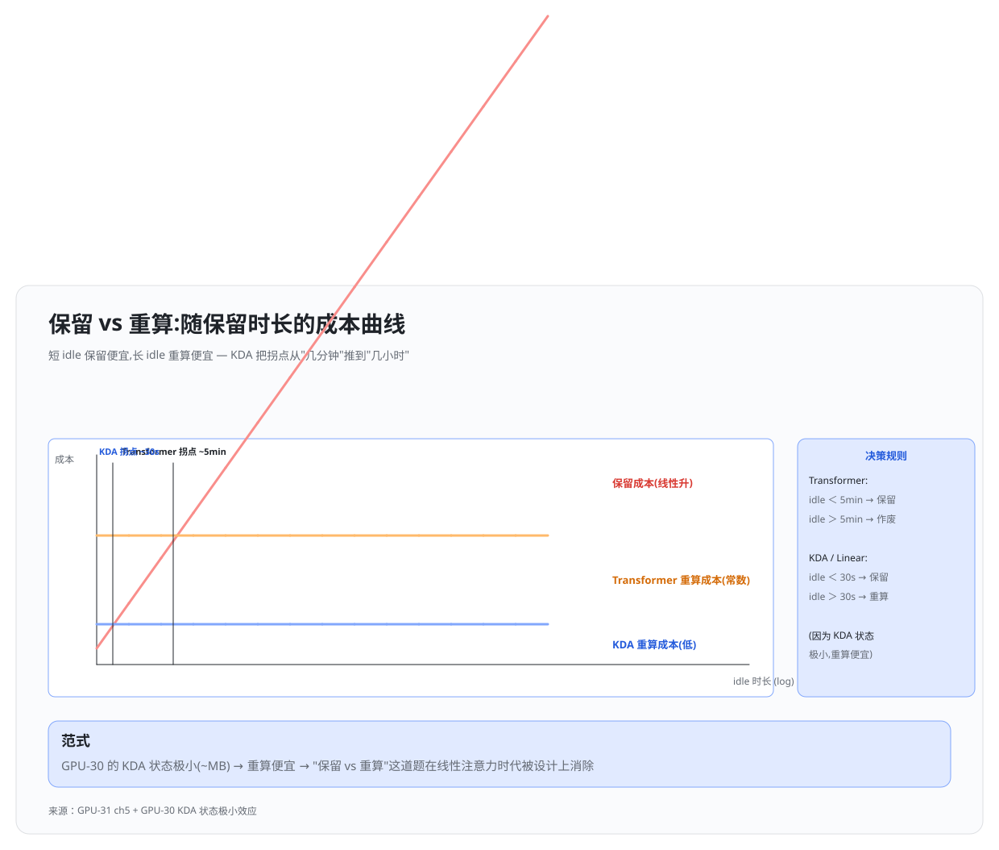
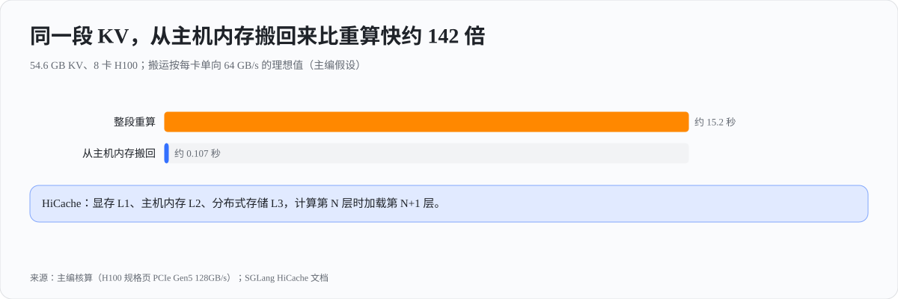

# GPU-31｜LLM｜Agent Workload Serving：会话原语与约束解码

> 🎯 **这篇文档解决什么问题**：Agent 的一次任务是一串前后依赖的模型调用，上下文一步步变长，每步只输出很少，步与步之间还隔着工具执行和人的确认。为单个请求设计的推理系统，会在这些间隔里把 KV 当作已结束请求回收，下一步回来再整段重算。本篇用公开的生产测量算清这笔账，再讲推理系统要补的几样东西：按会话决定 KV 去留、会话标识和逐出策略、缓存亲和的路由、分层存储、上下文压缩，以及让工具调用一定能解析的约束解码。

> 💡 **扩展 GPU-23、GPU-29**：本篇把 GPU-23（[GPU-23｜LLM｜推理系统：KV cache、PagedAttention 与 PD 分离](./23-inference.md)）的推理系统和 GPU-29（[GPU-29｜LLM｜推理引擎实战：SGLang vs vLLM 选型](./29-engine-choice.md)）的引擎对照放到 Agent 负载下：多轮会话、跨轮次保留的 KV 和约束解码。

**使用方式**：第 1 到 3 章看负载形态、会话间隔和缓存过期的代价。第 4 到 7 章讲推理系统怎样留住会话的 KV：留还是丢、会话原语、路由、分层存储。第 8、9 章讲框架和引擎交界处的两件事：上下文压缩和工具调用的约束解码。第 10 章给清单和自测。

**代码**：本篇没有配套代码，文中算例由主编按公开数据核算，第 10 章给出可以自己写的练习。

<b>🧭 主线位置</b>：GPU-00（[GPU-00｜索引｜从 0 开始 GPU 优化：路线、章节与练习](./README.md)）建立了时间账 T = T_compute + W_mem + W_host + W_comm + W_idle。GPU-23（[GPU-23｜LLM｜推理系统：KV cache、PagedAttention 与 PD 分离](./23-inference.md)）讲 KV cache 怎样决定显存和并发，GPU-28（[GPU-28｜LLM｜推理成本经济学：$ per token 与集群单卡经济](./28-cost.md)）算缓存命中省多少钱，GPU-29（[GPU-29｜LLM｜推理引擎实战：SGLang vs vLLM 选型](./29-engine-choice.md)）比较两个推理引擎的缓存与调度，GPU-30（[GPU-30｜LLM｜线性注意力与 KDA：KV 消失之后的 serving](./30-linear-attention.md)）看模型侧怎样让 KV 变少。本篇把视角从单个请求换到一个会话：KV 能不能跨过步与步之间的等待留下来，决定了每一步付的是新增那一小段的 T_compute，还是整段重算。GPU-32（[GPU-32｜LLM｜Rubin 时代与 Dynamo 推理：Blackwell 之后的时间账（2026）](./32-rubin-dynamo.md)）接着看新一代硬件和推理框架。

## 导读 · 先给结论

- <b>每步输入远大于输出。</b>一个生产会话在第 261 步输出 151 个 token，要处理 166,721 个 token 的上下文，按 Llama 3 70B 算 KV 约 54.6 GB（第 1 章）。[[1]](https://arxiv.org/html/2608.15127)[[2]](https://arxiv.org/pdf/2407.21783)
- <b>会话大部分时间在等。</b>中位数会话只有 20% 的时间在执行，间隔多数在 1 到 10 分钟（第 2 章）。[[1]](https://arxiv.org/html/2608.15127)
- <b>缓存过期很贵。</b>缓存寿命 5 分钟时，59.4% 的会话被逐出过，逐出导致的重写占总成本的 31.5%（第 3 章）。[[1]](https://arxiv.org/html/2608.15127)[[3]](https://docs.anthropic.com/en/docs/build-with-claude/prompt-caching)
- <b>留还是丢按会话定。</b>主编的算例里，重算约 15.2 秒、KV 占整机显存 8.5%，分界线约 3 分钟（第 4 章）。[[4]](https://arxiv.org/abs/2511.02230)[[5]](https://arxiv.org/abs/2507.07400)
- <b>引擎已有会话原语。</b>SGLang 支持 session_id 和按会话排序的逐出，但会话引用只是软保护（第 5 章）。[[6]](https://docs.sglang.io/docs/advanced_features/session_radix_cache)[[7]](https://docs.sglang.io/docs/advanced_features/radix_eviction_policy)
- <b>路由和分层存储要配套。</b>请求要回到有缓存的机器；KV 搬回显存比重算快约 142 倍（第 6、7 章）。[[8]](https://platform.openai.com/docs/guides/prompt-caching)[[9]](https://docs.sglang.io/docs/advanced_features/dp_dpa_router_guide)[[10]](https://docs.sglang.io/advanced_features/hicache_design.html)
- <b>压缩和约束解码在框架与引擎的交界处。</b>99% 的压缩把上下文缩短 70% 以上；工具参数 schema 只在 strict 时强制（第 8、9 章）。[[1]](https://arxiv.org/html/2608.15127)[[11]](https://docs.vllm.ai/en/latest/features/tool_calling.html)

<b>📎 与系列其他文档的分工</b>：GPU-23（[GPU-23｜LLM｜推理系统：KV cache、PagedAttention 与 PD 分离](./23-inference.md)）讲 KV cache 和分页。GPU-26（[GPU-26｜系统｜CXL：一致性互连与 KV offload 工程化](./26-cxl.md)）讲用 CXL 扩展内存、把 KV 卸载出去的工程化。GPU-28（[GPU-28｜LLM｜推理成本经济学：$ per token 与集群单卡经济](./28-cost.md)）讲推理成本。GPU-29（[GPU-29｜LLM｜推理引擎实战：SGLang vs vLLM 选型](./29-engine-choice.md)）讲 SGLang 和 vLLM 的前缀缓存、路由和结构化输出的机制。GPU-30（[GPU-30｜LLM｜线性注意力与 KDA：KV 消失之后的 serving](./30-linear-attention.md)）讲混合线性注意力模型的状态检查点。本篇只讲 Agent 会话给推理系统带来的变化，Agent 框架本身的设计和模型能力评估不展开。

## 第 1 章 · Agent 负载长什么样：上下文越滚越长，每步只输出很少

前面几篇算推理账，单位都是一个请求：来了，prefill 一次，解码到结束，KV 释放。Agent 的一次任务是一串前后依赖的调用，每一步把上一步的输出和工具结果追加进上下文，再整段送回模型。本章用两份公开测量看这类负载的形态，后面八章都从这里出发。

### 一次会话里发生了什么

AgentSysBench 是 2026 年 8 月发表的一份测量，覆盖十个代表性的 Agent 应用，用统一的系统级插桩记录每次模型调用、工具调用和环境操作[[1]](https://arxiv.org/html/2608.15127)。它的第一条发现是执行很重：十个应用里有五个，延迟主要花在模型以外的组件上，单个会话的沙箱工作集最高到 28 GB[[1]](https://arxiv.org/html/2608.15127)。也就是说，只优化模型推理，Agent 的很多时间根本碰不到。

第二条发现和推理系统直接相关。论文追踪了一个生产编程 Agent 会话的输入构成：第一步，系统消息（角色定义、工具和技能说明、记忆、框架指令）占输入的 99.7%；随着会话推进，历史（模型的推理、工具调用和工具返回）快速增长，最终占输入的 84.3%[[1]](https://arxiv.org/html/2608.15127)。到最后一步（第 261 步），模型只输出 151 个 token 作为下一步动作，却要先处理 166,721 个 token 的上下文[[1]](https://arxiv.org/html/2608.15127)。输入是输出的约 1104 倍。

把这段上下文换算成 KV：Llama 3 70B 有 80 层、8 个 KV 头[[2]](https://arxiv.org/pdf/2407.21783)，每个 token 的 KV 是 327680 字节，166,721 个 token 约 54.6 GB；换成 8B 模型（32 层）也有约 21.9 GB。一张 H100 只有 80 GB 显存[[12]](https://www.nvidia.com/en-us/data-center/h100/)，一个长会话的 KV 就能占掉大半张卡。

### 基准测试也换了口径

MLCommons 在 2026 年 7 月给 MLPerf Inference 加了 Agentic 测试。它把负载定义为轨迹：一串相互依赖的轮次，后面的请求带着前面全部的对话历史。参考数据集有 613 条多轮轨迹，其中 113 条是编程，500 条是工作流，合计 30,335 个由客户端发出的轮次[[13]](https://mlcommons.org/2026/07/agentic-inference-for-mlperf-inference/)。所选模型的上下文长度分别是 1,048,576 和 262,144 个 token[[13]](https://mlcommons.org/2026/07/agentic-inference-for-mlperf-inference/)。

文章列了这种负载改变推理问题的四个方面：上下文沿着轨迹增长，prefill 和 KV 压力随时间上升；KV 复用成了关键优化[[13]](https://mlcommons.org/2026/07/agentic-inference-for-mlperf-inference/)；输出长度差别很大，从很短的工具调用到很长的推理；轮次之间有依赖，吞吐衡量的是闭环进度，不再是独立请求的速率。指标也随之改成两个轴：纵轴是整个系统每秒输出的 token 数[[13]](https://mlcommons.org/2026/07/agentic-inference-for-mlperf-inference/)，横轴是端到端交互性，算法是所有轮次的输出 token 之和除以所有轮次端到端时间之和[[13]](https://mlcommons.org/2026/07/agentic-inference-for-mlperf-inference/)。前者看系统总共干了多少活，后者看单个 Agent 推进得多快。

放进时间账：单请求时代，prefill 的 T_compute 每个请求付一次。Agent 每一步都要把越来越长的上下文送进去，如果前缀命中缓存，只算新增的那一小段；没命中，就要把整段重算一遍。所以 Agent 负载的账，很大一部分取决于 KV 能不能在步与步之间留住。

按五步闭环看 Agent 负载：

- **定天花板**：按会话的最大上下文算出每个会话的 KV，看一张卡、一台机器能同时留住几个会话。
- **测实际**：按会话记录每一步的输入长度、命中长度和输出长度，不只看单个请求。
- **定位等待**：区分模型推理、工具执行和会话空闲各占多少时间（第 2 章）。
- **消除或隐藏**：让前缀稳定可复用，后面几章逐项展开。
- **复测**：用轨迹级指标（交互性和系统吞吐）复测，不只看单请求的 TTFT。

一个常见的误区是拿聊天负载的压测结果给 Agent 服务定容量。现象是压测时 TTFT 和吞吐都达标，上线后长会话的响应越来越慢。原因是聊天压测的输入短、轮次独立，测不到上下文累积和步间缓存复用。改法是用真实轨迹回放压测，按会话统计命中率和每步的 prefill 长度。

> 🔑 **本章要点**：Agent 会话的上下文逐步累积，AgentSysBench 的一个生产会话在第 261 步输出 151 个 token、要处理 166,721 个 token 的上下文，换成 Llama 3 70B 的 KV 约 54.6 GB。MLPerf Agentic 用轨迹定义负载，用系统吞吐和端到端交互性两个轴衡量。这一章是五步闭环的“定天花板”：先按会话算 KV 和 prefill 的规模。

## 第 2 章 · 会话大部分时间在等：活跃时间的中位数只有两成

第 1 章看的是一个会话里每一步有多大。本章看步与步之间：模型在等工具、等子任务、等人确认的时候，会话还活着，它的 KV 留不留、留多久，决定了下一步回来时要不要重算。先看生产数据里这些间隔有多长，再看现有引擎默认怎样对待它们。

### 活着但没在算

AgentSysBench 统计了 35,037 个生产编程 Agent 会话，把模型和工具执行的时间除以会话的总寿命：中位数会话只有 20% 的时间在执行[[1]](https://arxiv.org/html/2608.15127)，70% 的会话执行时间不到寿命的一半[[1]](https://arxiv.org/html/2608.15127)。间隔从几秒（等工具结果、等人批准）到几小时（隔夜暂停）都有，多数落在 1 到 10 分钟之间[[1]](https://arxiv.org/html/2608.15127)。这期间沙箱一直占着，KV 和对话历史也必须能随时恢复。

论文据此提出，Agent 服务只有“运行”和“结束”两种状态不够，框架应该暴露第三种静止的“等待”状态[[1]](https://arxiv.org/html/2608.15127)，并在可能时告诉推理层预期什么时候恢复。推理层就可以分开处理两类状态：沙箱、终端这类关系到正确性的状态做检查点或卸载，KV 这类只影响性能的状态按预期复用的收益决定保留、迁移还是逐出。

### 引擎默认把等待当作结束

通用推理引擎是按独立请求设计的。InferCept 的论文指出，现有系统把每一次外部交互都当成一次生成的结束[[14]](https://arxiv.org/abs/2402.01869)，交互完成后再当作新请求处理，已经算过的上下文要重新计算，这部分占模型前向总时间的 37-40%[[14]](https://arxiv.org/abs/2402.01869)。InferCept 让引擎感知这种中断，把省下的显存用来服务更多请求，整体吞吐提高 1.6x-2x[[14]](https://arxiv.org/abs/2402.01869)。

Continuum 的论文描述了同一个问题：为了提高利用率，现有引擎在有新请求排队时会逐出已完成请求的 KV[[4]](https://arxiv.org/abs/2511.02230)。Agent 的工具调用会在两次模型调用之间插入停顿，引擎看到的是“上一个请求结束了”，KV 就成了优先回收的对象。Autellix 从调度角度补充了一点：Agent 程序在推理引擎里累计的等待时间很长，主要来自单个请求和程序两个层面的队头阻塞[[15]](https://arxiv.org/abs/2502.13965)；它把程序当作一等公民调度，在相同延迟下程序吞吐提高 4-15x[[15]](https://arxiv.org/abs/2502.13965)。

放进时间账：会话等待期间，GPU 不为它计算，但它的 KV 占着显存。KV 留着，别的请求能用的批就小，摊到每个 token 上的权重读取变多；KV 丢了，下一步回来要整段重算，T_compute 和 TTFT 一起上涨。第 3、4 章分别从价格和自建集群两个角度算这笔账。

按五步闭环看会话等待：

- **定天花板**：按会话统计活跃时间占比和间隔分布，算出同时“活着”的会话有多少。
- **测实际**：记录每次间隔结束时前缀是否还在缓存里。
- **定位等待**：TTFT 偏高的请求，看是否正好跟在一段长间隔之后。
- **消除或隐藏**：让框架把“等待”和“结束”分开告诉推理层，按预期恢复时间决定 KV 去留。
- **复测**：长间隔之后的首 token 延迟是否下降。

一个常见的误区是用请求完成后多久没有新请求来判断会话已经结束。现象是工具执行一两分钟后回来的请求频繁冷启动，TTFT 时高时低。原因是推理层看不到会话，只能按请求的空闲时间回收 KV，而 Agent 的正常间隔就在分钟级。改法是在请求里带上会话标识，会话真正结束时显式关闭（第 5 章）。

> 🔑 **本章要点**：35,037 个生产会话里，中位数会话只有 20% 的时间在执行，间隔多数在 1 到 10 分钟。通用引擎把每次工具交互当作请求结束，InferCept 测得重算占前向时间的 37-40%。这一章是五步闭环的“定位等待”：先分清会话是在等，还是真的结束了。

## 第 3 章 · 缓存过期的代价：被逐出的前缀占了三成成本

第 2 章说过，会话的间隔多数在 1 到 10 分钟。前缀缓存的寿命如果短于这个间隔，下一步回来时前缀就没了，要整段重新写入缓存。本章先看生产数据里这件事发生得有多频繁、花了多少钱，再看两家 API 的缓存寿命和计价，算一笔延长寿命划不划算的账。

### 五分钟寿命碰上分钟级间隔

AgentSysBench 所研究的部署里，前缀缓存条目的寿命固定为 5 分钟[[1]](https://arxiv.org/html/2608.15127)。过期以后，下一次调用必须重新 prefill 被逐出的前缀。1 到 10 分钟的间隔经常和这个寿命重叠或超过它，结果 35,037 个会话里有 59.4% 至少经历过一次逐出[[1]](https://arxiv.org/html/2608.15127)。

论文把 token 分成四类：缓存读取、缓存写入、不进缓存的输入、输出，按 Claude Opus 4.6 的标价（每百万 token 依次为 0.5、6.25、5、25 美元）估算成本[[1]](https://arxiv.org/html/2608.15127)。结果是：逐出导致的重新写入占全部缓存写入 token 的 55.9%，占这些会话总成本的 31.5%[[1]](https://arxiv.org/html/2608.15127)。也就是说，接近三分之一的钱花在了重算本来已经算过的前缀上。

用第 1 章那一步（166,721 个 token 的上下文、151 个 token 的输出）按同一标价算：前缀命中时，这次调用约 0.087 美元；前缀被逐出、整段重新写入时，约 1.05 美元，相差约 12.0 倍。这里忽略了新增的那一小段输入，是主编的简化。

### API 的缓存寿命和计价

Anthropic 的文档说，缓存默认寿命 5 分钟[[3]](https://docs.anthropic.com/en/docs/build-with-claude/prompt-caching)，每次被使用都会免费刷新[[3]](https://docs.anthropic.com/en/docs/build-with-claude/prompt-caching)；嫌 5 分钟太短，可以选 1 小时的寿命[[3]](https://docs.anthropic.com/en/docs/build-with-claude/prompt-caching)。计价是：5 分钟寿命的缓存写入按基础输入价的 1.25 倍[[3]](https://docs.anthropic.com/en/docs/build-with-claude/prompt-caching)，1 小时寿命的写入按 2 倍[[3]](https://docs.anthropic.com/en/docs/build-with-claude/prompt-caching)，缓存读取按 0.1 倍[[3]](https://docs.anthropic.com/en/docs/build-with-claude/prompt-caching)。OpenAI 的文档说，默认的内存缓存通常在 5 到 10 分钟不活跃后失效，最长一小时[[8]](https://platform.openai.com/docs/guides/prompt-caching)；部分模型可以选更长的保留，最长 24 小时[[8]](https://platform.openai.com/docs/guides/prompt-caching)。

延长寿命划不划算，可以这样估：同一段前缀，选 1 小时寿命每写一次多付 0.75 倍基础价；每避免一次逐出，就省下一次 1.25 倍的重新写入、换成 0.1 倍的读取，净省 1.15 倍。0.75 ÷ 1.15 ≈ 0.65，所以平均每段前缀只要有超过 0.65 次本会被逐出的长间隔，1 小时寿命就回本。这是主编按上面的计价推的，没有算刷新和新增输入的细节。对第 2 章那种多数间隔在 1 到 10 分钟的负载，这个条件很容易满足。

放进时间账：缓存命中省掉的是被命中那段前缀的 prefill T_compute，TTFT 只剩新增输入的那一小段；逐出后整段重算，TTFT 和成本都按全长计。缓存寿命和会话间隔对不上，账面上看是钱，落到延迟上就是每次长间隔之后的一次冷启动。

按五步闭环看缓存寿命：

- **定天花板**：按第 1 章的会话规模，算出命中和逐出两种情况下每步的成本与 TTFT。
- **测实际**：从用量明细里统计缓存写入中有多少是逐出后的重新写入。
- **定位等待**：把重新写入和会话间隔对齐，看是否集中在超过缓存寿命的间隔之后。
- **消除或隐藏**：间隔常超过寿命的负载，选更长的缓存寿命；自建服务调整逐出策略（第 4、5 章）。
- **复测**：重新写入的占比和长间隔后的 TTFT 是否下降。

一个常见的误区是只看缓存命中率。现象是命中率看起来不低，账单里缓存写入却一直偏高。原因是命中率按 token 平均，会话内连续几步的命中把长间隔后的整段重写掩盖掉了。改法是单独统计逐出导致的重新写入，按会话间隔分桶看。

> 🔑 **本章要点**：缓存寿命 5 分钟、会话间隔 1 到 10 分钟，AgentSysBench 里 59.4% 的会话被逐出过，逐出导致的重写占总成本的 31.5%。按 Anthropic 的计价，1 小时寿命多付 0.75 倍写入，避免一次逐出净省 1.15 倍，平均超过 0.65 次逐出就回本。这一章是五步闭环的“测实际”：把逐出导致的重写单独量出来。

## 第 4 章 · 留还是丢：拿重算时间和占住的显存来比

第 3 章是从 API 用户的角度看账单。自建推理服务的人面对的是同一个问题的另一面：一个会话进入等待，它的 KV 是留在显存里，还是先逐出、等它回来再重算。本章用一个算例把两边放到同一个单位上，再看几篇论文怎样把这个判断做成策略。

### 一个算例：大约三分钟的分界线

还用第 1 章那段 166,721 个 token 的上下文，模型取 Llama 3 70B（约 70.6B 参数），部署在一台 8 卡 H100 上。H100 的 BF16 稀疏算力是 1,979 teraFLOPS[[12]](https://www.nvidia.com/en-us/data-center/h100/)，稠密按一半算是 989.5 TFLOPS，MFU 取 0.5（主编的假设）。整段重算的计算量约 60 PFLOP（线性层加因果注意力，见代码），8 卡约需 15.2 秒。这也是这个会话回来时的 TTFT。

留着的代价是显存。这段 KV 约 54.6 GB，8 卡共 640 GB 显存（每卡 80 GB[[12]](https://www.nvidia.com/en-us/data-center/h100/)），占整机的 8.5%。如果显存是限制并发的那个资源，留一秒就相当于占用整机 8.5% 的容量一秒；重算则要整机算 15.2 秒。两者相等的停顿时长约 178 秒，也就是 3 分钟左右：预期间隔短于它，留着更划算；长于它，逐出再重算更划算。这条线恰好落在 AgentSysBench 观察到的 1 到 10 分钟间隔里[[1]](https://arxiv.org/html/2608.15127)，说明固定的回收时间对这类负载很难选对，要看每个会话预期多久回来。这个算例忽略了排队、重算期间对其他请求的干扰，也没有算卸载到主机内存这条路（第 7 章），是主编的推断。

### 把判断做成策略

AgentSysBench 的建议是，固定寿命的逐出应该让位给按复用收益决定的保留、卸载和预取[[1]](https://arxiv.org/html/2608.15127)。几篇论文各自做了一部分。Continuum 对会产生工具调用的请求，把 KV 钉在显存里一段时间，时长由重新加载的代价和逐出后可能增加的排队延迟决定[[4]](https://arxiv.org/abs/2511.02230)，时间到了自动逐出，避免极端情况下占住不放；在真实 Agent 负载上，平均任务完成时间改善了 8x 以上[[4]](https://arxiv.org/abs/2511.02230)。

KVFlow 针对多 Agent 工作流：LRU 看不到以后谁会被调用，常常在复用之前不久把 KV 丢掉[[5]](https://arxiv.org/abs/2507.07400)。它把工作流抽象成步骤图，给每个 Agent 一个“还有几步轮到它”的值[[5]](https://arxiv.org/abs/2507.07400)，按这个值决定逐出顺序，并提前把下一步要用的 KV 从 CPU 预取回来。和带分层 radix 缓存的 SGLang 相比，单个大提示词工作流最多快 1.83 倍[[5]](https://arxiv.org/abs/2507.07400)，多工作流并发时最多快 2.19 倍[[5]](https://arxiv.org/abs/2507.07400)。

放进时间账：留着，等待期间的 KV 占住显存，压小别的请求的批，表现为整体的 W_mem 上升；丢掉，回来时付一次整段 prefill 的 T_compute，还可能在队列里等。分界线由重算时间和显存占比决定，模型越大、上下文越长，重算越贵，分界线越往后移。

按五步闭环看留还是丢：

- **定天花板**：按自己的模型和硬件，算出典型会话的重算时间和 KV 占比，得出分界线。
- **测实际**：统计会话间隔的分布，看多少间隔落在分界线两侧。
- **定位等待**：长间隔后的 TTFT 和高峰时的排队，哪个更伤。
- **消除或隐藏**：给工具调用中的会话设保留时长，按工作流顺序预取。
- **复测**：任务完成时间和整体吞吐一起看。

一个常见的误区是把留还是丢当成一个全局开关。现象是全留时高峰期并发掉得厉害，全丢时长会话的 TTFT 抖到十几秒。原因是不同会话的上下文长度和间隔差得很远，分界线因会话而异。改法是按会话的上下文长度和预期间隔逐个决定，至少按长度分档设置保留时长。

> 🔑 **本章要点**：主编的算例里，70B 模型在 8 卡 H100 上重算 166,721 个 token 约 15.2 秒，这段 KV 占整机显存 8.5%，两者相等的停顿约 3 分钟，正落在 1 到 10 分钟的常见间隔里。Continuum 按重载代价和排队延迟设保留时长，KVFlow 按工作流顺序逐出和预取。这一章是五步闭环的“消除或隐藏”：按会话决定 KV 去留。

## 第 5 章 · 引擎里的会话原语：会话标识和按会话排序的逐出

第 4 章说留还是丢要按会话决定，前提是引擎知道哪些请求属于同一个会话、会话什么时候结束。通用引擎的前缀缓存只看内容：两个请求的前缀相同就能共享，不管它们是不是同一个会话。本章看 SGLang 已经提供的会话原语和逐出策略，再说清它们能做到哪一步。

### 按内容命中，不认会话

vLLM 的自动前缀缓存按块做哈希，哈希值由块内的 token 和块之前的前缀 token 共同决定[[16]](https://docs.vllm.ai/en/latest/design/prefix_caching.html)，而且只缓存填满的块[[16]](https://docs.vllm.ai/en/latest/design/prefix_caching.html)。这样，任意请求只要前缀相同就能命中，不需要知道会话。缺点是逐出时也只能按内容和最近使用时间排序，一个刚进入等待、两分钟后就会回来的会话，和一个已经结束的会话，在逐出顺序里没有区别。Parrot 的论文把这类问题归结为公共推理服务只提供过于简化的请求级接口[[17]](https://arxiv.org/abs/2405.19888)，丢掉了应用层的信息，它提出的语义变量就是为了把这些信息交给服务端[[17]](https://arxiv.org/abs/2405.19888)。

### SGLang 的会话感知缓存

旧版本稿件曾写“两个主流引擎都没有会话标识”，按现在的 SGLang 文档，这个说法不成立。SGLang 提供了会话感知的 radix 缓存，目的是在显存紧张时改善长期、多轮负载的命中[[6]](https://docs.sglang.io/docs/advanced_features/session_radix_cache)，用 --enable-session-radix-cache 打开[[6]](https://docs.sglang.io/docs/advanced_features/session_radix_cache)。应用在一个会话的每个请求里带上同一个顶层 session_id[[6]](https://docs.sglang.io/docs/advanced_features/session_radix_cache)；这个标识只用来标记缓存的引用，不会替你拼接或重建上下文[[6]](https://docs.sglang.io/docs/advanced_features/session_radix_cache)，每个请求仍要带完整的提示词。请求结束后，引擎把可复用的缓存叶子登记到这个会话名下；会话结束时调用 /close_session，它只去掉引用，不会立即释放 KV[[6]](https://docs.sglang.io/docs/advanced_features/session_radix_cache)，这些 KV 回到普通的逐出顺序里。

逐出时，没有被会话引用的 KV 先走，仍被活跃会话引用的后走[[6]](https://docs.sglang.io/docs/advanced_features/session_radix_cache)。文档特别说明，会话引用是软保护，不是把显存钉住[[6]](https://docs.sglang.io/docs/advanced_features/session_radix_cache)：只回收无引用的部分不够时，被引用的也会被逐出。混合线性注意力模型的状态也纳入同一套规则，登记的是叶子上可复用的状态[[6]](https://docs.sglang.io/docs/advanced_features/session_radix_cache)，这和 GPU-30（[GPU-30｜LLM｜线性注意力与 KDA：KV 消失之后的 serving](./30-linear-attention.md)）讲的状态检查点是一回事。

### 逐出策略可以换

SGLang 的 radix 缓存还提供了多种逐出策略，默认的 lru 适合大多数负载[[7]](https://docs.sglang.io/docs/advanced_features/radix_eviction_policy)。其他几种各有侧重：lfu 先逐出命中次数最少的前缀[[7]](https://docs.sglang.io/docs/advanced_features/radix_eviction_policy)；priority 先逐出优先级最低的请求留下的前缀[[7]](https://docs.sglang.io/docs/advanced_features/radix_eviction_policy)；tlru 只保护一个会话下一次 prefill 为了满足 TTFT 预算所需要的那部分历史，适合尾部 TTFT 比命中率更重要的 Agent 和多轮负载[[7]](https://docs.sglang.io/docs/advanced_features/radix_eviction_policy)；state_cost 用于混合模型，按最近使用时间加上重建所需的 prefill 给状态检查点打分[[7]](https://docs.sglang.io/docs/advanced_features/radix_eviction_policy)。文档同样强调，策略只负责打分，不能把 KV 钉在显存里[[7]](https://docs.sglang.io/docs/advanced_features/radix_eviction_policy)。

tlru 来自论文《Tail-Optimized Caching for LLM Inference》，它对 LRU 只做了两行的修改[[18]](https://arxiv.org/abs/2510.15152)，在 WildChat 真实对话数据上，P90 和 P95 尾部 TTFT 分别最多降低 27.5% 和 23.9%[[18]](https://arxiv.org/abs/2510.15152)，200 毫秒 SLO 的违约最多减少 38.9%[[18]](https://arxiv.org/abs/2510.15152)。

放进时间账：会话原语本身不省计算，它改变的是显存紧张时先丢谁。把即将回来的会话排到后面，省下的是第 4 章那次 15.2 秒的重算；排序规则选得好，省下的就是尾部 TTFT。

按五步闭环看会话原语：

- **定天花板**：确认引擎版本是否支持会话标识和所需的逐出策略。
- **测实际**：开启前后分别统计被活跃会话引用的 KV 被逐出的次数。
- **定位等待**：尾部 TTFT 是否集中在被逐出过的会话上。
- **消除或隐藏**：每个请求带 session_id，会话结束时显式关闭；多轮负载试 tlru。
- **复测**：P90、P95 TTFT 和命中率一起看。

一个常见的误区是以为带了 session_id 就能保证 KV 不丢。现象是高峰期仍有会话回来时冷启动。原因是会话引用只是软保护，显存不够时被引用的 KV 也会被逐出。改法是把会话原语和容量规划一起做：按第 4 章算出要留住的会话数，显存不够时配合第 7 章的分层存储。

> 🔑 **本章要点**：vLLM 的前缀缓存按内容哈希命中，不区分会话。SGLang 已经提供会话感知缓存：每个请求带 session_id，结束时调用 /close_session，逐出时先走无引用的 KV，但会话引用只是软保护。tlru 只改两行，尾部 TTFT 最多降 27.5%。这一章是五步闭环的“消除或隐藏”：让引擎知道哪些 KV 属于还会回来的会话。

## 第 6 章 · 路由：同一会话要回到有缓存的那台机器

第 5 章讲的是一台机器内部先丢谁。服务一旦扩到多台机器，还有一个更早的问题：会话的下一步请求打到哪台。KV 在 A 机上，请求被均衡到 B 机，B 机只能整段重算，A 机上的 KV 白留着。本章看 API 厂商和 SGLang 路由器怎样处理缓存亲和与负载均衡的冲突。

### 缓存在单台机器上

OpenAI 的提示词缓存文档把这件事写得很直白：缓存的状态存在单台机器上，流量超过每分钟 15 个请求时可能被溢出到别的机器[[8]](https://platform.openai.com/docs/guides/prompt-caching)；请求只有到达一台持有未过期匹配条目的机器，才能复用缓存[[8]](https://platform.openai.com/docs/guides/prompt-caching)。所以它让用户给共享同一前缀的请求设一个稳定的 prompt_cache_key，忙的分组每个键合计大约每分钟 15 个请求[[8]](https://platform.openai.com/docs/guides/prompt-caching)，流量更大时用确定的映射拆成多个键。文档同时提醒，键只影响路由，不会把请求钉在某台机器上[[8]](https://platform.openai.com/docs/guides/prompt-caching)。

按这个口径估一下：假设共享同一前缀的 Agent 流量是每分钟 600 个请求，大约要拆成 40 个键。同一个会话要始终落在同一个键上，拆分规则就应该按会话标识做哈希，而不是随机分配。这是主编按文档给出的数字推的。

### SGLang 路由器：先看前缀，再看负载

SGLang 的路由器 sgl-router 按实时负载、KV 前缀匹配或会话亲和为每个请求挑选服务器[[9]](https://docs.sglang.io/docs/advanced_features/dp_dpa_router_guide)。推荐的 cache_aware 策略为每个 worker 维护一棵前缀树，数据来自 worker 发布的 KV 缓存事件[[9]](https://docs.sglang.io/docs/advanced_features/dp_dpa_router_guide)；请求到来时，选缓存前缀最长的那个 worker[[9]](https://docs.sglang.io/docs/advanced_features/dp_dpa_router_guide)，前提是匹配长度达到 --cache-affinity-min-matched-tokens，文档示例设的是 1024[[9]](https://docs.sglang.io/docs/advanced_features/dp_dpa_router_guide)。没有 worker 满足条件，或者首选的 worker 已到准入上限时，回退到 power_of_two：随机抽两个、选负载轻的那个[[9]](https://docs.sglang.io/docs/advanced_features/dp_dpa_router_guide)。打开 balanced 模式后，首选 worker 明显比其他 worker 忙时，也会切走[[9]](https://docs.sglang.io/docs/advanced_features/dp_dpa_router_guide)。

DualMap 的论文专门讨论这对矛盾：把同前缀请求放在一起的缓存亲和，常常和把请求均匀铺开的负载均衡冲突[[19]](https://arxiv.org/abs/2602.06502)。它的做法是用两个独立的哈希函数为每个请求映射出两台候选机器[[19]](https://arxiv.org/abs/2602.06502)，按当前状态选更好的一台；TTFT 超过 SLO 时，从亲和优先切换到负载优先[[19]](https://arxiv.org/abs/2602.06502)。在相同的 TTFT SLO 约束下，有效请求容量最多提高 2.25 倍[[19]](https://arxiv.org/abs/2602.06502)。

放进时间账：路由打偏一次，代价是第 4 章那样的一次整段重算，落在 T_compute 和 TTFT 上；死守亲和不切走，热点机器排队，代价落在 W_idle 上。路由器要在两者之间按负载切换。

按五步闭环看路由：

- **定天花板**：算出路由打偏一次的重算时间，作为切走的门槛。
- **测实际**：统计同一会话的连续请求落在同一台机器上的比例。
- **定位等待**：冷启动多的会话，看是路由打偏还是缓存被逐出。
- **消除或隐藏**：按会话标识做亲和，热点时按负载切走；API 用户按会话设缓存键。
- **复测**：命中率和各机器负载的离散程度一起看。

一个常见的误区是在网关层用轮询或最少连接分发 Agent 请求。现象是每台机器的前缀缓存都不小，命中率却很低。原因是同一个会话的请求被均匀撒到不同机器上，每台都只看到会话的一部分。改法是让路由层感知前缀或会话，用 cache_aware 这类策略，或者至少按会话标识做一致性映射。

> 🔑 **本章要点**：缓存在单台机器上，请求要回到持有缓存的机器才能复用；OpenAI 建议每个缓存键每分钟约 15 个请求。SGLang 的 cache_aware 路由选前缀最长的 worker，没有合适的就回退到 power_of_two；DualMap 用两个哈希候选，超 SLO 时转向负载优先，容量最多提高 2.25 倍。这一章是五步闭环的“定位等待”：分清冷启动是路由打偏还是缓存被逐出。

## 第 7 章 · 显存装不下就往下放：主机内存和远端 KV 池

第 4 章的算例只比了两条路：留在显存，或者丢掉重算。中间还有第三条：把等待中的会话的 KV 搬到主机内存或远端存储，回来时再搬回显存。只要搬运比重算快得多，就能既不占显存，又不付整段 prefill。本章先算搬运的时间，再看几个开源实现。

### 搬回来比重算快两个数量级

H100 的 PCIe Gen5 带宽标称 128GB/s[[12]](https://www.nvidia.com/en-us/data-center/h100/)，主编按单向一半即 64 GB/s 估，8 张卡并行合计 512 GB/s。第 1 章那段 54.6 GB 的 KV 从主机内存搬回 8 张卡，约 0.107 秒；第 4 章算过，同样的上下文重算约 15.2 秒，两者相差约 142 倍。这是带宽跑满时的理想值，实际还要看主机内存的带宽、数据怎样分片，以及能不能和计算重叠，但量级上的差距足以说明：对 Agent 这种间隔长、上下文也长的负载，卸载通常比重算划算。主机内存的容量比显存大得多，代价是要有人管理分层和搬运；GPU-26（[GPU-26｜系统｜CXL：一致性互连与 KV offload 工程化](./26-cxl.md)）讲过用 CXL 再往外扩一层的做法。

### 几个开源实现

SGLang 的 HiCache 把 GPU 显存当作 L1、主机内存当作 L2、分布式存储当作 L3[[10]](https://docs.sglang.io/advanced_features/hicache_design.html)。它在计算第 N 层时并行加载第 N+1 层的 KV[[10]](https://docs.sglang.io/advanced_features/hicache_design.html)，把搬运藏在计算后面；数据只有在被上一级逐出时才写回下一级[[10]](https://docs.sglang.io/advanced_features/hicache_design.html)。这和第 5 章的会话感知逐出是一套机制：显存里被逐出的会话 KV 不一定消失，可能只是降到了主机内存。

Mooncake 是 Kimi 的推理平台，它把 GPU 集群里没用满的 CPU、DRAM 和 SSD 组织成一个分离式的 KV 缓存[[20]](https://arxiv.org/abs/2407.00079)。论文报告，在部分模拟场景下吞吐最多提高 525%[[20]](https://arxiv.org/abs/2407.00079)，在真实负载下让 Kimi 多处理 75% 的请求[[20]](https://arxiv.org/abs/2407.00079)；它还用基于预测的提前拒绝来应对过载[[20]](https://arxiv.org/abs/2407.00079)。LMCache 把 vLLM 和 SGLang 生成的 KV 搬出显存，在引擎和请求之间共享[[21]](https://arxiv.org/abs/2510.09665)。论文说，用户存下的 KV 总量增长很快，远远超出显存容量[[21]](https://arxiv.org/abs/2510.09665)；和 vLLM 组合，在多轮问答等负载上吞吐最多提高 15x[[21]](https://arxiv.org/abs/2510.09665)。

Agent 还有一类状态和 KV 不同：沙箱和终端。AgentSysBench 的一个原型在模型规划期间把空闲的沙箱卸载出去，平均和峰值内存分别降了 4.6 倍和 2.1 倍[[1]](https://arxiv.org/html/2608.15127)，延迟增加在 0.5% 以内[[1]](https://arxiv.org/html/2608.15127)。这说明“等待状态”的思路对 KV 以外的会话状态同样适用。

放进时间账：卸载把重算的 T_compute 换成搬运的 W_mem 和 W_comm。搬运能和计算按层重叠，就能大部分藏起来；藏不住时，它也比整段重算短得多。

按五步闭环看分层存储：

- **定天花板**：按主机内存和网络带宽，算出典型会话 KV 搬回显存的时间，和重算比。
- **测实际**：统计长间隔后的请求有多少从下层命中、搬运花了多久。
- **定位等待**：搬运时间是否和计算重叠，有没有卡在主机内存带宽上。
- **消除或隐藏**：开启按层预取；按预期恢复时间提前把 KV 搬回来。
- **复测**：长间隔后的 TTFT 接近热命中，显存里同时活跃的会话数上升。

一个常见的误区是开了 KV 卸载就以为不会再冷启动。现象是长间隔后的 TTFT 降了一些，但还是比热命中高很多。原因是搬运没有和计算重叠，或者 KV 已经被下层也逐出了，退回整段重算。改法是确认预取和按层重叠已开启，并按会话数和上下文长度给下层留够容量。

> 🔑 **本章要点**：按主编的估算，54.6 GB 的 KV 从主机内存搬回 8 张 H100 约 0.107 秒，重算约 15.2 秒，差约 142 倍。HiCache 把显存、主机内存和分布式存储分成三级并按层重叠加载，Mooncake 和 LMCache 把 KV 池扩到显存之外。这一章是五步闭环的“消除或隐藏”：把等待中的会话的 KV 往下放，回来时按层搬回。

## 第 8 章 · 压缩上下文：省下的 prefill 要拿一次长解码去换

前几章都在想办法把越来越长的上下文留住或者搬回来。另一条路是让上下文别那么长：Agent 框架在上下文接近上限时，让模型把历史总结成一段更短的文字，替换掉原来的历史。这能省后面每一步的 prefill 和 KV，但总结本身也是一次推理，而且会打断前缀缓存。本章看生产数据里压缩的规模和代价。

### 压缩省了多少、花了多少

AgentSysBench 在 35,037 个生产会话里观察到 3,170 次压缩[[1]](https://arxiv.org/html/2608.15127)，99% 的压缩把上下文缩短了 70% 以上[[1]](https://arxiv.org/html/2608.15127)，说明生产上下文里有相当一部分可以被总结，不必逐字重放。按第 1 章那一步算，166,721 个 token 缩短 70% 后约剩 50,016 个，换成 Llama 3 70B 的 KV 从约 54.6 GB 降到约 16.4 GB，后面每一步的 prefill 和显存占用都跟着变小。

代价是总结本身。平均每次压缩要读 176K 个输入 token、生成 5K 个输出 token[[1]](https://arxiv.org/html/2608.15127)。如果前缀仍在缓存里，输入大部分不用重算，但生成总结要走一段长解码。压缩的平均延迟是 156 秒，P95 和 P99 分别是 161 秒和 775 秒[[1]](https://arxiv.org/html/2608.15127)。按平均值粗算，每个输出 token 约 31.2 毫秒，这是把全部延迟都算在解码上的上限，主编的估算。除了压缩，框架还为安全检查、循环检测这类辅助任务调用模型，在这些会话里合计多了 2,684 次调用、6.5M 个输入 token 和 50K 个输出 token[[1]](https://arxiv.org/html/2608.15127)。

### 前缀的顺序决定缓存还能不能用

Anthropic 的文档说，提示词缓存覆盖的是完整前缀，顺序依次是工具定义、系统提示词和消息[[3]](https://docs.anthropic.com/en/docs/build-with-claude/prompt-caching)，向前查找已有缓存时最多回看 20 个块[[3]](https://docs.anthropic.com/en/docs/build-with-claude/prompt-caching)。按这个顺序推下去，工具定义排在最前，改动工具列表会让它后面的所有缓存失效；压缩只改写消息部分，工具定义和系统提示词那一段仍能命中，从总结开始的部分要重新写入缓存。这是主编根据文档描述的顺序做的推断。

vLLM 的工具调用文档也提醒，请求里指定了工具时，即使不让模型调用工具，默认也会把工具定义放进提示词[[11]](https://docs.vllm.ai/en/latest/features/tool_calling.html)。工具说明是第 1 章那 99.7% 系统消息的主要来源之一，保持工具定义稳定、按固定顺序排在前面，是让它们一直命中缓存的前提。AgentSysBench 的建议更进一步：工具接口应该面向 Agent 设计[[1]](https://arxiv.org/html/2608.15127)，用稳定的 schema 标识、限定大小的结构化返回和可按需取回的句柄，代替每一轮重新注入完整 schema 和原始输出。

放进时间账：压缩用一次长解码（T_compute 和 W_mem 都按解码算）换后面每一步更短的 prefill 和更小的 KV。会话越长、压缩之后剩下的步数越多，越划算；压缩时机选得不好，会在用户正等着的时候插进一段两三分钟的停顿。

按五步闭环看上下文压缩：

- **定天花板**：按会话长度和压缩比，算出压缩后每步省下的 prefill 和 KV。
- **测实际**：统计压缩次数、每次的输入输出 token 和延迟。
- **定位等待**：用户感知的长停顿里，有多少是压缩造成的。
- **消除或隐藏**：工具定义和系统提示词保持稳定、排在最前；压缩尽量放在会话本来就在等待的时候。
- **复测**：压缩后的前缀命中率和每步 prefill 长度。

一个常见的误区是在每一轮动态生成工具列表或在系统提示词里放时间戳。现象是会话内的缓存命中率很低，第 1 章那种系统消息每一步都在重算。原因是前缀从最前面就变了，后面全部失效。改法是把变化的内容放到消息末尾，工具定义和系统提示词保持逐字不变。

> 🔑 **本章要点**：AgentSysBench 里 99% 的压缩把上下文缩短 70% 以上，代价是每次平均读 176K、写 5K 个 token，平均延迟 156 秒。缓存前缀按工具、系统、消息的顺序排，工具定义和系统提示词要保持稳定。这一章是五步闭环的“定天花板”：先算清压缩换来的 prefill 和 KV，再决定什么时候压。

## 第 9 章 · 工具调用要能解析：约束解码放在哪一层

Agent 每一步的输出大多是工具调用：一段要被框架解析、按参数 schema 执行的 JSON。解析失败，这一步就白做了，框架要么重试，要么把错误塞回上下文让模型改，两种都是再来一次带着长上下文的调用。GPU-29（[GPU-29｜LLM｜推理引擎实战：SGLang vs vLLM 选型](./29-engine-choice.md)）第 7 章讲过约束解码的机制，本章只看它在 Agent 服务里要怎样配置，哪些情况它保证不了。

### 引擎能保证什么

vLLM 的 tool_choice 支持指定函数、auto、required 和 none 几种取值[[11]](https://docs.vllm.ai/en/latest/features/tool_calling.html)。打开结构化标签约束以后，指定函数和 required 时一定会产生工具调用；auto 时调用是可选的，只有至少一个工具设了 strict: true 或服务端设了相应的严格级别时才启用约束[[11]](https://docs.vllm.ai/en/latest/features/tool_calling.html)。更关键的一条是，每个工具声明的参数 schema，只有在这个工具设了 strict: true（或服务端按参数级严格）时才会被强制执行[[11]](https://docs.vllm.ai/en/latest/features/tool_calling.html)，其余只受宽泛的参数语法约束。文档还写明，部分 Mistral 模型在官方格式下不保证一定产生调用[[11]](https://docs.vllm.ai/en/latest/features/tool_calling.html)，并建议在提示词里也写清期望的输出格式，让模型想生成的内容和约束一致[[11]](https://docs.vllm.ai/en/latest/features/tool_calling.html)。

所以“开了约束解码就不会解析失败”只在一定条件下成立：要用对 tool_choice，要给关键工具设 strict，要确认所用模型的解析器支持。条件不满足时，引擎只保证语法大致像 JSON，不保证参数符合 schema。

### 约束本身的开销和推理模型

约束解码的每一步都要算出哪些 token 合法。XGrammar 把词表分成两类：与上下文无关、可以预先检查的 token，和必须在运行时解释的 token[[22]](https://arxiv.org/pdf/2411.15100)；再把语法计算和 GPU 执行重叠起来[[22]](https://arxiv.org/pdf/2411.15100)。论文报告，对上下文无关文法，每 token 延迟比当时最好的方法最多降低 100x[[22]](https://arxiv.org/pdf/2411.15100)。SGLang 不指定后端时默认用 XGrammar[[23]](https://docs.sglang.io/advanced_features/structured_outputs.html)。约束开销小，就可以默认打开，不必为了速度在关键工具上省掉 strict。

推理模型会先输出一段思考，再输出工具调用。如果从第一个 token 就施加约束，思考段也会被逼成 JSON。SGLang 为此提供了在推理段内关闭语法约束的功能[[24]](https://docs.sglang.io/docs/advanced_features/structured_outputs_for_reasoning_models)，用 --reasoning-parser 指定思考结束的标记[[24]](https://docs.sglang.io/docs/advanced_features/structured_outputs_for_reasoning_models)，结束之后才开始约束。部署推理模型做 Agent 时，这个开关要和约束一起配。

放进时间账：一次解析失败，代价是又一次带长上下文的调用。按第 3 章的标价，前缀命中时一次约 0.087 美元，被逐出时约 1.05 美元，延迟上还要再等一次 TTFT 和解码。约束解码的每 token 开销很小，它省下的是这些重试。

按五步闭环看工具调用的合法性：

- **定天花板**：列出每个工具的参数 schema，确认哪些必须严格符合。
- **测实际**：统计工具调用的解析失败率和由此引起的重试次数。
- **定位等待**：失败集中在哪些工具、哪种 tool_choice、哪个模型。
- **消除或隐藏**：关键工具设 strict，推理模型配 --reasoning-parser，提示词里写明格式。
- **复测**：解析失败率和每任务的调用次数。

一个常见的误区是以为 auto 模式下引擎会自动按 schema 约束参数。现象是大部分调用正常，偶尔出现缺字段或类型不对的参数，框架只好重试。原因是没有设 strict 的工具只受宽泛的语法约束，参数 schema 没有被强制。改法是给参数必须准确的工具设 strict: true，并在压测里单独统计解析失败。

> 🔑 **本章要点**：vLLM 只在工具设了 strict: true 时强制参数 schema，auto 模式下调用可选，部分模型不保证产生调用。XGrammar 把每 token 的约束开销降到很小，SGLang 默认用它，推理模型要用 --reasoning-parser 让思考段不受约束。这一章是五步闭环的“复测”：用解析失败率和每任务调用次数验收。

## 第 10 章 · 上线前核对清单与自测

前九章沿着“Agent 会话怎样在推理系统里留住上下文”展开：第 1 章看负载形态，第 2 章看会话间隔，第 3 章算缓存过期的代价，第 4 章比留和丢，第 5 章讲会话原语和逐出策略，第 6 章讲路由，第 7 章讲分层存储，第 8 章讲上下文压缩，第 9 章讲工具调用的约束解码。本章把这些压成一张核对清单，再给出练习和自测题。

### 📌 核对清单

| 检查项 | 怎样查 | 通过的标志 |
|---|---|---|
| 会话规模 | 按最大上下文算每个会话的 KV 和整段 prefill 时间（第 1、4 章） | 知道一台机器能留住几个会话 |
| 会话间隔 | 按会话统计活跃占比和间隔分布（第 2 章） | 知道多少间隔超过缓存寿命 |
| 逐出重写 | 从用量或引擎日志里单独统计逐出导致的重新写入（第 3 章） | 重写占比有数，并随调优下降 |
| 保留时长 | 按重算时间和显存占比算分界线，按会话设保留时长（第 4 章） | 长间隔后的 TTFT 下降，高峰并发不掉 |
| 会话标识 | 每个请求带 session_id，会话结束时显式关闭（第 5 章） | 活跃会话的 KV 先于无主 KV 留下 |
| 逐出策略 | 多轮负载比较 lru 和 tlru 的尾部 TTFT（第 5 章） | P90、P95 TTFT 有实测依据 |
| 路由亲和 | 统计同一会话连续请求落在同一机器的比例（第 6 章） | 比例高，且热点时会切走 |
| 分层存储 | 开启主机内存和远端缓存，确认按层预取与重叠（第 7 章） | 下层命中后的 TTFT 接近热命中 |
| 前缀稳定 | 工具定义和系统提示词逐字不变、排在最前（第 8 章） | 会话内系统消息部分始终命中 |
| 工具解析 | 关键工具设 strict，推理模型配 --reasoning-parser（第 9 章） | 解析失败率和重试次数下降 |

### 练习

本篇没有配套代码。下面几个练习可以用几十行 Python 完成：

- **会话 KV 计算器**：输入模型的层数、KV 头数、头维度和上下文长度，输出每个会话的 KV，再算一台 8 卡机器能留住多少个这样的会话。
- **分界线**：按第 4 章的方法，对 8B 和 70B 两个模型、几种上下文长度，算出留和丢的分界停顿时长，画成曲线。
- **轨迹回放**：构造一组会话，每步追加若干 token，间隔从一个分布里抽样；模拟固定寿命逐出，统计重新写入的 token 占比。
- **缓存寿命账**：用第 3 章的计价倍数，对不同的间隔分布比较 5 分钟和 1 小时寿命的总成本。

### 自测题

1. 为什么 Agent 每一步的输入远大于输出？第 1 章的例子里两者差多少倍？
2. 会话的活跃时间占比低，对显存规划意味着什么？
3. 缓存寿命和会话间隔对不上时，成本和延迟各会怎样变化？
4. 第 4 章的分界线由哪两个量决定？模型变大时它往哪边移？
5. SGLang 的会话引用为什么只是软保护？带了 session_id 还可能冷启动吗？
6. 约束解码在什么情况下不保证工具参数符合 schema？

**下一步**：GPU-32（[GPU-32｜LLM｜Rubin 时代与 Dynamo 推理：Blackwell 之后的时间账（2026）](./32-rubin-dynamo.md)）看 Blackwell 之后的硬件和 Dynamo 推理框架，把时间账放到新一代系统上重新算。

## 参考文献

按正文首次引用顺序编号，资料截至 2026 年 11 月中。

[1] Chang et al. From LLM Inference to Agentic Workloads: Characterization and Implications for Serving Systems（AgentSysBench）. arXiv 2608.15127, 2026 [arxiv.org/html/2608.15127](https://arxiv.org/html/2608.15127)

[2] Llama Team. The Llama 3 Herd of Models. arXiv 2407.21783 [arxiv.org/pdf/2407.21783](https://arxiv.org/pdf/2407.21783)

[3] Anthropic 文档. Prompt caching [docs.anthropic.com/en/docs/build-with-claude/prompt-caching](https://docs.anthropic.com/en/docs/build-with-claude/prompt-caching)

[4] Continuum: Efficient and Robust Multi-Turn LLM Agent Scheduling with KV Cache Time-to-Live. arXiv 2511.02230 [arxiv.org/abs/2511.02230](https://arxiv.org/abs/2511.02230)

[5] KVFlow: Efficient Prefix Caching for Accelerating LLM-Based Multi-Agent Workflows. arXiv 2507.07400 [arxiv.org/abs/2507.07400](https://arxiv.org/abs/2507.07400)

[6] SGLang 文档. Session-Aware Radix Cache [docs.sglang.io/docs/advanced_features/session_radix_cache](https://docs.sglang.io/docs/advanced_features/session_radix_cache)

[7] SGLang 文档. Radix Cache Eviction Policies [docs.sglang.io/docs/advanced_features/radix_eviction_policy](https://docs.sglang.io/docs/advanced_features/radix_eviction_policy)

[8] OpenAI 文档. Prompt caching [platform.openai.com/docs/guides/prompt-caching](https://platform.openai.com/docs/guides/prompt-caching)

[9] SGLang 文档. DP, DPA and sgl-router [docs.sglang.io/docs/advanced_features/dp_dpa_router_guide](https://docs.sglang.io/docs/advanced_features/dp_dpa_router_guide)

[10] SGLang 文档. HiCache System Design and Optimization [docs.sglang.io/advanced_features/hicache_design.html](https://docs.sglang.io/advanced_features/hicache_design.html)

[11] vLLM 文档. Tool Calling [docs.vllm.ai/en/latest/features/tool_calling.html](https://docs.vllm.ai/en/latest/features/tool_calling.html)

[12] NVIDIA. H100 Tensor Core GPU（产品规格页） [www.nvidia.com/en-us/data-center/h100/](https://www.nvidia.com/en-us/data-center/h100/)

[13] MLCommons. Agentic Inference for MLPerf Inference（2026-07） [mlcommons.org/2026/07/agentic-inference-for-mlperf-inference/](https://mlcommons.org/2026/07/agentic-inference-for-mlperf-inference/)

[14] Abhyankar et al. InferCept: Efficient Intercept Support for Augmented Large Language Model Inference. arXiv 2402.01869, ICML 2024 [arxiv.org/abs/2402.01869](https://arxiv.org/abs/2402.01869)

[15] Luo et al. Autellix: An Efficient Serving Engine for LLM Agents as General Programs. arXiv 2502.13965 [arxiv.org/abs/2502.13965](https://arxiv.org/abs/2502.13965)

[16] vLLM 文档. Automatic Prefix Caching（设计文档） [docs.vllm.ai/en/latest/design/prefix_caching.html](https://docs.vllm.ai/en/latest/design/prefix_caching.html)

[17] Lin et al. Parrot: Efficient Serving of LLM-based Applications with Semantic Variable. arXiv 2405.19888, OSDI 2024 [arxiv.org/abs/2405.19888](https://arxiv.org/abs/2405.19888)

[18] Tail-Optimized Caching for LLM Inference. arXiv 2510.15152 [arxiv.org/abs/2510.15152](https://arxiv.org/abs/2510.15152)

[19] DualMap: Enabling Both Cache Affinity and Load Balancing for Distributed LLM Serving. arXiv 2602.06502, ICLR 2026 [arxiv.org/abs/2602.06502](https://arxiv.org/abs/2602.06502)

[20] Qin et al. Mooncake: A KVCache-centric Disaggregated Architecture for LLM Serving. arXiv 2407.00079 [arxiv.org/abs/2407.00079](https://arxiv.org/abs/2407.00079)

[21] LMCache: An Efficient KV Cache Layer for Enterprise-Scale LLM Inference. arXiv 2510.09665 [arxiv.org/abs/2510.09665](https://arxiv.org/abs/2510.09665)

[22] Dong et al. XGrammar: Flexible and Efficient Structured Generation Engine for Large Language Models. arXiv 2411.15100, MLSys 2025 [arxiv.org/pdf/2411.15100](https://arxiv.org/pdf/2411.15100)

[23] SGLang 文档. Structured Outputs [docs.sglang.io/advanced_features/structured_outputs.html](https://docs.sglang.io/advanced_features/structured_outputs.html)

[24] SGLang 文档. Structured Outputs For Reasoning Models [docs.sglang.io/docs/advanced_features/structured_outputs_for_reasoning_models](https://docs.sglang.io/docs/advanced_features/structured_outputs_for_reasoning_models)

---

上一章：[GPU-30｜LLM｜线性注意力与 KDA：KV 消失之后的 serving](./30-linear-attention.md) · [目录](./README.md) · 下一章：[GPU-32｜LLM｜Rubin 时代与 Dynamo 推理：Blackwell 之后的时间账（2026）](./32-rubin-dynamo.md)
