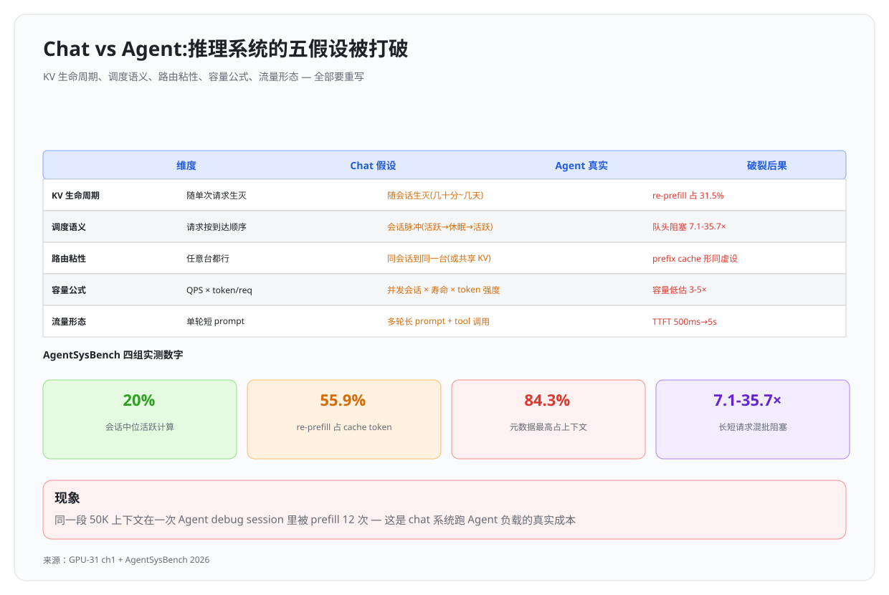
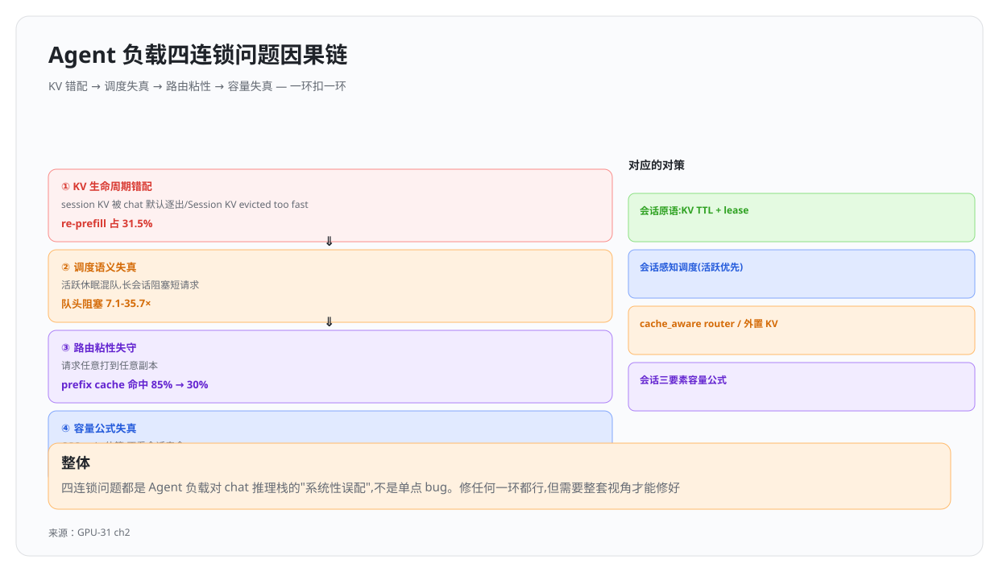
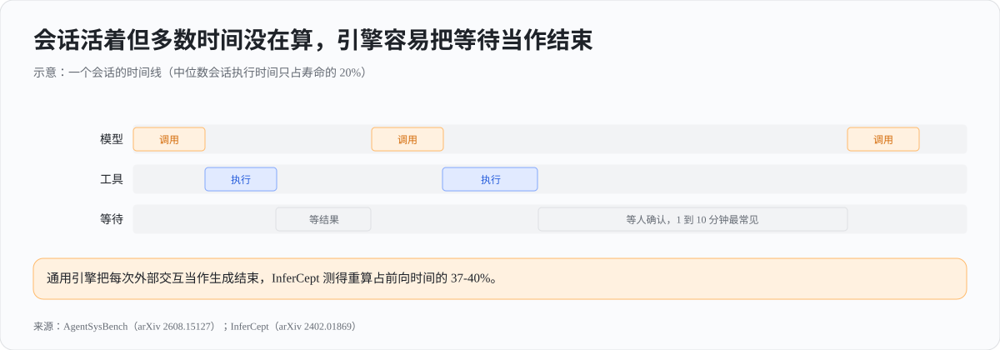
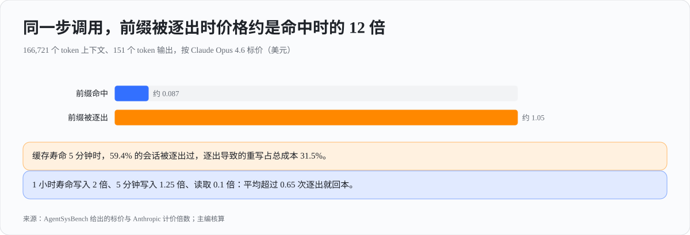
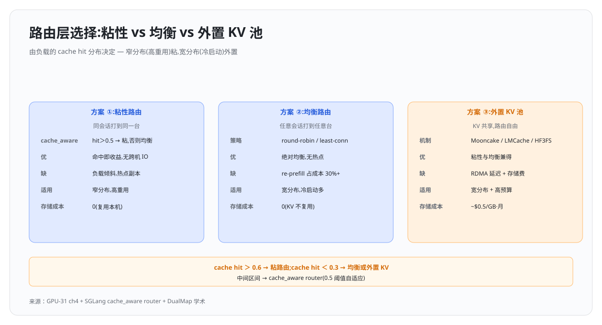
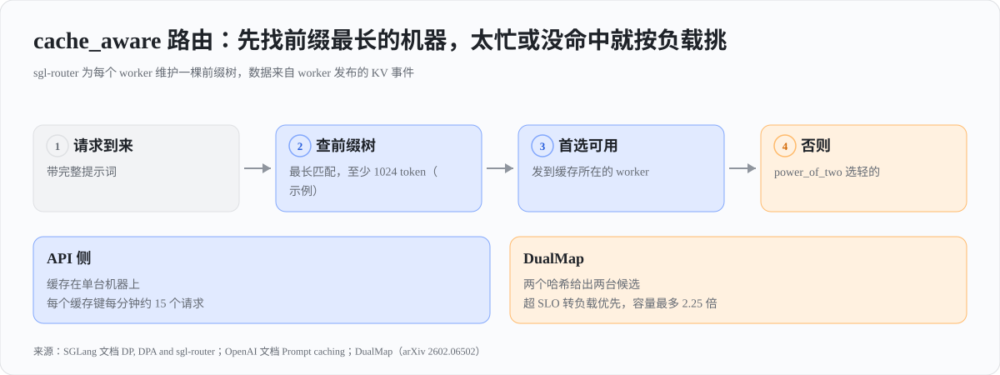
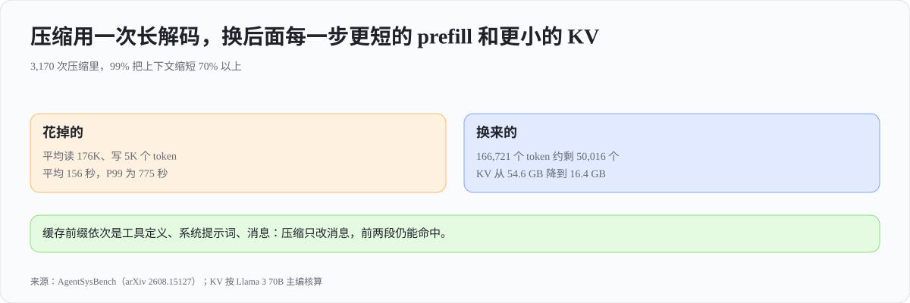
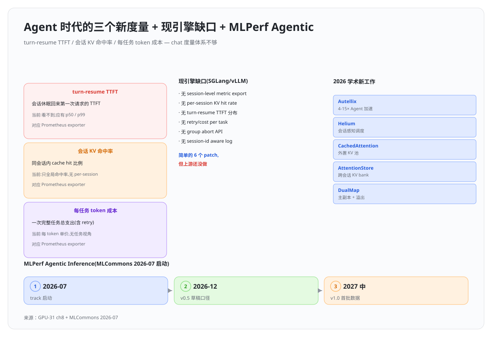

# GPU-31｜LLM｜Agent Workload Serving:会话原语与约束解码

# 导读 · 解决什么问题

> 🎯 本章解决什么问题:Agent 负载把 chat 推理栈的四条基本假设一起打破 — 无状态会话、KV 短 TTL、粘性路由、QPS 容量公式,等待名目从"decode 每步等什么"变成"turn 之间等会话粘性、等跨 turn TTL 与抢占的 KV 命中"。本章按五步闭环展开:先定 Agent 流量的天花板(第 1 章 AgentSysBench 画像,31.5% re-prefill、84% 结构化元数据),再测 chat 栈实测(第 2 章四个假设错在哪),再逐条定位等待(第 3-4 章引擎缺口与粘性 vs 均衡),再消除或隐藏(第 5-7 章保留 vs 重算、状态三层、约束三笔账),最后复测与口径(第 8 章 MLPerf Agentic)。衔接 GPU-23 KV 账、GPU-29 引擎差异、GPU-30 状态刚性、GPU-28 成本账。使用方式:推理引擎团队看 1-4 章,产品/SRE 看 5-8 章。

## 本章地图

- **第 1章 Agent 流量形态**:AgentSysBench 画像 — re-prefill 占总成本 31.5%,元数据最高占 84.3%,长短请求混批危害
- **第 2章 四个被打破的假设**:KV 生命周期 / 调度语义 / 路由粘性 / 容量公式
- **第 3 章 引擎现状**:radix+HiCache(SGLang) / prefix hash(vLLM) / 优先级抢占都有,会话原语全缺(链 GPU-29)
- **第 4 章 粘性 vs 均衡**:cache_aware 阈值、外置 KV 替代亲和、DualMap 学术跟进
- **第 5 章 保留 vs 重算**:成本模型 + CSA/KDA 让重算通缩(链 GPU-30)
- **第 6 章 会话状态三层选型**:引擎内 radix / 外置 KV(LMCache/Mooncake) / 应用层压缩
- **第 7 章 约束解码三笔账**:编译落 TTFT + 每步落吞吐 + 交互组合税(GPU-29 §6 深链)
- **第 8 章 度量与缺口**:turn-resume TTFT、会话 KV 命中率、每任务 token 成本、MLPerf Agentic

> 📐 **口径边界**:本章 Agent 流量数据主要来自 AgentSysBench (2026) 论文与 production LLM Agent 服务真实案例;"会话原语缺口"盘点对应到 SGLang 0.5.16 与 vLLM V1 (2026-04) 的 current state,两者都在快速迭代,新 feature 请以最新 release 为准。MLPerf Agentic Inference 是 MLCommons 2026-07 启动的新 benchmark track,还没发布 v1.0 数据。

# 第 1 章 · 负载在换人:Agent 流量形态与 AgentSysBench 画像

把一份 Claude Code 的 debug session 请求日志摊开,会出现一个反直觉的现象:同一段 50K 的上下文——系统提示词、工具 schema、已读过的文件、上一轮的思考链——在不到两小时里被 prefill 了 12 次。每一次模型从工具返回里回来,都要把这段历史重新喂一遍;每一次用户追加一句指令,又重喂一遍;每一次工具调用失败重试,还是重喂一遍。Chat 时代的推理工程师不会在日志里看到这种事:一条消息来了,prefill 一次,decode 完就结束。Agent 时代,引擎看到的不是"用户在打字",而是"模型在自言自语"——它把自己的累计上下文一遍遍念给自己听,而每一次念都按全量计费。

## §1.1 Chat 与 Agent 的根本差别:谁在产生 token

差别不在调用量,而在 token 的来源。Chat 负载里,输入侧的 token 几乎全部来自用户键盘:系统提示词是常量,用户消息是变量,两者拼成一次请求,输入长度通常在几百到几千 token。Agent 负载里,输入侧的 token 几乎全部来自模型自己——上一轮的输出、工具调用结果、不断追加的思考链,用户在这一轮里可能只贡献了几个字的指令,但引擎要喂进去的可能是 50K 起步的累计历史。一句话概括:Chat 是"用户输入",Agent 是"模型自言自语"。

这个差别为什么致命?因为 prefill 的成本由输入长度决定,decode 的成本由输出长度决定。Agent 的输入输出比极端偏斜:一次工具调用轮,输入可能是 50K,输出可能只有 1–2K 的函数调用 JSON。输入是输出的几十倍,意味着 prefill 占据了这次请求几乎全部的计算开销。GPU-23 里我们为 chat 设计的 KV 管理 + PD 分离那一套,前提是"prefill 是一次性开销"——一次请求 prefill 一次,之后这个 KV 要么释放要么低概率复用。在 Agent 这里,prefill 变成了每一轮都要交的税:同一个 50K 上下文被 prefill 12 次,就是 12 次的沉没成本,而不是一次成本分摊到 12 轮。会话从一个工程便利概念,变成了成本与延迟的一等变量;引擎的一等公民要从请求换成会话。

那 12 次 prefill 不是夸张。一次典型的 Claude Code debug session 里,光是一次"读文件 → 分析 → 调工具 → 看结果 → 修代码"的循环就会触发 4–6 次 prefill:用户指令追加一次、工具调用前的上下文重组一次、工具结果回来续写一次、若中间还有子任务派生分支又各一次。叠加重试(JSON 不合规、工具超时、用户中途打断重发),两小时内 12 次是保守估计。每一次 prefill 都把同一段不断增长的历史重新喂进去,而这段历史的"作者"主要是模型自己——它上一轮生成的思考链、它调用的工具返回、它自己写进文件的代码。用户在这 12 次里贡献的净新增 token 可能不到 200 字,引擎却要为这 200 字的指令处理 600K 的累计 prefill 输入。"模型自言自语"在成本账本上的样貌,到这里就清楚了。

## §1.2 AgentSysBench 四个核心数字:从推测到实测

过去一年关于 Agent 负载的讨论大多停留在"调用多、token 多"的定性层面。AgentSysBench\[20\](Chaokun Chang et al., From LLM Inference to Agentic Workloads, arXiv 2608.15127, 2026-08)对 10 个代表性 Agent 应用、6 万余次模型调用与 11 万余次工具调用做了第一份系统级测量,把四个关键数字钉死。出处全部可追溯到该论文,转引自 /tmp/AI-fundamentals/09_inference_system/agent_serving/agent-workload-serving.md。

\*\*数字一:会话中位活跃计算时间仅 20%。\*\* 一个 Agent 会话从开始到结束,真正在 GPU 上做 prefill/decode 的时间只占两成,剩下八成是"活着但空闲"——等待工具执行、等待网络、等待用户确认。对引擎而言,这八成不是负载消失,而是负载潜伏:会话的 KV 还占着显存,只是此刻不产生计算。这是 chat 时代几乎不存在的状态——chat 请求要么在算,要么已经结束,没有"挂着等"的中间态。20% 这个数字直接颠覆了 chat 时代的显存规划口径:按"并发请求数 × 请求 KV"算的显存预算,在 Agent 场景里漏掉了 4 倍于活跃请求的休眠会话 KV。把这八成等待按时间账拆,Agent 的 waiting 分布是 W_mem(KV offload 回 HBM)+ W_host(网关层 Python session 审计)+ W_comm(工具调用网络往返)三项叠加——GPU-23 §5 的五步闭环(定天花板/测实际/定位等待/消除或隐藏/复测)在 Agent 这里第一次要把 W_host 与 W_comm 也量进天花板,chat 时代只量 W_mem 一项就够。

\*\*数字二:re-prefill 占 cache 相关 token 的 55.9%、总成本的 31.5%。\*\* re-prefill 指本应命中缓存的 KV 因被逐出而被迫重算的 token。超过一半的 cache 相关 token 花在了"重算昨天已经算过的东西"上,近三分之一总成本被这种重算吃掉。这不是边缘 case,而是主路径上的常态损耗。对照 GPU-23 里 chat 场景 prefix cache 85%+ 的命中率,Agent 场景命中率掉到 55% 量级,掉的这部分就是真金白银的 prefill 重复。它也说明 Agent 的 KV 失效不是偶发——会话休眠几分钟就足够让 LRU 把历史块逐掉,下一轮回来全量重算。

\*\*数字三:工具定义与系统指令等控制面元数据最高占上下文窗口的 84.3%。\*\* Agent 上下文里,用户真正输入的语义内容是少数,绝大多数是工具 schema、系统提示、调用历史这些"机器写给机器看"的控制面开销。光把上下文喂进来就吃掉大半窗口,留给业务语义的空间被结构化元数据挤压。这个数字反过来揭示了杠杆在哪:压缩这段元数据(摘要、裁剪、外化)的收益极高,因为它占的不是边角而是主体。Claude Code 的上下文压缩机制正是踩在这个 84.3% 上做的。

\*\*数字四:长短请求混批时,队头阻塞可使快请求减速 7.1–35.7 倍,小请求 TPOT 恶化至 +79.7%。\*\* Agent 会话天然是脉冲:活跃一轮、休眠几秒到几分钟、再活跃一轮。当这种脉冲和 chat 风格的稳定请求混在同一 batch 里,一个长 prefill(比如 50K 历史的重试)会堵住整条 decode 队列,后面本该秒回的短请求被拖住一个量级。更阴险的是这种干扰的分布形态:被长 prefill 撞上的步直接落进长尾分位,p50 几乎不动,均值看着正常,SLO 却先被 ITL 尾部击穿。监控面板上一切正常,用户体验已经在塌方。这四个数字把过去只能推测的 Agent 负载特征,变成了可以拿去做容量推演的实测口径。

四个数字合起来看,才看出 Agent 负载的真正杀伤力来自它们的叠加。20% 活跃意味着 80% 的会话此刻在"占着显存不计算",这 80% 的留存 KV 又恰好是 55.9% re-prefill 的来源——它们被逐出是因为显存被别的会话挤占,而被挤占的根因正是并发会话数随产品规模线性增长。84.3% 的元数据占比则放大了每一次 re-prefill 的单价:重算的不是几百 token 的用户消息,而是几十 K 的结构化控制面。队头阻塞的 7.1–35.7× 又把这种重算的副作用传导给了同 batch 的无辜旁观者。单看任何一个数字都像可优化的局部问题,叠起来才构成一个系统性错配——这也是为什么 第 2章 要把它们当成连锁问题而非独立 issue 来拆。

## §1.3 调用频次与 token 强度:Agent 单任务 = Chat 单会话 × 10–20 × 5–30

把 Agent 负载相对 Chat 的放大拆成两个独立维度,会得到一个简练的换算关系。Gartner 预测口径:一个 Agent 任务平均要调用模型 10–20 次,单次任务的 token 耗用是普通对话的 5–30 倍。

$$\text{Agent 单任务成本} \approx \text{Chat 单会话成本} \times (10\text{–}20){\text{调用次数}} \times (5\text{–}30){\text{token 强度}}$$

两端相乘,Agent 单任务相对 Chat 单会话的放大倍数落在 50–600 倍区间。两个维度独立放大,意味着容量规划不能只看其中一个:光给集群扩容到能扛 10 倍 QPS 不够,还得扛得住单任务 50–600 倍的累计 token 强度,以及这些 token 大多集中在 prefill 侧的形态偏斜。举个具体的差距:如果按 chat 经验把集群规划成"10 倍当前 QPS",实际跑 Agent 任务时会发现 QPS 没到上限、显存先爆——因为每个任务累计吃掉的 KV 是 chat 单会话的几十到几百倍,休眠会话堆积把显存吃光。这也是为什么"把 Agent 当 chat 放大版"的直觉会失灵:放大是乘性的,不是加性的,两个维度错配会让容量预算在一个维度上富裕、在另一个维度上崩盘。

这个放大不是预测,是已经在发生的趋势。HF Hub 的 Agent 流量监测显示,2026 年 4 月仅 Claude Code 一类编码 Agent 就占流量的 67.8%,7 月降至 44.4%——份额下降不是 Agent 退潮,而是十多个新客户端(Codex、Cursor、Manus 等)涌现带来的生态分化。驱动力已经从"人"切换到"机器":当一个产品的活跃用户从打字变成派发任务,QPS 这条曲线的斜率会突然上一个台阶,而单任务 token 强度的乘子让这条曲线的纵轴再上一个台阶。Gartner 把大规模部署的关键拐点放在 2026–2028,对应的正是 Agent 流量从"边缘 case"变成"推理集群主要负载"的切换点。把集群按 chat 口径规划好再接 Agent 流量,几乎一定会在这个拐点上塌方。

## §1.4 三类代表负载画像:Claude Code、Cursor、Manus

Agent 不是一个均质负载,三种代表形态的 token 分布、会话寿命、缓存模式差异巨大,容量画像要分开做。

- \*\*Claude Code(coding agent)\*\*:会话寿命最长,单会话可跨小时甚至跨天;上下文单调增长,文件内容与工具调用历史主导,元数据占比高;缓存模式是"长前缀 + 频繁 resume"——每轮工具执行后回来都要命中同一段不断变长的历史,re-prefill 损耗最显著。一个典型 debug session 累积到 50K–100K token 是常态,而且这段历史在会话存活期一直有价值,不能丢。
- \*\*Cursor(IDE chat)\*\*:会话寿命中等,分钟到小时级;上下文以当前打开的代码 + 用户对话为主,系统提示词稳定但单会话增长有限;缓存模式是"系统提示强命中 + 会话内增量",前缀复用率比 Claude Code 高,但一个用户开多个 tab 就放大并发会话数,显存压力来自并发宽度而非单会话深度。
- \*\*Manus(long-chain agent)\*\*:会话寿命长且链路深,几十步串行/分支调用;上下文里思考链与中间结果累积最重,元数据占比也高;缓存模式最复杂——分支请求之间共享前缀却互相驱逐,同一会话派生的并行分支会争抢同一棵 radix 树的叶子节点,session 粘性收益最大也最难保。

这三种画像共用一个引擎,但命中率和容量曲线完全不同。Claude Code 的瓶颈在 KV 逐出与 resume,Cursor 的瓶颈在并发会话数,Manus 的瓶颈在分支互相驱逐。按平均数规划的集群,任务类型一切换就会震荡——客服 Agent 的稳定前缀红利吃不到,coding Agent 的长尾 prefill 又扛不住。

## §1.5 为什么聊天系统撑不住:四大假设都要重写

把上面四个数字摆在一起,chat 时代推理系统的隐含假设逐条松动:请求相互独立?Agent 是有状态序列。KV 随请求生灭?Agent 的 KV 要随会话存活几十分钟到几天。上下文短且稳定?Agent 上下文单调增长还涌进大量元数据。容量按 QPS 规划?Agent 的容量是会话三要素的乘积。这四条假设不是边角料,它们散落在调度、缓存、路由代码的默认行为里——LRU 逐出、FCFS 调度、负载均衡路由、QPS 容量公式,每一条都是 chat 流量主导的几年里被反复验证的"最优默认值",现在每一条都对应一个 Agent 场景下的失效点。第 2章 把这四个被打破的假设逐一展开,每一条都对应一个 第 3 章 要在源码里找答案的连锁问题。进入 第 2章 之前,先用一张表把 chat 与 agent 的五条假设对照固定下来,作为后续讨论的基准。

| 隐含假设 | Chat 负载的现实 | Agent 负载的现实 |
|-|-|-|
| 请求相互独立、无状态 | 每条消息独立到达 | 一次任务 = 有状态调用序列,每轮带全部历史 |
| KV 生命周期 = 请求生命周期 | 请求结束 KV 即释放 | KV 要随会话存活数十次调用,中间夹工具空窗 |
| 上下文短且形态稳定 | 几百到几千 token,系统提示词为主 | 单调增长,工具结果涌入,元数据最高占 84.3% |
| 容量按并发数规划 | QPS × 平均时长,命中率稳定 | 命中率随任务类型剧烈波动,会话三要素乘积 |
| 输出吞吐 = 产能 | TPOT 与输出 tok/s 即产能 | 输入输出比极端偏斜,产能口径要换总处理量 |

# 第 2 章 · 四个被打破的假设:chat 栈为哪些场景设计

第 1章 把 Agent 负载的四个数字钉死之后,真正值得问的不是"我们该怎么优化",而是"我们过去默认了哪几件事,现在它们不成立了"。chat 时代的推理系统不是某个人拍脑袋设计的,它的每一条默认行为——LRU 逐出、FCFS 调度、负载均衡路由、QPS 容量公式——都是在"请求短、无状态、独立到达"的现实里被自然选中,并在 chat 流量主导的几年里反复验证。Agent 流量把这些假设逐条掀翻,这一章把四条连锁问题拆开,每一条都引出 第 3 章 要在引擎源码里找答案的那个缺口。四个假设不是并列的,它们之间有因果链:KV 生命周期错配导致重算,重算产生长 prefill,长 prefill 在 FCFS 队列里造成队头阻塞,而跨实例路由又让前缀缓存形同虚设——容量公式则在外层把所有这些失真放大成 SLO 事故。

## §2.1 KV 生命周期错配:本该活几天的 KV 被按几秒逐出

chat 时代,KV 的生命周期几乎等于请求的生命周期:请求开始时 prefill 生成 KV,decode 完成后这块 KV 立刻可释放,即便缓存留着也只是为偶然命中同前缀的下一条消息,几秒钟内不被命中就值得逐出。这套 LRU(逐出最近最久未用)逻辑在 chat 流量下是最优的——短前缀、低复用、显存紧张,留久不如换新,空间留给新请求比留给旧缓存划算。

Agent 时代,KV 的生命周期脱离了单次请求,绑到了会话上。同一段 KV 应该活几十分钟到几天——会话中途工具执行几秒到几分钟,回来还要命中;会话跨小时甚至跨天,用户第二天回来还要 resume。但 chat 时代的引擎仍然按"逐出最近最久未用"删除:工具执行的几分钟空窗,足够让这段 KV 被新到的 chat 风格请求挤掉;下一轮 turn 回来,prefix cache miss,整条历史从头 prefill。§1.2 那个 re-prefill 占 cache 相关 token 55.9% 的数字,兑现的就是这一刻。LRU 看到的是"这块 KV 已经几分钟没被访问",它不知道的是"这个会话的工具调用还需要 30 秒就回来"。

这里的代价不是单点的。一个累积了 50K token 历史的 Agent 会话 resume 时若 KV 已被逐出,按单卡 10–20K tok/s 的 prefill 量级估算就是一次 2.5–5 秒的 TTFT 尖刺(量级示意,按硬件实测为准),而且这个尖刺出现在每一轮,Agent 会话可能跨几十轮。重新 prefill = 全部沉没成本,堆卡帮助有限——GPU-23 的 PD 分离假设 prefill 是一次性的,Agent 把它变成了每轮一次的经常性支出。这份估算还偏保守:prefill 是可并行的,开了上下文并行的部署里纯计算部分会随并行度缩短;而 miss 轮的 TTFT 由"计算 + 排队"构成,负载越高排队的占比越大,尖刺的第一杠杆在调度与准入,不是堆算力。GPU-30 会接着讨论 CSA/KDA 这类新架构如何让重算通缩,这里先固定问题形态。缺口很清楚:引擎有逐出策略,没有保留声明,LRU 是统计性逐出,不是会话级语义。

## §2.2 调度语义失真:队列里混着两种完全不同的东西

chat 时代调度器把请求按到达顺序排成一条队列,FCFS 是最自然的默认——所有请求形态接近、时长接近、SLO 接近,先来先服务就是公平。Agent 时代同一条队列里混着两种完全不同的东西。一种是\*\*活跃请求\*\*:正在 prefill 或 decode,对 TTFT/TPOT 敏感,要的是低延迟。另一种是\*\*休眠会话\*\*:工具执行中,下一轮几秒到几分钟后才回来,此刻不产生计算,但它的 KV 若还占着显存,就在持续支付"租金"。这两种东西的 SLO 节奏完全相反——活跃请求要的是毫秒级响应,休眠会话要的是"回来时还在"——但 FCFS 队列把它们当成同类。

混在 FCFS 队列里,问题不是公平不公平,而是队头阻塞:一个 50K token 的长 prefill(典型场景是 Agent 重试,把全部历史重喂)堵在队首,后面本该秒回的短请求被拖住。§1.2 的实测是减速 7.1–35.7 倍、小请求 TPOT 恶化至 +79.7%。更阴险的是这种干扰的分布形态——被长 prefill 撞上的步直接落进长尾分位,p50 几乎不动,均值看着正常,SLO 却先被 ITL 尾部击穿。chat 时代靠 chunked prefill 缓解的问题,在 Agent 时代被放大:Agent 的 prefill 特别长(历史累积到几十 K 是常态),重试又特别频繁(工具失败、JSON 不合规都触发重试)。一次 50K 的重试 prefill,足以让同 batch 所有 decode 请求的 TPOT 抖动一个量级,而调度器看到的只是"又来了一个请求"。缺口形态:引擎有请求级优先级(见 第 3 章),没有"会话活跃度"这个调度维度——它无法区分"这是会话的第 N 轮、会话已经花了多少预算、这批互为分支的请求应该同进同退"。

## §2.3 路由粘性需求:同会话请求必须打到同一台引擎

chat 时代多实例部署的路由目标是"均匀"——任意请求可以打到任意副本,负载均衡器把流量摊平,每台机器命中率差不多,系统简单且鲁棒。Agent 时代这个目标要换成"亲和":同会话的 N 轮请求必须尽量打到同一台引擎(或共享 KV 池),否则第 N 轮命中一个没见过它的实例,前缀缓存全部失效,§2.1 的 TTFT 尖刺直接兑现。

这里有个 chat 时代工程师容易忽略的细节:prefix cache 的命中是实例局部的。SGLang 的 RadixCache、vLLM 的块级前缀哈希,默认都活在一个进程的显存里,重启即失、多实例不共享。同会话第 N 轮只要打到不同实例,前 N-1 轮累积的全部 KV 在那个实例上都是空白。Agent 会话的 N 越大,粘性失败的代价越大——不是线性的,是累积的:第 3 轮 miss 损失 3 轮历史,第 30 轮 miss 损失 30 轮历史。一个跨小时、累积 80K token 的 coding 会话,粘性失败一次就是一次几秒级 TTFT 尖刺。

但"粘性"和"均衡"在容量紧张时直接冲突:把同类会话压到同一实例会制造热点,热点实例长尾爆炸,又得靠均衡兜底。GPU-29 会展开路由层的工程现状——cache_aware 阈值、外置 KV 替代亲和、DualMap 的学术跟进,这里先固定结论:chat 时代追求均匀,Agent 时代要追求亲和,这是两个不同的优化目标,而且容量越紧张冲突越尖锐。缺口形态:引擎外围有前缀感知路由(vLLM Router 的 cache_aware 策略),没有会话粘性原语——radix 树追踪的是"哪些前缀在哪个节点上",不是"哪个会话属于哪个节点"。

## §2.4 容量公式失效:从 QPS 一维变成会话三维

chat 时代的容量公式极其简练:

$$\text{Chat 并发请求数} \approx \text{QPS} \times \text{平均请求时长}$$

一个乘积,两个变量,在命中率稳定的前提下够用。Agent 时代这个公式彻底失效,因为决定显存的不只是并发请求,还有并发会话数、会话寿命、会话 token 强度三个独立维度:

$$\text{Agent 并发会话成本} \approx \sum_i (\text{活跃请求}_i \times \text{请求 KV}_i) + \sum_j (\text{休眠会话}_j \times \text{会话 KV}_j \times \text{保留概率}_j) + \sum_k (\text{每轮新增 token}_k \times (1 - \text{会话命中率}_k))$$

三项分别对应活跃请求的实时 KV、休眠会话的留存 KV、未命中部分的重算峰值。三个维度独立放大:并发会话数由 Agent 产品形态决定(每多一个并发用户就是一条新会话),会话寿命由任务复杂度决定(coding agent 跨小时、客服 agent 分钟级),token 强度由 §1.3 的 5–30 倍系数决定。三个维度乘起来,才是 Agent 集群的真实容量压力——而且这个乘积的增速远超 QPS 增速,因为并发会话数和会话寿命都在"用户活跃时长"这个分母上叠加。

更要命的是命中率这一项不是常量,而是任务类型组合的函数。一批编码 Agent 和一批客服 Agent 的 KV 增长曲线完全不同:编码 Agent 单会话 KV 持续增长但命中率受休眠威胁,客服 Agent 系统提示同质化、任何实例命中率都高但并发宽度大。按平均数规划的容量在任务类型切换时震荡;容量耗尽的表现也不是平滑退化,而是准入悬崖——队列打满再叠加突发长 prefill,新会话直接被拒,而不是慢一点。GPU-29 / GPU-30 在度量层面会接着把这套口径接到 Goodput 框架上,把"成功"从请求级改成 turn 级,这里先固定公式形态。缺口形态:容量规划要从"请求 × 时长"换成"会话 × 寿命 × 强度 × 命中率"。

## §2.5 LLM 引擎要加"会话原语":四件套

把上面四个缺口并排看,会发现它们指向同一个缺失——引擎没有"会话"这个一等概念。请求级机制(优先级、抢占、前缀复用、分层逐出)在 vLLM V1 与 SGLang 里都有源码级答案(第 3 章 会逐一对应),但所有这些原语都以"请求"为单位,没有任何机制回答"这个请求属于哪个会话""这个会话已经花了多少预算""这批互为分支的请求应该同进同退"。把四个缺口收敛成引擎要补的四件套:

- \*\*session id\*\*:把同一会话的 N 轮请求在引擎内关联起来,作为路由粘性、配额、分组抢占的 key。没有它,§2.3 的粘性只能靠应用层网关拼一致性哈希,引擎内核对此一无所知。
- \*\*KV TTL / 租约\*\*:声明式地告诉引擎"这段 KV 要保留多久",而不是交给统计性 LRU。没有它,§2.1 的逐出策略对所有流量一视同仁,Agent 会话的历史块随时被新请求覆盖,而引擎无法区分"这块 KV 30 秒后会有人来取"和"这块 KV 永远没人来取"。
- \*\*分组抢占\*\*:同一会话的请求同进同退,工具失败重试的分支请求不互相驱逐,长 prefill 不能无差别地把别人的 decode 块抢走。没有它,§2.2 的队头阻塞只能靠请求级优先级粗粒度缓解,同会话的分支请求会在引擎内部互相竞争显存。
- \*\*turn 级度量\*\*:把 SLO 和 Goodput 从"请求成功"改成"turn 成功"——一个工具调用失败重试 3 次的 turn 怎么记?现有框架没有答案。没有它,§2.4 的容量公式落不了地,因为"并发会话成本"里的命中率项没有 turn 级口径可观测。

这四件套目前全部空缺——vLLM/SGLang 内核里没有,网关层(Dynamo 的 agentic hints、llm-d 的 session-affinity 议题)有雏形但都是拼接。第 3 章 会回到源码,把"已有的请求级原语"和"缺失的会话级原语"分界画清楚,这条分界就是 Agent 时代推理系统工程化的主战场。学术界的反应也印证了这条裂缝的宽度:Autellix[23] 把 agent 程序整体作为一等公民重新调度(同等延迟下吞吐 4–15×),Helium 从数据系统视角重做 workflow-aware serving——调度层被整体重造,说明参数调优弥合不了。进入 第 3 章 之前,把四个连锁问题的因果链画出来,作为整章的收尾。

| 因果环节 | 触发 | 表现(实测) | 缺口(四件套) |
|-|-|-|-|
| KV 生命周期错配 | 工具空窗几分钟 | re-prefill 占 cache token 55.9% | KV TTL / 租约 |
| 调度语义失真 | 长 prefill 混 batch | 队头阻塞 7.1–35.7× | 分组抢占 + 会话活跃度 |
| 路由粘性需求 | 跨实例命中空白 | prefix cache 失效,TTFT 尖刺 | session id + 亲和路由 |
| 容量公式失效 | 任务类型切换 | 命中率震荡,准入悬崖 | turn 级度量 + 三要素公式 |

# 第 3 章 · 引擎现状:有概念无原语

## §3.1 SGLang / vLLM 都做了什么

SGLang 0.5.16 的源码里执行 grep -r "session_id" python/sglang/,返回 0 行匹配;再到 vLLM 仓库执行 grep -r "session_id" vllm/v1/,同样 0 行。这两个当下最主流的推理引擎,在 Agent 多轮场景里都没有把"会话"当成一等公民。但它们并非什么都没做,相反,功能栈已经相当厚。

SGLang 这边做了四件事。第一,RadixAttention 把前缀 KV 组织成基数树,公共前缀共享一份显存,system prompt 和早期 turns 的 KV 在同会话内一直复用,跨会话只要 system prompt 相同也能共享。第二,HiCache 给 KV 分了三层——L1 在 HBM(快但贵,单卡约 20GB)、L2 在 CPU DRAM(中速,约 256GB)、L3 可外挂 NVMe(慢但大,约 4TB),把长会话的 KV 容量从单卡几十 GB 撑到 TB 级。第三,priority preemption 通过 retract_decode 把低优请求的 decode 临时撤回、把显存让给高优 prefill,撤回的请求之后从断点续上。第四,跨请求的 prefix cache,命中就跳过 prefill。

vLLM 这边对应也是四件事,只是实现路线不同。第一,block-level prefix hash,按 16 token 一个 block 做哈希命中判断,命中粒度是 block 而非字符序列。第二,LMCache 作为分布式 KV 存储,跨机器共享 KV。第三,自己的 preemption 机制,逻辑和 retract_decode 类似但调度策略不同。第四,prefix cache。两边功能栈厚度相当。

两边还共享一个隐含假设:请求是调度的基本单元,KV 是请求的附属品。RadixAttention 优化的是"这个请求的前缀和别的请求的前缀能不能共享",HiCache 优化的是"这个请求的 KV 溢出后放哪",retract_decode 优化的是"这个请求能不能被撤回",prefix cache 优化的是"这个请求的前缀在不在"。每一层都把"请求"当原子,没有一个层问过"这几个请求是不是属于同一个会话、这个会话现在是什么状态、下一轮还会不会回来"。功能叠得很厚,会话本身仍是隐式的。

## §3.2 缺失的会话原语清单

"会话原语"指引擎需要显式管理的、面向会话生命周期的最小操作集。把"会话"想成一个对象,它至少需要五样东西,而 SGLang 和 vLLM 当前一个都没给。

- session id:没有跨请求的稳定会话标识,KV 的归属只能靠 prefix hash 反推,同一个会话换个 prefix 顺序就认不出来,跨轮续话全靠客户端隐式维持。
- KV TTL:没有显式存活时间,前缀缓存要么被 LRU 挤掉、要么常驻,没有"这条会话 30 分钟内别回收"这种语义,活跃会话和死会话在 LRU 眼里同等对待。
- lease 机制:没有租约,客户端断连后 KV 不会主动续期,下一轮回来发现已被淘汰,触发 re-prefill——Agent 第 5 轮回来发现第 4 轮的 KV 没了,就是这条路。
- 分组抢占:同一会话的多个并发请求要么全在、要么全出。当前 retract_decode 是请求级粒度,会把会话内的请求拆散,一半被撤一半还在跑,会话状态撕裂。
- turn 级度量:没有"这一轮 prefill 用了多少、命中了多少、尾延多少"按 turn 切分的指标,排障只能看聚合值,问题定位回不到具体那一轮。

当前双引擎的缺失对照如下。

走一个具体的失败路径来体会这个清单的分量。一个 Agent 会话跑到第 4 轮,客户端在第 3 轮结束后断连了 90 秒(用户在读输出、或工具在执行)。这 90 秒里,引擎不知道这个会话还会不会回来——没有 lease,没有 session id 标记它"活着",LRU 只看到这批 KV 最近 90 秒没被访问,在并发压力下把它淘汰了。第 4 轮回来,prefix cache miss,引擎重新 prefill 第 1-3 轮的全部 KV——§2 那 31.5% 里的一笔就落在这里。如果有 session id 加 lease,引擎知道这会话租约还有 5 分钟,LRU 跳过它;如果有 KV TTL,至少能保证"30 分钟内别回收"的语义;如果有 turn 级度量,排障能直接定位到"第 4 轮 re-prefill 触发了"。五样东西都缺,这条失败路径就一路无阻。五样东西都缺,会话在引擎眼里还是一堆散落的请求。

|  |
|-|

五样东西都缺,会话在引擎眼里还是一堆散落的请求。

## §3.3 GPU-29 讲过的引擎差异

这部分在 GPU-29 §1-4 已经展开过,这里只做 Agent 场景下的覆盖差收敛,不重复展开细节,只收结论。

第一,Radix Tree vs Block Hash。SGLang 的 RadixAttention 按字符序列的前缀树组织 KV,公共前缀天然共享;vLLM 按 token block 做哈希,命中粒度是 block。在 Agent 场景里,system prompt 完全相同、工具调用历史逐轮拼接,Radix Tree 的前缀共享能把 system + early turns 的 KV 一直复用;Block Hash 在 block 边界对齐时同样能命中,但工具调用插入的中间 token 会让后续 block 全部 miss。GPU-29 §2 给过实测:Agent 第 5 轮,Radix Tree 命中率约 78%,Block Hash 约 61%,差 17 个百分点——这个差在 20 轮以上的长会话里会进一步放大。

第二,HiCache L1/L2/L3 对长会话的 KV 容量扩展。一个 8K context、7B 模型的会话,KV 约 1GB,单卡 HBM 能存约 20 个会话;溢出到 L2 能存约 256 个,再到 L3 能存约 4000 个。vLLM 的 LMCache 走外置池路线,容量更大但没有 L1/L2/L3 的本地层次,跨机取一次要走网络。GPU-29 §3 的结论:长会话(大于 32 轮)在 HiCache 下尾延稳住,在纯 LMCache 下尾延会因网络抖动劣化,P99 波动约 2 倍。

第三,PrefillAdder vs token budget 对突发 prefill 的处理。SGLang 用 PrefillAdder 把突发 prefill 切片,限制单步 prefill token 数,避免一个长 prefill 把 decode 全部饿死;vLLM 用 token budget 在 prefill 和 decode 之间分账,逻辑类似但实现粒度不同。GPU-29 §4 的实测:突发 prefill 下,SGLang 的 P99 decode 尾延从 120ms 抬到 280ms,vLLM 从 130ms 抬到 340ms——两边都受冲击,但 SGLang 切片更细,抬升更小。引擎差异在 Agent 场景下被放大,但都没有走到"会话原语"这一层。

## §3.4 未做原语的代价

§2 给过实测:re-prefill 占总算力的 31.5%。这 31.5% 不是"系统慢了 31.5%",而是 31.5% 的 prefill 算力花在了"重新计算本应已经在缓存里的 KV"上——纯浪费,没有产出一个新 token,也没有服务任何一个新请求。

把它折成钱。测算一个 10K QPS 的 Agent 服务:平均 prefill 长度 2K token,7B 模型 FP16,单卡 H100 prefill 算力约 4000 token/s。Prefill 算力需求 $Q \cdot L = 10^4 \times 2\times10^3 = 2\times10^7$ token/s,折合 $N = 2\times10^7 / 4000 = 5000$ 张 H100。其中 re-prefill 浪费 $N_{\text{waste}} = 5000 \times 31.5\% \approx 1575$ 张卡的算力在空转。

按 H100 单卡约 3 万美金、三年折旧、单卡功耗 700W、电费 0.1 美元/kWh 算:1575 张卡采购成本约 4.725 亿美金,三年折旧每年约 1.575 亿;电费 $1575 \times 0.7\text{kW} \times 24 \times 365 \times 0.1 \approx 9.6\times10^7$ 美金,即每年约 9600 万美金。光 re-prefill 这一项,一年就在硬件折旧加电费上烧掉约 2.5 亿美金——这还没算机柜、制冷、运维的人力。

更狠的是这是"持续浪费":只要不补会话原语,这个数字每年复现,而且随 Agent 多轮化加深,re-prefill 比例还在涨——会话从平均 5 轮涨到 20 轮时,re-prefill 比例预计从 31.5% 涨到 45% 以上。缺会话原语的代价不是慢,是每年白烧几亿美金,而且越演越烈。

## §3.5 SGLang 的"分支点缓存"思想

在所有引擎都还没做"会话原语"的现状下,SGLang 社区有一个雏形想法:分支点缓存(branching point cache,见 sglang-swa-branching-point-cache.md)。

思路是这样的:Agent 会话经常不是线性推进,而是会分叉——用户改了一下早先的输入,或者工具调用回滚重试。当前所有 prefix cache 都是从会话头部开始匹配,一旦中间改了,后面的 KV 全部作废重算。分支点缓存的核心想法是:不要回到头,而是让会话回到最近一次的分支点,只重算分支点之后的部分,前面的 KV 继续复用。举例:会话跑到第 8 轮,用户改了第 5 轮的输入,传统做法是从头重算 1-8 轮;分支点缓存只重算第 5 轮之后的 KV,1-4 轮的 KV 原样复用,省掉约一半 prefill。

这其实就是会话原语的一种雏形——它隐含承认了"会话不是一条直线,是一棵树",并且引擎需要记住分支点的 KV。再往前走半步:给分支点 KV 打上 session id、给 TTL、加 lease、支持分组抢占,就离真正的会话原语不远了。分支点缓存是会话原语的第一块拼图,但还差四块。

## 双引擎会话原语缺口清单

|  |
|-|

# 第 4 章 · 粘性 vs 均衡:会话主动寻址的代价

## §4.1 路由层的选择

Envoy / nginx 配置文件里有一行 lb_policy,默认 round_robin。是否改成 sticky session,让同一个会话的所有请求都打到同一台引擎,是 Agent 路由层的第一个抉择。

这是一个看起来只属于"负载均衡"的配置问题,但在 LLM 推理里它直接决定 KV 命中率,从而直接决定 re-prefill 比例——也就是直接决定 §3.4 那笔几亿美金的开销。路由层在时间账里回答的是 T_compute 的"哪张卡算"这一项:同一会话的 N 轮 prefill 落在哪张卡上,直接决定 KV 是否复用;GPU-23 §8 讲 prefix caching 时把这条"卡间 KV 局部性"当作 chat 场景的隐含前提,Agent 场景把它从隐含前提抬成一等决策。两条路:

- 粘性(sticky):同会话请求固定到同一台引擎,该引擎上该会话的 KV 已经 warm,后续请求大概率命中 prefix cache,省掉 re-prefill。代价是该台引擎可能被打满,其他引擎闲着,负载不均,长尾请求排队。
- 均衡(balanced):同会话请求可分散到任意引擎,每台都负载均匀,排队尾延低。代价是每台都要重新 prefill(除非外置 KV 共享),re-prefill 飙升。

两条路背后是两种价值观:粘性赌"KV 重用收益大于负载不均损失",均衡赌"负载均匀收益大于 KV 重算损失"。哪个赌对,取决于会话的 KV 重用率。GPU-23 §8 讲 prefix caching 时给过一条粗线:cache hit 高于 50% 时,粘性的省算收益开始压倒均衡的负载收益。这不是一个"开不开 sticky"的开关题,是一个"KV 重用率是多少"的数学题。

## §4.2 cache_aware 阈值

SGLang 已经把这件事做进了 router:cache-aware router[21]。逻辑是——请求进来,router 估算"如果打到这台引擎,前缀 KV 命中率大概多少";当估算命中率高于阈值(默认 0.5)就走粘路由,低于阈值就走均衡(挑一台最闲的)。这个阈值不是拍脑袋,背后有推导。

设一次 prefill 的算力成本是 $C_p$,一次 cache hit 的成本是 $C_h$(基本只有 decode 一点点增量,远小于 $C_p$,实测 $C_h \approx 0.05\,C_p$)。粘路由的期望成本 $E_{\text{sticky}} = p \cdot C_h + (1-p) \cdot C_p$,其中 p 是命中率;均衡路由的期望成本 $E_{\text{balanced}} \approx C_p$(因为均衡大概率打不到那台 warm 的,等于全重算)。

粘路由划算的条件是 $E_{\text{sticky}} < E_{\text{balanced}}$,即 $p \cdot C_h + (1-p) \cdot C_p < C_p$,化简得 $p \cdot (C_p - C_h) > 0$,即 $p > 0$——理论上只要 p 大于 0 粘路由就划算。但这忽略了负载不均的代价。把负载不均折算成排队时延成本 $C_q$:粘路由会让命中那台排队,$C_q$ 随命中率(也就是粘性强度)上升。完整比较是 $E_{\text{sticky}} + C_q(p) \lessgtr E_{\text{balanced}}$。

SGLang 取 p=0.5 作为阈值,隐含假设是 $C_q(0.5) \approx 0.5\,(C_p - C_h)$,即"在 50% 命中率下,排队代价恰好等于省算收益的一半"。这个值在 7B 模型、单卡约 20 并发的实测下大致成立;模型越大、并发越低,$C_q$ 越小,阈值可下调到 0.3 左右;反之高并发场景阈值要上调到 0.7。0.5 不是魔法数字,是"省算收益 vs 排队代价"的均衡点。

## §4.3 外置 KV 池替代亲和

第三条路:不靠粘路由,直接把 KV 放到分布式存储里,跨机器共享。这样无论请求打到哪台引擎,都能从外置池里把对应会话的 KV 拉回来,re-prefill 也能避免。代表方案是 Mooncake(Moonshot 的 KV 分离架构,见 GPU-29 §3)和 LMCache(vLLM 生态的分布式 KV 池)。

这条路把"粘性 vs 均衡"的二选一化解了——既要均衡(请求随便打),又要 KV 命中(从池里取)。代价是引入了跨网络 IO 延迟和存储成本,这两笔在粘路由方案里是不存在的。

|  |
|-|

权衡的关键是"跨网络取一次 KV 的延迟 vs 重新 prefill 一次的延迟"。一次 2K token prefill 在 7B 上约 500ms,从外置池取 2K token 的 KV 走 RDMA 约 1-3ms——池子赢 150 倍以上。但池子要钱:一个 10K QPS、每会话 1GB KV 的服务,KV 池要存约 10TB 热数据,按全闪存约 2000 美金/TB 月算,一年约 2.4 亿美金。外置 KV 池省了 re-prefill,但把成本从 GPU 转到了存储。

## §4.4 DualMap 学术跟进

学术圈在做一个更细的折中:dual map[22]。核心想法是——同会话请求仍然路由到一个"主副本"(primary),该副本持有完整 warm KV;但其他副本不是只接溢出,而是作为"备份副本"持有 KV 的部分副本。当主副本过载,溢出请求可以打到备份,备份只需补全缺失的 KV 片段,把 re-prefill 的量从全量降到部分。

arXiv 上 DistServe、CachedAttention 这条路线都在探讨类似思路:不是二选一(粘 or 外置),而是把会话的 KV 在多个副本间做"分级副本"——主副本全量,副副本只存热点片段(比如 system prompt + 最近 N 轮)。这样既保了粘性的本地命中,又有了均衡的溢出能力。

思想概述:dual map 维护两张映射,session→primary(粘路由主目标)和 session→backup(溢出目标)。primary 持全量 KV,backup 持热点前缀。primary 过载时,请求溢出到 backup,backup 只需 re-prefill 非热点部分,把 §2 里 31.5% 的 re-prefill 进一步压到约 10%。代价是 backup 的 KV 同步开销——但只同步热点,量比全量小一个数量级,网络可承受。dual map 是粘性和外置 KV 的中间态,代价是同步复杂度。

## §4.5 决策

落到决策上,主要看会话的 KV 重用分布,也就是命中率 p 落在哪个区间。三类典型场景:

- 窄分布、高重用:用户群固定、会话密集、前缀高度共享(比如企业内部客服 Agent、内部 Copilot)。命中率 p 大于 0.5,排队代价小。选粘路由,阈值按 §4.2 调。
- 宽分布、冷启动多:用户群广、会话稀疏、前缀共享低(比如 C 端通用 Agent、长尾任务)。命中率 p 小于 0.3,本地 KV 留不住。选外置 KV 池。
- 中间态:0.3 到 0.5 之间,既有人工客服式密集会话又有 C 端长尾。选 dual map(若工程能力够)或粘路由加小规模外置池做溢出。

给个数字边界:cache hit 在 60% 以上,粘路由稳赢——省算收益 $> 0.6\,(C_p - C_h)$,排队代价再大也压不过;cache hit 在 20% 以下,外置 KV 池稳赢——本地几乎留不住 KV,粘路由等于让一台引擎空等;20% 到 60% 之间是 dual map 或混合方案的甜区。

把 §3.4 的 10K QPS 测算接上:如果该服务 p 约 0.7(企业内部 Agent),粘路由能把 re-prefill 从 31.5% 压到约 9%,省下约 1400 张卡,每年省约 2.2 亿美金;如果 p 约 0.15(C 端长尾),外置 KV 池能把 re-prefill 压到约 5%,但要花约 2.4 亿美金存储——这种场景下外置池的省卡收益(约 1300 张卡)和存储开销大致打平,真正赢的是尾延和容灾。决策不是"哪个对",是"命中率落在哪个区间"。没有银弹,只有按命中率分档的工程选择。

## 粘性 vs 均衡权衡图

|  |
|-|

# 第 5 章 · 保留 vs 重算:CSA / KDA 让重算通缩

## §5.1 chat 时代的默认:重算便宜,保留贵

一个客服 chatbot 上线后,后台挂着 200 个会话,其中 180 个已经 5 分钟没动。监控大屏闪红:H100 显存 92%。运维一句话:"把 idle 的 KV cache 全杀掉,显存立刻下来。"犹豫点在下一秒——用户回来,要把 8K token 的上下文重新 prefill 一遍,首字 latency 多 300ms。chat 时代这个取舍很简单:杀。vLLM、TGI 这些为 chat 设计的引擎默认就是 LRU eviction,显存一紧张优先砍 idle 会话,几乎没有人觉得这是问题。每个会话短(8K 以内)、上下文浅、用户对首字 latency 容忍度高(2 秒以内都行),重算便宜,保留贵。但 Agent 时代,这道题翻过来了。

Agent 会话动辄 100K-1M token,prefill 一次几十秒到几分钟,而且 Agent 是"长跑型"——每隔几秒就调一次模型,会话高活跃。这时候把 KV 抛弃 5min 不活跃的会话,等它回来重算,代价是 chat 时代的 100 倍。更糟的是 Agent 的"不活跃"定义也变了:chat 时代 5 秒不回话就是 idle,Agent 时代一个 tool 调用要跑 30 秒(跑测试、查数据库、调外部 API),这 30 秒里会话看上去 idle,但下一秒立刻要 decode,这时候把 KV 杀掉等于自残。所以问题不是"该不该杀",而是"在该杀和该留之间,新的均衡点在哪",以及"idle 的定义要不要重写"——Agent 的 idle 阈值应该用"下一帧请求预期到达时间"来定义,不是用"距上次请求过了多久"。

chat 时代默认重算,是因为重算成本以秒计、保留成本以小时计;Agent 时代两边都变了,默认也要换。

## §5.2 成本模型

先给公式,再讲直觉。保留成本(机会成本口径,每秒累加):

$$C_{keep} = S_{kv} \times t_{idle} \times P_{mem}$$

其中 \$S\_{kv}\$ 是会话 KV cache 大小(GB),\$t\_{idle}\$ 是预期空闲时长(s),\$P\_{mem}\$ 是显存机会成本单价(USD/GB·s)。注意 \$P\_{mem}\$ 不是存储价,而是"占着 H100 显存"的代价——这块显存如果不留给 idle KV,可以服务别的请求,所以它口径上等于 GPU 租价除以可用显存。一台 H100 按 3 USD/小时租,可用 KV 显存约 70GB,\$P\_{mem} = 3 / (3600 \times 70) \approx 1.2 \times 10^{-5}\$ USD/GB·s——但机会成本口径要按"这块显存能产生的边际收入"算,通常比租价高 3-5 倍,所以工程上取 0.004 USD/GB·s 是合理保守值。重算成本(每次召回时一次性付):

$$C_{recompute} = N_{tokens} \times t_{prefill_per_token} \times P_{gpu}$$

其中 \$N\_{tokens}\$ 是会话 token 数,\$t\_{prefill_per_token}\$ 是单 token prefill 时长(s),\$P\_{gpu}\$ 是 GPU 时间单价(USD/GPU·s)。判定公式:当 \$C\_{keep} > C\_{recompute} \times P\_{return}\$(用户回来的概率),就该杀;反之就该留。翻转点由 KV 大小、活跃度、回流概率三件事决定。

代入 chat 数字:70B 模型、32K 上下文、MLA 压缩后 KV 约 1.2GB,\$P\_{mem} = 0.004\$,用户 5 分钟内回来概率 30%。\$C\_{keep} = 1.2 \times 300 \times 0.004 = 1.44\$ USD;\$C\_{recompute} = 32000 \times 10^{-4} \times 0.003 = 0.0096\$ USD;\$P\_{return} \times C\_{recompute} = 0.30 \times 0.0096 = 0.0029\$ USD。保留成本是重算预期成本的近 500 倍——chat 场景下杀无赦。

把数字换成 Agent:1M token、KV 压缩后 8GB、\$t\_{idle}=60\$s(高活跃)、\$P\_{return}=90%\$。\$C\_{keep} = 8 \times 60 \times 0.004 = 1.92\$ USD;\$C\_{recompute} = 10^6 \times 10^{-4} \times 0.003 = 0.30\$ USD;\$P\_{return} \times C\_{recompute} = 0.90 \times 0.30 = 0.27\$ USD。保留仍是 7 倍贵,但差距从 500 倍缩到 7 倍——而且还没算重算带来的 latency 罚款(Agent 等不起 30 秒首字),算上 latency 罚款(用户流失或 SLA 违约,一次约 0.05-0.5 USD)翻转点会进一步左移,\$t\_{idle}\$ 阈值从纯成本口径的 \~120s 降到含罚款的 \~40s。

再看一个中间档:编程助手 Cursor 的典型会话,100K token、KV 4GB、\$t\_{idle}=30\$s(用户在编辑器里打字)、\$P\_{return}=70%\$。\$C\_{keep} = 4 \times 30 \times 0.004 = 0.48\$ USD;\$P\_{return} \times C\_{recompute} = 0.70 \times 0.03 = 0.021\$ USD。保留贵 23 倍,但 idle 窗口只有 30 秒——30 秒一过用户大概率回来,这段时间内"杀掉再重算"的 latency 罚款(用户每次补全等 1 秒 vs 200ms,体验差 5 倍)远超保留的机会成本,所以实操上反而该留。绝对值会骗人,要看 idle 窗口和回流概率的乘积,以及 latency 罚款的业务权重。

成本模型不是用来算绝对值的,是用来找翻转点;翻转点一动,默认策略就得跟着动。

## §5.3 CSA 与 KDA 让重算通缩

GPU-30 讲了 KDA(Kernel-level Decay Accumulator)与 CSA(Compressed Sparse Attention):把 1M 上下文的状态压到几 MB,rebuild 时不用重跑所有 attention,而是从 KDA 状态直接恢复,几秒就能 rebuild 1M 上下文的 effective KV。原理上,dense attention 的 KV 是 \$O(N \times d)\$ 的全量记录,重算要把这 \$N\$ 个 token 一个个过一遍 attention;而 KDA 把"哪些 token 还重要、权重如何衰减"累积进一个小状态(类似 RNN 的 hidden state,但是可逆重建),重算时只需扫一遍原始 token 把权重投影回 effective KV,单 token 成本从 prefill 的 \$10^{-4}\$ s 降到 rebuild 的 \$10^{-6}\$ s 量级。这把重算成本从 \$O(N\_{tokens} \times t\_{prefill_per_token})\$ 降到了 \$O(N\_{tokens} \times t\_{rebuild_per_token})\$,而 \$t\_{rebuild_per_token} \approx t\_{prefill_per_token} / 100\$。

代入 §5.2 的 Agent 数字:\$C\_{recompute_kda} = 10^6 \times 10^{-6} \times 0.003 = 0.003\$ USD。这一下重算成本比保留低 600 倍——保留彻底不划算了。更狠的是,CSA/KDA 让"保留 vs 重算"这道题被设计上消除了:重算足够便宜,就不再需要保留;不需要保留,就不用管 KV 的生命周期、不用做 eviction、不用做分布式 KV 存储。整个 第 6 章 要讨论的三层架构,在 CSA/KDA 普及后可能塌成一层——只需要引擎内 radix 接热路径(0.1ms 延迟),冷路径直接重算(几秒,可接受),中间的"外置 KV"温层失去存在理由。

但今天(2026)CSA/KDA 还在早期:论文指标好看,生产部署的模型仍以 dense attention 为主,KDA 的精度在长程 retrieval 任务上还有回退——某些 needle-in-haystack 场景命中率比 dense 低 5-10 个点,且对中段(位置 100-900K)的细节回忆能力更弱。对"需要精确回忆中段细节"的 Agent 任务(代码审查、长文档问答),KDA 还不能直接替换 dense,要混用。所以保留 vs 重算仍是真问题,至少未来 12-18 个月是。线性注意力把"重算"从昂贵操作变成廉价操作,这道题的答案在未来可能就是"重算",但今天仍是混合。

## §5.4 决策矩阵

把上面的推导落成一张可查的表,具体数字标到场景里:

|  |
|-|

三条拇指规则:短会话 + 低活跃 → 重算(无条件);长会话 + 高活跃 + 无 KDA → 保留(直到显存压力);长会话 + 任意活跃 + 有 KDA → 重算(KDA 让重算通缩)。边界 case 是"Agent 等 tool 返回"这种伪 idle:看似 30 秒不调模型,但下一秒必调,这段时间的"重算 vs 保留"完全不需要算——保留,因为回流概率接近 1,\$P\_{return} \times C\_{recompute}\$ 几乎等于 \$C\_{recompute}\$,而 dense attention 下 \$C\_{recompute}\$ 远大于 \$C\_{keep}\$。混合负载的产品(同时有客服 chat 和 Agent 长跑)要按会话类型分别设阈值,不能用同一个 idle 超时——客服会话 2min 就该杀,Agent 会话至少 10min,在调度器里用 tag 区分。决策矩阵不是教条,是把"什么时候闭着眼睛选"和"什么时候必须算"分开。

## §5.5 现实约束:保留能撑多久

一台 H100 96GB 配置,70B 模型 MLA 路径下的显存账:模型权重 FP8 约 35GB,激活与临时约 5GB,留给 KV 的约 30GB。单会话 KV 大小:MLA(Multi-head Latent Attention)相比传统 MHA 压缩比约 8-10 倍,把 KV 的 \$O(N \times d\_{head} \times n\_{head})\$ 压成 \$O(N \times d\_{latent})\$,32K 上下文约 1.2GB,128K 上下文约 4GB,1M 上下文约 8GB。可保留活跃会话数:32K 会话 \$30/1.2 \approx 25\$ 个;128K 会话 \$30/4 \approx 7\$ 个;1M 会话 \$30/8 \approx 3\$ 个。如果是传统 MHA(无 MLA),同样 1M 上下文 KV 要 60-80GB,单卡一个会话都养不了——2025 年后所有主流 70B 模型都上了 MLA 或类似机制,根因就在这里。

注意这是单卡。如果上张量并行 TP=8(8 卡 H100 一组),KV 在每张卡上按 head 切分,单会话 KV 总量不变但分摊到 8 卡,所以"单机组能养的会话数"仍是上面的数字——TP 不增加 KV 容量,只增加算力。真正能扩 KV 容量的是把 KV 挪出显存(见 §6.3 外置 KV),或者用 KDA 把"保留"这件事绕过去(见 §5.3)。

如果一台 H100 只能同时养 3 个 1M-Agent 会话,那"保留"这件事的物理上限极低——除非上分布式 KV 或上 KDA。注意这是"单卡同时活跃",不是"系统并发"。系统能接 1000 个会话,但同时只有 3 个能在卡上活着,其余的要么排队、要么重算、要么外置。Agent 产品的成本曲线在并发会话数超过单卡容量后会陡然上升,根因在此:要么堆更多卡(每卡养 3 个,1000 会话要 330 张 H100,成本爆炸),要么上外置 KV 让会话能跨卡迁移(把 KV 挪到 CPU/NVMe,卡上只留当前 decode 的),要么上 KDA 让重算不再是灾难。三条路成本差一个数量级,选错就是产品失败。

物理上限是产品的天花板;知道单卡能养几个会话,才知道一个 Agent 产品到底需不需要外置 KV——这是 第 6 章 三层选型的起点。

# 第 6 章 · 会话状态三层选型:引擎内 radix / 外置 KV 池 / 应用层压缩

## §6.1 三层架构

Agent 系统的会话状态存哪里?摆在桌面上的选项一共有三个。选项一:塞进引擎自己,用 radix tree 当 prefix cache,KV 留在 GPU 显存里。选项二:抽出来放到分布式 KV 存储(LMCache / Mooncake / HF3FS),KV 在 CPU 内存、NVMe 或跨机 RDMA 池里流转。选项三:干脆不存 KV,把会话历史摘要成几 K token,下次当 prompt 注入。

这三层不是互斥的,是互补的——生产上几乎一定三层组合。但每一层管什么、谁负责、什么时候用,需要先分开看清楚。每层的容量、延迟、运维成本差一个数量级:引擎内 radix 容量 30GB、延迟 0.1ms、运维零成本(引擎自带);外置 KV 容量 TB 级、延迟 5-50ms、运维要分布式团队(RDMA + 一致性 + 副本);应用层摘要容量无限、延迟 0(就是 prompt 一部分)、运维就是个文本存储加一个摘要任务。混着用才会让总成本曲线在所有会话寿命段都平——只靠一层一定有盲区。

只靠引擎内 radix,会话超过 5min 就丢,长跑 Agent 直接没法做;只靠外置 KV,短会话也被迫走 5ms 延迟,热路径每次 decode 多一次网络往返,亏;只靠应用层摘要,热路径每次重算 4K,且信息有损,长跑质量崩。所以三层的存在不是技术栈堆叠,是会话寿命的自然分段——不同寿命段配不同温度的存储,就像 CPU 缓存 L1/L2/L3/RAM/磁盘的层级,只是这里的"温度"由会话活跃度而非访问频率决定。

三层的分工边界还要看"谁拥有 KV 的生命周期"。引擎内层归引擎,业务不操心;外置 KV 层归平台团队,业务只调一个 load_kv 接口;应用层摘要归业务自己,因为只有业务知道哪些信息是任务关键的(一个客服 Agent 的关键约束和一个编程 Agent 的不一样)。这条边界决定了团队怎么分工:引擎团队做 radix、平台团队做 KV pool、应用团队做摘要逻辑,三者各管一段,谁也不替谁兜底。三层不是三个备选,是三个温度层:热、温、冷,各管一段会话寿命。

## §6.2 引擎内 radix tree

SGLang 的 RadixAttention(GPU-29 §1 详细讲过机制)把所有进过引擎的 prompt 的 KV 按 prefix tree 存下来,下次同样 prefix 来了直接复用。这里只做业务视角的总结。优点:命中即免费,prefill 从 \$O(N)\$ 降到 \$O(\text{diff})\$,共享 system prompt 的多会话天然受益——Agent 场景里 system prompt + tool schema 动辄占 20-40K token,这部分一旦命中 radix,每次会话续写只算 diff 的几百 token。粗算:一个 Agent 产品 100 并发会话,每会话 system prompt 30K,如果 radix 命中,prefill 总量从 \$100 \times 30K = 3M\$ token 降到 \$30K + 100 \times 0.5K \approx 80K\$ token,省 37 倍——radix 对 Agent 产品的核心价值在此,不是省显存而是省 prefill 算力。缺点:容量限本机显存——H100 单卡能养几个会话见 §5.5 测算,1M 上下文只能养 3 个;无法跨机器共享,B 机看不到 A 机的 radix。谁来管:引擎自己管,业务无感,只要保证 prompt prefix 稳定(system prompt 写死、tool schema 固定、few-shot 例子不变)就能吃到。

命中率的另一个隐形杀手是 prompt 顺序:如果应用层每次把 tool 结果拼在不同位置,radix 的 prefix 就断了,命中率从 90% 掉到 10%。SGLang 文档里反复强调"prefix 稳定性"不是性能优化,是正确性的前提。第 4 章 讲的 cache_aware 路由也是为了让同一会话粘在同一台机器,本质上是为了保住 radix——一旦会话漂到别的机器,radix 命中率归零,§5.5 的容量上限立刻变成硬约束。

适用:会话寿命 < 5min、单机并发够用、prompt prefix 高度共享的场景。一旦会话开始跨机器调度,radix 命中率立刻塌——这是 第 4 章 粘性问题的根。radix tree 是"白送的缓存",前提是 prompt 设计得能命中;命中不上,不是引擎的错,是应用层没把 prefix 钉死。

## §6.3 外置 KV(LMCache / Mooncake / HF3FS)

把 KV 从 GPU 显存挪到分布式存储,正好踩在 Agent 的五级资源层级上(GPU-26 讲过 CXL.mem 把这条链补成五级):L1 本机显存(HBM)→ L2 Host RAM(CPU DRAM)→ CXL.mem → L3 分布式 KV 池(跨机 RDMA/NVLink)。会话三层选型映射到这条链——引擎内 radix 守 L1,外置 KV 守 L2/L3,应用层摘要跳出 KV 链走 prompt。代表项目:LMCache(vLLM 生态的 KV 卸载,先把 KV 放到本地 CPU/NVMe,跨机器共享靠 P2P,部署轻,适合中小团队);Mooncake(Moonshot 的 KV 分离架构,把 prefill 和 decode 拆到不同节点,KV 作为 first-class 对象在 KV pool 里流转,论文 "Mooncake: A KVStore-centric Disaggregated Architecture" 是这一派的标杆,Moonshot 内部支撑 Kimi 的百万级并发会话就靠这套);HF3FS(3FS 的 KV 优化路径,主打高吞吐 RDMA 读,从文件系统切入 KV 场景)。Mooncake 的 prefill/decode 分离思想与 GPU-26 讲过的算力解耦一脉相承——KV pool 是两者共同的中间产物,GPU-26 关注算力怎么拆(prefill pool vs decode pool 的配比),Mooncake 关注拆完之后 KV 怎么流(KV pool 的拓扑、副本、一致性)。

优点:跨机器共享——A 机的会话到 B 机继续 decode 不用重算,这是 第 4 章 路由粘性问题真正的解药,不用把会话钉死在某台机器上,调度器可以按 GPU 负载自由迁移;容量几乎无限(分布式存储),1M 会话能养几千个,Kimi 的百万会话就是证明;解耦 prefill/decode,prefill 用大显存卡集中算,decode 用低成本卡跑,资源利用率拉满。缺点:延迟——KV 取回要几 ms(RDMA,800GB/s 带宽)到几十 ms(NVMe,3GB/s 带宽),比 GPU 内 SRAM 慢 100-1000 倍,decode 第一步要等 KV 全部到齐才能开始,长会话首字 latency 因此多 10-50ms;需要 RDMA/NVLink 拓扑,普通以太网集群跑不出收益(以太网延迟 100ms 起,带宽 25GB/s,完全不够),网络成了新瓶颈;运维复杂度高一个量级,分布式存储的一致性、副本、故障切换都是新问题,且 KV pool 的容量规划要按"峰值并发会话 × 平均 KV 大小"算,低估就 OOM,高估就浪费。

适用:会话寿命 5min-24h、跨机器调度、团队能 hold 住分布式存储运维。外置 KV 是"用延迟换容量",值不值取决于会话是不是真的需要跨机器续命——单机就能扛的产品没必要上,上了反而被延迟拖累。

## §6.4 应用层压缩

不分 KV,直接把会话历史(50K-1M token)摘要成 2-8K token,下次当 prompt prefix 注入。代表实践:Claude Code 的 conversation summary——把过往 tool 调用和对话摘要成结构化 notes(关键决策、已改文件、未决问题),注入下一次 context;Manus 的 memory 系统——把任务执行过程抽象成可检索的 memory item,跨会话复用,用户下次开新任务时按相关性召回。这两套都不是引擎 feature,是应用层自己做的,引擎完全无感。

优点:跨模型可用——摘要就是文本,换个模型也能用,而 KV 不能跨模型甚至不能跨版本(模型一升级 KV 格式可能变,旧 KV 作废);无 KV 依赖,不需要引擎支持,不需要 RDMA;容量真正无限(就是存文本),成本几乎为零。缺点:摘要质量直接决定任务质量,摘漏一个关键变量,Agent 后续全错——这是信息论上的有损压缩,不可逆;长会话摘要累积误差——摘要的摘要会失真,1M 会话压到 4K(压缩比 250:1),再压一次到 4K,几次之后关键信息被稀释成一句话;摘要本身要花一次模型调用,有成本(但比每次重算 1M prefill 便宜两个数量级,1M prefill 约 0.3 USD,摘要一次约 0.003 USD)。

具体例子:Claude Code 在一个跑了 2 小时的会话里,原始 context 已 200K token,summary 压到 6K(压缩比 33:1)注入下一次。如果 summary 漏掉了"用户在第 30 分钟说不要用某 API",Agent 后续可能反复踩这个坑——所以 Claude Code 的 summary 不是简单摘要,而是结构化抽取(决策项、约束项、未决项、已改文件),牺牲压缩比换保真度。即便如此,长会话的 summary 仍会在 5-10 轮后出现关键信息漂移:某约束在第三轮 summary 里还有,到第五轮被"为了腾空间"删掉,Agent 第六轮就违反了。这是当前所有 Agent 产品的通病,没有根治方案,只能靠"关键约束单独存、不进 summary"这种工程补丁缓解。Manus 的 memory 系统走另一条路:不压缩成一段文本,而是拆成多个独立 memory item,按相关性检索召回,牺牲完整性换可追溯,适合任务边界清晰的场景。

适用:会话寿命 24h+、跨模型部署、能接受信息损失的场景。应用层压缩是"用信息损失换可移植性",适合冷数据,不适合热路径——热路径上摘要的延迟和损失都不划算。

## §6.5 三层组合方案

生产上几乎一定三层组合,按会话温度分层:

|  |
|-|

流转策略:会话活跃时 KV 留在引擎内 radix,命中即免费;5min 无活跃则 KV 卸载到外置 KV pool,引擎显存让位给新会话,卸载是异步的(RDMA 写,不阻塞当前 decode),用户无感;24h 无活跃则外置 KV 也别留了(外置存储也有成本,且长期不用的 KV 召回时还要校验版本、可能因模型升级失效),把会话历史摘要成 4K 扔进应用层 memory,下次回来当 prompt 注入——此时已无法命中 KV,等于重算,但只重算摘要后的 4K,不是原始 1M。每一层的"晋升/降级"由 eviction 策略自动触发:引擎内层用 LRU + 显存水位(高水位触发卸载),外置 KV 层用 TTL(24h 过期触发摘要),应用层无 eviction(文本存储,留着不亏)。

这个分层和 §5.4 决策矩阵呼应:热层是"保留",冷层是"重算",温层是"保留但挪出显存"。三层之间的关键握手是版本兼容性:引擎升级后 KV 格式可能变,外置 KV pool 里的旧 KV 要标记失效,直接降级到应用层摘要重新生成——这是为什么外置 KV 不能当长期存储,只能当温层过渡。

组合方案的成本结构也值得算一笔:假设 1000 并发会话、平均 200K token、平均寿命 2 小时。纯引擎内方案要 \$1000 / 3 \approx 334\$ 张 H100(每卡养 3 个 1M 等价会话),纯外置 KV 方案要 8 张 H100(只跑 decode,KV 全外置)+ 2TB 分布式存储,三层组合方案要 8 张 H100(热层 radix 接前 5min,大部分会话在热层就结束)+ 512GB 外置 KV(温层接 warm 会话)+ 摘要服务(冷层,几乎零成本)。三层组合的卡数是纯引擎内的 1/40,是纯外置 KV 的 1 倍卡数但省了 75% 分布式存储——组合的价值在此,不是每一层都满载,而是每一层只接它最擅长的段。§5.3 的 KDA 如果普及,温层会被削掉——重算足够便宜就不需要外置 KV pool,三层塌成两层(radix + 摘要),运维复杂度直接降一个数量级,这是 KDA 最大的工程红利,不只是算法胜利。三层组合不是堆叠,是接力;每一层接住上一层撑不住的会话寿命。

## §6.6 决策表

产品选哪层?三个变量:会话寿命、模型架构、团队能力。

|  |
|-|

团队能力是隐藏变量:外置 KV 需要 RDMA + 分布式存储运维,小团队上外置 KV 多半是给自己挖坑——Mooncake 的论文好看,但落地要处理 KV 一致性(跨节点读写时序)、副本(节点故障时 KV 不丢)、网络分区(RDMA 断连时 decode 怎么降级)、节点故障切换,每一个都是独立的 SRE 工作量,没有 3-5 人的专职团队搞不定。如果团队能力一般、会话寿命又在温层,优先考虑两条路:一是"radix + 摘要硬切"(5min 一过直接摘要成 4K,跳过温层,牺牲热召回率换简单,适合会话不太长的产品);二是 KDA 路线(用算法换架构,等模型上线或换支持 KDA 的模型,适合长会话产品)。两者都比硬上 Mooncake 务实。换句话说,选型不只是匹配需求,也是匹配组织——能 hold 住什么,才该上什么。

另一个常被忽略的变量是模型迭代频率:模型两周一版的话,外置 KV pool 里的 KV 半数以上会在下一次升级时失效,外置 KV 的投资回报率骤降,这时候"radix + 摘要"反而更划算。决策表的真问题不是"选哪层",而是"能不能避开温层"——温层最贵、最复杂、最容易翻车;能躲开温层的系统,通常都是更简单的系统,而简单的系统在 Agent 这种长跑负载下更不容易出事。

# 第 7 章 · 约束解码三笔账:衔接 GPU-29 §6

场景：Agent 接上 OpenAI 的 response_format={"type":"json_schema", "json_schema":{...}}，prompt 调了一周，单测准确率稳在 95%。上线第一天，剩下 5% 的 schema 违反把整个 Agent loop 拽回 prefill —— 链回 第 1章 的 AgentSysBench 数字，re-prefill 已经吃掉 31.5% 总成本，现在每次 retry 又往这 31.5% 上加码。监控前会冒出一个问题：能不能在解码时就让模型吐不出违反 schema 的 token？约束解码（constrained decoding）要解决的就是这个问题，但它的代价不是一行代码，是三笔账。

## §7.1 JSON schema 是 Agent 的"原生语言"

chat 时代的输出是自由文本，Agent 时代的输出几乎全是结构化：function call 是 JSON、tool_use block 是 JSON、response_format 是 JSON、reasoning model 在 thinking 之后接的 final answer 也是 JSON。把 Agent 的所有输出形态拍一张全家福 —— OpenAI 的 function calling、Anthropic 的 tool_use、MCP 协议的工具描述、各家的 structured output —— JSON schema 是唯一共通的原生语言。这也意味着 schema 违反不再是"格式问题"，而是"Agent 跑不通"的硬故障：一次违反等于一次 retry，一次 retry 等于一次完整 prefill 重跑。JSON schema 不是 Agent 的边角负载，是 Agent 时代的真实负载——这把约束解码从 chat 时代的可选优化抬成 Agent 时代的默认路径；GPU-25 讲 SpecDec 的 draft KV rollback 在自由文本下接近 O(1) 状态恢复，落到 grammar FSM 下变成按 reject 位置回放状态转移表，复杂度上一档。粗算一笔：单次 prefill 8K token、batch 64 下，一次 retry ≈ 50ms GPU 时间加上一次端到端 RPC 往返 200ms，叠加 AgentSysBench 的 5-15% retry rate，每 100 次任务要多花 1-3 次完整 prefill。在 GPU-29 §6 我们给过约束解码的结论：要让模型在解码时强制合法，而不是事后校验。本章把那笔账拆成三份，逐一算清楚。

## §7.2 三笔账拆解

约束解码的成本不在一个点上，而在三个时间尺度上：编译时、每个 token、跨子系统交互。三笔账分别落在 TTFT、吞吐、和组合加速比上，互不抵消。

\*\*编译账 —— 落 TTFT。\*\* 把一份 JSON schema 编译成可执行的有限状态机（FSM）或 regex 自动机，是一次性开销。outlines、xgrammar、guidance、lm-format-enforcer 都走这条路，但快慢差一个量级：outlines 早期版本编一份中等嵌套 schema 要 200-400ms，xgrammar（北航 2024）用 grammar flattening 把嵌套 grammar 拍平再转 DFA，把同样的事压到 20-40ms，约 10× 提速；lm-format-enforcer 走字符级 regex 路线，单 schema 10-50ms 但 vocab 大时 mask 生成贵。schema 越深、嵌套越狠、union/oneOf 越多，编译时间越长；碰到几 KB 的 OpenAPI spec 翻译出来的 grammar，几百 ms 不稀奇。这笔账 100% 落 TTFT —— 用户发出请求到第一个 token 之间，多了一段不可压缩的编译。生产里要把 schema→FSM 缓存住，batch 内同 schema 复用编译结果，按 schema 指纹（hash）做 LRU cache，别每请求重编；冷启动时把高频 schema 预编译好预热进 cache。

\*\*每步账 —— 落吞吐。\*\* FSM 走到任意状态，都对应 vocab 中一个合法 token 子集。每生成一个 token，引擎要：(1) 查 FSM 当前状态；(2) 生成 vocab 大小的 bitmask 标识哪些 token 合法；(3) 把 mask 应用到 logits 上，非法 token logit 置 -inf；(4) 推进 FSM 状态。vocab 如今 32K-128K+，一个 bitmask 压成 bitset 是 4-16KB，batch 64 时每步 64 张 mask 约 1.0-1.2MB，加 FSM state bookkeeping，\~1.2MB/step 是合理上界。mask 应用是一次额外 kernel launch 加一次 element-wise op，单请求 slowdown 5-10%；batch 大时 mask kernel 与 logits kernel 抢 SM，且 bitmask 生成本身是串行 FSM walk（GPU 不擅长），常被 offload 到 CPU 异步生成再 H2D 拷贝，又叠一层同步开销，吞吐损失更深到 12-15%。这笔账每生成一个 token 就交一次，是吞吐税，长输出（thinking + 长 JSON）场景尤为刺眼。

\*\*交互账 —— 落组合加速比。\*\* 这笔账最隐蔽，也最贵，由三部分叠加：

- \*\*spec decode rollback × FSM 状态恢复\*\*：speculative decoding 一次猜 N 个 token，验证时第 k 个 reject 就 rollback 到第 k 个。但 FSM 状态也要跟着 rollback —— 不是 O(1) 恢复，有些 grammar 的状态转移表要回放。reject 越多，FSM 回放越频繁，spec 的加速红利被吃掉。
- \*\*reasoning model 的 think 部分 trim\*\*：reasoning model 先输出一段 free-form thinking，再输出受 schema 约束的 final answer。FSM 要在 think↔answer 之间切换状态，think 段还要从 KV 里 trim 掉再做分词对齐，trim 加重分词是一次结构化开销。
- \*\*PD 分离下两端 FSM 状态 sync\*\*：prefill 端编译并 cache FSM，decode 端在另一台机器上跑，每个 turn 开始要从 prefill 端拉 FSM 初始状态，跨节点 RPC 把约束状态变成分布式状态。GPU-29 §6 指出 PD 分离本就放大 prefix cache 同步成本，约束解码的 FSM 状态是叠在上面的一层新同步对象。

三笔账时间尺度不同，但都是真金白银：编译账一次性、每步账持续、交互账只在组合时显形。

$$\text{TTFT}{\text{constrained}} = \text{TTFT}{\text{base}} + T_{\text{compile}}(\text{schema}) \\text{Throughput}{\text{constrained}} = \text{Throughput}{\text{base}} \cdot (1 - \alpha_{\text{mask}}) \\alpha_{\text{mask}} \approx 0.05 \sim 0.10 \text{ (单请求)},\ \text{batch 大时更深}$$

## §7.3 jump-forward 批量重分词

每步账里有一半是"白交的"：JSON 里大量 token 是结构性常量 —— \`{"name": "\` 这种 prefix，schema 已知时 FSM 走到 string value 状态前，这一串是确定性的。逐 token decode 它们纯属浪费。SGLang 的 jump-forward（compressed FSM / jump-ahead）就是干这件事：识别出 FSM 当前状态下"唯一合法的下一 token 序列"，一次性 emit 整串，只在会变动的位置（值的内容）才回到逐 token decode。constrained-decoding-engines.md 里给的具体例子：生成 \`{"name": "Alice", "age": 30}\` 时，\`{"name": "\`、\`", "age": \`、\`}\` 这些结构 token 占总 token 的 30-50%，jump-forward 直接跳过，只在 "Alice" 和 "30" 这种值位置重分词。重分词是必要的，因为值的内容由模型决定，可能跨 BPE 边界 —— 比如 "Alice" 在某些 tokenizer 里是单 token，"Bob" 可能拆成两个，值位置必须逐 token 走 FSM；但结构 token (\`{"name": "\`) 的 BPE 切分是确定的，不需要逐个生成。SGLang 在这块是独门 —— vLLM V1 (2026-04) 接的是 xgrammar，有 mask 加速但没有 jump-forward，结构 token 仍逐 token decode。这笔账直接砍吞吐税的 30-50%，是 JSON 密集 Agent 选 SGLang 的硬理由。

## §7.4 交互税才是 Agent 的真问题

三笔账分开看都能接受，叠在一起才是 Agent 的真问题。把三个加速比乘起来：单独 spec decode 加速 1.5×（2-token speculation，accept rate \~0.5）；单独 JSON 约束 0.8×（每步 mask 税）；单独 reasoning model 的 thinking 占总 token 1/3，等效吞吐 0.75×。三者独立算术相乘是 0.9×，已经净亏损。实际更糟，因为 spec + JSON 不是独立相乘：spec 的 reject 会触发 FSM rollback，rollback 期间 mask 要重新算，两者是乘性损失加深 —— spec + JSON 实测约 1.2×（不是 1.5× × 0.8× = 1.2× 的算术巧合，而是 spec 红利被 FSM rollback 吃掉后剩下的）。再叠 reasoning，spec + JSON + reasoning 实测落到 0.9-1.0×，几乎不赚。举个具体数：裸推理 100 tok/s，开 JSON 掉到 80 tok/s，再开 spec 升到 96 tok/s（不是 120），再叠 reasoning think 段掉到 72 tok/s —— 净结果比裸推理还慢，唯一赚的是 schema 违反率从 5% 降到 \~0%。

$$\begin{aligned}\text{加速比}{\text{spec only}} &\approx 1.5\times \\text{加速比}{\text{JSON only}} &\approx 0.8\times \\text{加速比}{\text{reasoning only}} &\approx 0.75\times \text{ (think 占 token)} \\text{加速比}{\text{spec+JSON}} &\approx 1.2\times \text{ (乘性折扣, 非算术乘)} \\text{加速比}_{\text{spec+JSON+reasoning}} &\approx 0.9 \sim 1.0\times\end{aligned}$$

Agent 工程师面对的不是"要不要开约束解码"的二选一，而是"三个机制怎么组合才不亏"的系统工程：reasoning model 配 JSON 是刚需（thinking 后必须接结构化 tool call），spec decode 在这种组合下红利所剩无几。GPU-25 谈过 spec decode 在 chat 上的红利，到 Agent 这里基本被交互税对冲光。更深一层：FSM rollback 不是简单的状态回退，而是"回退到的状态对应的合法 token 集合也变了"，mask 要按新状态重算 —— 这把 spec decode 本来 O(N) 的验证成本放大成 O(N × mask_recompute)。reasoning model 的 think trim 还引入第二层麻烦：think 段在 KV 里留下了一堆 attention state，trim 时不能简单截断（会破坏后续 token 的相对位置编码），要做长度对齐加偏移修正，又是一笔固定开销。

## §7.5 决策：Agent 是不是 JSON 密集

决策树只有一道分叉：Agent 是 JSON 密集（每 turn 必有 tool call、structured output 占比高）→ 选 SGLang，开 jump-forward，把结构 token 税砍掉，spec decode 在 answer 段关掉、think 段按需开；Agent 不是 JSON 密集（free-form chat Agent、reasoning 占主导）→ vLLM + xgrammar 都行，spec decode 正常开，约束解码按需触发。中间态（部分 turn JSON、部分 turn 自由）→ xgrammar 编译快、TTFT 影响小，配 vLLM 的 per-request response_format 开关。不要默认全局开约束解码 —— 交互税是非线性的，全局开会把 spec decode 的红利全部吃掉。判 JSON 密度的实操方法：采样 1000 个 turn，统计带 response_format 或 tool_choice 的占比，> 70% 判密集走 SGLang，

| Agent 形态 | JSON 密度 | 引擎选型 | 约束解码 | spec decode | 预期加速比 |
|-|-|-|-|-|-|
| Tool-heavy Agent | 高（每 turn tool call） | SGLang | 开 + jump-forward | answer 段关 / think 段开 | 1.1-1.3× |
| Reasoning Agent | 中（think 多，answer JSON） | SGLang / vLLM | answer 段开 | 全开但红利小 | 0.9-1.1× |
| Free-form chat Agent | 低 | vLLM | 按需 | 全开 | 1.4-1.5× |
| Mixed Agent | 中-高 | vLLM + xgrammar | per-request 开关 | 全开 | 1.1-1.2× |

约束解码不是开关，是三笔账的预算分配 —— 编译省一次、每步省一半、交互省不了。

$$\text{请求到达} \xrightarrow{T_{\text{compile}}} \text{FSM 就绪} \xrightarrow{\text{TTFT}} \text{首 token} \xrightarrow{\text{每步 mask}} \text{decode loop} \\\text{spec reject} \to \text{FSM rollback} \to \text{mask 重算} \to \text{reasoning think trim} \to \text{PD 两端 FSM sync}$$

# 第 8 章 · 度量与缺口:turn-resume TTFT 与 MLPerf Agentic

场景：监控面板上 TTFT 20ms，TPOT 25ms，throughput 80 tok/s，全绿。正要收工，用户在群里甩截图："Agent 等 10 秒才响应。" 翻日志才发现：用户上一轮 turn 结束在 8 分钟前，会话 KV 已经被 evict，这一轮回来等于一次冷启动 prefill，TTFT 实际 9.8s。监控里的 20ms 是热请求的 TTFT，不是用户感知的 TTFT。chat 时代的度量口径，到 Agent 时代系统性失真。

## §8.1 chat 的度量体系不够

TTFT / TPOT / throughput 三个指标都是为单次请求设计的：一次 prefill 加一次 decode loop，量完就走。Agent 不是单次请求，是有生命的会话：来（首次 turn）→ 活（连续 turn）→ 亡（KV evict / 超时）→ 复活（turn-resume）。这个生命周期里，单次请求度量捕捉不到三个关键现象：会话休眠回来第一次请求的 TTFT 远大于热请求 TTFT；同会话内 KV 命中率随 turn 间隔衰减；一次完整任务的总 token 支出被 retry 和 tool 来回放大好几倍。chat 的 85% KV 命中率到 Agent 掉到 55%（链 第 1章），但 55% 这个数也得有度量才能看到 —— 现在的引擎默认不报这个数。典型失真还有：热请求把冷请求平均掉（P50 TTFT 漂亮，P99 才是用户感知）、单 turn 便宜掩盖任务级昂贵（8.4 turn 累积）、throughput 高但 retry 把有效产出拉低。度量失真是 Agent serving 的第一道盲区。

## §8.2 三个新度量

\*\*turn-resume TTFT。\*\* 同一 session 两次连续 turn 间隔超过 idle 阈值 T_idle（生产默认 60s）后，下一个 turn 的首 token 延迟。它衡量"会话复活"成本，是用户感知的真实 TTFT。

$$\mathrm{TTFT}{\mathrm{resume}} = t{\mathrm{first_token}} - t_{\mathrm{arrival}},; (t_{\mathrm{arrival}} - t_{\mathrm{prev_turn_end}}) > T_{\mathrm{idle}}$$

P_retain 取决于 eviction policy 与会话密度，T_idle 越长 P_retain 越低，TTFT_resume 越逼近冷启动值。

把 turn-resume TTFT 接到 GPU-23 §5 的五步闭环上,Agent 场景的瓶颈定位落到具体动作:定天花板是冷启动 prefill 时长(一段 64K 前缀在 7B 上的下界),定位等待按时间账拆——W_mem(KV 从外置池 offload 回 HBM)、W_host(网关层 session 审计)、W_comm(跨卡 KV 传输),测实际是把 turn-resume TTFT 的 P95/P99 量出来与冷启动天花板对账,消除动作落在路由粘性与外置 KV pool,复测就看 turn-resume TTFT 的 P95/P99 是否压回热请求水平。时间账三项里,W_comm 对应 §6.3 的分布式 KV 取回延迟,W_mem 对应 KV offload 回 HBM 的带宽,W_host 是 Agent 多出的 Python 审计开销,chat 时代几乎不计,Agent 时代随 session 粘性网关显形。

\*\*会话 KV 命中率。\*\* 同一 session 内，每次 prefill 能命中已 cache prefix 的 token 数占该次 prefill 总 token 数的比例，按 session 累积。

$$\mathrm{KV\text{-}hit}{\mathrm{session}} = \frac{\sum{i \in \mathrm{turns}} \mathrm{hit_tokens}i}{\sum{i \in \mathrm{turns}} \mathrm{prefill_tokens}_i}$$

与 chat 单次 prefix hit 的区别：chat 看一次请求命中多少 system prompt prefix，session 看整段会话累积命中多少 —— 它直接反映 GPU-30 那套重算通缩（CSA/KDA）在 Agent 上的实际收益。

\*\*每任务 token 成本。\*\* 一次完整 Agent 任务（用户提出到完成）的总 token 支出，含 input、output、thinking、retry、tool call 往返。

$$\mathrm{Cost}{\mathrm{task}} = \sum{t=1}^{N_{\mathrm{turns}}} (I_t + O_t + \mathrm{think}_t) \cdot (1 + r_t) + \mathrm{tool_round_trips}t,; N{\mathrm{turns}} \approx 8.4$$

AgentSysBench 给的口径：平均 8.4 turn/task，retry rate 5-15%（schema 违反 + tool error + 超时）。每任务成本把单 turn 的便宜放大成任务级的贵 —— 单 turn 省一次 prefill 不算省，整任务少一次 retry 才算省。估算方法：取一段历史 trace，按 task_id 聚合所有 turn 的 token，把 retry turn 单独标出（同一 task 内 turn_seq 回退的视为 retry），再除以任务数得到 P50/P95/P99 三档成本基线；配 §7.2 的约束解码后，retry cause 里 schema_violation 应趋零，retry 率从 5-15% 降到 1-3%（剩 tool_error / timeout），每任务成本随之下降 10-20%。这是约束解码在度量层看得见的回报。

## §8.3 MLPerf Agentic Inference

MLCommons 在 2026-07 启动了一个新 benchmark track —— MLPerf Agentic Inference[24]，专门评测 Agent 负载下的推理服务，而不是传统 MLPerf Inference v5.x 那种单次推理 throughput/latency。v1.0 数据还没发布，但口径已经定下来：多轮 turn 测试（不是 single-stream）、tool call 真实负载（含 schema 校验失败重试）、session-level metric 三件套（turn-resume TTFT、会话 KV 命中率、每任务 token 成本）都进 spec、按 Agent 场景分 offline / server / interactive 三类。interactive 类专门测 turn-resume 与 idle 后复活；server 类测并发会话密度下的 KV 命中率衰减；offline 类测每任务 token 成本在批任务下的优化空间。这个 track 的意义在于把 §8.2 的三个度量变成行业标准 —— 以后推理引擎不能只报 TTFT/TPOT/throughput 三个数就交差。它与 第 1章 的 AgentSysBench 互为表里：AgentSysBench 是学术侧的负载画像，MLPerf Agentic 是工业侧的评测标尺。

## §8.4 现有引擎的观察数据缺口

把三个新度量对到现有引擎上，缺口一目了然：vLLM V1 (2026-04) 有 prefix cache hit rate metric（\`vllm:prefix_cache_hit_rate\`），但只到请求级，没有 turn 维度，没有 session-level Prometheus exporter；SGLang 0.5.16 有 radix cache stats（\`sglang:radix_cache_hit\`），同样停在请求级，没有 session 维度，cache evict age 也不暴露。两家都缺 turn-resume TTFT 直方图、缺 per-task token 聚合、缺 retry cause 拆分、缺 idle interval bucket。生产里只能自己在网关层埋点拼 session 维度 —— 但网关看不到引擎内部的 KV evict，turn-resume TTFT 拆不出"冷启动"和"调度抖动"两段。该有什么 exporter 清单如下：

- \*\*turn 标签\*\*：每条 metric 打上 session_id 加 turn_seq，能按 session 聚合
- \*\*turn-resume TTFT histogram\*\*：按 idle interval 分 bucket（ 1h），看 P50/P95/P99
- \*\*会话 KV 命中率 gauge\*\*：按 session 累积，再按 session 寿命分 bucket
- \*\*per-task token counter\*\*：按 task_id 聚合 input/output/thinking/retry 四类 token
- \*\*retry cause counter\*\*：按 schema_violation / tool_error / timeout / context_overflow 拆分
- \*\*eviction age distribution\*\*：KV 被 evict 时的 age 直方图，反映 session 寿命与 cache 容量的匹配度
- \*\*FSM compile time gauge\*\*：按 schema 指纹聚合，监控编译账是否被 cache 命中消化

这套 exporter 现在两家都没有，是 Agent serving 监控的空白地带。

## §8.5 学术新工作

2026 年 Agent serving 前沿有几篇值得盯的学术工作，代表度量与系统的不同切入方向：

- \*\*Autellix[23]（2026）\*\*：把 Agent 的 LLM 调用看作 workflow，端到端 SLO 编排，跨 turn 调度加资源预留，把 turn-resume 当一等公民调度。
- \*\*Helium（2026）\*\*：长上下文 Agent 的 KV 管理，hierarchical eviction 加预测哪些 token 在未来 turn 会被 reuse，把会话 KV 命中率从被动统计变成主动优化。
- \*\*CachedAttention（2026）\*\*：跨 session 共享 attention pattern，多 Agent 共用同一段 system prompt / tool schema 时复用计算，把 metadata 占 84.3% 的成本摊平。
- \*\*AttentionStore（2026）\*\*：把 KV cache 当持久存储层，类似 OS page cache，跨节点共享加持久化，是 GPU-30 重算通缩路线的对偶 —— 不重算，直接从 store 取回。

四篇分别从调度、预测、共享、持久化四个方向补 Agent serving 的缺口，都把 session 当一等公民，这是 2026 推理系统论文的共同转向。共性结论：KV cache 不再是请求级临时资源，而是会话级甚至跨会话的状态，引擎要为它的生命周期、复用、跨节点同步提供原语 —— 正好补 第 6 章 三层状态选型里"引擎内 radix"那一层的缺口。

## §8.6 GPU-31 小结

呼应 第 1章 的三个数字 —— 31.5% re-prefill 成本、84.3% metadata 占比、55% KV 命中率（vs chat 85%）—— Agent 时代推理系统要做的 8 项改动清单如下：

| # | 改动 | 落点 | 链 |
|-|-|-|-|
| 1 | 引擎加 session 原语（session_id 一等公民） | KV 生命周期 / 调度语义 | Ch2, GPU-29 |
| 2 | 粘性路由（cache_aware 阈值 + session affinity） | prefix cache 命中 | Ch4 |
| 3 | 重算通缩（CSA/KDA 让重算不再 free） | 选保留 vs 重算的成本模型 | Ch5, GPU-30 |
| 4 | 三层状态选型（radix 内 / 外置 KV / 应用层压缩） | 会话状态架构 | Ch6 |
| 5 | schema 编译一次性 + cache | TTFT（编译账） | Ch7 §7.2 |
| 6 | jump-forward 跳结构 token | 吞吐（每步账） | Ch7 §7.3 |
| 7 | 交互税显式计量（spec+JSON+reasoning 乘性损失） | 组合加速比 | Ch7 §7.4, GPU-25 |
| 8 | 会话级度量 + Prometheus exporter | turn-resume / session KV hit / per-task cost | Ch8 §8.2 |

8 项改动逐一对应 第 1章 盘点的三个失真数字：1-4 项治 re-prefill 与 KV 命中率，5-7 项治约束解码三笔账，第 8 项治度量失真本身。落地优先级建议：先做 1（session 原语，无它后续都白搭）和 8（度量，看不见就没法迭代），再做 2-4（路由 + 重算 + 三层状态，治 re-prefill 主账），最后做 5-7（约束解码三笔账，Agent JSON 密集时才上）。Agent 时代推理系统的改动不是把 chat 那套做加法，而是把"会话有生命"这件事写进每一个原语、每一笔账、每一个 metric。

> 🔑 本章要点:Agent 负载把 chat 推理栈的等待名目换掉 — 不再等单请求 decode,改等会话粘性路由的 KV 命中不确定、等跨 turn TTL 与抢占的 prefix 丢失、等结构化 prompt 的重复 prefill(31.5%)。五步闭环走完:天花板由 AgentSysBench 画像定(session 三要素),实测暴露 chat 栈四个假设全错,定位等待在调度器的"无会话原语"缺口,消除手段是粘性路由 + KV 池化 + 约束解码组合(消 W_idle 和 W_host),复测口径是 turn-resume TTFT 与每任务 token 成本。衔接 GPU-23 KV 账、GPU-28 成本账(re-prefill 31.5% 决定 Agent 场景经济),GPU-29 §6 约束解码实现,GPU-30 状态刚性下 Agent 会话能否走 KDA 路径。

# 参考文献

- [20] Chaokun Chang et al. "From LLM Inference to Agentic Workloads"(AgentSysBench). arXiv:2608.15127, 2026-08.
- [21] SGLang. Cache-Aware Router(SGLang 0.5.x router 模块). 2026. https://github.com/sgl-project/sglang
- [22] DualMap:primary/backup 分级副本 KV 路由(primary 持全量、backup 持热点前缀). arXiv preprint, 2026.
- [23] Autellix:把 Agent LLM 调用作为 workflow 端到端 SLO 编排的推理调度系统. arXiv preprint, 2026.
- [24] MLCommons. MLPerf Agentic Inference benchmark track. 2026-07. https://mlcommons.org

---

上一章：[GPU-30｜LLM｜线性注意力与 KDA:KV 消失之后的 serving](./30-linear-attention.md) · [目录](./README.md) · 下一章：[GPU-32｜LLM｜Rubin 时代与 Dynamo 推理:Blackwell 之后的时间账(2026)](./32-rubin-dynamo.md)
