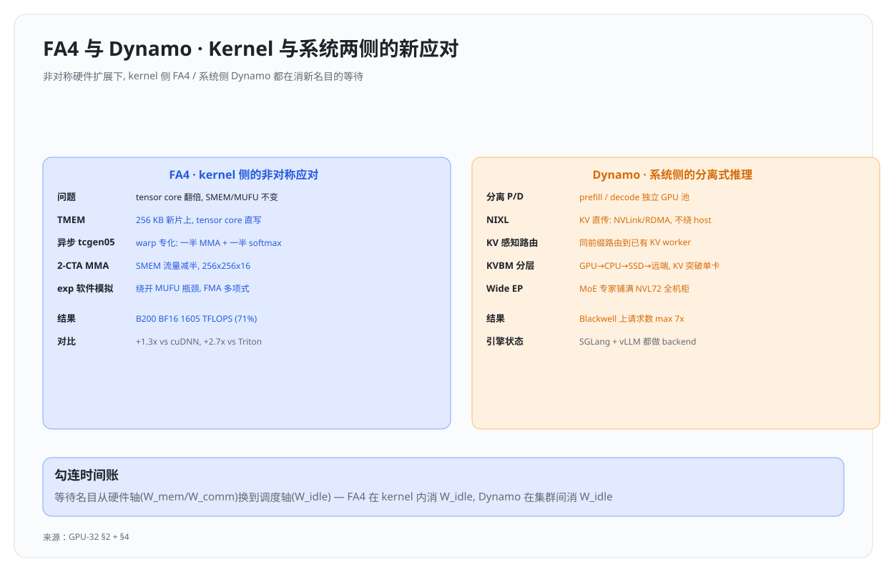

# GPU-32｜LLM｜Rubin 时代与 Dynamo 推理:Blackwell 之后的时间账(2026)

# 导读 · 解决什么问题

> 🎯 本章解决什么问题:GPU-01\~31 把 Hopper 到 Blackwell 世代的知识对齐到 2026 年初,但 NVIDIA 在 2026 GTC 上发布的 Vera Rubin 与 Dynamo 把"一台机器"的边界又往外推了一级 — 单机柜 72 卡的 NVL72 还是当下,Rubin NVL72 NVFP4 推理 50 PFLOPS、260 TB/s NVLink 总带宽、HBM4 22 TB/s,下一代推理系统的等待名目要再换一次。本章按五步闭环展开:先定 Vera Rubin 与 Rubin CPX 的规格天花板(第 1 章),再测 NVFP4 与 FA4 的实际收益(第 2 章),再逐项定位等待的转移(第 3 章模型结构倒逼 kernel:FlashMLA/DeepGEMM/DeepEP),再列出 NVIDIA 官方提供的消等方案(第 4 章 Dynamo 分离式推理 + KVBM 分层),最后回到时间账坐标系(第 5 章),衔接 GPU-27/28/30/31 的当代口径。使用方式:硬件与整机规划团队看第 1-2 章,推理系统工程团队看第 4-5 章,模型团队看第 3 章。

## 本章地图

- **第 1 章 硬件换代:Vera Rubin、Rubin CPX 与 NVLink 6**:单 GPU NVFP4 50 PFLOPS 推理(稀疏口径)、288 GB HBM4 22 TB/s、NVL72 130→260 TB/s,从 Blackwell Ultra 到下一次代际跳跃
- **第 2 章 精度与算子:NVFP4 + FlashAttention-4**:两级缩放让 4 bit 真正可用;TMEM/tcgen05/2-CTA MMA/非对称硬件扩展,FA4 怎么跨过"算力翻倍但 MUFU/SMEM 带宽不变"的新瓶颈
- **第 3 章 模型结构倒逼 kernel:FlashMLA / DeepGEMM / DeepEP 三件套**:DeepSeek 开源周(2025-02)三个库怎么改写 GPU-22 的 MoE 通信、GPU-23 的 KV cache、GPU-06 的 FP8 GEMM
- **第 4 章 系统换代:NVIDIA Dynamo 与分离式推理成为生产标配**:KV 感知路由、KVBM 分层卸载、wide EP 到 NVL72 全机柜,从论文到 1.0 的代价
- **第 5 章 放回时间账坐标系:Vera Rubin 上等待名目怎么变**:Blackwell 的 295 FLOP/B 拐点继续右移,稀疏注意力 + KVBM 分层 + PD 分离分别在哪一项等待上做减法

> 📐 口径边界:本章硬件规格引用 NVIDIA 2026 GTC 与官方 Blackwell Ultra / Vera Rubin 技术博客(NVIDIA 2026-10 披露),FlashAttention-4 引自 Dao et al. MLSys 2026 论文,Dynamo 引自 NVIDIA Dynamo 1.0 release notes 与 SemiAnalysis InferenceX v0.5 实测。Rubin CPX 规格仍为前瞻口径(预计 2026 年底可发货),实际数据中心可获得时间以 NVIDIA 官方 roadmap 为准。文中"NVFP4 推理 50 PFLOPS"为稀疏峰值口径,稠密推算见 §5.1。

# 第 1 章 · 硬件换代:Vera Rubin、Rubin CPX 与 NVLink 6

GPU-27 讲清楚了 Blackwell 世代的 NVL72 整机柜形态:72 x B300、130 TB/s NVSwitch Fabric、288 GB HBM4、FP4 9 PFLOPS 单卡。从 Blackwell 到 Vera Rubin 的跃迁不走"继续堆 SM"这条路,而是换三件事:HBM4 带宽从 8-12 TB/s 提到 22 TB/s(约 1.8x),NVLink 6 单链路 3.6 TB/s(NVLink 5 是 1.8 TB/s),整机柜 NVL72 的 NVLink 总带宽从 130 提到 260 TB/s。GPU 自身的瓶颈却没有按同比例松开:H100 → B300 → Vera Rubin,三代单卡最低精度峰值 2 → 9 → 50 PFLOPS,共 25x;同代 HBM 带宽 3.35 → 8-12 → 22 TB/s,共 6.6x。**算力增速 25x 是带宽增速 6.6x 的 3.8 倍** — 这意味着 GPU-02 那张 Roofline 的高点继续右移,以前刚好能贴上算力线的 kernel,新一代全部掉进访存区。

## §1.1 三年三代:从 H100 到 Vera Rubin 的硬件跳跃表

把 H100、B200、B300、Vera Rubin 放在同一张表里看,NVIDIA 的发布节奏从"两年一代"换到"一年一代":

| GPU | 世代 | 出货 | 显存 / 带宽 | 最低精度峰值(稠密) | 关键新特性 |
|-|-|-|-|-|-|
| H100 SXM | Hopper | 2022 | 80 GB HBM3 / 3.35 TB/s | FP8 ≈ 2 PFLOPS | wgmma、TMA、FP8 Transformer Engine |
| B200 | Blackwell | 2024-2025 | 192 GB HBM3e / 8 TB/s | FP4 ≈ 9-10 PFLOPS | 第五代 tensor core (tcgen05)、TMEM、NVFP4、双 die |
| B300 | Blackwell Ultra | 2026 年初 | 288 GB HBM3e / 8 TB/s | NVFP4 ≈ 15 PFLOPS | 注意力层加速约 2x(对 Blackwell)、ConnectX-8 800 Gb/s |
| Vera Rubin | Vera Rubin | 2026 H2 | 288 GB HBM4 / 22 TB/s | NVFP4 ≈ 50 PFLOPS(稀疏峰值) | 224 SM、第三代 Transformer Engine、NVLink 6 3.6 TB/s |

整机柜的变化更大:GB300 NVL72 用 72 张 B300,HBM 共 20 TB,NVLink 总带宽 130 TB/s,FP4 峰值 1.1 EFLOPS(稠密);Vera Rubin NVL72 用 72 张 Vera Rubin,HBM 仍是 20 TB(单卡缩到 288 GB),但 NVLink 总带宽直接翻倍到 260 TB/s,NVFP4 推理算力约 3.6 EFLOPS。"一台机器"的语义被进一步外推 — GPU-13 讲的 8 卡 NVLink 域、GPU-27 讲的 72 卡 NVL72 域,在 Vera Rubin 时代仍然是 72 卡,**但域内聚合带宽翻倍之后,过去必须跨机器的负载形状(EP=2048 MoE 的 all-to-all、长上下文的 KV 池化、宽 KV 的 TP=64)全部可以被收进单机柜**。

## §1.2 Rubin CPX:prefill 专用卡的预兆

NVIDIA 在 2026 GTC 还预告了一款特殊形态:Rubin CPX,128 GB GDDR7 显存、NVFP4 约 30 PFLOPS,专攻长上下文 prefill,预计 2026 年底可发货。这是 GPU 历史上第一次大模型推理的"prefill 卡 vs decode 卡"分野被做实到了芯片形态 — GPU-23、GPU-28 讨论的"prefill/decode 分离"在软件栈上是 PD 路由,在硬件栈上第一次变成"用便宜的 GDDR7 换算力专门跑 prefill,用再贵的 HBM 守住 decode"。背后的工程逻辑是 **prefill 是 compute-bound 而 decode 是 memory-bound**:decode 必须 HBM 喂,prefill 的算力即便砍一半仍能把 KV 算出来。这个分工意味着 GPU-28 的"卡种经济学"在 Rubin 一代会出现第三种角色,集群池从 P 卡 / D 卡两种粒度涨到三种,容量配比公式要被改写。

注意:Rubin CPX 截至 2026-11 仍是前瞻口径,GTC 给了规格但没给功耗、价格、可发货日期。集群采购侧的实际动作仍然是按 B300 / Vera Rubin 走,Rubin CPX 的定位要等 NVIDIA 官方 roadmap 再定。

# 第 2 章 · 精度与算子:NVFP4 与 FlashAttention-4

## §2.1 NVFP4:让 4 bit 真正可用的两级缩放

GPU-06 已经讲过 Blackwell 的 FP4 是新的硬件路径,不是 FP8 的再压一半。NVFP4 是这条路径上让 4 bit 真正能在生产里跑通的关键细节:普通 FP4 用 5 bit exponent + 2 bit mantissa 是 7 bit 的标记,动态范围根本不够,推理掉精度严重。NVFP4 在每个 16 元素的微块(micro-block)上叠加一个 **FP8(E4M3)缩放因子**,整个张量再叠加一个 FP32 缩放因子,形成"两级缩放"。官称精度对 FP8 误差在 1% 以内,显存比 FP8 省 1.8x,比 FP16 省 3.5x。

把 NVFP4 放回时间账:decode 是 memory-bound,意味着 decode 的 W_mem 直接随权重与 KV 的字节数线性变化;每个权重从 FP16 的 2 字节 → NVFP4 的 0.5 字节,意味着同样带宽下 W_mem 缩到 1/4,decode 吞吐理论上限提升 4 倍。GPU-23 的 KV cache 账、GPU-28 的 TCO 账、GPU-30 的 KV 退役选择,都要按 NVFP4 单位重新算 — 单位不是"几个字节",是"多少 16 元素微块共享一个缩放因子"。

## §2.2 FlashAttention-4:非对称硬件扩展下的算子重构

FlashAttention 一直是"算法跟着硬件重写"的范本。FA2 的分块把 W_mem 从 HBM 搬 bytes 砍 40x,FA3 的异步把 W_host 重叠到计算;而 2026 年的 FA4(Dao et al., MLSys 2026)处理的问题不一样 — Hopper 到 Blackwell 是**非对称扩展**:BF16 tensor core 吞吐从约 1 PFLOPS 翻到 2.25 PFLOPS,但 SM 的共享内存带宽(每 SM 每周期 128 字节)与 MUFU 单元吞吐(每 SM 每周期 16 次 exp)都没有同比增长。换句话说:Blackwell 上算力已经不是 attention 的瓶颈,真正的瓶颈跑到 softmax 的指数运算与 SMEM 的搬运上。

FA4 用了四件 Blackwell 专属的工具来消除这两类新等待:

| Blackwell 新特性 | FA4 怎么用 |
|-|-|
| TMEM(Tensor Memory) | 每 SM 256 KB 的新片上存储,专门存放 tensor core 的中间结果。MMA 直接写 TMEM 不再占寄存器,把 Hopper 上严重的寄存器压力降了下来。 |
| 全异步 tcgen05 MMA | 单线程发起矩阵乘,结果异步落 TMEM。FA4 用 warp specialization 让一部分 warp 发 MMA、一部分 warp 做 softmax,二者重叠。 |
| 2-CTA MMA | 两个线程块协作完成最大 256x256x16 的 MMA,共享内存流量减半,反向的全局原子归约也随之减半。 |
| 指数运算的软件模拟 | 把一部分 exp 从 MUFU 挪到 FMA 单元上用多项式近似计算,绕开指数单元这个新瓶颈。 |

效果:B200 BF16 前向最高约 1605 TFLOPS(约 71% 利用率),比 cuDNN 9.13 快 1.3x,比 Triton 快 2.7x,NVIDIA 随后把 FA4 多项技巧吸收进了新版 cuDNN 9.14+。这给我们一条重要启发:**Roofline 的房顶不只有"算力"和"HBM 带宽"两条**。当 tensor core 快过一个量级,共享内存带宽、指数单元吞吐、寄存器容量本身都可能变成新的"房顶",用上一代的经验判断瓶颈是错的。GPU-02 的 Roofline 在 FA4 视角下要加副线 — 一条给 MUFU、一条给 SMEM。

# 第 3 章 · 模型结构倒逼 kernel:FlashMLA / DeepGEMM / DeepEP

2025 年 2 月的 DeepSeek 开源周把 DS-V3 的三个生产级 kernel 库释放出来,核心是把通用算子拆到 DS-V3 模型的形状上做到硬件上限。这三个库的态度值得放开来看 — 它们不是"再写一个 kernel",而是**把模型结构信息直接编进 kernel**,逼着 vLLM / SGLang / TRT-LLM 把它们吸收成 backend。

| 库 | 解决的 GPU-XX 问题 | 公开数据(H800) |
|-|-|-|
| FlashMLA | GPU-23:MLA 的 decode attention kernel,支持分页 KV cache;后续版本上加 FP8 KV 稀疏注意力 kernel | 访存受限时约 3000 GB/s,计算受限时最高约 660 TFLOPS |
| DeepGEMM | GPU-06:FP8 细粒度缩放的 GEMM,支持稠密与 MoE 分组 GEMM;运行时 JIT 编译,核心代码仅约 300 行 | Hopper 上 FP8 超 1350 TFLOPS |
| DeepEP | GPU-22:MoE 专家并行的 all-to-all 通信(dispatch / combine),覆盖 NVLink 与 RDMA,支持 FP8 dispatch 与面向 decode 的低延迟 kernel | EPv2 最高 EP2048;通信占用的 SM 从 24 个降到 4-6 个 |

三个库合到一起,把 GPU-22 的 MoE、GPU-23 的 KV、GPU-06 的 GEMM 在形状和精度上都换了一水管。重要的是它们的态度:**kernel 工程师优先信任"我知道模型形状"那一次,胜过信任"通用贪心"一万次**。

## §3.1 DeepSeek-V3.2 与 Sparse Attention:DeepSeek 把 prefill 也拆成两级

2025 年 9 月 DeepSeek-V3.2 引入了 **DeepSeek Sparse Attention (DSA)**,token 级稀疏注意力。对应的 FlashMLA sparse kernel 在 H800 上 prefill 约 640 TFLOPS,decode 约 410 TFLOPS。DSA 的工程意义是把 GPU-23 的 KV cache 账**从"留多少 token"换成"留哪些 token"**:attention 不再稠密读整张 past KV,而是只读 DSA 选出的 top-K KV tokens,IO 等比缩小。

这个做法和 GPU-30 的线性注意力走不同的路。KDA 走"状态 R 刚性,把 KV 换成状态",DSA 走"KV 继续,但在 IO 端做稀疏选择"。两者都把 W_mem 砍掉一大刀,前者对长上下文更友好,后者对模型迁移/transformer 兼容性更友好。**到 2026 年,这两个方向还没有赢家**,工程侧的对策是同时支持:KDA 后端处理 prefill,DSA 后端处理长 decode,负载形状决定走哪个。

# 第 4 章 · 系统换代:NVIDIA Dynamo 与分离式推理的生产化

GPU-23 把 P/D 分离讲到了"论文 + 私货"层。到了 2026 年,推理系统层面发生的最重要事件是 NVIDIA 把这套想法做成了开源编排层 **Dynamo**(已发 1.0 正式版),覆盖在 vLLM / SGLang / TRT-LLM 之上,作用是把"分离式推理"从论文层推到生产层。Dynamo 里四件新东西值得单独看:

## §4.1 分离式 Prefill / Decode:用 NIXL 消掉 KV 跨卡搬运

Dynamo 把 prefill 与 decode 放进了两个独立的 GPU 池,各自扩缩容;prefill 产出的 KV cache 通过 NIXL(NVIDIA Inference Xfer Library)直接从 prefill GPU 的显存送到 decode GPU 的显存:**机内走 NVLink、跨机走 RDMA、传输不阻塞计算**。这个设计在 GPU-23 的"PD 分离"上加了一层硬件级的优化 — 之前 PD 分离的 KV 搬运通常要走 host 内存绕一圈,新设计让 KV 在 GPU 间走 NVLink,完全不进 host,把 W_comm 压到接近零。

## §4.2 KV 感知路由:把共享前缀的请求路由到已经有 KV 的 worker

PagedAttention 把同请求内的 prefix 复用做进了页表;Dynamo 把同样的想法推广到了集群:**router 识别共享前缀的请求,把它路由到已经持有这份 KV 的 worker**,避免重复 prefill。NVIDIA 官方称 TTFT 可以快约 2x。这和 GPU-31 的"粘性路由"相同方向,但 Dynamo 是跨机器级别的 — 不再要求会話强制粘回某台机器,而是路由层在每次 turn 都做一次"集群态命中检查",这是把 GPU-31 §4 讨论的"粘性 vs 均衡"矛盾换成了"感知 + 路由"的工程解。

## §4.3 KVBM:KV cache 的多层冷热卸载,从 GPU 到 SSD 到远端存储

KVBM(KV Block Manager)把 KV 块按冷热在 GPU HBM → CPU DRAM → SSD → 远端存储之间流动,让有效上下文突破单卡显存。这就是 GPU-26(CXL)与 GPU-23(KV offload)的工业版本 — Dynamo 给所有推理引擎指了一条标准路,把 KV offload 从"每引擎各自做"标准化为"编排层一件事"。

## §4.4 Wide EP:让 MoE 的 EP 跨到整机柜 NVL72

Wide EP 把 MoE 的专家铺到 NVL72 全机柜。配分离式部署,NVIDIA 报告在 Blackwell 上可服务的请求数最多提升约 7 倍(SemiAnalysis InferenceX v0.5 口径)。这是 GPU-22 MoE 的下一步:过去 EP 是 8-64,现在 EP=NVL72 整机柜(EP=72 或 EP=2048 子组),G P U - 2 2 讲 的 DeepEP 也在这个方向升级到 EPv2。等待名目跟着变:**W_comm 在机内 NVLink 上是 GB 级的,与推理负载的 token 速率比仍高度富余**,所以 wide EP 把 W_comm 消掉了,但把 **调度的复杂度**推到了 Dynamo 这一层。

# 第 5 章 · 放回时间账:Vera Rubin 上的等待名目怎么变

把这四章和 GPU-00\~31 合到一起,Vera Rubin 与 Dynamo 时代的等待名目可以被重新切一刀。每一项新进展都站在一个老的等待名目上做减法:

| 新特性 | 对应 GPU-XX 老账 | 消掉/藏起的等待 | 代 价 |
|-|-|-|-|
| HBM4 22 TB/s(单卡) | GPU-02 Roofline | W_mem:decode 带宽瓶颈放宽 1.8x | 价格 + 功耗 |
| NVFP4 两级缩放 | GPU-06 FP8/FP4 | W_mem(每个字节更小) + W_idle(单卡容量翻倍) | 精度,需 QAT/校准 |
| FA4(TMEM/tcgen05/2-CTA) | GPU-06 算子优化 | W_idle(kernel 内串行段) + W_host(kernel launch 气泡) | 代码量,Blackwell 专属 |
| DeepEP EPv2(EP=2048) | GPU-22 MoE all-to-all | W_comm 占用 SM 从 24 个降到 4-6 个 | 规模,集群支持成本 |
| FlashMLA sparse / DSA | GPU-23 KV cache | W_mem(只读 top-K KV) | 精度,模型侧改造 |
| NIXL(prefill KV 直传) | GPU-23 PD 分离 | W_comm + W_host(KV 不绕 host) | 需要 NVLink/RDMA 同源 |
| Dynamo KV 感知路由 | GPU-31 粘性路由 | W_idle(重复 prefill) — 集群级 | router 复杂, 集群要 KV 中心化 |
| KVBM 四层冷热卸载 | GPU-23 KV offload / GPU-26 CXL | W_idle(等显存) 与 W_host(等 host 拷贝) | 运维, & SLA 设计 |
| Wide EP(NVL72 机柜) | GPU-22 MoE all-to-all | W_comm: 跨机柜延迟降到机内 | 机柜采购成本 |
| Rubin CPX(长 prefill 专用) | GPU-23/28 PD 配比 | W_idle: 长 prefill 不再抢 decode HBM | 2026 底才发货, 规格未定 |

把这张表与 GPU-00 那张 §1.2 时间账对照,可以看一个明显的走向:**W_mem 与 W_comm 的账项开始全线向 W_idle 转移**。HBM 加了、NVLink 加了、FA 把 kernel 异步化了、KVBM 把冷 KV 放在 SSD 上 — 单卡片上瓶颈已经被推到只剩"等调度"与"等状态"。这意味着 Vera Rubin 时代,推理系统优化的主战场从"硬件轴"转到"调度轴",GPU-19 / GPU-29 / GPU-31 这三篇(调度、引擎、Agent 调度)拿到的权重反而比 GPU-01\~06(硬件知识)更重要。下一步的工作不是再买更快的硬件,而是把 Dynamo 这一类编排层吃透。

# 第 6 章 · 一句话总结

> 🔑 本章要点:Vera Rubin 与 Dynamo 这一组新进展的共同动作是把"等待"从硬件轴推到调度轴 — HBM4 + NVFP4 把字面带宽撑住,FA4 + FlashMLA + DeepGEMM 把 kernel 内等待压到接近零,DeepEP + Wide EP 把跨卡 all-to-all 消掉,NIXL + KV 感知路由 + KVBM 把跨卡 KV 的等待在编排层推到接近零。结果:**W_mem 与 W_comm 的账,正在被大规模换成 W_idle 的账**;优化主战场从 GPU-01\~06 的硬件轴转到 GPU-19/29/31 的调度轴。衔接 GPU-27 → 承接 Blackwell 机身换 Vera Rubin,GPU-28 → PD 配比公式加 CPX 第三种卡,GPU-30 → KDA vs DSA 两套状态/稀疏取舍,GPU-31 → KV 感知路由在集群层重写粘性路由,GPU-22 → DeepEP EPv2 + Wide EP 把 MoE all-to-all 做成标准动作。

# 参考文献

[15] DeepSeek. Production inference disclosure(155T tokens/天、96% 命中、\$38/卡时、400/1000ms TTFT). zhihu.com/org/deepseek-ai, 2026-10.

[16] NVIDIA. Inside NVIDIA Vera Rubin Platform: Six New Chips, One AI Supercomputer. nvidia.com, 2026-10.

[17] NVIDIA. Inside NVIDIA Blackwell Ultra: The Chip Powering the AI Factory Era. nvidia.com, 2026-04.

[18] NVIDIA. Introducing NVFP4 for Efficient and Accurate Low-Precision Inference. nvidia.com, 2026-06.

[19] NVIDIA. Dynamo: A Datacenter Scale Distributed Inference Serving Framework, 1.0 release notes. github.com/ai-dynamo/dynamo, 2026-09.

[20] Zadouri, Dao et al. FlashAttention-4: Algorithm and Kernel Pipelining Co-Design for Asymmetric Hardware Scaling. MLSys 2026.

[21] DeepSeek-AI. FlashMLA / DeepGEMM / DeepEP, 2025 开源周. github.com/deepseek-ai, 2025-02.

[22] DeepSeek-AI. DeepSeek-V3.2 Technical Report(DeepSeek Sparse Attention). arxiv.org, 2025-09.

[23] SemiAnalysis. InferenceX v0.5: NVIDIA Dynamo on Blackwell, max 7x request capacity. semianalysis.com, 2026-08.

---

上一章：[GPU-31｜LLM｜Agent Workload Serving:会话原语与约束解码](./31-agent-serving.md) · [目录](./README.md) · 下一章：[GPU-33｜LLM｜Tensor Core 三代跃迁:Volta→Turing→Ampere→Hopper,为什么每代都要重写 kernel](./33-tensor-core-generations.md)
