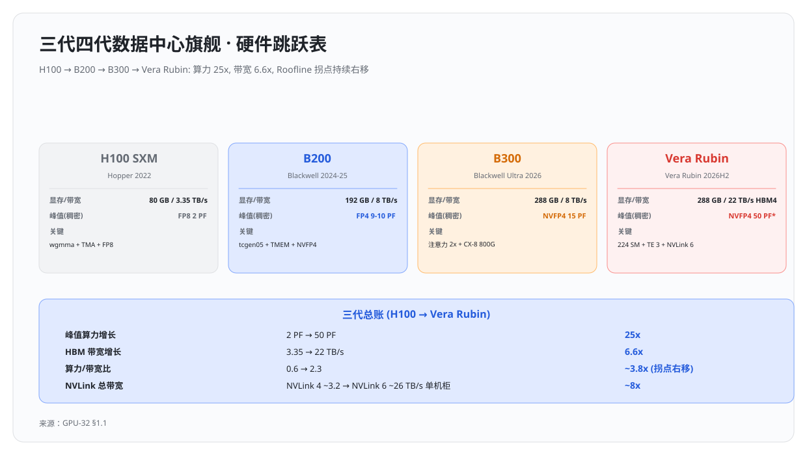
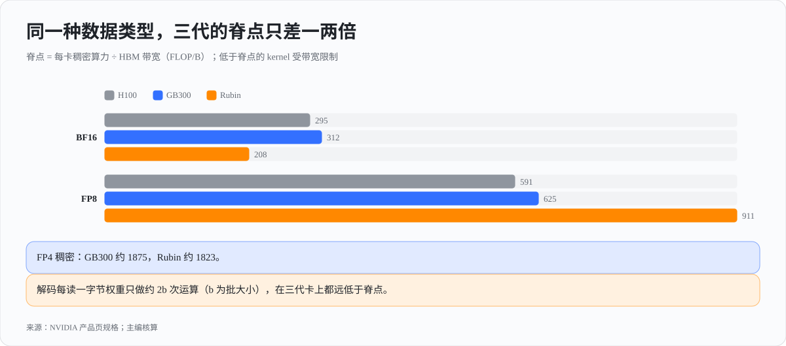
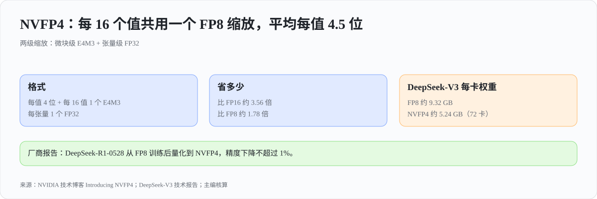
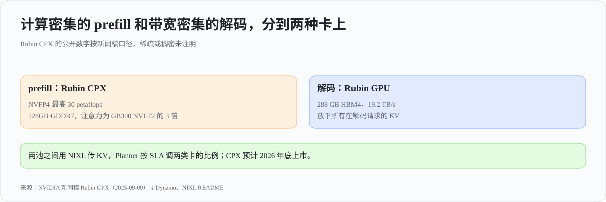
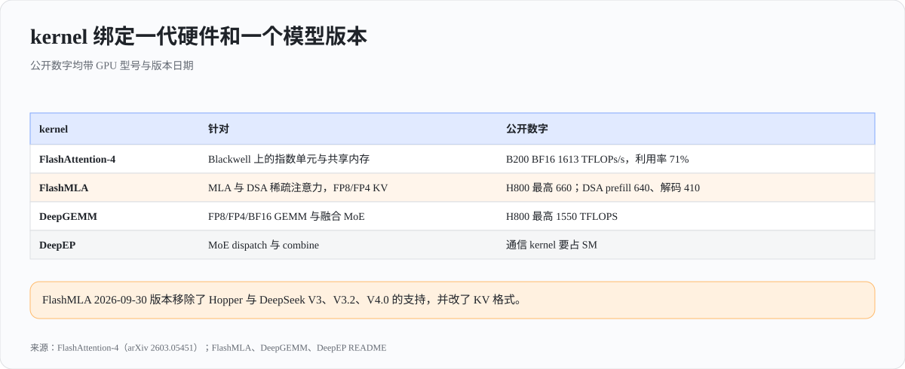
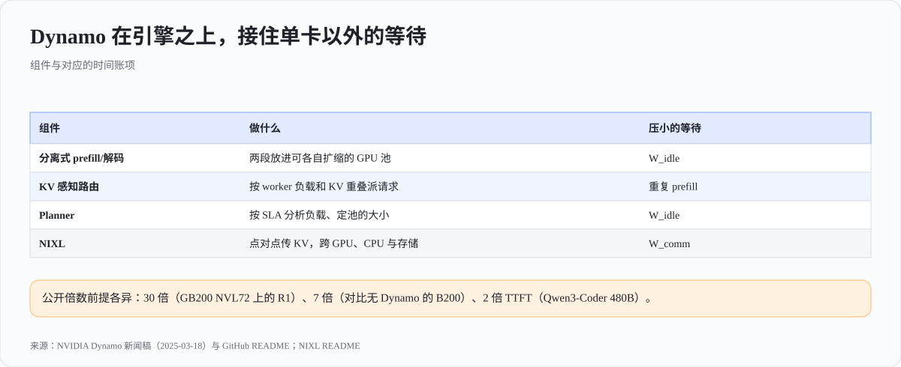
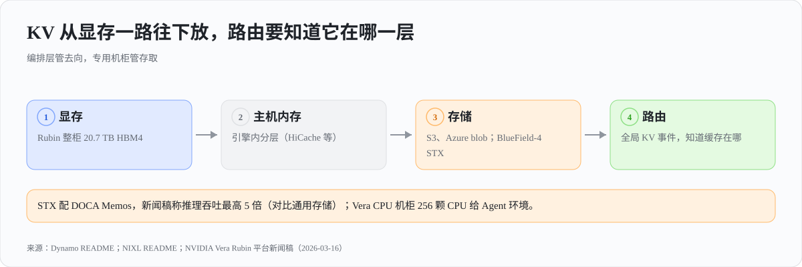
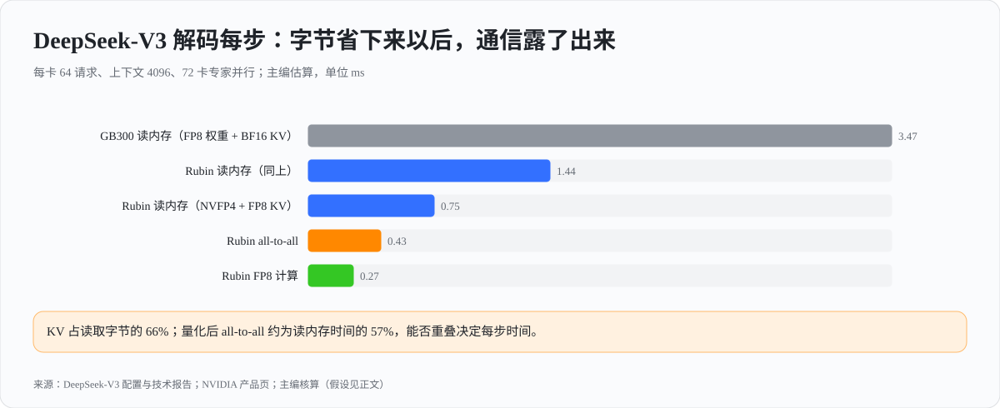
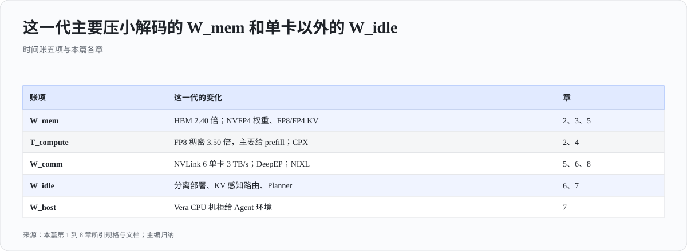

# GPU-32｜LLM｜Rubin 时代与 Dynamo 推理：Blackwell 之后的时间账（2026）

> 🎯 **这篇文档解决什么问题**：Vera Rubin、Rubin CPX、NVFP4 和 NVIDIA Dynamo 在 2025 到 2026 年陆续发布，宣传里的倍数很大，口径各不相同。本篇先把三代硬件换算到同一口径，算清这一代到底压小了时间账里的哪几项，再看 kernel 和编排层怎样把剩下的等待接过去，最后用 DeepSeek-V3 的解码做一轮完整的五步估算。读完以后，拿到下一代硬件的规格也能自己重算一遍。

> 💡 **扩展 GPU-27、GPU-23**：GPU-27（[GPU-27｜硬件｜NVL72 与 Grace-Blackwell Superchip：打穿 TP=8](./27-nvl72.md)）讲 Blackwell 的 NVL72，GPU-23（[GPU-23｜LLM｜推理系统：KV cache、PagedAttention 与 PD 分离](./23-inference.md)）讲推理系统；本篇往后看 Rubin 一代硬件和 Dynamo 推理框架。

**使用方式**：第 1、2 章对齐规格口径、算脊点。第 3、4 章讲数据格式和 prefill 专用卡。第 5 到 7 章讲 kernel、编排层和 KV 存储层。第 8 章是五步案例，第 9 章把变化放回时间账，第 10 章给清单和自测。

**代码**：本篇没有配套代码，文中算例由主编按公开规格和模型配置核算，第 10 章给出可以自己写的练习。

<b>🧭 主线位置</b>：GPU-00（[GPU-00｜索引｜从 0 开始 GPU 优化：路线、章节与练习](./README.md)）建立了时间账 T = T_compute + W_mem + W_host + W_comm + W_idle。GPU-02（[GPU-02｜硬件｜性能账本：Roofline、算术强度与三类瓶颈](./02-ledger.md)）用 Roofline 区分算力和带宽限制，GPU-27（[GPU-27｜硬件｜NVL72 与 Grace-Blackwell Superchip：打穿 TP=8](./27-nvl72.md)）讲 Blackwell 的 NVL72 机柜，GPU-31（[GPU-31｜LLM｜Agent Workload Serving：会话原语与约束解码](./31-agent-serving.md)）讲 Agent 会话怎样留住 KV。本篇把这些放到新一代硬件上重算：换代压小了哪几项，剩下的等待转到了 kernel 和调度层。GPU-33（[GPU-33｜LLM｜Tensor Core 三代跃迁：Volta→Turing→Ampere→Hopper，为什么每代都要重写 kernel](./33-tensor-core-generations.md)）接着回到 Tensor Core 本身，看为什么每代都要重写 kernel。

## 导读 · 先给结论

- <b>先对齐口径。</b>Rubin 单卡 NVFP4 推理 50 PFLOPS 是稀疏口径，稠密看 35；HBM4 是 288 GB、19.2 TB/s（第 1 章）。[[1]](https://www.nvidia.com/en-us/data-center/vera-rubin-nvl72/)[[2]](https://www.nvidia.com/en-us/data-center/gb300-nvl72/)
- <b>脊点几乎没动。</b>同数据类型的脊点在三代间只差一两倍，Rubin 的 BF16 脊点约 208，解码在新卡上仍然等内存（第 2 章）。[[1]](https://www.nvidia.com/en-us/data-center/vera-rubin-nvl72/)[[3]](https://www.nvidia.com/en-us/data-center/h100/)
- <b>NVFP4 按字节省。</b>每 16 个值共用一个 E4M3 缩放，平均每值 4.5 位，比 FP8 省约 1.78 倍（第 3 章）。[[4]](https://developer.nvidia.com/blog/introducing-nvfp4-for-efficient-and-accurate-low-precision-inference/)
- <b>prefill 拆到另一种卡上。</b>Rubin CPX 用 128GB GDDR7，NVFP4 最高 30 petaflops，专做长上下文（第 4 章）。[[5]](https://nvidianews.nvidia.com/news/nvidia-unveils-rubin-cpx-a-new-class-of-gpu-designed-for-massive-context-inference)
- <b>kernel 跟着硬件和模型重写。</b>FlashAttention-4 在 B200 上利用率 71%；FlashMLA 已不再支持 Hopper 和前代模型（第 5 章）。[[6]](https://arxiv.org/abs/2603.05451)[[7]](https://raw.githubusercontent.com/deepseek-ai/FlashMLA/main/README.md)
- <b>等待转到调度层。</b>Dynamo 做分离部署、KV 感知路由和按 SLA 扩缩，公开倍数各有前提；KV 卸载扩到存储层（第 6、7 章）。[[8]](https://raw.githubusercontent.com/ai-dynamo/dynamo/main/README.md)[[9]](https://nvidianews.nvidia.com/news/nvidia-dynamo-open-source-library-accelerates-and-scales-ai-reasoning-models/)[[10]](https://nvidianews.nvidia.com/news/nvidia-vera-rubin-platform)
- <b>五步案例。</b>DeepSeek-V3 解码每步读内存从 GB300 的约 3.47 ms 降到 Rubin 加量化后的约 0.75 ms，下一个等待是通信（第 8 章）。[[11]](https://arxiv.org/abs/2412.19437)[[12]](https://huggingface.co/deepseek-ai/DeepSeek-V3/raw/main/config.json)

<b>📎 与系列其他文档的分工</b>：GPU-06（[GPU-06｜硬件｜Tensor Core 与低精度：从 mma 到 FP8 和 FP4](./06-tensor-core.md)）讲 Tensor Core 与 FP8、FP4 指令。GPU-08（[GPU-08｜硬件｜注意力内核](./08-attention.md)）讲注意力 kernel。GPU-22（[GPU-22｜LLM｜MoE 与专家并行：all-to-all 与负载均衡](./22-moe-ep.md)）讲 MoE 和专家并行的通信。GPU-23（[GPU-23｜LLM｜推理系统：KV cache、PagedAttention 与 PD 分离](./23-inference.md)）讲 PD 分离。GPU-27（[GPU-27｜硬件｜NVL72 与 Grace-Blackwell Superchip：打穿 TP=8](./27-nvl72.md)）讲 NVL72 的拓扑。GPU-29（[GPU-29｜LLM｜推理引擎实战：SGLang vs vLLM 选型](./29-engine-choice.md)）讲 SGLang 和 vLLM。本篇只讲换代以后时间账怎样变、剩下的等待由谁来消。

## 第 1 章 · 先对齐口径：每卡、稠密、单向，再比三代硬件

换代时最容易算错的地方在口径。厂商规格页上的数字有的是整柜、有的是超级芯片、有的是单卡；算力有稀疏和稠密两种写法；互连带宽通常是双向合计。把这些混在一起比，会得出“算力涨了几十倍、带宽只涨几倍”这类夸大的结论。本章先把 H100、GB300 和 Vera Rubin 三代统一换算到每卡、稠密，再看哪些量真的变了。

### 规格页上的数字各是什么口径

Vera Rubin 的产品页把同一组规格写成三列：整柜 NVL72、一个超级芯片（2 张 Rubin GPU 加 1 颗 Vera CPU）、一张 Rubin GPU。整柜由 72 张 Rubin GPU 和 36 颗 Vera CPU 组成[[1]](https://www.nvidia.com/en-us/data-center/vera-rubin-nvl72/)。单卡一列里，NVFP4 推理 50 PFLOPS、NVFP4 训练 35 PFLOPS[[1]](https://www.nvidia.com/en-us/data-center/vera-rubin-nvl72/)，FP8 是 17.5 PFLOPS[[1]](https://www.nvidia.com/en-us/data-center/vera-rubin-nvl72/)，BF16 是 4 PFLOPS[[1]](https://www.nvidia.com/en-us/data-center/vera-rubin-nvl72/)。页脚说明，推理一栏是稀疏规格，训练一栏是稠密规格[[1]](https://www.nvidia.com/en-us/data-center/vera-rubin-nvl72/)。所以“单卡 50 PFLOPS”是稀疏口径，稠密的 NVFP4 应该看训练那一栏的 35。显存方面，单卡 288 GB HBM4、带宽 19.2 TB/s[[1]](https://www.nvidia.com/en-us/data-center/vera-rubin-nvl72/)，整柜 20.7 TB、1,400 TB/s[[1]](https://www.nvidia.com/en-us/data-center/vera-rubin-nvl72/)；第六代 NVLink 整柜 216 TB/s、单卡 3 TB/s[[1]](https://www.nvidia.com/en-us/data-center/vera-rubin-nvl72/)。

GB300 NVL72 的产品页只给整柜：72 张 Blackwell Ultra[[2]](https://www.nvidia.com/en-us/data-center/gb300-nvl72/)，显存 20 TB、带宽最高 576 TB/s[[2]](https://www.nvidia.com/en-us/data-center/gb300-nvl72/)，NVLink 130 TB/s[[2]](https://www.nvidia.com/en-us/data-center/gb300-nvl72/)。它的页脚写明，除非另外注明，Tensor Core 规格都是稀疏的[[2]](https://www.nvidia.com/en-us/data-center/gb300-nvl72/)；FP4 一栏同时给了 1440 和 1080 两个数，后者注明不含稀疏[[2]](https://www.nvidia.com/en-us/data-center/gb300-nvl72/)。FP8 一栏 720 PFLOPS、BF16 一栏 360 PFLOPS[[2]](https://www.nvidia.com/en-us/data-center/gb300-nvl72/)，都是稀疏口径。H100 的规格页上，BF16 Tensor Core 写的是 1,979 teraFLOPS 并带星号[[3]](https://www.nvidia.com/en-us/data-center/h100/)，星号表示含稀疏，显存 80GB、带宽 3.35TB/s[[3]](https://www.nvidia.com/en-us/data-center/h100/)。

### 换算到每卡、稠密

按上面的口径换算（稀疏除以 2，整柜除以 72）：H100 每卡 BF16 稠密 989.5 TFLOPS、FP8 稠密 1979 TFLOPS、HBM 3.35 TB/s。GB300 每卡 BF16 稠密 2500、FP8 稠密 5000、FP4 稠密 15 PFLOPS，HBM 8 TB/s，容量约 278 GB（整柜 20 TB 平均）。Rubin 每卡 BF16 稠密 4000、FP8 稠密 17500、NVFP4 稠密 35 PFLOPS，HBM 19.2 TB/s。从 GB300 到 Rubin，HBM 带宽是 2.40 倍，FP8 稠密算力是 3.50 倍，BF16 稠密只有 1.60 倍。旧稿里 Rubin 的 HBM 和 NVLink 带宽用的是发布初期的媒体报道数字，和规格页现在的 19.2 TB/s、3 TB/s、216 TB/s 不符，本篇以规格页为准。

NVLink 的数字也要注意方向。GB200 的规格页上，一个超级芯片（2 张 GPU）的 NVLink 是 3.6 TB/s[[13]](https://www.nvidia.com/en-us/data-center/gb200-nvl72/)，每卡约 1.8 TB/s；GB300 整柜 130 TB/s 平均到每卡约 1.81 TB/s。这些都是双向合计，单向要再减半。第 8 章算 all-to-all 时按单向用。

放进时间账：T_compute 的上限看稠密算力，W_mem 的下限看 HBM 带宽，W_comm 看单向互连带宽。三者用同一种口径，后面几章的比较才有意义。

按五步闭环看规格口径：

- **定天花板**：把要比的几代卡都换成每卡、稠密、单向，列成一张表。
- **测实际**：用自己的 kernel 测实际能达到的带宽和算力，和表里的上限比。
- **定位等待**：比较时确认数据类型一致，FP4 和 FP8 不能直接比。
- **消除或隐藏**：容量规划和采购评估统一用稠密口径。
- **复测**：新卡到货后先测带宽和算力，再更新表。

一个常见的误区是拿新卡的稀疏 FP4 和老卡的稠密 BF16 相除，得出几十倍的提升。现象是按这个倍数做的容量计划，上线后差得很远。原因是数据类型、稀疏与否和卡数口径都换了，真正同口径的提升只有几倍。改法是先换算到同一种数据类型、稠密、每卡，再谈提升。

> 🔑 **本章要点**：Rubin 单卡 NVFP4 推理 50 PFLOPS 是稀疏口径，稠密看训练栏的 35；HBM4 是 288 GB、19.2 TB/s，NVLink 6 单卡 3 TB/s。换算到每卡稠密后，Rubin 对 GB300 的 HBM 带宽是 2.40 倍，FP8 算力 3.50 倍，BF16 算力 1.60 倍。这一章是五步闭环的“定天花板”：先把三代硬件放进同一种口径。

## 第 2 章 · 脊点几乎没动：解码在新卡上仍然等内存

GPU-02（[GPU-02｜硬件｜性能账本：Roofline、算术强度与三类瓶颈](./02-ledger.md)）讲过 Roofline：算力除以带宽得到脊点，一个 kernel 每读一个字节做的计算少于脊点，就受带宽限制。换代以后脊点往哪边移，决定了旧的瓶颈是被消掉了还是原样搬到了新卡上。本章用第 1 章换算好的数字算三代的脊点，再看解码落在哪一边。

### 三代的脊点

按每卡稠密算力除以 HBM 带宽：H100 的 BF16 脊点约 295 FLOP/B，FP8 约 591；GB300 的 BF16 约 312，FP8 约 625，FP4 约 1875；Rubin 的 BF16 约 208，FP8 约 911，FP4 约 1823。规格数字来自三家产品页[[3]](https://www.nvidia.com/en-us/data-center/h100/)[[2]](https://www.nvidia.com/en-us/data-center/gb300-nvl72/)[[1]](https://www.nvidia.com/en-us/data-center/vera-rubin-nvl72/)，除法是主编做的。

同一种数据类型里，脊点在三代之间只差一两倍，BF16 在 Rubin 上甚至变低了，因为 HBM 带宽的涨幅（2.40 倍）超过了 BF16 算力的涨幅（1.60 倍）。FP8 的脊点在 Rubin 上升到约 911，是因为 FP8 算力涨了 3.50 倍。所以“新卡上所有 kernel 都更容易受带宽限制”这种说法不成立，要按数据类型看。

### 解码落在哪一边

解码每一步，每个权重只被当前批里的 token 用一次。批大小为 b 时，每读一个字节的权重大约做 2b 次 FP8 运算（权重 1 字节）。要贴到 Rubin 的 FP8 脊点 911，b 要到四百多；MoE 模型的每个专家只分到批里的一部分 token，实际的 b 更小。再加上注意力每一步要读整段 KV，而 KV 的复用度只有 1，解码在三代卡上都远低于脊点。这是 GPU-23（[GPU-23｜LLM｜推理系统：KV cache、PagedAttention 与 PD 分离](./23-inference.md)）那条结论在新硬件上的延续：解码的时间主要是 W_mem，按字节算。

于是换代对解码的收益，主要来自两个地方：HBM 带宽本身变大（GB300 到 Rubin 是 2.40 倍），以及每个权重和每个 KV 用更少的字节存（第 3 章的 NVFP4、第 5 章的 FP8 和 FP4 KV）。算力涨得再多，解码也用不上。prefill 和训练是另一回事，它们的计算密度高，能吃到算力的涨幅，第 4 章的 Rubin CPX 就是按这个思路把 prefill 单独拿出来。

FlashAttention-4 的论文从 kernel 内部给了一个相近的观察：在 Blackwell 上，Tensor Core 吞吐翻倍，而共享内存带宽和指数运算单元增长更慢或没变[[6]](https://arxiv.org/abs/2603.05451)。所以脊点之外，片上的共享内存和特殊函数单元也会变成新的上限，第 5 章再讲。

放进时间账：解码的 T 约等于每步要读的字节除以 HBM 带宽，W_mem 占大头；换代把分母变大，量化把分子变小。T_compute 在解码里只占一小部分，算力的涨幅对它影响不大。

按五步闭环看脊点：

- **定天花板**：按目标数据类型算新卡的脊点。
- **测实际**：算出 kernel 的计算密度（每字节 FLOP），看它在脊点哪一侧。
- **定位等待**：低于脊点的 kernel，时间花在读内存上。
- **消除或隐藏**：解码靠减少字节（量化、稀疏注意力）和加大批；prefill 靠算力。
- **复测**：换卡后看解码的每步时间是否按带宽比例下降。

一个常见的误区是按算力涨幅预估解码吞吐。现象是换了新卡，解码吞吐只涨了两倍多，远低于宣传的算力倍数。原因是解码受带宽限制，吞吐跟着 HBM 带宽和每 token 的字节数走。改法是按“每步读多少字节 ÷ 带宽”预估解码，算力倍数只用来估 prefill。

> 🔑 **本章要点**：同一种数据类型的脊点在三代之间只差一两倍，Rubin 的 BF16 脊点约 208，比 GB300 的约 312 还低。解码的计算密度远低于脊点，收益来自 HBM 带宽和每 token 字节数，GB300 到 Rubin 的带宽是 2.40 倍。这一章是五步闭环的“定位等待”：解码在新卡上仍然等内存。

## 第 3 章 · NVFP4：每个值 4.5 位，解码按字节省

第 2 章说，解码的时间约等于每步读的字节数除以带宽。把权重从 FP8 换成 4 位，分子就变小。难点在精度：4 位浮点能表示的数很少，一个张量里大小相差悬殊的值共用一个缩放因子，小值会被量化成零。NVFP4 用两级缩放来解决这个问题。本章看它的格式、实际占多少位、精度损失多大，以及它在时间账里省的是哪一项。

### 两级缩放

NVIDIA 的技术博客介绍，NVFP4 给每 16 个值组成的微块配一个 E4M3 格式的细粒度缩放因子[[4]](https://developer.nvidia.com/blog/introducing-nvfp4-for-efficient-and-accurate-low-precision-inference/)，再给整个张量配一个 FP32 的二级缩放因子[[4]](https://developer.nvidia.com/blog/introducing-nvfp4-for-efficient-and-accurate-low-precision-inference/)。和 MXFP4 相比，它把一组的大小从 32 个元素减到 16 个，缩放更细[[4]](https://developer.nvidia.com/blog/introducing-nvfp4-for-efficient-and-accurate-low-precision-inference/)。代价是额外的缩放因子：每个值 4 位，加上每 16 个值一个 FP8 缩放，平均每个值 4.5 位[[4]](https://developer.nvidia.com/blog/introducing-nvfp4-for-efficient-and-accurate-low-precision-inference/)，张量级的 FP32 可以忽略。按这个位数，相对 FP16 约省 3.56 倍，相对 FP8 约省 1.78 倍，和博客给的约 3.5 倍和约 1.8 倍一致[[4]](https://developer.nvidia.com/blog/introducing-nvfp4-for-efficient-and-accurate-low-precision-inference/)。

精度方面，博客报告 DeepSeek-R1-0528 从原始的 FP8 用训练后量化转成 NVFP4[[4]](https://developer.nvidia.com/blog/introducing-nvfp4-for-efficient-and-accurate-low-precision-inference/)，在主要的语言建模任务上精度下降不超过 1%[[4]](https://developer.nvidia.com/blog/introducing-nvfp4-for-efficient-and-accurate-low-precision-inference/)。这是厂商在一个模型上的结果，换成自己的模型和任务要重新验证。

### 它省的是 W_mem

以 DeepSeek-V3 为例，它有 671B 总参数、每 token 激活 37B[[11]](https://arxiv.org/abs/2412.19437)。FP8 存储时权重约 671 GB，铺到一个 72 卡机柜上每卡约 9.32 GB；换成 NVFP4，每卡约 5.24 GB。解码时，批足够大、所有专家都被用到的情况下，每一步每卡都要把自己那份权重读一遍，读的字节少了 1.78 倍，这部分 W_mem 就按同样比例变小（第 8 章细算）。省下来的显存还能放更多 KV，批可以开得更大。

NVFP4 也有算力上的好处：Rubin 单卡 NVFP4 稠密 35 PFLOPS，是 FP8 稠密 17.5 的 2 倍[[1]](https://www.nvidia.com/en-us/data-center/vera-rubin-nvl72/)。但第 2 章说过，解码用不上算力，这个好处主要落在 prefill 上。KV 的量化是另一件事，DeepSeek 的 FlashMLA 已经支持 FP8 和 FP4 格式的 KV 缓存[[7]](https://raw.githubusercontent.com/deepseek-ai/FlashMLA/main/README.md)，第 5 章再看。

放进时间账：NVFP4 把权重的字节数降到 FP8 的约 56%，解码中读权重的 W_mem 同比例下降；prefill 的 T_compute 按 NVFP4 的算力算。精度损失属于质量账，要和速度一起验收。

按五步闭环看 NVFP4：

- **定天花板**：按 4.5 位算出权重的字节数和每步读权重的时间下限。
- **测实际**：在目标模型上测 NVFP4 和 FP8 的解码每步时间。
- **定位等待**：每步时间里权重读取和 KV 读取各占多少。
- **消除或隐藏**：权重换 NVFP4，KV 另行量化；用省下的显存加大批。
- **复测**：在自己的评测集上比较精度，确认损失在可接受范围内。

一个常见的误区是把 NVFP4 当作 4 位来算显存。现象是按 4 位规划的模型放不下，或者批比预期小。原因是每 16 个值还有一个 FP8 缩放因子，实际是 4.5 位，大约多出 12.5%。改法是按 4.5 位规划，并给缩放因子的存放和读取留出余量。

> 🔑 **本章要点**：NVFP4 每 16 个值共用一个 E4M3 缩放，再加张量级 FP32 缩放，平均每值 4.5 位，比 FP8 省约 1.78 倍。厂商在 DeepSeek-R1-0528 上测得精度下降不超过 1%。它省的是解码读权重的 W_mem。这一章是五步闭环的“消除或隐藏”：用更少的字节存权重。

## 第 4 章 · Rubin CPX：把 prefill 拆到另一种卡上

第 2 章说，解码受带宽限制，prefill 的计算密度高、能吃到算力。两段负载要的硬件不一样，GPU-23（[GPU-23｜LLM｜推理系统：KV cache、PagedAttention 与 PD 分离](./23-inference.md)）讲的 PD 分离已经在软件上把它们拆开。Rubin CPX 往前走了一步，在硬件上也拆开：一种专门做长上下文 prefill 的卡，用便宜的显存，换更多的算力。本章看它公开了哪些规格，以及这种拆法在时间账里的意义。

### 公开的规格

NVIDIA 在 2025 年 9 月 9 日发布 Rubin CPX，定位是处理百万 token 级别的编程和视频生成[[5]](https://nvidianews.nvidia.com/news/nvidia-unveils-rubin-cpx-a-new-class-of-gpu-designed-for-massive-context-inference)。按新闻稿，它的 NVFP4 算力最高 30 petaflops[[5]](https://nvidianews.nvidia.com/news/nvidia-unveils-rubin-cpx-a-new-class-of-gpu-designed-for-massive-context-inference)，用 128GB 成本更低的 GDDR7 显存[[5]](https://nvidianews.nvidia.com/news/nvidia-unveils-rubin-cpx-a-new-class-of-gpu-designed-for-massive-context-inference)，注意力能力是 GB300 NVL72 系统的 3x[[5]](https://nvidianews.nvidia.com/news/nvidia-unveils-rubin-cpx-a-new-class-of-gpu-designed-for-massive-context-inference)。它和 Vera CPU、Rubin GPU 一起装在 Vera Rubin NVL144 CPX 平台里，整柜 8 exaflops 算力、是 GB300 NVL72 的 7.5x[[5]](https://nvidianews.nvidia.com/news/nvidia-unveils-rubin-cpx-a-new-class-of-gpu-designed-for-massive-context-inference)，单柜 100TB 快速内存、1.7 PB/s 内存带宽[[5]](https://nvidianews.nvidia.com/news/nvidia-unveils-rubin-cpx-a-new-class-of-gpu-designed-for-massive-context-inference)。预计 2026 年底上市[[5]](https://nvidianews.nvidia.com/news/nvidia-unveils-rubin-cpx-a-new-class-of-gpu-designed-for-massive-context-inference)。

这些数字有两点要注意。新闻稿没有写明 30 petaflops 是稀疏还是稠密，按第 1 章的经验，比较时要先确认口径。GDDR7 的带宽比 HBM 低得多，CPX 适合计算密集的 prefill，不适合解码。截至本篇写作时，没有找到它的正式规格页，以上都按新闻稿的口径。

### 为什么这样拆

长上下文 prefill 的计算量随长度增长，注意力部分还是平方增长；它读的权重和产生的 KV，相对计算量很少。所以 prefill 卡需要的是算力和注意力的吞吐，显存只要放得下权重和这一段的 KV。解码卡则要大容量、高带宽的 HBM，放下所有正在解码的请求的 KV。用一种卡做两件事，要么 prefill 时 HBM 带宽闲着，要么解码时算力闲着，都是 W_idle。

拆开以后，prefill 卡算完的 KV 要传给解码卡，这一步的 W_comm 由互连决定。GPU-23 讲过这个传输量；第 6 章讲的 Dynamo 用 NIXL 做这一步的点对点传输[[14]](https://raw.githubusercontent.com/ai-dynamo/nixl/main/README.md)。CPX 要发挥作用，调度层要能把长 prefill 派给它、把解码派给 HBM 卡，并控制好两类卡的比例，Dynamo 的 Planner 就是做这件事的组件[[8]](https://raw.githubusercontent.com/ai-dynamo/dynamo/main/README.md)。

放进时间账：CPX 让 prefill 的 T_compute 落在算力更便宜的卡上，解码卡的 HBM 不再被长 prefill 占用，两边的 W_idle 都变小；多出来的是 KV 从 prefill 卡到解码卡的 W_comm。

按五步闭环看 prefill 专用卡：

- **定天花板**：按业务的输入长度分布，算 prefill 和解码各需要多少算力和带宽。
- **测实际**：在现有集群上统计 prefill 时 HBM 带宽的利用率和解码时算力的利用率。
- **定位等待**：哪一段的硬件闲得最多。
- **消除或隐藏**：长输入多的业务考虑 prefill 与解码分池，硬件按各自需求选。
- **复测**：分池以后 TTFT、每 token 延迟和单位成本。

一个常见的误区是把新闻稿里的整柜倍数直接当作业务收益。现象是按 7.5 倍预估的吞吐，在短输入为主的业务上看不到。原因是 CPX 加速的是长上下文 prefill 和注意力，短输入的业务时间主要花在解码上。改法是先统计输入长度分布，算出 prefill 在总时间里的占比，再估收益。

> 🔑 **本章要点**：Rubin CPX 是 prefill 专用卡，NVFP4 最高 30 petaflops、128GB GDDR7，注意力能力是 GB300 NVL72 的 3 倍，预计 2026 年底上市，口径以新闻稿为准。它把计算密集的 prefill 和带宽密集的解码放到不同硬件上，代价是两类卡之间传 KV。这一章是五步闭环的“消除或隐藏”：用分池消掉两段负载互相闲置的 W_idle。

## 第 5 章 · kernel 跟着模型和硬件一起重写

前几章看的是硬件的上限。真正把上限用起来的是 kernel，而 kernel 每一代都要重写：新硬件的瓶颈换了位置，新模型的形状也换了。本章看两类例子：FlashAttention-4 针对 Blackwell 上新的片上瓶颈，DeepSeek 开源的 FlashMLA、DeepGEMM 和 DeepEP 针对自家模型的结构。它们说明，换代以后 W_mem 和 W_comm 能省多少，很大程度上取决于有没有为这一代硬件和这一类模型写的 kernel。

### FlashAttention-4：片上的瓶颈换了位置

FlashAttention-4 的论文指出，B200 和 GB200 这类 Blackwell 系统存在非对称扩展：Tensor Core 吞吐翻倍，而共享内存带宽和指数运算单元增长更慢或没变[[6]](https://arxiv.org/abs/2603.05451)。矩阵乘变快以后，softmax 里的指数运算和共享内存的搬运就成了 attention 的瓶颈。论文的对策有三类：利用完全异步的 MMA 和更大的分块重新设计流水线；用软件模拟指数函数、按条件重缩放 softmax，减少矩阵乘以外的运算[[6]](https://arxiv.org/abs/2603.05451)；在反向传播里用 Tensor Memory 和 2-CTA MMA 模式减少共享内存流量和原子加[[6]](https://arxiv.org/abs/2603.05451)。结果是在 B200 上 BF16 最高 1613 TFLOPs/s，利用率 71%[[6]](https://arxiv.org/abs/2603.05451)。和其他实现相比，它比 cuDNN 9.13 快 1.3 倍，比 Triton 快 2.7 倍[[6]](https://arxiv.org/abs/2603.05451)。它整个用嵌在 Python 里的 CuTe-DSL 实现[[6]](https://arxiv.org/abs/2603.05451)。GPU-08（[GPU-08｜硬件｜注意力内核](./08-attention.md)）讲过前几代 FlashAttention 的分块思路，这里的变化是瓶颈从 HBM 移到了片上。

### DeepSeek 的三个库：按模型形状写

FlashMLA 是 DeepSeek 的注意力 kernel 库。2025 年 4 月的版本在 H800 SXM5 上计算受限时最高 660 TFlops[[7]](https://raw.githubusercontent.com/deepseek-ai/FlashMLA/main/README.md)；2025 年 9 月随 DeepSeek-V3.2 发布了 token 级稀疏注意力 kernel，支撑 DeepSeek Sparse Attention（DSA）[[7]](https://raw.githubusercontent.com/deepseek-ai/FlashMLA/main/README.md)，prefill 最高 640 TFlops、解码最高 410 TFlops[[7]](https://raw.githubusercontent.com/deepseek-ai/FlashMLA/main/README.md)。现在的版本支持 FP8 和 FP4 格式的 KV 缓存[[7]](https://raw.githubusercontent.com/deepseek-ai/FlashMLA/main/README.md)。值得注意的是 2026 年 9 月 30 日的版本：它移除了对 Hopper 架构和前代模型（包括 DeepSeek V3、V3.2、V4.0）的支持[[7]](https://raw.githubusercontent.com/deepseek-ai/FlashMLA/main/README.md)，并改了 FP8 和 FP4 的 KV 缓存格式[[7]](https://raw.githubusercontent.com/deepseek-ai/FlashMLA/main/README.md)。kernel 和一个模型版本、一代硬件绑得很紧，换模型或换卡都可能要换 kernel。

DeepGEMM 是矩阵乘库，覆盖 FP8、FP4、BF16 的 GEMM 和通信重叠的融合 MoE[[15]](https://raw.githubusercontent.com/deepseek-ai/DeepGEMM/main/README.md)，全部在运行时编译[[15]](https://raw.githubusercontent.com/deepseek-ai/DeepGEMM/main/README.md)，2025 年 4 月在 H800 上最高达到 1550 TFLOPS[[15]](https://raw.githubusercontent.com/deepseek-ai/DeepGEMM/main/README.md)。DeepEP 是专家并行的通信库，提供 MoE dispatch 和 combine 的 all-to-all kernel，支持 FP8 dispatch[[16]](https://raw.githubusercontent.com/deepseek-ai/DeepEP/main/README.md)；V2 版本支持更大的 scale-up 和 scale-out 域[[16]](https://raw.githubusercontent.com/deepseek-ai/DeepEP/main/README.md)，用解析方法算出需要多少 SM 和队列对[[16]](https://raw.githubusercontent.com/deepseek-ai/DeepEP/main/README.md)。它的文档也写明，dispatch 和 combine 要占用 GPU 的 SM[[16]](https://raw.githubusercontent.com/deepseek-ai/DeepEP/main/README.md)，通信并不是免费的，这部分要从算力里扣。

放进时间账：FA4 把 attention 里矩阵乘以外的等待（指数单元、共享内存）压小；FlashMLA 的稀疏注意力和低精度 KV 压小解码读 KV 的 W_mem；DeepEP 压小 MoE 的 W_comm，但要占 SM。这些收益都依赖 kernel 对得上当前的硬件和模型版本。

按五步闭环看 kernel：

- **定天花板**：查清所用模型和硬件有没有专用 kernel，及其公开的利用率。
- **测实际**：用 profiler 看 attention、GEMM 和通信 kernel 各自的耗时和利用率。
- **定位等待**：利用率低的 kernel，看是等 HBM、等共享内存、等指数单元还是等通信。
- **消除或隐藏**：换成针对这一代硬件和这一类模型的 kernel。
- **复测**：换 kernel 后每步时间和精度一起看。

一个常见的误区是以为升级推理引擎版本就自动用上了新卡的最佳 kernel。现象是换到新卡后 attention 的利用率明显低于论文数字。原因是引擎默认的后端可能还是通用实现，或者 kernel 版本和模型版本不匹配。改法是逐个确认 attention、GEMM 和通信用的是哪个 kernel、哪个版本，再和公开数字对比。

> 🔑 **本章要点**：Blackwell 上 Tensor Core 翻倍，共享内存和指数单元没跟上，FlashAttention-4 在 B200 上做到 1613 TFLOPs/s、利用率 71%。FlashMLA、DeepGEMM、DeepEP 按 DeepSeek 模型的形状写，FlashMLA 2026 年 9 月的版本已不再支持 Hopper 和前代模型。这一章是五步闭环的“定位等待”：找出新卡上 kernel 等的是哪一项。

## 第 6 章 · Dynamo：硬件压小的等待，转到了调度层

单卡变快以后，一个请求在集群里的时间，越来越多花在单卡以外：请求该派给哪台机器，prefill 和解码各开多少卡，KV 在卡与卡之间怎样传。NVIDIA Dynamo 是在推理引擎之上做这些事的编排层。本章看它的组件、它解决的是时间账里的哪几项，以及它公开的性能数字各有什么前提。

### 组件和分工

Dynamo 在 2025 年 3 月 18 日发布[[9]](https://nvidianews.nvidia.com/news/nvidia-dynamo-open-source-library-accelerates-and-scales-ai-reasoning-models/)，定位是 Triton Inference Server 的继任者[[9]](https://nvidianews.nvidia.com/news/nvidia-dynamo-open-source-library-accelerates-and-scales-ai-reasoning-models/)，支持 SGLang、TensorRT-LLM 和 vLLM 等引擎[[9]](https://nvidianews.nvidia.com/news/nvidia-dynamo-open-source-library-accelerates-and-scales-ai-reasoning-models/)。它的 README 把自己描述为引擎之上的编排层[[8]](https://raw.githubusercontent.com/ai-dynamo/dynamo/main/README.md)。发布时的新闻稿列了四个组件：按需增减 GPU 的规划器[[9]](https://nvidianews.nvidia.com/news/nvidia-dynamo-open-source-library-accelerates-and-scales-ai-reasoning-models/)，把请求派到能少做重复计算的 GPU 上的路由器[[9]](https://nvidianews.nvidia.com/news/nvidia-dynamo-open-source-library-accelerates-and-scales-ai-reasoning-models/)，GPU 之间的低延迟通信库[[9]](https://nvidianews.nvidia.com/news/nvidia-dynamo-open-source-library-accelerates-and-scales-ai-reasoning-models/)，以及把推理数据卸载到更便宜的内存和存储、再取回来的内存管理器[[9]](https://nvidianews.nvidia.com/news/nvidia-dynamo-open-source-library-accelerates-and-scales-ai-reasoning-models/)。

按现在的 README，对应的能力是：分离式 prefill 和解码，把两段放进可以各自扩缩的 GPU 池[[8]](https://raw.githubusercontent.com/ai-dynamo/dynamo/main/README.md)；KV 感知路由，按 worker 的负载和 KV 缓存的重叠程度派请求[[8]](https://raw.githubusercontent.com/ai-dynamo/dynamo/main/README.md)；按 SLA 自动扩缩的 Planner，先分析负载再定各个池的大小[[8]](https://raw.githubusercontent.com/ai-dynamo/dynamo/main/README.md)。通信库就是 NIXL，面向 Dynamo 这类推理框架的点对点传输[[14]](https://raw.githubusercontent.com/ai-dynamo/nixl/main/README.md)。1.0 版本还加了面向 Agent 的请求提示，可以带上优先级、预期输出长度和会话元数据[[8]](https://raw.githubusercontent.com/ai-dynamo/dynamo/main/README.md)，和 GPU-31（[GPU-31｜LLM｜Agent Workload Serving：会话原语与约束解码](./31-agent-serving.md)）讲的会话原语是同一个方向。

### 性能数字的前提

Dynamo 公开的几组数字，前提各不相同，不能放在一起比。发布时的新闻稿说，同样数量的 GPU 上，Dynamo 让 Hopper 平台服务 Llama 模型的性能翻倍[[9]](https://nvidianews.nvidia.com/news/nvidia-dynamo-open-source-library-accelerates-and-scales-ai-reasoning-models/)；在大规模 GB200 NVL72 集群上跑 DeepSeek-R1，每卡生成的 token 数提高 30 倍以上[[9]](https://nvidianews.nvidia.com/news/nvidia-dynamo-open-source-library-accelerates-and-scales-ai-reasoning-models/)。现在 README 的“关键结果”里，7 倍的每卡吞吐对比的是“GB200 NVL72 加 Dynamo”和“B200 不加 Dynamo”[[8]](https://raw.githubusercontent.com/ai-dynamo/dynamo/main/README.md)，硬件和软件同时变了；2 倍的 TTFT 来自 KV 感知路由，模型是 Qwen3-Coder 480B，数据出自第三方的基准[[8]](https://raw.githubusercontent.com/ai-dynamo/dynamo/main/README.md)。这些倍数都包含了硬件、并行方式和负载的差异，用来判断方向可以，用来预估自己业务的收益不行。

放进时间账：分离式部署消掉 prefill 和解码互相抢资源造成的 W_idle；KV 感知路由消掉重复 prefill 的 T_compute；Planner 按负载调整池的大小，减少整池闲置的 W_idle；NIXL 压小 KV 传输的 W_comm。这些等待都不在单卡上，硬件再快也消不掉。

按五步闭环看编排层：

- **定天花板**：算出单卡上限乘以卡数，作为集群吞吐的理想值。
- **测实际**：量集群的实际吞吐、TTFT 和每 token 延迟。
- **定位等待**：差距里多少来自重复 prefill、池的配比不对、KV 传输和排队。
- **消除或隐藏**：分离部署、KV 感知路由、按 SLA 扩缩。
- **复测**：用自己的负载和硬件复测，不直接套用厂商倍数。

一个常见的误区是把“30 倍”“7 倍”这类数字当作换上 Dynamo 就能得到的收益。现象是在原有集群上部署后，提升远小于宣传。原因是这些倍数包含了换代硬件、大规模专家并行和特定模型，编排层本身只占其中一部分。改法是按上面五步，在同样的硬件和模型上只改编排层，量出它自己的贡献。

> 🔑 **本章要点**：Dynamo 是引擎之上的编排层：分离式 prefill 与解码、KV 感知路由、按 SLA 扩缩的 Planner、用 NIXL 传 KV。它公开的 30 倍、7 倍、2 倍各有不同的硬件、模型和对比基线。这一章是五步闭环的“消除或隐藏”：单卡以外的等待由调度层来消。

## 第 7 章 · KV 往机柜外放：存储层成了推理系统的一部分

GPU-31（[GPU-31｜LLM｜Agent Workload Serving：会话原语与约束解码](./31-agent-serving.md)）算过，Agent 会话的 KV 动辄几十 GB，会话又有大半时间在等。整柜 HBM 再大也有上限，Vera Rubin NVL72 是 20.7 TB[[1]](https://www.nvidia.com/en-us/data-center/vera-rubin-nvl72/)。放不下的 KV 要么丢掉重算，要么往下放。这一代的变化是，往下放这件事从各个引擎自己做，变成了编排层和专用硬件一起做。本章看 Dynamo 的存储层卸载和 NVIDIA 为 KV 设计的存储机柜。

### 编排层管 KV 的去向

Dynamo 发布时就把内存管理器列为四个组件之一，负责把推理数据卸载到更便宜的内存和存储、需要时再取回[[9]](https://nvidianews.nvidia.com/news/nvidia-dynamo-open-source-library-accelerates-and-scales-ai-reasoning-models/)。现在的版本支持把 KV 卸载到存储层，包括 S3 和 Azure blob，并通过全局的 KV 事件让整个集群看到缓存在哪里[[8]](https://raw.githubusercontent.com/ai-dynamo/dynamo/main/README.md)。底下的传输库 NIXL 在 CPU 内存、GPU 显存和文件、块、对象存储之上提供统一的抽象[[14]](https://raw.githubusercontent.com/ai-dynamo/nixl/main/README.md)。这样，同一份 KV 可以从显存降到主机内存再降到存储，路由器知道它在哪，请求来了先去找。GPU-29（[GPU-29｜LLM｜推理引擎实战：SGLang vs vLLM 选型](./29-engine-choice.md)）讲的 SGLang HiCache 是引擎内部的分层，Dynamo 把分层扩到集群和存储。

### 为 KV 设计的存储和 CPU 机柜

2026 年 3 月的 Vera Rubin 平台发布里，NVIDIA 同时推出了几种机柜[[10]](https://nvidianews.nvidia.com/news/nvidia-vera-rubin-platform)。BlueField-4 STX 存储机柜的定位是存取大模型和 Agent 工作流产生的大量 KV 数据[[10]](https://nvidianews.nvidia.com/news/nvidia-vera-rubin-platform)，配套的 DOCA Memos 框架做专门的 KV 存储处理，新闻稿称推理吞吐最高提高 5 倍[[10]](https://nvidianews.nvidia.com/news/nvidia-vera-rubin-platform)，对比基线是通用存储架构。另一种是 Vera CPU 机柜，集成 256 颗 Vera CPU[[10]](https://nvidianews.nvidia.com/news/nvidia-vera-rubin-platform)，服务的是强化学习和 Agent 负载里大量基于 CPU 的环境[[10]](https://nvidianews.nvidia.com/news/nvidia-vera-rubin-platform)。这对应 GPU-31 第 1 章那条发现：Agent 的很多时间花在模型以外的工具和沙箱上。

这些机柜说明了一个方向：推理系统的边界从 GPU 扩到了存储和 CPU。KV 不再只是显存里的临时数据，它有自己的存储层和取回路径；工具和沙箱也有了专门的 CPU 资源。5 倍这类数字是厂商在特定对比下给出的，本篇没有找到更细的测试条件。

放进时间账：KV 降到存储层，显存里的 W_idle（被等待中的会话占住）变小，回来时多出取回的 W_comm 和 W_mem。取回比重算快多少，GPU-31 第 7 章按主机内存算过；落到存储层还要再看存储和网络的带宽。

按五步闭环看存储层：

- **定天花板**：按会话数和每会话 KV，算出需要多少容量，分别放在显存、主机内存和存储的哪一层。
- **测实际**：统计各层的命中次数和取回时间。
- **定位等待**：取回时间是卡在存储带宽、网络还是路由没找到。
- **消除或隐藏**：开启集群级 KV 事件，让路由知道 KV 在哪；按预期恢复时间提前取回。
- **复测**：取回后的 TTFT 和重算比，看下层是否真的划算。

一个常见的误区是把 KV 卸载到存储层以后就不再管它。现象是存储里的 KV 越积越多，命中率却不高。原因是路由不知道 KV 存在哪台机器或哪个存储桶，请求到了别处只能重算；或者 KV 的格式随模型和 kernel 版本变了，旧的存档用不上（第 5 章 FlashMLA 改过 KV 格式[[7]](https://raw.githubusercontent.com/deepseek-ai/FlashMLA/main/README.md)）。改法是让 KV 事件全局可见，并在模型或 kernel 升级时清理不兼容的存档。

> 🔑 **本章要点**：Dynamo 把 KV 卸载扩到 S3 等存储层，并用全局 KV 事件让路由看到缓存位置；NVIDIA 推出了为 KV 设计的 BlueField-4 STX 存储机柜和面向 Agent 环境的 Vera CPU 机柜。KV 的格式会随 kernel 版本变，存档要跟着管理。这一章是五步闭环的“消除或隐藏”：把等待中的 KV 放到更便宜的层。

## 第 8 章 · 五步案例：DeepSeek-V3 解码从 GB300 换到 Rubin

前七章分别讲了硬件、数据格式、kernel 和调度。本章把它们放进一个算例：DeepSeek-V3 在一个 72 卡机柜上做解码，从 GB300 NVL72 换到 Vera Rubin NVL72，每一步的时间怎样变，等待转到了哪一项。全部是主编按公开规格和模型配置做的估算，假设写在每一步里，计算见代码。

### 定天花板：每步要读多少、传多少、算多少

DeepSeek-V3 总参数 671B、每 token 激活 37B，用 MLA 和 DeepSeekMoE 结构[[11]](https://arxiv.org/abs/2412.19437)。它的配置文件里有 61 层，前 3 层是稠密层，其余 58 层是 MoE；隐藏维度 7168，256 个路由专家，每个 token 选 8 个；MLA 每层每 token 缓存 kv_lora_rank 512 加 RoPE 维度 64，共 576 个元素[[12]](https://huggingface.co/deepseek-ai/DeepSeek-V3/raw/main/config.json)。所以每 token 的 KV 在 BF16 下是 70272 字节，FP8 下是 35136 字节。

假设注意力按数据并行、专家铺满 72 张卡，每卡 64 个请求、平均上下文 4096 个 token。每卡每步要读：FP8 权重约 9.32 GB（批够大，所有专家都被用到），BF16 KV 约 18.42 GB；要传：每个 token 在每个 MoE 层发给 8 个专家（FP8，每份 7168 字节）再收回来（BF16），按全部走远端算约 639 MB；要算：64 个 token 每个约 2 × 37B 次运算。

### 测实际、定位等待：KV 占了三分之二

GB300 上（每卡 HBM 8 TB/s、FP8 稠密 5000 TFLOPS、单向 NVLink 约 0.90 TB/s）：读内存约 3.47 ms，all-to-all 约 0.71 ms，计算约 0.95 ms。Rubin 上（19.2 TB/s、17500 TFLOPS、单向约 1.50 TB/s）：读内存约 1.44 ms，all-to-all 约 0.43 ms，计算约 0.27 ms。两代都是读内存最长，其中 KV 占读取字节的 66%。换代把读内存的时间缩了 2.40 倍，和第 2 章的结论一致；这个算例没有实测数据可对，“测实际”一步要在真实集群上用 profiler 补。

### 消除或隐藏、复测：字节减半以后，通信露了出来

第 3、5 章的两个手段都针对字节：权重换 NVFP4（每卡约 5.24 GB），KV 换 FP8（每卡约 9.21 GB，FlashMLA 支持 FP8 KV[[7]](https://raw.githubusercontent.com/deepseek-ai/FlashMLA/main/README.md)）。复算一遍：GB300 上读内存降到约 1.81 ms，Rubin 上约 0.75 ms。这时通信的相对分量变大了：GB300 上 all-to-all 是读内存时间的 39%，Rubin 上是 57%。如果通信不能和计算、读内存重叠，它就会成为下一个瓶颈。DeepEP 的通信 kernel 要占 SM[[16]](https://raw.githubusercontent.com/deepseek-ai/DeepEP/main/README.md)，重叠的程度又会影响计算。到这一步，再往下省要靠稀疏注意力少读 KV、靠调度把 all-to-all 藏到计算后面，或者靠 Dynamo 这类编排层把解码和 prefill 分开、按负载调批大小[[8]](https://raw.githubusercontent.com/ai-dynamo/dynamo/main/README.md)。

这个算例忽略了不少东西：MoE 路由的负载不均、部分专家在本卡不必走远端、注意力本身的计算、kernel 达不到带宽上限，以及批小时并非所有专家都被用到。它的作用是指出数量级和顺序：先是 KV，再是权重，字节省下来以后是通信。

放进时间账：换代和量化一起，把解码的 W_mem 从约 3.47 ms 压到约 0.75 ms；剩下的 W_comm 约 0.43 ms 能不能藏住，决定了每步的实际时间。

按五步闭环复盘这个案例：

- **定天花板**：按配置算每步读、传、算的量，再除以对应的带宽和算力。
- **测实际**：在真实集群上用 profiler 量每步时间，和三项下限对比。
- **定位等待**：读 KV 是最大项，其次是权重，量化以后是通信。
- **消除或隐藏**：NVFP4 权重、FP8 KV、稀疏注意力；通信和计算重叠；分离部署。
- **复测**：每步时间和精度一起看，确认通信是否已经藏住。

一个常见的误区是只量化权重。现象是 NVFP4 上线后解码只快了一点。原因是这个负载里 KV 占了读取字节的 66%，权重只占约三分之一。改法是先算清每步字节里 KV 和权重各占多少，从大的那一项下手。

> 🔑 **本章要点**：主编的算例里，DeepSeek-V3 每卡 64 个请求、4096 上下文，GB300 上每步读内存约 3.47 ms，KV 占 66%；换到 Rubin 约 1.44 ms，再用 NVFP4 权重和 FP8 KV 降到约 0.75 ms，这时 all-to-all 约 0.43 ms，相当于读内存的 57%。这一章是五步闭环的完整一轮：字节省下来以后，下一个等待是通信。

## 第 9 章 · 换代时怎样重算时间账：每项变化对应哪个等待

前八章各讲了一样变化。本章把它们放回 GPU-00（[GPU-00｜索引｜从 0 开始 GPU 优化：路线、章节与练习](./README.md)）的时间账 T = T_compute + W_mem + W_host + W_comm + W_idle，逐项说明这一代压小了什么、没压小什么，以及每个数字要怎样复核。目的是让读者拿到下一代硬件的规格时，能按同样的方法自己算一遍。

### 逐项对照

W_mem：HBM 带宽从 GB300 的每卡 8 TB/s 到 Rubin 的 19.2 TB/s[[2]](https://www.nvidia.com/en-us/data-center/gb300-nvl72/)[[1]](https://www.nvidia.com/en-us/data-center/vera-rubin-nvl72/)，是 2.40 倍；NVFP4 让权重比 FP8 少约 1.78 倍[[4]](https://developer.nvidia.com/blog/introducing-nvfp4-for-efficient-and-accurate-low-precision-inference/)；FP8 和 FP4 的 KV 缓存让 KV 再少一半或更多[[7]](https://raw.githubusercontent.com/deepseek-ai/FlashMLA/main/README.md)。解码的 W_mem 是这一代压得最多的一项。

T_compute：FP8 稠密算力 3.50 倍，NVFP4 稠密 35 PFLOPS[[1]](https://www.nvidia.com/en-us/data-center/vera-rubin-nvl72/)；prefill 和训练能用上，解码基本用不上（第 2 章）。Rubin CPX 把长 prefill 单独拿出来，用算力更便宜的卡做[[5]](https://nvidianews.nvidia.com/news/nvidia-unveils-rubin-cpx-a-new-class-of-gpu-designed-for-massive-context-inference)。

W_comm：NVLink 6 单卡 3 TB/s、整柜 216 TB/s[[1]](https://www.nvidia.com/en-us/data-center/vera-rubin-nvl72/)，比 GB300 每卡约 1.81 TB/s 高；DeepEP 把 MoE 通信做成 kernel，但要占 SM[[16]](https://raw.githubusercontent.com/deepseek-ai/DeepEP/main/README.md)；NIXL 负责 PD 分离和存储层之间的点对点传输[[14]](https://raw.githubusercontent.com/ai-dynamo/nixl/main/README.md)。第 8 章的算例里，字节省下来以后通信的相对分量变大。

W_idle：分离部署让 prefill 和解码不再互相闲置，Planner 按 SLA 调整池的大小，KV 感知路由减少重复 prefill[[8]](https://raw.githubusercontent.com/ai-dynamo/dynamo/main/README.md)。这些都在调度层，不在单卡上。

W_host：本篇没有展开。Vera CPU 机柜面向 Agent 和强化学习里大量基于 CPU 的环境[[10]](https://nvidianews.nvidia.com/news/nvidia-vera-rubin-platform)，说明 CPU 侧的等待在 Agent 负载里重新变得重要，GPU-31（[GPU-31｜LLM｜Agent Workload Serving：会话原语与约束解码](./31-agent-serving.md)）第 1 章有数据。

### 复核时要问的三个问题

第一个问题是口径：每卡还是整柜、稀疏还是稠密、单向还是双向、哪种数据类型（第 1 章）。第二个问题是对比基线：厂商的倍数对比的是哪一代硬件、哪个软件版本、哪个模型（第 6 章的 30 倍、7 倍、2 倍各不相同[[9]](https://nvidianews.nvidia.com/news/nvidia-dynamo-open-source-library-accelerates-and-scales-ai-reasoning-models/)[[8]](https://raw.githubusercontent.com/ai-dynamo/dynamo/main/README.md)）。第三个问题是时效：规格会改，Rubin 的带宽数字在发布后就调整过，本篇以写作时的规格页为准；kernel 也会改，FlashMLA 在 2026 年 9 月移除了对 Hopper 和前代模型的支持[[7]](https://raw.githubusercontent.com/deepseek-ai/FlashMLA/main/README.md)。

放进时间账：这一代的主要收益在 W_mem 和单卡以外的 W_idle；T_compute 的涨幅主要惠及 prefill；W_comm 在字节变少以后变得相对重要。下一代硬件来了，按同样的五项重算一遍即可。

按五步闭环看换代评估：

- **定天花板**：用规格页的每卡稠密数字，按五项算出新卡上的下限。
- **测实际**：在新卡上用同样的模型、同样的负载测。
- **定位等待**：对照五项，看哪一项缩得最少。
- **消除或隐藏**：针对缩得最少的那一项换 kernel、改格式或改调度。
- **复测**：把结果和旧卡同口径比较，记录版本和日期。

一个常见的误区是只比较新旧两代的峰值算力来决定升级。现象是升级后整体收益和预期差很多，有的业务几乎没变。原因是不同负载落在时间账的不同项上，峰值算力只对应 T_compute。改法是先按业务把时间账拆开，再看新硬件在每一项上缩了多少。

> 🔑 **本章要点**：这一代压得最多的是解码的 W_mem（带宽 2.40 倍、NVFP4 和低精度 KV 再省一半左右）和单卡以外的 W_idle（分离部署、KV 感知路由、Planner）；T_compute 的涨幅主要给 prefill；W_comm 在字节变少后变得相对重要。复核时问口径、基线和时效。这一章是五步闭环的“复测”：换代后按五项重算。

## 第 10 章 · 上线前核对清单与自测

前九章沿着“这一代硬件压小了哪些等待、剩下的等待转到了哪里”展开：第 1 章对齐规格口径，第 2 章算脊点，第 3 章讲 NVFP4，第 4 章讲 Rubin CPX，第 5 章讲 kernel，第 6 章讲 Dynamo，第 7 章讲 KV 存储层，第 8 章用 DeepSeek-V3 做了一轮五步案例，第 9 章把变化放回时间账。本章把这些压成一张核对清单，再给出练习和自测题。

### 📌 核对清单

| 检查项 | 怎样查 | 通过的标志 |
|---|---|---|
| 规格口径 | 把新旧卡换成每卡、稠密、单向、同数据类型（第 1 章） | 表里每个数都标了口径和来源 |
| 脊点 | 按目标数据类型算脊点，判断 kernel 在哪一侧（第 2 章） | 知道解码和 prefill 各受什么限制 |
| 权重格式 | 评估 NVFP4，按 4.5 位规划显存（第 3 章） | 精度损失在业务可接受范围内 |
| prefill 硬件 | 按输入长度分布估算 prefill 占比，决定是否分池（第 4 章） | 分池收益有实测依据 |
| kernel 版本 | 确认 attention、GEMM、通信 kernel 针对当前硬件和模型（第 5 章） | 利用率接近公开数字 |
| 编排层 | 在同样硬件和模型上只改编排层，量出它的贡献（第 6 章） | 不直接套用厂商倍数 |
| KV 存储层 | 开启集群级 KV 事件，管理不兼容的旧存档（第 7 章） | 下层命中后的 TTFT 低于重算 |
| 每步字节 | 算清解码每步里 KV、权重和通信各占多少（第 8 章） | 从最大的那一项下手 |
| 通信重叠 | 量化后检查 all-to-all 是否藏在计算后面（第 8 章） | 通信不在关键路径上 |
| 时效 | 记录规格页和 kernel 的版本与日期（第 9 章） | 数字可追溯、可复核 |

### 练习

本篇没有配套代码。下面几个练习可以用几十行 Python 完成：

- **规格换算表**：从三家产品页抄下整柜或超级芯片的规格，写脚本换算成每卡、稠密、单向，并算出各数据类型的脊点。
- **解码每步时间**：输入模型配置、每卡请求数、平均上下文和数据格式，输出读权重、读 KV、all-to-all 和计算四项时间。
- **格式扫描**：对第 8 章的算例，分别只换权重格式、只换 KV 格式、两者都换，比较每步时间。
- **上下文扫描**：把平均上下文从一千多扫到十几万，看 KV 在每步字节里的占比怎样变。

### 自测题

1. Rubin 单卡“NVFP4 推理 50 PFLOPS”是什么口径？稠密的 NVFP4 应看哪个数？
2. 为什么 Rubin 的 BF16 脊点比 GB300 低？这对解码意味着什么？
3. NVFP4 每个值实际占多少位？相对 FP8 省多少？
4. Rubin CPX 适合做 prefill 还是解码？为什么？
5. Dynamo 公开的 7 倍吞吐对比的是什么？为什么不能直接当作编排层的收益？
6. 第 8 章的算例里，量化之后下一个要处理的等待是什么？

**下一步**：本篇多次提到 kernel 要随硬件重写。GPU-33（[GPU-33｜LLM｜Tensor Core 三代跃迁：Volta→Turing→Ampere→Hopper，为什么每代都要重写 kernel](./33-tensor-core-generations.md)）回到 Tensor Core 本身，看从 Volta 到 Hopper 每一代的指令和数据通路怎样变，为什么每代都要重写 kernel。

## 参考文献

按正文首次引用顺序编号，资料截至 2026 年 11 月中。

[1] NVIDIA. Vera Rubin NVL72（产品规格页） [www.nvidia.com/en-us/data-center/vera-rubin-nvl72/](https://www.nvidia.com/en-us/data-center/vera-rubin-nvl72/)

[2] NVIDIA. GB300 NVL72（产品规格页） [www.nvidia.com/en-us/data-center/gb300-nvl72/](https://www.nvidia.com/en-us/data-center/gb300-nvl72/)

[3] NVIDIA. H100 Tensor Core GPU（产品规格页） [www.nvidia.com/en-us/data-center/h100/](https://www.nvidia.com/en-us/data-center/h100/)

[4] NVIDIA Technical Blog. Introducing NVFP4 for Efficient and Accurate Low-Precision Inference [developer.nvidia.com/blog/introducing-nvfp4-for-efficient-and-accurate-low-precision-inference/](https://developer.nvidia.com/blog/introducing-nvfp4-for-efficient-and-accurate-low-precision-inference/)

[5] NVIDIA Newsroom. NVIDIA Unveils Rubin CPX: A New Class of GPU Designed for Massive-Context Inference（2025-09-09） [nvidianews.nvidia.com/news/nvidia-unveils-rubin-cpx-a-new-class-of-gpu-designed-for-massive-context-inference](https://nvidianews.nvidia.com/news/nvidia-unveils-rubin-cpx-a-new-class-of-gpu-designed-for-massive-context-inference)

[6] Zadouri et al. FlashAttention-4: Algorithm and Kernel Pipelining Co-Design for Asymmetric Hardware Scaling. arXiv 2603.05451, 2026 [arxiv.org/abs/2603.05451](https://arxiv.org/abs/2603.05451)

[7] DeepSeek. FlashMLA（GitHub README） [raw.githubusercontent.com/deepseek-ai/FlashMLA/main/README.md](https://raw.githubusercontent.com/deepseek-ai/FlashMLA/main/README.md)

[8] NVIDIA. Dynamo（GitHub README） [raw.githubusercontent.com/ai-dynamo/dynamo/main/README.md](https://raw.githubusercontent.com/ai-dynamo/dynamo/main/README.md)

[9] NVIDIA Newsroom. NVIDIA Dynamo Open-Source Library Accelerates and Scales AI Reasoning Models（2025-03-18） [nvidianews.nvidia.com/news/nvidia-dynamo-open-source-library-accelerates-and-scales-ai-reasoning-models/](https://nvidianews.nvidia.com/news/nvidia-dynamo-open-source-library-accelerates-and-scales-ai-reasoning-models/)

[10] NVIDIA Newsroom. NVIDIA Vera Rubin Opens Agentic AI Frontier（2026-03-16） [nvidianews.nvidia.com/news/nvidia-vera-rubin-platform](https://nvidianews.nvidia.com/news/nvidia-vera-rubin-platform)

[11] DeepSeek-AI. DeepSeek-V3 Technical Report. arXiv 2412.19437 [arxiv.org/abs/2412.19437](https://arxiv.org/abs/2412.19437)

[12] DeepSeek-AI. DeepSeek-V3 config.json（Hugging Face） [huggingface.co/deepseek-ai/DeepSeek-V3/raw/main/config.json](https://huggingface.co/deepseek-ai/DeepSeek-V3/raw/main/config.json)

[13] NVIDIA. GB200 NVL72（产品规格页） [www.nvidia.com/en-us/data-center/gb200-nvl72/](https://www.nvidia.com/en-us/data-center/gb200-nvl72/)

[14] NVIDIA. NIXL: NVIDIA Inference Xfer Library（GitHub README） [raw.githubusercontent.com/ai-dynamo/nixl/main/README.md](https://raw.githubusercontent.com/ai-dynamo/nixl/main/README.md)

[15] DeepSeek. DeepGEMM（GitHub README） [raw.githubusercontent.com/deepseek-ai/DeepGEMM/main/README.md](https://raw.githubusercontent.com/deepseek-ai/DeepGEMM/main/README.md)

[16] DeepSeek. DeepEP（GitHub README） [raw.githubusercontent.com/deepseek-ai/DeepEP/main/README.md](https://raw.githubusercontent.com/deepseek-ai/DeepEP/main/README.md)

---

上一章：[GPU-31｜LLM｜Agent Workload Serving：会话原语与约束解码](./31-agent-serving.md) · [目录](./README.md) · 下一章：[GPU-33｜LLM｜Tensor Core 三代跃迁：Volta→Turing→Ampere→Hopper，为什么每代都要重写 kernel](./33-tensor-core-generations.md)
