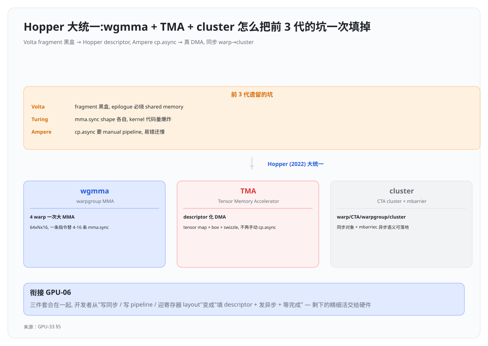

# GPU-33｜LLM｜Tensor Core 三代跃迁:Volta→Turing→Ampere→Hopper,为什么每代都要重写 kernel

# 导读 · 解决什么问题

> 🎯 本章解决什么问题:GPU-06 讲了 Hopper 与 Blackwell 的 tensor core(wgmma/UMMA/tcgen05/TE 2.0),但 tensor core 不是从 Hopper 才开始的 — 从 2017 年 Volta 第一次把矩阵乘单元塞进 GPU,到 2022 年 Hopper 第四代,每一代的指令集、寄存器布局、同步原语都被重新写过,而老 kernel 在新代上不能直接跑。理解这条"重写"的循环,是理解为什么 GPU-06 讲的 Blackwell 改动不是一次性事件的关键。本章按五步闭环展开:先定 Volta 第一代 wmma 是怎么把 tensor core 摆进 GPU 的(第 1 章),测 Turing 与 Ampere 在精度与同步上加了什么(第 2-3 章),定位每代之间因 kernel 不兼容而暴露的等待(第 4 章),再列 Hopper 的 wgmma 是怎么一次性把前 3 代的坑填掉(第 5 章,衔接 GPU-06),复测在 2026 年的视角下四代一脉的"重写"循环会不会继续(第 6 章)。使用方式:要写 tensor core kernel 的工程师看全部,只关心 Blackwell 当代口径的可以跳到第 5-6 章接 GPU-06。

## 本章地图

- **第 1 章 Volta (2017):tensor core 起点与 wmma 编程模型**:第一次把矩阵乘单元塞进 GPU,HMMA 指令 + 16x16x16 fragment,寄存器布局的限制
- **第 2 章 Turing (2018):INT8/INT4 加入与 mma.sync 统一**:深度学习推理驱动 tensor core 走下 FP16,整数算力也来了
- **第 3 章 Ampere (2020):TF32、稀疏 tensor core 与 cp.async**:训练用 TF32 免改代码就加速,推理用稀疏压权重,cp.async 把拷贝与计算重叠
- **第 4 章 重写循环:为什么每代 tensor core 都要重写 kernel**:指令、寄存器、同步原语三个层面拆开看,不是小题大做
- **第 5 章 Hopper (2022):wgmma + TMA + 线程块集群,把前 3 代的坑一次填掉**:异步化一切,衔接 GPU-06
- **第 6 章 重写循环下一站:Blackwell 之后会继续吗**:衔接 GPU-06 的 tcgen05 与 GPU-32 的 Vera Rubin

> 📐 口径边界:本章硬件时间线引用 NVIDIA 官方架构 whitepaper(Tesla V100 2017、Turing T4 2018、A100 2020、H100 2022),指令集语义参考 PTX ISA 8.x 文档(nVIDIA 2023),性能数字来自 NVIDIA 官方规格与 microbenchmark 复现(Citadel/CUTLASS 开源数据). Blackwell 与 Vera Rubin 的内容只作"承上启下",细节见 GPU-06 与 GPU-32。

# 第 1 章 · Volta (2017):tensor core 起点

2017 年 NVIDIA 发布 Tesla V100 (Volta 架构),第一次在 GPU 里塞进了专门为矩阵乘加设计的硬件单元 — tensor core。在那之前 GPU 只有标量 FP32 / FP64 单元,做矩阵乘要靠 CUDA core 反复 FMA;在 V100 里,一个 SM 有 8 个 tensor core,每个能在单条指令里做 4x4x4 的 HMMA(half-precision matrix multiply-accumulate),FP16 输入、FP32 累加。

## §1.1 编程模型:wmma fragment 与 16x16x16

NVIDIA 给开发者的接口是 **wmma**(warp-level matrix multiply-accumulate):一个 warp(32 线程)集体执行一条 wmma 指令,完成一个 16x16x16 的矩阵乘加。寄存器用 fragment 这个抽象管理 — 每个 fragment 是一个 warp 内 32 个线程共同持有的小矩阵(A、B、C、D 四种),wmma 的语义是 D = A \* B + C。为什么用 warp 而不是线程?因为矩阵数据的带宽超出了一个线程能供给的能力,需要 32 个线程并行加载、并行计算。

WMMA 的 16x16x16 形状不是终点,是**编译器能拼出任意大小 GEMM 的最小砖块** — 128x128 的 GEMM 要拆成 8x8 个 wmma tile,而每个 tile 内部又要循环 16x16x16 fragment。这一拆分在 GPU-05 GEMM 优化里详细讲过。

## §1.2 Volta 的坑:fragment 寄存器布局黑盒 + 同步全显式

Volta 是第一代,踩过两个影响深远的坑:

| 坑 | 影响 |
|-|-|
| Fragment 内部寄存器布局是**未公开黑盒** | 开发者不能直接读写 fragment 的 element,只能通过 load_matrix_sync / store_matrix_sync;想做 epilogue(比如加 bias、激活)必须先存回 shared memory 再读回 |
| 同步原语只有 \_\_syncwarp() | warpgroup 内同步要靠 volatile shared memory + memory fence 自己拼;跨 SM 同步完全不可能 |

这两个坑是后面 Hopper 的 wgmma 设计的直接动机 — 第四代 tensor core 把 fragment 黑盒换成 TMA 提供的 descriptor,把同步换成 mbarrier。换句话说:**Volta 的局限不是错,而是给 Hopper 留的作业**。

# 第 2 章 · Turing (2018):tensor core 走下 FP16,整数算力也来了

Turing (2018) 是游戏卡 GeForce RTX 2080 / 数据中心 T4 那一代。它对 tensor core 的最大改动不是精度更高,而是**精度更低** — 加了 INT8 与 INT4 的 tensor core 指令。动机是推理:训练用 FP16 已经够,但推理如果能用 INT8 甚至 INT4,同样显存能塞下 2x-4x 更大的模型,推理吞吐能翻 2\~4 倍。

## §2.1 IMMA:整数矩阵乘的命令堂弟

Turing 加了一条 IMMA(integer matrix multiply-accumulate)指令族:输入 INT8/INT4,累加 INT32。这一条让更多推理框架(TensorRT)开始上 INT8 量化 — 不需要把权重保持 FP16,标定(calibration)之后用 INT8 跑,精度可控。

## §2.2 mma.sync:WMMA 之外的第二条指令族

Turing 同时引入了 **mma.sync**,一条 shape 更灵活的 warp 级 MMA 指令,支持 m16n8k8 / m16n8k16 等多种形状。mma.sync 相比 wmma 的优势是**寄存器布局规格化**:开发者可以在 PTX 层直接操作寄存器 element,做 epilogue 不再需要存回 shared memory。mma.sync 就是从 Turing 起一直延续到 Hopper 的指令名,Volta 时代的 wmma 反而成了"老接口"。

从编程模型上,Turing 是 tensor core 成熟的一步:精度、形状、寄存器三个维度开始规格化,kernel 工程师第一次可以"知道自己在做什么"而不是"信任 compiler 的黑盒"。

# 第 3 章 · Ampere (2020):TF32、稀疏、cp.async

A100 (Ampere, 2020) 是数据中心训练卡的拐点。它在 tensor core 上走了三条独立的路,每一条都解决一类具体等待:

## §3.1 TF32:训练加速的免改代码路径

训练用 FP32 是老传统 — 数值稳定、工程友好。但 FP32 的 FMA 在 A100 上是 19.5 TFLOPS,而 FP16 的 tensor core 是 312 TFLOPS,差 16 倍。NVIDIA 的解法是 **TF32**:FP32 输入截断到 10 bit mantissa(变 TF32),走 tensor core 算、FP32 累加。结果:训练代码一行不改,FP32 路径自动走 TF32 的 tensor core,获得 156 TFLOPS(8 倍于 FP32,一半是 FP16)。

TF32 的工程意义在 GPU-06 的 FP8 训练里重演 — 降低输入精度就是减 W_mem 的流量,然后 tensor core 的算力账自动变得有利。这是 NVIDIA 第一次把"精度"作为性能工程的工具而不是正确性的代价。

## §3.2 稀疏 tensor core:让权重的 0 不再算

A100 引入了 structured sparsity:每 4 个权重里允许 2 个为 0,硬件自动跳过零值计算。算力直接翻倍到 624 TFLOPS(稀疏 FP16),等价于在 GPU-23 意义上的"压缩 KV"的方向,但更早 — 这是"模型本身就是稀疏的"第一批硬件原生支持。

## §3.3 cp.async:把全局内存拷贝与计算重叠

Ampere 另一个重要新指令是 **cp.async**:从全局内存异步拷贝到 shared memory,不阻塞线程。在它之前,shared memory 装载要靠 ld.global → st.shared 两步,中间线程全程等待;有了 cp.async,可以做到"前一批 tile 还在算,后一批 tile 就在准备"。这是 GPU-04 双缓冲思想的硬件级实现 — 双缓冲从"两倍 shared memory"变成"cp.async + barrier"。

cp.async 是 Ampere 留给 Hopper TMA 的种子。TMA 做的事就是"cp.async 但是 tensor map 化 + descriptor 化",下一章讲。

# 第 4 章 · 重写循环:tensor core 的四次指令重定义

把 Volta → Turing → Ampere → Hopper 排一张表,把"每代都改变的三件事"拆开看:

| 代 | 指令 | 寄存器布局 | 同步原语 | 新坑 |
|-|-|-|-|-|
| Volta 2017 | wmma.sync 16x16x16 | fragment 黑盒 | \_\_syncwarp + volatile smem | epilogue 要绕 smem |
| Turing 2018 | + mma.sync(m16n8k8/k16) | 规格化,PTX 可见 | \_\_syncwarp | 各形状写各自的 kernel,代码量爆炸 |
| Ampere 2020 | + TF32 / 稀疏 / cp.async | mma.sync 布局扩展 | + mbarrier | cp.async 需要 manual pipeline,易错 |
| Hopper 2022 | + wgmma(warpgroup)+ TMA | descriptor + tensor memory | mbarrier + cluster.sync | kernel 重写, wgmma 与 mma.sync 不兼容 |
| Blackwell 2024+ | + tcgen05 / UMMA | TMEM descriptor | + tcgen05.mma_arrive/wait | 再次重写, wgmma 与 tcgen05 不兼容 |

每一代都有一组"看起来很小"的兼容性 break,合起来就是 kernel 工程师每 2 年重写一次的作业。这不是事故,是设计:nVIDIA 不接受兼容性陷阱换性能,如果新指令能用更高带宽、更少寄存器、更深的流水,就重写 — 用户代码可以不用,但追性能的人必须重写。

## §4.1 三个层面的拆解

"重写 kernel"听起来夸张,其实每一代只是在三个层面换 API:

| 层面 | 变化案例 | 影响 |
|-|-|-|
| 指令 shape | Volta 16x16x16 → Turing 16x8x8/16x8x16 → Hopper 64xNx16 | tile 拆分算法要重写, CUTLASS 模板参数换 |
| 寄存器与 smem | Volta fragment 黑盒 → Turing 规格化 → Ampere + cp.async → Hopper descriptor + tensor memory | 寄存器分配重写, 不能 carry old kernel |
| 同步原语 | \_\_syncwarp →+ mbarrier →+ cluster.sync →+ tcgen05.mma_arrive | pipeline 重写, barrier 数量减 |

# 第 5 章 · Hopper (2022):wgmma + TMA,前三代的坑一次填掉

Hopper (H100, 2022) 是 tensor core 的成年礼。它用 wgmma + TMA 解决了前 3 代的三个核心问题:

## §5.1 wgmma:从 warp 到 warpgroup,一次指令变大 4 倍

wgmma(warpgroup matrix multiply-accumulate)不再让一个 warp 执行 MMA,而是让**4 个 warp 组成 warpgroup**一次执行 64xNx16 的大 MMA。优势是单条指令做更多工作,指令发起频率降 4 倍,SM 指令带宽压力小 4 倍。

## §5.2 TMA:把 cp.async 升级为 descriptor 化的硬件 DMA

TMA(Tensor Memory Accelerator)是 Ampere cp.async 的"Hardened 版":程序员不再写"从哪里拷到哪里拷多少",而是**创建一份 tensor map descriptor**,告诉硬件"我要从全局内存的 X 形状的 tensor 拷一个 box 到 shared memory 的 box,带有这个 swizzle pattern"。硬件接管 DMA,线程可以做别的。

结果是 GPU-04 讲的"双缓冲"在 Hopper 上变成"四缓冲甚至八缓冲非常便宜" — 不再靠 SM 内的 cp.async,而是 TMA 在背景帮 SM 拉数据。

## §5.3 mbarrier + cluster:同步原语的跨 warpgroup 化

Hopper 引入了 mbarrier(memory barrier object)与 cluster(线程块集群,至多 8 个 CTA 共享 L1)。同步对象不再只是 warp 或 CTA,可以是 warpgroup、cluster、甚至跨 SM 的 sub-cluster,使 wgmma 的异步语义能落地。

这就是为什么 GPU-06 在讲 Blackwell 的 UMMA/tcgen05 时,不可避免地要先回到 Hopper 的 wgmma:Blackwell 的 tcgen05 把 Hopper 的 wgmma 再往前推一步(更深的异步 + tensor memory 而非寄存器),但思路是连贯的 — 一切向"硬件 DMA + 异步计算"靠拢,而不是回到"V100 那种细粒度手工同步"。

# 第 6 章 · 重写循环下一站:Blackwell 与 Vera Rubin 还会继续吗

从 V100 (2017) 到 Vera Rubin (2026),tensor core 已经走过四代(老NVIDIA 路线)到五代(新路线)。是否有理由期待未来每隔 2 年都要"再重写一次"?综合 GPU-32 对 NVIDIA 路线图的解读,答案大概率是 **重写节奏会变慢,但重写量会变大**。

## §6.1 重写节奏变慢的原因

Vera Rubin 的 tensor core 与 Blackwell 的 tcgen05 显然是同一个 API 家族(同样的 UMMA 名字,只是 shape 与精度升级)。NVIDIA 把 Hopper 到 Blackwell 的兼容性 break 称作"未来五年不再发生"。这与市场压力有关 — Hopper 时代的 kernel 重写潮让 FA-team、CUTLASS、TRT-LLM 都付出了大工,NVIDIA 显然不想再两年代来一次。

## §6.2 重写量变大的原因

但是,即便 API 稳定,新问题也已经在地平线之上:GPU-32 §2.3 提到的"非对称硬件扩展"(tensor core 比 SMEM/MUFU 涨得快)让 kernel 优化的瓶颈从"算力"换到"附属单元",意味着即便指令不变,调度策略、warp specialization、TMEM 分配仍然要重写。换句话说:**未来"重写"不再是改指令,而是改策略**。FA4 就是第一个例子 — 在 Blackwell 上完全用新策略跑 attention,即便 wgmma 那条线不变。

## §6.3 衔接到 GPU-06 与 GPU-32

所以本章与 GPU-06(Blackwell 的 FP4/TE 2.0/UMMA)和 GPU-32(Rubin / Dynamo / FA4)的分工是:本章回答"为什么 tensor core 的 kernel 需要重写"、GPU-06 回答"Blackwell 上重写该怎么写"、GPU-32 回答"Vera Rubin 与 Dynamo 之后这套重写会不会变方向"。三篇一起看,才能对"tensor core 的未来五年"有完整判断。

> 🔑 本章要点:tensor core 的四代重写不是意外,是"性能 vs 兼容性"的必然 — Volta 起点、Turing 规格化、Ampere 三件套(TF32 + 稀疏 + cp.async)、Hopper 大统一(wgmma + TMA + cluster)、Blackwell 再带 tcgen05,每一代都在 API 上选择"重写"以换取更大带宽 / 更深流水 / 更少同步开销。把这五代连起来看,可以得到两条工程启发:(1) 对修改最友好的代码不是"用最新指令",而是"用 CUTLASS/Triton/TE 的抽象层",让库跟重写,用户代码不动;(2) 未来重写量不减反增,但方向从指令级换到策略级 — FA4 与 GPU-32 的 Dynamo 都是这个方向的例子。衔接 GPU-06 的当代 Blackwell 调优、GPU-32 的 Vera Rubin 与 Dynamo 的前瞻口径。

# 参考文献

[24] NVIDIA. Tesla V100 GPU Architecture Whitepaper (Volta). nvidia.com, 2017.

[25] NVIDIA. Turing GPU Architecture Whitepaper. nvidia.com, 2018.

[26] NVIDIA. A100 Tensor Core GPU Architecture Whitepaper (Ampere). nvidia.com, 2020.

[27] NVIDIA. H100 Tensor Core GPU Architecture Whitepaper (Hopper). nvidia.com, 2022.

[28] NVIDIA. PTX ISA 8.3 Documentation, mma.sync / wgmma / tcgen05 sections. docs.nvidia.com, 2023.

[29] CUTLASS. Collective Mma and Epilogue design (Hopper). github.com/NVIDIA/cutlass, 2024.

[30] Zadouri, Dao et al. FlashAttention-4: Algorithm and Kernel Pipelining Co-Design for Asymmetric Hardware Scaling. MLSys 2026.

---

上一章：[GPU-32｜LLM｜Rubin 时代与 Dynamo 推理:Blackwell 之后的时间账(2026)](./32-rubin-dynamo.md) · [目录](./README.md)
