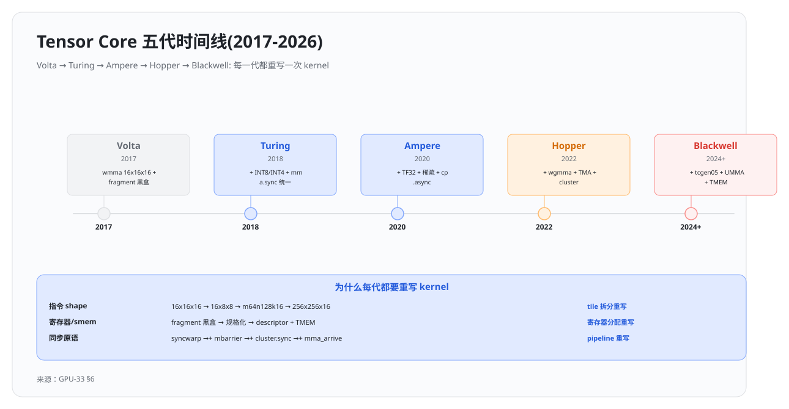
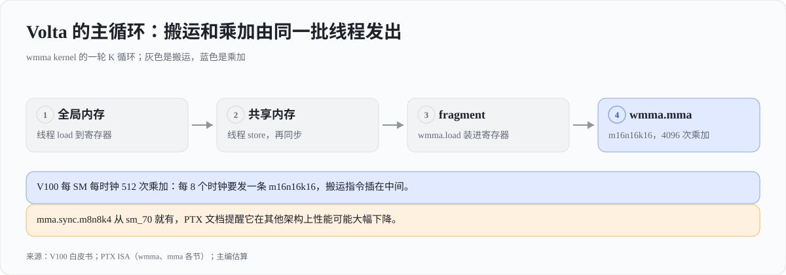
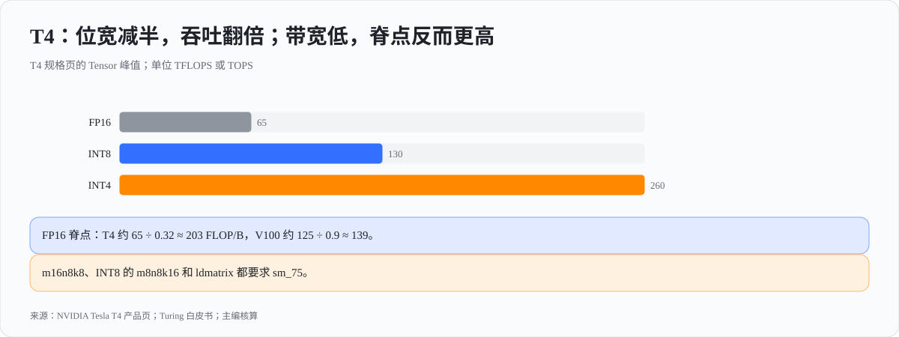
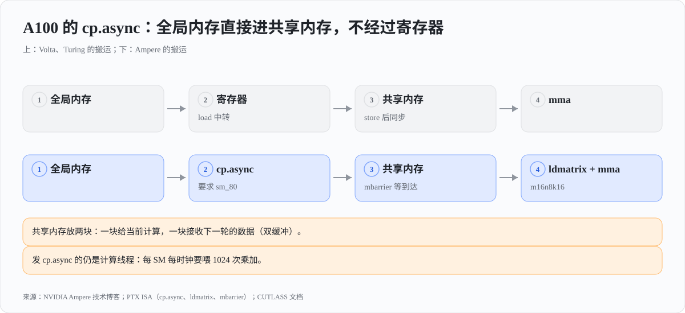
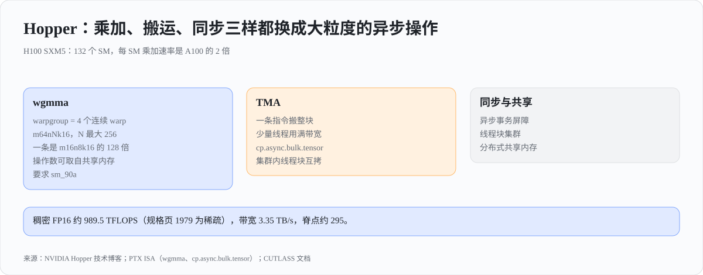
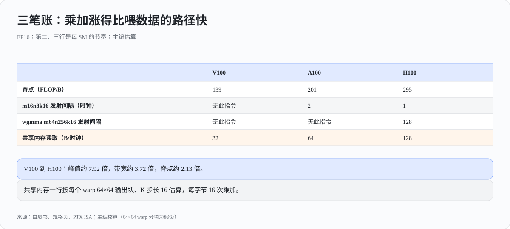
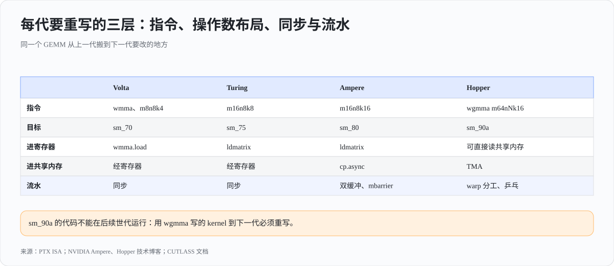
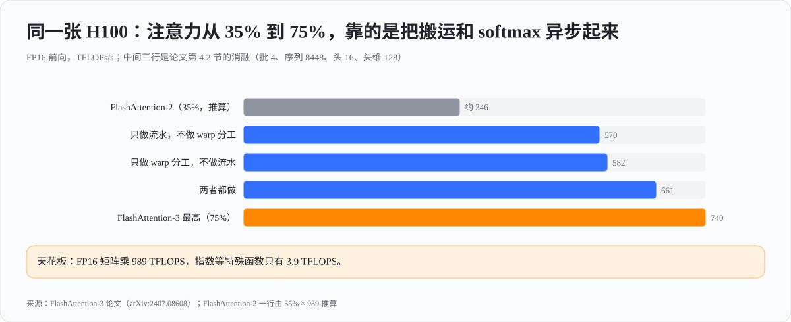
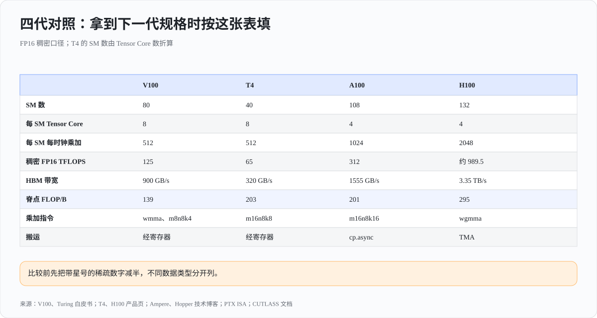

# GPU-33｜LLM｜Tensor Core 三代跃迁：Volta→Turing→Ampere→Hopper，为什么每代都要重写 kernel

> 🎯 **这篇文档解决什么问题**：同一张 H100 上，优化过的矩阵乘能跑到峰值的八到九成，按 Ampere 写法实现的 FlashAttention-2 只有 35%[[1]](https://arxiv.org/html/2407.08608v2)。本篇从 Volta 到 Hopper 逐代看 Tensor Core 改了什么：每 SM 的乘加速率、数据类型、矩阵指令的形状，以及搬运和同步的方式。再用三笔账说明为什么乘加变快以后旧 kernel 会“等搬运”，最后用 FlashAttention 从 Ampere 写法到 Hopper 写法的公开数据走一轮五步。读完以后，拿到下一代 GPU 的规格，能判断现有 kernel 要重写哪几层。

> 💡 **扩展 GPU-06**：GPU-06（[GPU-06｜硬件｜Tensor Core 与低精度：从 mma 到 FP8 和 FP4](./06-tensor-core.md)）讲 Hopper 与 Blackwell 的 Tensor Core，本篇往前补 Volta 到 Hopper 四代的指令演进，解释为什么每一代都要重写 kernel。

**使用方式**：第 1 章换算四代的乘加速率。第 2 到 5 章逐代讲 Volta、Turing、Ampere、Hopper。第 6 章算三笔账，第 7 章讲每代要重写的三层。第 8 章是五步案例，第 9 章是代际对照表，第 10 章给清单和自测。

**代码**：本篇没有配套代码，文中算例由主编按白皮书、规格页和 PTX 文档核算，第 10 章给出可以自己写的练习。

<b>🧭 主线位置</b>：GPU-00（[GPU-00｜索引｜从 0 开始 GPU 优化：路线、章节与练习](./README.md)）建立了时间账 T = T_compute + W_mem + W_host + W_comm + W_idle。GPU-06（[GPU-06｜硬件｜Tensor Core 与低精度：从 mma 到 FP8 和 FP4](./06-tensor-core.md)）讲 Tensor Core 与低精度指令，本篇是它的延伸：往回看 Volta 到 Hopper 四代，解释乘加单元每代变快以后，W_mem 为什么会在旧 kernel 里变大。上一篇 GPU-32（[GPU-32｜LLM｜Rubin 时代与 Dynamo 推理：Blackwell 之后的时间账（2026）](./32-rubin-dynamo.md)）讲 Rubin 时代 kernel 要随硬件和模型重写，本篇回到 Tensor Core 本身，看这种重写从哪一代就开始了。

## 导读 · 先给结论

- <b>每 SM 速率每代翻倍。</b>每 SM 每时钟 FP16 乘加从 V100 的 512 次到 A100 的 1024 次、H100 的 2048 次（第 1 章）。[[2]](https://images.nvidia.com/content/volta-architecture/pdf/volta-architecture-whitepaper.pdf)[[3]](https://developer.nvidia.com/blog/nvidia-ampere-architecture-in-depth/)[[4]](https://developer.nvidia.com/blog/nvidia-hopper-architecture-in-depth/)
- <b>Volta 定下分工。</b>V100 有 640 个 Tensor Core，CUDA 9 的 wmma 让一个 warp 做 16×16 的矩阵乘；mma.sync.m8n8k4 从 sm_70 就有（第 2 章）。[[2]](https://images.nvidia.com/content/volta-architecture/pdf/volta-architecture-whitepaper.pdf)[[5]](https://docs.nvidia.com/cuda/parallel-thread-execution/index.html)
- <b>Turing 变的是精度和形状。</b>T4 的 FP16、INT8、INT4 分别是 65、130、260，带宽约 320 GB/s，脊点约 203（第 3 章）。[[6]](https://www.nvidia.com/en-us/data-center/tesla-t4/)
- <b>Ampere 让搬运异步。</b>A100 稠密 FP16 312 TFLOPS，cp.async 把数据直接装进共享内存、不经过寄存器（第 4 章）。[[3]](https://developer.nvidia.com/blog/nvidia-ampere-architecture-in-depth/)
- <b>Hopper 把乘加和搬运都放大。</b>wgmma 由四个 warp 一起发，TMA 一条指令搬整块，少量线程就能用满带宽（第 5 章）。[[5]](https://docs.nvidia.com/cuda/parallel-thread-execution/index.html)[[4]](https://developer.nvidia.com/blog/nvidia-hopper-architecture-in-depth/)
- <b>三笔账和三层重写。</b>脊点从约 139 到约 295，发射节奏和共享内存读取量每代翻倍；指令、布局、流水三层都要改，sm_90a 的代码不能在后续世代运行（第 6、7 章）。[[5]](https://docs.nvidia.com/cuda/parallel-thread-execution/index.html)[[7]](https://raw.githubusercontent.com/NVIDIA/cutlass/main/media/docs/cpp/efficient_gemm.md)
- <b>五步案例。</b>FlashAttention-2 在 H100 上利用率 35%，FlashAttention-3 改用 Hopper 的写法后最高 740 TFLOPs/s、利用率 75%（第 8 章）。[[8]](https://arxiv.org/abs/2407.08608)

<b>📎 与系列其他文档的分工</b>：GPU-02（[GPU-02｜硬件｜性能账本：Roofline、算术强度与三类瓶颈](./02-ledger.md)）讲 Roofline 和脊点。GPU-05（[GPU-05｜硬件｜GEMM 逐步优化：从朴素循环到 warp 分块](./05-gemm.md)）讲 GEMM 的分块。GPU-06（[GPU-06｜硬件｜Tensor Core 与低精度：从 mma 到 FP8 和 FP4](./06-tensor-core.md)）讲 Tensor Core 指令与 FP8、FP4，以及 Blackwell 的 tcgen05 和 Tensor Memory。GPU-07（[GPU-07｜硬件｜Triton、CUTLASS 与 CuTe DSL](./07-dsl.md)）讲 Triton、CUTLASS 和 CuTe。GPU-08（[GPU-08｜硬件｜注意力内核](./08-attention.md)）讲注意力 kernel。本篇只讲 Volta 到 Hopper 每代改了什么、kernel 为什么要跟着重写。

## 第 1 章 · 这一层在等什么：乘加单元每代翻倍，喂数据的路径要跟着重写

Tensor Core 是 SM 里专做小矩阵乘加的单元。从 Volta 到 Hopper，它每个时钟能做的乘加次数一代比一代多，但每次乘加需要的操作数仍然要从 HBM 经过共享内存、寄存器送进来。乘加单元变快以后，旧 kernel 里“先搬、再算”的写法会让它空等。本章先把四代的乘加速率换到同一个口径，再说明这种空等在时间账里记在哪一项。

### 每个 SM 每个时钟能做多少次乘加

按白皮书，V100 每个 SM 有 8 个 Tensor Core，每个每时钟做 64 次 FP16 乘加（FMA），一个 SM 合计 512 次[[2]](https://images.nvidia.com/content/volta-architecture/pdf/volta-architecture-whitepaper.pdf)。Turing 的 SM 同样是 8 个 Tensor Core、每个 64 次[[9]](https://images.nvidia.com/aem-dam/en-zz/Solutions/design-visualization/technologies/turing-architecture/NVIDIA-Turing-Architecture-Whitepaper.pdf)，每 SM 每时钟也是 512 次。A100 改成每 SM 4 个 Tensor Core，每个 256 次，合计 1024 次，白皮书写明这是 Volta 和 Turing 每 SM 算力的 2 倍[[3]](https://developer.nvidia.com/blog/nvidia-ampere-architecture-in-depth/)。Hopper 的技术博客写明，同数据类型下 H100 每个 SM 的矩阵乘加速率是 A100 的 2 倍，用 FP8 时是 4 倍[[4]](https://developer.nvidia.com/blog/nvidia-hopper-architecture-in-depth/)，即每 SM 每时钟 2048 次 FP16 乘加。

一次乘加算两次浮点运算，所以四代每 SM 每时钟的 FP16 运算量是 1024、1024、2048、4096 次。三代里翻了两番，而 SM 的数量只从 V100 的 80 个[[2]](https://images.nvidia.com/content/volta-architecture/pdf/volta-architecture-whitepaper.pdf)涨到 H100 的 132 个[[4]](https://developer.nvidia.com/blog/nvidia-hopper-architecture-in-depth/)。整卡峰值的增长主要来自每个 SM 内部变快。

### 峰值等于 SM 数乘每 SM 速率乘时钟

这几个数可以互相核对。V100 有 80 个 SM，加速时钟 1530 MHz[[3]](https://developer.nvidia.com/blog/nvidia-ampere-architecture-in-depth/)，80 × 512 × 2 × 1.53 GHz ≈ 125.3 TFLOPS，和白皮书的 125 Tensor TFLOPS 一致[[2]](https://images.nvidia.com/content/volta-architecture/pdf/volta-architecture-whitepaper.pdf)。A100 有 108 个 SM、加速时钟 1410 MHz[[3]](https://developer.nvidia.com/blog/nvidia-ampere-architecture-in-depth/)，108 × 1024 × 2 × 1.41 GHz ≈ 311.9 TFLOPS，和稠密 FP16 的 312 一致[[3]](https://developer.nvidia.com/blog/nvidia-ampere-architecture-in-depth/)。H100 规格页给的 FP16 是带稀疏的 1979 TFLOPS[[10]](https://www.nvidia.com/en-us/data-center/h100/)，稠密是一半，约 989.5；按 132 个 SM 和每 SM 2048 次乘加反推，时钟约 1.83 GHz，这个时钟是主编推断，规格页没有直接给出。核对的意义在于：后面所有“每 SM 每时钟”的推算都建立在这套口径上。

每 SM 速率翻倍，意味着同一个 SM 每个时钟要拿到的操作数也翻倍。操作数从 HBM 到共享内存、从共享内存到寄存器，每一段都要有指令去搬。A100 以前，这些搬运由做计算的同一批线程发出，和乘加指令排在同一条指令流里。PTX 文档对 Volta 时代的 mma.sync.m8n8k4 有一句提醒：它针对 sm_70 优化，在其他架构上性能可能大幅下降[[5]](https://docs.nvidia.com/cuda/parallel-thread-execution/index.html)。旧指令在新卡上能跑，跑不快。

放进时间账：GPU-00（[GPU-00｜索引｜从 0 开始 GPU 优化：路线、章节与练习](./README.md)）的 T = T_compute + W_mem + W_host + W_comm + W_idle 里，Tensor Core 忙着的时间是 T_compute；它算完一块、下一块操作数还没到寄存器的时间，属于“搬运与计算串行”，记在 W_mem。每代乘加变快，T_compute 缩短，如果搬运方式没变，W_mem 在总时间里的占比就变大。

按五步闭环看这一层：

- **定天花板**：用 SM 数、每 SM 每时钟乘加次数和时钟算出稠密峰值，和规格页核对。
- **测实际**：用 profiler 量 kernel 达到的 TFLOPS 和 Tensor Core 的忙碌比例。
- **定位等待**：Tensor Core 不忙的时候，线程在等全局内存、等共享内存还是等同步。
- **消除或隐藏**：换成这一代的乘加指令和搬运方式，让搬运和计算重叠。
- **复测**：同一个问题规模下重新量 TFLOPS，和天花板对比。

一个常见的误区是以为旧 kernel 换到新卡上，会按峰值的比例自动变快。现象是在 A100 上调好的 kernel，到 H100 上利用率只有三成多，第 8 章的 FlashAttention-2 就是这样。原因是每 SM 每时钟要喂的数据翻倍了，旧 kernel 的搬运方式和同步方式没变，Tensor Core 有大段时间在等。改法是先按本章的口径算出新卡的天花板，再看第 8 章的案例，按五步定位等待。

> 🔑 **本章要点**：每 SM 每时钟的 FP16 乘加从 V100、Turing 的 512 次到 A100 的 1024 次、H100 的 2048 次，整卡峰值的增长主要来自 SM 内部；峰值 = SM 数 × 每 SM 速率 × 2 × 时钟，可以和规格页互相核对。乘加变快而搬运方式不变，等待就记在 W_mem。这一章是五步闭环的“定天花板”：先把四代换到同一个口径。

## 第 2 章 · Volta：一个 warp 做一块 16×16 的矩阵乘

Volta 是第一代带 Tensor Core 的数据中心 GPU。它定下了后面几代沿用的分工：矩阵乘以 warp 为单位发出，操作数先放进每个线程的寄存器，再交给 Tensor Core。本章看 V100 的规格、它的编程接口，以及在这一代就已经存在的“搬运和计算排在同一条指令流里”的问题。

### V100 的规格与编程接口

V100 用 80 个 SM[[2]](https://images.nvidia.com/content/volta-architecture/pdf/volta-architecture-whitepaper.pdf)，共 640 个 Tensor Core，每个 SM 8 个[[2]](https://images.nvidia.com/content/volta-architecture/pdf/volta-architecture-whitepaper.pdf)；每个 Tensor Core 每时钟做 64 次 FMA，一个 SM 的 8 个合计 512 次[[2]](https://images.nvidia.com/content/volta-architecture/pdf/volta-architecture-whitepaper.pdf)。整卡 Tensor 峰值 125 TFLOPS，显存带宽 900 GB/s[[2]](https://images.nvidia.com/content/volta-architecture/pdf/volta-architecture-whitepaper.pdf)。按 GPU-02（[GPU-02｜硬件｜性能账本：Roofline、算术强度与三类瓶颈](./02-ledger.md)）的 Roofline，脊点约 125 ÷ 0.9 ≈ 139 FLOP/B：一个 kernel 每从 HBM 读一个字节，要做 139 次以上的运算，才不受带宽限制。

编程接口上，Volta 的 Tensor Core 在 CUDA 9 里以 warp 级矩阵运算（wmma）的形式提供[[2]](https://images.nvidia.com/content/volta-architecture/pdf/volta-architecture-whitepaper.pdf)，白皮书写明这个接口假定矩阵是 16×16，由 warp 的全部 32 个线程共同持有[[2]](https://images.nvidia.com/content/volta-architecture/pdf/volta-architecture-whitepaper.pdf)。一次 wmma 的 m16n16k16 运算做 16 × 16 × 16 = 4096 次乘加。PTX 层面还有更底层的 mma.sync.m8n8k4，FP16 版本要求 sm_70 或更高[[5]](https://docs.nvidia.com/cuda/parallel-thread-execution/index.html)，也就是从 Volta 起就有，并不是 Turing 才引入的。

### 这一代就埋下的等待

一个 wmma kernel 的主循环大致是：线程从全局内存读一块 A 和 B，写进共享内存，同步；再用 wmma 的 load 把共享内存里的数据装进寄存器里的 fragment，调用 mma，循环推进 K 维；最后把结果 store 回去。读全局内存、写共享内存、装 fragment 这几步，都是计算线程自己发出的普通指令，它们和乘加指令共用同一批线程的发射机会和寄存器。

按每 SM 每时钟 512 次乘加算，一个 SM 每 8 个时钟就要发出一条 m16n16k16 的 wmma 运算，才能让 Tensor Core 不停（主编估算，见第 6 章）。这个节奏在 V100 上还有余量，因为搬运指令可以插在乘加指令之间。常用的补救是双缓冲：CUTLASS 文档描述，共享内存里放两块，一块给当前的矩阵运算用，另一块接收为下一轮主循环装载的数据[[7]](https://raw.githubusercontent.com/NVIDIA/cutlass/main/media/docs/cpp/efficient_gemm.md)；但搬运仍由计算线程自己发出。到后面几代，每 SM 的乘加速率翻了两番，同样的写法就排不开了。PTX 文档专门提醒 mma.sync.m8n8k4 针对 sm_70 优化，在其他架构上性能可能大幅下降[[5]](https://docs.nvidia.com/cuda/parallel-thread-execution/index.html)，这是指令层面“为某一代写”的直接证据。

放进时间账：V100 上 kernel 的 W_mem 主要来自 HBM 带宽和共享内存的装载，脊点约 139，矩阵够大的 GEMM 可以落在计算一侧。搬运和计算串在同一条指令流里，这一代还不显眼，但它决定了后面每一代要改的地方。

按五步闭环看 Volta 上的 kernel：

- **定天花板**：125 TFLOPS、900 GB/s、脊点约 139。
- **测实际**：量 GEMM 的 TFLOPS 和 HBM 带宽利用率。
- **定位等待**：看主循环里装载共享内存、装 fragment 和 mma 之间是否有空档。
- **消除或隐藏**：用双缓冲让下一块的装载和这一块的计算重叠。
- **复测**：对比改动前后的 TFLOPS，确认 Tensor Core 忙碌比例上升。

一个常见的误区是把 wmma 的 fragment 当成可以随意读写的数组。现象是在 fragment 上逐元素做后处理，结果在换卡或换编译器版本后出错。原因是 PTX 文档写明 wmma.mma 的寄存器参数持有的是“未指定的”矩阵 fragment[[5]](https://docs.nvidia.com/cuda/parallel-thread-execution/index.html)，元素在 32 个线程间怎样分布不在接口承诺之内，接口只保证整块的 load、mma、store。改法是后处理先 store 到共享内存再做，或者用文档写明了布局的 mma.sync 指令。

> 🔑 **本章要点**：V100 有 80 个 SM、640 个 Tensor Core，每 SM 每时钟 512 次 FMA，峰值 125 TFLOPS、带宽 900 GB/s、脊点约 139。编程接口是 CUDA 9 的 warp 级 wmma，矩阵按 16×16 由一个 warp 持有；mma.sync.m8n8k4 从 sm_70 就有。搬运和计算排在同一条指令流里，是后面每代要改的起点。这一章是五步闭环的“定天花板”：给出第一代的基线。

## 第 3 章 · Turing：乘加单元没变快，变的是精度和指令形状

Turing 的 Tensor Core 每 SM 每时钟的 FP16 乘加次数和 Volta 一样，变化在两处：多了 INT8 和 INT4 两种整数精度，PTX 里多了 m16n8k8 这类新形状和配套的 ldmatrix。推理用的 T4 是这一代的数据中心卡。本章用 T4 说明一件容易被忽略的事：乘加速率不变，带宽变低，脊点照样会往上走。

### T4 的规格

白皮书写明 Turing 的 Tensor Core 增加了 INT8 和 INT4 精度模式[[9]](https://images.nvidia.com/aem-dam/en-zz/Solutions/design-visualization/technologies/turing-architecture/NVIDIA-Turing-Architecture-Whitepaper.pdf)；每个 SM 有 64 个 CUDA 核和 8 个 Tensor Core[[9]](https://images.nvidia.com/aem-dam/en-zz/Solutions/design-visualization/technologies/turing-architecture/NVIDIA-Turing-Architecture-Whitepaper.pdf)，每个 Tensor Core 用 FP16 输入时每时钟最多 64 次 FMA[[9]](https://images.nvidia.com/aem-dam/en-zz/Solutions/design-visualization/technologies/turing-architecture/NVIDIA-Turing-Architecture-Whitepaper.pdf)。T4 有 2560 个 CUDA 核和 320 个 Tensor Core[[9]](https://images.nvidia.com/aem-dam/en-zz/Solutions/design-visualization/technologies/turing-architecture/NVIDIA-Turing-Architecture-Whitepaper.pdf)，按每 SM 8 个折算是 40 个 SM。规格页给出 FP16 65 TFLOPS、INT8 130 TOPS、INT4 260 TOPS[[6]](https://www.nvidia.com/en-us/data-center/tesla-t4/)，显存带宽 320+ GB/s[[6]](https://www.nvidia.com/en-us/data-center/tesla-t4/)。按 40 × 512 × 2 反推，65 TFLOPS 对应的时钟约 1.59 GHz（主编推断）。

数据类型每减半一次，吞吐翻一倍：FP16 到 INT8 是 65 到 130，INT8 到 INT4 是 130 到 260[[6]](https://www.nvidia.com/en-us/data-center/tesla-t4/)。这和后面几代 FP8、FP4 的规律相同：Tensor Core 按位宽给吞吐，操作数位数少一半，同样的数据通路每时钟能送进的元素就多一倍。

### 新形状与 ldmatrix

PTX 文档列出，FP16 的 mma 形状 m16n8k8 要求 sm_75 或更高[[5]](https://docs.nvidia.com/cuda/parallel-thread-execution/index.html)，INT8 的 m8n8k16 也要求 sm_75[[5]](https://docs.nvidia.com/cuda/parallel-thread-execution/index.html)；ldmatrix 同样要求 sm_75[[5]](https://docs.nvidia.com/cuda/parallel-thread-execution/index.html)。ldmatrix 的作用是由一个 warp 协作，把一个或多个矩阵从共享内存装进 mma 指令要用的寄存器[[5]](https://docs.nvidia.com/cuda/parallel-thread-execution/index.html)。和 Volta 上逐线程用普通 load 装 fragment 相比，它把“共享内存到寄存器”这一段变成了一条专用指令，布局也由文档写明，kernel 作者可以据此安排共享内存的排布、避免 bank 冲突。

对 kernel 作者来说，这意味着为 Volta 写的 m8n8k4 主循环要改。PTX 文档写明 m8n8k4 针对 sm_70 优化，在其他架构上性能可能大幅下降[[5]](https://docs.nvidia.com/cuda/parallel-thread-execution/index.html)。所以从 Volta 搬到 Turing，主循环里的 mma 形状、fragment 的装载方式要一起换。这是第一次“同一个算子，换一代卡要换一套指令”。

### 脊点为什么反而更高

T4 的 FP16 脊点约 65 ÷ 0.32 ≈ 203 FLOP/B，比 V100 的 139 还高，尽管 T4 的峰值只有 V100 的一半左右。原因是 T4 的显存带宽只有 320 GB/s 左右[[6]](https://www.nvidia.com/en-us/data-center/tesla-t4/)。脊点是峰值除以带宽，两者一起决定；只看乘加速率会误判 kernel 落在哪一侧。在 T4 上做推理，小批量的矩阵乘大多落在带宽一侧，INT8 量化省下的字节比省下的乘加更有用。

放进时间账：Turing 没有让 T_compute 在同精度下变短，但 INT8、INT4 让同样字节数里装下更多元素，直接压小 W_mem。代价是 kernel 要为新形状和 ldmatrix 重写，精度要单独验证。

按五步闭环看 T4 上的推理 kernel：

- **定天花板**：FP16 65 TFLOPS、带宽 320 GB/s、脊点约 203。
- **测实际**：量矩阵乘的 TFLOPS 和带宽利用率，判断落在哪一侧。
- **定位等待**：小批量时多半在等 HBM，大批量时看 fragment 装载是否和 mma 重叠。
- **消除或隐藏**：带宽一侧用 INT8 少读字节；计算一侧换 m16n8k8 和 ldmatrix。
- **复测**：TFLOPS 或每秒请求数，加上精度对比。

一个常见的误区是把 Volta 上调好的 kernel 原样放到 T4 上，只因为两者每 SM 的 Tensor Core 配置相同。现象是 T4 上的利用率远低于预期。原因有两个：mma.sync.m8n8k4 在 sm_70 以外的架构上可能大幅变慢，T4 的带宽又低得多。改法是先按 T4 的脊点判断瓶颈，再决定换指令还是换精度。

> 🔑 **本章要点**：Turing 每 SM 仍是 8 个 Tensor Core、每时钟 512 次 FP16 乘加，新增 INT8、INT4；T4 有 40 个 SM，FP16 65、INT8 130、INT4 260，带宽约 320 GB/s，脊点约 203，比 V100 还高。m16n8k8 和 ldmatrix 要求 sm_75，为 Volta 写的 m8n8k4 主循环要改。这一章是五步闭环的“定位等待”：先看脊点判断等的是带宽还是计算。

## 第 4 章 · Ampere：每个 Tensor Core 大了四倍，搬运第一次可以异步

A100 是这条线上变化最大的一代之一。每个 Tensor Core 每时钟的乘加次数变成 Volta 的 4 倍，每 SM 的算力翻倍；同时，搬运这一侧第一次有了专门的异步指令 cp.async 和共享内存里的异步屏障。本章看规格、新的数据类型和稀疏，再看 cp.async 改变了主循环的哪一段。

### 规格与数据类型

A100 的第三代 Tensor Core 每个每时钟做 256 次 FP16/FP32 乘加[[3]](https://developer.nvidia.com/blog/nvidia-ampere-architecture-in-depth/)；每 SM 4 个，合计 1024 次稠密乘加，是 Volta 和 Turing 每 SM 的 2 倍[[3]](https://developer.nvidia.com/blog/nvidia-ampere-architecture-in-depth/)。整卡 108 个 SM、432 个 Tensor Core[[3]](https://developer.nvidia.com/blog/nvidia-ampere-architecture-in-depth/)，加速时钟 1410 MHz[[3]](https://developer.nvidia.com/blog/nvidia-ampere-architecture-in-depth/)。稠密 FP16 Tensor 峰值 312 TFLOPS，带稀疏 624[[3]](https://developer.nvidia.com/blog/nvidia-ampere-architecture-in-depth/)；显存 40 GB HBM2，带宽 1555 GB/s[[3]](https://developer.nvidia.com/blog/nvidia-ampere-architecture-in-depth/)。FP16 脊点约 312 ÷ 1.555 ≈ 201 FLOP/B。

数据类型上，A100 新增 TF32：峰值 156 TFLOPS[[3]](https://developer.nvidia.com/blog/nvidia-ampere-architecture-in-depth/)，而普通 FP32 只有 19.5 TFLOPS[[3]](https://developer.nvidia.com/blog/nvidia-ampere-architecture-in-depth/)，博客写明 TF32 比 V100 的 FP32 FMA 快 10 倍[[3]](https://developer.nvidia.com/blog/nvidia-ampere-architecture-in-depth/)。BF16 的 mma 形状 m16n8k8 和 m16n8k16 要求 sm_80[[5]](https://docs.nvidia.com/cuda/parallel-thread-execution/index.html)，TF32 的 m16n8k4 和 m16n8k8 也要求 sm_80[[5]](https://docs.nvidia.com/cuda/parallel-thread-execution/index.html)；FP16 的 m16n8k16 同样从 sm_80 起才有[[5]](https://docs.nvidia.com/cuda/parallel-thread-execution/index.html)。一条 m16n8k16 做 16 × 8 × 16 = 2048 次乘加。

稀疏方面，A100 定义了 2:4 结构化稀疏：每 4 个元素里最多 2 个非零[[3]](https://developer.nvidia.com/blog/nvidia-ampere-architecture-in-depth/)，满足这个结构的矩阵，Tensor Core 吞吐翻倍[[3]](https://developer.nvidia.com/blog/nvidia-ampere-architecture-in-depth/)。这就是规格表里 312 和 624 两个数的来源。比较不同代的峰值时，要先确认两边都是稠密口径。

### cp.async：搬运不再经过寄存器

Volta 和 Turing 上，把一块数据从全局内存搬进共享内存，要由线程先 load 到寄存器，再 store 到共享内存。博客写明，A100 新增的异步拷贝指令把数据直接从全局内存装进共享内存，可以绕过 L1，并且不再需要经过寄存器文件[[3]](https://developer.nvidia.com/blog/nvidia-ampere-architecture-in-depth/)。PTX 里这条指令是 cp.async：源地址在全局内存，目的地址在共享内存[[5]](https://docs.nvidia.com/cuda/parallel-thread-execution/index.html)，要求 sm_80 或更高[[5]](https://docs.nvidia.com/cuda/parallel-thread-execution/index.html)。配套的是基于共享内存的屏障单元[[3]](https://developer.nvidia.com/blog/nvidia-ampere-architecture-in-depth/)，PTX 里叫 mbarrier，它是建在共享内存里的屏障[[5]](https://docs.nvidia.com/cuda/parallel-thread-execution/index.html)。CUDA 11 开始为这些新数据类型、稀疏、异步拷贝和屏障指令提供编程支持[[3]](https://developer.nvidia.com/blog/nvidia-ampere-architecture-in-depth/)。

这改变了主循环的形状。线程发出 cp.async 以后不必等数据到达，可以接着对上一块数据做 mma；等到要用下一块时，再用 cp.async 的等待指令或屏障确认它已到达。CUTLASS 文档描述的就是这种双缓冲：共享内存里放两块，一块给当前的矩阵运算用，另一块接收从全局内存为下一轮主循环装载的数据[[7]](https://raw.githubusercontent.com/NVIDIA/cutlass/main/media/docs/cpp/efficient_gemm.md)。把流水线拉深到三四级，就能把 HBM 的延迟藏到计算后面。

但发出 cp.async 的仍然是做计算的那批线程，每条指令搬的量很小，地址也要线程自己算。每 SM 每时钟要喂 1024 次乘加，搬运指令和 mma、ldmatrix 抢同一批 warp 的发射机会。第 6 章会算出，这个压力到 H100 上再翻一倍。

放进时间账：cp.async 让“全局内存到共享内存”这一段可以和计算重叠，W_mem 里属于 HBM 延迟的那部分能藏起来；寄存器不再中转，也给计算留出了寄存器。还藏不掉的，是地址计算和搬运指令本身占用的发射时间。

按五步闭环看 A100 上的 GEMM：

- **定天花板**：稠密 FP16 312 TFLOPS、带宽 1555 GB/s、脊点约 201。
- **测实际**：量 TFLOPS，看 Tensor Core 忙碌比例和等待共享内存数据的停顿。
- **定位等待**：主循环里搬运和计算是否串行，流水线级数够不够藏住 HBM 延迟。
- **消除或隐藏**：改用 cp.async 加多级缓冲，fragment 用 ldmatrix 装、m16n8k16 算。
- **复测**：同规模对比 TFLOPS，确认停顿下降。

一个常见的误区是用带稀疏的 624 TFLOPS 当 A100 的天花板去算利用率。现象是稠密 GEMM 的“利用率”只有四成多，看上去很差。原因是 624 只对满足 2:4 结构的稀疏矩阵成立，稠密口径是 312。改法是规格表里每个数都先标明稠密还是稀疏，再拿来做分母。

> 🔑 **本章要点**：A100 每个 Tensor Core 每时钟 256 次乘加，每 SM 1024 次，是 Volta 的 2 倍；108 个 SM，稠密 FP16 312 TFLOPS，带稀疏 624，带宽 1555 GB/s，脊点约 201。新增 TF32、BF16 和 2:4 稀疏；cp.async 把数据直接从全局内存装进共享内存、不经过寄存器，配合 mbarrier 和多级缓冲把搬运藏到计算后面。这一章是五步闭环的“消除或隐藏”：第一次可以让搬运和计算重叠。

## 第 5 章 · Hopper：四个 warp 一起发一条乘加，搬运交给 TMA

H100 的每 SM 乘加速率又翻了一倍。这一次，NVIDIA 没有只把指令形状再放大一点，而是把乘加和搬运都改成了异步的、粒度更大的操作：乘加由四个 warp 组成的 warpgroup 一起发出，搬运由专门的 TMA 单元按整块完成，同步用带事务计数的屏障。本章看这三件事分别解决什么问题。

### 规格

H100 SXM5 有 132 个 SM，每 SM 4 个第四代 Tensor Core，共 528 个[[4]](https://developer.nvidia.com/blog/nvidia-hopper-architecture-in-depth/)。同数据类型下每 SM 的矩阵乘加速率是 A100 的 2 倍，FP8 是 4 倍[[4]](https://developer.nvidia.com/blog/nvidia-hopper-architecture-in-depth/)，即每 SM 每时钟 2048 次 FP16 乘加，平均每个 Tensor Core 512 次（主编推断）。规格页上 FP16 和 BF16 都是 1979 TFLOPS、FP8 是 3958 TFLOPS，都带星号[[10]](https://www.nvidia.com/en-us/data-center/h100/)，星号注明是带稀疏的数字[[10]](https://www.nvidia.com/en-us/data-center/h100/)；稠密口径减半，FP16 约 989.5、FP8 约 1979。显存带宽 3.35 TB/s[[10]](https://www.nvidia.com/en-us/data-center/h100/)，FP16 脊点约 989.5 ÷ 3.35 ≈ 295 FLOP/B。

### wgmma：乘加的粒度从 warp 变成 warpgroup

PTX 文档定义，warpgroup 是四个连续的 warp，第一个 warp 的编号是 4 的倍数[[5]](https://docs.nvidia.com/cuda/parallel-thread-execution/index.html)。wgmma.mma_async 在整个 warpgroup 上做矩阵乘加[[5]](https://docs.nvidia.com/cuda/parallel-thread-execution/index.html)：warpgroup 里的所有线程一起把 A、B、D 放进寄存器或共享内存，再发出乘加[[5]](https://docs.nvidia.com/cuda/parallel-thread-execution/index.html)。FP16 的稠密形状从 m64n8k16、m64n16k16 一直到 m64n256k16，N 按 8 递增[[5]](https://docs.nvidia.com/cuda/parallel-thread-execution/index.html)。一条 m64n256k16 做 64 × 256 × 16 = 262144 次乘加，是 mma.sync m16n8k16 的 128 倍；摊到 warpgroup 里的每个 warp，也是 32 倍。

两点变化最关键。其一，B 矩阵（以及可选的 A）可以直接从共享内存读，不必先用 ldmatrix 装进寄存器，“共享内存到寄存器”这一段的指令没有了。其二，它是异步的：发出以后线程可以去做别的事，要用结果之前，必须用 wgmma.commit_group 和 wgmma.wait_group 等这批乘加完成[[5]](https://docs.nvidia.com/cuda/parallel-thread-execution/index.html)。wgmma 要求 sm_90a[[5]](https://docs.nvidia.com/cuda/parallel-thread-execution/index.html)，后缀 a 的含义见第 7 章。

### TMA、线程块集群和事务屏障

TMA（Tensor Memory Accelerator）是一个新的硬件单元，在全局内存和共享内存之间高效地搬大块数据，还支持集群内线程块之间的异步拷贝[[4]](https://developer.nvidia.com/blog/nvidia-hopper-architecture-in-depth/)。博客写明，用 TMA 只需要少量 CUDA 线程就能用满 H100 的全部内存带宽，其余线程可以专心做计算[[4]](https://developer.nvidia.com/blog/nvidia-hopper-architecture-in-depth/)。PTX 里对应的是 cp.async.bulk.tensor，它发起一次张量数据的异步拷贝[[5]](https://docs.nvidia.com/cuda/parallel-thread-execution/index.html)，线程只需发出一条指令描述要搬的整块，不必每个线程各算各的地址。和 A100 上每个线程各自发 cp.async 相比，搬运从“很多条小指令”变成“一条描述整块的指令”。

配套的有两样。异步事务屏障用来做原子的数据搬运和同步[[4]](https://developer.nvidia.com/blog/nvidia-hopper-architecture-in-depth/)：CUTLASS 文档描述，TMA 把数据写进共享内存以后，会更新这一级缓冲对应的屏障，通知等待的线程缓冲已经填好[[7]](https://raw.githubusercontent.com/NVIDIA/cutlass/main/media/docs/cpp/efficient_gemm.md)。线程块集群让多个 SM 上同时运行的线程块可以同步并协作地取数和交换数据[[4]](https://developer.nvidia.com/blog/nvidia-hopper-architecture-in-depth/)，分布式共享内存让 SM 之间直接读写彼此的共享内存[[4]](https://developer.nvidia.com/blog/nvidia-hopper-architecture-in-depth/)，同一块数据可以由集群里的一个线程块取来、多个线程块共用。

放进时间账：wgmma 和 TMA 都是异步的，搬运、乘加、softmax 这类其他运算可以由不同的 warp 并行推进，W_mem 能藏到 T_compute 后面；发射乘加和搬运所需的指令数大幅减少，计算线程不再被搬运占住。代价是 kernel 的结构要整个改，见第 7 章。

按五步闭环看 H100 上的 GEMM：

- **定天花板**：稠密 FP16 约 989.5 TFLOPS、带宽 3.35 TB/s、脊点约 295。
- **测实际**：量 TFLOPS，看 kernel 用的是 mma.sync 还是 wgmma，搬运是 cp.async 还是 TMA。
- **定位等待**：计算线程是否在发搬运指令、是否在等同步。
- **消除或隐藏**：乘加改 wgmma，搬运改 TMA，同步改事务屏障，按 warp 分工。
- **复测**：同规模对比 TFLOPS 和 Tensor Core 忙碌比例。

一个常见的误区是把规格页的 1979 TFLOPS 当成 H100 的 FP16 天花板。现象是算出来的利用率只有一半左右。原因是规格页的 FP16 数字带星号，是稀疏口径[[10]](https://www.nvidia.com/en-us/data-center/h100/)。改法是稠密 kernel 用约 989.5 做分母，和第 4 章 A100 的 312 对比时也保持同口径。

> 🔑 **本章要点**：H100 有 132 个 SM，每 SM 乘加速率是 A100 的 2 倍，稠密 FP16 约 989.5 TFLOPS、带宽 3.35 TB/s、脊点约 295。wgmma 由四个 warp 组成的 warpgroup 一起发出，一条 m64n256k16 是 mma.sync m16n8k16 的 128 倍，操作数可直接取自共享内存，异步完成；TMA 一条指令搬整块，少量线程就能用满带宽；事务屏障和线程块集群负责同步与共享。这一章是五步闭环的“消除或隐藏”：把搬运和乘加都改成异步。

## 第 6 章 · 乘加涨得比带宽快：三笔账算出“等搬运”从哪来

前四章逐代讲了改了什么。本章换个角度，把四代放在一起算三笔账：整卡的脊点、每个 SM 发射乘加指令的节奏、每个 SM 从共享内存取操作数的速度。三笔账都指向同一个结论：乘加单元涨得比喂数据的路径快，旧写法会在新卡上等搬运。全部是主编按规格做的估算，计算见代码。

### 第一笔账：脊点往右走

FP16 稠密脊点（峰值除以 HBM 带宽）：V100 约 139，T4 约 203，A100 约 201，H100 约 295 FLOP/B。从 V100 到 H100，峰值涨了约 7.92 倍（125 到 989.5[[2]](https://images.nvidia.com/content/volta-architecture/pdf/volta-architecture-whitepaper.pdf)[[10]](https://www.nvidia.com/en-us/data-center/h100/)），带宽只涨了约 3.72 倍（0.9 到 3.35 TB/s[[2]](https://images.nvidia.com/content/volta-architecture/pdf/volta-architecture-whitepaper.pdf)[[10]](https://www.nvidia.com/en-us/data-center/h100/)），脊点涨了约 2.13 倍。从 A100 到 H100，峰值约 3.17 倍，带宽约 2.15 倍[[3]](https://developer.nvidia.com/blog/nvidia-ampere-architecture-in-depth/)[[10]](https://www.nvidia.com/en-us/data-center/h100/)。同一个 GEMM，在 V100 上落在计算一侧，到 H100 上可能就落在带宽一侧；分块要更大，数据在片上的复用要更多，GPU-05（[GPU-05｜硬件｜GEMM 逐步优化：从朴素循环到 warp 分块](./05-gemm.md)）讲的分块参数每代都要重调。

### 第二笔账：每个 SM 多久要发一条乘加

用每条指令的乘加次数除以每 SM 每时钟的乘加次数，可以得到“每隔几个时钟就要发一条，Tensor Core 才不停”。wmma 的 m16n16k16 是 4096 次乘加，V100 上一个 SM 每 8 个时钟要发一条。mma.sync 的 m16n8k16 是 2048 次（从 sm_80 起才有[[5]](https://docs.nvidia.com/cuda/parallel-thread-execution/index.html)），A100 上每 SM 每 2 个时钟一条；同一条指令放到 H100 上，每 SM 每个时钟就要一条。每条 mma 之前还要有 ldmatrix 把操作数装进寄存器、有 cp.async 把下一块搬进共享内存，这些指令和 mma 抢同一批 warp 的发射机会。

wgmma 的 m64n256k16 是 262144 次乘加[[5]](https://docs.nvidia.com/cuda/parallel-thread-execution/index.html)，H100 上一个 SM 每 128 个时钟发一条就够了。指令数降了两个数量级，搬运又交给了 TMA，做计算的 warp 才有余力去做 softmax、类型转换这些乘加以外的工作。这是 Hopper 把乘加粒度放大到 warpgroup 的直接原因。

### 第三笔账：共享内存每时钟要送出多少字节

假设一个 warp 负责 64×64 的输出块，K 方向每步走 16（主编假设）。每步做 64 × 64 × 16 = 65536 次乘加，要读 A 的 64×16 和 B 的 16×64 两块 FP16，共 4096 字节，即每字节 16 次乘加。按这个复用程度，每 SM 每时钟要从共享内存读出的字节数是：V100 约 32，A100 约 64，H100 约 128。每代翻倍，而且这些字节在 mma.sync 写法里都要经过寄存器。wgmma 让 B 直接从共享内存读[[5]](https://docs.nvidia.com/cuda/parallel-thread-execution/index.html)，省掉了寄存器这一跳；输出块更大（M 固定 64，N 可到 256），复用也更高。

三笔账合起来：峰值的涨幅大于带宽，脊点右移；每 SM 乘加速率翻倍，按旧指令算，发射节奏和共享内存的读取量都要翻倍。旧 kernel 在新卡上“等搬运”，等的是这三样里跟不上的那一样。

放进时间账：第一笔账对应 HBM 一侧的 W_mem，第二、三笔对应片上的 W_mem 和发射上的空转。新一代硬件把这三样分别交给更大的分块、更大的乘加指令和专用搬运单元，kernel 只有改写成这一代的结构才能用上。

按五步闭环用这三笔账：

- **定天花板**：算出目标卡的脊点、每 SM 发射节奏和共享内存读取量。
- **测实际**：profiler 里看 Tensor Core 忙碌比例、发射停顿的原因分布。
- **定位等待**：停顿主要在等全局内存、等共享内存还是等指令发射。
- **消除或隐藏**：分别对应加大分块、换更大的乘加指令、换专用搬运单元。
- **复测**：对比停顿分布和 TFLOPS 的变化。

一个常见的误区是只看脊点判断 kernel 在新卡上会不会变慢。现象是一个按脊点判断“计算受限”的大 GEMM，在新卡上利用率仍然不高。原因是脊点只算了 HBM 这一层，片上的发射节奏和共享内存读取同样会卡住 Tensor Core。改法是三笔账一起算，再用 profiler 的停顿原因去对。

> 🔑 **本章要点**：V100 到 H100，FP16 峰值约 7.92 倍、带宽约 3.72 倍，脊点从约 139 到约 295；mma.sync m16n8k16 在 H100 上要每 SM 每时钟发一条，wgmma m64n256k16 只要每 128 个时钟一条；按 64×64 分块，每 SM 每时钟要从共享内存读的字节从约 32 涨到约 128。这一章是五步闭环的“定位等待”：用三笔账找出跟不上的是哪一样。

## 第 7 章 · 每代要重写的三层：指令、操作数布局、同步与流水

前面几章分别讲了每代的新指令。对写 kernel 的人来说，问题是：从上一代搬到下一代，要改哪些地方，哪些可以保留。本章把要改的东西分成三层，逐层对照四代，再说明为什么 Hopper 的 kernel 不能原样带到下一代。GEMM 的分块方法交给 GPU-05（[GPU-05｜硬件｜GEMM 逐步优化：从朴素循环到 warp 分块](./05-gemm.md)），CUTLASS、Triton 的抽象交给 GPU-07（[GPU-07｜硬件｜Triton、CUTLASS 与 CuTe DSL](./07-dsl.md)），本章只讲每代必须改的部分。

### 指令层：每代都有新形状

Volta 的 FP16 mma 是 m8n8k4，要求 sm_70[[5]](https://docs.nvidia.com/cuda/parallel-thread-execution/index.html)，一个 warp 一次做 4 个 8×8×4 的乘加[[5]](https://docs.nvidia.com/cuda/parallel-thread-execution/index.html)；Turing 加了 FP16 的 m16n8k8 和 INT8 的 m8n8k16，要求 sm_75[[5]](https://docs.nvidia.com/cuda/parallel-thread-execution/index.html)；Ampere 加了 FP16 的 m16n8k16，以及 BF16、TF32 的形状，要求 sm_80[[5]](https://docs.nvidia.com/cuda/parallel-thread-execution/index.html)；Hopper 的 wgmma 是 m64nNk16，要求 sm_90a[[5]](https://docs.nvidia.com/cuda/parallel-thread-execution/index.html)。旧形状在新卡上大多还能编译运行，但 PTX 文档对 m8n8k4 写明，它针对 sm_70 优化，在其他架构上性能可能大幅下降[[5]](https://docs.nvidia.com/cuda/parallel-thread-execution/index.html)。能跑和跑得快是两回事。

Hopper 这一代还多了一层约束。PTX 文档说明，带后缀 a 的目标（如 sm_90a）包含只在该架构上支持的特性，不遵循向后兼容的分层模型，为它生成的 PTX 不能在后续世代的设备上运行[[5]](https://docs.nvidia.com/cuda/parallel-thread-execution/index.html)。wgmma 只在 sm_90a 上有[[5]](https://docs.nvidia.com/cuda/parallel-thread-execution/index.html)，所以用 wgmma 写的 kernel，到下一代 GPU 上必须换指令重写，不会像以前那样“慢一点但能跑”。

### 操作数布局层：寄存器还是共享内存

Volta 的 wmma 里，寄存器参数持有的 fragment 布局是未指定的[[5]](https://docs.nvidia.com/cuda/parallel-thread-execution/index.html)，作者只能整块读写。mma.sync 在 PTX 文档里逐个形状写明了矩阵元素怎样分布到 warp 的各个线程[[5]](https://docs.nvidia.com/cuda/parallel-thread-execution/index.html)，Turing 起再配合 ldmatrix 从共享内存按 mma 要求的布局装进寄存器[[5]](https://docs.nvidia.com/cuda/parallel-thread-execution/index.html)，作者要自己安排共享内存的排布。Ampere 的 cp.async 让数据从全局内存直接进共享内存、不经过寄存器[[3]](https://developer.nvidia.com/blog/nvidia-ampere-architecture-in-depth/)，但从共享内存进寄存器仍靠 ldmatrix。Hopper 的 wgmma 可以把操作数放在寄存器或共享内存[[5]](https://docs.nvidia.com/cuda/parallel-thread-execution/index.html)，共享内存里的布局要符合 wgmma 的描述符要求，于是共享内存的排布方式又要重新设计一遍。

### 同步与流水层：从双缓冲到按 warp 分工

Ampere 风格的流水，CUTLASS 文档描述为两级双缓冲：共享内存里两块，一块给当前计算、一块接收下一轮的数据[[7]](https://raw.githubusercontent.com/NVIDIA/cutlass/main/media/docs/cpp/efficient_gemm.md)；寄存器里也有两份 fragment。所有 warp 既搬运又计算。从 Hopper 开始，CUTLASS 3.0 引入了 warp 分工（warp specialization）[[7]](https://raw.githubusercontent.com/NVIDIA/cutlass/main/media/docs/cpp/efficient_gemm.md)：一个线程块分成两组 warp[[7]](https://raw.githubusercontent.com/NVIDIA/cutlass/main/media/docs/cpp/efficient_gemm.md)，生产者 warpgroup 用 TMA 把数据从全局内存装进共享内存缓冲[[7]](https://raw.githubusercontent.com/NVIDIA/cutlass/main/media/docs/cpp/efficient_gemm.md)，消费者 warpgroup 用 wgmma 计算，双方用异步流水的屏障交接，TMA 写完会更新对应缓冲的屏障[[7]](https://raw.githubusercontent.com/NVIDIA/cutlass/main/media/docs/cpp/efficient_gemm.md)。在此基础上的“乒乓”设计，让两个消费者 warpgroup 各算一块输出，一个做收尾写回时另一个在做乘加，以尽量让 Tensor Core 一直忙[[7]](https://raw.githubusercontent.com/NVIDIA/cutlass/main/media/docs/cpp/efficient_gemm.md)。

同步原语也随之变化：Volta 和 Turing 主要靠线程块级的同步，Ampere 有了共享内存里的 mbarrier[[5]](https://docs.nvidia.com/cuda/parallel-thread-execution/index.html)，Hopper 的事务屏障把数据搬运和同步合在一起[[4]](https://developer.nvidia.com/blog/nvidia-hopper-architecture-in-depth/)。主循环的骨架、每个 warp 的角色、屏障放在哪里，都要按这一代重写。

到 Blackwell 这一步还会再变。CUTLASS 文档写明，Blackwell SM100 的 kernel 采用了很不一样的 warp 分工结构，不过生产者和消费者分开的思路仍然适用[[7]](https://raw.githubusercontent.com/NVIDIA/cutlass/main/media/docs/cpp/efficient_gemm.md)。细节交给 GPU-06（[GPU-06｜硬件｜Tensor Core 与低精度：从 mma 到 FP8 和 FP4](./06-tensor-core.md)）。

放进时间账：三层里，指令层决定 T_compute 能不能到峰值，布局层和流水层决定 W_mem 能藏掉多少。每一代硬件把更多的搬运和同步交给专用单元，kernel 的结构就要跟着改，才能把这部分等待藏起来。

按五步闭环看一次跨代迁移：

- **定天花板**：按新卡的规格和指令形状算出峰值和三笔账（第 6 章）。
- **测实际**：在新卡上跑旧 kernel，量 TFLOPS 和停顿原因。
- **定位等待**：逐层对照，看卡在指令、布局还是流水。
- **消除或隐藏**：先换指令，再改共享内存布局，最后改流水和 warp 分工。
- **复测**：每改一层量一次，确认收益来自哪一层。

一个常见的误区是以为用库就不必关心代际。现象是升级到新卡后，同一个模型里有的算子快了很多，有的几乎没变。原因是库里为新架构写过专门实现的算子才用上了新指令和新流水，其余算子还走旧的通用实现。改法是用 profiler 列出每个热点 kernel 的名字和它针对的架构，没有新架构实现的单独评估。

> 🔑 **本章要点**：每代要重写三层。指令层从 m8n8k4（sm_70）到 m16n8k8（sm_75）、m16n8k16（sm_80）、wgmma（sm_90a），sm_90a 的代码不能在后续世代运行；布局层从未指定的 fragment 到 ldmatrix，再到 wgmma 直接读共享内存；流水层从所有 warp 都搬都算的双缓冲，到生产者用 TMA、消费者用 wgmma 的 warp 分工和乒乓。这一章是五步闭环的“消除或隐藏”：按层改，按层复测。

## 第 8 章 · 五步案例：为 Ampere 写的注意力 kernel 在 H100 上只用到 35%

本章用一个有公开前后数字的案例走完五步：FlashAttention-2 是按 Ampere 的写法实现的注意力 kernel，放到 H100 上利用率只有 35%；FlashAttention-3 按 Hopper 的指令和流水重写后，FP16 最高到 740 TFLOPs/s。选注意力而不选 GEMM，是因为它有论文给出的逐项消融数据，每一步改动带来多少收益都能对上。数字全部来自 FlashAttention-3 论文，注意力 kernel 的算法本身交给 GPU-08（[GPU-08｜硬件｜注意力内核](./08-attention.md)）。

### 定天花板与测实际

天花板有两个。论文写明 H100 SXM5 的 FP16 矩阵乘是 989 TFLOPS，而指数这类特殊函数只有 3.9 TFLOPS[[1]](https://arxiv.org/html/2407.08608v2)，相差约 254 倍。注意力里有两个矩阵乘，中间夹着 softmax 的指数运算；矩阵乘吃满 Tensor Core 时，softmax 的指数运算就算量很小，也可能因为单元慢而拖住整体。

实际值：论文摘要写明 FlashAttention-2 在 H100 上利用率只有 35%[[8]](https://arxiv.org/abs/2407.08608)，按 989 折算约 346 TFLOPS（主编推算）；正文对比说，优化过的 GEMM kernel 在 H100 上能到 80% 到 90%[[1]](https://arxiv.org/html/2407.08608v2)。同一张卡上，矩阵乘能跑到八九成，注意力只有三成多，差距不在 Tensor Core 本身。

### 定位等待

论文给出两层原因。实现层面，FlashAttention-2 在调用 Tensor Core 时用的是 Ampere 的指令，没有换成 Hopper 专用的指令[[1]](https://arxiv.org/html/2407.08608v2)，也就是第 7 章说的指令层没有改。更根本的是算法层面：它遵循一个简化的同步模型，设计里没有显式利用异步和低精度[[1]](https://arxiv.org/html/2407.08608v2)。按第 6 章的三笔账看，搬运由计算线程自己发、和乘加串行，softmax 又和两个矩阵乘串行，Tensor Core 有大段时间在等搬运和等 softmax。

### 消除或隐藏

FlashAttention-3 的改法对应第 5、7 章的三样新东西：利用 Tensor Core 和 TMA 的异步，通过 warp 分工让整体的计算和数据搬运重叠；把分块的矩阵乘和 softmax 交错执行；再利用 FP8 的硬件支持做分块量化[[8]](https://arxiv.org/abs/2407.08608)。乒乓调度让两个 warpgroup 轮流做矩阵乘和 softmax，论文在头维 128、序列长 8192 的 FP16 前向上测到，从 570 TFLOPS 提高到 620 到 640 TFLOPS[[1]](https://arxiv.org/html/2407.08608v2)。

### 复测

论文第 4.2 节在固定配置（批 4、序列长 8448、头数 16、头维 128）上做了消融[[11]](https://arxiv.org/pdf/2407.08608v2)：只保留 warp 分工、去掉矩阵乘与 softmax 的流水，4.021 ms、582 TFLOPs/s；只保留流水、去掉 warp 分工，4.105 ms、570 TFLOPs/s；两者都用，3.538 ms、661 TFLOPs/s[[11]](https://arxiv.org/pdf/2407.08608v2)。两项一起带来从 570 到 661 TFLOPs 的提升[[11]](https://arxiv.org/pdf/2407.08608v2)，约 16%，时间少了约 13.8%。在不同的序列长度和头维上，FlashAttention-3 的 FP16 最高到 740 TFLOPs/s，是 H100 理论峰值的 75%[[11]](https://arxiv.org/pdf/2407.08608v2)，比 FlashAttention-2 最多快 2.0 倍[[11]](https://arxiv.org/pdf/2407.08608v2)；FP8 接近 1.2 PFLOPs/s[[8]](https://arxiv.org/abs/2407.08608)。

这个案例里，消融的两行说明单独一项的收益有限：只做一项，570 或 582；两项一起才到 661。这与第 6 章的结论一致，搬运、乘加、其他运算三者要同时异步起来，Tensor Core 才不等。

放进时间账：FlashAttention-2 在 H100 上的大部分时间是 W_mem（搬运和计算串行）加上 softmax 占住的时间；FlashAttention-3 用 TMA 和 warp 分工把 W_mem 藏到 T_compute 后面，用乒乓把 softmax 藏到另一个 warpgroup 的矩阵乘后面，利用率从 35% 到 75%。

按五步闭环复盘：

- **定天花板**：FP16 矩阵乘 989 TFLOPS，特殊函数 3.9 TFLOPS。
- **测实际**：FlashAttention-2 利用率 35%，同卡 GEMM 八九成。
- **定位等待**：用的是 Ampere 指令，同步模型下搬运、矩阵乘、softmax 串行。
- **消除或隐藏**：TMA 加 warp 分工、矩阵乘与 softmax 交错、乒乓调度、FP8。
- **复测**：消融 570、582 到 661 TFLOPs/s，最高 740，利用率 75%。

一个常见的误区是把 FlashAttention-2 在 A100 上的表现当作它在 H100 上的预期，只按峰值比例折算。现象是 H100 上注意力的耗时占比反而比 A100 上高。原因是峰值涨了，旧 kernel 的同步结构没变，等待的比例变大。改法是确认用的是针对 Hopper 的实现，并按本章五步量一遍。

> 🔑 **本章要点**：FlashAttention-2 用 Ampere 指令和同步模型，在 H100 上利用率 35%，同卡 GEMM 能到八九成；FlashAttention-3 用 TMA、warp 分工、矩阵乘与 softmax 交错和乒乓调度，消融从 570 到 661 TFLOPs/s，最高 740、利用率 75%，比 FlashAttention-2 最多快 2.0 倍。这一章是五步闭环的完整一轮：等待来自没有异步化的搬运和 softmax。

## 第 9 章 · 代际对照表：把四代压到一张表里，拿到下一代规格时照着填

前八章分散给出了各代的规格、指令和写法。本章把它们压成一张表，按同一口径逐行对照，并说明拿到下一代 GPU 的规格时，这张表的每一行该去哪里找、怎样核对。表里的数都已在前文给出来源；只有反推的时钟和每 SM 速率是主编推算，已在各章注明。

### 规格与三笔账

SM 数：V100 80[[2]](https://images.nvidia.com/content/volta-architecture/pdf/volta-architecture-whitepaper.pdf)，T4 40（由 320 个 Tensor Core 按每 SM 8 个折算[[9]](https://images.nvidia.com/aem-dam/en-zz/Solutions/design-visualization/technologies/turing-architecture/NVIDIA-Turing-Architecture-Whitepaper.pdf)），A100 108[[3]](https://developer.nvidia.com/blog/nvidia-ampere-architecture-in-depth/)，H100 132[[4]](https://developer.nvidia.com/blog/nvidia-hopper-architecture-in-depth/)。每 SM Tensor Core：8、8、4、4[[2]](https://images.nvidia.com/content/volta-architecture/pdf/volta-architecture-whitepaper.pdf)[[9]](https://images.nvidia.com/aem-dam/en-zz/Solutions/design-visualization/technologies/turing-architecture/NVIDIA-Turing-Architecture-Whitepaper.pdf)[[3]](https://developer.nvidia.com/blog/nvidia-ampere-architecture-in-depth/)[[4]](https://developer.nvidia.com/blog/nvidia-hopper-architecture-in-depth/)。每 SM 每时钟 FP16 乘加：512、512、1024、2048。稠密 FP16 峰值：125、65、312、约 989.5 TFLOPS[[2]](https://images.nvidia.com/content/volta-architecture/pdf/volta-architecture-whitepaper.pdf)[[6]](https://www.nvidia.com/en-us/data-center/tesla-t4/)[[3]](https://developer.nvidia.com/blog/nvidia-ampere-architecture-in-depth/)[[10]](https://www.nvidia.com/en-us/data-center/h100/)。显存带宽：900 GB/s、约 320 GB/s、1555 GB/s、3.35 TB/s[[2]](https://images.nvidia.com/content/volta-architecture/pdf/volta-architecture-whitepaper.pdf)[[6]](https://www.nvidia.com/en-us/data-center/tesla-t4/)[[3]](https://developer.nvidia.com/blog/nvidia-ampere-architecture-in-depth/)[[10]](https://www.nvidia.com/en-us/data-center/h100/)。FP16 脊点：约 139、203、201、295 FLOP/B。

按位宽给吞吐的规律在每代都成立：T4 的 INT8 是 FP16 的 2 倍、INT4 是 4 倍[[6]](https://www.nvidia.com/en-us/data-center/tesla-t4/)；A100 的 2:4 稀疏让吞吐翻倍[[3]](https://developer.nvidia.com/blog/nvidia-ampere-architecture-in-depth/)；H100 的 FP8 每 SM 速率是 A100 的 4 倍[[4]](https://developer.nvidia.com/blog/nvidia-hopper-architecture-in-depth/)，稠密 FP8 约 1979 TFLOPS[[10]](https://www.nvidia.com/en-us/data-center/h100/)。比较时先把稀疏数字减半、把不同数据类型分开。

### 指令、搬运与同步

乘加指令：Volta 是 wmma 和 mma.sync.m8n8k4（sm_70）；Turing 加 m16n8k8、INT8 的 m8n8k16（sm_75）；Ampere 加 m16n8k16 和 BF16、TF32 形状（sm_80）；Hopper 是 wgmma 的 m64nNk16（sm_90a）[[5]](https://docs.nvidia.com/cuda/parallel-thread-execution/index.html)。共享内存到寄存器：Volta 用 wmma 的 load，Turing 起用 ldmatrix（sm_75）[[5]](https://docs.nvidia.com/cuda/parallel-thread-execution/index.html)，Hopper 的 wgmma 可直接读共享内存[[5]](https://docs.nvidia.com/cuda/parallel-thread-execution/index.html)。全局内存到共享内存：Volta、Turing 经过寄存器中转，Ampere 用 cp.async（sm_80）[[5]](https://docs.nvidia.com/cuda/parallel-thread-execution/index.html)，Hopper 用 TMA 和 cp.async.bulk.tensor[[4]](https://developer.nvidia.com/blog/nvidia-hopper-architecture-in-depth/)[[5]](https://docs.nvidia.com/cuda/parallel-thread-execution/index.html)。同步：线程块级同步，Ampere 起有 mbarrier[[5]](https://docs.nvidia.com/cuda/parallel-thread-execution/index.html)，Hopper 有事务屏障和线程块集群[[4]](https://developer.nvidia.com/blog/nvidia-hopper-architecture-in-depth/)。kernel 结构：所有 warp 都搬都算的双缓冲，到 Hopper 的生产者、消费者 warp 分工[[7]](https://raw.githubusercontent.com/NVIDIA/cutlass/main/media/docs/cpp/efficient_gemm.md)。

### 拿到下一代规格时怎样填

规格这几行，从架构白皮书或技术博客找 SM 数、每 SM Tensor Core 数和每 SM 每时钟乘加次数，用“SM 数 × 每 SM 速率 × 2 × 时钟”和规格页的稠密峰值互相核对；规格页的数字先看有没有稀疏的星号。指令这几行，从 PTX 文档每条指令的“Target ISA Notes”找它要求的 sm 版本，留意带后缀 a 的目标不能在后续世代运行[[5]](https://docs.nvidia.com/cuda/parallel-thread-execution/index.html)。kernel 结构这一行，看 CUTLASS 文档里针对这一代的 kernel 设计说明，它通常是第一个公开新写法的地方。

放进时间账：表里前半部分给出每代的 T_compute 下限和 W_mem 的门槛（脊点），后半部分给出藏起 W_mem 的手段。新一代来了，先把前半部分填满，算出三笔账，再看后半部分有没有新手段、kernel 有没有用上。

按五步闭环用这张表：

- **定天花板**：填规格几行，算稠密峰值和脊点。
- **测实际**：在新卡上跑现有 kernel，记下 TFLOPS。
- **定位等待**：对照指令、搬运、同步几行，看现有 kernel 停在哪一代的写法上。
- **消除或隐藏**：换成这一代那一列的写法，或者换用已经这样写好的库。
- **复测**：记录版本、规模和 TFLOPS，补进表的最后一列。

一个常见的误区是只填规格那几行，不填指令和结构。现象是按峰值估算的升级收益在实际 kernel 上兑现不了。原因是峰值只是 T_compute 的下限，能不能接近它取决于 kernel 有没有用上这一代的指令和流水。改法是表的每一列都填，而且最后一列写上实测数字和测量条件。

> 🔑 **本章要点**：四代的 SM 数 80、40、108、132，每 SM 每时钟乘加 512、512、1024、2048，稠密 FP16 125、65、312、约 989.5 TFLOPS，脊点约 139、203、201、295；乘加指令从 wmma、m8n8k4 到 m16n8k8、m16n8k16、wgmma，搬运从寄存器中转到 cp.async、TMA，结构从双缓冲到 warp 分工。这一章是五步闭环的“定天花板”：新一代先按同一张表填一遍。

## 第 10 章 · 上线前核对清单与自测

前九章沿着“乘加单元每代变快、喂数据的路径要跟着重写”展开：第 1 章换算每 SM 的乘加速率，第 2 到 5 章逐代讲 Volta、Turing、Ampere、Hopper 改了什么，第 6 章算三笔账，第 7 章把要重写的东西分成三层，第 8 章用 FlashAttention 走了一轮五步，第 9 章压成一张代际对照表。本章把这些变成上线前的核对清单，再给出练习和自测题。

### 📌 核对清单

| 检查项 | 怎样查 | 通过的标志 |
|---|---|---|
| 峰值口径 | 用 SM 数 × 每 SM 乘加 × 2 × 时钟核对规格页，稀疏数字减半（第 1、9 章） | 分母是稠密、同数据类型的峰值 |
| 脊点 | 峰值除以 HBM 带宽，判断 kernel 在哪一侧（第 6 章） | 知道新卡上这个 kernel 等的是带宽还是计算 |
| 乘加指令 | 反汇编或看 kernel 名，确认用的是 mma.sync 还是 wgmma（第 5、7 章） | 用的是目标架构的指令 |
| 目标架构 | 编译选项里的 sm 版本，留意带 a 后缀的目标（第 7 章） | 换代时有对应架构的编译产物 |
| 全局到共享内存 | 看搬运用普通 load、cp.async 还是 TMA（第 4、5 章） | 搬运不经过寄存器，并和计算重叠 |
| 共享内存到寄存器 | 看是否用 ldmatrix，或 wgmma 直接读共享内存（第 3、5 章） | 没有逐线程的标量装载 |
| 流水级数 | 数共享内存缓冲的级数和屏障的位置（第 4、7 章） | HBM 延迟被藏住，停顿里等全局内存的比例低 |
| warp 分工 | 看是否有生产者、消费者 warpgroup 的划分（第 7 章） | 计算 warp 不发搬运指令 |
| 乘加以外的运算 | 看 softmax、类型转换是否和矩阵乘交错（第 8 章） | 特殊函数的时间藏在另一组 warp 的乘加后面 |
| 复测记录 | 记录卡型、驱动、库版本、问题规模和 TFLOPS（第 9 章） | 前后两次同口径可比 |

### 练习

本篇没有配套代码。下面几个练习可以用几十行 Python 完成：

- **峰值核对**：写一个脚本，输入 SM 数、每 SM Tensor Core 数、每个每时钟乘加次数和时钟，输出稠密峰值，用 V100、A100 的白皮书数字验证。
- **三笔账**：对第 6 章的三笔账写成函数，输入任意一代的规格和指令形状，输出脊点、发射间隔和共享内存读取量。
- **分块扫描**：把 warp 分块从 32×32 扫到 128×256，看每 SM 每时钟要从共享内存读的字节怎样变。
- **读论文的消融表**：找一篇针对新架构重写 kernel 的论文，像第 8 章那样把它的改动和消融数字对应到五步里。

### 自测题

1. V100、A100、H100 每 SM 每时钟各能做多少次 FP16 乘加？由此怎样核对整卡峰值？
2. 为什么 T4 的峰值只有 V100 的一半左右，脊点却更高？
3. A100 的 cp.async 和 Volta 上的搬运方式相比，少了哪一步？
4. wgmma 的 warpgroup 由几个 warp 组成？一条 m64n256k16 是 mma.sync m16n8k16 的多少倍？
5. 为 sm_90a 编译的 kernel 能不能在下一代 GPU 上运行？为什么？
6. 第 8 章的消融里，只做 warp 分工或只做流水，分别到多少 TFLOPs/s？两者一起呢？

**下一步**：本篇讲到 Hopper 为止。Blackwell 的 tcgen05、Tensor Memory 和 FP4 见 GPU-06（[GPU-06｜硬件｜Tensor Core 与低精度：从 mma 到 FP8 和 FP4](./06-tensor-core.md)）；它们怎样改变一个机柜的时间账，见 GPU-32（[GPU-32｜LLM｜Rubin 时代与 Dynamo 推理：Blackwell 之后的时间账（2026）](./32-rubin-dynamo.md)）。全系列的路线回到 GPU-00（[GPU-00｜索引｜从 0 开始 GPU 优化：路线、章节与练习](./README.md)）。

## 参考文献

按正文首次引用顺序编号，资料截至 2026 年 11 月中。

[1] Shah et al. FlashAttention-3（arXiv HTML 全文，第 1、3、4 节） [arxiv.org/html/2407.08608v2](https://arxiv.org/html/2407.08608v2)

[2] NVIDIA. Tesla V100 GPU Architecture（Volta 架构白皮书） [images.nvidia.com/content/volta-architecture/pdf/volta-architecture-whitepaper.pdf](https://images.nvidia.com/content/volta-architecture/pdf/volta-architecture-whitepaper.pdf)

[3] NVIDIA Technical Blog. NVIDIA Ampere Architecture In-Depth [developer.nvidia.com/blog/nvidia-ampere-architecture-in-depth/](https://developer.nvidia.com/blog/nvidia-ampere-architecture-in-depth/)

[4] NVIDIA Technical Blog. NVIDIA Hopper Architecture In-Depth [developer.nvidia.com/blog/nvidia-hopper-architecture-in-depth/](https://developer.nvidia.com/blog/nvidia-hopper-architecture-in-depth/)

[5] NVIDIA. Parallel Thread Execution ISA（PTX ISA 文档，mma、wgmma、cp.async、mbarrier 各节） [docs.nvidia.com/cuda/parallel-thread-execution/index.html](https://docs.nvidia.com/cuda/parallel-thread-execution/index.html)

[6] NVIDIA. Tesla T4 Tensor Core GPU（产品规格页） [www.nvidia.com/en-us/data-center/tesla-t4/](https://www.nvidia.com/en-us/data-center/tesla-t4/)

[7] NVIDIA CUTLASS 文档. Efficient GEMM in CUDA（含 Hopper Warp Specialization） [raw.githubusercontent.com/NVIDIA/cutlass/main/media/docs/cpp/efficient_gemm.md](https://raw.githubusercontent.com/NVIDIA/cutlass/main/media/docs/cpp/efficient_gemm.md)

[8] Shah et al. FlashAttention-3: Fast and Accurate Attention with Asynchrony and Low-precision（arXiv:2407.08608） [arxiv.org/abs/2407.08608](https://arxiv.org/abs/2407.08608)

[9] NVIDIA. NVIDIA Turing GPU Architecture（Turing 架构白皮书） [images.nvidia.com/aem-dam/en-zz/Solutions/design-visualization/technologies/turing-architecture/NVIDIA-Turing-Architecture-Whitepaper.pdf](https://images.nvidia.com/aem-dam/en-zz/Solutions/design-visualization/technologies/turing-architecture/NVIDIA-Turing-Architecture-Whitepaper.pdf)

[10] NVIDIA. H100 Tensor Core GPU（产品规格页） [www.nvidia.com/en-us/data-center/h100/](https://www.nvidia.com/en-us/data-center/h100/)

[11] Shah et al. FlashAttention-3（arXiv PDF 全文，第 4.2 节消融实验） [arxiv.org/pdf/2407.08608v2](https://arxiv.org/pdf/2407.08608v2)

---

上一章：[GPU-32｜LLM｜Rubin 时代与 Dynamo 推理：Blackwell 之后的时间账（2026）](./32-rubin-dynamo.md) · [目录](./README.md)
