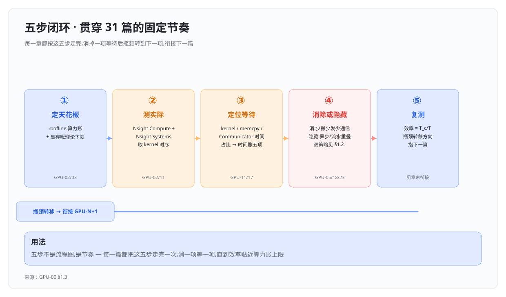

# GPU-00｜索引｜从 0 开始 GPU 优化：路线、章节与练习

> 本目录是「从 0 开始 GPU 优化」系列文档的 Markdown 版，共 33 章，由飞书原文转换，正文与原文一致，画板导出为图片放在 `assets/`。配套代码在仓库根目录，每章一个目录。

> 🎯 **这篇文档解决什么问题**：全系列只讲一件事，让昂贵的计算单元少等待、多干活。GPU 优化的本质是识别并消除时间账的五项等待（有效计算、访存等待、主机等待、通信等待、空转停机），各层级的优化手段（从片上 SRAM 到万卡集群）的骨架相同：先算出不该等多久（天花板），再测出实际等了多久，定位等在哪，消掉它，复测看瓶颈转到了哪里。全系列 31 篇沿用这一条主线，从单个 SM 一直讲到万卡集群和 LLM 训推。
>
> 使用方式：先读第 1 章理解时间账与五步闭环，再按第 4 章选读法（算子、平台还是 LLM 系统）跳读相关章节，用第 3 章的五张表当目录查询。每篇文档配套代码放在 zero-to-gpu 仓库的对应目录，目录名以 NN-title 形式对应章节 GPU-NN。代码分两类：sim\_ 开头的 CPU 可跑的模拟器，gpu\_ 开头的需要真实 GPU；每章都有测试，可运行验证。文中版本、规格和基准数字核对于 2026 年 11 月 5 日。
>
> **代码**：[zero-to-gpu](../README.md) 仓库地址 ../README.md，所有 31 章的代码目录全部就位，每章包含模拟器（sim\_）和 GPU 测试（gpu\_），支持完整的闭环验证。仓库目录树见第 6 章，命名约定见第 6 章说明。

**🧭 主线位置**：本页是系列入口，给出完整的学习路线、时间账与五步闭环的定义、硬件代数、五级等待框架和四把尺子；读完第 1 章就理解每篇处理时间账的哪一项；从 [GPU-01｜硬件｜GPU 架构：SM、存储层级与延迟隐藏](./01-arch.md) 开始下潜到硬件单核，最后由 [GPU-24｜LLM｜综合：从选卡到上线](./24-capstone.md) 把整张账收口，再回到本页第 7 章做验收与自测。

# 导读 · 先给结论

- **计算单元的等待来自于数据搬运、同步和通信，每一级搬运都有带宽限制。**依据 [[1]](https://www.nvidia.com/en-us/data-center/h100/)：H100 单卡 HBM 带宽 3.35 TB/s，NVLink 单向 450 GB/s（双向 900），PCIe Gen5 x16 约 63 GB/s（单向），200 Gb/s RDMA 网卡约 25 GB/s，形成访存与通信的“带宽阶梯”。同样字节数的等待，距离计算单元越远，延迟越长。
- **FlashAttention 从 V2 到 V3 的改进展示了时间账的压缩过程。**依据 [[2]](https://arxiv.org/abs/2307.08691)（FA2）和 [[3]](https://arxiv.org/abs/2407.08608)（FA3）：FA2 通过分块和在线 Softmax 压缩访存等待 W_mem；FA3 进一步用异步操作把计算与主机侧等待 W_host 重叠，每代消掉的是账簿的一项。
- **拐点右移让越来越多 kernel 遭遇访存墙。**依据 [[1]](https://www.nvidia.com/en-us/data-center/h100/) 和 [[4]](https://www.nvidia.com/en-us/data-center/dgx-b200/)：H100 拐点（算术强度）295 Flops/Byte，B200 约 560 Flops/Byte，表示能充分利用峰值的 kernel 越来越稀有，大多数 kernel 卡在访存瓶颈。
- **显存容量与延迟是 batch 大小和并行度的上限。**依据 [[5]](https://arxiv.org/abs/2309.06180)（PagedAttention）：训练需要足够显存放梯度和中间激活，推理需要容纳 KV cache；显存不够要么降 batch、要么卸载或重算，每一种选择反过来改变计算与通信的时间账。
- **系统层（驱动、显存分配、PCIe、NVLink）的等待常被忽视，但在大规模集群整体吞吐上通常占 5 到 20 百分比。**依据 [[6]](https://arxiv.org/abs/2402.15627)（MegaScale）和 [[7]](https://arxiv.org/abs/2104.04473)（Megatron-LM）：单机 8 卡还看不出，跨节点时通信碰撞、调度气泡、故障恢复会显著拉长关键路径。
- **模型并行、数据并行、流水并行与专家并行的时间账各不相同，选错了并行方案让某一项等待爆炸。**依据 [[8]](https://arxiv.org/abs/2412.19437)（DeepSeek-V3）和 [[9]](https://jax-ml.github.io/scaling-book/) 《How To Scale Your Model》：通信等待与计算重叠比例、显存与算力比、集群网络带宽这三个参数决定哪种并行最优。

**📎 与系列其他文档的分工**

本页给出整套时间账、五步方法论、硬件代数和五级框架；硬件微观特性（SM、缓存、延迟隐藏）由 [GPU-01｜硬件｜GPU 架构：SM、存储层级与延迟隐藏](./01-arch.md) [GPU-06｜硬件｜Tensor Core 与低精度：从 mma 到 FP8 和 FP4](./06-tensor-core.md) 负责；账本定义、Roofline 和四把尺子在 [GPU-02｜硬件｜性能账本：Roofline、算术强度与三类瓶颈](./02-ledger.md)；通信下限和 NCCL 优化细节在 [GPU-18｜集群｜NCCL：算法、协议与挂死排查](./18-nccl.md)；显存和算力的权衡在 [GPU-21｜LLM｜训练并行：TP、PP、DP、ZeRO 与 FP8](./21-train-parallel.md) [GPU-23｜LLM｜推理系统：KV cache、PagedAttention 与 PD 分离](./23-inference.md)；最后 [GPU-24｜LLM｜综合：从选卡到上线](./24-capstone.md) 用具体模型案例验证整套方案。

# 第 1 章 · 这套系列在等什么：一本时间账、五步闭环

GPU 优化就是把等待一层层消掉：先算出不该等多久（天花板），再测出实际等了多久，找到等在哪，消掉它，复测，再看瓶颈转到了哪里。这五步组成一个闭环，贯穿本系列所有 31 篇。

## 1.1 一句话主线

GPU 优化的目标是让计算单元（CUDA 核心、Tensor Core）充分利用，少做等待。昂贵的硅片每纳秒空转一次都是真金白银的浪费。本系列的主线就是“让计算单元少等待、多干活”，按等待发生的位置由内向外分层，落到 31 篇课程，每篇都回答同一组问题：这一层在等什么、等多久、怎么消。

## 1.2 时间账：把等待名目化

一个 kernel 或一个训练步的总时间可以分解为五项：

```
实际时间 T = T_compute                    (有效计算时间)
           + W_mem                       (SM 等 HBM：访存延迟、搬运)
           + W_host                      (GPU 等主机与环境：驱动、显存分配、PCIe)
           + W_comm                      (卡等卡、卡等网络：NVLink、RDMA、气泡)
           + W_idle                      (空转与停机：卡等任务、等调度、等故障恢复)
效率 = T_compute / T

```


“暴露的”等待是关键词。被重叠（overlap）藏到计算后面的等待不计入关键路径，所以优化分两类：**减少等待量**（少搬字节、少发 kernel、少通信）和**把等待藏起来**（异步、流水、重叠）。FlashAttention-2 用分块压缩了 W_mem；FlashAttention-3 用异步操作把 W_host 重叠到计算里。

显存账、通信账、算力账是时间账的输入：算力账决定 T_compute 的下限，通信账给 W_comm 的理论下限，显存账决定能开多大 batch，从而反过来影响前两项。

## 1.3 五步闭环

每篇正文和案例都按五步展开，每步都必须出现这五个词。

**第 1 步：定天花板**。用规格手册和账本公式算出理论时间。GPU-02 用 Roofline 模型[[10]](https://www2.eecs.berkeley.edu/Pubs/TechRpts/2008/EECS-2008-134.html)给每个 kernel 画出带宽界与算力界的交点，得出理论 FLOPs；GPU-14 用 nsys 拿到 profiler 的时间线，看清空隙和饱和度[[11]](https://docs.nvidia.com/nsight-systems/UserGuide/index.html)。通常天花板=规格/（瓶颈资源），比如访存瓶颈的天花板 =HBM 带宽 ÷ 字节数。

**第 2 步：测实际**。用指定工具测出实际时间或带宽，给出命令和指标名。GPU-02 跑 sim_roofline.py 测实际达到的 FLOPs；GPU-17 跑 ECMP 碰撞测试（sim_ecmp.py）看网络延迟变化[[12]](https://www.microsoft.com/en-us/research/publication/rdma-commodity-ethernet-scale/)；GPU-18 拿 NCCL 的 all-reduce 时间[[13]](https://github.com/NVIDIA/nccl-tests)。

**第 3 步：定位等待**。差距落在时间账的哪一项，用哪个指标证明。GPU-01 用 occupancy 和 in-flight 字节数证明是 W_mem（[GPU-01｜硬件｜GPU 架构：SM、存储层级与延迟隐藏](./01-arch.md)）；GPU-14 用 nsys 的 Stall Reason 看 SM 为什么闲着（[GPU-14｜单机｜性能分析与 Profiling](./14-profiling.md)）；GPU-17 的 ECMP 碰撞测试显示网络上的气泡（[GPU-17｜集群｜RDMA 网络：InfiniBand、RoCE 与拥塞控制](./17-rdma.md)）。

**第 4 步：消除或隐藏**。给出手段和它消掉的那一项，附前后对比数字。GPU-05 的 GEMM 优化从朴素循环到双缓冲，消掉乘加单元的等待（[GPU-05｜硬件｜GEMM 逐步优化：从朴素循环到 warp 分块](./05-gemm.md)）；GPU-18 的分桶策略减少 all-reduce 的通信延迟[[14]](https://arxiv.org/abs/2507.04786)，隐藏 W_comm（[GPU-18｜集群｜NCCL：算法、协议与挂死排查](./18-nccl.md)）；GPU-23 的 decode 带宽账表[[5]](https://arxiv.org/abs/2309.06180)显示怎么用 KV cache 压缩的权重访存。

**第 5 步：复测并找下一个瓶颈**。消掉一项等待后，瓶颈转移到时间账的哪一项，衔接下一篇。GPU-02 消掉算力约束后，可能卡在访存，转到 GPU-04；GPU-04 优化访存合并后，可能卡在计算强度，转到 GPU-05。



## 1.4 带宽阶梯：同一堵墙在不同尺度

访存墙和通信墙本质是同一现象：离计算单元越远，带宽越低、延迟越高。以 H100 SXM 为例，全系列引用这张阶梯（单向，带引用）：

| 层级 | 典型带宽 | 对应章节 |
|-|-|-|
| 寄存器 / 共享内存 | 每 SM 每周期 128 B，整卡数十 TB/s | GPU-01、04、05、08 |
| L2 缓存 | 数 TB/s 到十余 TB/s | GPU-01、04 |
| HBM3 | 3.35 TB/s[[1]](https://www.nvidia.com/en-us/data-center/h100/) | GPU-01、02、04 |
| NVLink4（单卡聚合，单向） | 450 GB/s（双向 900）[[1]](https://www.nvidia.com/en-us/data-center/h100/) | GPU-13、18、21 |
| PCIe Gen5 x16（单向） | 约 63 GB/s[[15]](https://docs.nvidia.com/cuda/cuda-toolkit-release-notes/index.html) | GPU-11 |
| 400 Gb/s RDMA 网卡（单向） | 50 GB/s[[12]](https://www.microsoft.com/en-us/research/publication/rdma-commodity-ethernet-scale/) | GPU-17、18 |

带宽阶梯说明”少搬字节”和”把搬运藏起来”在每一级都重复出现。从寄存器到 HBM 是数量级的下降，从 HBM 到网络卡又是十倍的下降，所以片上缓存的优化（共享内存用法、bank conflict 避免）值得细致打磨。

## 1.5 四把尺子：指标口径统一

不同的指标回答不同的问题，常见误用会导致优化方向错。以下四把尺子贯穿全系列，定义在 GPU-02，采集方法在 GPU-14，定基线在 GPU-16，集群监控在 GPU-20，最后用来验收在 GPU-24。

| 尺子 | 回答什么 | 常见误用 |
|-|-|-|
| GPU-Util（nvidia-smi） | 采样窗口内是否有任意 kernel 在跑 | 当成饱和度；一个只占 1 SM 的 kernel 也能显示 100% |
| SM Activity / Occupancy（DCGM） | 多少 SM、多少 warp 在干活 | 忽略 Tensor Core 是否真的在用 |
| Tensor Core Active / DRAM Active（DCGM、ncu） | 矩阵单元和 HBM 是否被喂饱 | 与 MFU 混用；稀疏时误导极大 |
| MFU / HFU、tokens/s、goodput | 端到端有效产出占峰值的百分比 | 用稀疏峰值作分母；重算计入 MFU 拉低百分比 |

> 🔑 **本章要点**
>
> GPU 优化的骨架是消除时间账的五项等待（T_compute、W_mem、W_host、W_comm、W_idle）。每篇都遵循五步闭环：定天花板、测实际、定位等待、消除或隐藏、复测。带宽阶梯展示从片上 SRAM（数十 TB/s）到网卡（50 GB/s）的十倍级递减，所以优化的代价在每一级都不同。四把尺子（GPU-Util、Occupancy、Tensor Active、MFU）各有口径，混用会导致优化歧路。本章消除的是对“等什么”这个问题的模糊认识。

# 第 2 章 · 五级路线：等待从内到外

从单个计算单元内部的数据等待，到整个集群中的任务排队，GPU 优化构成五个嵌套的等待等级。每级移除或隐藏一类等待，把瓶颈暴露到下一级，最后由 [GPU-24｜LLM｜综合：从选卡到上线](./24-capstone.md) 把整张账收口。

## 2.1 五级与出口能力

[GPU-01｜硬件｜GPU 架构：SM、存储层级与延迟隐藏](./01-arch.md) 到 [GPU-08｜硬件｜注意力内核](./08-attention.md) 聚焦单卡单 kernel，优化对象是**计算单元等待数据**。逐步拉高 kernel 本身的吞吐率，出口是单 kernel 能达到硬件峰值的百分之几。

[GPU-09｜系统｜驱动、CUDA 兼容与 Xid](./09-driver.md) 到 [GPU-12｜系统｜MIG、MPS 与容器](./12-sharing.md) 管理单卡全局资源，问题是**GPU 等主机、环境与共享冲突**。排除驱动版本不匹配、显存碎片、任务独占但远未饱卡的浪费，出口是整个 GPU 的实用率达到多少。

[GPU-13｜单机｜NVLink 与 NVSwitch](./13-nvlink.md) 到 [GPU-16｜单机｜单机验收与调优](./16-node-burnin.md) 优化单机内部互联与发射流水，重点是**卡等卡（机内）与 CPU 发射**。NVLink 带宽和集合通信的气泡决定单机的集合吞吐，Python/CUDA 框架开销决定单个 kernel 之间的间隔，出口是一台机器内所有 GPU 协同的有效吞吐率。

[GPU-17｜集群｜RDMA 网络：InfiniBand、RoCE 与拥塞控制](./17-rdma.md) 到 [GPU-20｜集群｜可靠性与可观测：故障、静默错误与 checkpoint](./20-reliability.md) 跨越机间网络与故障，瓶颈转为**卡等网络与任务等故障恢复**。多机间的 RDMA 网络、NCCL 通信算法、Kubernetes 调度碎片和集群级故障都拉长关键路径，出口是一个集群内所有机器的协同吞吐与可靠性承诺。

[GPU-21｜LLM｜训练并行：TP、PP、DP、ZeRO 与 FP8](./21-train-parallel.md) 到 [GPU-24｜LLM｜综合：从选卡到上线](./24-capstone.md) 聚焦 LLM 模型级系统，最后一米是**模型并行和推理系统**。TP/PP/DP/ZeRO 和 KV cache 管理决定全局的显存账和通信账，最终由 [GPU-24｜LLM｜综合：从选卡到上线](./24-capstone.md) 给出完整的成本模型和验收清单，闭合整个优化闭环。

| **级别** | **章节** | **等待的根源** | **优化的出口能力** | **下级新瓶颈** |
|-|-|-|-|-|
| **L1 · 硬件与内核** | 01–08 | 计算单元等待内存数据、延迟未隐藏、带宽未饱和 | 单 kernel MFU ≈ 60–85%（根据算术强度） | 主机与设备间的同步和拷贝 |
| **L2 · 系统与驱动** | 09–12 | GPU 等驱动、环境、显存、资源碎片 | 整卡实用率 ≈ 70–90%（消除空闲时间片） | 机间互联与单机协同 |
| **L3 · 单机** | 13–16 | 卡等卡（NVLink 饱和）、CPU 发射延迟、框架开销 | 单机内 8 卡协同的集合通信吞吐 ≈ 85–95% | 跨机网络延迟与拥塞 |
| **L4 · 集群** | 17–20 | 卡等网络（ECMP 极化、拥塞）、任务排队、故障恢复 | N 机集群的吞吐缩放效率 ≈ 85%（通信开销 <15%） | 模型级并行与显存账 |
| **L5 · LLM 训练基础设施** | 21–24 | 显存与通信账不匹配、流水气泡、训练侧 KV cache 显存账 | 训练模型的每 flop 的有效吞吐与成本可预测 | （训练侧闭环） |
| **L6 · 推理专项** | 25–31 | decode 等权重与 KV、推理引擎与成本、Agent 流量的新形态 | 推理侧单卡产能、单 token 成本、turn-resume TTFT 可预测 | （推理侧闭环）**L7 · 前沿跟踪**32–33等待名目从硬件轴转到调度轴(Vera Rubin/Dynamo/FA4), tensor core 五代重写循环(Volta→Blackwell)能把 NVIDIA 当年 roadmap 翻译成时间账变化(前瞻与考古) |


## 2.2 每章的统一结构

为了让读者快速定位问题，所有章节（01–31）遵循固定的骨架：开篇 🎯 说明本章解决的问题、使用方式和配套代码；🧭 主线位置指出本章在整个时间账中的角色；导读给出 5–7 条开箱即用的结论；第 1 章讲“在等什么”和具体例子；随后深入五步闭环（定天花板、测实际、定位等待、消除或隐藏、复测）；常见误区 💡 callout 列举陷阱；末章包含 📌 核对清单与 🔑 本章要点。

这样做的好处是读者既能按主题精读（比如只关注 NCCL），也能按闭环顺序深度学习，还能快速在已知条件下补课。

## 2.3 版本基线与硬件代次

本系列基准测试与代码对标 [[15]](https://docs.nvidia.com/cuda/cuda-toolkit-release-notes/index.html) CUDA 13.4 Update 2、[[16]](https://github.com/pytorch/pytorch/releases/tag/v2.15.0) PyTorch 2.15.0、[[17]](https://docs.nvidia.com/deeplearning/nccl/release-notes/index.html) NCCL 2.32.3、[[18]](https://docs.nvidia.com/cutlass/latest/CHANGELOG.html) CUTLASS 4.8.1、[[19]](https://developer.nvidia.com/nsight-compute-history) Nsight Compute 2026.3.1。所有性能数字和行为基准按本列表，跨版本的差异在各章单独说明。

硬件重点覆盖 A100、H100、B200、Rubin，每代都会因拐点移动而改变瓶颈归类。第 5 章详细说明为什么每代都要重新计算等待账。

> 💡 **常见误区**：以为优化从 L1 开始顺序向上，优化是“找瓶颈 → 定位到哪级 → 纵深消除”。有时一个 kernel 在 L1 已经 85% MFU，但在整个训练流中它只占 2%，对端到端吞吐的影响微乎其微。优先级是抓关键路径上的等待、占比最大的等待、能带来指数级收益的等待。

> 💡 <p><b>常见误区</b>：把“MFU 不达峰值”等同于“kernel 写得不好”。 MFU 受限于问题的数学特性和通信约束：矩阵小、算术强度低、通信开销大都是正常的，[GPU-02｜硬件｜性能账本：Roofline、算术强度与三类瓶颈](./02-ledger.md) 的 Roofline 会解释清楚为什么。不是所有 kernel 都能或需要吃到 80% 以上的峰值。</p>

> 💡 <p><b>常见误区</b>：假设多机扩展就自动并行。 L4 的大多数问题（ECMP 极化、拥塞、调度碎片）都是隐形的。第一次上集群往往会掉到 50% 的缩放效率，需要逐层诊断和配置。[GPU-17｜集群｜RDMA 网络：InfiniBand、RoCE 与拥塞控制](./17-rdma.md) 到 [GPU-20｜集群｜可靠性与可观测：故障、静默错误与 checkpoint](./20-reliability.md) 的四章正是为了从系统层补全这些空白。</p>

> 🔑 **本章要点**：五级框架是”等待从细粒度到粗粒度、从芯片内到跨集群”的递进。每级的出口能力（MFU、实用率、缩放效率）都是下一级的约束和参考。本章确立了阅读地图和问题诊断的分级体系。

# 第 3 章 · 三十一章清单：每篇消掉哪一项等待

下面五张表是系列的完整目录，每篇都已发布。等待列对应第 1 章时间账里的一项，范围列写这一篇深挖什么、不越界写什么；代码列是配套仓库里的目录，每个目录都有能在 CPU 上跑的模拟器和单元测试，需要 GPU 的脚本另行标注。

## 3.1 L1 硬件与内核

八章处理计算单元等数据：SM 等 HBM、乘加单元等搬运、搬运与计算串行、中间结果落 HBM。

| 章节 | 处理的等待 | 范围 | 配套代码 |
|---|---|---|---|
| [GPU-01｜硬件｜GPU 架构：SM、存储层级与延迟隐藏](./01-arch.md) | 线程等访存延迟 | SM 上驻留的 warp 不够多，访存延迟藏不住；占用率、Little 定律与 in-flight 字节数 | [01-arch](../01-arch) |
| [GPU-02｜硬件｜性能账本：Roofline、算术强度与三类瓶颈](./02-ledger.md) | 建坐标：谁在等谁 | 给每个 kernel 和每个训练步算出理论时间，判断等待落在算力、带宽还是固定开销；MFU 与 Roofline 是全系列的尺子 | [02-ledger](../02-ledger) |
| [GPU-03｜硬件｜CUDA 编程模型：线程层级、stream 与编译链](./03-cuda.md) | 主机与设备互相等 | 隐式同步、默认 stream 串行、H2D 拷贝挡住计算；stream、event 与异步拷贝让两边并行 | [03-cuda](../03-cuda) |
| [GPU-04｜硬件｜访存与归约：合并访存、共享内存与 warp 归约](./04-memory.md) | SM 等 HBM | 不合并访存、bank conflict、标量加载让每次搬运浪费带宽；归约逼近带宽屋顶 | [04-memory](../04-memory) |
| [GPU-05｜硬件｜GEMM 逐步优化：从朴素循环到 warp 分块](./05-gemm.md) | 乘加单元等数据 | GEMM 每一级分块提高数据复用、双缓冲把搬运藏到计算后面 | [05-gemm](../05-gemm) |
| [GPU-06｜硬件｜Tensor Core 与低精度：从 mma 到 FP8 和 FP4](./06-tensor-core.md) | 搬运与计算串行 | Tensor Core 太快，搬运必须异步化（cp.async、TMA、wgmma、tcgen05），每个字节还要更小（FP8、FP4） | [06-tensor-core](../06-tensor-core) |
| [GPU-07｜硬件｜Triton、CUTLASS 与 CuTe DSL](./07-dsl.md) | 等待交给谁来消 | 手写 CUDA、Triton、CuTe DSL 各自把多少流水、分块和异步留给编译器；抽象层的性能上限 | [07-dsl](../07-dsl) |
| [GPU-08｜硬件｜注意力内核](./08-attention.md) | 中间结果落 HBM | 注意力的 N×N 矩阵往返 HBM；分块融合加在线 softmax 让它不落盘，新瓶颈转到指数单元与共享内存 | [08-attention](../08-attention) |

## 3.2 L2 系统与驱动

四章处理 GPU 等主机和环境：等驱动起来、等显存分配、等 PCIe 与主机内存、卡等任务。

| 章节 | 处理的等待 | 范围 | 配套代码 |
|---|---|---|---|
| [GPU-09｜系统｜驱动、CUDA 兼容与 Xid](./09-driver.md) | 任务等环境 | 驱动、CUDA、容器版本错配起不来，Xid 故障掉卡；等待最贵的形态是停机 | [09-driver](../09-driver) |
| [GPU-10｜系统｜显存管理](./10-memory-mgmt.md) | 等显存 | 分配器碎片、OOM 重试、可分页内存拷贝让 GPU 等内存；caching allocator 与 pinned 内存 | [10-memory-mgmt](../10-memory-mgmt) |
| [GPU-11｜系统｜PCIe、NUMA 与 GPUDirect](./11-pcie-gdr.md) | GPU 等主机链路 | PCIe 代际与宽度、NUMA 跨 socket、IOMMU 和 bounce buffer 让数据绕路；GPUDirect 让设备直达 | [11-pcie-gdr](../11-pcie-gdr) |
| [GPU-12｜系统｜MIG、MPS 与容器](./12-sharing.md) | 卡等任务 | 一个吃不满整卡的任务独占整卡；MIG、MPS 和容器切分把空闲时间片用起来 | [12-sharing](../12-sharing) |

## 3.3 L3 单机

四章处理卡等卡与 GPU 等 CPU 发射，并定下单机不该等多久的基线。

| 章节 | 处理的等待 | 范围 | 配套代码 |
|---|---|---|---|
| [GPU-13｜单机｜NVLink 与 NVSwitch](./13-nvlink.md) | 卡等卡（机内） | 8 卡之间的 NVLink 与 NVSwitch 带宽决定单机集合通信的下限 | [13-nvlink](../13-nvlink) |
| [GPU-14｜单机｜性能分析与 Profiling](./14-profiling.md) | 看准等待 | nsys 时间线找空隙、ncu stall reason 找 kernel 内等待、DCGM 看整机饱和度；GPU-Util 不等于干活 | [14-profiling](../14-profiling) |
| [GPU-15｜单机｜PyTorch 运行时](./15-runtime.md) | GPU 等 CPU 发射 | Python 和框架开销让 kernel 之间出现空隙；torch.compile 融合与 CUDA Graph 消除 launch 等待 | [15-runtime](../15-runtime) |
| [GPU-16｜单机｜单机验收与调优](./16-node-burnin.md) | 定下不该等多久 | 单机验收把算力、带宽、互联的合格线定下来，作为后续所有等待的基线 | [16-node-burnin](../16-node-burnin) |

## 3.4 L4 集群

四章处理卡等网络、计算等通信、任务等调度、训练等故障恢复。

| 章节 | 处理的等待 | 范围 | 配套代码 |
|---|---|---|---|
| [GPU-17｜集群｜RDMA 网络：InfiniBand、RoCE 与拥塞控制](./17-rdma.md) | 卡等网络 | 跨机 RDMA 的带宽、拥塞、PFC 和 ECMP 哈希极化让集合通信等网络 | [17-rdma](../17-rdma) |
| [GPU-18｜集群｜NCCL：算法、协议与挂死排查](./18-nccl.md) | 计算等通信 | ring、tree 与 Simple、LL、LL128 协议决定通信时间，overlap 决定其中多少暴露在关键路径上；挂死是无限等待 | [18-nccl](../18-nccl) |
| [GPU-19｜集群｜Kubernetes 上的 GPU：设备插件与拓扑感知调度](./19-k8s.md) | 任务等调度 | 设备插件、GPU Operator 与拓扑感知调度决定任务排队多久、落在哪个 NVLink 域，碎片让卡空等任务 | [19-k8s](../19-k8s) |
| [GPU-20｜集群｜可靠性与可观测：故障、静默错误与 checkpoint](./20-reliability.md) | 训练等故障恢复 | 故障、慢节点和静默数据错误让整个作业停摆或重算；checkpoint 间隔与有效训练时间占比 | [20-reliability](../20-reliability) |

## 3.5 L5 LLM infra

四章处理模型级的等待：并行的通信与气泡、等最慢的专家、decode 等权重与 KV，最后把整张时间账算到上线。

| 章节 | 处理的等待 | 范围 | 配套代码 |
|---|---|---|---|
| [GPU-21｜LLM｜训练并行：TP、PP、DP、ZeRO 与 FP8](./21-train-parallel.md) | 等通信与流水气泡 | TP、PP、DP、ZeRO 和 FSDP 的组合决定显存账、通信账和气泡；FP8 训练把每个字节变小 | [21-train-parallel](../21-train-parallel) |
| [GPU-22｜LLM｜MoE 与专家并行：all-to-all 与负载均衡](./22-moe-ep.md) | 等最慢的专家 | MoE 的 all-to-all 通信和专家负载不均让所有 rank 等最慢的那个；DeepEP 与负载均衡 | [22-moe-ep](../22-moe-ep) |
| [GPU-23｜LLM｜推理系统：KV cache、PagedAttention 与 PD 分离](./23-inference.md) | decode 等权重与 KV，请求互相等 | KV cache 显存账、PagedAttention、continuous batching、chunked prefill、PD 分离 | [23-inference](../23-inference) |
| [GPU-24｜LLM｜综合：从选卡到上线](./24-capstone.md) | 把整张等待账算到上线 | 给定模型、预算和 SLO，选卡、定并行、估吞吐、算成本，再用实测校准每一项等待 | [24-capstone](../24-capstone) |
| [GPU-25｜LLM｜投机解码：αK 与 MTP / EAGLE 谱系](./25-speculative.md) | decode 一串算力富余可白送给草稿模型 | 三段式 Draft→Verify→Accept,αK 接受率决定上界,从 ngram 到 MTP/EAGLE 各档 K 值选型 | `25-spec-decode` |
| [GPU-26｜系统｜CXL：一致性互连与 KV offload 工程化](./26-cxl.md) | 等 CPU LPDDR 之外更大的一致性域 | 三协议复用一通道、Type 1/2/3 互斥、直连 170ns vs Switch 250ns、KV offload 落地到 CXL.mem 池 | `26-cxl` |
| [GPU-27｜硬件｜NVL72 与 Grace-Blackwell Superchip：打穿 TP=8](./27-nvl72.md) | 等 8 卡 NVLink 之外的更大 superchip 相干域 | 8→72 跨域、C2C 900 GB/s 芯内互联、130 TB/s NVSwitch Fabric、TP=72 重塑并行 | `27-nvl72` |
| [GPU-28｜LLM｜推理成本经济学：$ per token 与集群单卡经济](./28-cost.md) | 每个 token 等 CapEx / OpEx 在自己头上摊到 $/1M | 单卡账本($38/卡时)、利用率与折旧敏感性、P:D 卡种经济学、API 计费五分量、三场景测算、硬件 TCO、价格战底线 | `28-cost` |
| [GPU-29｜LLM｜推理引擎实战:SGLang vs vLLM 选型](./29-engine-choice.md) | decode 步等调度器拼 batch、等 KV 管理腾页 | Radix Tree vs 块哈希、PrefillAdder 五预算 vs token budget、HiCache L1/L2/L3 vs Hybrid KV、UnifiedRadixTree vs 多 backend、约束解码与投机解码 | `29-engine` |
| [GPU-30｜LLM｜线性注意力与 KDA:KV 消失之后的 serving](./30-linear-attention.md) | 读端等状态 checkpoint、prefill 等状态刚性强制的串行 | 谱系 DeltaNet→GDN→KDA,通道级门控 Diag(α)+DPLR 特化+NoPE,prefill 严格串行,状态检查点取代前缀缓存,双账本(状态刚性 vs KV 弹性) | `30-linear-attn` |
| [GPU-31｜LLM｜Agent Workload Serving:会话原语与约束解码](./31-agent-serving.md) | turn 之间等会话粘性、等跨 turn TTL 与抢占的 KV 命中 | 会话原语缺口(session id/KV TTL/分组抢占/turn 度量)、粘性路由 vs 外置 KV 池、约束解码三笔账、turn-resume TTFT、MLPerf Agentic 评测口径 | `31-agent-serving` |
| [GPU-32｜LLM｜Rubin 时代与 Dynamo 推理:Blackwell 之后的时间账(2026)](./32-rubin-dynamo.md) | 算力不再追带宽 — 等调度层把 Vera Rubin 的潜力兑现 | Vera Rubin 规格 (NVFP4 50 PF、HBM4 22 TB/s、NVL72 260 TB/s)、Rubin CPX prefill 专用卡、NVFP4 两级缩放、FA4 非对称硬件扩展 (TMEM/tcgen05/2-CTA)、FlashMLA/DeepGEMM/DeepEP 三件套、NVIDIA Dynamo (NIXL/KV 感知路由/KVBM/wide EP)、等待名目从硬件轴转到调度轴 | `32-rubin-dynamo` |
| [GPU-33｜LLM｜Tensor Core 三代跃迁:Volta→Turing→Ampere→Hopper,为什么每代都要重写 kernel](./33-tensor-core-generations.md) | 每代 tensor core 都换指令、寄存器、同步原语 — 老 kernel 都得重写 | Volta 起点 wmma 16x16x16 与 fragment 黑盒、Turing INT8/INT4 + mma.sync 统一、Ampere TF32 + 稀疏 + cp.async、Hopper wgmma + TMA + cluster 大统一、Blackwell tcgen05/UMMA 衔接 GPU-06、五代重写循环与"性能 vs 兼容性"的取舍、后继 API 趋稳但策略重写量加大 | `33-tensor-core` |

> 🔑 **本章要点**:三十三篇按等待从内到外排开。L1 八篇交付"能写、能算、能解释一个 kernel 的等待",L2 四篇交付"能装好一台机器并定位主机侧的等待",L3 四篇交付"能验收一台 8 卡机并给出单机等待基线",L4 四篇交付"能定位千卡作业的通信变慢、挂死和停机损失",L5 四篇交付"能为一个大模型写出带时间账的训练方案",L6 七篇交付"能为一个推理服务写出引擎、成本和 Agent 形体账",L7 二篇交付"能预判:Vera Rubin / Dynamo / FA4 / NVFP4 这一组新进展把时间账推向哪里,以及 tensor core 从 Volta 到 Blackwell 五代重写循环的来由"。查表的目的只有一个:先确认你的问题落在时间账的哪一项,再去读负责那一项的那一篇。

# 第 4 章 · 四条读法

本系列 31 章按五级从硬件到模型分布，但不同岗位从不同角度入场。三条主线分别对应”你要消掉哪几类等待”，在不同层级切片。选定主线后，主线外的章节可以后查；其他层级的问题遇到再回来翻。

## 4.1 第一条：算子与内核（消 W_mem）

目标是能写和优化 kernel，参与低精度、融合算子、分块算法这类单机优化。主线读 [GPU-01｜硬件｜GPU 架构：SM、存储层级与延迟隐藏](./01-arch.md) 到 [GPU-08｜硬件｜注意力内核](./08-attention.md) 全部，再用 [GPU-14｜单机｜性能分析与 Profiling](./14-profiling.md) 学会 profiler。这条线最依赖 GPU：[GPU-01｜硬件｜GPU 架构：SM、存储层级与延迟隐藏](./01-arch.md)、[GPU-04｜硬件｜访存与归约：合并访存、共享内存与 warp 归约](./04-memory.md)、[GPU-05｜硬件｜GEMM 逐步优化：从朴素循环到 warp 分块](./05-gemm.md) 的练习都要在真卡上跑才有意义，CPU 模拟器只服务于理解分块与访存模式。

关键检查点：每个 kernel 都能用 Roofline [[10]](https://www2.eecs.berkeley.edu/Pubs/TechRpts/2008/EECS-2008-134.html) 算出理论上限，再与实测对齐，差距超过 30% 时能指出原因。差距来自于以下之一：(1) 算术强度低于拐点，受 W_mem 约束；(2) 占用率不足，访存延迟未被隐藏，同属 W_mem；(3) 指令吞吐未饱和，固定开销或控制流占比过高；(4) L2 或 HBM 带宽未打满，说明存在通信或资源竞争。整个 L1 的目标是把 kernel 从 30% 利用率推到 60%，为上层提供不再是“算力” 而是“固定访存延迟加低吞吐”的问题表述。

## 4.2 第二条：平台与集群（消 W_host、W_comm）

目标是交付装好驱动、网络和资源的机器，支持训练和推理团队。主线是 [GPU-01｜硬件｜GPU 架构：SM、存储层级与延迟隐藏](./01-arch.md) 打底掌握硬件天花板，然后 [GPU-09｜系统｜驱动、CUDA 兼容与 Xid](./09-driver.md)、[GPU-11｜系统｜PCIe、NUMA 与 GPUDirect](./11-pcie-gdr.md)、[GPU-12｜系统｜MIG、MPS 与容器](./12-sharing.md) 理清系统层每一层的等待：显存分配、PCIe DMA、内核驱动。接着 [GPU-13｜单机｜NVLink 与 NVSwitch](./13-nvlink.md)、[GPU-16｜单机｜单机验收与调优](./16-node-burnin.md) 学会单机验收，最后 [GPU-17｜集群｜RDMA 网络：InfiniBand、RoCE 与拥塞控制](./17-rdma.md) 到 [GPU-20｜集群｜可靠性与可观测：故障、静默错误与 checkpoint](./20-reliability.md) 建网络、设调度、处故障。

内核章节（[GPU-01｜硬件｜GPU 架构：SM、存储层级与延迟隐藏](./01-arch.md)–[GPU-08｜硬件｜注意力内核](./08-attention.md)）可以只读概念部分不深挖实现。但 [GPU-14｜单机｜性能分析与 Profiling](./14-profiling.md) 关于 DCGM 的一节必读：线上监控、告警、成本核算都依赖那几个指标。这条线的最终交付是：这台机器的单机 baseline 是多少（[GPU-16｜单机｜单机验收与调优](./16-node-burnin.md) 验收题）；集群的通信时间账是多少（[GPU-18｜集群｜NCCL：算法、协议与挂死排查](./18-nccl.md) 和 [GPU-20｜集群｜可靠性与可观测：故障、静默错误与 checkpoint](./20-reliability.md) 的测量）；故障恢复 SLA 是多少。

## 4.3 第三条：LLM 训推系统（消 W_idle、W_comm）

目标是为一个模型写出训练或推理方案，把端到端吞吐调到线。主线从 [GPU-02｜硬件｜性能账本：Roofline、算术强度与三类瓶颈](./02-ledger.md) 的时间账打底，通过 [GPU-10｜系统｜显存管理](./10-memory-mgmt.md)、[GPU-15｜单机｜PyTorch 运行时](./15-runtime.md) 搞清显存与运行时约束，[GPU-14｜单机｜性能分析与 Profiling](./14-profiling.md) 学会读时间线定位气泡，[GPU-18｜集群｜NCCL：算法、协议与挂死排查](./18-nccl.md) 理解集合通信成本，然后 [GPU-21｜LLM｜训练并行：TP、PP、DP、ZeRO 与 FP8](./21-train-parallel.md) 到 [GPU-24｜LLM｜综合：从选卡到上线](./24-capstone.md) 用三本账（显存、通信、算力）逐个写出并行方案。

这条线要求读每一章都随身带一张表，同一行对应：方案名（如分布式数据并行与模型并行组合）、显存占用、通信量、计算量、与其他方案是否冲突。读完每章都要更新这一行，[GPU-24｜LLM｜综合：从选卡到上线](./24-capstone.md) 最后汇总全表，验证自己能够写出完整的时间账。这条线难度最高，因为涉及五层的综合理解：L1 的 kernel 效率、L2 的驱动与显存分配、L3 的单机 baseline、L4 的网络拓扑和 NCCL 碰撞、L5 的并行策略搜索。任何一层的卡点都会导致吞吐下降。

## 4.4 第四条 · 推理专项(消 decode 等待,T_flops ≤ 1 的负载)

目标是给一个推理服务(decode-dominated serving)写出引擎选择、成本账、负载匹配方案。主线读 [GPU-23｜LLM｜推理系统：KV cache、PagedAttention 与 PD 分离](./23-inference.md)(推理系统总账)打底，然后 [GPU-25｜LLM｜投机解码：αK 与 MTP / EAGLE 谱系](./25-speculative.md)(SpecDec 把 decode 单步变成 αK 步进)、[GPU-26｜系统｜CXL：一致性互连与 KV offload 工程化](./26-cxl.md)(KV offload 到 CXL.mem 池)、[GPU-27｜硬件｜NVL72 与 Grace-Blackwell Superchip：打穿 TP=8](./27-nvl72.md)(TP=72 的硬件底座)。落地经济学三段:[GPU-28｜LLM｜推理成本经济学：$ per token 与集群单卡经济](./28-cost.md)(单卡账本、价格战底线)、[GPU-29｜LLM｜推理引擎实战:SGLang vs vLLM 选型](./29-engine-choice.md)(SGLang/vLLM 引擎选型)、[GPU-30｜LLM｜线性注意力与 KDA:KV 消失之后的 serving](./30-linear-attention.md)(post-KV 时代的 serving)、[GPU-31｜LLM｜Agent Workload Serving:会话原语与约束解码](./31-agent-serving.md)(Agent 流量形态与约束解码)。

这条线跟前三条线的关系,是把"访存带宽 roofline(Chapter 1/2)、KV cache 显存账(Chapter 10/23)、PD 分离(Chapter 17)、NVLink 互联(Chapter 13/27)"这五项工程能力,**落到推理侧的具体算术题上**:一张卡 1 小时能接多少请求、单 token 边际成本多少钱、turn-resume TTFT 怎么进 SLO。学完这条线,应该能独立的完成"新推理服务上线 checklist" — 从选卡、选引擎、定 PD 比例,到压测、容量、成本,到 Agent 负载的会话原语评估。

## 4.5 第五条 · 前沿跟踪(消 W_idle 的新名目)

目标是预判:NVIDIA 当年 GTC 的 roadmap 会对时间账带来哪些新变化,新硬件、新精度、新算子、新模型结构将来时,团队能不能提前把账算出来。主线读 [GPU-32｜LLM｜Rubin 时代与 Dynamo 推理:Blackwell 之后的时间账(2026)](./32-rubin-dynamo.md)(Vera Rubin / Dynamo / FA4 / NVFP4 一组新进展怎么把等待从硬件轴推到调度轴),再读 [GPU-33｜LLM｜Tensor Core 三代跃迁:Volta→Turing→Ampere→Hopper,为什么每代都要重写 kernel](./33-tensor-core-generations.md)(tensor core 五代重写循环,理解 Hopper 不是终点、Blackwell 不是奇点)。

这条线与 4.1-4.4 的关系,是把"kernel / 单机 / 集群 / 训练 / 推理"这五条静态主线放到时间轴上 — 新书出来不是把老书推翻,而是在时间账同一套坐标上挪点位;team 内读完 GPU-32/33 的工程师,应该能用 30 分钟向团队解释 NVIDIA 当年 GTC 公告的时间账含义,并预告下一代自己负责子领域要做的重写。**这个能力是团队跟上 2026-2028 硬件节奏的关键**。

## 4.5 如何选择你的主线

三条路的起点不同，难度和所需时间也不同。算子与内核最陡：每个 kernel 从 30% 到 60% 都要反复迭代 Roofline 分析和 profiler 定位，一个 kernel 可能要花整整一周。但好处是最聚焦，一周能深刻理解 GPU 的内存层级和延迟隐藏；平台与集群最宽：系统层的坑多，IOMMU、NUMA、驱动版本的组合可能导致带宽掉一半，但最后的交付明确（验收题 checklist 列得很细）；LLM 训推系统最高：需要综合所有层的知识，但如果只是为了快速把一个模型调上去，可以先看 [GPU-23｜LLM｜推理系统：KV cache、PagedAttention 与 PD 分离](./23-inference.md)（推理 KV 读取的时间账）或 [GPU-21｜LLM｜训练并行：TP、PP、DP、ZeRO 与 FP8](./21-train-parallel.md)（训练并行的通信账），然后再按需回溯。

现实中很多团队的做法是混合路线：核心优化人员走第一条深挖算子，系统运维走第二条保证基础设施，模型框架团队走第三条定义并行方案，然后三方坐在一起对齐时间账。选哪条不重要，重要的是坚持用时间账作为对话的公共语言。把网络慢这个现象翻译成计算机可理解的语言：W_comm 是多少字节、在哪个通信算子上；把 MFU 不够翻译成是受 W_mem 还是 W_idle 约束；把显存不够翻译成 batch 再小一半后通信账会怎么变。本系列每章都在做这个翻译。

> 💡 <p><b>常见误区</b>：只读第三条（LLM infra）、跳过 L1 和 L2，会把很多现象误判成框架问题。MFU 低很可能是 GEMM 形状没对齐 Tensor Core 的分块（L1 问题），通信慢很可能是 NUMA 绑核错了导致 RDMA 走了跨 socket 链路（L2 问题）。如果 [GPU-21｜LLM｜训练并行：TP、PP、DP、ZeRO 与 FP8](./21-train-parallel.md) 每一笔通信账都没读过 [GPU-13｜单机｜NVLink 与 NVSwitch](./13-nvlink.md)、[GPU-17｜集群｜RDMA 网络：InfiniBand、RoCE 与拥塞控制](./17-rdma.md)、[GPU-18｜集群｜NCCL：算法、协议与挂死排查](./18-nccl.md) 的带宽定义，就容易低估实际等待。</p>

**🔑 本章要点**：三条主线分别针对算子、系统、模型层级，消掉 W_mem、W_host + W_comm、W_idle，每条都从各自的起点开始；选定主线可以跳过其他层级，但遇到性能卡点时要回来查细节。

# 第 5 章 · 硬件为什么每代都要重算

同一份代码在 A100 和 H100 上的瓶颈可能截然不同。根本原因是算力和带宽的增长速度不同步，每代硬件的 Roofline 拐点都在上移。原来在 A100 上受带宽限制的 kernel，升到 H100 后非但没有变快，反而更容易被带宽卡死，因为拐点右移意味着低算术强度会进一步受限。

## 5.1 拐点为什么每代都在上升

拐点定义是峰值算力除以显存带宽，单位 FLOP/字节 [[1]](https://www.nvidia.com/en-us/data-center/h100/)。H100 BF16 稠密 989 TFLOPS 除以 3.35 TB/s 显存带宽，拐点约 295 FLOP/B [[1]](https://www.nvidia.com/en-us/data-center/h100/)。前一代 A100 BF16 峰值 312 TFLOPS，显存带宽 2.04 TB/s，拐点约 153 FLOP/B [[20]](https://www.nvidia.com/en-us/data-center/a100/)。B200 跳到 FP8 稠密 4.5 PFLOPS 与 8 TB/s，约 560 FLOP/B [[4]](https://www.nvidia.com/en-us/data-center/dgx-b200/)；Rubin 用 NVFP4 50 PFLOPS 和 22 TB/s HBM4，约 2270 FLOP/B [[21]](https://developer.nvidia.com/blog/inside-nvidia-rubin-gpu-architecture-powering-the-era-of-agentic-ai/)。

**拐点右移的后果**：算术强度（kernel 每读一字节的浮点操作数）是硬件无关的性质，由算法决定。LLM decode 的矩阵向量乘，每字节权重做 2 次浮点运算，算术强度就是 2 FLOP/B。在 A100 上这已经离拐点 153 很近，在 H100 上离 295 就更远了，在 B200 上更是十倍差距。这意味着 decode、逐元素算子、归一化这些本来就不是算力密集的操作，在每一代新卡上都会掉进 W_mem 的更深处。

优化策略的迁移成本很高。一个在 H100 上经过仔细调优的 kernel，拷到 B200 上时，同样的代码可能性能反而下降。原因出在硬件的脾气变了：H100 上解决问题的访存优化策略（减少读写次数、增加访存粒度）在 B200 上已经不足够。拐点上升了，光靠减访存还不够，还需要改算法本身来提高算术强度。这就是为什么每代硬件发布后的第一年，各个框架和算子库都要重新优化所有内核。

## 5.2 读规格表的三个口径

- **稀疏与稠密**：NVIDIA 产品页面的最大 TFLOPS 通常是 2:4 结构化稀疏口径，稠密是它的一半。H100 FP8 标称 3958 TFLOPS 是稀疏，稠密 1979 TFLOPS [[1]](https://www.nvidia.com/en-us/data-center/h100/)。本系列所有账本都按稠密口径计算。
- **整机与单卡**：DGX、HGX 产品页给的聚合数字（算力与带宽都是 8 卡合计），要除以 8；NVLink 双向带宽标称数字是往返之和，单向要再除以 2。[GPU-13｜单机｜NVLink 与 NVSwitch](./13-nvlink.md) 会给出 16 卡 H100 HGX 的完整规格拆解。
- **峰值与可达**：峰值假设每个 SM 都在最高频率、指令全是 Tensor Core 乘加且无依赖延迟。实测 GEMM 通常能达到峰值的 70–80%，HBM 带宽实测通常在标称值 90% 上下。[GPU-02｜硬件｜性能账本：Roofline、算术强度与三类瓶颈](./02-ledger.md) 会教怎么用 Roofline [[10]](https://www2.eecs.berkeley.edu/Pubs/TechRpts/2008/EECS-2008-134.html) 和 [GPU-14｜单机｜性能分析与 Profiling](./14-profiling.md) 的 profiler 实测这些数字。

**常见误区：拿稀疏峰值算 MFU**。H100 上一个 FP8 训练任务实测达到 900 TFLOPS，按稀疏峰值 3958 TFLOPS 算只有 23% MFU，按稠密峰值 1979 TFLOPS 算是 45%。两倍差异可能导致错误的优化判断：按 45% 判断瓶颈已经显著，但按 23% 判断还有远大空间。这在优化方向判断上会产生完全相反的结论。由于稠密峰值是实际训练中能触达的上界，[GPU-02｜硬件｜性能账本：Roofline、算术强度与三类瓶颈](./02-ledger.md) 和 [GPU-24｜LLM｜综合：从选卡到上线](./24-capstone.md) 的收口都按稠密峰值算 MFU。[GPU-21｜LLM｜训练并行：TP、PP、DP、ZeRO 与 FP8](./21-train-parallel.md) 引用 Megatron-LM 和 MegaScale 的论文报告时，也要统一口径，确认作者原文用的是稀疏还是稠密 [[7]](https://arxiv.org/abs/2104.04473) [[6]](https://arxiv.org/abs/2402.15627)。

## 5.3 实战：如何用拐点快速判断优化空间

拿到一个 kernel 的实测 TFLOPS，第一步是算出它的算术强度。不需要 profiler，只要数 FLOP 数和字节数。例如 BF16 矩阵乘 C = A × B，如果 A 是 (N, K)，B 是 (K, M)，C 是 (N, M)，那么 FLOP 数是 2·N·K·M，字节数是 2·B（(N+K)·M + N·K）（不计 C 的输出，因为那是写入）。算术强度 = FLOP 数 / 字节数。然后看这个值相对于你的硬件拐点在哪：如果远低于拐点，优化方向就是减少访存（融合算子、重用数据、改批大小）；如果接近或超过拐点，看实测是否达到峰值，如果没有就检查占用率和指令级并行。这个判断过程不需要等 profiler 跑完，30 秒的心算就能给出优化方向。

这也是为什么 [GPU-02｜硬件｜性能账本：Roofline、算术强度与三类瓶颈](./02-ledger.md) 要求每个 kernel 都要画 Roofline 图：不只是为了好看，而是这个图本身就是一个快速筛选工具。如果你的 kernel 在拐点左侧（算术强度低），优化的天花板就是访存带宽，再怎么 tune 也增加不了 TFLOPS。此时有两个选择：改算法提高算术强度，或接受这就是当前能跑的最快速度。

> 💡 <p><b>前提知识</b>：如果这一章读得有疑惑，说明 [GPU-01｜硬件｜GPU 架构：SM、存储层级与延迟隐藏](./01-arch.md) 关于 SM 与访存延迟、或 [GPU-02｜硬件｜性能账本：Roofline、算术强度与三类瓶颈](./02-ledger.md) 关于 Roofline 的概念部分没有掌握。Roofline 是全系列的公共图示 <a href="https://www2.eecs.berkeley.edu/Pubs/TechRpts/2008/EECS-2008-134.html">[10]</a>，包括这一章的拐点概念也是 Roofline 模型的直接推论。建议先读完 [GPU-01｜硬件｜GPU 架构：SM、存储层级与延迟隐藏](./01-arch.md)–[GPU-02｜硬件｜性能账本：Roofline、算术强度与三类瓶颈](./02-ledger.md)，或者把自己任务的一个 kernel 画到 Roofline 上，验证算术强度和拐点的关系。</p>

**🔑 本章要点**：拐点每代上升，低算术强度 kernel 永远受带宽限制且差距扩大，优化策略在新硬件上需要重新评估；规格表有三个口径陷阱（稀疏/稠密、整机/单卡、峰值/可达），统一口径是全系列报数的前提；快速判断任何 kernel 的优化空间只需要算出算术强度和拐点的关系。

# 第 6 章 · 起步前的准备

## 6.1 前置知识

- **C++ 与 Python**：能读懂指针、模板和 CMake；能写 PyTorch 训练循环，知道张量的形状、步长和设备。这套手册大量涉及性能代码，涉及底层优化的实战而非高级应用场景。CUDA kernel 通常用 C++ 写，压测脚本用 Python，你需要在两者间切换。
- **计算机体系结构**：知道缓存行、内存带宽、SIMD 和流水线是什么。CPU 和 GPU 虽然都用这些概念，但数字差异巨大：CPU 缓存以 KB 计，延迟以纳秒计；GPU 缓存以 MB 计，延迟以百纳秒计。不熟的读者先读第 1 章前两节，那里从 CPU 和 GPU 的设计取舍讲起，能解释为什么 GPU 特别适合并行计算。
- **Linux 运维**：会用 dmesg、lspci、numactl、systemctl，知道内核模块和用户态驱动的区别。L2 各章默认读者能自己装驱动、查看系统日志、改内核参数（IOMMU、MPS、MIG）。没有 root 权限的读者可以跳过 L2 章节，先完成 L1。
- **Transformer**：知道一层 Transformer 里有哪些矩阵乘，KV cache 存的是什么。L5 会把这些换算成 FLOPs 和字节数，推导出每个阶段的时间账。如果不熟 Transformer，先花 30 分钟查一份简明图解。

## 6.2 硬件与环境要求

| 阶段 | 最低配置 | 说明 |
|---|---|---|
| L1 | 一张 Turing 及以上的 NVIDIA GPU | CUDA 13 最低支持 Turing 及更新卡；做 FP8 和 TMA 相关练习（[GPU-06｜硬件｜Tensor Core 与低精度：从 mma 到 FP8 和 FP4](./06-tensor-core.md)、[GPU-07｜硬件｜Triton、CUTLASS 与 CuTe DSL](./07-dsl.md)）需要 Hopper（H100 或更新）；消费卡如 RTX 4090 也能跑 L1，但显存只有 24GB。没有卡可以按小时租云实例，阿里云、腾讯云、宁夏智算中心都有 H100 按量计费。 |
| L2 | 一台有 root 权限的 GPU 机器 | 装驱动、改 IOMMU、开 MIG 都要 root；MIG 需要 A100、H100 或更新的数据中心卡。L2 的验收题涉及看 DCGM 日志和修改 NUMA 绑定，也都要 root。没有权限的人可以向运维借一台临时账号。 |
| L3 | 一台 8 卡 NVLink 机器 | 包含 NVSwitch 的高端机器，如 DGX H100 或 HGX 级别。单机的验收题包括 nccl-tests 全拓扑跑通和 GPU 时钟冲突检查，只能在 HGX 级别完整复现。云上通常支持租赁整机，成本较高但够做验收。 |
| L4、L5 | 两台以上带 RDMA 网卡的机器 | 第 19、20 章的练习至少要两机组成集群，验证网络拓扑、NCCL 调参、故障恢复机制。规模更大的集群实验可以用论文的公开数据做模拟，L5 验收题允许用三本账的估算代替实测。 |
| L6 · 推理专项 | GB300 / NVL72 真机(或按 DeepSeek 公开口径估算) | 第 25~31 章的推理专项测算需要 Blackwell 级带宽与 FP4 算力。没有真机时,可以用 DeepSeek 2026-10 公开生产参数($38/卡时, 155T tokens/天, 2370 有效卡) + GPU-28 的单卡账本公式做等效推算。 |

没有 GPU 也能完成大部分练习。Roofline 计算器、显存账本、NCCL 通信量估算、并行方案搜索都是纯 Python 的 CPU 代码，这些都在 common 目录内。需要真卡的练习在目录 README 里标 GPU；所有涉及性能计算的练习都包含 CPU 验证版本，先在 CPU 上跑通逻辑再用 GPU 做实验。

## 6.3 环境配置与验证

推荐用 NGC 的 PyTorch 官方容器，或在宿主机装好驱动后用 pip 装 PyTorch。宿主机驱动必须满足 CUDA 13.x 的最低要求，容器里的 CUDA 工具包版本不能高于宿主机驱动支持的版本 [[22]](https://docs.nvidia.com/deploy/cuda-compatibility/)。例如驱动 R550 最高支持 CUDA 12.5，用 CUDA 13 的容器会初始化失败。第一次启动时用下面的命令检查环境，一行一行跑，看清楚输出。

```bash
# 1. 看驱动版本和 GPU 拓扑
nvidia-smi
nvidia-smi topo -m

# 2. 装 PyTorch（默认 wheel 基于 CUDA 13.2）
python3 -m venv .venv && source .venv/bin/activate
pip install torch==2.15.0

# 3. 验证
python3 -c "import torch; print(torch.cuda.is_available(), torch.version.cuda, torch.cuda.get_device_name())"

# 4. 编译 CUDA 练习（按自己的卡改 -arch；H100 是 sm_90，A100 是 sm_80）
nvcc -O3 -arch=sm_90 -o vec_add 03-cuda/vec_add.cu && ./vec_add
```

如果 torch.cuda.is_available() 返回 False，常见原因是驱动版本不匹配或 IOMMU 关闭。查看 nvidia-smi 的输出：如果显示驱动版本但看不到任何 GPU，驱动未正确加载，需要重新装或更新。如果驱动版本明显老于三年，先升级到最新稳定版 R580（支持 CUDA 13）。编译 CUDA 代码时，-arch 参数指定代码生成架构，必须与你的 GPU 对应，否则 kernel 无法运行。

[GPU-09｜系统｜驱动、CUDA 兼容与 Xid](./09-driver.md) 到 [GPU-12｜系统｜MIG、MPS 与容器](./12-sharing.md)（L2）会详细讲驱动版本检查、CUDA 运行时与工具链的兼容性、IOMMU 对显存访问的影响。现在只要能跑通上面四条命令就够了。如果在云上租实例，确认镜像已预装了 NVIDIA 驱动和 CUDA Toolkit（不必最新，R550 + CUDA 12.4 就够 L1 用）。如果自己装驱动，参考 NVIDIA 官网的 Linux 驱动下载页，选择你的 GPU 型号和 Linux 版本。装完后重启。

## 6.4 配套代码仓库

配套代码在 [zero-to-gpu](../README.md)。这个仓库以章为单位组织，31 章每章一个目录，加一个 common 目录放共用工具。每个目录自带 README，说明该章代码的运行方式、依赖版本和期望输出。第一次拉代码后建议先读顶层 README，了解仓库的整体版本策略、环境变量、编译命令。

```text
zero-to-gpu/
├── README.md            # 总览、版本基线、编译与运行命令
├── common/              # 共用工具：GPU 规格表、计时模块、绘图库
├── 01-arch/ … 08-attention/        # L1：微基准、GEMM、Tensor Core、注意力机制
├── 09-driver/ … 12-sharing/        # L2：驱动检查、显存分析、拓扑发现、共享模式
├── 13-nvlink/ … 16-node-burnin/    # L3：NVLink 性能、profiling 案例、单机验收脚本
├── 17-rdma/ … 20-reliability/      # L4：网络拓扑计算、NCCL 模拟、故障恢复模拟
└── 21-train-parallel/ … 24-capstone/  # L5：训练并行账本、EP 通信、推理 KV、综合方案
```

## 6.5 命名约定与代码分类

所有脚本按前缀分类。sim\_ 开头是 CPU 模拟器或纯算术计算器，没有 GPU 也能跑；gpu\_ 开头的 Python 脚本和 .cu 文件需要一张真实 NVIDIA GPU；.sh 是启动脚本或长时间压测脚本，用来重现论文的基准；test\_ 开头是单元测试，验证工具函数的正确性。每个脚本在文件头用 Python 或 CUDA 注释写明对应的软件版本（PyTorch 2.15.0、CUDA 13.2 等）和运行环境（L1 单卡、L3 8 卡、L4+ 集群）。本文件配套的 code_outputs.md 列出了所有 31 章在 2026 年 11 月 5 日本机的测试状态，所有 sim\_ 脚本都已通过单元测试，gpu\_ 脚本在对应硬件上也已验证。

## 5.7 · Blackwell 世代对照表(2026 视角)

Hopper(H100/H200) → Blackwell(B200/B300)不是简单的算力翻倍。Blackwell 引入四个让旧口径失效的新事实:FP4 精度(推理吞吐再翻一倍)、Transformer Engine 2.0(带硬件级 FP4 scaling)、C2C 芯片间 900 GB/s 互联(superchip 把 2 个 die 焊成一个逻辑芯)、NVL72 域(72 GPU 全互联,TP 上限突破 8)。这四件事单独看都是增量,叠加起来是 Hopper 时代很多假设的破坏者。下表把 2026 年 4 月后常用卡的"口径变量"列在一起:

| 卡 | FP16 算力 | FP4 算力 | HBM 容量/带宽 | NVLink 域 | 拐点(FP16→FP4) | 对应章节 |
|-|-|-|-|-|-|-|
| H100 SXM | 989 TFLOPS | N/A | 80 GB / 3.35 TB/s | 8 卡(NVSwitch 4×) | 295 | GPU-01、02、05 |
| H200 SXM | 989 TFLOPS | N/A | 141 GB / 4.8 TB/s | 8 卡 | 295 | GPU-01、02、05 |
| B200(Blackwell) | \~1,100 TFLOPS | 4,500 TFLOPS | 192 GB HBM3e / 8 TB/s | 8 卡(NVSwitch 5×) | \~560(FP4) | GPU-01、02、05、07、27 |
| B300(Blackwell Ultra) | \~1,300 TFLOPS | 9,000 TFLOPS | 288 GB HBM4 / 12 TB/s | 8 卡,NVL72 域 72 卡 | \~780(FP4) | GPU-27、GPU-28 |
| GB300 NVL72 | 72 × 1,300 TFLOPS | 72 × 9,000 TFLOPS | 72 × 288 GB HBM4 | 130 TB/s NVSwitch Fabric | \~780 | GPU-27、GPU-28、GPU-30 |

三个常被忽略的细节。第一,FP16 算力表上的平淡增长(989→1,300)只是表面,真正的世代跃迁是 **FP4 硬件路径**,Hopper 末代(H200)根本没有 FP4,只有 Blackwell 才有;第二,HBM 容量每代翻倍,但 **HBM 带宽增速慢于算力增速**,所以 Roofline 拐点每代右移 — 低算术强度 kernel 永远是输家,这是 5.1/5.2 的物理原因;第三,NVLink 域从单机 8 卡变成 superchip / NVL72,通信下限(HBM3→HBM4)和通信上限(NVLink→NVLink 5)同时在变,GPU-13 + GPU-27 合起来才是完整的"互联栈"图景。

## 5.8 · 什么时候"Hopper 口径"失效

本系列 GPU-01\~24 大多以 Hopper(H100/H200/Llama 3 70B)作为参照系。下面五个场景里,这些口径不再成立:

- **推理吞吐测算**:H100 FP8 算力 3,958 TFLOPS,B300 FP4 算力 9,000 TFLOPS,差 2.3×,所以 GPU-24 §9 的 LLaMA 405B 训练成本(\$13.5/M tokens, H100 + Llama 3.1 + 2 年折旧)对应的 2026 数字是 DeepSeek-V3.2 + GB300 NVL72 + FP4 + KDA 的 **\~\$3-4/M tokens, 差 3-4×**,实际生产价 5-10×(见 GPU-28 完整账);
- **KV offload 容量上限**:H100 80 GB 装不下 1M 上下文 Transformer KV(250 GB),所以 GPU-23 §9 的"分层卸载(HBM-CPU-NVMe)"是必要方案;而 GB300 288 GB HBM4 + KDA(状态 \~5 GB)让"KV 全部驻留 HBM"重新成立;
- **TP 拓扑上限**:H100 单机 NVLink 4 域 8 卡,TP=8 就是极限,跨节点就是 RDMA(GPU-17);而 NVL72 单机域 72 卡(GPU-27),TP=72 才是新的生产配置;
- **线性注意力可行性**:Llama 3 405B 这种 MLA-heavy 模型在 H100 上 prefill 极慢,所以混合架构(Qwen3-Next/Kimi Linear/K3)几乎必配;但 KDA 需要严格串行 prefill 和状态刚性硬顶的容量规划(GPU-30),Hopper 上 GPU-23 默认的"KV 弹性"思路不适用;
- **Agent 流量形态**:GPU-23 / GPU-24 编写时(2026-初) Agent(Claude Code / Cursor / Manus)还不是主流,但 2026 下半年 Agent 已经占推理总量 30-50%(GPU-31 AgentSysBench 画像),前端 TTFT、turn-resume TTFT、约束解码三笔账都重新成为工程决策的核心变量。

所以这本书的"H200 口径"和"B300 口径"是叠加关系而非互替:Hopper 的章节讲清了时间账五项、五步闭环、五级资源、四把尺子,**这些方法论本身不变**;变化的只是各个目录里的具体数字。接过这本书的工程团队,读 Hopper 章节时应该随手把数字代换成 B300 的口径 — 这就是 §5.7 那张表要做的事。

> 🔑 **本章要点**：我们消除了知识与环境的等待。选定前置知识后，环境配置、代码获取和命名约定都已清晰，读者可以按图索骥跑通对应章节的练习。

# 第 7 章 · 学习节奏、验收与核对清单

## 7.1 学习节奏表

按每周 8 到 10 小时估算，完整走一遍约十四周。L1 最重，建议 [GPU-05｜硬件｜GEMM 逐步优化：从朴素循环到 warp 分块](./05-gemm.md) GEMM 留出整整一周；L4 和 L5 可以交叉读，例如读完 [GPU-18｜集群｜NCCL：算法、协议与挂死排查](./18-nccl.md) 后直接读 [GPU-21｜LLM｜训练并行：TP、PP、DP、ZeRO 与 FP8](./21-train-parallel.md) 训练并行的通信账。

| 周次 | 章节 | 本周交付 |
|-|-|-|
| 第 1 周 | 01、02 | 一份本机微基准报告、一张 Roofline 图 |
| 第 2 周 | 03、04 | 一组带宽实测和三种归约的对比 |
| 第 3 周 | 05 | 一个达到 cuBLAS 六成以上的 GEMM |
| 第 4 周 | 06、07 | 一个 Tensor Core GEMM、一个 Triton kernel |
| 第 5 周 | 08 | 一个 CPU 上可验证的分块注意力，加 GPU 上的性能对比 |
| 第 6 周 | 09、10 | 一份版本兼容检查表、一份显存快照分析 |
| 第 7 周 | 11、12 | 一张 PCIe 与 NUMA 拓扑图、一份 MIG 切分方案 |
| 第 8 周 | 13、14 | 一份 nccl-tests 结果、一份 nsys 加 ncu 的瓶颈分析 |
| 第 9 周 | 15、16 | 一份 CUDA Graph 收益实测、一份单机验收报告 |
| 第 10 周 | 17、18 | 一份网络拓扑和带宽账、一份 NCCL 调参记录 |
| 第 11 周 | 19、20 | 一份调度方案、一份故障模拟和 checkpoint 间隔计算 |
| 第 12 至 14 周 | 21 至 24 | 一份并行方案、一份 EP 通信账、一份 KV 账本、一份综合方案 |
| 第 15 至 18 周 | 25 至 31(推理专项) | 一份单卡账本、一份引擎选型、一份 Agent 形体账、一份上线 checklist |
| 第 15 至 18 周 | 25 至 31(推理专项) | 一份单卡账本、一份引擎选型、一份 Agent 形体账、一份上线 checklist |

## 7.2 每级验收题

每题都对应时间账的某一项。L1 考 T_compute，L2 考 W_host，L3 考 W_mem，L4 考 W_comm，L5 综合五项。通过验收意味着能在该层级定位和消除等待。

| 级别 | 验收题 | 交付物 |
|-|-|-|
| L1 | 在一张卡上写一个 FP16 GEMM，4096 方阵达到 cuBLAS 的六成以上，并用 ncu 解释剩下的 T_compute 差距（受限于访存还是流水线） | 源码、ncu 报告、Roofline 图 |
| L2 | 给一台新装的机器，查出驱动、CUDA、PyTorch 版本是否匹配，IOMMU 和 NUMA 配置是否影响 W_host（GPUDirect） | 检查脚本输出、拓扑图、配置对比 |
| L3 | 对一台 8 卡机跑完验收流程，给出算力、W_mem 显存、NVLink、PCIe 四项是否合格的结论 | 验收报告、异常项的根因定位 |
| L4 | 给一次 NCCL all-reduce 变慢的现场，定位到是 W_comm 还是其他瓶颈（网络、拓扑、协议、节点硬件） | nccl-tests 对比、日志、根因说明 |
| L5 | 给一个模型和一组卡，写出训练或推理方案，三本账的 T_compute、W_mem、W_comm 估算与实测误差在两成以内 | 方案文档、计算器输出、实测数据 |
| L5+ · 推理专项(21–31 进阶) | 给定一次推理服务的生产数据，写出成本账、引擎选型、KV/状态容量三本账，并能用 GPU-25/30 的工具替代 GPU-23 默认方案 | 方案文档、口诀化估算、上线 checklist |

## 7.3 上线前核对清单

> 📌 <p><b>上线前核对清单</b>：开始学习前逐项核对</p><ul><li>有一张可用的 GPU，或者已确认先用 CPU 计算器完成第 1 到第 3 周</li><li>已克隆配套仓库 zero-to-gpu，能在本地跑通 02-ledger 的 Roofline 计算器</li><li>已在第 4 章选定一条读法（L1 通才、L2-L3 单机运维、L4-L5 框架与并行），并把主线章节排进学习日程</li><li>能说出自己 GPU 的 BF16 峰值 TFLOPS 和显存带宽 TB/s，两者相除得到拐点 FLOP/字节；说不出就先读 [GPU-01｜硬件｜GPU 架构：SM、存储层级与延迟隐藏](./01-arch.md) 和 [GPU-02｜硬件｜性能账本：Roofline、算术强度与三类瓶颈](./02-ledger.md)</li><li>能写出自己关注任务的时间账五项（T_compute、W_mem、W_host、W_comm、W_idle），清楚每项对应哪一章</li></ul>

## 7.4 自测题（带答案要点）

**题 1：时间账五项各举一例。**答：T_compute 是 GEMM 在 Tensor Core 上真正做乘加的时间（[GPU-05｜硬件｜GEMM 逐步优化：从朴素循环到 warp 分块](./05-gemm.md)、[GPU-06｜硬件｜Tensor Core 与低精度：从 mma 到 FP8 和 FP4](./06-tensor-core.md)）；W_mem 是 SM 等 HBM 数据的时间，decode 阶段读权重最典型（[GPU-04｜硬件｜访存与归约：合并访存、共享内存与 warp 归约](./04-memory.md)、[GPU-23｜LLM｜推理系统：KV cache、PagedAttention 与 PD 分离](./23-inference.md)）；W_host 是 GPU 等 PCIe 拷贝或主机侧准备数据（[GPU-03｜硬件｜CUDA 编程模型：线程层级、stream 与编译链](./03-cuda.md)、[GPU-11｜系统｜PCIe、NUMA 与 GPUDirect](./11-pcie-gdr.md)）；W_comm 是没被计算盖住的 all-reduce（[GPU-18｜集群｜NCCL：算法、协议与挂死排查](./18-nccl.md)）；W_idle 是 GPU 在等 CPU 发射下一个 kernel，CUDA Graph 可以消掉它（[GPU-15｜单机｜PyTorch 运行时](./15-runtime.md)）。

**题 2：H100 拐点怎么算。**答：H100 SXM 的 BF16 稠密峰值 989 TFLOPS，显存带宽 3.35 TB/s [[1]](https://www.nvidia.com/en-us/data-center/h100/)。拐点 = 峰值 / 带宽 = 989×10^12 FLOPs/s / （3.35×10^12 字节/s） ≈ 295 FLOP/字节。LLM decode 的矩阵向量乘每读一个 BF16 权重只做两次浮点运算，算术强度 2，远低于拐点，所以受带宽限制。

**题 3：busbw 与 NVLink 单向带宽的关系。**答：H100 SXM 每卡 18 条 NVLink4，每条单向 25 GB/s，单卡单向 450 GB/s，规格页的 900 GB/s 是双向合计。nccl-tests 的 busbw = algbw × 2(n−1)/n，环形 all-reduce 的 busbw 天花板等于环上最慢一跳的单向带宽：8 卡全走 NVSwitch 时是 450 GB/s，环上只要有一跳退到 PCIe Gen5 x16 就掉到约 63 GB/s，跨机走 400G 网卡则是 50 GB/s。细节见 [GPU-13｜单机｜NVLink 与 NVSwitch](./13-nvlink.md) 和 [GPU-18｜集群｜NCCL：算法、协议与挂死排查](./18-nccl.md)。

**题 4：MFU 为什么按稠密峰值算。**答：MFU = 模型理论需要的 FLOPs ÷（墙钟时间 × 硬件峰值）。分母取所用精度的稠密峰值（H100 BF16 989 TFLOPS），因为稀疏峰值要求 2:4 结构化稀疏，普通训练用不上；按稀疏峰值算会把 MFU 凭空砍半。用 FP8 训练时要写清分母是 FP8 稠密峰值 1979 TFLOPS 还是 BF16 峰值，跨团队对比必须同一口径（[GPU-02｜硬件｜性能账本：Roofline、算术强度与三类瓶颈](./02-ledger.md)、[GPU-24｜LLM｜综合：从选卡到上线](./24-capstone.md)）。

**题 5：B300 拐点怎么算,跟 H100 差了多少。**答:B300 FP4 稠密算力 9,000 TFLOPS,HBM4 显存带宽 12 TB/s,拐点 ≈ 750 FLOP/字节(FP4);对应 FP16 算力 \~1,300 TFLOPS,拐点 \~110 FLOP/字节。H100 BF16 拐点是 295 FLOP/字节。注意 FP16 → FP4 拐点翻了 2.7 倍,所以同一个 attention kernel 在 H100 上是"访存瓶颈",在 B300 FP4 是"算力瓶颈" — kernel 形状要重画(Roofline 视角,见 [GPU-02｜硬件｜性能账本：Roofline、算术强度与三类瓶颈](./02-ledger.md) §5.7 那张世代对照表)。

## 7.5 瓶颈转移到哪里

读完本页，你手里有一本时间账、一条五步闭环和一张五级路线图。下一步从 [GPU-01｜硬件｜GPU 架构：SM、存储层级与延迟隐藏](./01-arch.md) 开始：先看清 SM 为什么要靠成千上万个线程去等访存，再到 [GPU-02｜硬件｜性能账本：Roofline、算术强度与三类瓶颈](./02-ledger.md) 把天花板算出来。之后每读完一篇，回到第 3 章的清单，看这一篇消掉了哪一项等待、瓶颈又转到了哪一项。

> 🔑 **本章要点**：学习节奏、验收标准和核对清单确保了大纲的可行性。四道自测题覆盖时间账五项、拐点、busbw 口径和 MFU 分母，答不上来的题对应的篇目就是起点。

# 参考文献

按正文首次引用顺序编号，资料截至 2026 年 11 月初。

[1] NVIDIA. H100 Tensor Core GPU 产品规格 (2023) [www.nvidia.com/en-us/data-center/h100/](https://www.nvidia.com/en-us/data-center/h100/)

[2] Dao. FlashAttention-2: Faster Attention with Better Parallelism and Work Partitioning. arXiv (2023) [arxiv.org/abs/2307.08691](https://arxiv.org/abs/2307.08691)

[3] Shah et al. FlashAttention-3: Fast and Accurate Attention with Asynchrony and Low-precision. arXiv (2024) [arxiv.org/abs/2407.08608](https://arxiv.org/abs/2407.08608)

[4] NVIDIA. DGX B200 产品规格 (2025) [www.nvidia.com/en-us/data-center/dgx-b200/](https://www.nvidia.com/en-us/data-center/dgx-b200/)

[5] Kwon et al. Efficient Memory Management for Large Language Model Serving with PagedAttention. SOSP (2023) [arxiv.org/abs/2309.06180](https://arxiv.org/abs/2309.06180)

[6] Jiang et al. MegaScale: Scaling Large Language Model Training to More Than 10,000 GPUs. NSDI (2024) [arxiv.org/abs/2402.15627](https://arxiv.org/abs/2402.15627)

[7] Narayanan et al. Efficient Large-Scale Language Model Training on GPU Clusters Using Megatron-LM. SC (2021) [arxiv.org/abs/2104.04473](https://arxiv.org/abs/2104.04473)

[8] DeepSeek-AI. DeepSeek-V3 Technical Report. arXiv (2024) [arxiv.org/abs/2412.19437](https://arxiv.org/abs/2412.19437)

[9] Austin et al. How To Scale Your Model (2025) [jax-ml.github.io/scaling-book/](https://jax-ml.github.io/scaling-book/)

[10] Williams et al. Roofline: An Insightful Visual Performance Model for Floating-Point Programs and Multicore Architectures. UC Berkeley EECS-2008-134 (2008) [www2.eecs.berkeley.edu/Pubs/TechRpts/2008/EECS-2008-134.html](https://www2.eecs.berkeley.edu/Pubs/TechRpts/2008/EECS-2008-134.html)

[11] NVIDIA. Nsight Systems User Guide (2026) [docs.nvidia.com/nsight-systems/UserGuide/index.html](https://docs.nvidia.com/nsight-systems/UserGuide/index.html)

[12] Guo et al. RDMA over Commodity Ethernet at Scale. SIGCOMM (2016) [www.microsoft.com/en-us/research/publication/rdma-commodity-ethernet-scale/](https://www.microsoft.com/en-us/research/publication/rdma-commodity-ethernet-scale/)

[13] NVIDIA. nccl-tests 代码仓库 [github.com/NVIDIA/nccl-tests](https://github.com/NVIDIA/nccl-tests)

[14] Hu et al. Demystifying NCCL: An In-depth Analysis of GPU Communication Protocols and Algorithms. arXiv (2025) [arxiv.org/abs/2507.04786](https://arxiv.org/abs/2507.04786)

[15] NVIDIA. CUDA Toolkit 13.4 Update 2 Release Notes (2026) [docs.nvidia.com/cuda/cuda-toolkit-release-notes/index.html](https://docs.nvidia.com/cuda/cuda-toolkit-release-notes/index.html)

[16] PyTorch. v2.15.0 Release Notes (2026) [github.com/pytorch/pytorch/releases/tag/v2.15.0](https://github.com/pytorch/pytorch/releases/tag/v2.15.0)

[17] NVIDIA. NCCL 2.32.3 Release Notes (2026) [docs.nvidia.com/deeplearning/nccl/release-notes/index.html](https://docs.nvidia.com/deeplearning/nccl/release-notes/index.html)

[18] NVIDIA. CUTLASS Changelog, 4.8.0 与 4.8.1 (2026) [docs.nvidia.com/cutlass/latest/CHANGELOG.html](https://docs.nvidia.com/cutlass/latest/CHANGELOG.html)

[19] NVIDIA. Nsight Compute 版本历史，2026.3.1 (2026) [developer.nvidia.com/nsight-compute-history](https://developer.nvidia.com/nsight-compute-history)

[20] NVIDIA. A100 Tensor Core GPU 产品规格 (2021) [www.nvidia.com/en-us/data-center/a100/](https://www.nvidia.com/en-us/data-center/a100/)

[21] NVIDIA Technical Blog. Inside NVIDIA Rubin GPU Architecture (2026) [developer.nvidia.com/blog/inside-nvidia-rubin-gpu-architecture-powering-the-era-of-agentic-ai/](https://developer.nvidia.com/blog/inside-nvidia-rubin-gpu-architecture-powering-the-era-of-agentic-ai/)

[22] NVIDIA. CUDA Compatibility (2026) [docs.nvidia.com/deploy/cuda-compatibility/](https://docs.nvidia.com/deploy/cuda-compatibility/)

---

## 章节列表

- [GPU-01｜硬件｜GPU 架构：SM、存储层级与延迟隐藏](./01-arch.md)
- [GPU-02｜硬件｜性能账本：Roofline、算术强度与三类瓶颈](./02-ledger.md)
- [GPU-03｜硬件｜CUDA 编程模型：线程层级、stream 与编译链](./03-cuda.md)
- [GPU-04｜硬件｜访存与归约：合并访存、共享内存与 warp 归约](./04-memory.md)
- [GPU-05｜硬件｜GEMM 逐步优化：从朴素循环到 warp 分块](./05-gemm.md)
- [GPU-06｜硬件｜Tensor Core 与低精度：从 mma 到 FP8 和 FP4](./06-tensor-core.md)
- [GPU-07｜硬件｜Triton、CUTLASS 与 CuTe DSL](./07-dsl.md)
- [GPU-08｜硬件｜注意力内核](./08-attention.md)
- [GPU-09｜系统｜驱动、CUDA 兼容与 Xid](./09-driver.md)
- [GPU-10｜系统｜显存管理](./10-memory-mgmt.md)
- [GPU-11｜系统｜PCIe、NUMA 与 GPUDirect](./11-pcie-gdr.md)
- [GPU-12｜系统｜MIG、MPS 与容器](./12-sharing.md)
- [GPU-13｜单机｜NVLink 与 NVSwitch](./13-nvlink.md)
- [GPU-14｜单机｜性能分析与 Profiling](./14-profiling.md)
- [GPU-15｜单机｜PyTorch 运行时](./15-runtime.md)
- [GPU-16｜单机｜单机验收与调优](./16-node-burnin.md)
- [GPU-17｜集群｜RDMA 网络：InfiniBand、RoCE 与拥塞控制](./17-rdma.md)
- [GPU-18｜集群｜NCCL：算法、协议与挂死排查](./18-nccl.md)
- [GPU-19｜集群｜Kubernetes 上的 GPU：设备插件与拓扑感知调度](./19-k8s.md)
- [GPU-20｜集群｜可靠性与可观测：故障、静默错误与 checkpoint](./20-reliability.md)
- [GPU-21｜LLM｜训练并行：TP、PP、DP、ZeRO 与 FP8](./21-train-parallel.md)
- [GPU-22｜LLM｜MoE 与专家并行：all-to-all 与负载均衡](./22-moe-ep.md)
- [GPU-23｜LLM｜推理系统：KV cache、PagedAttention 与 PD 分离](./23-inference.md)
- [GPU-24｜LLM｜综合：从选卡到上线](./24-capstone.md)
- [GPU-25｜LLM｜投机解码：αK 与 MTP / EAGLE 谱系](./25-speculative.md)
- [GPU-26｜系统｜CXL：一致性互连与 KV offload 工程化](./26-cxl.md)
- [GPU-27｜硬件｜NVL72 与 Grace-Blackwell Superchip：打穿 TP=8](./27-nvl72.md)
- [GPU-28｜LLM｜推理成本经济学：$ per token 与集群单卡经济](./28-cost.md)
- [GPU-29｜LLM｜推理引擎实战:SGLang vs vLLM 选型](./29-engine-choice.md)
- [GPU-30｜LLM｜线性注意力与 KDA:KV 消失之后的 serving](./30-linear-attention.md)
- [GPU-31｜LLM｜Agent Workload Serving:会话原语与约束解码](./31-agent-serving.md)
- [GPU-32｜LLM｜Rubin 时代与 Dynamo 推理:Blackwell 之后的时间账(2026)](./32-rubin-dynamo.md)
- [GPU-33｜LLM｜Tensor Core 三代跃迁:Volta→Turing→Ampere→Hopper,为什么每代都要重写 kernel](./33-tensor-core-generations.md)
