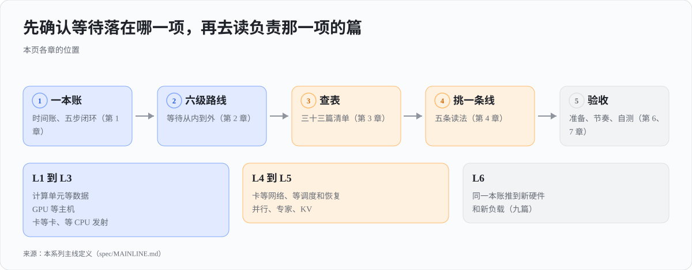
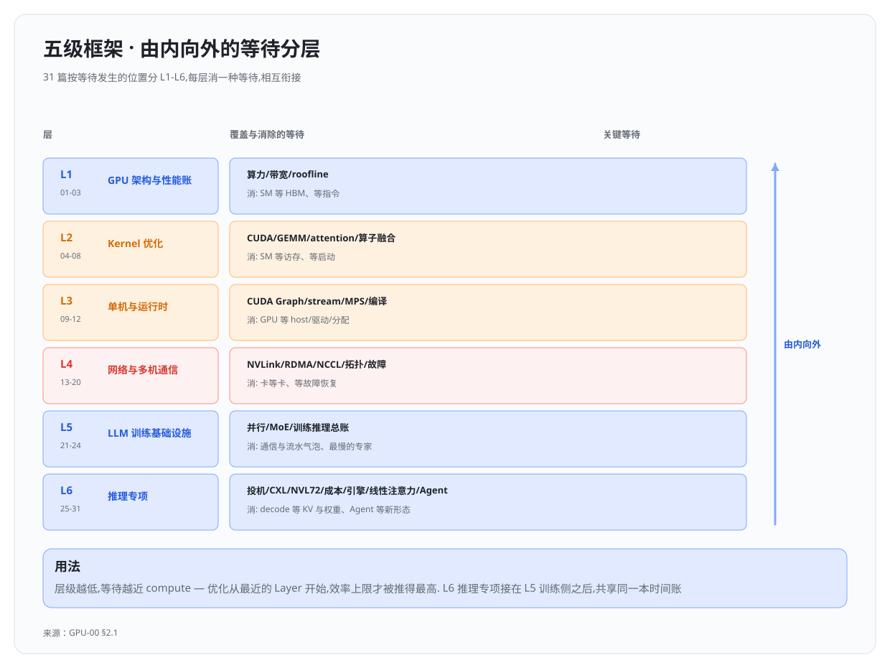
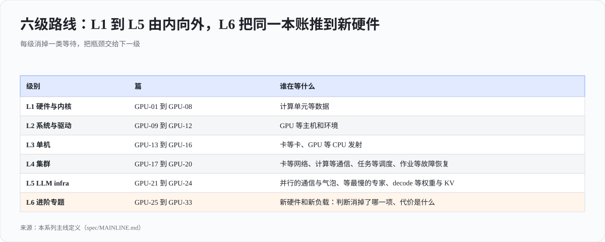
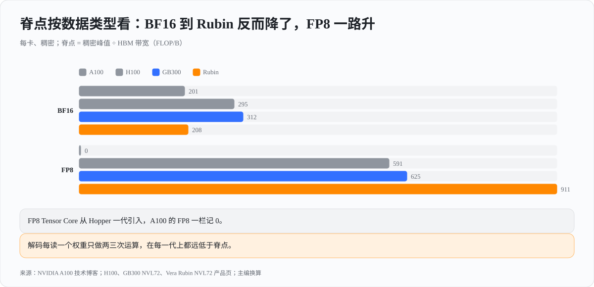

# GPU-00｜索引｜从 0 开始 GPU 优化：路线、章节与练习

> 本目录是「从 0 开始 GPU 优化」系列的 Markdown 版，共 34 篇（本篇索引加 GPU-01 到 GPU-33），由飞书原文转换，正文与飞书当前版本一致；画板导出为图片放在 `assets/`。GPU-01 到 GPU-24 的配套代码在仓库根目录，每章一个目录；GPU-25 到 GPU-33 没有配套代码。已知与正文不一致的代码见 [KNOWN_ISSUES.md](../KNOWN_ISSUES.md)。

> 🎯 **这篇文档解决什么问题**：全系列只讲一件事，让昂贵的计算单元少等、多干活。GPU-01 到 GPU-33 共三十三篇，按等待发生的位置从芯片内一直排到集群，再推到新硬件和新负载。本页给出贯穿全系列的时间账和五步闭环、六级路线、三十三篇清单、五条读法，以及起步准备、学习节奏和验收题。读完本页，你应该能说出自己手上的问题落在时间账的哪一项，以及先读哪一篇。

**使用方式**：先读第 1 章的时间账和五步闭环，再看第 2 章的六级路线；第 3 章的六张表当目录查；第 4 章按手上的问题选一条读法；第 5 章讲为什么硬件每代都要重算；第 6、7 章是起步准备、学习节奏和验收。

**代码**：配套仓库 zero-to-gpu，目录名 NN-xxx 对应 GPU-NN。sim_ 开头的脚本是 CPU 上可跑的模拟器或计算器，gpu_ 开头和 .cu 文件需要真实 GPU，test_ 开头是单元测试。L6 的九篇（GPU-25 到 GPU-33）没有配套代码，正文的算例由主编按公开数据核算并给出计算过程。

<b>🧭 主线位置</b>：本页是系列入口。主线是一本时间账 T = T_compute + W_mem + W_host + W_comm + W_idle 和一套五步闭环（定天花板、测实际、定位等待、消除或隐藏、复测）。从 GPU-01（[GPU-01｜硬件｜GPU 架构：SM、存储层级与延迟隐藏](./01-arch.md)）开始下潜到单个 SM，由 GPU-24（[GPU-24｜LLM｜综合：从选卡到上线](./24-capstone.md)）把整张账算到上线，L6 再把同一本账推到 2026 年的硬件和推理系统，最后回到本页第 7 章做验收。

## 导读 · 先给结论

- <b>一本账。</b>任何一个 kernel 或训练步的时间，都能拆成有效计算和四类暴露出来的等待；优化就是让等待变少或藏到计算后面（第 1 章）。
- <b>一套方法。</b>每篇至少有一个按定天花板、测实际、定位等待、消除或隐藏、复测五步走完的案例，前后数字来自配套代码或带引用的公开数据（第 1 章）。
- <b>带宽阶梯。</b>以 H100 SXM 为例，HBM 3.35 TB/s，NVLink 单向 450 GB/s，PCIe Gen5 x16 每方向约 63 GB/s，400 Gb/s 网卡 50 GB/s；离计算单元越远，带宽越低（第 1 章）。[[1]](https://www.nvidia.com/en-us/data-center/h100/)[[2]](https://en.wikipedia.org/wiki/PCI_Express)[[3]](https://arxiv.org/pdf/2407.21783)
- <b>六级路线。</b>L1 到 L5 按等待从芯片内到集群排开，L6 把同一本账推到新硬件和新负载（第 2 章）。
- <b>三十三篇清单。</b>每篇只深挖自己负责的那一项等待，别的等待一句话指向负责的篇（第 3 章）。
- <b>脊点按数据类型看。</b>同为 BF16 稠密，H100 约 295、GB300 约 312、Rubin 约 208 FLOP/B，脊点并不总是逐代上升（第 5 章）。[[1]](https://www.nvidia.com/en-us/data-center/h100/)[[4]](https://www.nvidia.com/en-us/data-center/gb300-nvl72/)[[5]](https://www.nvidia.com/en-us/data-center/vera-rubin-nvl72/)
- <b>先确认落在哪一项。</b>拿到问题先查第 3 章的表，再按第 4 章的读法下潜；第 7 章的验收题答不上来的，对应的篇就是起点。



<b>📎 与系列其他文档的分工</b>：本页只给定义、路线和目录。时间账和 Roofline 的计算方法在 GPU-02（[GPU-02｜硬件｜性能账本：Roofline、算术强度与三类瓶颈](./02-ledger.md)），四把尺子的采集方法在 GPU-14（[GPU-14｜单机｜性能分析与 Profiling](./14-profiling.md)），单机基线在 GPU-16（[GPU-16｜单机｜单机验收与调优](./16-node-burnin.md)），整张账的收口在 GPU-24（[GPU-24｜LLM｜综合：从选卡到上线](./24-capstone.md)），新硬件的重算在 GPU-32（[GPU-32｜LLM｜Rubin 时代与 Dynamo 推理：Blackwell 之后的时间账（2026）](./32-rubin-dynamo.md)）和 GPU-33（[GPU-33｜LLM｜Tensor Core 三代跃迁：Volta→Turing→Ampere→Hopper，为什么每代都要重写 kernel](./33-tensor-core-generations.md)）。

## 第 1 章 · 一本时间账、一套五步闭环：每篇都在回答等在哪、怎么消

GPU 很贵，贵的部分是计算单元。它闲着的每一段时间，都是在等什么东西：等数据从显存搬进来，等主机发下一个 kernel，等别的卡把数据传过来，或者干脆没有任务。本章把这些等待写成一本账，再给出全系列每篇都要走一遍的五步方法，最后给出两组全系列共用的口径：带宽阶梯和四把尺子。

### 时间账：把等待逐项记下来

一个 kernel 或一个训练步的实际时间，拆成五项：

- **T_compute**：有效计算，计算单元真正在做乘加的时间。
- **W_mem**：暴露的访存等待，SM 等 HBM、搬运和计算串行（L1 为主）。
- **W_host**：暴露的主机侧等待，同步、PCIe、分配器、kernel 发射（L2、L3 为主）。
- **W_comm**：暴露的通信等待，卡等卡、卡等网络、流水气泡、all-to-all（L3 到 L5）。
- **W_idle**：空转与停机，卡等任务、等调度、等故障恢复（L2、L4 为主）。

效率 = T_compute ÷ T。单个 kernel 看达到峰值的比例，训练看 MFU，推理看每卡 tokens/s 和 goodput。“暴露的”是关键词：被重叠藏到计算后面的等待，不在关键路径上，不计入。所以手段只有两类：减少等待量（少搬字节、少发 kernel、少通信），或者把等待藏起来（异步、流水、重叠）。显存账、通信账、算力账是这本账的输入：算力账给出 T_compute，通信账给出 W_comm 的下限，显存账决定能开多大的批、要不要重算或卸载。


### 五步闭环：每篇都按这五步走一遍

全系列每篇至少有一个完整案例按五步展开，正文里会显式出现这五个词：

- **定天花板**：用规格和账本算出理论时间，例如 GPU-02（[GPU-02｜硬件｜性能账本：Roofline、算术强度与三类瓶颈](./02-ledger.md)）用 Roofline 给每个 kernel 算出算力界和带宽界[[6]](https://www2.eecs.berkeley.edu/Pubs/TechRpts/2008/EECS-2008-134.html)。
- **测实际**：用指定工具测出实际时间或带宽，给出命令和指标名，例如 GPU-14（[GPU-14｜单机｜性能分析与 Profiling](./14-profiling.md)）用 Nsight Systems 拿到时间线[[7]](https://docs.nvidia.com/nsight-systems/UserGuide/index.html)。
- **定位等待**：差距落在时间账的哪一项，用哪个指标证明，例如 stall reason、时间线空隙、busbw、气泡比例、接受率。
- **消除或隐藏**：给出手段和它消掉的那一项，附前后对比，例如 GPU-05（[GPU-05｜硬件｜GEMM 逐步优化：从朴素循环到 warp 分块](./05-gemm.md)）用分块和双缓冲消掉乘加单元的等待。
- **复测**：消掉一项以后，瓶颈转到哪一项，衔接下一篇。

五步的意义在于顺序：先算出不该等多久，才知道实测的差距有多大；先定位是哪一项，才知道该用哪一篇的手段。跳过第一步直接调参，最常见的结果是把时间花在一个不在关键路径上的等待上。



### 带宽阶梯：同一堵墙在不同尺度上重复出现

访存墙和通信墙是同一个现象：离计算单元越远，带宽越低、延迟越高。全系列引用同一组 H100 SXM 的单向数字：

| 层级 | 单向带宽 | 主讲篇 |
|---|---|---|
| 寄存器、共享内存 | 片上，最高 | GPU-01、GPU-04、GPU-05、GPU-08 |
| HBM3 | 3.35 TB/s[[1]](https://www.nvidia.com/en-us/data-center/h100/) | GPU-01、GPU-02、GPU-04 |
| NVLink4（单卡聚合） | 450 GB/s，规格页的 900 GB/s 是双向[[1]](https://www.nvidia.com/en-us/data-center/h100/) | GPU-13、GPU-18、GPU-21 |
| PCIe Gen5 x16 | 每方向约 63 GB/s[[2]](https://en.wikipedia.org/wiki/PCI_Express) | GPU-11、GPU-26 |
| 400 Gb/s RDMA 网卡 | 50 GB/s（400 ÷ 8）[[3]](https://arxiv.org/pdf/2407.21783) | GPU-17、GPU-18 |

从 HBM 到 NVLink、从 NVLink 到 PCIe、从 PCIe 到网卡，每一级都差几倍到十几倍。所以“少搬字节”和“把搬运藏起来”这两个手段，在每一级都会以不同的名字再出现一次：片上叫分块和双缓冲，机内叫重叠通信，跨机叫分桶和拓扑感知。

### 四把尺子：同一个“利用率”有四种口径

| 尺子 | 回答什么 | 常见误用 |
|---|---|---|
| GPU-Util（nvidia-smi） | 采样窗口内是否有任意 kernel 在跑 | 当成饱和度；只占少数 SM 的 kernel 也能显示满格 |
| SM Activity、Occupancy | 多少 SM、多少 warp 在干活 | 忽略 Tensor Core 是否真的在用 |
| Tensor Core Active、DRAM Active | 矩阵单元和 HBM 是否喂饱 | 和 MFU 混用 |
| MFU、HFU、tokens/s、goodput | 端到端有效产出 | 用稀疏峰值作分母；把重算计入有效计算 |

四把尺子在 GPU-02（[GPU-02｜硬件｜性能账本：Roofline、算术强度与三类瓶颈](./02-ledger.md)）定义，GPU-14（[GPU-14｜单机｜性能分析与 Profiling](./14-profiling.md)）讲怎么采，GPU-16（[GPU-16｜单机｜单机验收与调优](./16-node-burnin.md)）定单机基线，GPU-20（[GPU-20｜集群｜可靠性与可观测：故障、静默错误与 checkpoint](./20-reliability.md)）做集群监控，GPU-24（[GPU-24｜LLM｜综合：从选卡到上线](./24-capstone.md)）用来验收。其他篇引用时不重复定义。

一个常见的误区是看到 GPU-Util 满格就认为卡已经吃满。现象是 GPU-Util 一直很高，吞吐却远低于估算。原因是 GPU-Util 只说明有 kernel 在跑，不说明 SM 和 Tensor Core 是否忙。改法是同时看 SM Activity 和 Tensor Core Active，再用 MFU 对端到端产出。

> 🔑 **本章要点**：时间账把实际时间拆成 T_compute 和 W_mem、W_host、W_comm、W_idle 四类暴露的等待，手段只有减少等待量和把等待藏起来两类；五步闭环是定天花板、测实际、定位等待、消除或隐藏、复测；带宽阶梯从 HBM 3.35 TB/s 到网卡 50 GB/s 逐级下降；四把尺子各有口径，不能混用。这一章是五步闭环的“定天花板”：先有一本账，才知道不该等多久。

## 第 2 章 · 六级路线：等待从芯片内排到集群，再推到新硬件

时间账的五项不是同时出现的。一个 kernel 先等的是显存，kernel 写好以后等的是主机和驱动，单机调好以后等的是卡与卡之间、机器与机器之间，模型跑起来以后等的是并行方案和推理系统。全系列按这个顺序分成六级，每一级消掉一类等待，把瓶颈交给下一级。本章给出六级的划分、每级的出口能力，以及每篇共用的结构。

### 六级与出口能力

| 级别 | 篇 | 谁在等什么 | 出口能力 |
|---|---|---|---|
| L1 硬件与内核 | GPU-01 到 GPU-08 | 计算单元等数据 | 能把一个 kernel 推到天花板的六成以上，并说清剩下的等待在哪 |
| L2 系统与驱动 | GPU-09 到 GPU-12 | GPU 等主机和环境 | 能装好一台机器，并定位主机侧每一类等待 |
| L3 单机 | GPU-13 到 GPU-16 | 卡等卡、GPU 等 CPU 发射 | 能验收一台 8 卡机并给出单机等待基线 |
| L4 集群 | GPU-17 到 GPU-20 | 卡等网络、计算等通信、任务等调度、作业等故障恢复 | 能定位千卡作业的通信变慢、挂死和有效训练时间损失 |
| L5 LLM infra | GPU-21 到 GPU-24 | 并行的通信与气泡、等最慢的专家、decode 等权重与 KV | 能写出带时间账的训推方案，并用实测校准 |
| L6 进阶专题 | GPU-25 到 GPU-33 | 投机解码、CXL、NVL72、成本、推理引擎、线性注意力、Agent serving、Rubin 与 Dynamo、Tensor Core 代际 | 能判断一项新硬件或新系统消掉了时间账的哪一项、代价是什么 |



L1 到 L5 是一条由内向外的主线：L1 消 W_mem、把 T_compute 推近峰值，L2 消 W_host，L3 消机内的 W_comm 和发射空隙，L4 消跨机的 W_comm 和停机，L5 把这些合到模型级的训推方案里，由 GPU-24（[GPU-24｜LLM｜综合：从选卡到上线](./24-capstone.md)）收口。L6 不再往外走一级，它把同一本账推到 2026 年的新硬件和新负载上：账的形式不变，变的是哪一项最大、由谁来消。

L6 每篇都延伸前面某一篇，读之前先读它延伸的那篇：GPU-25（[GPU-25｜LLM｜投机解码：αK 与 MTP / EAGLE 谱系](./25-speculative.md)） 延伸 GPU-23（[GPU-23｜LLM｜推理系统：KV cache、PagedAttention 与 PD 分离](./23-inference.md)）；GPU-26（[GPU-26｜系统｜CXL：一致性互连与 KV offload 工程化](./26-cxl.md)） 延伸 GPU-11（[GPU-11｜系统｜PCIe、NUMA 与 GPUDirect](./11-pcie-gdr.md)）、GPU-23（[GPU-23｜LLM｜推理系统：KV cache、PagedAttention 与 PD 分离](./23-inference.md)）；GPU-27（[GPU-27｜硬件｜NVL72 与 Grace-Blackwell Superchip：打穿 TP=8](./27-nvl72.md)） 延伸 GPU-13（[GPU-13｜单机｜NVLink 与 NVSwitch](./13-nvlink.md)）；GPU-28（[GPU-28｜LLM｜推理成本经济学：$ per token 与集群单卡经济](./28-cost.md)） 延伸 GPU-24（[GPU-24｜LLM｜综合：从选卡到上线](./24-capstone.md)）；GPU-29（[GPU-29｜LLM｜推理引擎实战：SGLang vs vLLM 选型](./29-engine-choice.md)） 延伸 GPU-23（[GPU-23｜LLM｜推理系统：KV cache、PagedAttention 与 PD 分离](./23-inference.md)）；GPU-30（[GPU-30｜LLM｜线性注意力与 KDA：KV 消失之后的 serving](./30-linear-attention.md)） 延伸 GPU-08（[GPU-08｜硬件｜注意力内核](./08-attention.md)）、GPU-23（[GPU-23｜LLM｜推理系统：KV cache、PagedAttention 与 PD 分离](./23-inference.md)）；GPU-31（[GPU-31｜LLM｜Agent Workload Serving：会话原语与约束解码](./31-agent-serving.md)） 延伸 GPU-23（[GPU-23｜LLM｜推理系统：KV cache、PagedAttention 与 PD 分离](./23-inference.md)）、GPU-29（[GPU-29｜LLM｜推理引擎实战：SGLang vs vLLM 选型](./29-engine-choice.md)）；GPU-32（[GPU-32｜LLM｜Rubin 时代与 Dynamo 推理：Blackwell 之后的时间账（2026）](./32-rubin-dynamo.md)） 延伸 GPU-27（[GPU-27｜硬件｜NVL72 与 Grace-Blackwell Superchip：打穿 TP=8](./27-nvl72.md)）、GPU-06（[GPU-06｜硬件｜Tensor Core 与低精度：从 mma 到 FP8 和 FP4](./06-tensor-core.md)）；GPU-33（[GPU-33｜LLM｜Tensor Core 三代跃迁：Volta→Turing→Ampere→Hopper，为什么每代都要重写 kernel](./33-tensor-core-generations.md)） 延伸 GPU-06（[GPU-06｜硬件｜Tensor Core 与低精度：从 mma 到 FP8 和 FP4](./06-tensor-core.md)）。

### 每篇共用的结构

每篇的开头是 🎯 说明解决什么问题、使用方式和配套代码，🧭 主线位置说明它在时间账里负责哪一项、承接哪一篇；导读先给结论。正文第 1 章讲这一层在等什么，中间各章各讲一种手段，每章写明它放进时间账是哪一项、按五步闭环怎样走、一个常见误区的现象原因和改法，章末有 🔑 本章要点；全篇至少有一章是完整的五步案例。最后一章是上线前核对清单、练习和自测题。这样既能按主题跳读，也能按五步闭环顺着读。

一个常见的误区是以为优化要从 L1 开始一级级往上做。现象是先把一个 kernel 的利用率推上去，端到端吞吐几乎没变。原因是这个 kernel 在整个训练步里只占很小一部分，关键路径上的等待在别的级。改法是先用 GPU-14（[GPU-14｜单机｜性能分析与 Profiling](./14-profiling.md)）的工具看整步的时间线，找到占比最大的那一项，再到对应的级去消。

另一个常见的误区是把“利用率不到峰值”等同于“kernel 写得不好”。现象是对一个算术强度很低的 kernel 反复调参，利用率仍然上不去。原因是它落在带宽一侧，天花板本来就是带宽，GPU-02（[GPU-02｜硬件｜性能账本：Roofline、算术强度与三类瓶颈](./02-ledger.md)）的 Roofline 会把这一点算清楚。改法是先定天花板，再判断差距。

> 🔑 **本章要点**：L1 到 L5 按等待从芯片内到集群排开，每级有明确的出口能力；L6 把同一本账推到新硬件和新负载，每篇都延伸前面某一篇。每篇共用同一套结构：🎯、🧭、导读、各章的时间账和五步、误区、🔑，最后是清单和自测。这一章是五步闭环的“定位等待”：先判断等待落在哪一级。

## 第 3 章 · 三十三篇清单：每篇消掉哪一项等待

下面六张表是全系列的目录。“处理的等待”一列对应第 1 章时间账里的一项，“范围”一列写这一篇深挖什么、哪些内容交给别的篇；GPU-01 到 GPU-24 在配套仓库 zero-to-gpu 里各有一个同编号的目录，L6 九篇没有配套代码，用正文里主编核算的算例。查表的用法只有一个：先确认手上的问题落在时间账的哪一项，再去读负责那一项的那一篇。

### L1 硬件与内核：计算单元等数据

八篇处理计算单元等数据：线程等访存延迟、SM 等 HBM、乘加单元等搬运、搬运与计算串行、中间结果落 HBM。

| 篇 | 处理的等待 | 范围 |
|---|---|---|
| GPU-01（[GPU-01｜硬件｜GPU 架构：SM、存储层级与延迟隐藏](./01-arch.md)） | 线程等访存延迟 | SM 上驻留的 warp 不够多，访存延迟藏不住；占用率、Little 定律与 in-flight 字节数 |
| GPU-02（[GPU-02｜硬件｜性能账本：Roofline、算术强度与三类瓶颈](./02-ledger.md)） | 建坐标：谁在等谁 | 给每个 kernel 和每个训练步算出理论时间，判断等待落在算力、带宽还是固定开销；MFU 与 Roofline 是全系列的尺子 |
| GPU-03（[GPU-03｜硬件｜CUDA 编程模型：线程层级、stream 与编译链](./03-cuda.md)） | 主机与设备互相等 | 隐式同步、默认 stream 串行、H2D 拷贝挡住计算；stream、event 与异步拷贝让两边并行 |
| GPU-04（[GPU-04｜硬件｜访存与归约：合并访存、共享内存与 warp 归约](./04-memory.md)） | SM 等 HBM | 不合并访存、bank conflict、标量加载让每次搬运浪费带宽；归约逼近带宽屋顶 |
| GPU-05（[GPU-05｜硬件｜GEMM 逐步优化：从朴素循环到 warp 分块](./05-gemm.md)） | 乘加单元等数据 | GEMM 每一级分块提高数据复用、双缓冲把搬运藏到计算后面 |
| GPU-06（[GPU-06｜硬件｜Tensor Core 与低精度：从 mma 到 FP8 和 FP4](./06-tensor-core.md)） | 搬运与计算串行 | Tensor Core 太快，搬运必须异步化（cp.async、TMA、wgmma、tcgen05），每个字节还要更小（FP8、FP4） |
| GPU-07（[GPU-07｜硬件｜Triton、CUTLASS 与 CuTe DSL](./07-dsl.md)） | 等待交给谁来消 | 手写 CUDA、Triton、CuTe DSL 各自把多少流水、分块和异步留给编译器；抽象层的性能上限 |
| GPU-08（[GPU-08｜硬件｜注意力内核](./08-attention.md)） | 中间结果落 HBM | 注意力的 N×N 矩阵往返 HBM；分块融合加在线 softmax 让它不落盘，新瓶颈转到指数单元与共享内存 |

### L2 系统与驱动：GPU 等主机和环境

四篇处理 GPU 等主机和环境：等驱动和版本、等显存分配、等 PCIe 与主机内存、卡等任务。

| 篇 | 处理的等待 | 范围 |
|---|---|---|
| GPU-09（[GPU-09｜系统｜驱动、CUDA 兼容与 Xid](./09-driver.md)） | 任务等环境 | 驱动、CUDA、容器版本错配起不来，Xid 故障掉卡；等待最贵的形态是停机 |
| GPU-10（[GPU-10｜系统｜显存管理](./10-memory-mgmt.md)） | 等显存 | 分配器碎片、OOM 重试、可分页内存拷贝让 GPU 等内存；caching allocator 与 pinned 内存 |
| GPU-11（[GPU-11｜系统｜PCIe、NUMA 与 GPUDirect](./11-pcie-gdr.md)） | GPU 等主机链路 | PCIe 代际与宽度、NUMA 跨 socket、IOMMU 和 bounce buffer 让数据绕路；GPUDirect 让设备直达 |
| GPU-12（[GPU-12｜系统｜MIG、MPS 与容器](./12-sharing.md)） | 卡等任务 | 一个吃不满整卡的任务独占整卡；MIG、MPS 和容器切分把空闲时间片用起来 |

### L3 单机：卡等卡、GPU 等 CPU 发射

四篇处理一台 8 卡机内部的等待，并定下单机不该等多久的基线。

| 篇 | 处理的等待 | 范围 |
|---|---|---|
| GPU-13（[GPU-13｜单机｜NVLink 与 NVSwitch](./13-nvlink.md)） | 卡等卡（机内） | 8 卡之间的 NVLink 与 NVSwitch 带宽决定单机集合通信的下限 |
| GPU-14（[GPU-14｜单机｜性能分析与 Profiling](./14-profiling.md)） | 看准等待 | nsys 时间线找空隙、ncu stall reason 找 kernel 内等待、DCGM 看整机饱和度；GPU-Util 不等于干活 |
| GPU-15（[GPU-15｜单机｜PyTorch 运行时](./15-runtime.md)） | GPU 等 CPU 发射 | Python 和框架开销让 kernel 之间出现空隙；torch.compile 融合与 CUDA Graph 消除 launch 等待 |
| GPU-16（[GPU-16｜单机｜单机验收与调优](./16-node-burnin.md)） | 定下不该等多久 | 单机验收把算力、带宽、互联的合格线定下来，作为后续所有等待的基线 |

### L4 集群：卡等网络、任务等调度和故障恢复

四篇处理跨机以后的等待：网络、集合通信、调度和故障恢复。

| 篇 | 处理的等待 | 范围 |
|---|---|---|
| GPU-17（[GPU-17｜集群｜RDMA 网络：InfiniBand、RoCE 与拥塞控制](./17-rdma.md)） | 卡等网络 | 跨机 RDMA 的带宽、拥塞、PFC 和 ECMP 哈希极化让集合通信等网络 |
| GPU-18（[GPU-18｜集群｜NCCL：算法、协议与挂死排查](./18-nccl.md)） | 计算等通信 | ring、tree 与 Simple、LL、LL128 协议决定通信时间，overlap 决定其中多少暴露在关键路径上；挂死是无限等待 |
| GPU-19（[GPU-19｜集群｜Kubernetes 上的 GPU：设备插件与拓扑感知调度](./19-k8s.md)） | 任务等调度 | 设备插件、GPU Operator 与拓扑感知调度决定任务排队多久、落在哪个 NVLink 域，碎片让卡空等任务 |
| GPU-20（[GPU-20｜集群｜可靠性与可观测：故障、静默错误与 checkpoint](./20-reliability.md)） | 训练等故障恢复 | 故障、慢节点和静默数据错误让整个作业停摆或重算；checkpoint 间隔与有效训练时间占比 |

### L5 LLM infra：并行、专家和 KV

四篇处理模型级的等待，最后由 GPU-24（[GPU-24｜LLM｜综合：从选卡到上线](./24-capstone.md)）把整张账算到上线。

| 篇 | 处理的等待 | 范围 |
|---|---|---|
| GPU-21（[GPU-21｜LLM｜训练并行：TP、PP、DP、ZeRO 与 FP8](./21-train-parallel.md)） | 等通信与流水气泡 | TP、PP、DP、ZeRO 和 FSDP 的组合决定显存账、通信账和气泡；FP8 训练把每个字节变小 |
| GPU-22（[GPU-22｜LLM｜MoE 与专家并行：all-to-all 与负载均衡](./22-moe-ep.md)） | 等最慢的专家 | MoE 的 all-to-all 通信和专家负载不均让所有 rank 等最慢的那个；DeepEP 与负载均衡 |
| GPU-23（[GPU-23｜LLM｜推理系统：KV cache、PagedAttention 与 PD 分离](./23-inference.md)） | decode 等权重与 KV，请求互相等 | KV cache 显存账、PagedAttention、continuous batching、chunked prefill、PD 分离 |
| GPU-24（[GPU-24｜LLM｜综合：从选卡到上线](./24-capstone.md)） | 把整张等待账算到上线 | 给定模型、预算和 SLO，选卡、定并行、估吞吐、算成本，再用实测校准每一项等待 |

### L6 进阶专题：把同一本账推到新硬件和新负载

九篇各自延伸前面某一篇，判断一项新硬件或新系统消掉了时间账的哪一项、代价是什么。

| 篇 | 处理的等待 | 范围 |
|---|---|---|
| GPU-25（[GPU-25｜LLM｜投机解码：αK 与 MTP / EAGLE 谱系](./25-speculative.md)） | decode 逐 token 串行：每步都等一次权重读取 | 草稿-验证-接受三段，接受率 α 与草稿长度 K 的收益账；ngram、Medusa、EAGLE、MTP 谱系与选型；不重讲 KV 管理，见 GPU-23（[GPU-23｜LLM｜推理系统：KV cache、PagedAttention 与 PD 分离](./23-inference.md)） |
| GPU-26（[GPU-26｜系统｜CXL：一致性互连与 KV offload 工程化](./26-cxl.md)） | KV 放不下显存时等更远一级内存 | CXL.io/cache/mem 三协议、Type 1/2/3、直连与经交换机的延迟账、KV offload 落到 CXL 内存池；不重讲 PCIe 与 GPUDirect，见 GPU-11（[GPU-11｜系统｜PCIe、NUMA 与 GPUDirect](./11-pcie-gdr.md)） |
| GPU-27（[GPU-27｜硬件｜NVL72 与 Grace-Blackwell Superchip：打穿 TP=8](./27-nvl72.md)） | TP 跨出 8 卡后等慢速网络 | NVL72 机柜级 NVLink 域、NVLink-C2C 与 Grace-Blackwell，TP/EP 域从 8 扩到 72 后通信账怎么变；不重讲单机 NVLink，见 GPU-13（[GPU-13｜单机｜NVLink 与 NVSwitch](./13-nvlink.md)） |
| GPU-28（[GPU-28｜LLM｜推理成本经济学：$ per token 与集群单卡经济](./28-cost.md)） | 等待折算成钱：每 token 成本 | 卡时成本、利用率与折旧、prefill/decode 卡种经济、API 计费分量、价格战底线；不重讲选卡流程，见 GPU-24（[GPU-24｜LLM｜综合：从选卡到上线](./24-capstone.md)） |
| GPU-29（[GPU-29｜LLM｜推理引擎实战：SGLang vs vLLM 选型](./29-engine-choice.md)） | 引擎调度引入的等待 | SGLang 与 vLLM 的前缀缓存结构、调度预算、分层 KV、约束与投机解码集成，按负载形状选型；不重讲 PagedAttention 原理，见 GPU-23（[GPU-23｜LLM｜推理系统：KV cache、PagedAttention 与 PD 分离](./23-inference.md)） |
| GPU-30（[GPU-30｜LLM｜线性注意力与 KDA：KV 消失之后的 serving](./30-linear-attention.md)） | 长上下文 decode 等 KV 读取 | 线性注意力谱系 DeltaNet→GDN→KDA、混合层设计、状态检查点取代前缀缓存后的 serving 账；不重讲 FlashAttention，见 GPU-08（[GPU-08｜硬件｜注意力内核](./08-attention.md)） |
| GPU-31（[GPU-31｜LLM｜Agent Workload Serving：会话原语与约束解码](./31-agent-serving.md)） | Agent 多轮请求互等与前缀重算 | 会话粘性、KV TTL 与抢占、外置 KV 池、约束解码开销、turn 级度量；不重讲引擎内部，见 GPU-29（[GPU-29｜LLM｜推理引擎实战：SGLang vs vLLM 选型](./29-engine-choice.md)） |
| GPU-32（[GPU-32｜LLM｜Rubin 时代与 Dynamo 推理：Blackwell 之后的时间账（2026）](./32-rubin-dynamo.md)） | 下一代硬件与分布式推理框架下的时间账 | Vera Rubin 平台规格、NVFP4、Rubin CPX、FlashMLA/DeepGEMM/DeepEP、NVIDIA Dynamo 分离式推理；等待名目从硬件轴移到调度轴；不重讲 NVL72，见 GPU-27（[GPU-27｜硬件｜NVL72 与 Grace-Blackwell Superchip：打穿 TP=8](./27-nvl72.md)） |
| GPU-33（[GPU-33｜LLM｜Tensor Core 三代跃迁：Volta→Turing→Ampere→Hopper，为什么每代都要重写 kernel](./33-tensor-core-generations.md)） | 矩阵单元换代后旧 kernel 等搬运 | Volta→Turing→Ampere→Hopper 的 Tensor Core 指令（wmma、mma.sync、cp.async、wgmma/TMA）与数据通路变化，kernel 为何每代重写；Blackwell 细节交给 GPU-06（[GPU-06｜硬件｜Tensor Core 与低精度：从 mma 到 FP8 和 FP4](./06-tensor-core.md)） |

放进时间账：L1 主要消 W_mem 并把 T_compute 推近峰值，L2 消 W_host 和一部分 W_idle，L3 消机内的 W_comm 和发射造成的空隙，L4 消跨机的 W_comm 和停机造成的 W_idle，L5 把这些合到模型级的方案里，L6 判断新硬件和新系统改变了哪一项。

> 🔑 **本章要点**：三十三篇按等待从内到外排成六级：L1 八篇、L2 四篇、L3 四篇、L4 四篇、L5 四篇、L6 九篇。每篇只深挖自己负责的那一项，别的等待一句话指向负责的篇。这一章是五步闭环的“定位等待”：先查表确认问题落在哪一项，再读那一篇。

## 第 4 章 · 五条读法：按手上的问题挑一条线

三十三篇不必从头读到尾。按读者手上的问题，可以挑一条线读下去：每条线对应时间账里的一两项等待，顺序是先定天花板、再沿着等待由近及远。下面五条线各列出要读的篇和每篇在这条线上的作用，读完一条线，再回到第 3 章的表补其他篇。

### 第一条：写算子和 kernel，消 W_mem

适合写 CUDA、Triton 或 CUTLASS 的人。手上的问题是某个 kernel 达不到预期的 TFLOPS 或带宽。

1. GPU-01（[GPU-01｜硬件｜GPU 架构：SM、存储层级与延迟隐藏](./01-arch.md)）：先看清 SM 怎样靠大量线程藏访存延迟。
2. GPU-02（[GPU-02｜硬件｜性能账本：Roofline、算术强度与三类瓶颈](./02-ledger.md)）：算出这个 kernel 的天花板和它落在哪一侧。
3. GPU-04（[GPU-04｜硬件｜访存与归约：合并访存、共享内存与 warp 归约](./04-memory.md)）：把单次搬运做到不浪费。
4. GPU-05（[GPU-05｜硬件｜GEMM 逐步优化：从朴素循环到 warp 分块](./05-gemm.md)）：用分块和双缓冲提高复用。
5. GPU-06（[GPU-06｜硬件｜Tensor Core 与低精度：从 mma 到 FP8 和 FP4](./06-tensor-core.md)）：换到 Tensor Core 和低精度。
6. GPU-07（[GPU-07｜硬件｜Triton、CUTLASS 与 CuTe DSL](./07-dsl.md)）：决定哪些交给 DSL 和编译器。
7. GPU-08（[GPU-08｜硬件｜注意力内核](./08-attention.md)）：把注意力的中间结果留在片上。
8. GPU-14（[GPU-14｜单机｜性能分析与 Profiling](./14-profiling.md)）：用 profiler 证明等待在哪。
9. GPU-33（[GPU-33｜LLM｜Tensor Core 三代跃迁：Volta→Turing→Ampere→Hopper，为什么每代都要重写 kernel](./33-tensor-core-generations.md)）：理解换代后为什么要重写。

### 第二条：平台、单机和集群，消 W_host、W_comm、W_idle

适合负责机器、驱动、网络和调度的人。手上的问题是机器起不来、卡等主机、通信慢或者作业停。

1. GPU-09（[GPU-09｜系统｜驱动、CUDA 兼容与 Xid](./09-driver.md)）：先让驱动和版本对上。
2. GPU-10（[GPU-10｜系统｜显存管理](./10-memory-mgmt.md)）：看清显存分配的等待。
3. GPU-11（[GPU-11｜系统｜PCIe、NUMA 与 GPUDirect](./11-pcie-gdr.md)）：PCIe、NUMA 和 GPUDirect。
4. GPU-12（[GPU-12｜系统｜MIG、MPS 与容器](./12-sharing.md)）：把吃不满的卡切开用。
5. GPU-13（[GPU-13｜单机｜NVLink 与 NVSwitch](./13-nvlink.md)）：机内 NVLink 与 NVSwitch。
6. GPU-16（[GPU-16｜单机｜单机验收与调优](./16-node-burnin.md)）：定下单机的合格线。
7. GPU-17（[GPU-17｜集群｜RDMA 网络：InfiniBand、RoCE 与拥塞控制](./17-rdma.md)）：跨机网络。
8. GPU-18（[GPU-18｜集群｜NCCL：算法、协议与挂死排查](./18-nccl.md)）：集合通信与挂死。
9. GPU-19（[GPU-19｜集群｜Kubernetes 上的 GPU：设备插件与拓扑感知调度](./19-k8s.md)）：调度与拓扑。
10. GPU-20（[GPU-20｜集群｜可靠性与可观测：故障、静默错误与 checkpoint](./20-reliability.md)）：故障与 checkpoint。
11. GPU-26（[GPU-26｜系统｜CXL：一致性互连与 KV offload 工程化](./26-cxl.md)）：显存装不下时的下一级内存。

### 第三条：LLM 训练，消通信和气泡

适合做大模型训练的人。手上的问题是 MFU 上不去、扩卡以后效率掉。

1. GPU-02（[GPU-02｜硬件｜性能账本：Roofline、算术强度与三类瓶颈](./02-ledger.md)）：用 MFU 和 Roofline 定口径。
2. GPU-13（[GPU-13｜单机｜NVLink 与 NVSwitch](./13-nvlink.md)）：机内带宽决定 TP 的上限。
3. GPU-18（[GPU-18｜集群｜NCCL：算法、协议与挂死排查](./18-nccl.md)）：通信时间和重叠。
4. GPU-21（[GPU-21｜LLM｜训练并行：TP、PP、DP、ZeRO 与 FP8](./21-train-parallel.md)）：TP、PP、DP、ZeRO 的组合。
5. GPU-22（[GPU-22｜LLM｜MoE 与专家并行：all-to-all 与负载均衡](./22-moe-ep.md)）：MoE 的 all-to-all 和负载不均。
6. GPU-20（[GPU-20｜集群｜可靠性与可观测：故障、静默错误与 checkpoint](./20-reliability.md)）：有效训练时间。
7. GPU-27（[GPU-27｜硬件｜NVL72 与 Grace-Blackwell Superchip：打穿 TP=8](./27-nvl72.md)）：NVLink 域扩到整柜以后。

### 第四条：LLM 推理，消解码等待和请求互等

适合做推理服务的人。手上的问题是每卡吞吐、首 token 延迟或每 token 成本。

1. GPU-08（[GPU-08｜硬件｜注意力内核](./08-attention.md)）：注意力 kernel。
2. GPU-23（[GPU-23｜LLM｜推理系统：KV cache、PagedAttention 与 PD 分离](./23-inference.md)）：KV cache、批处理和 PD 分离。
3. GPU-25（[GPU-25｜LLM｜投机解码：αK 与 MTP / EAGLE 谱系](./25-speculative.md)）：用投机解码利用解码时富余的算力。
4. GPU-29（[GPU-29｜LLM｜推理引擎实战：SGLang vs vLLM 选型](./29-engine-choice.md)）：引擎选型。
5. GPU-30（[GPU-30｜LLM｜线性注意力与 KDA：KV 消失之后的 serving](./30-linear-attention.md)）：线性注意力把 KV 换成状态。
6. GPU-31（[GPU-31｜LLM｜Agent Workload Serving：会话原语与约束解码](./31-agent-serving.md)）：Agent 负载的会话与约束解码。
7. GPU-28（[GPU-28｜LLM｜推理成本经济学：$ per token 与集群单卡经济](./28-cost.md)）：把时间账折成钱。
8. GPU-24（[GPU-24｜LLM｜综合：从选卡到上线](./24-capstone.md)）：从选卡到上线算一遍。

### 第五条：评估新硬件，判断消掉了哪一项

适合做选型和规划的人。手上的问题是新一代硬件值不值得换、换了以后哪些要重做。

1. GPU-02（[GPU-02｜硬件｜性能账本：Roofline、算术强度与三类瓶颈](./02-ledger.md)）：脊点和口径。
2. GPU-06（[GPU-06｜硬件｜Tensor Core 与低精度：从 mma 到 FP8 和 FP4](./06-tensor-core.md)）：Tensor Core 与低精度。
3. GPU-33（[GPU-33｜LLM｜Tensor Core 三代跃迁：Volta→Turing→Ampere→Hopper，为什么每代都要重写 kernel](./33-tensor-core-generations.md)）：指令和数据通路每代怎样变。
4. GPU-27（[GPU-27｜硬件｜NVL72 与 Grace-Blackwell Superchip：打穿 TP=8](./27-nvl72.md)）：NVL72 的互连和故障域。
5. GPU-32（[GPU-32｜LLM｜Rubin 时代与 Dynamo 推理：Blackwell 之后的时间账（2026）](./32-rubin-dynamo.md)）：Rubin 与 Dynamo 下的时间账。
6. GPU-28（[GPU-28｜LLM｜推理成本经济学：$ per token 与集群单卡经济](./28-cost.md)）：成本。

放进时间账：第一条线主要消 W_mem、把 T_compute 推近峰值；第二条线消 W_host、W_comm 和 W_idle；第三条线消训练里的 W_comm 和流水气泡；第四条线消推理里解码等权重和 KV 的 W_mem、请求之间互等的 W_idle；第五条线不直接消某一项，它判断新硬件把哪一项变小了、哪一项变得显眼。

一个常见的误区是不看问题直接按编号读。现象是从 GPU-01 读到 GPU-10，手上的问题还是没有着落。原因是每篇只负责一项等待，和问题无关的篇读得再细也用不上。改法是先用第 1 章的时间账判断问题在哪一项，再挑对应的线；不确定的，从 GPU-02（[GPU-02｜硬件｜性能账本：Roofline、算术强度与三类瓶颈](./02-ledger.md)）和 GPU-14（[GPU-14｜单机｜性能分析与 Profiling](./14-profiling.md)）开始，先定天花板、再测实际。

> 🔑 **本章要点**：五条读法分别对应写 kernel、平台与集群、LLM 训练、LLM 推理、新硬件评估，每条线都从定天花板开始，沿着等待由近及远。这一章是五步闭环的“测实际”之前的一步：先选对线，再去量。

## 第 5 章 · 硬件每代都要重算：脊点按数据类型看，不一定逐代上升

同一份代码换到新一代卡上，瓶颈可能变了。原因是算力和带宽的涨幅不同步，而且不同数据类型涨得不一样。本章先按同一口径算出几代卡的脊点，再给出读规格表的三个口径，最后给一个用脊点快速判断优化方向的办法。更细的推导在 GPU-02（[GPU-02｜硬件｜性能账本：Roofline、算术强度与三类瓶颈](./02-ledger.md)）、GPU-32（[GPU-32｜LLM｜Rubin 时代与 Dynamo 推理：Blackwell 之后的时间账（2026）](./32-rubin-dynamo.md)）和 GPU-33（[GPU-33｜LLM｜Tensor Core 三代跃迁：Volta→Turing→Ampere→Hopper，为什么每代都要重写 kernel](./33-tensor-core-generations.md)）。

### 脊点按数据类型逐代对照

脊点（Roofline 的拐点）是稠密峰值除以显存带宽，单位 FLOP/B[[6]](https://www2.eecs.berkeley.edu/Pubs/TechRpts/2008/EECS-2008-134.html)。按每卡、稠密口径：A100 的 FP16 是 312 TFLOPS，BF16 与 FP16 吞吐相同，带宽 1555 GB/s[[8]](https://developer.nvidia.com/blog/nvidia-ampere-architecture-in-depth/)，脊点约 201。H100 的 BF16 规格页写 1979 TFLOPS，带星号，是稀疏口径[[1]](https://www.nvidia.com/en-us/data-center/h100/)，稠密约 989.5，带宽 3.35 TB/s，脊点约 295；FP8 稠密约 1979，脊点约 591。GB300 NVL72 整柜的 BF16 是 360 PFLOPS、FP8 是 720 PFLOPS，页面注明除另有说明外都是稀疏口径[[4]](https://www.nvidia.com/en-us/data-center/gb300-nvl72/)；按 72 张卡、稀疏减半折算，每卡 BF16 稠密约 2500 TFLOPS、FP8 约 5000，每卡带宽约 8 TB/s（整柜 576 TB/s 除以 72），脊点分别约 312 和 625。Vera Rubin 的每卡 BF16 稠密 4 PFLOPS、FP8 稠密 17.5 PFLOPS[[5]](https://www.nvidia.com/en-us/data-center/vera-rubin-nvl72/)，带宽 19.2 TB/s[[5]](https://www.nvidia.com/en-us/data-center/vera-rubin-nvl72/)，脊点约 208 和 911。

同为 BF16，脊点从 A100 的约 201 到 H100 的约 295、GB300 的约 312，到 Rubin 反而降到约 208；FP8 则从约 591、625 升到约 911；FP8 Tensor Core 是 Hopper 一代才引入的[[9]](https://developer.nvidia.com/blog/nvidia-hopper-architecture-in-depth/)，A100 没有这一栏。所以“脊点每代右移”只对某些数据类型成立。比较时要先固定数据类型，再看这一代把哪一侧推得更远。



对解码这类每读一个权重只做两三次运算的 kernel，这些脊点都远在它的右边：无论哪一代，它都受带宽限制，新卡带来的收益主要来自带宽和更小的数据格式。对矩阵够大的 GEMM 和 prefill，FP8 脊点的上升意味着分块要更大、数据复用要更多，才能吃到新增的算力。这是每代硬件发布以后，算子库都要为新卡重写一批 kernel 的原因之一，GPU-33（[GPU-33｜LLM｜Tensor Core 三代跃迁：Volta→Turing→Ampere→Hopper，为什么每代都要重写 kernel](./33-tensor-core-generations.md)）从 Tensor Core 的指令演进讲这件事。

### 读规格表的三个口径

- **稀疏与稠密**：产品页的最大值常是 2:4 结构化稀疏口径，稠密是它的一半。H100 FP8 标称 3958 TFLOPS 是稀疏，稠密约 1979[[1]](https://www.nvidia.com/en-us/data-center/h100/)；Rubin 的 NVFP4 推理 50 PFLOPS 是稀疏，NVFP4 训练的 35 PFLOPS 是稠密[[5]](https://www.nvidia.com/en-us/data-center/vera-rubin-nvl72/)。本系列的账一律按稠密口径算。
- **整柜与单卡**：DGX、HGX、NVL72 的页面常给整机或整柜的合计，要除以卡数；NVLink 的标称带宽常是双向之和，单向要再除以 2。
- **峰值与可达**：峰值假设所有 SM 都在最高频率、指令全是 Tensor Core 乘加。公开数据里，优化过的 GEMM kernel 在 H100 上能到峰值的 80% 到 90%[[10]](https://arxiv.org/html/2407.08608v2)；GPU-02（[GPU-02｜硬件｜性能账本：Roofline、算术强度与三类瓶颈](./02-ledger.md)）和 GPU-14（[GPU-14｜单机｜性能分析与 Profiling](./14-profiling.md)）讲怎样实测这些数字。

### 用脊点快速判断优化方向

拿到一个 kernel，先数它的运算次数和读写字节数，算出算术强度，再和目标卡同一数据类型的脊点比。远低于脊点，天花板是带宽，方向是少搬字节：融合算子、提高复用、换更小的数据格式。接近或高于脊点，天花板是算力，方向是看实测离峰值还差多少：占用率、指令级并行、Tensor Core 是否喂饱。这个判断不需要等 profiler，GPU-02（[GPU-02｜硬件｜性能账本：Roofline、算术强度与三类瓶颈](./02-ledger.md)）要求每个 kernel 都画到 Roofline 上，就是为了这一步。

放进时间账：脊点决定一个 kernel 的等待落在 W_mem 还是 T_compute；换代改变脊点，就改变了哪一项最大。按五步闭环，换卡以后先重新定天花板，再测实际、定位等待。

一个常见的误区是拿稀疏峰值算 MFU。现象是同一个任务，两个团队报的 MFU 差了一倍。原因是分母不同：假设一个 FP8 训练任务在 H100 上实测 900 TFLOPS，按稀疏峰值 3958 算约 22.7%，按稠密峰值 1979 算约 45.5%。改法是全系列统一按所用数据类型的稠密峰值作分母，引用论文数字时先确认作者用的是哪个口径。

> 🔑 **本章要点**：脊点按数据类型看：BF16 从 A100 约 201、H100 约 295、GB300 约 312 到 Rubin 约 208，FP8 从 H100 约 591、GB300 约 625 到 Rubin 约 911。读规格先分清稀疏与稠密、整柜与单卡、峰值与可达，MFU 一律用稠密峰值作分母。这一章是五步闭环的“定天花板”：换卡以后先重算脊点。

## 第 6 章 · 起步前的准备：没有整机也能先把账算起来

全系列的练习从一张卡上的微基准一直到多机集群。不是每个人都有齐全的硬件，所以本章先说明每一级需要什么知识和硬件、缺硬件时用什么替代，再给出环境检查的命令和配套仓库的结构。

### 前置知识

- **C++ 与 Python**：能读指针、模板和 CMake；能写 PyTorch 训练循环，知道张量的形状、步长和设备。kernel 多用 C++ 和 CUDA 写，测量脚本多用 Python。
- **计算机体系结构**：知道缓存行、内存带宽、SIMD 和流水线。不熟的先读 GPU-01（[GPU-01｜硬件｜GPU 架构：SM、存储层级与延迟隐藏](./01-arch.md)）前两章。
- **Linux 运维**：会用 dmesg、lspci、numactl、systemctl，知道内核模块和用户态驱动的区别。L2 各篇默认读者能自己装驱动、看系统日志、改内核参数。
- **Transformer**：知道一层里有哪些矩阵乘，KV cache 存的是什么。L5 会把这些换算成运算次数和字节数。

### 每一级需要的硬件

| 级别 | 最低配置 | 说明与替代 |
|---|---|---|
| L1 | 一张 NVIDIA GPU | FP8、TMA、wgmma 相关的练习需要 Hopper 或更新的卡，见 GPU-06（[GPU-06｜硬件｜Tensor Core 与低精度：从 mma 到 FP8 和 FP4](./06-tensor-core.md)）和 GPU-33（[GPU-33｜LLM｜Tensor Core 三代跃迁：Volta→Turing→Ampere→Hopper，为什么每代都要重写 kernel](./33-tensor-core-generations.md)）；没有卡可以先跑各目录里的 sim_ 计算器 |
| L2 | 一台有 root 权限的 GPU 机器 | 装驱动、改 IOMMU、开 MIG 都要 root；MIG 只在部分数据中心卡上有，见 GPU-12（[GPU-12｜系统｜MIG、MPS 与容器](./12-sharing.md)） |
| L3 | 一台带 NVSwitch 的 8 卡机 | 单机验收和 nccl-tests 全拓扑只能在这类机器上完整复现，见 GPU-16（[GPU-16｜单机｜单机验收与调优](./16-node-burnin.md)） |
| L4、L5 | 两台以上带 RDMA 网卡的机器 | 更大规模的实验用论文公开数据和计算器估算，验收允许用三本账的估算代替实测 |
| L6 | 不要求 | 九篇都没有配套代码，正文算例按公开规格和论文数字核算；第 10 章的练习可以用几十行 Python 完成 |

### 环境检查

宿主机驱动必须支持容器里 CUDA 工具包的版本，否则 CUDA 初始化会失败；兼容规则见 NVIDIA 的 CUDA 兼容性文档[[11]](https://docs.nvidia.com/deploy/cuda-compatibility/)和 GPU-09（[GPU-09｜系统｜驱动、CUDA 兼容与 Xid](./09-driver.md)）。第一次上机按下面的顺序检查，一行一行跑，看清输出：

```bash
nvidia-smi                 # 驱动版本、每张卡的状态
nvidia-smi topo -m         # 卡与卡、卡与网卡之间走什么链路
python3 -c "import torch; print(torch.cuda.is_available(), torch.version.cuda, torch.cuda.get_device_name())"
nvcc -O3 -arch=native -o vec_add vec_add.cu && ./vec_add   # 按本机的卡生成代码
```

torch.cuda.is_available() 返回 False，最常见的原因是驱动和 CUDA 版本不匹配。nvidia-smi 能看到驱动版本却看不到卡，说明驱动没有正确加载。这两类问题都在 GPU-09（[GPU-09｜系统｜驱动、CUDA 兼容与 Xid](./09-driver.md)）里按五步排查。

### 配套仓库的结构

配套仓库 zero-to-gpu 以篇为单位组织，每篇一个目录，另有 common 目录放共用的规格表、计时和绘图工具。每个目录自带 README，写明运行方式、依赖和期望输出。脚本按前缀分类：sim_ 是 CPU 上可跑的模拟器或计算器，gpu_ 和 .cu 需要真实 GPU，.sh 是启动或长时间压测脚本，test_ 是单元测试。每篇正文开头的“代码”一段写明该篇用到哪些脚本、哪些需要卡。

放进时间账：这一章消的是读者自己的 W_idle，即因为环境不通、硬件不齐而停在原地的时间。按五步闭环，先确认手上有什么硬件（定天花板），跑通上面的检查（测实际），不通的按 GPU-09 定位。

一个常见的误区是没有整机就跳过 L3 到 L5。现象是读到集群和训练并行时，对通信和气泡没有量级感。原因是这些篇的练习大多有 CPU 上可跑的计算器，不需要整机。改法是先用 sim_ 脚本把账算出来，有机会上机时再用实测校准。

> 🔑 **本章要点**：L1 要一张卡，L2 要 root，L3 要一台 8 卡机，L4、L5 要两台以上带 RDMA 的机器，L6 不要求硬件；缺硬件时先用 sim_ 计算器把账算出来。上机先跑 nvidia-smi、topo、torch 和 nvcc 四项检查，驱动与 CUDA 的兼容问题见 GPU-09。这一章是五步闭环的“测实际”之前的准备：先让环境能量出数字。

## 第 7 章 · 学习节奏、验收与核对清单

本章把前六章变成可执行的计划：按六级分成六个阶段，每个阶段交一组可检查的东西；每级一道验收题；开始前逐项核对；最后是几道自测题，答不上来的题对应的篇就是起点。

### 学习节奏

按级分阶段，每个阶段的交付物都能对应到时间账的某一项。L4 和 L5 可以交叉读，例如读完 GPU-18（[GPU-18｜集群｜NCCL：算法、协议与挂死排查](./18-nccl.md)）后直接读 GPU-21（[GPU-21｜LLM｜训练并行：TP、PP、DP、ZeRO 与 FP8](./21-train-parallel.md)）的通信账。

| 阶段 | 篇 | 交付物 |
|---|---|---|
| 一 | L1：GPU-01 到 GPU-08 | 一份本机微基准报告、一张 Roofline 图、一个 Tensor Core GEMM；GEMM 一篇留足时间 |
| 二 | L2：GPU-09 到 GPU-12 | 一份版本兼容检查表、一份显存快照分析、一张 PCIe 与 NUMA 拓扑图 |
| 三 | L3：GPU-13 到 GPU-16 | 一份 nccl-tests 结果、一份 nsys 加 ncu 的瓶颈分析、一份单机验收报告 |
| 四 | L4：GPU-17 到 GPU-20 | 一份网络带宽账、一份 NCCL 调参记录、一份 checkpoint 间隔计算 |
| 五 | L5：GPU-21 到 GPU-24 | 一份并行方案、一份 EP 通信账、一份 KV 账本、一份综合方案 |
| 六 | L6：GPU-25 到 GPU-33 | 按第 4 章挑一条线读，交一份新硬件或新系统消掉哪一项等待的评估 |

### 每级验收题

| 级别 | 验收题 | 交付物 |
|---|---|---|
| L1 | 在一张卡上写一个 FP16 GEMM，推到天花板的六成以上，并用 ncu 说明剩下的差距在哪 | 源码、ncu 报告、Roofline 图 |
| L2 | 给一台新装的机器，查出驱动、CUDA、PyTorch 是否匹配，IOMMU 和 NUMA 配置是否带来 W_host | 检查脚本输出、拓扑图 |
| L3 | 对一台 8 卡机跑完验收流程，给出算力、显存带宽、NVLink、PCIe 是否合格的结论 | 验收报告、异常项的根因 |
| L4 | 给一次 all-reduce 变慢的现场，定位是网络、拓扑、协议还是节点硬件 | nccl-tests 对比、日志、根因说明 |
| L5 | 给一个模型和一组卡，写出训练或推理方案，并用实测校准三本账 | 方案文档、计算器输出、实测数据 |
| L6 | 给一项新硬件或新系统，说明它消掉了时间账的哪一项、代价是什么、怎样复测 | 评估文档、核算过程 |

### 📌 上线前核对清单

- 有一张可用的 GPU，或者已确认先用 sim_ 计算器完成 L1 的练习。
- 能在本地跑通 02-ledger 目录里的 Roofline 计算器。
- 已在第 4 章选定一条读法，并把这条线上的篇排进日程。
- 能说出自己 GPU 在常用数据类型下的稠密峰值和显存带宽，两者相除得到脊点；说不出就先读 GPU-01（[GPU-01｜硬件｜GPU 架构：SM、存储层级与延迟隐藏](./01-arch.md)）和 GPU-02（[GPU-02｜硬件｜性能账本：Roofline、算术强度与三类瓶颈](./02-ledger.md)）。
- 能写出自己关注的任务的时间账五项，知道每项对应哪一篇。

### 自测题（带答案要点）

1. 时间账五项各举一例。答：T_compute 是 GEMM 在 Tensor Core 上真正做乘加的时间；W_mem 是 SM 等 HBM，解码读权重最典型；W_host 是 GPU 等主机，如同步和 PCIe 拷贝；W_comm 是没被计算盖住的 all-reduce；W_idle 是卡等任务、等调度、等故障恢复。
2. H100 的 BF16 脊点怎么算。答：规格页的 1979 TFLOPS 是稀疏口径，稠密约 989.5，除以 3.35 TB/s，约 295 FLOP/B[[1]](https://www.nvidia.com/en-us/data-center/h100/)。解码的矩阵向量乘每读一个权重只做两次运算，远低于脊点，受带宽限制。
3. NVLink 的 900 GB/s 和 450 GB/s 是什么关系。答：900 是双向合计，单向 450[[1]](https://www.nvidia.com/en-us/data-center/h100/)；集合通信的带宽天花板按单向算，环上只要有一跳退到 PCIe 或网卡，就掉到那一级的带宽，细节见 GPU-13（[GPU-13｜单机｜NVLink 与 NVSwitch](./13-nvlink.md)）和 GPU-18（[GPU-18｜集群｜NCCL：算法、协议与挂死排查](./18-nccl.md)）。
4. MFU 为什么按稠密峰值算。答：稀疏峰值要求 2:4 结构化稀疏，普通训练用不上，按它算会把 MFU 压低一半；用 FP8 时要写清分母是 FP8 还是 BF16 的稠密峰值（第 5 章）。
5. 换到新一代卡，脊点一定变大吗。答：不一定。同为 BF16，Rubin 的脊点约 208，比 GB300 的约 312 还低；FP8 则从约 625 升到约 911[[4]](https://www.nvidia.com/en-us/data-center/gb300-nvl72/)[[5]](https://www.nvidia.com/en-us/data-center/vera-rubin-nvl72/)。要按数据类型分开看（第 5 章）。

放进时间账：验收题每级对应一项或几项等待，答不上来说明那一项还没有消。按五步闭环，复测就是回到这里再答一遍。

一个常见的误区是读完不做验收题。现象是读完了几个级别的篇，遇到真实问题仍然不知道从哪一项查起。原因是没有把读到的方法在自己的机器和任务上走一遍五步。改法是每读完一级，交这一级的验收题和交付物。

> 🔑 **本章要点**：按六级分六个阶段，每阶段交可检查的交付物；每级一道验收题；开始前核对硬件、计算器、读法、脊点和时间账五项；自测题覆盖时间账、脊点、NVLink 口径、MFU 分母和换代。下一步从 GPU-01（[GPU-01｜硬件｜GPU 架构：SM、存储层级与延迟隐藏](./01-arch.md)）开始，先看清 SM 为什么靠大量线程藏访存延迟，再到 GPU-02（[GPU-02｜硬件｜性能账本：Roofline、算术强度与三类瓶颈](./02-ledger.md)）把天花板算出来。这一章是五步闭环的“复测”：读完一级就回来验收。

## 参考文献

按正文首次引用顺序编号，资料截至 2026 年 11 月中。

[1] NVIDIA. H100 Tensor Core GPU（产品规格页） [www.nvidia.com/en-us/data-center/h100/](https://www.nvidia.com/en-us/data-center/h100/)

[2] Wikipedia. PCI Express（各代每方向吞吐表） [en.wikipedia.org/wiki/PCI_Express](https://en.wikipedia.org/wiki/PCI_Express)

[3] Llama Team, AI @ Meta. The Llama 3 Herd of Models（arXiv:2407.21783，PDF） [arxiv.org/pdf/2407.21783](https://arxiv.org/pdf/2407.21783)

[4] NVIDIA. GB300 NVL72（产品规格页） [www.nvidia.com/en-us/data-center/gb300-nvl72/](https://www.nvidia.com/en-us/data-center/gb300-nvl72/)

[5] NVIDIA. Vera Rubin NVL72（产品规格页） [www.nvidia.com/en-us/data-center/vera-rubin-nvl72/](https://www.nvidia.com/en-us/data-center/vera-rubin-nvl72/)

[6] Williams et al. Roofline: An Insightful Visual Performance Model for Floating-Point Programs and Multicore Architectures. UC Berkeley EECS-2008-134 (2008) [www2.eecs.berkeley.edu/Pubs/TechRpts/2008/EECS-2008-134.html](https://www2.eecs.berkeley.edu/Pubs/TechRpts/2008/EECS-2008-134.html)

[7] NVIDIA. Nsight Systems User Guide (2026) [docs.nvidia.com/nsight-systems/UserGuide/index.html](https://docs.nvidia.com/nsight-systems/UserGuide/index.html)

[8] NVIDIA Technical Blog. NVIDIA Ampere Architecture In-Depth [developer.nvidia.com/blog/nvidia-ampere-architecture-in-depth/](https://developer.nvidia.com/blog/nvidia-ampere-architecture-in-depth/)

[9] NVIDIA Technical Blog. NVIDIA Hopper Architecture In-Depth [developer.nvidia.com/blog/nvidia-hopper-architecture-in-depth/](https://developer.nvidia.com/blog/nvidia-hopper-architecture-in-depth/)

[10] Shah et al. FlashAttention-3（arXiv HTML 全文） [arxiv.org/html/2407.08608v2](https://arxiv.org/html/2407.08608v2)

[11] NVIDIA. CUDA Compatibility (2026) [docs.nvidia.com/deploy/cuda-compatibility/](https://docs.nvidia.com/deploy/cuda-compatibility/)

---

[目录](./README.md) · 下一章：[GPU-01｜硬件｜GPU 架构：SM、存储层级与延迟隐藏](./01-arch.md)
